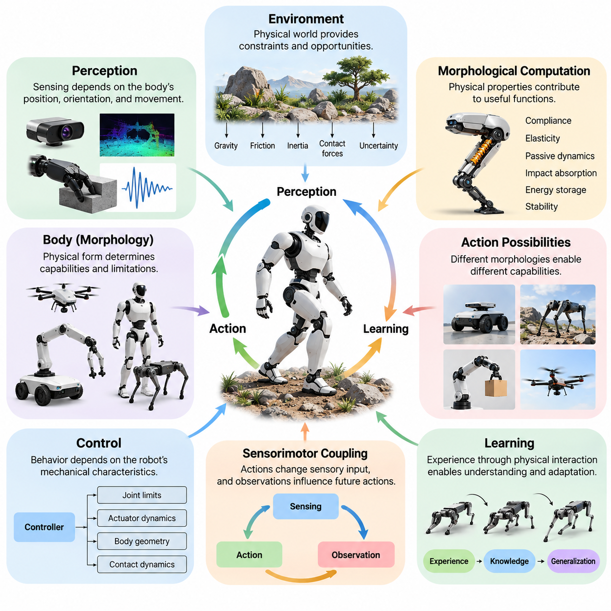
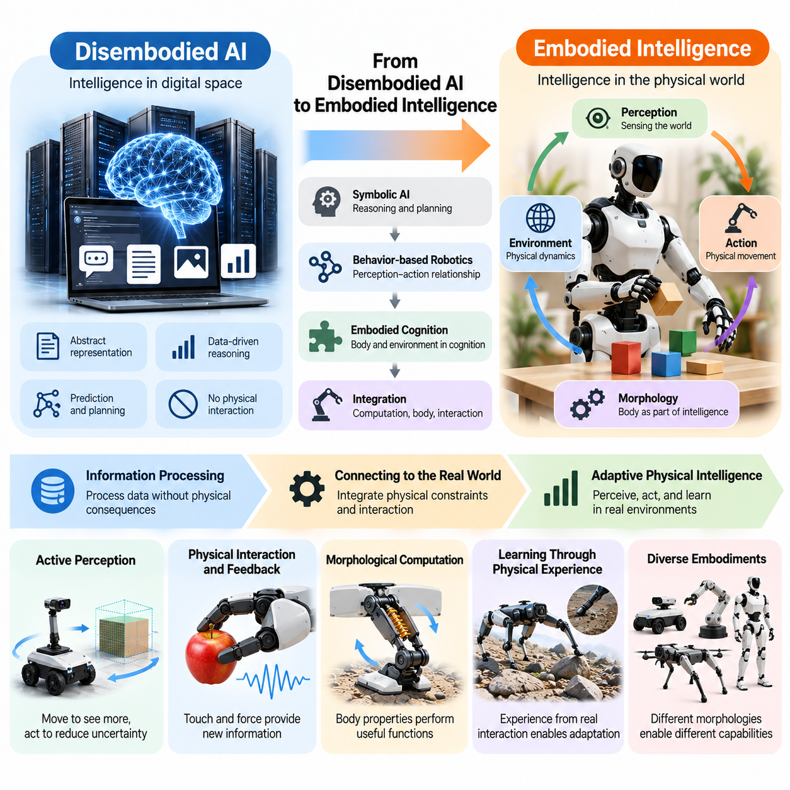
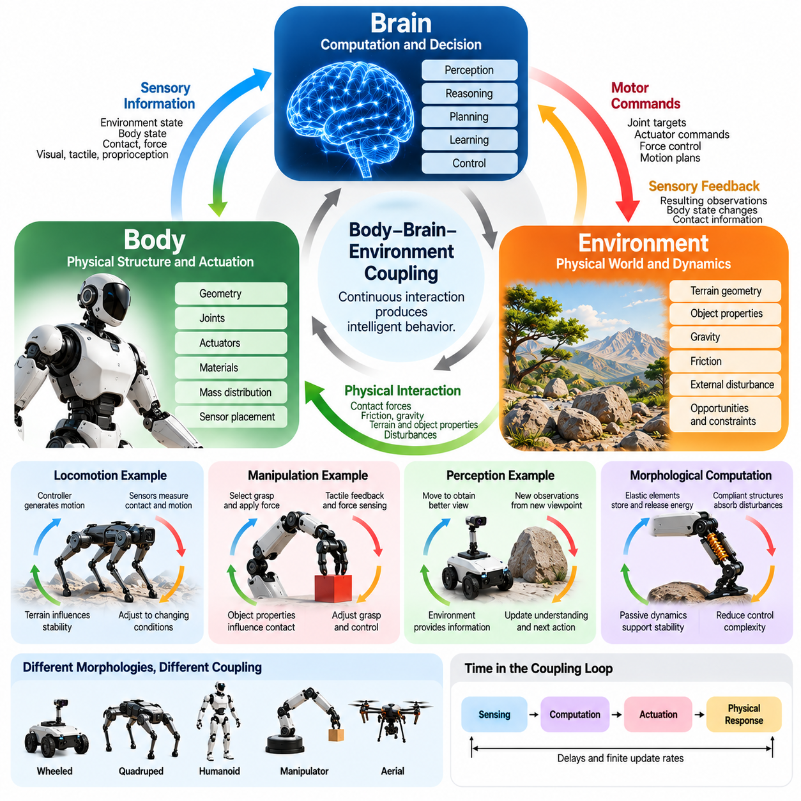
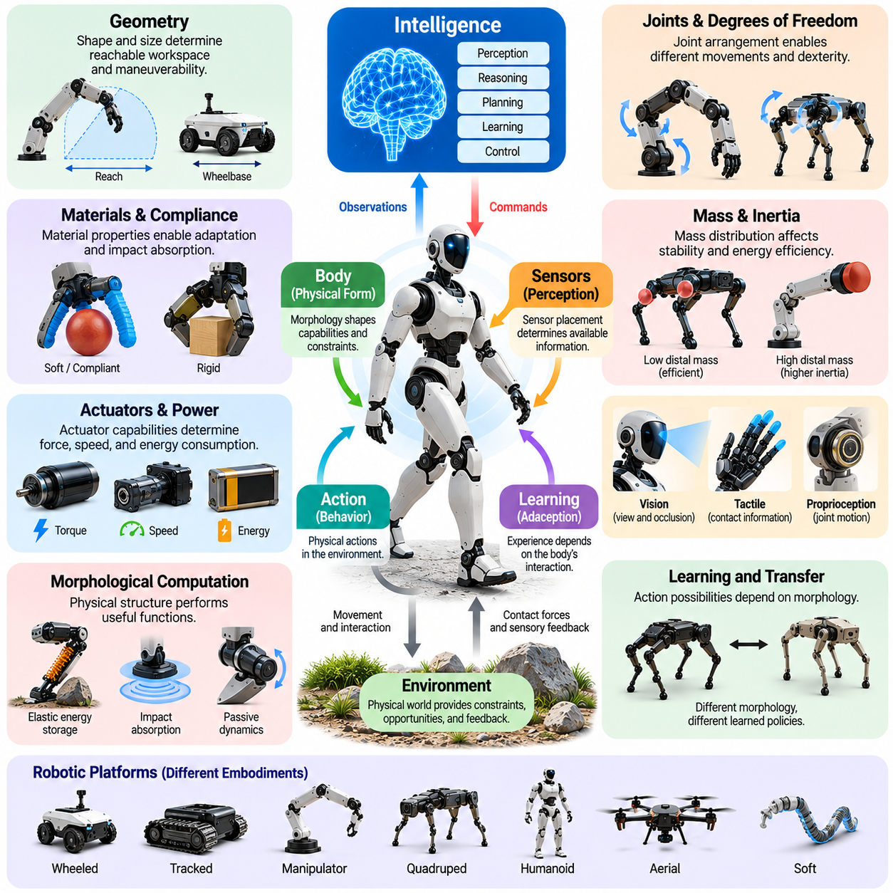
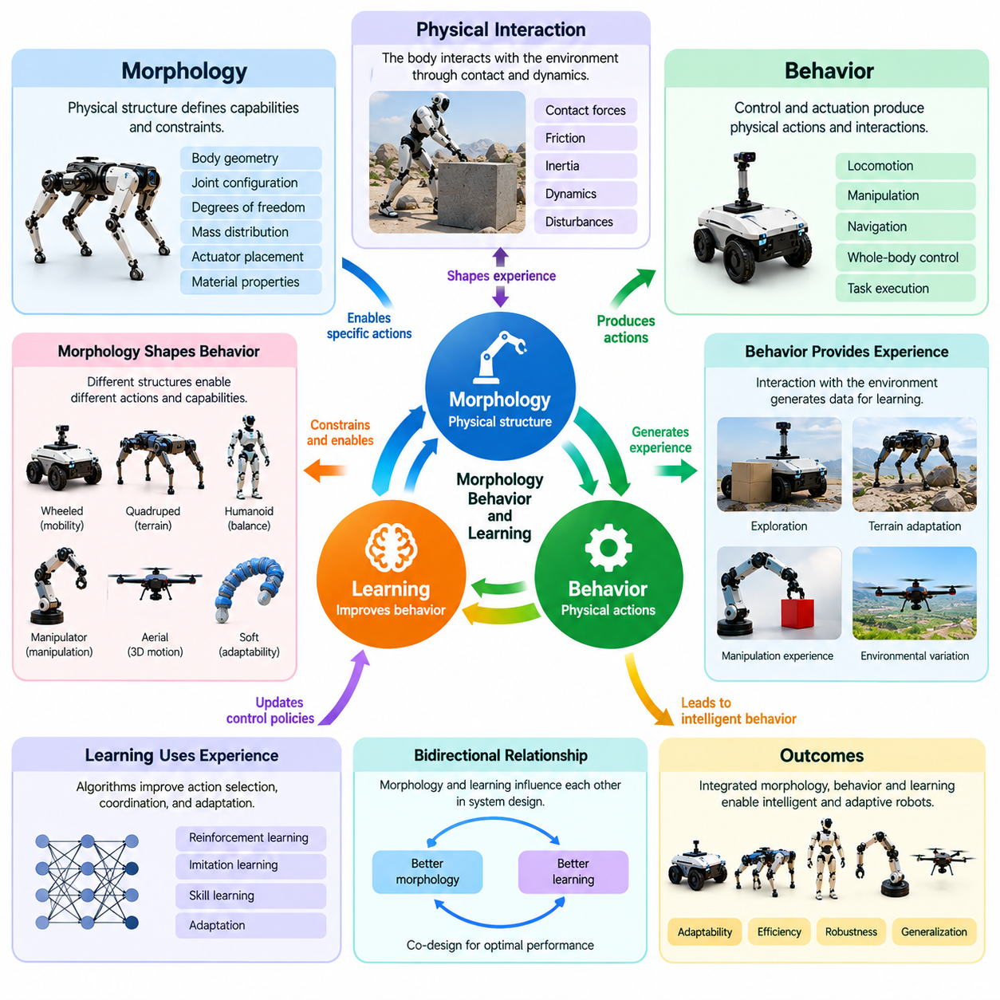
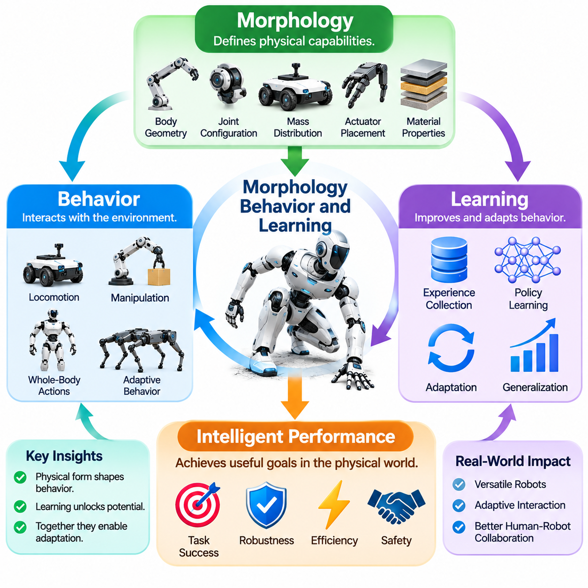
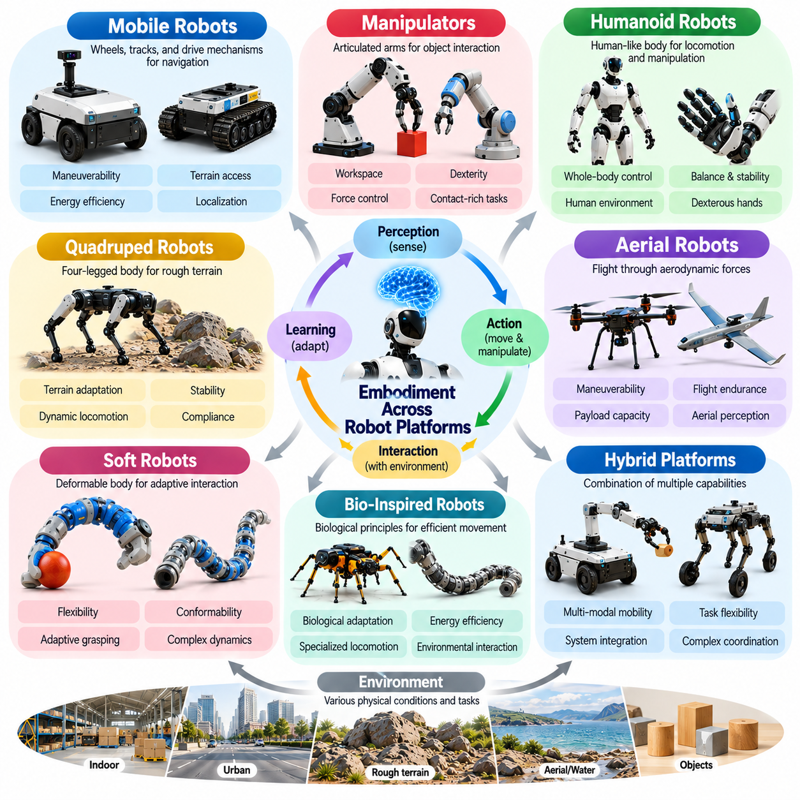
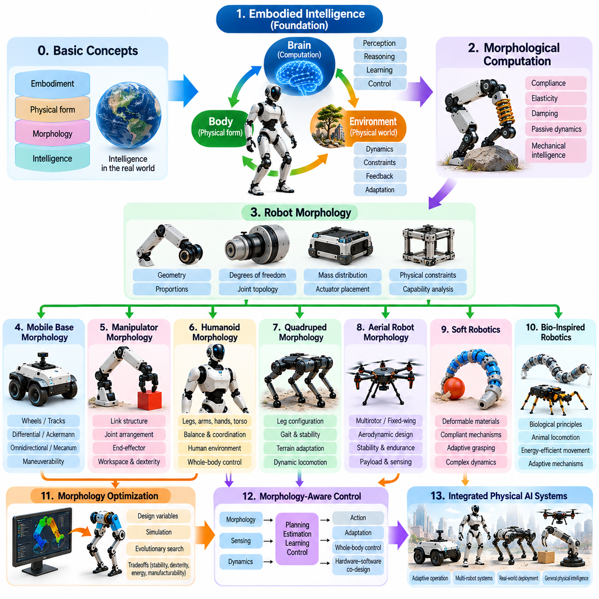

**Volume 03. Embodiment and Morphology**

# Chapter 00. Introduction

## 00.01. Why Embodiment Matters

{width="7.268055555555556in" height="7.268055555555556in"}

체화(Embodiment)는 물리적 인공지능(Physical AI)의 근본적인 원리이다. 물리적 세계(Physical World)에서 작동하는 지능(Intelligence)은 환경을 인식하고 행동하며 상호작용하는 신체(Body)와 분리될 수 없기 때문이다. 계산 환경(Computational Environment)에서 정보를 처리하는 순수 디지털 시스템(Digital System)과 달리, 체화된 시스템(Embodied System)은 물리적 제약(Physical Constraints), 환경적 불확실성(Environmental Uncertainty), 행동의 결과에 지속적으로 대응해야 한다. 따라서 신체는 단순히 명령을 실행하는 수동적 기계 장치가 아니라 지능적 행동(Intelligent Behavior)을 구성하는 필수 요소가 된다.

전통적인 인공지능(Artificial Intelligence)은 지능을 주로 정보 처리(Information Processing), 추론(Reasoning), 예측(Prediction), 의사결정(Decision-Making)의 관점에서 다루어 왔다. 이러한 능력은 여전히 중요하지만, 물리적 상호작용(Physical Interaction)에는 운동(Motion), 힘(Force), 균형(Balance), 접촉(Contact), 에너지 소비(Energy Consumption)와 관련된 추가적인 요구사항이 존재한다. 지능형 로봇(Intelligent Robot)은 기계적 구조(Mechanical Structure)의 한계를 고려하면서 추상적인 의사결정을 물리적으로 실행 가능한 행동으로 변환해야 한다. 체화는 계산적 지능(Computational Intelligence)을 물리적 세계의 실제 조건과 연결한다.

체화의 중요성은 물리적 시스템(Physical System)이 정보를 획득하는 방식을 살펴보면 명확해진다. 센서(Sensor)는 로봇의 위치(Position), 방향(Orientation), 움직임(Movement)과 독립적으로 환경을 관측하지 않는다. 이동 플랫폼(Mobile Platform)에 장착된 카메라(Camera)는 플랫폼의 움직임에 따라 서로 다른 관측 정보를 생성하며, 촉각 센서(Tactile Sensor)는 접촉을 통해 물체의 특성을 파악한다. 따라서 인식(Perception)은 신체의 구성(Configuration)과 행동(Action)에 의존하며, 감지(Sensing), 운동(Motion), 환경 이해(Environmental Understanding) 사이에 지속적인 관계를 형성한다.

체화 지능(Embodied Intelligence)은 계산 과정(Computational Process), 물리적 구조(Physical Structure), 환경 동역학(Environmental Dynamics)의 상호작용을 통해 나타난다. 로봇의 행동은 알고리즘(Algorithm)뿐만 아니라 형상(Geometry), 질량 분포(Mass Distribution), 관절 배치(Joint Arrangement), 액추에이터 특성(Actuator Characteristics), 재료 특성(Material Properties)의 영향을 받는다. 이러한 특성은 가능한 움직임, 힘의 전달 방식, 외란(Disturbance)에 대한 대응 능력을 결정한다. 따라서 지능은 통합된 물리적 시스템(Integrated Physical System)의 특성으로 이해해야 한다.

물리적 환경(Physical Environment) 역시 지능적 행동(Intelligent Behavior)에 직접적으로 기여한다. 중력(Gravity), 마찰(Friction), 관성(Inertia), 탄성(Elasticity), 접촉력(Contact Force)은 체화된 에이전트(Embodied Agent)가 수행하는 모든 움직임에 영향을 미친다. 지능형 시스템(Intelligent System)은 이러한 현상을 단순히 보상해야 할 외란으로 취급하는 대신, 제어(Control)를 단순화하고 효율(Efficiency)을 향상시키는 데 활용할 수 있다. 예를 들어 보행 메커니즘(Walking Mechanism)은 자연적인 진자 동역학(Pendulum Dynamics)을 활용하여 이동 과정에 필요한 능동적 계산(Active Computation)과 구동(Actuation)을 줄일 수 있다.

이러한 관계는 신체의 물리적 특성이 명시적인 계산 제어(Computational Control)를 통해 수행해야 할 기능의 일부를 담당하는 형태적 계산(Morphological Computation)이라는 개념으로 이어진다. 유연한 구조(Compliant Structure)는 충격을 흡수하고, 탄성 요소(Elastic Element)는 기계적 에너지(Mechanical Energy)를 저장하고 방출하며, 수동적 기계 배치(Passive Mechanical Arrangement)는 움직임을 안정화할 수 있다. 이는 지능적 행동의 일부가 소프트웨어(Software)만이 아니라 물리적 설계(Physical Design)에서 나타날 수 있음을 보여주지만, 많은 작업에서는 능동 제어(Active Control)가 여전히 필수적이다.

체화는 지능형 에이전트(Intelligent Agent)가 수행할 수 있는 행동 가능성(Action Possibilities)도 결정한다. 바퀴형 이동 로봇(Wheeled Mobile Robot)은 비교적 평탄한 표면을 효율적으로 이동할 수 있으며, 사족보행 로봇(Quadruped Robot)은 다리의 협응 운동(Coordinated Leg Movement)을 통해 불규칙한 지형을 통과할 수 있다. 매니퓰레이터(Manipulator)는 도달 가능한 작업공간(Reachable Workspace) 내에서 물체를 파지하고 재배치할 수 있으며, 비행 로봇(Aerial Robot)은 지상 플랫폼(Ground Platform)이 접근할 수 없는 위치에 도달할 수 있다. 이러한 차이는 물리적 형태(Physical Form)가 지능형 시스템의 운용 능력과 한계를 어떻게 결정하는지 보여준다.

형태(Morphology)와 행동(Behavior)의 관계는 서로 다른 물리적 구성(Physical Configuration)에 서로 다른 제어 전략(Control Strategy)이 필요하다는 점에서 특히 중요하다. 휴머노이드 로봇(Humanoid Robot)은 상호 연결된 관절(Joint)을 통해 균형, 자세, 조작을 협응해야 하며, 멀티로터 항공기(Multirotor Aircraft)는 공기역학적 힘과 모멘트(Aerodynamic Forces and Moments)를 제어하여 움직임을 조절한다. 두 로봇이 동일한 목표를 수행하더라도 실행 가능한 행동은 크게 달라질 수 있다. 따라서 효과적인 지능은 각 체화 형태의 구체적인 기계적 특성(Mechanical Characteristics)을 고려해야 한다.

물리적 체화(Physical Embodiment)는 에이전트(Agent)가 경험할 수 있는 상황이 센서(Sensor), 액추에이터(Actuator), 상호작용 능력(Interaction Capability)에 따라 달라지기 때문에 학습(Learning)에도 영향을 미친다. 로봇은 이동(Locomotion)을 통해 표면의 특성을 학습하고, 조작(Manipulation)을 통해 물체의 속성을 파악하며, 반복적인 물리적 경험(Physical Experience)을 통해 환경적 제약(Environmental Constraints)을 이해한다. 이러한 경험은 수동적 관측(Passive Observation)만으로는 항상 획득할 수 없는 정보를 제공한다. 학습은 행동, 감각적 결과(Sensory Consequences), 물리적 동역학(Physical Dynamics) 사이의 관계를 발견하는 과정이 된다.

감각운동 결합(Sensorimotor Coupling)은 이러한 학습 과정의 중요한 기반을 제공한다. 로봇이 움직이면 행동이 수신되는 감각 정보(Sensory Information)를 변화시키고, 그 결과로 얻어진 관측(Observation)은 이후의 의사결정(Decision-Making)에 영향을 미친다. 이러한 지속적인 피드백 관계(Feedback Relationship)는 변화하는 환경과 불확실한 조건에 대한 적응(Adaptation)을 가능하게 한다. 따라서 효과적인 행동은 감지(Sensing), 계획(Planning), 실행(Execution)을 완전히 독립된 계산 단계로 취급하기보다 시간에 따라 인식과 행동을 협응하는 데 의존한다.

체화는 지능형 시스템(Intelligent System)이 다양한 작업과 환경에 걸쳐 일반화(Generalization)하는 능력에도 영향을 미친다. 특정 로봇에서 학습한 정책(Policy)은 관절 구성(Joint Configuration), 액추에이터 한계(Actuator Limits), 물리적 치수(Physical Dimensions)가 다른 로봇에 직접 적용되지 않을 수 있다. 비교적 작은 형태적 차이(Morphological Difference)도 운동 동역학(Motion Dynamics)과 접촉 행동(Contact Behavior)을 변화시킬 수 있다. 따라서 체화 간 일반화(Cross-Embodiment Generalization)에는 이전 가능한 작업 지식(Transferable Task Knowledge)과 플랫폼별 물리적 제약(Platform-Specific Physical Constraints)을 구분하는 표현(Representation)과 학습 방법(Learning Method)이 필요하다.

체화의 중요성은 접촉이 많은 상호작용(Contact-Rich Interaction)을 포함하는 조작 작업(Manipulation Task)에서 특히 명확하게 나타난다. 익숙하지 않은 물체를 파지하려면 인식(Perception), 손의 형상(Hand Geometry), 손가락의 유연성(Finger Compliance), 가해지는 힘(Applied Force), 접촉 센서(Contact Sensor)의 피드백을 협응해야 한다. 기계적으로 적응 가능한 그리퍼(Adaptive Gripper)는 정확한 기하학적 재구성(Geometric Reconstruction) 없이도 물체 형상의 변화에 대응할 수 있다. 이는 적절한 물리적 설계가 지능형 제어(Intelligent Control)를 보완하고 불확실한 조건에서 강건성(Robustness)을 향상시킬 수 있음을 보여준다.

체화는 유연성(Flexibility), 효율성(Efficiency), 안정성(Stability), 기계적 복잡성(Mechanical Complexity) 사이의 중요한 절충관계(Tradeoff)도 발생시킨다. 관절 수를 늘리면 로봇의 운동 능력(Motion Capability)이 확장될 수 있지만, 동시에 추가적인 제어 요구사항(Control Requirements), 중량(Weight), 에너지 소비(Energy Consumption)가 증가할 수 있다. 구조적 유연성(Structural Compliance)을 높이면 충격에 대한 내성(Impact Tolerance)이 향상되지만 위치 결정 정밀도(Positioning Precision)는 감소할 수 있다. 따라서 지능형 물리 시스템의 설계는 계산 성능이나 기계적 성능의 단일 지표를 극대화하기보다 상충하는 여러 목표 사이의 균형을 고려해야 한다.

에너지 효율(Energy Efficiency)은 체화가 중요한 또 다른 이유이다. 모든 물리적 행동(Physical Action)은 액추에이터 작동(Actuator Operation), 기계적 손실(Mechanical Losses), 감지(Sensing), 계산(Computation)을 통해 자원을 소비한다. 신체 형상(Body Geometry), 동력 전달 메커니즘(Transmission Mechanism), 질량 분포(Mass Distribution), 탄성 요소(Elastic Element)는 작업 수행에 필요한 에너지에 영향을 미친다. 적절하게 설계된 형태(Morphology)는 불필요한 움직임을 줄이고 수동 동역학(Passive Dynamics)을 활용하여 지능형 에이전트가 더 낮은 전력 소비(Power Consumption)와 향상된 운용 지속시간(Operational Endurance)으로 목표를 달성하도록 지원한다.

안전성(Safety)과 신뢰성(Reliability) 역시 물리적 체화(Physical Embodiment)의 영향을 받는다. 사람 주변에서 작동하는 로봇은 접촉력(Contact Force), 예상하지 못한 충돌(Unexpected Collision), 기계적 고장(Mechanical Failure), 불안정한 움직임(Unstable Movement)을 관리해야 한다. 유연한 재료(Compliant Materials), 적절한 관절 배치(Joint Arrangement), 제어된 관성(Controlled Inertia), 보호 구조(Protective Structure)는 특정 물리적 위험(Physical Risk)을 줄일 수 있다. 그러나 기계적 설계만으로는 예측하기 어려운 환경에서 안전한 작동을 보장할 수 없으므로 이러한 특성은 감지, 제어, 안전 메커니즘(Safety Mechanism)과 통합되어야 한다.

체화는 생물학적 지능(Biological Intelligence)을 이해하는 기반도 제공한다. 동물은 신경계(Nervous System), 근골격 구조(Musculoskeletal Structure), 감각기관(Sensory Organs), 환경적 상호작용(Environmental Interaction)이 결합하여 적응적 행동(Adaptive Behavior)을 생성하는 방식을 보여준다. 힘줄(Tendon)은 기계적 에너지를 저장하고, 유연한 사지(Flexible Limbs)는 불규칙한 지형에 적응하며, 특수화된 신체 구조(Specialized Body Structure)는 효율적인 움직임을 지원한다. 이러한 생물학적 사례는 계산, 기계적 구조, 환경적 상호작용에 기능적 역할을 분산하는 로봇 설계에 영감을 제공한다.

물리적 인공지능(Physical AI)에서 핵심적인 시사점은 지능적 행동(Intelligent Behavior)을 알고리즘 수준(Algorithmic Level)에서만 설계해서는 안 된다는 것이다. 센서(Sensor), 액추에이터(Actuator), 기계적 구조(Mechanical Structure), 계산 아키텍처(Computational Architecture), 제어 정책(Control Policy)은 상호 연결된 요소로 고려해야 한다. 형태(Morphology)의 변화는 인식 품질(Perception Quality), 제어 요구사항(Control Requirements), 학습 효율(Learning Efficiency), 작업 성능(Task Performance)을 변화시킬 수 있다. 따라서 통합 설계(Integrated Design)는 소프트웨어와 하드웨어(Hardware)를 독립적으로 최적화하는 접근법보다 포괄적인 공학적 프레임워크(Engineering Framework)를 제공한다.

궁극적으로 체화(Embodiment)는 지능(Intelligence)을 추상적인 계산 능력(Abstract Computational Capability)에서 물리적 상호작용(Physical Interaction)에 기반한 실제 운용 능력(Operational Capacity)으로 전환한다. 성공적인 물리적 인공지능 시스템(Physical AI System)은 환경을 해석하고 적절한 행동을 선택하는 것뿐만 아니라, 물리 법칙(Physical Laws)의 지배를 받는 신체를 통해 해당 행동을 실행할 수 있어야 한다. 따라서 체화에 대한 이해는 다양한 실제 환경(Real-World Environments)에서 적응성(Adaptability), 효율성(Efficiency), 강건성(Robustness), 의미 있는 자율 행동(Autonomous Behavior)을 갖춘 로봇을 개발하는 데 필수적이다.

## 00.02. From Disembodied AI to Embodied Intelligence

{width="7.268055555555556in" height="7.268055555555556in"}

비체화 인공지능(Disembodied Artificial Intelligence)에서 체화 지능(Embodied Intelligence)으로의 전환은 지능형 시스템(Intelligent System)을 이해하고 개발하는 방식의 근본적인 변화를 의미한다. 전통적인 인공지능(Traditional AI)은 주로 추상적 표현(Abstract Representation), 디지털 정보(Digital Information), 계산적 추론(Computational Reasoning)을 기반으로 작동한다. 체화 지능은 이러한 능력을 물리적 세계(Physical World)로 확장하며, 인식(Perception), 행동(Action), 기계적 구조(Mechanical Structure), 환경적 상호작용(Environmental Interaction)이 함께 지능적 행동(Intelligent Behavior)을 결정하도록 한다.

비체화 인공지능 시스템(Disembodied AI System)은 일반적으로 의사결정의 물리적 결과(Physical Consequences)를 직접 경험하지 않고 정보를 처리한다. 언어 모델(Language Model), 추천 시스템(Recommendation System), 전통적인 분석 알고리즘(Analytical Algorithm)은 기호적 표현(Symbolic Representation), 통계적 패턴(Statistical Pattern), 디지털 데이터(Digital Data)를 통해 작동한다. 이러한 시스템은 정교한 추론(Reasoning)과 예측(Prediction) 능력을 보여줄 수 있지만, 계산 과정(Computational Process) 자체가 반드시 물리적 신체(Physical Body)나 실제 세계의 동역학(Real-World Dynamics)과 지속적으로 상호작용할 필요는 없다.

비체화 지능(Disembodied Intelligence)의 한계는 계산적 의사결정(Computational Decision)이 신뢰할 수 있는 물리적 행동(Physical Action)으로 이어져야 할 때 명확하게 드러난다. 시스템은 물체를 정확하게 식별하거나 조작 계획(Manipulation Plan)을 생성할 수 있지만, 필요한 움직임을 실제로 실행하지 못할 수 있다. 물리적 실행(Physical Execution)에는 기하학(Geometry), 힘(Force), 마찰(Friction), 관성(Inertia), 불확실성(Uncertainty)과 관련된 제약이 존재한다. 따라서 실제 세계에서 작동하는 지능은 추상적 지식(Abstract Knowledge)을 물리적 신체의 능력 및 한계와 연결해야 한다.

체화 지능(Embodied Intelligence)은 신체(Body)를 지능형 시스템(Intelligent System)의 필수적인 구성 요소로 취급함으로써 이러한 문제를 해결한다. 센서(Sensor)는 환경에 관한 정보를 제공하고, 액추에이터(Actuator)는 물리적 행동을 생성하며, 기계적 구조(Mechanical Structure)는 이러한 행동이 주변 세계에 미치는 영향을 결정한다. 계산 과정(Computational Process)은 감각 피드백(Sensory Feedback)을 지속적으로 해석하고 행동을 조정한다. 결과적으로 지능은 인식(Perception), 제어(Control), 형태(Morphology), 환경 동역학(Environmental Dynamics) 사이의 협응된 상호작용을 통해 나타난다.

역사적으로 인공지능 연구(Artificial Intelligence Research)는 기호적 추론(Symbolic Reasoning), 지식 표현(Knowledge Representation), 계획(Planning), 논리적 추론(Logical Inference)을 강조해 왔다. 이러한 접근법은 지능을 행동 수행에 사용되는 물리적 메커니즘(Physical Mechanism)과 독립적으로 모델링(Modeling)할 수 있다고 가정하는 경우가 많았다. 그러나 로보틱스 연구(Robotics Research)는 실제 세계에서 성공적인 행동을 수행하려면 지속적인 감지(Continuous Sensing), 반응형 제어(Reactive Control), 기계적 설계(Mechanical Design), 불확실한 환경 조건에 대한 적응(Adaptation)이 필요하다는 사실을 점차 입증하였다.

행동 기반 로보틱스(Behavior-Based Robotics)는 인식(Perception)과 행동(Action) 사이의 직접적인 관계를 강조함으로써 이러한 개념적 전환(Conceptual Transition)에 크게 기여하였다. 모든 행동이 완전한 내부 세계 표현(Internal World Representation)에서 생성되어야 한다고 가정하는 대신, 반응형 시스템(Reactive System)은 비교적 단순한 감각운동 상호작용(Sensorimotor Interaction)을 통해 유용한 능력이 나타날 수 있음을 보여주었다. 이러한 관점은 상황적 행동(Situated Behavior)의 중요성을 부각하고, 지능형 제어(Intelligent Control)에 대한 순수 중앙집중형 모델(Centralized Model)에 도전하였다.

체화 인지(Embodied Cognition)는 인지 과정(Cognitive Process)이 신체 구조(Bodily Structure)와 환경적 상호작용(Environmental Interaction)의 영향을 받는다는 관점을 제시하면서 이러한 개념을 더욱 확장하였다. 인식(Perception), 추론(Reasoning), 행동(Action)은 고립된 계산 시스템(Computational System) 내부에서 작동하는 독립적인 단계일 필요가 없다. 오히려 인지 능력(Cognitive Capability)은 에이전트(Agent)가 움직이고, 감지하고, 주변 환경과 물리적으로 상호작용하는 방식에 의존할 수 있다. 신체는 정보 처리(Information Processing)와 행동 조직화(Behavioral Organization)에 능동적으로 참여하는 요소가 된다.

이러한 전환은 지능형 시스템(Intelligent System)에서 인식(Perception)의 의미도 변화시킨다. 비체화 인공지능(Disembodied AI)은 사전에 수집된 이미지(Image), 텍스트(Text), 센서 기록(Sensor Recording)을 고정된 입력(Fixed Input)으로 처리하는 경우가 많다. 반면 체화된 에이전트(Embodied Agent)는 추가적인 정보를 획득하기 위해 시점(Viewpoint)을 능동적으로 변경하고, 센서의 위치를 조정하며, 물체에 접근하거나 환경 조건(Environmental Conditions)을 조작할 수 있다. 따라서 인식은 행동이 시스템의 관측 및 이해 능력에 영향을 미치는 상호작용적 과정(Interactive Process)이 된다.

능동 인식(Active Perception)은 체화가 지능적 행동(Intelligent Behavior)에 새로운 가능성을 제공하는 방식을 보여준다. 이동 로봇(Mobile Robot)은 장애물(Obstacle)의 형상에 관한 불확실성을 해소하기 위해 장애물 주변으로 이동할 수 있으며, 매니퓰레이터(Manipulator)는 이전에 보이지 않던 표면을 관찰하기 위해 물체를 회전시킬 수 있다. 이러한 행동은 단순히 인식의 결과가 아니라 인식을 향상시키기 위한 수단이다. 지능적 행동은 정보 수집(Information Gathering)과 작업 실행(Task Execution)을 동시에 지원하는 움직임을 선택하는 과정을 포함한다.

물리적 상호작용(Physical Interaction)은 많은 순수 디지털 인공지능 응용(Digital AI Application)에는 존재하지 않는 피드백 메커니즘(Feedback Mechanism)도 도입한다. 로봇이 물체를 파지할 때 촉각 측정(Tactile Measurement)과 힘 반응(Force Response)은 파지가 안정적인지에 관한 정보를 제공한다. 다족보행 로봇(Legged Robot)이 불규칙한 지형을 만날 때 접촉력(Contact Force)의 변화는 지면 상태(Ground Conditions)에 관한 정보를 제공한다. 이러한 피드백은 지속적인 보정(Correction)과 적응(Adaptation)을 가능하게 하며, 의사결정(Decision-Making)을 행동의 물리적 결과와 직접 연결한다.

지능이 물리적 시스템(Physical System)으로 확장될수록 형태(Morphology)의 중요성은 더욱 명확해진다. 신체 형상(Body Geometry), 관절 구성(Joint Configuration), 질량 분포(Mass Distribution), 액추에이터 배치(Actuator Placement), 재료의 유연성(Material Compliance)은 에이전트(Agent)가 수행할 수 있는 행동에 영향을 미친다. 유사한 계산 모델(Computational Model)을 탑재한 두 로봇도 기계적 구조(Mechanical Structure)가 환경과 상호작용하는 방식이 다르기 때문에 서로 다른 행동을 보일 수 있다. 따라서 체화 지능(Embodied Intelligence)은 물리적 형태(Physical Form)를 능력 결정 요인으로 고려해야 한다.

형태적 계산(Morphological Computation)은 물리적 체화(Physical Embodiment)가 지능의 조직 방식(Organization of Intelligence)을 어떻게 변화시키는지 보여주는 중요한 사례이다. 탄성 구조(Elastic Structure), 유연한 메커니즘(Compliant Mechanism), 수동 동역학(Passive Dynamics)은 모든 기계적 반응에 대해 명시적인 계산 명령(Computational Instruction)을 요구하지 않으면서 유용한 기능을 수행할 수 있다. 유연한 그리퍼(Compliant Gripper)는 물체의 형상에 적응할 수 있으며, 수동적 기계 요소(Passive Mechanical Element)는 안정화(Stabilization)를 지원할 수 있다. 이러한 특성은 물리적 설계(Physical Design)가 소프트웨어 기반 지능(Software-Based Intelligence)을 보완하도록 한다.

지능형 에이전트(Intelligent Agent)가 환경과 상호작용할 수 있는 신체를 갖추면 학습(Learning) 방식도 변화한다. 체화된 시스템(Embodied System)은 정적 데이터셋(Static Dataset)에만 의존하는 대신 탐색(Exploration), 조작(Manipulation), 이동(Locomotion), 반복적 실험(Repeated Experimentation)을 통해 지식을 획득할 수 있다. 행동은 물체의 저항(Object Resistance), 표면 마찰(Surface Friction), 운동 제약(Movement Constraints)을 포함한 물리적 관계(Physical Relationships)를 드러내는 관측 정보를 생성한다. 따라서 학습은 물리적 상호작용의 결과에 기반을 두게 된다.

강화학습(Reinforcement Learning)과 모방학습(Imitation Learning)은 체화된 행동(Embodied Behavior)을 개발하기 위한 계산적 접근법(Computational Approach)을 제공한다. 강화학습은 상호작용(Interaction)과 피드백(Feedback)을 통해 행동 정책(Action Policy)을 최적화할 수 있으며, 모방학습은 시연(Demonstration)으로부터 행동 패턴(Behavioral Pattern)을 전달할 수 있다. 그러나 성공적인 배포(Deployment)를 위해서는 물리적 동역학(Physical Dynamics), 액추에이터 한계(Actuator Limitations), 안전 제약(Safety Constraints), 학습 환경(Training Environment)과 실제 로봇 플랫폼(Robotic Platform) 사이의 차이를 고려해야 한다.

시뮬레이션(Simulation)은 비체화 계산(Disembodied Computation)과 체화된 시스템의 실제 배포(Embodied Deployment)를 연결하는 중요한 가교가 되었다. 물리 기반 시뮬레이터(Physics-Based Simulator)는 지능형 에이전트(Intelligent Agent)가 통제된 가상 환경(Virtual Environment)에서 근사적인 기계적 상호작용(Mechanical Interaction), 환경 외란(Environmental Disturbance), 접촉 동역학(Contact Dynamics)을 경험하도록 한다. 이러한 도구는 대규모 실험(Large-Scale Experimentation)과 정책 개발(Policy Development)을 지원하지만, 시뮬레이션 환경과 실제 환경 사이의 차이로 인해 추가적인 적응(Adaptation) 없이는 직접적인 전이(Transfer)가 제한될 수 있다.

현대의 파운데이션 모델(Foundation Model)은 이러한 전환에 또 다른 차원을 제공한다. 언어 모델(Language Model)과 비전-언어 모델(Vision-Language Model)은 의미적 이해(Semantic Understanding), 추론(Reasoning), 작업 해석(Task Interpretation)을 위한 강력한 능력을 제공한다. 이러한 모델을 로봇 인식(Robotic Perception), 계획(Planning), 제어 시스템(Control System)과 통합하면 체화 지능(Embodied Intelligence)에 기여할 수 있다. 그러나 의미적 능력(Semantic Competence)만으로 물리적 능력(Physical Competence)이 보장되는 것은 아니다. 신뢰할 수 있는 행동을 위해서는 기하학(Geometry), 동역학(Dynamics), 실시간 피드백(Real-Time Feedback)에 기반한 이해가 필요하기 때문이다.

비전-언어-행동 모델(Vision-Language-Action Model)은 고수준 이해(High-Level Understanding)를 물리적 행동(Physical Behavior)과 연결하기 위한 새로운 접근법이다. 이러한 시스템은 시각적 관측(Visual Observation)과 언어 명령(Language Instruction)을 로봇 행동(Robot Action)으로 변환하려 하며, 실제 시연(Physical Demonstration)에서 수집한 데이터를 활용하는 경우가 많다. 모델의 효과는 학습된 표현(Learned Representation), 로봇 형태(Robot Morphology), 사용 가능한 행동(Available Actions), 환경 조건(Environmental Conditions) 사이의 관계에 의존한다. 서로 다른 체화 형태 사이의 일반화(Generalization)는 여전히 중요한 연구 과제이다.

체화 지능(Embodied Intelligence)으로의 전환은 시스템 평가(System Evaluation) 방식도 변화시킨다. 전통적인 인공지능 벤치마크(AI Benchmark)는 예측 정확도(Prediction Accuracy), 추론 성능(Reasoning Performance), 정보 검색(Information Retrieval)을 강조하는 경우가 많다. 반면 체화된 시스템(Embodied System)은 작업 완료(Task Completion), 물리적 강건성(Physical Robustness), 에너지 효율(Energy Efficiency), 상호작용 안전성(Interaction Safety), 환경 변화에 대한 적응(Adaptation to Environmental Variation)을 추가적으로 평가해야 한다. 성능은 계산 결과(Computational Output)만이 아니라 실제 행동(Actual Behavior)을 통해 측정되어야 한다.

궁극적으로 비체화 인공지능(Disembodied AI)에서 체화 지능(Embodied Intelligence)으로의 전환은 추상적 추론(Abstract Reasoning)이나 디지털 계산(Digital Computation)의 중요성을 제거하는 것이 아니다. 오히려 이러한 능력을 물리적 구조(Physical Structure), 감각운동 과정(Sensorimotor Process), 환경 동역학(Environmental Dynamics)과 통합하는 것이다. 이러한 통합은 지식을 실제 세계의 의미 있는 행동(Meaningful Real-World Action)으로 전환하면서 체화가 만들어 내는 제약과 가능성에 적응할 수 있는 물리적 인공지능 시스템(Physical AI System)의 기반을 제공한다.

## 00.03. Body Brain Environment Coupling

{width="7.268055555555556in" height="7.268055555555556in"}

신체-두뇌-환경 결합(Body-Brain-Environment Coupling)은 체화 지능(Embodied Intelligence)의 기본 원리로, 물리적 구조(Physical Structure), 계산적 제어(Computational Control), 환경 동역학(Environmental Dynamics)이 지속적으로 서로 영향을 미치는 관계를 설명한다. 지능적 행동(Intelligent Behavior)은 중앙 처리 시스템(Central Processing System)에서만 발생하는 것이 아니라 이러한 구성 요소 사이의 상호작용을 통해 나타난다. 신체(Body)는 행동을 실행하고, 두뇌(Brain)는 정보를 처리하고 행동을 조정하며, 환경(Environment)은 물리적 제약(Physical Constraints), 감각 피드백(Sensory Feedback), 적응 기회(Opportunities for Adaptation)를 제공한다.

체화된 시스템(Embodied System)에서 두뇌(Brain)는 인식(Perception), 추론(Reasoning), 계획(Planning), 학습(Learning), 제어(Control)를 담당하는 계산 메커니즘(Computational Mechanisms)을 의미한다. 이러한 메커니즘은 감각 정보(Sensory Information)를 해석하고 물리적 행동에 영향을 미치는 명령을 생성한다. 그러나 계산적 의사결정(Computational Decision)은 이를 실행하는 신체와 독립적으로 이해할 수 없다. 관절 구성(Joint Configuration), 액추에이터 성능(Actuator Capabilities), 기계적 한계(Mechanical Limitations), 센서 배치(Sensor Placement)는 추상적인 의사결정이 의미 있는 물리적 행동으로 얼마나 효과적으로 변환될 수 있는지를 결정한다.

신체(Body)는 지능형 에이전트(Intelligent Agent)가 주변 환경과 상호작용하는 물리적 인터페이스(Physical Interface)를 제공한다. 신체의 형상(Geometry), 질량 분포(Mass Distribution), 재료 특성(Material Properties), 기계적 아키텍처(Mechanical Architecture)는 가능한 움직임과 상호작용의 범위를 결정한다. 유연한 관절(Compliant Joints)을 가진 로봇은 유사한 제어 알고리즘(Control Algorithms)을 사용하더라도 강체 로봇(Rigid Robot)과 외력(External Forces)에 다르게 반응한다. 따라서 물리적 형태(Physical Morphology)는 계산적 제어가 적용되기 전부터 행동에 영향을 미치며, 모든 행동의 결과를 지속적으로 형성한다.

환경(Environment)은 이러한 결합 시스템(Coupled System)의 세 번째 필수 구성 요소이다. 중력(Gravity), 마찰(Friction), 지형 형상(Terrain Geometry), 물체 특성(Object Properties), 외부 외란(External Disturbances)은 행동이 실제로 전개되는 방식에 영향을 미친다. 환경 조건(Environmental Conditions)은 어떤 행동이 효과적이거나 실행 가능한지도 결정한다. 매끄러운 실내 바닥에 적합한 이동 전략(Locomotion Strategy)은 느슨한 자갈이나 불규칙한 지면에서 제대로 작동하지 않을 수 있다. 따라서 지능형 제어(Intelligent Control)는 로봇의 신체와 주변 환경 사이에서 지속적으로 변화하는 관계를 고려해야 한다.

결합(Coupling)은 인식(Perception)과 행동(Action)을 연결하는 지속적인 피드백 루프(Feedback Loop)를 통해 이루어진다. 센서(Sensors)는 환경 조건(Environmental Conditions)과 신체 내부 상태(Internal Body States)를 측정하며, 제어 알고리즘(Control Algorithms)은 액추에이터(Actuators)에 대한 명령을 생성한다. 이러한 명령은 움직임(Motion), 접촉(Contact), 힘의 상호작용(Force Interactions)을 발생시켜 로봇의 상태와 주변 조건을 변화시킨다. 이후 새로운 감각 관측(Sensory Observations)이 후속 의사결정에 영향을 미치면서 지능적 행동이 조절되고 적응되는 지속적인 순환 과정이 형성된다.

이러한 피드백 관계(Feedback Relationship)는 본질적으로 양방향성(Bidirectional)을 가진다. 두뇌(Brain)는 운동 명령(Motor Commands)을 생성하여 신체에 영향을 미치지만, 신체의 물리적 반응(Physical Response) 역시 감각 피드백(Sensory Feedback)을 통해 이후의 계산 과정에 영향을 미친다. 마찬가지로 환경은 접촉력(Contact Forces)과 외란(Disturbances)을 통해 신체에 영향을 미치며, 로봇은 이동과 조작을 통해 환경을 변화시킨다. 따라서 지능은 감지(Sensing), 추론(Reasoning), 행동(Acting)의 엄격한 단방향 순서가 아니라 상호적인 상호작용(Reciprocal Interactions)을 통해 나타난다.

실제 사례는 로봇 보행(Robotic Walking)에서 확인할 수 있다. 제어기(Controller)는 균형(Balance)을 유지하고 전진 운동(Forward Motion)을 생성하기 위한 관절 움직임(Joint Movements)을 명령하며, 로봇의 기계적 구조(Mechanical Structure)는 이러한 명령이 힘으로 변환되는 방식을 결정한다. 지면 접촉(Ground Contact)은 마찰(Friction), 충격(Impact), 지지 반력(Support Reactions)을 발생시켜 안정성(Stability)에 영향을 미친다. 센서는 결과적으로 발생한 움직임과 접촉 조건을 측정하고, 제어기는 로봇이 변화하는 지형을 만날 때 명령을 조정할 수 있다.

조작(Manipulation)은 신체-두뇌-환경 결합(Body-Brain-Environment Coupling)을 보여주는 또 다른 사례이다. 로봇이 물체를 파지할 때 제어기(Controller)는 파지 구성(Grasp Configuration)을 선택하고 손(Hand)이나 그리퍼(Gripper)를 통해 힘을 가한다. 물체의 형상(Shape), 질량(Mass), 표면 마찰(Surface Friction), 유연성(Compliance)은 결과적인 접촉 행동(Contact Behavior)에 영향을 미친다. 촉각 및 힘 측정(Tactile and Force Measurements)은 파지 안정성(Grasp Stability)에 관한 피드백을 제공하며, 필요한 경우 제어기가 손가락 위치(Finger Positions)나 파지력(Gripping Forces)을 수정하도록 한다.

결합 원리(Coupling Principle)는 인식(Perception)을 움직임(Movement)과 항상 분리할 수 없는 이유도 설명한다. 로봇의 관측(Observations)은 센서 배치(Sensor Placement), 신체 방향(Body Orientation), 수행하는 행동(Actions)에 따라 달라진다. 물체에 가까이 이동하면 시각적 해상도(Visual Resolution)가 향상될 수 있으며, 시점(Viewpoint)을 변경하면 이전에 가려져 있던 표면을 확인할 수 있다. 두뇌는 신체 구성(Body Configuration)을 변화시키는 행동을 선택하고, 이러한 변화는 이후의 해석(Interpretation)에 사용할 수 있는 감각 정보(Sensory Information)를 수정한다.

기계적 특성(Mechanical Properties)은 명시적인 계산 개입(Computational Intervention) 없이도 피드백 조절(Feedback Regulation)에 직접적으로 기여할 수 있다. 탄성 요소(Elastic Elements)는 에너지를 저장하고 방출하며, 유연한 구조(Compliant Structures)는 외란(Disturbances)을 흡수하고, 수동적 기계 동역학(Passive Mechanical Dynamics)은 안정적인 움직임을 지원할 수 있다. 이러한 효과는 신체의 물리적 특성이 유용한 조절 기능(Regulatory Functions)을 수행하는 형태적 계산(Morphological Computation)의 한 형태이다. 이러한 메커니즘은 제어 복잡성(Control Complexity)을 줄이면서 환경적 상호작용에 대한 반응성(Responsiveness)을 향상시킬 수 있다.

결합(Coupling)의 강도와 구조는 로봇 형태(Robot Morphology)에 따라 달라진다. 바퀴형 플랫폼(Wheeled Platforms)은 구름 접촉(Rolling Contact)을 통해 지형과 상호작용하고, 사족보행 로봇(Quadrupeds)은 여러 다리에 지지력(Support Forces)을 분산하며, 비행 로봇(Aerial Robots)은 운동과 안정성을 위해 공기역학적 힘(Aerodynamic Forces)에 의존한다. 휴머노이드 로봇(Humanoid Robots)은 전신 균형(Whole-Body Balance)을 조작(Manipulation) 및 이동(Locomotion)과 협응해야 한다. 각 형태는 감각 정보, 제어 결정(Control Decisions), 물리적 동역학(Physical Dynamics), 환경적 제약(Environmental Constraints) 사이에 고유한 관계를 형성한다.

시간(Time)은 신체-두뇌-환경 결합(Body-Brain-Environment Coupling)의 또 다른 중요한 차원이다. 물리적 과정(Physical Processes)은 연속적으로 변화하지만, 감지(Sensing), 계산(Computation), 구동(Actuation)에는 지연(Delays)이 발생하며 유한한 갱신 주기(Update Rates)로 작동한다. 제어기(Controller)의 반응이 지나치게 느리면 특히 동적 이동(Dynamic Locomotion)이나 접촉이 많은 조작(Contact-Rich Manipulation)에서 외란을 적절히 보상하지 못할 수 있다. 따라서 효과적인 체화 지능(Embodied Intelligence)은 물리적 동역학과 계산적 의사결정 사이의 시간적 협응(Temporal Coordination)을 필요로 한다.

결합 시스템(Coupled System)에서 학습(Learning)은 신체와 환경 사이의 상호작용에 맞추어 행동을 적응시키는 과정이다. 강화학습(Reinforcement Learning)은 반복적인 물리적 경험(Physical Experiences)이나 시뮬레이션 경험(Simulated Experiences)을 통해 정책(Policies)을 발견할 수 있으며, 적응 제어(Adaptive Control)는 동역학이 변화할 때 매개변수(Parameters)를 조정할 수 있다. 이러한 방법은 형태(Morphology)가 관측(Observations), 사용 가능한 행동(Available Actions), 결과적인 보상(Rewards)에 미치는 영향을 고려해야 한다. 따라서 학습은 체화와 독립적으로 발생하는 것이 아니라 물리적 시스템의 영향을 받는다.

결합 관계(Coupling Relationship)는 모델링(Modeling)과 예측(Prediction)에도 어려움을 발생시킨다. 로봇의 행동은 비선형 동역학(Nonlinear Dynamics), 불확실한 접촉 조건(Uncertain Contact Conditions), 액추에이터 특성(Actuator Characteristics), 환경 변화(Environmental Variation)에 의존한다. 단순화된 수학적 모델(Mathematical Models)은 모든 상호작용을 정확하게 표현하지 못할 수 있으며, 순수 데이터 기반 모델(Data-Driven Models)은 익숙하지 않은 조건에서 어려움을 겪을 수 있다. 물리 모델(Physical Models), 감각 피드백(Sensory Feedback), 학습된 표현(Learned Representations)을 결합하면 불확실성 아래에서 예측과 제어 성능을 향상시킬 수 있다.

시뮬레이션(Simulation)은 연구자가 신체 매개변수(Body Parameters), 제어기 설계(Controller Designs), 환경 조건(Environmental Conditions)을 체계적으로 변화시킬 수 있기 때문에 이러한 상호작용을 연구하는 데 유용한 환경을 제공한다. 질량 분포(Mass Distribution), 관절 강성(Joint Stiffness), 마찰(Friction), 지형(Terrain)의 변화는 서로 다른 구성 요소가 전체 행동에 미치는 영향을 보여준다. 그러나 시뮬레이션 모델(Simulation Models)은 여전히 근사 모델(Approximate Models)이므로, 학습되거나 설계된 결합 메커니즘(Coupling Mechanisms)이 실제 환경으로 신뢰성 있게 전이되는지 평가하려면 실제 실험(Real-World Experiments)이 필요하다.

신체-두뇌-환경 결합(Body-Brain-Environment Coupling)은 하드웨어-소프트웨어 공동 설계(Hardware-Software Co-Design)에 중요한 시사점을 제공한다. 기계적 구조(Mechanical Structures), 센서 구성(Sensor Configurations), 액추에이터 성능(Actuator Capabilities), 제어 알고리즘(Control Algorithms)은 독립적으로 최적화되는 구성 요소가 아니라 상호 연결된 요소로 개발되어야 한다. 신체 형상(Body Geometry)의 변화는 제어 요구사항(Control Requirements)을 바꿀 수 있으며, 향상된 감지(Improved Sensing)는 서로 다른 기계적 설계(Mechanical Designs)를 가능하게 할 수 있다. 통합 개발(Integrated Development)은 설계자가 전체 시스템에 걸쳐 상호 보완적인 능력을 활용하도록 한다.

안전성(Safety)과 강건성(Robustness) 역시 결합(Coupling)의 품질에 의존한다. 예상하지 못한 충돌(Unexpected Collisions), 변화하는 탑재 하중(Changing Payloads), 불확실한 표면(Uncertain Surfaces), 액추에이터 외란(Actuator Disturbances)은 제어 명령(Control Commands)과 물리적 결과(Physical Outcomes) 사이의 관계를 변화시킬 수 있다. 신뢰할 수 있는 로봇(Reliable Robots)은 이러한 변화를 감지하고 적절한 물리적 및 계산적 한계(Physical and Computational Limits) 내에서 대응해야 한다. 기계적 유연성(Mechanical Compliance), 피드백 제어(Feedback Control), 상태 추정(State Estimation), 보호 메커니즘(Protective Mechanisms)은 동적 환경(Dynamic Environments)에서 안전한 행동에 공동으로 기여한다.

궁극적으로 신체-두뇌-환경 결합(Body-Brain-Environment Coupling)은 체화 지능(Embodied Intelligence)과 물리적 인공지능(Physical AI)을 이해하기 위한 통합 프레임워크(Unified Framework)를 제공한다. 두뇌(Brain)는 계산 능력(Computational Capabilities)을 제공하고, 신체(Body)는 의사결정을 물리적 상호작용(Physical Interactions)으로 변환하며, 환경(Environment)은 그 결과에 지속적으로 영향을 미친다. 실제 행동(Real-World Behavior)을 평가할 때 이러한 구성 요소 중 어느 것도 완전히 독립적으로 이해할 수 없다. 효과적인 물리적 인공지능은 이들의 협응된 작동(Coordinated Operation)을 통해 나타나며, 지능형 시스템이 물리적 세계에서 인식하고, 행동하고, 학습하고, 적응할 수 있도록 한다.

## 00.04. Physical Form as Part of Intelligence

{width="7.268055555555556in" height="7.268055555555556in"}

물리적 형태(Physical Form)는 신체의 구조가 에이전트(Agent)의 인식(Perception), 이동(Movement), 환경과의 상호작용(Interaction)을 결정하기 때문에 체화된 시스템(Embodied System)에서 지능(Intelligence)을 구성하는 필수 요소이다. 지능은 프로세서(Processor)나 신경망(Neural Network)이 수행하는 계산(Computation)만으로 이해할 수 없다. 로봇의 형상(Geometry), 재료(Materials), 관절(Joints), 액추에이터(Actuators), 기계적 특성(Mechanical Properties)은 로봇이 생성할 수 있는 행동과 물리적 작업(Physical Tasks)을 수행하는 데 필요한 전략에 영향을 미친다.

전통적인 인공지능(Traditional Artificial Intelligence)은 계산적 추론(Computational Reasoning)을 의사결정을 실행하는 메커니즘(Mechanism)과 분리하는 경우가 많다. 그러나 물리적 시스템(Physical System)에서는 기계적 구조(Mechanical Structure)가 행동의 실행 가능성(Action Feasibility)과 성능(Performance)에 직접적인 영향을 미치기 때문에 이러한 분리가 완전하지 않다. 로봇이 수학적으로 최적의 운동 계획(Optimal Movement Plan)을 생성하더라도 실제 실행은 관절 한계(Joint Limits), 액추에이터 성능(Actuator Capabilities), 구조적 강성(Structural Stiffness), 환경적 접촉 조건(Environmental Contact Conditions)에 따라 달라진다.

지능의 일부로서 물리적 형태(Physical Form)를 이해하는 개념은 형태(Morphology)가 단순히 계산 구성 요소(Computational Components)를 담는 수동적인 구조물이 아니라는 점을 강조한다. 형태는 에이전트(Agent)가 이용할 수 있는 정보를 형성하고 제어 명령(Control Commands)이 물리적 행동(Physical Behavior)으로 변환되는 방식을 결정한다. 신체 비율(Body Proportions), 센서 배치(Sensor Placement), 자유도(Degrees of Freedom), 재료의 유연성(Material Compliance)은 지능형 알고리즘(Intelligent Algorithms)이 작동할 수 있는 가능성과 한계를 설정한다.

로봇의 형상(Geometry)은 도달 가능한 작업공간(Reachable Workspace), 기동성(Maneuverability), 물체와의 상호작용 능력(Interaction Capability)을 결정한다. 긴 매니퓰레이터 링크(Manipulator Links)는 도달 범위(Reach)를 확장할 수 있지만 관성(Inertia)과 위치 결정 민감도(Positioning Sensitivity)를 증가시키며, 소형 구조(Compact Structures)는 안정성(Stability)을 향상시키고 기계적 하중(Mechanical Loading)을 줄일 수 있다. 마찬가지로 이동 로봇(Mobile Robot)의 휠베이스(Wheelbase)와 윤거(Track Width)는 회전 특성(Turning Behavior)과 전복 저항성(Tipping Resistance)에 영향을 미친다. 이러한 관계는 물리적 치수(Physical Dimensions)가 운용 능력(Operational Capabilities)에 직접적인 영향을 미친다는 사실을 보여준다.

관절 구성(Joint Configuration)은 형태(Morphology)와 지능(Intelligence)을 연결하는 또 다른 중요한 요소이다. 관절의 수(Number), 배치(Arrangement), 유형(Type)은 사용 가능한 자유도(Degrees of Freedom)와 실현 가능한 움직임의 범위를 결정한다. 여유 자유도(Redundant Degrees of Freedom)를 가진 매니퓰레이터(Manipulator)는 여러 관절 구성에서 물체에 접근할 수 있지만, 더 단순한 메커니즘(Simple Mechanism)은 높은 강성(Stiffness)과 쉬운 제어(Easier Control)를 제공할 수 있다. 지능형 계획(Intelligent Planning)은 실행 가능한 행동을 선택할 때 이러한 구조적 차이(Structural Differences)를 고려해야 한다.

질량 분포(Mass Distribution)와 관성(Inertia)은 로봇이 얼마나 효율적이고 안전하게 움직일 수 있는지에 영향을 미친다. 무거운 구성 요소(Heavy Components)를 신체 중심(Body Center) 가까이에 집중시키면 일부 움직임에서 회전 관성(Rotational Inertia)을 줄일 수 있지만, 사지 말단(Limb Ends)에 과도한 질량이 배치되면 가속(Acceleration) 과정에서 액추에이터 요구량(Actuator Demands)이 증가한다. 다족보행 로봇(Legged Robots)에서는 사지 말단 질량(Distal Limb Mass)이 동적 성능(Dynamic Performance)과 에너지 소비(Energy Consumption)에 큰 영향을 미친다. 이러한 기계적 특성(Mechanical Characteristics)은 안정적이고 효율적인 이동(Locomotion)에 필요한 제어 전략(Control Strategies)을 결정한다.

재료 특성(Material Properties) 역시 지능적인 물리적 행동(Intelligent Physical Behavior)에 기여한다. 강체 구조(Rigid Structures)는 예측 가능한 형상(Predictable Geometry)과 정밀한 힘 전달(Precise Force Transmission)을 제공하는 반면, 유연한 재료(Compliant Materials)는 불확실성(Uncertainty)에 대응하고 충격(Impact)을 흡수하며 불규칙한 표면(Irregular Surfaces)에 적응할 수 있다. 소프트 로봇 그리퍼(Soft Robotic Gripper)는 정확한 기하학적 정렬(Geometric Alignment) 없이도 서로 다른 형상의 물체에 맞추어 변형될 수 있다. 이러한 경우 메커니즘의 물리적 특성이 추가적인 감지(Sensing)와 제어(Control)를 필요로 하는 기능의 일부를 수행한다.

형태적 계산(Morphological Computation)은 기계적 구조(Mechanical Structures)가 정보 처리(Information Processing)와 행동 조절(Behavioral Regulation)에 어떻게 기여할 수 있는지를 설명한다. 탄성 요소(Elastic Elements)는 에너지를 저장하고 방출할 수 있으며, 수동 동역학(Passive Dynamics)은 이동(Locomotion)을 지원하고, 유연한 메커니즘(Compliant Mechanisms)은 접촉력(Contact Forces)을 자동으로 분산할 수 있다. 이러한 효과가 계산적 지능(Computational Intelligence)을 대체하는 것은 아니지만, 물리적 시스템의 자연 동역학(Natural Dynamics)을 활용하여 제어 문제(Control Problems)의 복잡성을 줄이고 반응성(Responsiveness)을 향상시킬 수 있다.

생물학적 유기체(Biological Organisms)는 물리적 형태(Physical Form)가 지원하는 지능(Intelligence)의 설득력 있는 사례를 제공한다. 동물의 사지(Animal Limbs), 힘줄(Tendons), 골격 구조(Skeletal Structures), 감각기관(Sensory Organs)은 특정 환경과의 상호작용을 지원하도록 진화해 왔다. 조류(Birds)는 날개 형상(Wing Geometry)과 공기역학적 힘(Aerodynamic Forces)을 활용하며, 포유류(Mammals)는 근골격계의 유연성(Musculoskeletal Compliance)을 이용하여 충격을 흡수하고 이동성을 유지한다. 이러한 사례는 모든 기계적 반응에 중앙집중식 계산(Centralized Computation)이 필요하지 않으며, 물리적 구조가 적응적 행동(Adaptive Behavior)을 지원할 수 있음을 보여준다.

형태(Morphology)와 지능(Intelligence)의 관계는 서로 다른 로봇 플랫폼(Robotic Platforms)을 비교할 때 특히 명확하게 나타난다. 바퀴형 로봇(Wheeled Robots)은 적합한 표면에서 효율적으로 이동하고, 사족보행 로봇(Quadrupeds)은 협응된 발 배치(Coordinated Foot Placement)를 통해 불규칙한 지형을 통과하며, 비행 로봇(Aerial Robots)은 공기역학적 힘(Aerodynamic Forces)을 활용하여 3차원 공간(Three-Dimensional Space)에서 이동한다. 휴머노이드 로봇(Humanoid Robots)은 인간과 유사한 구조(Human-Like Structure) 내에서 조작(Manipulation)과 이동(Locomotion) 능력을 결합한다. 각 체화 형태(Embodiment)는 특정 행동을 가능하게 하는 동시에 고유한 물리적 제약(Physical Constraints)을 발생시킨다.

물리적 형태(Physical Form)는 센서(Sensors)가 정보를 수집하는 방식도 결정한다. 카메라 배치(Camera Placement)는 가시성(Visibility)과 가림 현상(Occlusion)에 영향을 미치며, 촉각 센서 분포(Tactile Sensor Distribution)는 감지할 수 있는 접촉(Contact)의 범위를 결정하고, 고유수용성 센서(Proprioceptive Sensors)는 관절 운동(Joint Motion)과 신체 구성(Body Configuration)에 관한 정보를 제공한다. 따라서 로봇의 형태(Morphology)는 학습 알고리즘(Learning Algorithm)이 관측 정보(Observations)를 처리하기 전부터 감각 경험(Sensory Experience)을 형성한다. 지능형 인식(Intelligent Perception)은 센서 형상(Sensor Geometry), 신체 움직임(Body Movement), 환경적 상호작용(Environmental Interaction) 사이의 관계를 고려해야 한다.

물리적 형태(Physical Form)와 학습(Learning)의 관계도 매우 중요하다. 학습 알고리즘(Learning Algorithm)은 신체가 제공하는 행동 가능성(Action Possibilities)을 통해 다양한 행동을 탐색한다. 외부 작업(External Task)이 동일하더라도 서로 다른 관절 구성(Joint Configurations), 액추에이터 한계(Actuator Limits), 접촉 특성(Contact Properties)은 서로 다른 학습 환경(Learning Environments)을 형성한다. 따라서 특정 형태(Morphology)에서 학습한 정책(Policy)은 다른 형태에 직접 전이(Transfer)되지 않을 수 있으며, 체화 간 학습(Cross-Embodiment Learning)을 위해서는 신체 인식 표현(Body-Aware Representations)이 중요하다.

물리적 형태(Physical Form)는 가능한 행동의 범위뿐만 아니라 제어(Control)의 난이도에도 영향을 미친다. 기계적으로 안정적인 플랫폼(Mechanically Stable Platform)은 비교적 단순한 피드백 제어(Feedback Control)만 필요할 수 있지만, 본질적으로 불안정한 구성(Inherently Unstable Configuration)은 빠른 감지(Rapid Sensing)와 지속적인 보정(Continuous Correction)을 요구한다. 수동적 안정성(Passive Stability), 유연한 관절(Compliant Joints), 적절한 질량 분포(Mass Distribution)는 제어 요구사항(Control Requirements)을 단순화할 수 있다. 반대로 과도한 기계적 복잡성(Mechanical Complexity)은 계산 요구량(Computational Demands)을 증가시키고 추가적인 불확실성(Uncertainty)을 발생시킬 수 있다.

물리적 형태(Physical Form)의 중요성은 에너지 효율(Energy Efficiency)과 운용 지속시간(Operational Endurance)으로도 확장된다. 기계적 동력 전달 설계(Mechanical Transmission Design), 액추에이터 배치(Actuator Placement), 구조적 중량(Structural Weight), 탄성 에너지 저장(Elastic Energy Storage)은 움직임을 실행하는 데 필요한 에너지의 양을 결정한다. 효율적인 형태(Efficient Morphology)는 불필요한 구동(Unnecessary Actuation)을 줄이고 수동적 기계 효과(Passive Mechanical Effects)를 활용할 수 있다. 이러한 관계는 엄격한 에너지 제약(Energy Constraints) 아래에서 작동하는 배터리 기반 이동 로봇(Battery-Powered Mobile Robots), 다족보행 플랫폼(Legged Platforms), 비행 시스템(Aerial Systems)에서 특히 중요하다.

안전성(Safety)과 신뢰성(Reliability) 역시 형태적 설계(Morphological Design)의 영향을 받는다. 둥근 구조(Rounded Structures), 유연한 표면(Compliant Surfaces), 제어된 관성(Controlled Inertia), 기계적으로 제한된 관절 운동(Mechanically Limited Joint Motion)은 인간-로봇 상호작용(Human-Robot Interaction) 과정에서 발생하는 특정 위험을 줄일 수 있다. 물리적 설계(Physical Design)는 소프트웨어 기반 안전 메커니즘(Software-Based Safety Mechanisms)이 반응하기 전에도 보호 기능(Protective Behavior)을 제공할 수 있다. 그러나 안전한 작동(Safe Operation)을 위해서는 기계적 안전장치(Mechanical Safeguards), 감지(Sensing), 제어 알고리즘(Control Algorithms), 운용 제약(Operational Constraints) 사이의 협응이 필요하다.

형태 최적화(Morphology Optimization)는 물리적 형태(Physical Form)를 특정 목표에 맞추어 체계적으로 개선할 수 있는 설계 변수(Design Variable)로 취급한다. 링크 길이(Link Lengths), 관절 배치(Joint Placement), 질량 분포(Mass Distribution), 강성(Stiffness), 액추에이터 구성(Actuator Configuration)과 같은 매개변수(Parameters)를 조정하여 이동성(Mobility), 조작성(Dexterity), 안정성(Stability), 탑재 능력(Payload Capacity), 에너지 효율(Energy Efficiency) 사이의 균형을 달성할 수 있다. 계산 최적화(Computational Optimization)와 시뮬레이션(Simulation)은 설계자가 이러한 절충관계(Tradeoffs)를 탐색하고 지능형 제어 정책(Intelligent Control Policies)을 보완하는 구조를 식별하도록 지원한다.

하드웨어-소프트웨어 공동 설계(Hardware-Software Co-Design)는 기계적 구조(Mechanical Structures)와 계산 전략(Computational Strategies)을 함께 최적화함으로써 이러한 원리를 확장한다. 고정된 신체(Fixed Body)를 먼저 개발하고 이후 제어기(Controller)를 설계하는 대신, 통합 접근법(Integrated Approaches)은 형태(Morphology)의 변화가 인식(Perception), 학습(Learning), 계획(Planning), 제어(Control)에 미치는 영향을 함께 고려한다. 유연한 메커니즘(Compliant Mechanism)은 조작(Manipulation)을 단순화할 수 있으며, 향상된 감지(Improved Sensing)는 더 가볍거나 유연한 구조(Lighter or More Flexible Structure)를 가능하게 할 수 있다. 이러한 협응(Cooperation)은 개별적인 최적화(Isolated Optimization)만으로는 달성하기 어려운 능력을 만들어 낼 수 있다.

궁극적으로 물리적 형태(Physical Form)는 계산(Computation)을 지원하는 수동적인 플랫폼(Passive Platform)이 아니라 지능(Intelligence)에 능동적으로 기여하는 요소(Active Contributor)로 이해해야 한다. 형태(Morphology)는 행동의 가능성(Action Possibilities)을 결정하고, 감각 정보(Sensory Information)를 형성하며, 학습(Learning)에 영향을 미치고, 물리적 행동의 조절(Physical Behavior Regulation)에 참여한다. 따라서 효과적인 물리적 인공지능(Physical AI)을 구현하려면 신체(Body), 계산(Computation), 환경적 상호작용(Environmental Interaction)을 통합적으로 설계해야 하며, 이를 통해 전체 체화 시스템(Embodied System)의 협응된 작동(Coordinated Operation)에서 지능적 능력(Intelligent Capabilities)이 나타나도록 해야 한다.

## 00.05. Morphology Behavior and Learning

{width="7.268055555555556in" height="7.268055555555556in"}

{width="7.268055555555556in" height="7.268055555555556in"}

형태(Morphology), 행동(Behavior), 학습(Learning)은 에이전트(Agent)의 물리적 구조(Physical Structure)가 수행할 수 있는 행동과 획득할 수 있는 경험을 결정하기 때문에 체화 지능(Embodied Intelligence)에서 밀접하게 연결되어 있다. 형태는 기계적 능력(Mechanical Capabilities)을 정의하고, 행동은 환경과의 상호작용 결과를 나타내며, 학습은 이러한 능력이 활용되는 방식을 변화시킨다. 따라서 지능적 성능(Intelligent Performance)은 물리적 설계(Physical Design), 행동 선택(Action Selection), 적응(Adaptation) 사이의 지속적인 관계를 통해 나타난다.

로봇 형태(Robot Morphology)는 신체 형상(Body Geometry), 관절 구성(Joint Configuration), 자유도(Degrees of Freedom), 질량 분포(Mass Distribution), 액추에이터 배치(Actuator Placement), 재료 특성(Material Properties)을 포함한다. 이러한 특성은 행동이 발달하는 과정에서 적용되는 물리적 제약(Physical Constraints)을 설정한다. 긴 사지(Long Limbs)를 가진 로봇은 더 넓은 도달 범위(Reach)를 확보할 수 있지만 높은 관성(Inertia)을 경험할 수 있으며, 소형 플랫폼(Compact Platform)은 향상된 안정성(Stability)을 제공할 수 있다. 학습 알고리즘(Learning Algorithms)은 무제한적인 운동 능력을 가정하는 대신 이러한 형태적 한계(Morphological Boundaries) 내에서 작동해야 한다.

행동(Behavior)은 계산적 제어(Computational Control)가 신체의 기계적 특성(Mechanical Characteristics) 및 환경 동역학(Environmental Dynamics)과 상호작용할 때 나타난다. 동일한 제어 명령(Control Commands)이라도 질량(Mass), 관절 배치(Joint Arrangement), 유연성(Compliance)이 서로 다른 로봇에 적용되면 다른 결과를 생성할 수 있다. 따라서 행동을 소프트웨어(Software)나 제어 정책(Control Policies)만의 결과로 설명할 수 없다. 행동은 형태(Morphology), 액추에이터 동역학(Actuator Dynamics), 환경 접촉(Environmental Contact), 피드백 조절(Feedback Regulation)이 결합된 영향을 반영한다.

형태(Morphology)와 행동(Behavior)의 관계는 이동(Locomotion)에서 특히 명확하게 나타난다. 바퀴형 로봇(Wheeled Robots)은 효율적인 이동을 위해 구름 접촉(Rolling Contact)을 활용하고, 사족보행 로봇(Quadrupeds)은 지지 상태(Support)를 유지하기 위해 여러 다리를 협응하며, 휴머노이드 로봇(Humanoids)은 보행 중 전신 균형(Whole-Body Balance)을 조절한다. 각 형태는 서로 다른 실행 가능한 운동 패턴(Feasible Movement Patterns)을 형성한다. 학습 시스템(Learning Systems)은 지형 조건(Terrain Conditions), 외란(Disturbances), 작업 요구사항(Task Requirements)에 적응하면서 이러한 구조에 적합한 전략을 발견해야 한다.

조작(Manipulation)은 형태에 의존하는 행동(Morphology-Dependent Behavior)의 또 다른 사례이다. 강체 평행 그리퍼(Rigid Parallel Gripper)는 정확한 위치 결정(Accurate Positioning)과 힘 제어(Force Control)에 의존하는 반면, 유연한 그리퍼(Compliant Gripper)는 물체 형상(Object Geometry)의 변화를 기계적으로 수용할 수 있다. 다지 로봇 손(Multi-Fingered Robotic Hands)은 추가적인 조작 가능성(Manipulation Possibilities)을 제공하지만 협응 복잡성(Coordination Complexity)도 증가시킨다. 학습 과정(Learning Process)은 신뢰할 수 있는 파지(Grasping)와 물체 취급(Object Handling) 전략을 개발할 때 이러한 구조적 특성을 고려해야 한다.

형태(Morphology)는 학습(Learning)에 사용할 수 있는 정보도 결정한다. 센서 배치(Sensor Placement), 신체 방향(Body Orientation), 관절 운동(Joint Motion), 접촉 표면(Contact Surfaces)은 상호작용 과정에서 수집되는 관측 정보(Observations)에 영향을 미친다. 높은 위치에 카메라(Elevated Cameras)를 장착한 이동 로봇(Mobile Robot)은 낮은 차체의 플랫폼(Low-Profile Platform)과 장애물(Obstacles)을 다르게 인식할 수 있으며, 로봇 손(Robotic Hand) 전체에 분산된 촉각 센서(Tactile Sensors)는 접촉력(Contact Forces)에 관한 정보를 제공한다. 따라서 신체 구조는 학습 시스템의 행동 공간(Action Space)과 관측 공간(Observation Space)을 모두 형성한다.

학습(Learning)은 경험(Experience)을 활용하여 행동 선택(Action Selection), 협응(Coordination), 적응(Adaptation)을 개선함으로써 행동(Behavior)을 변화시킨다. 강화학습(Reinforcement Learning)은 상호작용(Interaction)과 보상 피드백(Reward Feedback)을 통해 제어 정책(Control Policies)을 발견할 수 있으며, 모방학습(Imitation Learning)은 시연(Demonstrations)에서 유용한 행동 패턴(Behavioral Patterns)을 재현할 수 있다. 그러나 이러한 방법의 효과는 학습 경험(Training Experiences)이 로봇의 실제 형태(Actual Morphology)와 물리적 제약(Physical Constraints)을 얼마나 잘 반영하는지에 달려 있다. 학습된 정책(Learned Policy)은 해당 체화 형태(Embodiment)의 기계적 능력(Mechanical Capabilities) 내에서 실행 가능해야 한다.

형태(Morphology)와 학습(Learning) 사이의 상호작용은 시스템 설계(System Design) 수준에서 양방향성(Bidirectional)을 가진다. 물리적 구조(Physical Structure)는 어떤 행동을 쉽게 학습할 수 있는지에 영향을 미치며, 학습 결과(Learning Outcomes)는 선택된 형태의 장점과 약점을 드러낸다. 로봇이 특정 움직임을 지속적으로 수행하지 못한다면 그 원인은 부적절한 제어(Inadequate Control), 불충분한 학습(Insufficient Training), 불리한 기계적 설계(Unfavorable Mechanical Design) 중 하나일 수 있다. 따라서 효과적인 개발(Effective Development)을 위해서는 신체 구조와 학습 성능(Learning Performance)을 함께 평가해야 한다.

형태적 계산(Morphological Computation)은 물리적 구조(Physical Structures)가 유용한 조절 기능(Regulatory Functions)을 수행하도록 하여 학습 알고리즘(Learning Algorithms)에 부과되는 부담을 줄일 수 있다. 탄성 관절(Elastic Joints)은 에너지를 저장하고 방출할 수 있으며, 유연한 재료(Compliant Materials)는 접촉 외란(Contact Disturbances)을 흡수하고, 수동적 기계 동역학(Passive Mechanical Dynamics)은 안정적인 움직임을 지원할 수 있다. 이러한 효과는 성공적인 행동에 필요한 제어 정책(Control Policy)을 단순화할 수 있다. 따라서 학습은 모든 기계적 상호작용을 보상하는 대신 더 높은 수준의 협응(Higher-Level Coordination)에 집중할 수 있다.

행동 유도성(Affordances)이라는 개념은 형태(Morphology), 행동(Behavior), 학습(Learning)을 더욱 긴밀하게 연결한다. 행동 유도성은 에이전트(Agent)의 능력과 환경 특성(Environmental Properties) 사이의 관계에서 발생하는 행동 가능성(Action Possibility)을 의미한다. 특정 계단(Step)은 사족보행 로봇(Quadruped)이 통과할 수 있지만 바퀴형 로봇(Wheeled Robot)은 접근할 수 없을 수 있으며, 어떤 물체는 특정 말단장치(End Effector)로 파지할 수 있지만 다른 말단장치로는 파지할 수 없을 수 있다. 학습 시스템(Learning Systems)은 환경 특성을 보편적으로 실행 가능한 대상으로 취급하기보다 자신의 물리적 능력(Physical Capabilities)에 따라 행동 유도성을 발견해야 한다.

탐색(Exploration)은 신체가 에이전트(Agent)에게 안전하고 효과적으로 생성할 수 있는 경험의 범위를 결정하기 때문에 형태적 설계(Morphological Design)의 영향을 크게 받는다. 관절 이동성(Joint Mobility)이 제한된 로봇은 더 작은 자세 범위(Range of Postures)를 탐색할 수 있지만, 관절이 많은 시스템(Highly Articulated System)은 더욱 복잡한 상호작용(Complex Interactions)을 조사할 수 있다. 센서 감지 범위(Sensor Coverage)와 기계적 유연성(Mechanical Compliance) 역시 탐색 품질(Exploration Quality)에 영향을 미친다. 따라서 학습 효율(Learning Efficiency)은 신체가 제공하는 경험의 다양성(Diversity), 접근 가능성(Accessibility), 안전성(Safety)에 의존한다.

형태(Morphology)는 행동 차원(Action Dimensionality)과 동적 행동(Dynamic Behavior)에 미치는 영향을 통해 학습 문제(Learning Problem)의 복잡성을 결정한다. 자유도(Degrees of Freedom)가 추가되면 가능한 움직임의 공간이 확장되지만, 효과적인 협응(Effective Coordination)을 발견하는 데 필요한 학습량(Training Requirements)이 증가할 수 있다. 기계적으로 안정적인 설계(Mechanically Stable Designs)는 정책 학습(Policy Learning)을 단순화할 수 있지만, 매우 불안정한 구성(Highly Unstable Configurations)은 정밀한 타이밍(Precise Timing)과 빠른 피드백(Rapid Feedback)을 요구한다. 물리적 유연성(Physical Flexibility)이 높다고 해서 반드시 학습 효율이 향상되는 것은 아니다.

시뮬레이션 기반 학습(Simulation-Based Learning)은 형태적 매개변수(Morphological Parameters)가 행동 성능(Behavioral Performance)에 미치는 영향을 조사할 수 있도록 한다. 연구자는 제어 정책(Control Policies)을 학습시키면서 링크 길이(Link Lengths), 관절 강성(Joint Stiffness), 질량 분포(Mass Distribution), 액추에이터 출력(Actuator Strength), 접촉 특성(Contact Properties)을 변화시킬 수 있다. 그 결과 나타나는 행동을 비교하면 효율적인 학습(Efficient Learning)과 강건한 실행(Robust Execution)을 지원하는 물리적 특성을 식별하는 데 도움이 된다. 그러나 시뮬레이션 정확도(Simulation Accuracy)와 실제 하드웨어(Real Hardware)로의 전이(Transfer)는 여전히 필수적인 고려사항이다.

형태 간 전이(Cross-Morphology Transfer)는 특정 물리적 구성(Physical Configuration)을 위해 개발된 정책(Policies)이 다른 구성에서는 효과적으로 작동하지 않을 수 있기 때문에 중요한 과제이다. 관절 구조(Joint Structure), 액추에이터 한계(Actuator Limits), 신체 비율(Body Proportions), 센서 배치(Sensor Placement)의 차이는 관측(Observations)과 행동(Actions) 사이의 관계를 변화시킨다. 전이 방법(Transfer Methods)은 공유 작업 표현(Shared Task Representations), 형태 조건부 정책(Morphology-Conditioned Policies), 적응형 제어 아키텍처(Adaptable Control Architectures)를 활용할 수 있다. 이러한 방법의 목적은 체화별 제약(Embodiment-Specific Constraints)에 대응하면서 유용한 지식을 보존하는 것이다.

형태 인식 학습(Morphology-Aware Learning)은 정책 개발(Policy Development) 과정에 물리적 특성(Physical Characteristics)을 명시적으로 포함한다. 로봇을 구체적인 구조가 정의되지 않은 행동 생성 시스템(Action-Producing System)으로 취급하는 대신, 학습 과정은 관절 토폴로지(Joint Topology), 링크 치수(Link Dimensions), 액추에이터 성능(Actuator Capabilities), 신체 동역학(Body Dynamics)에 관한 정보를 활용할 수 있다. 이러한 표현(Representations)은 서로 다른 로봇 구성(Robot Configurations)에 대한 적응을 지원하고 학습된 행동(Learned Behavior)의 일관성을 향상시킬 수 있다. 또한 이기종 로봇 플랫폼(Heterogeneous Robotic Platforms) 전반의 일반화(Generalization)를 위한 기반을 제공한다.

형태와 제어의 공동 최적화(Joint Optimization of Morphology and Control)는 물리적 설계(Physical Design)와 학습된 행동(Learned Behavior)을 상호 연결된 최적화 변수(Optimization Variables)로 취급함으로써 이러한 개념을 확장한다. 후보 신체 구조(Candidate Body Structure)는 해당 구조에 맞게 학습된 제어기(Controller)와 함께 평가될 수 있으며, 이를 통해 성능 차이가 두 요소의 상호작용을 반영하도록 한다. 진화 최적화(Evolutionary Optimization), 시뮬레이션 기반 탐색(Simulation-Based Search), 미분 가능 기법(Differentiable Methods)은 이러한 관계를 탐색할 수 있다. 실제 최적화(Practical Optimization)에서는 제조 제약(Manufacturing Constraints), 내구성(Durability), 안전성(Safety), 계산 비용(Computational Cost)도 고려해야 한다.

행동 강건성(Behavioral Robustness)은 형태(Morphology)와 학습(Learning)이 환경적 불확실성(Environmental Uncertainty)에 공동으로 대응하는 방식에 의존한다. 유연한 구조(Compliant Structure)는 작은 위치 결정 오차(Positioning Errors)를 허용할 수 있으며, 적응형 제어기(Adaptive Controller)는 변화하는 탑재 하중(Changing Payloads)이나 지형 조건(Terrain Conditions)을 보상할 수 있다. 기계적 적응성(Mechanical Adaptability)이나 학습된 제어(Learned Control)만으로는 신뢰할 수 있는 작동(Reliable Operation)을 보장할 수 없다. 강건한 성능(Robust Performance)을 위해서는 적절한 물리적 특성(Physical Characteristics), 충분한 정보를 제공하는 피드백(Informative Feedback), 운용 한계(Operational Limits)를 초과하지 않으면서 외란(Disturbances)에 대응할 수 있는 정책(Policies)이 필요하다.

궁극적으로 형태(Morphology), 행동(Behavior), 학습(Learning)은 물리적 인공지능(Physical AI)을 위한 통합된 기반(Integrated Foundation)을 형성한다. 형태는 상호작용의 가능성과 제약(Possibilities and Constraints)을 설정하고, 행동은 에이전트(Agent)가 이러한 제약 내에서 작동하는 방식을 나타내며, 학습은 행동을 선택하고 협응하는 능력을 향상시킨다. 이들의 관계는 지능형 로봇(Intelligent Robots)이 물리적 설계(Physical Design)와 계산적 설계(Computational Design)의 협응을 통해 개발되어야 함을 보여준다. 이를 통해 전체 체화 시스템(Embodied System)의 특성을 반영하는 적응적 능력(Adaptive Capabilities)을 구현할 수 있다.

## 00.06. Embodiment Across Robot Platforms

{width="7.268055555555556in" height="7.268055555555556in"}

체화(Embodiment)는 로봇 플랫폼(Robotic Platforms)에 따라 서로 다르게 나타나는데, 이는 각 물리적 아키텍처(Physical Architecture)가 인식(Perception), 이동(Movement), 조작(Manipulation), 환경적 상호작용(Environmental Interaction) 사이에 서로 다른 관계를 형성하기 때문이다. 로봇의 신체(Body)는 힘을 생성하고, 안정성(Stability)을 유지하며, 외부 조건(External Conditions)에 대응하는 방식을 결정한다. 서로 다른 플랫폼이 동일한 계산 알고리즘(Computational Algorithms)을 공유하더라도 물리적 구조(Physical Structures)는 고유한 능력(Capabilities)과 제약(Constraints)을 형성하여 지능적 행동(Intelligent Behavior)에 영향을 미친다.

이동 로봇(Mobile Robots)은 바퀴(Wheels), 궤도(Tracks), 특수 구동 메커니즘(Specialized Drive Mechanisms)을 통해 주로 이동(Locomotion)을 수행하는 대표적인 체화 형태(Embodiment)이다. 이러한 로봇의 형태(Morphology)는 기동성(Maneuverability), 견인력(Traction), 에너지 효율(Energy Efficiency), 지형 접근성(Terrain Accessibility)에 영향을 미친다. 차동 구동 로봇(Differential-Drive Robots)은 기계적으로 단순한 주행(Navigation)을 제공하는 반면, 전방향 플랫폼(Omnidirectional Platforms)은 측면 이동(Lateral Movement)을 지원한다. 이러한 차이는 운동 계획(Motion Planning), 위치 추정(Localization), 장애물 회피(Obstacle Avoidance), 운용 성능(Operational Performance)에 영향을 미친다.

자율 이동 로봇(Autonomous Mobile Robots)은 기계적 구성(Mechanical Configuration)과 주변 환경(Surrounding Environments) 사이의 지속적인 상호작용을 통해 작동한다. 바퀴 직경(Wheel Diameter), 휠베이스(Wheelbase), 현가장치(Suspension), 지상고(Ground Clearance)는 안정적으로 주행할 수 있는 표면을 결정한다. 센서(Sensors)는 장애물(Obstacles)과 차량 운동(Vehicle Motion)에 관한 정보를 제공하며, 제어기(Controllers)는 이동 궤적(Trajectories)과 속도(Velocities)를 조정한다. 따라서 효과적인 자율주행(Effective Navigation)은 물리적 이동 제약(Physical Mobility Constraints)을 인식(Perception) 및 의사결정(Decision-Making)과 통합하는 데 달려 있다.

로봇 매니퓰레이터(Robotic Manipulators)는 물체의 위치를 조정하고 상호작용하도록 설계된 관절형 기계 구조(Articulated Mechanical Structures)를 통해 체화(Embodiment)를 구현한다. 링크 길이(Link Lengths), 관절 배치(Joint Arrangements), 액추에이터 특성(Actuator Characteristics), 말단장치 형상(End-Effector Geometry)은 작업공간(Workspace)과 조작성(Dexterity)을 결정한다. 산업용 로봇 팔(Industrial Arms)은 반복 정밀도(Repeatability)와 강성(Stiffness)을 우선시하는 경우가 많지만, 협동 매니퓰레이터(Collaborative Manipulators)는 힘 감지(Force Sensing)와 유연성(Compliance)을 통합할 수 있다. 이러한 물리적 설계(Physical Design)는 조작 전략(Manipulation Strategies)과 제어 요구사항(Control Requirements)에 직접적인 영향을 미친다.

매니퓰레이터(Manipulator)의 체화(Embodiment)는 조립(Assembly), 삽입(Insertion), 연마(Polishing), 파지(Grasping)와 같이 접촉이 많은 작업(Contact-Rich Tasks)에서 특히 중요해진다. 물체 형상(Object Geometry), 표면 마찰(Surface Friction), 관절 유연성(Joint Compliance), 힘 전달(Force Transmission)은 물리적 상호작용(Physical Interactions)의 결과를 결정한다. 강체 매니퓰레이터(Rigid Manipulator)는 정밀한 힘 조절(Force Regulation)이 필요할 수 있지만, 유연한 메커니즘(Compliant Mechanism)은 작은 정렬 오차(Alignment Errors)를 수용할 수 있다. 지능형 조작(Intelligent Manipulation)은 정확성(Accuracy)과 안전성(Safety)을 유지하면서 이러한 특성을 활용해야 한다.

휴머노이드 로봇(Humanoid Robots)은 인간을 모방한 물리적 구조(Human-Inspired Physical Structure) 내에서 이동(Locomotion), 조작(Manipulation), 전신 협응(Whole-Body Coordination)을 결합한다. 이러한 형태(Morphology)는 관절형 다리(Articulated Legs), 팔(Arms), 몸통(Torso), 그리고 정교한 손(Dexterous Hands)을 포함하는 경우가 많다. 이러한 구성은 인간 활동(Human Activities)을 위해 설계된 환경과 상호작용할 수 있는 기회를 제공한다. 그러나 키가 크고 관절이 많은 신체(Tall Articulated Body)의 균형을 유지하려면 복잡한 안정성(Stability), 협응(Coordination), 에너지 관리(Energy Management) 문제가 발생하며, 이는 제어(Control)와 학습(Learning)에 영향을 미친다.

휴머노이드 체화(Humanoid Embodiment)는 자세(Posture), 접촉력(Contact Forces), 작업 수행(Task Execution) 사이의 지속적인 협응을 필요로 한다. 물체에 손을 뻗는 동작(Reaching)은 질량 중심(Center of Mass)을 이동시켜 균형 요구사항(Balance Requirements)을 변화시킬 수 있으며, 탑재 하중(Payload)을 운반하면 관절 하중(Joint Loading)과 운동 동역학(Movement Dynamics)이 달라진다. 보행(Walking)과 조작(Manipulation)은 항상 독립적으로 제어될 수 있는 것은 아니다. 전신 제어(Whole-Body Control)는 관절 한계(Joint Limits), 지지 접촉(Support Contacts), 동적 안정성(Dynamic Stability)을 고려하여 이러한 활동을 통합한다.

사족보행 로봇(Quadruped Robots)은 여러 접촉점(Contact Points)에 지지력(Support Forces)을 분산하는 네 다리의 기계적 아키텍처(Four-Legged Mechanical Architecture)를 통해 지능을 구현한다. 이러한 형태(Morphology)는 바퀴형 로봇(Wheeled Robots)이 한계를 보일 수 있는 불규칙한 지형(Irregular Terrain)에서 이동을 지원한다. 다리 길이(Leg Length), 관절 구성(Joint Configuration), 발 형상(Foot Geometry), 신체 질량 분포(Body Mass Distribution)는 보폭 패턴(Stride Patterns)과 안정성(Stability)에 영향을 미친다. 지능형 이동(Intelligent Locomotion)은 변화하는 환경 조건(Environmental Conditions)에 맞추어 발 배치(Foot Placement), 보행 주기(Gait Timing), 힘 분포(Force Distribution)를 조정해야 한다.

사족보행 체화(Quadruped Embodiment)는 기계적 유연성(Mechanical Compliance)과 동적 상호작용(Dynamic Interaction)의 중요성도 보여준다. 달리기(Running)나 등반(Climbing) 중 다리는 반복적인 충격(Repeated Impacts), 가변적인 접촉력(Variable Contact Forces), 변화하는 지지 조건(Support Conditions)을 경험한다. 탄성 요소(Elastic Components)와 제어된 관절 임피던스(Controlled Joint Impedance)는 외란(Disturbances)을 흡수하고 지형 적응(Terrain Adaptation)을 향상시킬 수 있다. 학습 기반 제어기(Learning-Based Controllers)는 효율적인 보행 패턴(Gait Patterns)을 발견할 수 있지만, 성공적인 행동은 여전히 액추에이터 용량(Actuator Capacity)과 물리적 형태(Physical Morphology)의 제약을 받는다.

비행 로봇(Aerial Robots)은 지속적인 지면 접촉(Continuous Ground Contact)이 아니라 공기역학적 힘(Aerodynamic Forces)을 통해 운동(Motion)과 지지(Support)를 생성하므로 근본적으로 다른 체화 형태(Embodiment)를 제공한다. 멀티로터 플랫폼(Multirotor Platforms)은 로터 추력(Rotor Thrust)을 조절하여 위치(Position)와 자세(Orientation)를 제어하는 반면, 고정익 항공기(Fixed-Wing Aircraft)는 전진 운동(Forward Motion)을 통해 발생하는 양력(Lift)에 의존한다. 기체 형상(Airframe Geometry), 추진 장치 배치(Propulsion Layout), 질량 분포(Mass Distribution), 공기역학적 특성(Aerodynamic Characteristics)은 안정성(Stability), 기동성(Maneuverability), 에너지 소비(Energy Consumption)를 결정한다.

비행 체화(Aerial Embodiment)는 감지(Sensing), 계산(Computation), 제어(Control)에 엄격한 제약을 부과한다. 제한된 탑재 능력(Limited Payload Capacity)은 센서(Sensor)와 프로세서(Processor)의 선택을 제한하며, 배터리 용량(Battery Capacity)은 비행 지속시간(Flight Endurance)에 영향을 미친다. 빠른 자세 변화(Rapid Attitude Changes)에 대응하려면 적시에 이루어지는 상태 추정(State Estimation)과 반응성이 높은 제어(Responsive Control)가 필요하다. 바람 외란(Wind Disturbances)과 공기역학적 불확실성(Aerodynamic Uncertainty)은 주행 및 항법(Navigation)을 더욱 복잡하게 만든다. 따라서 지능형 비행(Intelligent Flight)은 기계적 설계(Mechanical Design), 온보드 인식(Onboard Perception), 동적 제어(Dynamic Control)의 긴밀한 통합에 의존한다.

소프트 로봇(Soft Robots)은 주로 강체 링크(Rigid Links)를 사용하는 대신 변형 가능한 재료(Deformable Materials)와 유연한 구조(Compliant Structures)를 기반으로 하는 대안적인 체화 형태(Alternative Embodiment)를 나타낸다. 이러한 로봇의 신체는 굽힘(Bending), 신장(Stretching), 비틀림(Twisting), 주변 물체나 표면에 대한 형상 적응(Conforming)을 수행할 수 있다. 이러한 유연성(Flexibility)은 적응형 파지(Adaptive Grasping)와 불규칙한 환경(Irregular Environments)에서의 상호작용을 가능하게 한다. 그러나 변형(Deformation)은 복잡한 동역학(Complex Dynamics)을 발생시키고 정확한 상태 추정(Accurate State Estimation)을 어렵게 하므로 특수한 감지(Sensing), 모델링(Modeling), 제어(Control) 방법이 필요하다.

생체모방 로봇 플랫폼(Bio-Inspired Robotic Platforms)은 생물체(Living Organisms)에서 관찰되는 구조적 및 기능적 특성(Structural and Functional Characteristics)을 채택함으로써 체화 원리(Embodiment Principles)를 확장한다. 뱀 로봇(Snake Robots)은 좁은 공간(Confined Spaces)을 이동하기 위해 분산 관절 구조(Distributed Articulation)를 사용하며, 곤충 모방 시스템(Insect-Inspired Systems)은 경량 구조(Lightweight Structures)와 특수 이동 메커니즘(Specialized Locomotion Mechanisms)을 활용한다. 이러한 설계는 형태(Morphology)가 기존의 로봇 아키텍처(Conventional Architectures)로 구현하기 어려운 행동을 가능하게 할 수 있음을 보여준다.

하이브리드 로봇 시스템(Hybrid Robotic Systems)은 다양한 물리적 능력(Physical Capabilities)이 필요한 작업을 수행하기 위해 여러 체화 형태(Forms of Embodiment)를 결합한다. 이동 매니퓰레이터(Mobile Manipulators)는 이동 베이스(Locomotion Base)와 관절형 로봇 팔(Articulated Arm)을 통합하여 하나의 플랫폼에서 주행(Navigation)과 물체 취급(Object Handling)을 가능하게 한다. 바퀴-다리 복합 로봇(Wheeled-Legged Robots)은 구름 이동 효율(Rolling Efficiency)과 보행 능력(Stepping Capability)을 결합한다. 이러한 아키텍처는 운용 유연성(Operational Flexibility)을 확장하지만 안정성(Stability), 협응(Coordination), 시스템 수준 계획(System-Level Planning)에서 추가적인 과제를 발생시킨다.

체화(Embodiment)는 학습 알고리즘(Learning Algorithms)이 서로 다른 로봇 플랫폼 사이에서 전이(Transfer)되는 방식에도 영향을 미친다. 바퀴형 로봇(Wheeled Robot)을 위해 학습된 정책(Policy)은 행동 공간(Action Spaces)과 물리적 동역학(Physical Dynamics)이 다르기 때문에 사족보행 로봇(Quadruped)을 직접 제어할 수 없다. 마찬가지로 조작 전략(Manipulation Strategies)은 그리퍼 형상(Gripper Geometry)과 관절 성능(Joint Capabilities)에 의존한다. 체화 간 학습(Cross-Embodiment Learning)은 플랫폼별 형태(Platform-Specific Morphology), 센서 배치(Sensing Arrangements), 제어 제약(Control Constraints)을 고려하면서 재사용 가능한 표현(Reusable Representations)을 확보하는 것을 목표로 한다.

플랫폼 선택(Platform Selection)은 형태(Morphology)와 운용 환경(Operational Environments) 사이의 관계를 고려해야 한다. 창고(Warehouses)에서는 효율적인 운송(Transport)을 위해 바퀴형 이동 로봇(Wheeled Mobile Robots)이 유리할 수 있지만, 불규칙한 실외 지형(Uneven Outdoor Terrain)에서는 다족보행 이동(Legged Mobility)이 필요할 수 있다. 산업용 조립(Industrial Assembly)에는 정밀 매니퓰레이터(Precise Manipulators)가 적합하며, 항공 점검(Aerial Inspection)에는 비행 가능 시스템(Flight-Capable Systems)이 필요하다. 가장 적절한 체화 형태(Embodiment)는 작업 요구사항(Task Requirements), 환경 조건(Environmental Conditions), 안전 제약(Safety Constraints), 수명주기 비용(Lifecycle Costs)에 따라 결정된다.

구조적 차이(Structural Differences)에도 불구하고 로봇 플랫폼(Robotic Platforms)은 체화 지능(Embodied Intelligence)의 기본 원리를 공유한다. 모든 플랫폼은 환경 조건(Environmental Conditions)을 인식하고, 물리적으로 실행 가능한 행동(Physically Feasible Actions)을 생성하며, 피드백(Feedback)을 통해 외란(Disturbances)에 적응해야 한다. 기계적 설계(Mechanical Design)는 가능한 행동을 형성하고, 계산적 지능(Computational Intelligence)은 이러한 행동의 실행을 협응하고 개선한다. 공통 원리(Common Principles)와 플랫폼별 제약(Platform-Specific Constraints)을 모두 이해하는 것은 전이 가능한 물리적 인공지능 아키텍처(Transferable Physical AI Architectures)를 개발하는 데 필수적이다.

궁극적으로 로봇 플랫폼 전반의 체화(Embodiment Across Robotic Platforms)는 지능(Intelligence)이 단일한 보편적 신체 아키텍처(Universal Body Architecture)가 아니라 다양한 물리적 형태(Physical Forms)를 통해 표현된다는 사실을 보여준다. 이동 로봇(Mobile Robots), 매니퓰레이터(Manipulators), 휴머노이드(Humanoids), 사족보행 로봇(Quadrupeds), 비행 시스템(Aerial Systems), 소프트 로봇(Soft Robots)은 서로 다른 기계적 원리(Mechanical Principles)를 활용하여 물리적 세계와 상호작용한다. 효과적인 물리적 인공지능(Physical AI)은 각 플랫폼의 능력(Capabilities)과 한계(Limitations)에 맞추어 형태(Morphology), 인식(Perception), 학습(Learning), 제어(Control)가 통합될 때 구현된다.

## 00.07. Roadmap of Embodiment and Morphology

{width="7.268055555555556in" height="7.268055555555556in"}

체화 및 형태 로드맵(Roadmap of Embodiment and Morphology)은 물리적 형태(Physical Form)가 로봇 시스템(Robotic Systems)의 지능적 행동(Intelligent Behavior)에 어떻게 기여하는지 이해하기 위한 체계적인 기반을 제공한다. 이 로드맵은 체화 지능(Embodied Intelligence)의 원리를 기계적 설계(Mechanical Design), 환경적 상호작용(Environmental Interaction), 학습(Learning), 제어(Control)와 연결한다. 학습 과정은 기본 개념(Fundamental Concepts)에서 시작하여 특화된 로봇 아키텍처(Specialized Robot Architectures), 최적화 방법(Optimization Methods), 적응적 작동(Adaptive Operation)이 가능한 통합 물리적 인공지능 시스템(Integrated Physical AI Systems)으로 발전한다.

첫 번째 단계는 인지(Cognition), 물리적 구조(Physical Structure), 환경 동역학(Environmental Dynamics)이 지속적으로 상호작용하는 프레임워크(Framework)로서 체화 지능(Embodied Intelligence)을 정립한다. 이 관점은 신체(Body)를 수동적인 메커니즘(Passive Mechanism)으로 취급하는 대신 형태(Morphology)를 인식(Perception)과 행동(Action)에 능동적으로 기여하는 요소로 인식한다. 신체-두뇌-환경 결합(Body-Brain-Environment Coupling)을 이해하는 것은 기계적 특성(Mechanical Properties)이 계산적 의사결정(Computational Decisions)과 행동 결과(Behavioral Outcomes)에 어떻게 영향을 미치는지 설명하기 위한 개념적 기반(Conceptual Basis)을 제공한다.

형태적 계산(Morphological Computation)은 모든 반응에 명시적인 계산 명령(Explicit Computational Commands)이 필요하지 않으면서 물리적 구조(Physical Structures)가 유용한 기능을 수행하는 방식을 탐구하는 다음 단계의 기반을 형성한다. 유연성(Compliance), 탄성(Elasticity), 감쇠(Damping), 수동 동역학(Passive Dynamics)은 접촉력(Contact Forces)을 조절하고 외란(Disturbances)을 흡수하며 움직임(Movement)을 지원할 수 있다. 이러한 메커니즘은 기계적 지능(Mechanical Intelligence)이 소프트웨어 기반 제어(Software-Based Control)를 보완하고 물리적 상호작용(Physical Interaction)의 계산 복잡성(Computational Complexity)을 줄일 수 있음을 보여준다.

로봇 형태(Robot Morphology)에 관한 연구는 물리적 능력(Physical Capabilities)을 결정하는 구조적 매개변수(Structural Parameters)를 소개한다. 신체 형상(Body Geometry), 비율(Proportions), 자유도(Degrees of Freedom), 관절 토폴로지(Joint Topology), 질량 분포(Mass Distribution), 액추에이터 배치(Actuator Placement)는 도달 가능성(Reachability), 안정성(Stability), 이동성(Mobility), 조작 능력(Manipulation)에 영향을 미친다. 이러한 관계를 이해하면 설계자는 물리적 아키텍처(Physical Architecture)가 가능한 행동을 어떻게 제한하는지, 그리고 구조적 의사결정(Structural Decisions)이 전체 시스템 성능(System Performance)에 어떤 영향을 미치는지 평가할 수 있다.

이동 베이스 형태(Mobile Base Morphology)는 바퀴(Wheels), 궤도(Tracks), 특수 이동 메커니즘(Specialized Locomotion Mechanisms)을 사용하여 환경을 주행하는 로봇으로 이러한 원리를 확장한다. 차동 구동(Differential-Drive), 애커먼 조향(Ackermann-Steered), 전방향(Omnidirectional), 메카넘(Mecanum) 플랫폼은 기동성(Maneuverability), 기계적 단순성(Mechanical Simplicity), 지형 적합성(Terrain Compatibility)의 서로 다른 조합을 제공한다. 이러한 물리적 구성(Physical Configurations)은 운동학적 제약(Kinematic Constraints)을 결정하고 주행(Navigation), 운동 계획(Motion Planning), 위치 추정(Localization), 에너지 효율(Energy Efficiency)에 영향을 미친다.

매니퓰레이터 형태(Manipulator Morphology)는 도구의 위치를 조정하고 물체와 상호작용하도록 설계된 관절형 메커니즘(Articulated Mechanisms)에 초점을 맞춘다. 링크 구조(Link Structures), 관절 배치(Joint Arrangements), 손목 아키텍처(Wrist Architectures), 말단장치 구성(End-Effector Configurations)은 작업공간(Workspace), 조작성(Dexterity), 힘 전달(Force Transmission)을 결정한다. 기계적 설계(Mechanical Design)와 제어(Control) 사이의 관계는 정밀 조립(Precision Assembly), 파지(Grasping), 접촉이 많은 작업(Contact-Rich Operations)에서 특히 중요하며, 이러한 작업에서는 형상(Geometry)과 유연성(Compliance)이 작업 성공(Task Success)에 큰 영향을 미친다.

휴머노이드 형태(Humanoid Morphology)는 관절형 다리(Articulated Legs), 팔(Arms), 손(Hands), 몸통 구조(Torso Structures)를 결합하여 더욱 통합된 체화 형태(Integrated Form of Embodiment)를 제공한다. 인간을 모방한 신체 비율(Human-Inspired Proportions)은 인간의 신체 치수(Human Dimensions)를 기준으로 설계된 환경과의 상호작용을 가능하게 하지만, 동시에 까다로운 균형(Balance)과 협응(Coordination) 요구사항을 발생시킨다. 이동(Locomotion)과 조작(Manipulation)을 지원하기 위해서는 전신 운동(Whole-Body Movement), 질량 분포(Mass Distribution), 관절 배치(Joint Placement), 손의 조작성(Hand Dexterity)을 통합적으로 고려해야 한다.

사족보행 로봇 형태(Quadruped Morphology)는 네 다리 구조(Four-Legged Architectures)가 불규칙하고 불확실한 지형(Uneven and Uncertain Terrain)에서 이동성을 제공하는 방식을 탐구한다. 다리 구성(Leg Configurations), 신체 비율(Body Proportions), 관절 배치(Joint Arrangements), 발 구조(Foot Structures)는 보행 방식 선택(Gait Selection), 안정성(Stability), 접촉력 분포(Contact Force Distribution)에 영향을 미친다. 동적 이동(Dynamic Locomotion)은 기계적 유연성(Mechanical Compliance)과 능동 제어(Active Control) 사이의 협응을 필요로 한다. 이 플랫폼은 형태가 이동 효율(Movement Efficiency), 지형 적응(Terrain Adaptation), 강건성(Robustness) 사이의 관계를 어떻게 형성하는지 보여준다.

비행 로봇 형태(Aerial Robot Morphology)는 공기역학적 힘(Aerodynamic Forces)과 비행 동역학(Flight Dynamics)의 지배를 받는 물리적 아키텍처(Physical Architectures)를 소개한다. 멀티로터 구성(Multirotor Configurations), 고정익 구조(Fixed-Wing Structures), 하이브리드 비행 시스템(Hybrid Aerial Systems)은 추진 장치 배치(Propulsion Arrangements), 안정성 특성(Stability Characteristics), 탑재 능력(Payload Capacity), 에너지 요구량(Energy Requirements)에서 차이를 보인다. 기체 형상(Airframe Geometry)과 질량 분포(Mass Distribution)는 제어 가능성(Controllability)에 직접적인 영향을 미친다. 이러한 관계를 이해하는 것은 기동성(Maneuverability), 비행 지속시간(Endurance), 감지 능력(Sensing Capabilities) 사이의 균형을 갖춘 비행 시스템(Flight Systems)을 설계하는 데 필수적이다.

소프트 로보틱스(Soft Robotics)는 변형 가능한 재료(Deformable Materials), 유연한 메커니즘(Compliant Mechanisms), 분산 구동(Distributed Actuation)을 통해 형태적 설계 공간(Morphological Design Space)을 확장한다. 주로 강체 구조(Rigid Structures)를 사용하는 로봇과 달리 소프트 시스템(Soft Systems)은 상호작용 과정에서 형상을 변화시키고 재료 특성(Material Properties)을 활용하여 불확실성(Uncertainty)에 대응할 수 있다. 이러한 유연성(Flexibility)은 섬세한 조작(Delicate Manipulation)과 환경에 대한 형상 적응(Environmental Conformity)을 지원하지만, 연속적으로 변형되는 구조(Continuously Deforming Structures)의 모델링(Modeling), 감지(Sensing), 정밀 제어(Precise Control)에서 어려움을 발생시킨다.

생체모방 로보틱스(Bio-Inspired Robotics)는 생물학적 구조(Biological Structures)와 운동 전략(Movement Strategies)이 로봇 설계(Robotic Design)에 어떤 통찰을 제공할 수 있는지 탐구한다. 동물의 이동(Animal Locomotion), 근골격계 배치(Musculoskeletal Arrangements), 유연한 조직(Compliant Tissues), 특수 감각 구조(Specialized Sensory Structures)는 효과적인 물리적 적응(Physical Adaptation)의 사례를 제공한다. 이러한 원리를 공학 시스템(Engineered Systems)에 적용하면 생물학적 구조를 정확하게 복제하지 않고도 새로운 이동 메커니즘(Locomotion Mechanisms), 에너지 효율적인 움직임(Energy-Efficient Movements), 적응형 조작 전략(Adaptable Manipulation Strategies)을 구현할 수 있다.

형태 최적화(Morphology Optimization)는 운용 목표(Operational Objectives)에 따라 물리적 구조(Physical Structures)를 체계적으로 개선하는 방법을 제공한다. 링크 치수(Link Dimensions), 관절 배치(Joint Placement), 강성(Stiffness), 액추에이터 구성(Actuator Configuration), 질량 분포(Mass Distribution)는 설계 변수(Design Variables)로 취급할 수 있다. 시뮬레이션(Simulation), 진화적 탐색(Evolutionary Search), 수치 최적화(Numerical Optimization)는 안정성(Stability), 조작성(Dexterity), 이동성(Mobility), 에너지 효율(Energy Efficiency), 제조 가능성(Manufacturing Feasibility) 사이의 절충관계(Tradeoffs)를 평가하는 데 도움이 된다. 최적화는 기계적 성능(Mechanical Performance)과 계산적 성능(Computational Performance) 사이의 균형이 필요한 경우 특히 중요해진다.

형태 인식 제어(Morphology-Aware Control)는 물리적 구조(Physical Structure)를 계획(Planning), 추정(Estimation), 학습(Learning), 피드백 조절(Feedback Regulation)에 직접 통합함으로써 전체 학습 과정을 완성한다. 제어기(Controllers)는 관절 토폴로지(Joint Topology), 액추에이터 한계(Actuator Limitations), 접촉 동역학(Contact Dynamics), 신체별 운동 능력(Body-Specific Movement Capabilities)을 고려해야 한다. 형태 조건부 학습(Morphology-Conditioned Learning)과 적응 제어(Adaptive Control)는 변화하는 구성(Changing Configurations) 전반에서 성능을 향상시킬 수 있다. 하드웨어-소프트웨어 공동 설계(Hardware-Software Co-Design)는 물리적 메커니즘(Physical Mechanisms)과 계산 전략(Computational Strategies)을 더욱 긴밀하게 정렬한다.

이러한 주제는 형태(Morphology)가 지능형 시스템(Intelligent System)에 제공되는 물리적 가능성(Physical Possibilities)을 결정하고, 제어(Control)와 학습(Learning)이 그러한 가능성을 얼마나 효과적으로 활용하는지를 결정한다는 공통 원리(Common Principle)로 연결된다. 기계적 구조(Mechanical Structure)는 감각 정보(Sensory Information), 행동 실행 가능성(Action Feasibility), 에너지 소비(Energy Consumption), 환경 적응(Environmental Adaptation)에 영향을 미친다. 따라서 로봇 설계(Robot Design)는 형상(Geometry), 재료(Materials), 동역학(Dynamics), 계산(Computation), 운용 요구사항(Operational Requirements)을 포함하는 통합 문제(Integrated Problem)로 접근해야 한다.

이 로드맵(Roadmap)은 개별 기계 구성 요소(Individual Mechanical Components)에서 완전한 로봇 플랫폼(Complete Robotic Platforms)과 협응된 지능적 행동(Coordinated Intelligent Behavior)으로 발전하는 학습 과정도 제시한다. 관절(Joints), 링크(Links), 유연성(Compliance), 신체 형상(Body Geometry)을 이해하면 매니퓰레이터(Manipulators), 이동 로봇(Mobile Robots), 휴머노이드(Humanoids), 사족보행 로봇(Quadrupeds), 비행 시스템(Aerial Systems)을 분석할 수 있는 기반이 마련된다. 이후 플랫폼 수준 분석(Platform-Level Analysis)은 물리적 제약(Physical Constraints)이 학습(Learning)과 제어(Control)에 미치는 영향을 보여준다. 이러한 계층적 접근법(Layered Approach)은 하드웨어(Hardware)와 지능(Intelligence)을 분리하지 않으면서 체계적인 개발(Systematic Development)을 지원한다.

실제 구현(Practical Implementation)을 위해서는 이론적인 형태 원리(Theoretical Morphology Principles)를 공학적 평가(Engineering Evaluation)와 연결해야 한다. 시뮬레이션(Simulation)은 후보 구조(Candidate Structures)와 제어 전략(Control Strategies)을 탐색할 수 있으며, 물리적 시제품(Physical Prototypes)은 제조 공차(Manufacturing Tolerances), 액추에이터 한계(Actuator Limitations), 센서 불확실성(Sensor Uncertainty), 환경 외란(Environmental Disturbances)을 드러낸다. 예측된 이점(Predicted Advantages)이 신뢰할 수 있는 성능(Reliable Performance)으로 이어지는지 판단하려면 실험적 검증(Experimental Validation)이 필요하다. 반복적 개발(Iterative Development)은 측정된 증거(Measured Evidence)를 바탕으로 형태와 제어를 함께 개선할 수 있도록 한다.

물리적 인공지능(Physical AI)의 미래 발전(Future Developments)은 형태 설계(Morphology Design), 기계학습(Machine Learning), 자동화된 공학 워크플로(Automated Engineering Workflows)의 통합을 더욱 강화할 것으로 예상된다. 생성형 설계(Generative Design), 미분 가능 시뮬레이션(Differentiable Simulation), 적응형 재료(Adaptive Materials), 형태 조건부 파운데이션 모델(Morphology-Conditioned Foundation Models)은 물리적 아키텍처(Physical Architectures)를 더욱 체계적으로 탐색할 수 있도록 할 것이다. 그러나 실제 배치(Practical Deployment)에서는 안전성(Safety), 내구성(Durability), 에너지 소비(Energy Consumption), 유지보수성(Maintainability), 실제 환경 일반화(Real-World Generalization)에 대한 지속적인 고려가 필요하다.

궁극적으로 체화 및 형태 로드맵(Roadmap of Embodiment and Morphology)은 물리적 형태(Physical Form)를 지능형 로봇 시스템 설계(Intelligent Robotic System Design)의 핵심 차원(Central Dimension)으로 정립한다. 이 로드맵은 체화 지능(Embodied Intelligence)의 기초 이론(Foundational Theories)을 플랫폼별 아키텍처(Platform-Specific Architectures), 기계적 최적화(Mechanical Optimization), 형태 인식 제어(Morphology-Aware Control)와 연결한다. 신체(Body)가 인식(Perception), 행동(Action), 학습(Learning)을 어떻게 형성하는지 이해함으로써 엔지니어(Engineers)는 계산적 지능(Computational Intelligence)과 물리적 능력(Physical Capabilities)이 하나의 통합된 전체(Coordinated Whole)로 작동하는 물리적 인공지능 시스템(Physical AI Systems)을 개발할 수 있다.
