**Volume 03. Embodiment and Morphology**


# Chapter 01. Embodied Intelligence

##  

## 01.01. Defining Embodied Intelligence

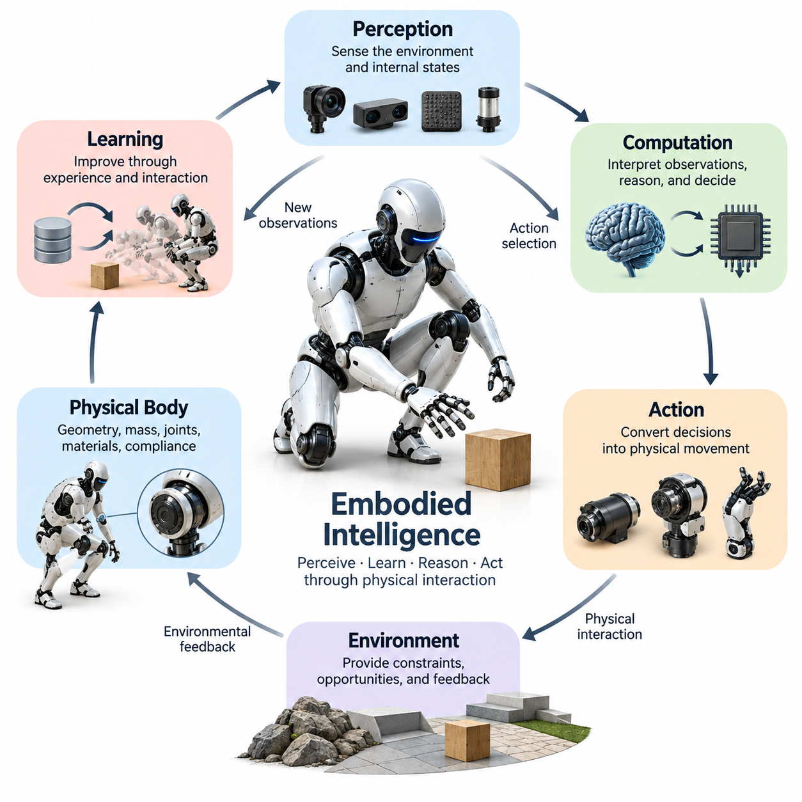{width="7.268055555555556in" height="7.268055555555556in"}

Embodied intelligence refers to the capacity of an intelligent agent to perceive, learn, reason, and act through continuous interaction between its physical body and the surrounding environment. Unlike intelligence understood primarily as abstract information processing, embodied intelligence emerges from the integration of computational processes, sensory experiences, mechanical structures, and physical actions within a dynamically changing world.

The central principle of embodied intelligence is that intelligent behavior cannot be fully understood by examining the computational system independently of its body. The physical structure determines how an agent receives information, produces movement, encounters constraints, and influences its environment. Consequently, intelligence is shaped not only by algorithms and learned representations but also by the physical conditions under which behavior occurs.

An embodied intelligent system consists of interconnected sensing, computation, actuation, and physical interaction capabilities. Sensors provide information about external conditions and internal states, while computational processes interpret observations and determine appropriate actions. Actuators transform control commands into physical movements, and the resulting environmental changes generate new sensory information that continuously influences subsequent decisions.

This continuous interaction establishes a perception-action loop in which sensing and movement operate as mutually dependent processes. Perception informs action selection, while actions determine what information becomes available through subsequent observations. An intelligent robot may reposition its camera to reduce visual uncertainty, adjust its grasp to evaluate contact stability, or move through an environment to improve its understanding of surrounding objects.

Embodied intelligence differs from conventional artificial intelligence approaches that treat perception, reasoning, and action as largely independent computational stages. Traditional architectures frequently assume that environmental information can be represented before decisions are executed. Embodied systems instead operate under incomplete observations, physical uncertainty, and continuously changing conditions, requiring perception and control to remain closely coordinated.

The physical body is therefore more than an execution mechanism for commands generated by an artificial intelligence model. Its geometry, mass distribution, joint configuration, material properties, and mechanical compliance directly influence the behaviors that can emerge. A robot equipped with flexible joints may absorb disturbances mechanically, while a rigid structure may require more explicit computational control to achieve comparable interaction stability.

The environment also participates in the generation of intelligent behavior by providing physical constraints, opportunities, and feedback. Gravity, friction, contact forces, terrain geometry, and object properties influence the outcomes of actions. An embodied agent must accommodate these conditions rather than treating them as irrelevant external variables, making environmental interaction a fundamental component of intelligent operation.

Biological organisms provide important examples of embodied intelligence because their nervous systems, sensory organs, muscles, and skeletal structures function as integrated systems. Human walking depends on neural control together with mechanical dynamics, balance responses, and environmental contact. Similarly, animals exploit body elasticity, distributed sensing, and physical adaptation to achieve complex behaviors without explicitly calculating every mechanical interaction.

The relationship between embodiment and intelligence becomes particularly evident in locomotion. A legged robot must coordinate its body configuration, joint torques, contact forces, and balance while moving across uneven terrain. Successful locomotion requires more than generating a sequence of joint commands because each movement changes the robot\'s physical state and alters the sensory conditions used to determine subsequent actions.

Manipulation provides another important illustration of embodied intelligence. When a robot grasps an unfamiliar object, visual information alone may be insufficient to determine its mass, friction, or mechanical properties. Through controlled contact, the robot can acquire tactile and force feedback, estimate interaction conditions, and modify its grasp. Knowledge about the object develops through physical engagement rather than passive observation alone.

Embodied intelligence also includes the ability to learn from the consequences of physical actions. By interacting with objects and environments, an agent can identify relationships between motor commands, sensory changes, and task outcomes. These experiences support the development of internal models, adaptive control strategies, and learned policies that improve performance under conditions not fully represented during initial training.

Learning in embodied systems is constrained by the physical characteristics of the agent. A wheeled mobile robot, a humanoid robot, a quadruped, and an aerial robot encounter different movement possibilities, sensing perspectives, and environmental limitations. Even when these platforms share similar computational architectures, their physical configurations produce distinct interaction experiences and require different strategies for achieving intelligent behavior.

This dependence on physical configuration introduces the concept of embodiment-specific intelligence. A behavior that is effective for one robotic morphology may be inefficient or physically impossible for another. For example, a humanoid robot can use articulated arms to manipulate elevated objects, whereas a mobile platform without manipulators cannot perform the same operation directly. Intelligent capability must therefore be evaluated relative to the body\'s available actions.

At the same time, embodied intelligence is not limited to a particular mechanical architecture or biological resemblance. Intelligent physical interaction can emerge in rigid industrial manipulators, autonomous mobile robots, compliant robotic hands, soft robotic structures, and aerial vehicles. The defining characteristic is the functional integration of perception, decision-making, physical action, and environmental feedback rather than any specific external appearance.

An important distinction exists between possessing a physical body and demonstrating embodied intelligence. A machine that repeatedly executes predetermined movements without adapting to changing conditions is physically embodied but may exhibit limited intelligent behavior. Embodied intelligence becomes more evident when the system uses sensory feedback, contextual understanding, and adaptive decision-making to respond appropriately to environmental uncertainty and task variation.

Autonomy represents a related but distinct dimension of embodied intelligence. An autonomous robot can select and execute actions without continuous human intervention, but the degree of autonomy depends on its perception, planning, learning, and control capabilities. Embodied intelligence provides mechanisms through which autonomy can become physically grounded, allowing decisions to reflect actual environmental conditions and the consequences of interaction.

The concept of situated intelligence further emphasizes that intelligent behavior occurs within a particular operational context. An action cannot always be evaluated independently of the environment in which it is performed. A grasping strategy suitable for a rigid industrial component may be inappropriate for a fragile object, while a locomotion policy effective on smooth flooring may fail on loose gravel or deformable terrain.

Embodied intelligence also challenges the assumption that increasingly sophisticated computation alone necessarily produces superior physical performance. Improvements in mechanical design, sensor placement, actuator characteristics, and material properties can substantially influence intelligent behavior. In some cases, appropriate physical structures simplify control requirements by naturally supporting stability, energy efficiency, or adaptation to environmental disturbances.

This observation establishes an important connection between embodied intelligence and morphological computation. Morphological computation describes how the physical characteristics and dynamics of a body can contribute to functions otherwise requiring explicit computational processing. Although the two concepts are not identical, morphological computation demonstrates why intelligent performance should be analyzed as a property of the complete physical system rather than its controller alone.

From an engineering perspective, embodied intelligence requires coordinated development across mechanical design, electronics, sensing, control theory, artificial intelligence, and environmental modeling. A high-performance learning algorithm cannot compensate for every limitation imposed by inadequate actuators or poorly positioned sensors. Likewise, advanced hardware cannot independently guarantee intelligent behavior without appropriate perception, reasoning, and feedback mechanisms.

Evaluating embodied intelligence consequently requires observing behavior under realistic physical conditions. Relevant measures include task completion, adaptability, interaction stability, energy consumption, robustness, and recovery from disturbances. Performance should be assessed across environmental variations because a system that succeeds only under narrowly controlled conditions may lack the adaptive capabilities associated with more general embodied intelligence.

A fundamental challenge is the transfer of learned behavior across tasks, environments, and robotic bodies. Physical differences alter sensor observations, action spaces, dynamics, and contact interactions, making direct transfer difficult. Generalization therefore requires representations and learning mechanisms that capture useful relationships while accounting for embodiment-specific constraints and the physical consequences of actions.

Embodied intelligence provides a conceptual foundation for Physical AI by explaining why artificial intelligence operating in the real world must integrate computational reasoning with physical embodiment. Physical AI extends these principles into engineered systems capable of sensing, understanding, and influencing their environments. Its effectiveness depends on how successfully perception, learning, decision-making, mechanical structure, and control operate as a unified system.

Ultimately, embodied intelligence should be understood as intelligence expressed and developed through physical interaction rather than intelligence merely installed inside a machine. The body shapes available actions, the environment determines their consequences, and computational processes adapt behavior through feedback and experience. This integrated perspective provides the foundation for understanding robot morphology, morphological computation, adaptive control, and increasingly capable Physical AI systems.

체화 지능(Embodied Intelligence)은 지능형 에이전트(Intelligent Agent)가 물리적 신체(Physical Body)와 주변 환경(Environment) 사이의 지속적인 상호작용을 통해 인식하고, 학습하고, 추론하고, 행동하는 능력을 의미한다. 지능을 주로 추상적인 정보 처리(Abstract Information Processing)로 이해하는 관점과 달리, 체화 지능은 동적으로 변화하는 현실 세계에서 계산 과정(Computational Process), 감각 경험(Sensory Experience), 기계적 구조(Mechanical Structure), 물리적 행동(Physical Action)이 통합되면서 형성된다.

체화 지능의 핵심 원리는 지능적 행동(Intelligent Behavior)을 물리적 신체와 분리된 계산 시스템(Computational System)만으로는 완전히 이해할 수 없다는 것이다. 신체의 물리적 구조는 에이전트가 정보를 수집하고, 움직임을 생성하고, 제약 조건을 경험하고, 환경에 영향을 미치는 방식을 결정한다. 따라서 지능은 알고리즘(Algorithm)과 학습된 표현(Learned Representation)뿐만 아니라 행동이 발생하는 물리적 조건(Physical Condition)에 의해서도 형성된다.

체화 지능 시스템(Embodied Intelligent System)은 감지(Sensing), 계산(Computation), 구동(Actuation), 물리적 상호작용(Physical Interaction) 기능이 상호 연결된 구조로 구성된다. 센서(Sensor)는 외부 환경과 내부 상태에 관한 정보를 제공하며, 계산 과정은 관측 정보를 해석하고 적절한 행동을 결정한다. 액추에이터(Actuator)는 제어 명령(Control Command)을 물리적 움직임으로 변환하며, 그 결과 발생하는 환경 변화는 새로운 감각 정보를 생성하여 이후의 의사결정(Decision-Making)에 지속적으로 영향을 미친다.

이러한 지속적인 상호작용은 인식과 행동이 상호 의존적으로 작동하는 인식-행동 순환(Perception-Action Loop)을 형성한다. 인식은 행동 선택(Action Selection)에 필요한 정보를 제공하고, 행동은 이후 관측을 통해 얻을 수 있는 정보를 결정한다. 지능형 로봇(Intelligent Robot)은 시각적 불확실성(Visual Uncertainty)을 줄이기 위해 카메라 위치를 변경하거나, 접촉 안정성(Contact Stability)을 평가하기 위해 파지 상태를 조정하거나, 주변 물체에 대한 이해를 높이기 위해 환경 속에서 이동할 수 있다.

체화 지능은 인식(Perception), 추론(Reasoning), 행동(Action)을 대체로 독립적인 계산 단계로 취급하는 전통적인 인공지능(Conventional Artificial Intelligence) 접근 방식과 구별된다. 전통적인 아키텍처(Traditional Architecture)는 의사결정을 실행하기 전에 환경 정보를 표현할 수 있다고 가정하는 경우가 많다. 반면 체화 시스템(Embodied System)은 불완전한 관측(Incomplete Observation), 물리적 불확실성(Physical Uncertainty), 지속적으로 변화하는 조건에서 작동하므로 인식과 제어(Control)가 긴밀하게 조정되어야 한다.

따라서 물리적 신체는 인공지능 모델(Artificial Intelligence Model)이 생성한 명령을 실행하는 단순한 장치 이상의 의미를 가진다. 신체의 기하학적 형상(Geometry), 질량 분포(Mass Distribution), 관절 구성(Joint Configuration), 재료 특성(Material Property), 기계적 순응성(Mechanical Compliance)은 구현 가능한 행동에 직접적인 영향을 미친다. 유연한 관절을 가진 로봇은 외란(Disturbance)을 기계적으로 흡수할 수 있지만, 강체 구조(Rigid Structure)는 유사한 상호작용 안정성을 확보하기 위해 더욱 명시적인 계산 기반 제어가 필요할 수 있다.

환경(Environment) 역시 물리적 제약(Physical Constraint), 행동 기회(Opportunity), 피드백(Feedback)을 제공함으로써 지능적 행동의 형성에 참여한다. 중력(Gravity), 마찰(Friction), 접촉력(Contact Force), 지형 형상(Terrain Geometry), 물체 특성(Object Property)은 행동의 결과에 영향을 미친다. 체화 에이전트(Embodied Agent)는 이러한 조건을 무관한 외부 변수로 취급하는 대신 이에 적응해야 하며, 환경과의 상호작용은 지능적 작동(Intelligent Operation)의 기본 구성 요소가 된다.

생물학적 유기체(Biological Organism)는 신경계(Nervous System), 감각 기관(Sensory Organ), 근육(Muscle), 골격 구조(Skeletal Structure)가 통합된 시스템으로 작동하기 때문에 체화 지능의 중요한 사례를 제공한다. 인간의 보행(Human Walking)은 신경 제어(Neural Control)뿐만 아니라 기계적 동역학(Mechanical Dynamics), 균형 반응(Balance Response), 환경 접촉(Environmental Contact)에 의존한다. 마찬가지로 동물은 모든 기계적 상호작용을 명시적으로 계산하지 않고도 신체 탄성(Body Elasticity), 분산 감지(Distributed Sensing), 물리적 적응(Physical Adaptation)을 활용하여 복잡한 행동을 수행한다.

체화와 지능의 관계는 특히 이동(Locomotion) 과정에서 명확하게 나타난다. 다리형 로봇(Legged Robot)은 불규칙한 지형을 이동하면서 신체 구성(Body Configuration), 관절 토크(Joint Torque), 접촉력(Contact Force), 균형(Balance)을 조정해야 한다. 성공적인 이동은 단순히 관절 명령의 순서를 생성하는 것 이상을 요구한다. 각각의 움직임이 로봇의 물리적 상태(Physical State)를 변화시키고, 이후 행동을 결정하는 데 사용되는 감각 조건(Sensory Condition)을 변경하기 때문이다.

조작(Manipulation)은 체화 지능을 설명하는 또 다른 중요한 사례이다. 로봇이 익숙하지 않은 물체를 파지(Grasping)할 때 시각 정보(Visual Information)만으로는 물체의 질량(Mass), 마찰(Friction), 기계적 특성(Mechanical Property)을 충분히 파악하기 어려울 수 있다. 로봇은 제어된 접촉(Controlled Contact)을 통해 촉각 피드백(Tactile Feedback)과 힘 피드백(Force Feedback)을 획득하고, 상호작용 조건을 추정하며, 파지 상태를 수정할 수 있다. 물체에 관한 지식은 수동적인 관측만이 아니라 물리적 관여(Physical Engagement)를 통해 형성된다.

체화 지능에는 물리적 행동의 결과로부터 학습하는 능력도 포함된다. 에이전트는 물체 및 환경과 상호작용하면서 운동 명령(Motor Command), 감각 변화(Sensory Change), 작업 결과(Task Outcome) 사이의 관계를 파악할 수 있다. 이러한 경험은 내부 모델(Internal Model), 적응형 제어 전략(Adaptive Control Strategy), 학습된 정책(Learned Policy)의 개발을 지원하며, 초기 학습 과정에서 충분히 표현되지 않았던 조건에서도 성능을 개선할 수 있도록 한다.

체화 시스템의 학습(Learning)은 에이전트의 물리적 특성에 의해 제약을 받는다. 바퀴형 이동 로봇(Wheeled Mobile Robot), 휴머노이드 로봇(Humanoid Robot), 사족보행 로봇(Quadruped Robot), 비행 로봇(Aerial Robot)은 서로 다른 이동 가능성(Movement Possibility), 감지 관점(Sensing Perspective), 환경적 제약(Environmental Constraint)을 경험한다. 이러한 플랫폼이 유사한 계산 아키텍처(Computational Architecture)를 공유하더라도 물리적 구성의 차이는 서로 다른 상호작용 경험을 형성하고, 지능적 행동을 구현하기 위한 상이한 전략을 요구한다.

이러한 물리적 구성에 대한 의존성은 신체 형태 특화 지능(Embodiment-Specific Intelligence)이라는 개념으로 이어진다. 특정 로봇 형태(Robot Morphology)에서 효과적인 행동이 다른 형태에서는 비효율적이거나 물리적으로 불가능할 수 있다. 예를 들어 휴머노이드 로봇은 관절형 팔(Articulated Arm)을 사용하여 높은 위치의 물체를 조작할 수 있지만, 매니퓰레이터(Manipulator)가 없는 이동 플랫폼(Mobile Platform)은 동일한 작업을 직접 수행할 수 없다. 따라서 지능적 능력(Intelligent Capability)은 신체가 수행할 수 있는 행동을 기준으로 평가해야 한다.

동시에 체화 지능은 특정 기계적 아키텍처(Mechanical Architecture)나 생물학적 유사성(Biological Resemblance)에 제한되지 않는다. 지능적 물리 상호작용(Intelligent Physical Interaction)은 강체형 산업용 매니퓰레이터(Rigid Industrial Manipulator), 자율 이동 로봇(Autonomous Mobile Robot), 순응형 로봇 손(Compliant Robotic Hand), 소프트 로봇 구조(Soft Robotic Structure), 비행체(Aerial Vehicle) 등 다양한 시스템에서 나타날 수 있다. 체화 지능을 정의하는 핵심 특성은 특정 외형이 아니라 인식, 의사결정, 물리적 행동, 환경 피드백의 기능적 통합(Functional Integration)이다.

물리적 신체를 보유하는 것과 체화 지능을 구현하는 것 사이에는 중요한 차이가 존재한다. 변화하는 조건에 적응하지 않고 사전에 정의된 움직임만 반복하는 기계는 물리적으로 체화되어 있지만 제한적인 지능적 행동만 보일 수 있다. 체화 지능은 시스템이 감각 피드백(Sensory Feedback), 상황 이해(Contextual Understanding), 적응형 의사결정(Adaptive Decision-Making)을 활용하여 환경적 불확실성(Environmental Uncertainty)과 작업 변화(Task Variation)에 적절히 대응할 때 더욱 명확하게 나타난다.

자율성(Autonomy)은 체화 지능과 관련되어 있지만 구별되는 개념이다. 자율 로봇(Autonomous Robot)은 지속적인 인간 개입(Human Intervention) 없이 행동을 선택하고 실행할 수 있지만, 자율성의 수준은 인식, 계획(Planning), 학습, 제어 능력에 따라 달라진다. 체화 지능은 자율성이 물리적 현실에 기반하도록 하는 메커니즘(Mechanism)을 제공하며, 의사결정이 실제 환경 조건과 상호작용의 결과를 반영하도록 한다.

상황 기반 지능(Situated Intelligence)은 지능적 행동이 특정 운영 맥락(Operational Context)에서 발생한다는 점을 더욱 강조한다. 행동의 적절성은 그 행동이 수행되는 환경과 독립적으로 평가하기 어려운 경우가 많다. 강체형 산업 부품(Rigid Industrial Component)에 적합한 파지 전략(Grasping Strategy)은 깨지기 쉬운 물체(Fragile Object)에는 부적절할 수 있으며, 매끄러운 바닥에서 효과적인 이동 정책(Locomotion Policy)은 자갈이나 변형 가능한 지형(Deformable Terrain)에서는 실패할 수 있다.

체화 지능은 계산 능력(Computational Capability)의 향상만으로 반드시 더 우수한 물리적 성능(Physical Performance)이 구현되는 것은 아니라는 점도 보여준다. 기계 설계(Mechanical Design), 센서 배치(Sensor Placement), 액추에이터 특성(Actuator Characteristic), 재료 특성(Material Property)의 개선은 지능적 행동에 상당한 영향을 미칠 수 있다. 경우에 따라 적절한 물리적 구조는 안정성(Stability), 에너지 효율(Energy Efficiency), 환경 외란에 대한 적응을 자연스럽게 지원하여 제어 요구사항(Control Requirement)을 단순화한다.

이러한 관점은 체화 지능과 형태적 계산(Morphological Computation) 사이의 중요한 연관성을 확립한다. 형태적 계산은 신체의 물리적 특성과 동역학(Dynamics)이 일반적으로 명시적인 계산 처리를 필요로 하는 기능에 기여하는 현상을 설명한다. 두 개념이 동일한 것은 아니지만, 형태적 계산은 지능적 성능을 제어기(Controller)만의 특성이 아니라 완전한 물리 시스템(Physical System)의 특성으로 분석해야 하는 이유를 보여준다.

공학적 관점(Engineering Perspective)에서 체화 지능은 기계 설계, 전자공학(Electronics), 감지 기술(Sensing Technology), 제어 이론(Control Theory), 인공지능, 환경 모델링(Environmental Modeling) 사이의 조정된 개발을 요구한다. 고성능 학습 알고리즘(High-Performance Learning Algorithm)도 부적절한 액추에이터나 잘못 배치된 센서에서 발생하는 모든 한계를 보완할 수는 없다. 마찬가지로 첨단 하드웨어(Advanced Hardware)만으로는 적절한 인식, 추론, 피드백 메커니즘 없이 지능적 행동을 보장할 수 없다.

따라서 체화 지능의 평가(Evaluation)는 현실적인 물리적 조건에서 행동을 관찰하는 방식으로 수행되어야 한다. 주요 평가 지표(Evaluation Metric)에는 작업 완료(Task Completion), 적응성(Adaptability), 상호작용 안정성(Interaction Stability), 에너지 소비(Energy Consumption), 강건성(Robustness), 외란으로부터의 복구(Recovery from Disturbance)가 포함된다. 제한적으로 통제된 조건에서만 성공하는 시스템은 보다 일반적인 체화 지능과 관련된 적응 능력이 부족할 수 있으므로 다양한 환경 변화에서 성능을 평가해야 한다.

근본적인 과제 중 하나는 작업, 환경, 로봇 신체 사이에서 학습된 행동을 전이(Transfer)하는 것이다. 물리적 차이는 센서 관측(Sensor Observation), 행동 공간(Action Space), 동역학, 접촉 상호작용(Contact Interaction)을 변화시키므로 직접적인 전이를 어렵게 만든다. 따라서 일반화(Generalization)를 위해서는 신체 형태별 제약(Embodiment-Specific Constraint)과 행동의 물리적 결과를 고려하면서 유용한 관계를 포착할 수 있는 표현(Representation)과 학습 메커니즘이 필요하다.

체화 지능은 현실 세계에서 작동하는 인공지능이 계산적 추론(Computational Reasoning)과 물리적 체화(Physical Embodiment)를 통합해야 하는 이유를 설명함으로써 피지컬 AI(Physical AI)의 개념적 기반(Conceptual Foundation)을 제공한다. 피지컬 AI는 이러한 원리를 환경을 감지하고, 이해하고, 변화시킬 수 있는 공학적 시스템(Engineered System)으로 확장한다. 그 효과는 인식, 학습, 의사결정, 기계적 구조, 제어가 하나의 통합 시스템(Unified System)으로 얼마나 성공적으로 작동하는지에 달려 있다.

궁극적으로 체화 지능은 단순히 기계 내부에 설치된 지능이 아니라 물리적 상호작용을 통해 표현되고 발전하는 지능으로 이해해야 한다. 신체는 수행 가능한 행동을 형성하고, 환경은 그 행동의 결과를 결정하며, 계산 과정은 피드백과 경험을 통해 행동을 적응시킨다. 이러한 통합적 관점(Integrated Perspective)은 로봇 형태학(Robot Morphology), 형태적 계산(Morphological Computation), 적응형 제어(Adaptive Control), 그리고 점점 더 높은 능력을 갖추는 피지컬 AI 시스템(Physical AI System)을 이해하기 위한 기초를 제공한다.

##  

## 01.02. Embodied Cognition and Situated Intelligence

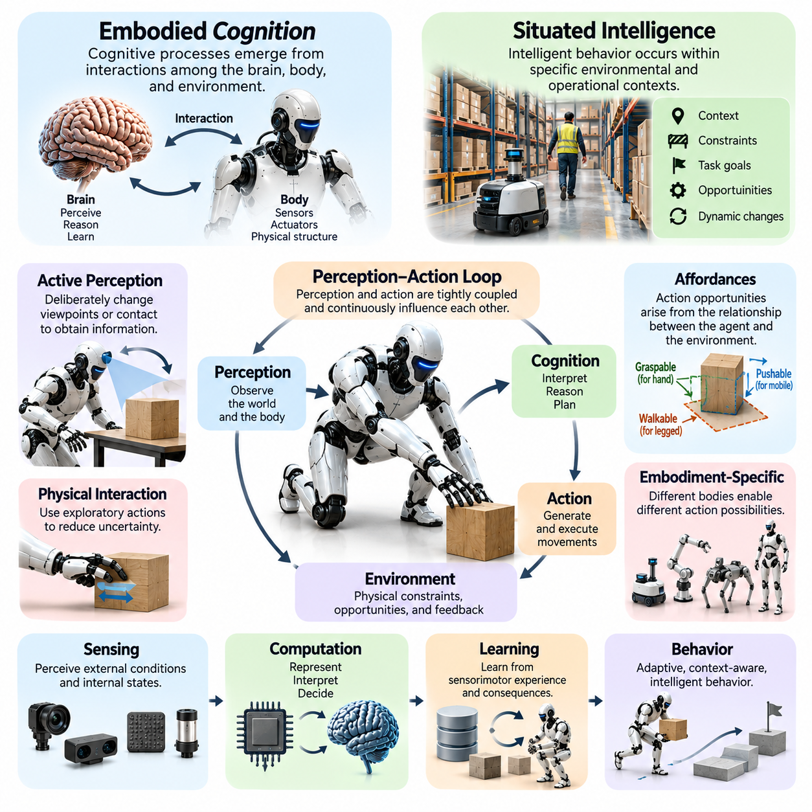{width="7.268055555555556in" height="7.268055555555556in"}

Embodied cognition is a theoretical perspective that explains cognitive processes as emerging from interactions among the brain, body, and environment. Rather than treating cognition as isolated symbolic computation, it emphasizes how perception, movement, bodily constraints, and physical experiences influence reasoning and learning. Intelligence is therefore understood as an activity grounded in the agent\'s capacity to interact with the world.

Situated intelligence extends this perspective by emphasizing that intelligent behavior occurs within specific environmental and operational contexts. An agent does not make decisions independently of its surroundings but responds to available information, physical constraints, task objectives, and interaction opportunities. The meaning and effectiveness of an action depend on the circumstances in which it is performed and the consequences it produces.

Traditional cognitive architectures often describe intelligence as a sequence of perception, internal representation, reasoning, and action. Embodied cognition challenges the assumption that these processes must always operate as separate stages. In many physical tasks, perception and action are tightly coupled, allowing an agent to respond continuously to environmental changes without constructing a complete internal representation before every movement.

The relationship between embodied cognition and situated intelligence becomes clear when considering how humans interact with everyday objects. Reaching for a cup involves visual perception, body positioning, motor coordination, and expectations about the object\'s physical properties. The surrounding environment influences the movement, while the body\'s capabilities determine which actions are practical and how they can be performed.

A fundamental concept in embodied cognition is that the body contributes directly to cognitive processing. Sensory systems, joint configurations, muscle dynamics, and physical feedback influence how information is acquired and interpreted. In robotics, the placement of cameras, the structure of manipulators, and the availability of tactile sensors shape the information accessible to learning algorithms and the strategies available for solving tasks.

Situated intelligence emphasizes the importance of environmental context in determining appropriate behavior. A mobile robot navigating a warehouse must consider moving workers, temporary obstacles, floor conditions, and operational priorities. A navigation strategy suitable for an empty corridor may become unsafe in a crowded workspace. Intelligent behavior therefore requires continuous adjustment to the conditions surrounding the agent.

The concept of affordances provides an important connection between embodied cognition and situated intelligence. An affordance represents an opportunity for action arising from the relationship between an agent\'s capabilities and environmental properties. A surface may support walking for a humanoid robot but remain inaccessible to a wheeled platform. The same physical object can therefore provide different action possibilities for different embodiments.

Affordances are not simply fixed properties of objects because they depend on the agent\'s morphology, capabilities, and current state. A handle may be graspable by a dexterous robotic hand but inaccessible to a large industrial gripper. Similarly, a narrow passage may be traversable by a compact mobile robot but unsuitable for a larger platform. Perception must therefore identify actionable relationships rather than merely classify environmental objects.

Embodied cognition also recognizes that physical interaction can simplify cognitive requirements. Instead of calculating every possible outcome internally, an agent may use exploratory movements to obtain additional information. A robot can gently push an unfamiliar object to estimate its mobility or adjust its fingers to determine grasp stability. These actions transform uncertainty into observable feedback and support more informed decisions.

This approach highlights the role of active perception, in which an intelligent agent deliberately changes its sensory conditions to improve understanding. A mobile robot may move around an obstacle to reveal hidden geometry, while a manipulator may rotate an object to inspect an occluded surface. Perception becomes an interactive process guided by task requirements, rather than passive reception of sensory measurements.

Situated intelligence is closely associated with real-time interaction because environmental conditions can change faster than extensive deliberative reasoning can be completed. Robots operating around people, vehicles, or moving machinery must frequently update their behavior using immediate sensory feedback. Reactive control mechanisms can complement higher-level planning by providing rapid responses to disturbances and unexpected events.

The interaction between reactive behavior and deliberative reasoning is particularly important in embodied systems. Reactive mechanisms support immediate responses, while deliberative processes enable prediction, planning, and long-term goal management. Effective embodied intelligence integrates these capabilities so that an agent can respond quickly to local conditions while maintaining consistency with broader task objectives and operational constraints.

Embodied cognition also influences how intelligent agents acquire knowledge. Physical experience provides information about object properties, movement consequences, spatial relationships, and causal interactions. Through repeated sensorimotor experiences, a robot can learn how its actions affect the environment. Such knowledge is grounded in observable consequences rather than relying exclusively on abstract descriptions or predefined symbolic rules.

The concept of sensorimotor contingencies further explains how perception depends on relationships between actions and sensory changes. When an agent moves its body or sensors, predictable transformations occur in the incoming observations. Learning these relationships allows the system to distinguish self-generated changes from external events and develop more reliable representations of environmental structure and physical interaction.

The physical morphology of an agent strongly influences its situated cognitive capabilities. A humanoid robot can exploit human-oriented infrastructure, including stairs, handles, and work surfaces, while a quadruped may achieve greater stability across irregular terrain. These differences affect not only mechanical performance but also the agent\'s available actions, perceptual experiences, and strategies for accomplishing tasks.

Environmental structure can also function as an external resource for cognition. Rather than maintaining every detail in internal memory, an agent may rely on stable landmarks, object arrangements, and environmental cues to guide behavior. A warehouse robot can use recognizable shelf locations to support navigation, while a manipulation system can exploit fixtures and work surfaces to simplify object positioning and assembly operations.

This perspective introduces the idea of distributed cognitive processing, where intelligent behavior depends on coordinated contributions from internal computation, bodily dynamics, and environmental structure. The environment does not necessarily perform explicit computation, but its physical organization can reduce planning complexity and constrain possible actions. Intelligence can therefore emerge through interactions extending beyond the computational controller.

Embodied cognition has important implications for artificial intelligence learning architectures. Models trained exclusively on static images or textual descriptions may acquire useful semantic knowledge but lack direct experience of physical consequences. Embodied learning introduces action-dependent observations, contact dynamics, and feedback from task execution, allowing learned representations to become more closely connected to real-world behavior.

Reinforcement learning provides one computational approach for studying situated intelligence because an agent improves its policy through interaction with an environment. However, successful learning depends on the relationship between observations, available actions, physical dynamics, and reward structures. A policy learned in simulation may require adaptation when deployed on hardware with different friction, latency, compliance, or sensing characteristics.

Generalization remains a major challenge because situated behavior is influenced by the specific conditions under which learning occurs. A robot trained to manipulate objects on a fixed workbench may struggle when object positions, lighting, materials, or contact conditions change. Robust embodied cognition requires learning representations and control strategies that preserve useful relationships across varying environments and physical configurations.

Embodied cognition also provides a framework for understanding human-robot interaction. Robots operating alongside people must interpret gestures, movements, spatial relationships, and social context while respecting physical safety constraints. Their behavior must account for how humans perceive robotic motion and how shared environments influence expectations. Intelligent interaction therefore involves both physical coordination and contextual interpretation.

Evaluating situated intelligence requires examining how effectively an agent adapts its behavior to changing circumstances. Task success alone may be insufficient if performance depends on narrowly controlled environmental conditions. Relevant evaluation dimensions include adaptability, robustness, response latency, interaction safety, recovery capability, and the ability to exploit environmental opportunities while respecting physical constraints.

For Physical AI, embodied cognition and situated intelligence establish complementary foundations for designing systems that operate meaningfully in the physical world. Embodied cognition explains how bodily structure and sensorimotor experience contribute to intelligence, while situated intelligence explains how environmental context shapes appropriate behavior. Together, they support architectures that integrate perception, reasoning, learning, and action.

Ultimately, embodied cognition and situated intelligence challenge the view that intelligence can be understood solely as computation performed independently of physical existence. Intelligent behavior develops through the continuous relationship between an agent\'s internal processes, bodily capabilities, and surrounding environment. This perspective provides a foundation for developing adaptive, context-aware, and physically grounded robotic systems capable of operating in complex real-world conditions.

체화 인지(Embodied Cognition)는 인지 과정(Cognitive Process)이 뇌(Brain), 신체(Body), 환경(Environment) 사이의 상호작용을 통해 형성된다고 설명하는 이론적 관점(Theoretical Perspective)이다. 체화 인지는 인지를 독립적인 기호적 계산(Symbolic Computation)으로 취급하는 대신, 인식(Perception), 움직임(Movement), 신체적 제약(Bodily Constraint), 물리적 경험(Physical Experience)이 추론(Reasoning)과 학습(Learning)에 미치는 영향을 강조한다. 따라서 지능(Intelligence)은 에이전트(Agent)가 세계와 상호작용하는 능력에 기반한 활동으로 이해된다.

상황 기반 지능(Situated Intelligence)은 지능적 행동(Intelligent Behavior)이 특정한 환경적 맥락(Environmental Context)과 운영 맥락(Operational Context)에서 발생한다는 점을 강조함으로써 이러한 관점을 확장한다. 에이전트는 주변 환경과 독립적으로 의사결정을 내리는 것이 아니라, 이용 가능한 정보(Available Information), 물리적 제약(Physical Constraint), 작업 목표(Task Objective), 상호작용 기회(Interaction Opportunity)에 대응한다. 행동의 의미와 효과는 행동이 수행되는 상황과 그로 인해 발생하는 결과에 따라 달라진다.

전통적인 인지 아키텍처(Traditional Cognitive Architecture)는 지능을 인식, 내부 표현(Internal Representation), 추론, 행동으로 이어지는 일련의 과정으로 설명하는 경우가 많다. 체화 인지는 이러한 과정이 반드시 분리된 단계로 작동해야 한다는 가정에 의문을 제기한다. 많은 물리적 작업(Physical Task)에서 인식과 행동은 긴밀하게 결합되어 있으며, 에이전트는 모든 움직임에 앞서 완전한 내부 표현을 구성하지 않고도 환경 변화에 지속적으로 대응할 수 있다.

체화 인지와 상황 기반 지능의 관계는 인간이 일상적인 물체와 상호작용하는 과정을 살펴보면 명확해진다. 컵을 잡기 위해 손을 뻗는 행동에는 시각적 인식(Visual Perception), 신체 위치 조정(Body Positioning), 운동 협응(Motor Coordination), 물체의 물리적 특성(Physical Property)에 대한 예측이 포함된다. 주변 환경은 움직임에 영향을 미치며, 신체의 능력(Bodily Capability)은 어떤 행동이 실현 가능하고 어떻게 수행될 수 있는지를 결정한다.

체화 인지의 기본 개념 중 하나는 신체가 인지 처리(Cognitive Processing)에 직접적으로 기여한다는 것이다. 감각 시스템(Sensory System), 관절 구성(Joint Configuration), 근육 동역학(Muscle Dynamics), 물리적 피드백(Physical Feedback)은 정보가 획득되고 해석되는 방식에 영향을 미친다. 로보틱스(Robotics)에서는 카메라 배치(Camera Placement), 매니퓰레이터 구조(Manipulator Structure), 촉각 센서(Tactile Sensor)의 유무가 학습 알고리즘(Learning Algorithm)이 접근할 수 있는 정보와 작업 해결 전략을 결정한다.

상황 기반 지능은 적절한 행동을 결정할 때 환경적 맥락의 중요성을 강조한다. 창고를 이동하는 모바일 로봇(Mobile Robot)은 작업자의 움직임, 일시적인 장애물(Temporary Obstacle), 바닥 상태(Floor Condition), 운영 우선순위(Operational Priority)를 고려해야 한다. 비어 있는 복도에 적합한 내비게이션 전략(Navigation Strategy)은 혼잡한 작업 공간에서는 안전하지 않을 수 있다. 따라서 지능적 행동은 에이전트를 둘러싼 조건에 맞추어 지속적으로 조정되어야 한다.

행동 가능성(Affordance) 개념은 체화 인지와 상황 기반 지능을 연결하는 중요한 요소이다. 행동 가능성은 에이전트의 능력과 환경적 특성(Environmental Property) 사이의 관계에서 발생하는 행동의 기회(Opportunity for Action)를 의미한다. 특정 표면은 휴머노이드 로봇(Humanoid Robot)에게 보행 가능한 공간을 제공하지만, 바퀴형 플랫폼(Wheeled Platform)에는 접근할 수 없는 영역일 수 있다. 따라서 동일한 물리적 물체라도 서로 다른 신체 형태(Embodiment)에 따라 다른 행동 가능성을 제공할 수 있다.

행동 가능성은 에이전트의 형태학(Morphology), 능력(Capability), 현재 상태(Current State)에 따라 달라지므로 단순히 물체의 고정된 특성으로 볼 수 없다. 손잡이는 정교한 로봇 손(Dexterous Robotic Hand)으로는 파지할 수 있지만, 대형 산업용 그리퍼(Industrial Gripper)로는 접근하기 어려울 수 있다. 마찬가지로 좁은 통로는 소형 모바일 로봇이 통과할 수 있지만 대형 플랫폼에는 적합하지 않을 수 있다. 따라서 인식은 환경 내 물체를 단순히 분류하는 것을 넘어 실제 행동이 가능한 관계(Actionable Relationship)를 식별해야 한다.

체화 인지는 물리적 상호작용(Physical Interaction)이 인지적 요구사항(Cognitive Requirement)을 단순화할 수 있다는 점도 인정한다. 에이전트는 가능한 모든 결과를 내부적으로 계산하는 대신 탐색적 움직임(Exploratory Movement)을 통해 추가 정보를 획득할 수 있다. 로봇은 익숙하지 않은 물체를 부드럽게 밀어 이동 가능성(Mobility)을 추정하거나 손가락 위치를 조정하여 파지 안정성(Grasp Stability)을 확인할 수 있다. 이러한 행동은 불확실성(Uncertainty)을 관측 가능한 피드백(Observable Feedback)으로 전환하고 더 정확한 의사결정을 지원한다.

이러한 접근 방식은 지능형 에이전트가 환경에 대한 이해를 개선하기 위해 의도적으로 감각 조건을 변화시키는 능동적 인식(Active Perception)의 역할을 강조한다. 모바일 로봇은 장애물 주변으로 이동하여 가려진 기하학적 구조(Occluded Geometry)를 확인할 수 있으며, 매니퓰레이터(Manipulator)는 물체를 회전시켜 보이지 않던 표면을 검사할 수 있다. 인식은 감각 측정값(Sensory Measurement)을 수동적으로 수신하는 과정이 아니라 작업 요구사항(Task Requirement)에 따라 수행되는 상호작용적 과정(Interactive Process)이 된다.

상황 기반 지능은 환경 조건이 복잡한 숙고적 추론(Deliberative Reasoning)이 완료되는 속도보다 빠르게 변화할 수 있기 때문에 실시간 상호작용(Real-Time Interaction)과 밀접하게 관련된다. 사람, 차량, 이동하는 기계 주변에서 작동하는 로봇은 즉각적인 감각 피드백을 활용하여 행동을 자주 갱신해야 한다. 반응형 제어 메커니즘(Reactive Control Mechanism)은 외란(Disturbance)과 예상하지 못한 사건에 신속하게 대응함으로써 상위 수준 계획(Higher-Level Planning)을 보완할 수 있다.

반응형 행동(Reactive Behavior)과 숙고적 추론 사이의 상호작용은 체화 시스템(Embodied System)에서 특히 중요하다. 반응형 메커니즘은 즉각적인 대응을 지원하고, 숙고적 과정(Deliberative Process)은 예측(Prediction), 계획(Planning), 장기 목표 관리(Long-Term Goal Management)를 가능하게 한다. 효과적인 체화 지능은 이러한 능력을 통합하여 에이전트가 전체 작업 목표와 운영 제약(Operational Constraint)을 유지하면서도 국소적인 환경 조건에 신속하게 대응할 수 있도록 한다.

체화 인지는 지능형 에이전트가 지식을 획득하는 방식에도 영향을 미친다. 물리적 경험은 물체의 특성, 움직임의 결과, 공간적 관계(Spatial Relationship), 인과적 상호작용(Causal Interaction)에 관한 정보를 제공한다. 로봇은 반복적인 감각운동 경험(Sensorimotor Experience)을 통해 자신의 행동이 환경에 어떤 영향을 미치는지 학습할 수 있다. 이러한 지식은 추상적인 설명이나 사전에 정의된 기호적 규칙(Symbolic Rule)에만 의존하는 것이 아니라 관측 가능한 결과에 기반한다.

감각운동 수반 관계(Sensorimotor Contingency) 개념은 인식이 행동과 감각 변화 사이의 관계에 어떻게 의존하는지를 설명한다. 에이전트가 신체나 센서를 움직이면 입력되는 관측 정보(Incoming Observation)에 예측 가능한 변화가 발생한다. 이러한 관계를 학습하면 시스템은 스스로 생성한 변화(Self-Generated Change)와 외부 사건(External Event)을 구별하고, 환경 구조(Environmental Structure)와 물리적 상호작용에 대한 더욱 신뢰할 수 있는 표현을 형성할 수 있다.

에이전트의 물리적 형태학(Physical Morphology)은 상황 기반 인지 능력(Situated Cognitive Capability)에 강한 영향을 미친다. 휴머노이드 로봇은 계단, 손잡이, 작업대 등 인간 중심의 기반시설(Human-Oriented Infrastructure)을 활용할 수 있으며, 사족보행 로봇(Quadruped Robot)은 불규칙한 지형에서 더 높은 안정성을 확보할 수 있다. 이러한 차이는 기계적 성능(Mechanical Performance)뿐만 아니라 에이전트가 수행할 수 있는 행동, 지각 경험(Perceptual Experience), 작업 수행 전략에도 영향을 미친다.

환경 구조(Environmental Structure)는 인지를 위한 외부 자원(External Resource)으로 기능할 수도 있다. 에이전트는 모든 세부 정보를 내부 메모리(Internal Memory)에 유지하는 대신 안정적인 랜드마크(Stable Landmark), 물체 배치(Object Arrangement), 환경 단서(Environmental Cue)를 활용하여 행동을 유도할 수 있다. 창고 로봇은 식별 가능한 선반 위치를 내비게이션에 활용할 수 있으며, 조작 시스템(Manipulation System)은 고정 장치(Fixture)와 작업 표면(Work Surface)을 이용하여 물체 위치 조정과 조립 작업을 단순화할 수 있다.

이러한 관점은 지능적 행동이 내부 계산(Internal Computation), 신체 동역학(Bodily Dynamics), 환경 구조의 조정된 기여에 의존한다는 분산 인지 처리(Distributed Cognitive Processing) 개념으로 이어진다. 환경이 반드시 명시적인 계산을 수행하는 것은 아니지만, 환경의 물리적 구성(Physical Organization)은 계획의 복잡성(Planning Complexity)을 줄이고 가능한 행동을 제한할 수 있다. 따라서 지능은 계산 제어기(Computational Controller)의 범위를 넘어서는 상호작용을 통해 형성될 수 있다.

체화 인지는 인공지능 학습 아키텍처(Artificial Intelligence Learning Architecture)에 중요한 시사점을 제공한다. 정적인 이미지(Static Image)나 텍스트 설명(Textual Description)만으로 학습된 모델은 유용한 의미적 지식(Semantic Knowledge)을 획득할 수 있지만 물리적 결과에 대한 직접적인 경험은 부족할 수 있다. 체화 학습(Embodied Learning)은 행동에 의존하는 관측(Action-Dependent Observation), 접촉 동역학(Contact Dynamics), 작업 실행 피드백(Task Execution Feedback)을 도입하여 학습된 표현이 실제 세계의 행동과 더욱 밀접하게 연결되도록 한다.

강화학습(Reinforcement Learning)은 에이전트가 환경과의 상호작용을 통해 정책(Policy)을 개선한다는 점에서 상황 기반 지능을 연구하는 계산적 접근 방식(Computational Approach) 중 하나이다. 그러나 성공적인 학습은 관측(Observation), 사용 가능한 행동(Available Action), 물리적 동역학(Physical Dynamics), 보상 구조(Reward Structure) 사이의 관계에 달려 있다. 시뮬레이션(Simulation)에서 학습된 정책은 마찰, 지연시간(Latency), 순응성(Compliance), 감지 특성(Sensing Characteristic)이 다른 실제 하드웨어(Hardware)에 배포될 때 적응이 필요할 수 있다.

상황 기반 행동은 학습이 이루어진 특정 조건의 영향을 받기 때문에 일반화(Generalization)는 여전히 중요한 과제로 남아 있다. 고정된 작업대에서 물체를 조작하도록 학습된 로봇은 물체 위치(Object Position), 조명(Lighting), 재료(Material), 접촉 조건(Contact Condition)이 변화하면 어려움을 겪을 수 있다. 강건한 체화 인지(Robust Embodied Cognition)를 구현하려면 다양한 환경과 물리적 구성에서도 유용한 관계를 유지할 수 있는 표현과 제어 전략(Control Strategy)을 학습해야 한다.

체화 인지는 인간-로봇 상호작용(Human-Robot Interaction)을 이해하기 위한 프레임워크(Framework)도 제공한다. 사람과 함께 작동하는 로봇은 물리적 안전 제약(Physical Safety Constraint)을 준수하면서 몸짓(Gesture), 움직임, 공간적 관계, 사회적 맥락(Social Context)을 해석해야 한다. 로봇의 행동은 인간이 로봇의 움직임을 어떻게 인식하는지와 공유 환경(Shared Environment)이 기대에 어떤 영향을 미치는지를 고려해야 한다. 따라서 지능적 상호작용은 물리적 협응(Physical Coordination)과 맥락적 해석(Contextual Interpretation)을 모두 포함한다.

상황 기반 지능의 평가(Evaluation)는 에이전트가 변화하는 상황에 맞추어 행동을 얼마나 효과적으로 적응시키는지 검토해야 한다. 성능이 제한적으로 통제된 환경 조건에 의존한다면 작업 성공(Task Success)만으로는 충분하지 않을 수 있다. 주요 평가 항목에는 적응성(Adaptability), 강건성(Robustness), 응답 지연시간(Response Latency), 상호작용 안전성(Interaction Safety), 복구 능력(Recovery Capability), 물리적 제약을 준수하면서 환경적 기회를 활용하는 능력이 포함된다.

피지컬 AI(Physical AI)에서 체화 인지와 상황 기반 지능은 물리적 세계에서 의미 있게 작동하는 시스템을 설계하기 위한 상호 보완적인 기반(Complementary Foundation)을 제공한다. 체화 인지는 신체 구조(Bodily Structure)와 감각운동 경험이 지능에 어떻게 기여하는지를 설명하며, 상황 기반 지능은 환경적 맥락이 적절한 행동을 어떻게 형성하는지를 설명한다. 두 개념은 인식, 추론, 학습, 행동을 통합하는 아키텍처(Architecture)를 지원한다.

궁극적으로 체화 인지와 상황 기반 지능은 지능을 물리적 존재(Physical Existence)와 독립적으로 수행되는 계산만으로 이해할 수 있다는 관점에 도전한다. 지능적 행동은 에이전트의 내부 과정(Internal Process), 신체 능력(Bodily Capability), 주변 환경 사이의 지속적인 관계를 통해 발전한다. 이러한 관점은 복잡한 현실 세계 조건에서 작동할 수 있는 적응형(Adaptive), 맥락 인식형(Context-Aware), 물리적 기반(Physically Grounded)의 로봇 시스템(Robotic System)을 개발하기 위한 토대를 제공한다.

##  

## 01.03. Body as Part of the Intelligent System

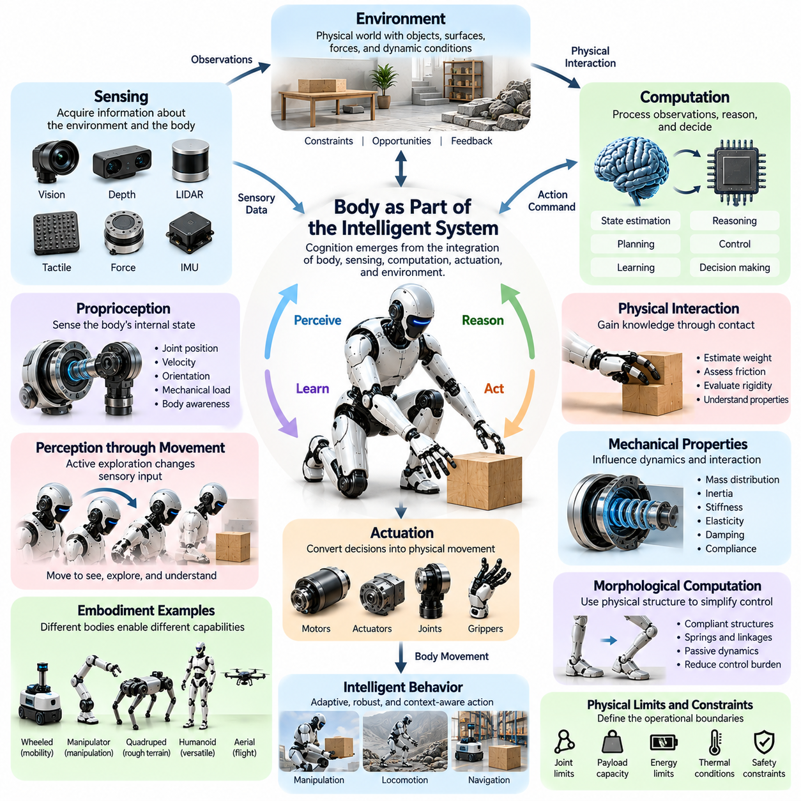{width="7.268055555555556in" height="7.268055555555556in"}

The physical body is an integral component of an intelligent system rather than a passive mechanism that executes computational commands. In embodied intelligence, cognition emerges through coordinated interactions among computational processes, sensory systems, actuators, mechanical structures, and the environment. The body\'s physical characteristics influence how information is acquired, how actions are performed, and how intelligent behavior develops through experience.

Traditional artificial intelligence architectures often distinguish the computational controller from the physical platform it operates. The controller processes observations, generates decisions, and sends commands to mechanical components. Although this separation simplifies system design, it can obscure the contribution of physical structure to intelligent behavior. Embodied intelligence instead treats the body and controller as interdependent elements of a unified system.

The body determines the range of actions available to an intelligent agent through its geometry, joint configuration, degrees of freedom, and actuator capabilities. A robotic manipulator can reach and grasp objects only within its mechanical workspace, while a mobile robot must operate within the movement constraints imposed by its locomotion mechanism. These physical limitations shape planning, learning, and decision-making before any computational policy is executed.

Mechanical properties also influence how the body responds to environmental forces. Mass distribution, inertia, stiffness, elasticity, damping, and compliance determine the dynamics of movement and contact. A compliant robotic arm may absorb unexpected contact forces through mechanical deformation, whereas a rigid manipulator may require active force control. The body\'s physical response therefore contributes directly to interaction stability and behavioral robustness.

The relationship between sensing and physical structure is equally important. Sensor placement, orientation, field of view, and mechanical integration determine which environmental information becomes observable. A camera mounted on a movable robotic head provides different perceptual opportunities from a fixed camera. Similarly, tactile sensors embedded in robotic fingers enable direct observation of contact conditions that cannot always be inferred from vision alone.

Proprioception allows an intelligent system to estimate its own physical configuration and movement. Joint encoders, inertial measurement units, force sensors, and other internal sensing mechanisms provide information about position, velocity, orientation, and mechanical loading. These measurements support body awareness, enabling the controller to relate external observations to the robot\'s current physical state and available movement capabilities.

The body also participates in perception by determining how sensory information changes during movement. When a robot rotates its head, extends an arm, or shifts its position, the resulting observations depend on its physical configuration. Such action-dependent sensory changes provide information about spatial relationships, object geometry, and environmental structure. Perception is therefore influenced by the body\'s ability to actively explore its surroundings.

Physical interaction creates opportunities for intelligence that cannot be achieved through passive observation alone. A robot manipulating an unfamiliar object can estimate its weight, friction, and rigidity through controlled contact. These measurements emerge from the interaction between the robot\'s mechanical structure and the object\'s physical properties. The body becomes an instrument for acquiring knowledge through direct experimentation with the environment.

The concept of morphological computation explains how physical structures can contribute to functions that would otherwise require explicit computational control. Springs, compliant joints, flexible materials, and mechanical linkages can naturally regulate forces, filter disturbances, or coordinate movement. Although these mechanisms do not replace intelligent control, they can reduce computational requirements by exploiting the physical dynamics of the body.

Passive dynamic walking illustrates how mechanical design can support intelligent movement. Appropriately configured leg structures may produce walking-like motion under suitable gravitational and contact conditions with limited active control. This demonstrates that locomotion behavior can arise partly from mechanical dynamics rather than exclusively from calculated joint trajectories. Active controllers can then exploit these natural dynamics to improve efficiency and stability.

The body\'s morphology also influences the complexity of learning. A robot with an appropriately designed mechanical structure may require fewer control adjustments to achieve stable behavior. Conversely, an unsuitable morphology may introduce difficult control problems even when sophisticated learning algorithms are available. The effectiveness of an intelligent policy therefore depends partly on whether the physical design supports the intended task.

Different robotic embodiments create distinct relationships between physical structure and intelligence. Wheeled robots exploit rolling contact for efficient movement on suitable surfaces, while quadrupeds use articulated legs to negotiate irregular terrain. Humanoid robots provide manipulation and locomotion capabilities compatible with many human environments. Aerial robots depend on aerodynamic forces and propulsion arrangements that impose different sensing and control requirements.

The body also establishes the physical boundaries within which an intelligent agent must operate. Joint limits, actuator torque, payload capacity, structural strength, thermal conditions, and energy availability constrain feasible actions. Intelligent planning must respect these boundaries to avoid unsafe or ineffective behavior. A controller that ignores the body\'s physical limitations may generate commands that are computationally valid but mechanically impossible.

Energy efficiency provides another example of the body\'s contribution to intelligent performance. Mechanical transmission, actuator placement, structural mass, and elastic energy storage influence the energy required for movement. A robot designed to exploit natural dynamics may accomplish a task with lower energy consumption than a mechanically inefficient platform using a more sophisticated controller. Intelligence and physical efficiency must therefore be considered together.

Body awareness becomes especially important when an agent interacts with external loads or changing environments. Carrying a payload modifies mass distribution, inertia, and balance requirements. Contact with uneven terrain changes the forces acting on the robot. An intelligent system must estimate these changes and adapt its control strategy accordingly, demonstrating that cognition depends on an evolving understanding of the body\'s physical condition.

The integration of body and intelligence also affects how robots recover from disturbances. Mechanical compliance may absorb part of an unexpected impact, while sensors detect the resulting motion and controllers generate corrective actions. Recovery emerges from the combined contribution of passive physical responses and active computational regulation. Robust behavior therefore depends on the coordination of mechanical design, sensing, and control.

In manipulation tasks, the geometry and compliance of an end effector can simplify grasp planning and execution. A soft gripper may conform to objects with different shapes, reducing the need for precise geometric reconstruction. A rigid multi-fingered hand may provide greater dexterity but require more detailed contact estimation and coordination. These examples demonstrate how physical design influences the computational complexity of intelligent manipulation.

The body can also serve as a medium through which learning algorithms discover effective behavior. Reinforcement learning and imitation learning generate control policies that interact with specific mechanical dynamics. The resulting behavior reflects both the learned policy and the robot\'s physical characteristics. Consequently, transferring a policy between different robotic platforms often requires adaptation to differences in morphology, actuation, and sensing.

Simulation-based development must represent the body\'s physical characteristics accurately enough to support meaningful learning and evaluation. Incorrect estimates of friction, inertia, joint compliance, or actuator response can produce policies that perform well in simulation but fail on real hardware. The relationship between physical modeling and intelligent behavior makes embodiment fidelity an important consideration in simulation-to-real transfer.

The body also influences the development of general-purpose robotic intelligence. A system intended to perform diverse tasks requires physical capabilities that support multiple forms of interaction. However, adding joints, sensors, or actuators does not automatically increase useful intelligence. Greater mechanical complexity introduces additional control, reliability, and energy challenges that must be balanced against improvements in versatility and task performance.

Hardware-software co-design provides a practical framework for treating the body as part of the intelligent system. Mechanical structures, sensors, actuators, control algorithms, and learning architectures are developed together rather than optimized independently. This approach allows physical characteristics to support computational objectives while ensuring that intelligent algorithms operate within realistic mechanical and operational constraints.

Evaluating the contribution of the body requires examining complete system performance rather than algorithmic accuracy alone. Relevant measures include task success, movement efficiency, contact stability, robustness, adaptability, and energy consumption. Comparing different morphologies under equivalent task conditions can reveal how mechanical design changes the computational effort and physical resources needed to achieve intelligent behavior.

For Physical AI, recognizing the body as part of the intelligent system changes the fundamental approach to system architecture. Intelligence is no longer located exclusively within a computational model but is expressed through the interaction of learned policies, sensing capabilities, mechanical dynamics, and environmental conditions. This perspective encourages integrated engineering methods that connect artificial intelligence development with physical system design.

Ultimately, the body is both a constraint on intelligence and a resource that enables it. Its structure determines available actions, its sensors shape perception, and its dynamics influence the consequences of movement. By exploiting these properties through coordinated learning and control, embodied systems can achieve adaptive and efficient behavior. Understanding this relationship is essential for designing intelligent robots capable of reliable physical interaction.

물리적 신체(Physical Body)는 계산 명령(Computational Command)을 실행하는 수동적인 기계 장치(Passive Mechanism)가 아니라 지능형 시스템(Intelligent System)을 구성하는 핵심 요소이다. 체화 지능(Embodied Intelligence)에서 인지(Cognition)는 계산 과정(Computational Process), 감각 시스템(Sensory System), 액추에이터(Actuator), 기계적 구조(Mechanical Structure), 환경(Environment) 사이의 조정된 상호작용을 통해 형성된다. 신체의 물리적 특성은 정보가 획득되는 방식, 행동이 수행되는 방식, 경험을 통해 지능적 행동(Intelligent Behavior)이 발전하는 방식에 영향을 미친다.

전통적인 인공지능 아키텍처(Traditional Artificial Intelligence Architecture)는 계산 제어기(Computational Controller)와 그것이 작동시키는 물리적 플랫폼(Physical Platform)을 구분하는 경우가 많다. 제어기는 관측 정보(Observation)를 처리하고, 의사결정(Decision)을 생성하며, 기계적 구성 요소(Mechanical Component)에 명령을 전달한다. 이러한 분리는 시스템 설계(System Design)를 단순화하지만 물리적 구조가 지능적 행동에 기여하는 역할을 충분히 드러내지 못할 수 있다. 반면 체화 지능은 신체와 제어기를 통합 시스템(Unified System)의 상호 의존적인 요소로 취급한다.

신체는 기하학적 형상(Geometry), 관절 구성(Joint Configuration), 자유도(Degrees of Freedom), 액추에이터 성능(Actuator Capability)을 통해 지능형 에이전트(Intelligent Agent)가 수행할 수 있는 행동의 범위를 결정한다. 로봇 매니퓰레이터(Robotic Manipulator)는 기계적 작업 공간(Mechanical Workspace) 내에서만 물체에 접근하고 파지할 수 있으며, 모바일 로봇(Mobile Robot)은 이동 메커니즘(Locomotion Mechanism)에 의해 부과되는 운동 제약(Movement Constraint) 내에서 작동해야 한다. 이러한 물리적 한계는 계산 정책(Computational Policy)이 실행되기 전부터 계획(Planning), 학습(Learning), 의사결정(Decision-Making)에 영향을 미친다.

기계적 특성(Mechanical Property)은 신체가 환경적 힘(Environmental Force)에 반응하는 방식에도 영향을 미친다. 질량 분포(Mass Distribution), 관성(Inertia), 강성(Stiffness), 탄성(Elasticity), 감쇠(Damping), 순응성(Compliance)은 움직임과 접촉의 동역학(Dynamics)을 결정한다. 순응형 로봇 팔(Compliant Robotic Arm)은 기계적 변형(Mechanical Deformation)을 통해 예상하지 못한 접촉력을 흡수할 수 있지만, 강체형 매니퓰레이터(Rigid Manipulator)는 능동적 힘 제어(Active Force Control)가 필요할 수 있다. 따라서 신체의 물리적 반응은 상호작용 안정성(Interaction Stability)과 행동 강건성(Behavioral Robustness)에 직접적으로 기여한다.

감지(Sensing)와 물리적 구조 사이의 관계도 중요하다. 센서 배치(Sensor Placement), 방향(Orientation), 시야각(Field of View), 기계적 통합(Mechanical Integration)은 어떤 환경 정보를 관측할 수 있는지를 결정한다. 움직일 수 있는 로봇 머리(Robotic Head)에 장착된 카메라는 고정형 카메라(Fixed Camera)와 다른 지각 기회(Perceptual Opportunity)를 제공한다. 마찬가지로 로봇 손가락(Robotic Finger)에 내장된 촉각 센서(Tactile Sensor)는 시각 정보만으로는 항상 추론할 수 없는 접촉 조건(Contact Condition)을 직접 관측할 수 있도록 한다.

고유수용감각(Proprioception)은 지능형 시스템이 자신의 물리적 구성(Physical Configuration)과 움직임을 추정할 수 있도록 한다. 관절 엔코더(Joint Encoder), 관성 측정 장치(Inertial Measurement Unit), 힘 센서(Force Sensor), 기타 내부 감지 메커니즘(Internal Sensing Mechanism)은 위치(Position), 속도(Velocity), 방향(Orientation), 기계적 하중(Mechanical Loading)에 관한 정보를 제공한다. 이러한 측정값은 신체 인식(Body Awareness)을 지원하며, 제어기가 외부 관측 정보(External Observation)를 로봇의 현재 물리적 상태(Current Physical State) 및 사용 가능한 운동 능력(Movement Capability)과 연결할 수 있도록 한다.

신체는 움직임에 따라 감각 정보가 변화하는 방식을 결정함으로써 인식(Perception)에도 참여한다. 로봇이 머리를 회전하거나, 팔을 뻗거나, 위치를 이동하면 그 결과로 얻어지는 관측 정보는 로봇의 물리적 구성에 따라 달라진다. 이러한 행동 의존적 감각 변화(Action-Dependent Sensory Change)는 공간적 관계(Spatial Relationship), 물체 형상(Object Geometry), 환경 구조(Environmental Structure)에 관한 정보를 제공한다. 따라서 인식은 신체가 주변 환경을 능동적으로 탐색(Active Exploration)할 수 있는 능력의 영향을 받는다.

물리적 상호작용(Physical Interaction)은 수동적 관측(Passive Observation)만으로는 얻기 어려운 지능적 능력을 형성할 기회를 제공한다. 익숙하지 않은 물체를 조작하는 로봇은 제어된 접촉(Controlled Contact)을 통해 물체의 무게(Weight), 마찰(Friction), 강성(Rigidity)을 추정할 수 있다. 이러한 측정값은 로봇의 기계적 구조와 물체의 물리적 특성 사이의 상호작용에서 발생한다. 신체는 환경과의 직접적인 실험(Direct Experimentation)을 통해 지식을 획득하는 수단이 된다.

형태적 계산(Morphological Computation)은 물리적 구조가 명시적인 계산 제어(Explicit Computational Control)를 필요로 하는 기능에 어떻게 기여할 수 있는지를 설명한다. 스프링(Spring), 순응형 관절(Compliant Joint), 유연한 재료(Flexible Material), 기계적 링크(Mechanical Linkage)는 힘을 자연스럽게 조절하고, 외란(Disturbance)을 여과하며, 움직임을 조정할 수 있다. 이러한 메커니즘이 지능형 제어(Intelligent Control)를 대체하는 것은 아니지만, 신체의 물리적 동역학(Physical Dynamics)을 활용하여 계산 요구사항(Computational Requirement)을 줄일 수 있다.

수동 동역학 보행(Passive Dynamic Walking)은 기계적 설계(Mechanical Design)가 지능적 이동(Intelligent Locomotion)을 지원하는 방식을 보여준다. 적절하게 구성된 다리 구조(Leg Structure)는 특정한 중력 및 접촉 조건(Gravitational and Contact Condition)에서 제한적인 능동 제어(Active Control)만으로 보행과 유사한 움직임을 생성할 수 있다. 이는 이동 행동이 계산된 관절 궤적(Joint Trajectory)에만 의존하는 것이 아니라 기계적 동역학에서도 부분적으로 발생할 수 있음을 보여준다. 능동 제어기는 이러한 자연 동역학(Natural Dynamics)을 활용하여 효율성과 안정성을 개선할 수 있다.

신체 형태학(Body Morphology)은 학습의 복잡성(Learning Complexity)에도 영향을 미친다. 적절하게 설계된 기계적 구조를 가진 로봇은 안정적인 행동을 구현하기 위해 더 적은 제어 조정(Control Adjustment)이 필요할 수 있다. 반대로 부적절한 형태학은 정교한 학습 알고리즘(Sophisticated Learning Algorithm)을 사용하더라도 어려운 제어 문제(Control Problem)를 발생시킬 수 있다. 따라서 지능형 정책(Intelligent Policy)의 효과는 물리적 설계가 의도한 작업을 얼마나 잘 지원하는지에 부분적으로 의존한다.

서로 다른 로봇 신체 형태(Robotic Embodiment)는 물리적 구조와 지능 사이에 고유한 관계를 형성한다. 바퀴형 로봇(Wheeled Robot)은 적합한 표면에서 효율적으로 이동하기 위해 구름 접촉(Rolling Contact)을 활용하며, 사족보행 로봇(Quadruped Robot)은 관절형 다리(Articulated Leg)를 사용하여 불규칙한 지형을 통과한다. 휴머노이드 로봇(Humanoid Robot)은 다양한 인간 환경(Human Environment)에 적합한 조작 및 이동 능력을 제공한다. 비행 로봇(Aerial Robot)은 공기역학적 힘(Aerodynamic Force)과 추진 장치 구성(Propulsion Arrangement)에 의존하므로 서로 다른 감지 및 제어 요구사항을 가진다.

신체는 지능형 에이전트가 작동해야 하는 물리적 경계(Physical Boundary)도 설정한다. 관절 한계(Joint Limit), 액추에이터 토크(Actuator Torque), 적재 용량(Payload Capacity), 구조적 강도(Structural Strength), 열적 조건(Thermal Condition), 에너지 가용성(Energy Availability)은 실행 가능한 행동을 제한한다. 지능형 계획(Intelligent Planning)은 안전하지 않거나 비효율적인 행동을 방지하기 위해 이러한 경계를 준수해야 한다. 신체의 물리적 한계를 무시하는 제어기는 계산적으로는 유효하지만 기계적으로는 실행할 수 없는 명령을 생성할 수 있다.

에너지 효율(Energy Efficiency)은 신체가 지능적 성능(Intelligent Performance)에 기여하는 또 다른 사례이다. 기계적 동력 전달(Mechanical Transmission), 액추에이터 배치(Actuator Placement), 구조적 질량(Structural Mass), 탄성 에너지 저장(Elastic Energy Storage)은 움직임에 필요한 에너지에 영향을 미친다. 자연 동역학을 활용하도록 설계된 로봇은 더 정교한 제어기를 사용하는 기계적으로 비효율적인 플랫폼보다 적은 에너지로 작업을 수행할 수 있다. 따라서 지능과 물리적 효율성(Physical Efficiency)은 함께 고려되어야 한다.

신체 인식(Body Awareness)은 에이전트가 외부 하중(External Load)이나 변화하는 환경과 상호작용할 때 특히 중요해진다. 탑재 하중(Payload)을 운반하면 질량 분포, 관성, 균형 요구사항(Balance Requirement)이 변화한다. 불규칙한 지형과의 접촉은 로봇에 작용하는 힘을 변화시킨다. 지능형 시스템은 이러한 변화를 추정하고 이에 따라 제어 전략(Control Strategy)을 조정해야 하며, 이는 인지가 신체의 물리적 상태에 대한 지속적으로 변화하는 이해에 의존한다는 점을 보여준다.

신체와 지능의 통합은 로봇이 외란으로부터 복구하는 방식에도 영향을 미친다. 기계적 순응성(Mechanical Compliance)은 예상하지 못한 충격(Unexpected Impact)의 일부를 흡수할 수 있으며, 센서는 그 결과 발생하는 움직임을 감지하고 제어기는 보정 동작(Corrective Action)을 생성한다. 복구(Recovery)는 수동적 물리 반응(Passive Physical Response)과 능동적 계산 조절(Active Computational Regulation)이 결합된 결과로 나타난다. 따라서 강건한 행동(Robust Behavior)은 기계 설계, 감지, 제어 사이의 조정에 의존한다.

조작 작업(Manipulation Task)에서는 말단효과기(End Effector)의 형상과 순응성이 파지 계획(Grasp Planning) 및 실행을 단순화할 수 있다. 소프트 그리퍼(Soft Gripper)는 서로 다른 형상의 물체에 맞추어 변형될 수 있으므로 정밀한 기하학적 재구성(Geometric Reconstruction)의 필요성을 줄인다. 강체형 다지 로봇 손(Rigid Multi-Fingered Hand)은 더 높은 조작 능력(Dexterity)을 제공할 수 있지만, 더욱 상세한 접촉 추정(Contact Estimation)과 협응(Coordination)이 필요하다. 이러한 사례는 물리적 설계가 지능형 조작의 계산 복잡성(Computational Complexity)에 영향을 미친다는 점을 보여준다.

신체는 학습 알고리즘(Learning Algorithm)이 효과적인 행동을 발견하는 매개체(Medium)로도 기능한다. 강화학습(Reinforcement Learning)과 모방학습(Imitation Learning)은 특정 기계적 동역학(Mechanical Dynamics)과 상호작용하는 제어 정책(Control Policy)을 생성한다. 그 결과 나타나는 행동은 학습된 정책과 로봇의 물리적 특성을 모두 반영한다. 따라서 서로 다른 로봇 플랫폼 사이에서 정책을 전이(Policy Transfer)하려면 형태학, 구동(Actuation), 감지 특성의 차이에 대한 적응이 필요한 경우가 많다.

시뮬레이션 기반 개발(Simulation-Based Development)은 의미 있는 학습과 평가를 지원할 수 있도록 신체의 물리적 특성을 충분히 정확하게 표현해야 한다. 마찰, 관성, 관절 순응성(Joint Compliance), 액추에이터 응답(Actuator Response)에 대한 잘못된 추정은 시뮬레이션에서는 우수하게 작동하지만 실제 하드웨어(Real Hardware)에서는 실패하는 정책을 생성할 수 있다. 물리적 모델링(Physical Modeling)과 지능적 행동 사이의 관계는 시뮬레이션에서 현실로의 전이(Simulation-to-Real Transfer)에서 신체 구현 충실도(Embodiment Fidelity)를 중요한 고려사항으로 만든다.

신체는 범용 로봇 지능(General-Purpose Robotic Intelligence)의 발전에도 영향을 미친다. 다양한 작업을 수행하도록 설계된 시스템에는 여러 형태의 상호작용을 지원하는 물리적 능력이 필요하다. 그러나 관절, 센서, 액추에이터를 추가한다고 해서 유용한 지능이 자동으로 향상되는 것은 아니다. 기계적 복잡성(Mechanical Complexity)의 증가는 추가적인 제어, 신뢰성(Reliability), 에너지 문제를 발생시키므로 범용성(Versatility)과 작업 성능(Task Performance)의 개선 효과를 고려하여 균형을 맞추어야 한다.

하드웨어-소프트웨어 공동 설계(Hardware-Software Co-Design)는 신체를 지능형 시스템의 일부로 취급하기 위한 실용적인 프레임워크(Practical Framework)를 제공한다. 기계적 구조, 센서, 액추에이터, 제어 알고리즘(Control Algorithm), 학습 아키텍처(Learning Architecture)는 독립적으로 최적화되는 대신 함께 개발된다. 이러한 접근 방식은 물리적 특성이 계산 목표(Computational Objective)를 지원하도록 하면서 지능형 알고리즘이 현실적인 기계적 제약(Mechanical Constraint)과 운영 제약(Operational Constraint) 내에서 작동하도록 한다.

신체의 기여도를 평가하려면 알고리즘 정확도(Algorithmic Accuracy)만이 아니라 전체 시스템 성능(Complete System Performance)을 검토해야 한다. 주요 평가 지표(Evaluation Metric)에는 작업 성공(Task Success), 이동 효율(Movement Efficiency), 접촉 안정성(Contact Stability), 강건성(Robustness), 적응성(Adaptability), 에너지 소비(Energy Consumption)가 포함된다. 동일한 작업 조건에서 서로 다른 형태학을 비교하면 기계적 설계가 지능적 행동을 구현하는 데 필요한 계산 노력(Computational Effort)과 물리적 자원(Physical Resource)을 어떻게 변화시키는지 확인할 수 있다.

피지컬 AI(Physical AI)에서 신체를 지능형 시스템의 일부로 인식하는 것은 시스템 아키텍처(System Architecture)에 대한 근본적인 접근 방식을 변화시킨다. 지능은 더 이상 계산 모델(Computational Model) 내부에만 존재하는 것이 아니라 학습된 정책(Learned Policy), 감지 능력(Sensing Capability), 기계적 동역학, 환경 조건(Environmental Condition)의 상호작용을 통해 표현된다. 이러한 관점은 인공지능 개발(Artificial Intelligence Development)과 물리 시스템 설계(Physical System Design)를 연결하는 통합 공학 방법론(Integrated Engineering Method)을 촉진한다.

궁극적으로 신체는 지능을 제한하는 제약 조건이면서 동시에 지능을 가능하게 하는 자원(Resource)이다. 신체의 구조는 수행 가능한 행동을 결정하고, 센서는 인식을 형성하며, 동역학은 움직임의 결과에 영향을 미친다. 체화 시스템(Embodied System)은 조정된 학습과 제어를 통해 이러한 특성을 활용함으로써 적응적이고 효율적인 행동을 구현할 수 있다. 이러한 관계를 이해하는 것은 신뢰할 수 있는 물리적 상호작용(Reliable Physical Interaction)을 수행할 수 있는 지능형 로봇(Intelligent Robot)을 설계하기 위한 필수적인 기반이다.

##  

## 01.04. Brain Body Environment Coupling

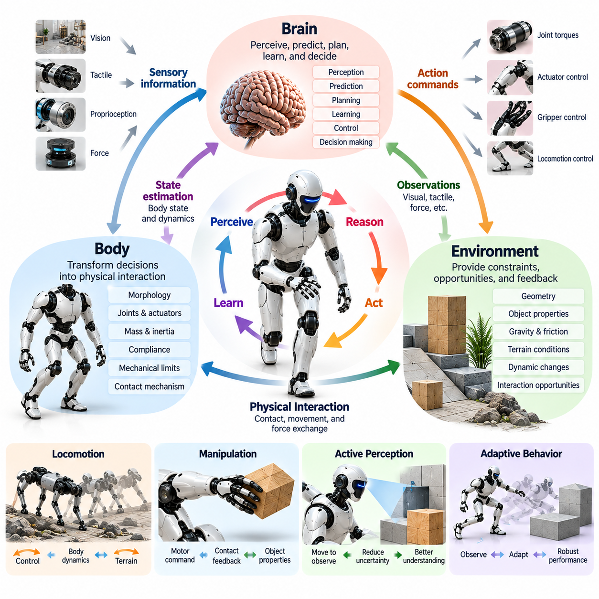{width="7.268055555555556in" height="7.268055555555556in"}

Brain-body-environment coupling describes the continuous and reciprocal interactions through which cognitive processes, physical structures, and environmental dynamics jointly produce intelligent behavior. In embodied intelligence, the brain represents the computational or neural mechanisms responsible for perception, learning, and decision-making, while the body provides the physical interface through which these processes influence and experience the surrounding world.

The central principle of this coupling is that intelligence cannot be fully explained by analyzing the brain, body, or environment independently. Each component influences the others through interconnected feedback processes. Computational decisions generate physical actions, bodily dynamics determine how those actions unfold, and environmental responses produce sensory information that modifies subsequent decisions and behavior.

The brain contributes perception, prediction, planning, learning, and adaptive control to the coupled system. In biological organisms, these functions involve distributed neural processes, while robotic systems implement them through computational models and control architectures. However, the effectiveness of these processes depends on the body\'s mechanical capabilities and the environmental conditions under which actions are performed.

The body transforms computational intentions into physical interactions through actuators, joints, structural elements, and contact mechanisms. Its geometry, mass distribution, inertia, compliance, and mechanical constraints influence the resulting movement. Consequently, identical control commands may produce different outcomes when applied to robots with different morphologies or when the same robot operates under changing physical conditions.

The environment completes the coupling by introducing external forces, geometric constraints, object properties, and interaction opportunities. Gravity, friction, terrain characteristics, and contact conditions determine how the body responds to actions. Environmental changes also influence sensory observations, creating a continuous feedback relationship in which the agent must update its internal estimates and adapt its behavior.

This relationship forms a closed-loop dynamical system in which perception and action continuously influence one another. Sensors measure the consequences of movement, computational processes interpret those measurements, and controllers generate new actions. The resulting physical interactions alter both the robot\'s state and its surroundings, ensuring that intelligent behavior develops through repeated cycles of observation, prediction, action, and correction.

Brain-body-environment coupling is fundamentally different from a purely sequential model in which perception is completed before reasoning begins and actions are executed afterward. Physical interaction often requires these processes to operate simultaneously. A robot maintaining balance must continuously estimate body orientation, adjust joint torques, and respond to ground contact without waiting for a complete reconstruction of the surrounding environment.

Locomotion provides a clear illustration of this dynamic coupling. During walking, a legged robot generates motor commands that interact with its mass distribution, joint dynamics, and ground contact conditions. Each foot placement changes the body\'s momentum and stability, while sensory feedback informs subsequent control adjustments. Stable walking emerges from coordinated interactions among control algorithms, mechanical dynamics, and terrain properties.

Manipulation demonstrates similar relationships at the level of object interaction. When a robotic hand grasps an object, the controller determines finger movements and gripping forces, but the outcome depends on finger geometry, surface friction, object stiffness, and contact distribution. Tactile and force feedback allow the system to adjust its grasp, illustrating how intelligence emerges through continuous coordination between computation and physical contact.

Mechanical compliance plays an important role in coupling because it influences how the body responds to unexpected forces. Flexible joints, elastic structures, and compliant materials can absorb impacts and redistribute contact loads before computational correction occurs. These passive physical responses interact with active control mechanisms, potentially improving stability while reducing the need for rapid corrective computation.

The temporal characteristics of coupling are equally important. Neural computation, actuator response, mechanical deformation, and environmental interaction operate at different timescales. A mechanical structure may respond almost immediately to contact, while perception and planning require additional processing time. Effective embodied systems coordinate these processes so that fast physical responses complement slower computational reasoning and decision-making.

Coupling also influences the development of internal representations and predictive models. A robot learns about its environment by observing how sensory measurements change following physical actions. Repeated interactions reveal relationships among motor commands, body dynamics, and environmental consequences. These experiences support the construction of models that predict future states and improve planning under uncertainty.

The relationship between action and perception is particularly important when environmental information is incomplete. An embodied agent can actively move to obtain observations that reduce uncertainty. A mobile robot may change its viewpoint to inspect an obstacle, while a manipulator may adjust contact to estimate an object\'s physical properties. Such actions demonstrate that perception is shaped by the body\'s capabilities and the environment\'s response.

Brain-body-environment coupling also explains why intelligent behavior is sensitive to morphological differences. A wheeled robot, quadruped, humanoid, and aerial robot experience different physical interactions even when pursuing similar objectives. Their locomotion mechanisms, sensor arrangements, and actuator capabilities determine how computational policies influence the environment and how environmental feedback becomes available.

Environmental structure can sometimes simplify the computational requirements of intelligent behavior. A robot may exploit a supporting surface to stabilize an object during manipulation or use mechanical guides to constrain movement. These interactions reduce the number of variables that must be actively controlled. The environment therefore contributes functional structure to the overall intelligent system rather than serving only as an external source of disturbances.

This principle is closely related to morphological computation, where the physical properties of the body contribute to functions otherwise requiring explicit computational processing. Elasticity, damping, passive dynamics, and structural geometry can regulate movement through mechanical interactions. Brain-body-environment coupling provides the broader framework within which such physical contributions interact with perception, learning, and active control.

Learning within a coupled system requires accounting for the consequences of actions across all three components. Reinforcement learning policies, for example, are shaped by observations, actuator capabilities, mechanical dynamics, and environmental rewards. A policy that performs effectively in one physical configuration may fail when payload, friction, compliance, or terrain conditions change, requiring adaptation to the altered coupling relationships.

The coupling perspective has important implications for simulation-based training and simulation-to-real transfer. A simulated environment must represent relevant body dynamics, sensor characteristics, actuator responses, and environmental interactions with sufficient fidelity. Differences between simulated and physical coupling can cause learned policies to behave unpredictably when deployed on real robots, even when their computational architectures remain unchanged.

Robustness emerges when the coupled system can maintain acceptable behavior despite disturbances and uncertainty. Mechanical structures may absorb part of an impact, sensors detect deviations, and controllers generate corrective responses. Successful recovery depends on the combined effectiveness of these processes. Robustness therefore cannot be attributed exclusively to computational intelligence or mechanical design.

Human-robot interaction introduces additional complexity because human behavior becomes part of the environment influencing the robot. A collaborative robot must interpret human movement, maintain safe separation, and adjust its actions according to changing intentions and physical proximity. Human responses are also influenced by the robot\'s movements, creating reciprocal interaction dynamics that require continuous perception and adaptation.

Engineering brain-body-environment coupling requires coordinated design across artificial intelligence, mechanical engineering, sensing, actuation, and control. Optimizing these components independently may produce a system with incompatible response characteristics or unnecessary complexity. Integrated design instead considers how computational capabilities, physical structures, and environmental conditions jointly determine task performance.

Evaluating coupled intelligence requires measurements that capture complete system behavior under realistic conditions. Task success, stability, energy efficiency, response latency, disturbance recovery, and adaptability provide complementary perspectives. Experiments involving changes in terrain, payload, object properties, or sensor conditions can reveal whether the system maintains effective coordination across different interaction scenarios.

For Physical AI, brain-body-environment coupling provides a foundational explanation of how computational intelligence becomes physically meaningful. Intelligent behavior results not simply from generating correct commands but from producing appropriate actions through a body operating within a changing environment. This perspective supports the development of morphology-aware control, adaptive learning, and integrated robotic architectures.

Ultimately, brain-body-environment coupling establishes intelligence as a dynamic property of an interacting physical system. Computational processes guide behavior, bodily structures shape its execution, and environmental dynamics determine its consequences. Understanding and engineering these reciprocal relationships is essential for creating Physical AI systems capable of adaptive, efficient, robust, and context-sensitive operation in the real world.

뇌-신체-환경 결합(Brain-Body-Environment Coupling)은 인지 과정(Cognitive Process), 물리적 구조(Physical Structure), 환경 동역학(Environmental Dynamics)이 지속적이고 상호적인 상호작용을 통해 지능적 행동(Intelligent Behavior)을 공동으로 형성하는 관계를 설명한다. 체화 지능(Embodied Intelligence)에서 뇌(Brain)는 인식(Perception), 학습(Learning), 의사결정(Decision-Making)을 담당하는 계산적 또는 신경학적 메커니즘(Computational or Neural Mechanism)을 의미하며, 신체(Body)는 이러한 과정이 주변 세계에 영향을 미치고 이를 경험할 수 있도록 하는 물리적 인터페이스(Physical Interface)를 제공한다.

이러한 결합의 핵심 원리는 뇌, 신체, 환경을 독립적으로 분석하는 것만으로는 지능을 완전히 설명할 수 없다는 것이다. 각 구성 요소는 상호 연결된 피드백 과정(Feedback Process)을 통해 다른 요소에 영향을 미친다. 계산적 의사결정(Computational Decision)은 물리적 행동(Physical Action)을 생성하고, 신체 동역학(Bodily Dynamics)은 행동이 실제로 전개되는 방식을 결정하며, 환경 반응(Environmental Response)은 이후의 의사결정과 행동을 변화시키는 감각 정보(Sensory Information)를 생성한다.

뇌는 결합 시스템(Coupled System)에 인식, 예측(Prediction), 계획(Planning), 학습, 적응형 제어(Adaptive Control) 기능을 제공한다. 생물학적 유기체(Biological Organism)에서는 이러한 기능이 분산된 신경 과정(Distributed Neural Process)을 통해 수행되며, 로봇 시스템(Robotic System)에서는 계산 모델(Computational Model)과 제어 아키텍처(Control Architecture)를 통해 구현된다. 그러나 이러한 과정의 효과는 신체의 기계적 능력(Mechanical Capability)과 행동이 수행되는 환경 조건(Environmental Condition)에 따라 달라진다.

신체는 액추에이터(Actuator), 관절(Joint), 구조 요소(Structural Element), 접촉 메커니즘(Contact Mechanism)을 통해 계산적 의도(Computational Intention)를 물리적 상호작용(Physical Interaction)으로 변환한다. 신체의 기하학적 형상(Geometry), 질량 분포(Mass Distribution), 관성(Inertia), 순응성(Compliance), 기계적 제약(Mechanical Constraint)은 실제 움직임에 영향을 미친다. 따라서 동일한 제어 명령(Control Command)이라도 서로 다른 형태학(Morphology)을 가진 로봇에 적용하거나 동일한 로봇이 변화하는 물리적 조건에서 작동하면 서로 다른 결과가 발생할 수 있다.

환경은 외력(External Force), 기하학적 제약(Geometric Constraint), 물체 특성(Object Property), 상호작용 기회(Interaction Opportunity)를 제공함으로써 결합 관계를 완성한다. 중력(Gravity), 마찰(Friction), 지형 특성(Terrain Characteristic), 접촉 조건(Contact Condition)은 신체가 행동에 반응하는 방식을 결정한다. 환경 변화는 감각 관측(Sensory Observation)에도 영향을 미치며, 에이전트(Agent)가 내부 추정값(Internal Estimate)을 갱신하고 행동을 적응시켜야 하는 지속적인 피드백 관계를 형성한다.

이러한 관계는 인식과 행동이 지속적으로 상호 영향을 미치는 폐루프 동적 시스템(Closed-Loop Dynamical System)을 형성한다. 센서(Sensor)는 움직임의 결과를 측정하고, 계산 과정(Computational Process)은 측정값을 해석하며, 제어기(Controller)는 새로운 행동을 생성한다. 그 결과 발생하는 물리적 상호작용은 로봇의 상태와 주변 환경을 모두 변화시키므로 지능적 행동은 관측(Observation), 예측, 행동, 보정(Correction)의 반복적인 순환을 통해 발전한다.

뇌-신체-환경 결합은 인식이 완료된 후 추론이 시작되고 그다음 행동이 실행되는 순차적 모델(Sequential Model)과 근본적으로 다르다. 물리적 상호작용에서는 이러한 과정이 동시에 작동해야 하는 경우가 많다. 균형을 유지하는 로봇은 주변 환경에 대한 완전한 재구성(Complete Reconstruction)이 끝날 때까지 기다리지 않고 신체 방향(Body Orientation)을 지속적으로 추정하고, 관절 토크(Joint Torque)를 조정하며, 지면 접촉(Ground Contact)에 대응해야 한다.

이동(Locomotion)은 이러한 동적 결합(Dynamic Coupling)을 명확하게 보여주는 사례이다. 보행 중 다리형 로봇(Legged Robot)은 질량 분포, 관절 동역학(Joint Dynamics), 지면 접촉 조건과 상호작용하는 운동 명령(Motor Command)을 생성한다. 각각의 발 배치(Foot Placement)는 신체의 운동량(Momentum)과 안정성(Stability)을 변화시키며, 감각 피드백(Sensory Feedback)은 이후의 제어 조정(Control Adjustment)에 필요한 정보를 제공한다. 안정적인 보행은 제어 알고리즘(Control Algorithm), 기계적 동역학(Mechanical Dynamics), 지형 특성 사이의 조정된 상호작용에서 형성된다.

조작(Manipulation)은 물체와의 상호작용 수준에서 유사한 관계를 보여준다. 로봇 손(Robotic Hand)이 물체를 파지(Grasping)할 때 제어기는 손가락 움직임(Finger Movement)과 파지력(Gripping Force)을 결정하지만, 실제 결과는 손가락 형상(Finger Geometry), 표면 마찰(Surface Friction), 물체 강성(Object Stiffness), 접촉 분포(Contact Distribution)에 따라 달라진다. 촉각 및 힘 피드백(Tactile and Force Feedback)은 시스템이 파지 상태를 조정할 수 있도록 하며, 지능이 계산과 물리적 접촉 사이의 지속적인 협응(Coordination)을 통해 형성된다는 점을 보여준다.

기계적 순응성(Mechanical Compliance)은 신체가 예상하지 못한 힘에 반응하는 방식에 영향을 미치므로 결합 관계에서 중요한 역할을 한다. 유연한 관절(Flexible Joint), 탄성 구조(Elastic Structure), 순응형 재료(Compliant Material)는 계산적 보정(Computational Correction)이 수행되기 전에 충격을 흡수하고 접촉 하중(Contact Load)을 재분배할 수 있다. 이러한 수동적 물리 반응(Passive Physical Response)은 능동 제어 메커니즘(Active Control Mechanism)과 상호작용하여 안정성을 개선하고 빠른 보정 계산의 필요성을 줄일 수 있다.

결합의 시간적 특성(Temporal Characteristic)도 중요하다. 신경 계산(Neural Computation), 액추에이터 응답(Actuator Response), 기계적 변형(Mechanical Deformation), 환경 상호작용(Environmental Interaction)은 서로 다른 시간 척도(Timescale)에서 작동한다. 기계적 구조는 접촉에 거의 즉각적으로 반응할 수 있지만, 인식과 계획에는 추가적인 처리 시간이 필요하다. 효과적인 체화 시스템(Embodied System)은 빠른 물리적 반응이 상대적으로 느린 계산적 추론(Computational Reasoning)과 의사결정을 보완하도록 이러한 과정을 조정한다.

결합은 내부 표현(Internal Representation)과 예측 모델(Predictive Model)의 개발에도 영향을 미친다. 로봇은 물리적 행동 이후 감각 측정값(Sensory Measurement)이 어떻게 변화하는지 관측함으로써 환경을 학습한다. 반복적인 상호작용은 운동 명령, 신체 동역학, 환경적 결과(Environmental Consequence) 사이의 관계를 드러낸다. 이러한 경험은 미래 상태(Future State)를 예측하고 불확실성(Uncertainty) 아래에서 계획 능력을 개선하는 모델의 구성을 지원한다.

행동과 인식 사이의 관계는 환경 정보가 불완전할 때 특히 중요하다. 체화 에이전트(Embodied Agent)는 불확실성을 줄이는 관측 정보를 획득하기 위해 능동적으로 움직일 수 있다. 모바일 로봇(Mobile Robot)은 장애물을 검사하기 위해 관측 시점(Viewpoint)을 변경할 수 있으며, 매니퓰레이터(Manipulator)는 물체의 물리적 특성을 추정하기 위해 접촉 상태를 조정할 수 있다. 이러한 행동은 인식이 신체의 능력과 환경의 반응에 의해 형성된다는 점을 보여준다.

뇌-신체-환경 결합은 지능적 행동이 형태학적 차이(Morphological Difference)에 민감한 이유도 설명한다. 바퀴형 로봇(Wheeled Robot), 사족보행 로봇(Quadruped Robot), 휴머노이드 로봇(Humanoid Robot), 비행 로봇(Aerial Robot)은 유사한 목표를 수행하더라도 서로 다른 물리적 상호작용을 경험한다. 각 플랫폼의 이동 메커니즘(Locomotion Mechanism), 센서 구성(Sensor Arrangement), 액추에이터 성능(Actuator Capability)은 계산 정책(Computational Policy)이 환경에 영향을 미치는 방식과 환경 피드백(Environmental Feedback)을 획득하는 방식을 결정한다.

환경 구조(Environmental Structure)는 때때로 지능적 행동에 필요한 계산 요구사항(Computational Requirement)을 단순화할 수 있다. 로봇은 조작 중 물체를 안정화하기 위해 지지 표면(Supporting Surface)을 활용하거나 움직임을 제한하기 위해 기계적 가이드(Mechanical Guide)를 사용할 수 있다. 이러한 상호작용은 능동적으로 제어해야 하는 변수(Variable)의 수를 줄인다. 따라서 환경은 단순히 외란(Disturbance)을 제공하는 외부 요소가 아니라 전체 지능형 시스템에 기능적 구조(Functional Structure)를 제공한다.

이 원리는 신체의 물리적 특성이 명시적인 계산 처리(Explicit Computational Processing)를 필요로 하는 기능에 기여하는 형태적 계산(Morphological Computation)과 밀접하게 관련된다. 탄성(Elasticity), 감쇠(Damping), 수동 동역학(Passive Dynamics), 구조적 형상(Structural Geometry)은 기계적 상호작용을 통해 움직임을 조절할 수 있다. 뇌-신체-환경 결합은 이러한 물리적 기여가 인식, 학습, 능동 제어(Active Control)와 상호작용하는 방식을 설명하는 더 넓은 프레임워크(Framework)를 제공한다.

결합 시스템 내에서의 학습은 세 가지 구성 요소 전반에 걸쳐 행동의 결과를 고려해야 한다. 예를 들어 강화학습 정책(Reinforcement Learning Policy)은 관측, 액추에이터 성능, 기계적 동역학, 환경 보상(Environmental Reward)의 영향을 받는다. 특정 물리적 구성에서 효과적으로 작동하는 정책이라도 탑재 하중(Payload), 마찰, 순응성, 지형 조건(Terrain Condition)이 변화하면 실패할 수 있으며, 변경된 결합 관계에 대한 적응(Adaptation)이 필요하다.

결합 관점(Coupling Perspective)은 시뮬레이션 기반 학습(Simulation-Based Training)과 시뮬레이션에서 현실로의 전이(Simulation-to-Real Transfer)에 중요한 시사점을 제공한다. 시뮬레이션 환경(Simulated Environment)은 관련된 신체 동역학, 센서 특성(Sensor Characteristic), 액추에이터 응답, 환경 상호작용을 충분한 충실도(Fidelity)로 표현해야 한다. 시뮬레이션과 실제 물리적 결합 사이의 차이는 계산 아키텍처(Computational Architecture)가 동일하더라도 학습된 정책이 실제 로봇(Real Robot)에 배포될 때 예측하기 어려운 행동을 발생시킬 수 있다.

강건성(Robustness)은 결합 시스템이 외란과 불확실성에도 불구하고 허용 가능한 행동을 유지할 수 있을 때 나타난다. 기계적 구조는 충격의 일부를 흡수하고, 센서는 편차(Deviation)를 감지하며, 제어기는 보정 응답(Corrective Response)을 생성한다. 성공적인 복구(Recovery)는 이러한 과정의 결합된 효과에 달려 있다. 따라서 강건성을 계산 지능(Computational Intelligence)이나 기계 설계(Mechanical Design) 중 어느 하나에만 귀속시킬 수는 없다.

인간-로봇 상호작용(Human-Robot Interaction)은 인간의 행동이 로봇에 영향을 미치는 환경의 일부가 되기 때문에 추가적인 복잡성을 발생시킨다. 협동 로봇(Collaborative Robot)은 인간의 움직임을 해석하고, 안전거리(Safe Separation)를 유지하며, 변화하는 의도(Intention)와 물리적 근접성(Physical Proximity)에 따라 행동을 조정해야 한다. 인간의 반응 역시 로봇의 움직임에 영향을 받으므로 지속적인 인식과 적응이 필요한 상호적 상호작용 동역학(Reciprocal Interaction Dynamics)이 형성된다.

뇌-신체-환경 결합을 공학적으로 구현하려면 인공지능(Artificial Intelligence), 기계공학(Mechanical Engineering), 감지(Sensing), 구동(Actuation), 제어(Control) 분야의 조정된 설계가 필요하다. 이러한 구성 요소를 독립적으로 최적화하면 응답 특성(Response Characteristic)이 서로 맞지 않거나 불필요한 복잡성을 가진 시스템이 만들어질 수 있다. 반면 통합 설계(Integrated Design)는 계산 능력(Computational Capability), 물리적 구조, 환경 조건이 공동으로 작업 성능(Task Performance)을 결정하는 방식을 고려한다.

결합 지능(Coupled Intelligence)을 평가하려면 현실적인 조건에서 전체 시스템 행동(Complete System Behavior)을 포착할 수 있는 측정이 필요하다. 작업 성공(Task Success), 안정성, 에너지 효율(Energy Efficiency), 응답 지연시간(Response Latency), 외란 복구(Disturbance Recovery), 적응성(Adaptability)은 상호 보완적인 평가 관점을 제공한다. 지형, 탑재 하중, 물체 특성, 센서 조건(Sensor Condition)을 변화시키는 실험은 시스템이 다양한 상호작용 상황에서 효과적인 협응을 유지하는지 확인할 수 있도록 한다.

피지컬 AI(Physical AI)에서 뇌-신체-환경 결합은 계산 지능이 어떻게 물리적으로 의미 있는 행동으로 구현되는지를 설명하는 근본적인 기반(Foundational Explanation)을 제공한다. 지능적 행동은 단순히 올바른 명령을 생성하는 것에서 비롯되는 것이 아니라 변화하는 환경 속에서 작동하는 신체를 통해 적절한 행동을 수행함으로써 형성된다. 이러한 관점은 형태 인식 제어(Morphology-Aware Control), 적응형 학습(Adaptive Learning), 통합 로봇 아키텍처(Integrated Robotic Architecture)의 개발을 지원한다.

궁극적으로 뇌-신체-환경 결합은 지능을 상호작용하는 물리 시스템(Interacting Physical System)의 동적 특성(Dynamic Property)으로 정의한다. 계산 과정은 행동을 유도하고, 신체 구조(Bodily Structure)는 행동의 실행 방식을 형성하며, 환경 동역학은 행동의 결과를 결정한다. 이러한 상호적 관계(Reciprocal Relationship)를 이해하고 공학적으로 구현하는 것은 현실 세계에서 적응적이고, 효율적이며, 강건하고, 상황에 민감한(Context-Sensitive) 작동을 수행할 수 있는 피지컬 AI 시스템을 개발하기 위한 필수 조건이다.

##  

## 01.05. Perception Action Coupling

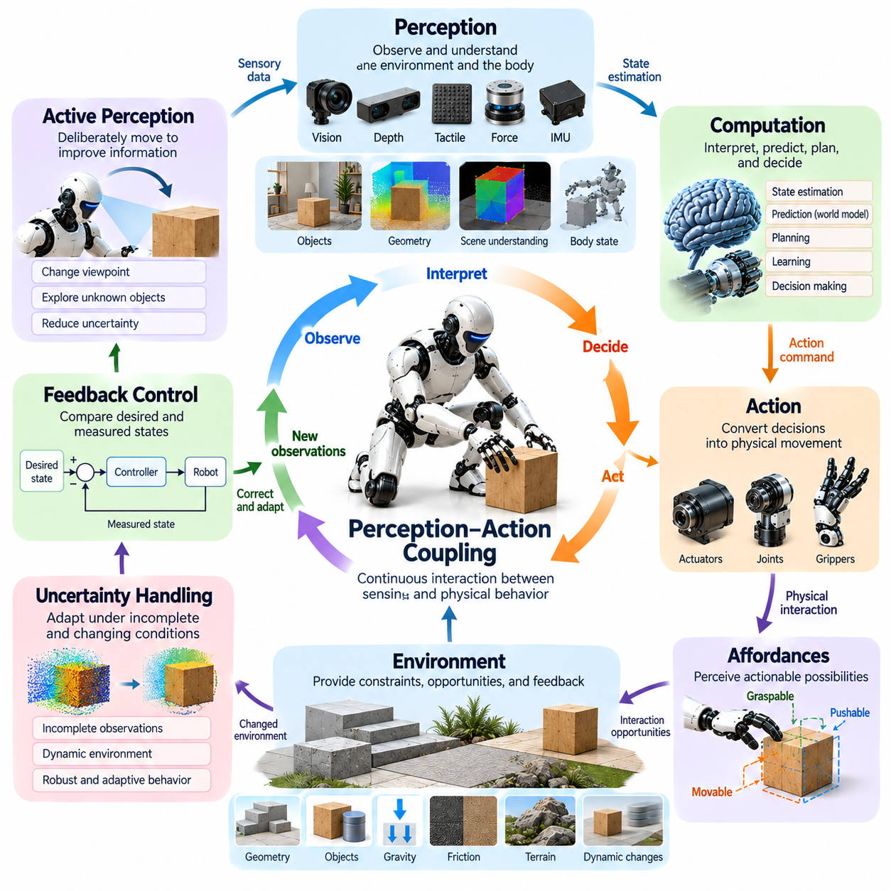{width="7.268055555555556in" height="7.268055555555556in"}

Perception-action coupling describes the continuous interaction between sensory information and physical behavior through which embodied agents understand and influence their environments. Perception provides information about external conditions and internal states, while action changes those conditions and determines subsequent observations. Intelligent behavior emerges from this reciprocal relationship rather than from perception and action operating as independent processes.

Traditional artificial intelligence architectures often organize perception, reasoning, planning, and action into sequential processing stages. Although this structure supports modular development, it may introduce delays when environmental conditions change rapidly. Perception-action coupling emphasizes continuous feedback, allowing an agent to adjust its movements while simultaneously updating its understanding of the surrounding world.

The perception-action loop begins when sensors acquire information about the environment and the agent\'s physical state. Cameras, depth sensors, tactile sensors, force sensors, and inertial measurement units provide complementary observations. Computational processes interpret these measurements and generate actions, while the resulting movements alter sensory inputs and initiate further adjustments through closed-loop control.

A defining characteristic of perception-action coupling is that perception influences action while action actively shapes perception. A robot approaching an unfamiliar object may reposition its camera to improve visibility before attempting manipulation. Similarly, a mobile robot may move around an obstacle to reveal previously hidden geometry. These examples demonstrate that sensing is not merely passive observation but an activity influenced by behavioral objectives.

The coupling relationship is particularly important because physical environments are dynamic and only partially observable. Moving objects, changing lighting conditions, contact forces, and unexpected disturbances continuously modify the information available to an agent. A robot must therefore update its internal estimates while acting, rather than relying exclusively on a static environmental representation constructed before movement begins.

Closed-loop control provides a practical implementation of perception-action coupling. The controller compares desired behavior with measured system states and generates corrective commands when deviations occur. In mobile robotics, wheel encoders and inertial sensors support velocity and orientation regulation. In manipulation, force and tactile feedback enable continuous adjustment of contact conditions and gripping forces.

Perception-action coupling also operates across multiple temporal scales. Low-level control loops respond rapidly to changes in joint position, force, or body orientation, while higher-level processes evaluate task progress and select future actions. Effective embodied systems coordinate these processes so that immediate physical corrections remain consistent with broader planning objectives and environmental constraints.

Locomotion illustrates how perception and action jointly maintain stability. A legged robot must continuously estimate its body orientation, contact state, and movement velocity while adjusting joint torques and foot placement. Each step changes the robot\'s momentum and contact conditions, producing new sensory information. Stable walking consequently depends on continuous coordination between sensing, mechanical dynamics, and motor control.

Manipulation demonstrates a similar relationship during physical contact with objects. When a robotic gripper closes around an object, tactile and force measurements reveal contact location, pressure distribution, and potential slippage. The controller modifies finger positions or gripping forces according to these observations. Successful grasping therefore develops through repeated interaction rather than relying solely on a predetermined motion sequence.

Active perception represents an important extension of perception-action coupling because actions can be selected specifically to improve information quality. A robot may rotate an object to inspect an occluded surface, change its viewing angle to reduce visual ambiguity, or probe a material to estimate stiffness. These exploratory actions reduce uncertainty and provide information needed for more reliable task execution.

The concept of affordances further connects perception with actionable possibilities. An affordance describes an opportunity for action arising from the relationship between an agent\'s capabilities and environmental properties. A handle may offer a grasping opportunity for a dexterous robotic hand, while a narrow opening may permit passage for a compact mobile platform. Perception must identify these relationships to support meaningful action selection.

Sensorimotor contingencies describe predictable relationships between an agent\'s movements and resulting sensory changes. When a robot moves its camera, the apparent positions of objects change according to viewpoint geometry. When it presses against a surface, tactile and force measurements vary with contact conditions. Learning these relationships helps the agent distinguish self-generated sensory changes from external environmental events.

Predictive models strengthen perception-action coupling by allowing an agent to anticipate the consequences of movement. A robot can estimate how a planned action will change its position, contact forces, or visual observations before execution. These predictions are compared with actual sensory feedback, enabling the system to identify modeling errors and adapt its behavior when physical outcomes differ from expectations.

Uncertainty plays a central role in determining how perception and action should interact. Sensor noise, occlusion, imperfect calibration, and unpredictable environmental dynamics limit the reliability of observations. An intelligent agent may respond by slowing its movement, gathering additional measurements, or selecting safer actions. Perception-action coupling therefore supports decisions that account for both task objectives and the confidence of available information.

The relationship between perception and action is strongly influenced by robot morphology. Sensor placement, joint configuration, actuator characteristics, and mechanical compliance determine which observations and movements are possible. A humanoid robot can coordinate head movements and hand manipulation, while an aerial robot may alter its flight trajectory to improve visibility. Different embodiments consequently produce distinct perception-action strategies.

Mechanical dynamics also affect the coupling process because physical responses can occur before computational updates are completed. Compliant joints and flexible structures may absorb disturbances while sensors and controllers prepare corrective actions. Such interactions demonstrate that perception-action coupling operates through the combined behavior of computational processes and physical mechanisms rather than through software control alone.

Learning-based control provides mechanisms for improving perception-action relationships through experience. Reinforcement learning can optimize policies that map observations to actions according to task outcomes, while imitation learning can acquire sensorimotor behavior from demonstrations. The effectiveness of these approaches depends on whether training experiences adequately represent the physical conditions encountered during deployment.

Perception-action coupling is especially important for transferring learned policies from simulation to real hardware. Differences in sensor noise, actuator latency, friction, and contact dynamics can alter the relationship between actions and observations. A policy that performs well in simulation may become unstable when these relationships change. Robust deployment therefore requires calibration, adaptation, and validation under realistic operating conditions.

Human-robot interaction introduces additional perception-action requirements because human movements and responses are continuously changing. A collaborative robot must observe human proximity, interpret movement intentions, and adjust its trajectory to maintain safe interaction. The robot\'s actions may also influence human behavior, creating reciprocal feedback that requires ongoing monitoring and context-sensitive control.

Engineering perception-action coupling requires coordinated development of sensing, computation, actuation, and control architectures. Sensor update rates, communication delays, processing latency, and actuator bandwidth determine how quickly the system can respond to environmental changes. Poor coordination may produce outdated decisions or unstable behavior, even when individual perception and control components perform accurately.

Evaluating perception-action coupling requires examining how effectively an agent maintains performance during changing physical conditions. Relevant measures include task success, response latency, tracking accuracy, disturbance recovery, contact stability, and adaptation to uncertainty. Experiments involving moving obstacles, sensor degradation, variable payloads, and unexpected contact can reveal weaknesses in the feedback relationship.

For Physical AI, perception-action coupling provides a fundamental mechanism through which computational intelligence becomes responsive physical behavior. Perception supplies information needed for decision-making, while action generates new experiences that refine environmental understanding. This continuous interaction supports adaptive locomotion, dexterous manipulation, autonomous navigation, and reliable operation in environments that cannot be completely predicted in advance.

Ultimately, perception-action coupling establishes sensing and movement as mutually dependent components of embodied intelligence. Intelligent agents do not simply observe the world and then act upon it; they continuously reshape their observations through physical interaction. Understanding and engineering this reciprocal process is essential for developing Physical AI systems capable of robust, adaptive, and context-aware behavior in complex real-world environments.

인식-행동 결합(Perception-Action Coupling)은 체화 에이전트(Embodied Agent)가 환경을 이해하고 환경에 영향을 미치는 과정에서 감각 정보(Sensory Information)와 물리적 행동(Physical Behavior) 사이에 발생하는 지속적인 상호작용을 설명한다. 인식(Perception)은 외부 조건(External Condition)과 내부 상태(Internal State)에 관한 정보를 제공하며, 행동(Action)은 이러한 조건을 변화시키고 이후의 관측(Observation)을 결정한다. 지능적 행동(Intelligent Behavior)은 인식과 행동이 독립적인 과정으로 작동하는 것이 아니라 상호적인 관계(Reciprocal Relationship)를 형성함으로써 나타난다.

전통적인 인공지능 아키텍처(Traditional Artificial Intelligence Architecture)는 인식, 추론(Reasoning), 계획(Planning), 행동을 순차적인 처리 단계(Sequential Processing Stage)로 구성하는 경우가 많다. 이러한 구조는 모듈식 개발(Modular Development)을 지원하지만, 환경 조건이 빠르게 변화할 때 지연(Delay)을 발생시킬 수 있다. 인식-행동 결합은 지속적인 피드백(Continuous Feedback)을 강조하며, 에이전트가 주변 세계에 대한 이해를 갱신하는 동시에 움직임을 조정할 수 있도록 한다.

인식-행동 루프(Perception-Action Loop)는 센서(Sensor)가 환경과 에이전트의 물리적 상태(Physical State)에 관한 정보를 획득하면서 시작된다. 카메라(Camera), 깊이 센서(Depth Sensor), 촉각 센서(Tactile Sensor), 힘 센서(Force Sensor), 관성 측정 장치(Inertial Measurement Unit)는 상호 보완적인 관측 정보를 제공한다. 계산 과정(Computational Process)은 이러한 측정값을 해석하고 행동을 생성하며, 그 결과 발생하는 움직임은 감각 입력(Sensory Input)을 변화시키고 폐루프 제어(Closed-Loop Control)를 통한 추가적인 조정을 유도한다.

인식-행동 결합의 핵심적인 특징은 인식이 행동에 영향을 미치는 동시에 행동이 인식을 능동적으로 형성한다는 점이다. 익숙하지 않은 물체에 접근하는 로봇은 조작(Manipulation)을 시도하기 전에 가시성(Visibility)을 개선하기 위해 카메라 위치를 변경할 수 있다. 마찬가지로 모바일 로봇(Mobile Robot)은 장애물(Obstacle) 주변으로 이동하여 이전에는 가려져 있던 기하학적 구조(Geometry)를 확인할 수 있다. 이러한 사례는 감지(Sensing)가 단순한 수동적 관측(Passive Observation)이 아니라 행동 목표(Behavioral Objective)의 영향을 받는 활동임을 보여준다.

물리적 환경(Physical Environment)은 동적(Dynamic)이며 부분적으로만 관측 가능(Partially Observable)하기 때문에 인식-행동 결합은 특히 중요하다. 움직이는 물체(Moving Object), 변화하는 조명 조건(Lighting Condition), 접촉력(Contact Force), 예상하지 못한 외란(Unexpected Disturbance)은 에이전트가 이용할 수 있는 정보를 지속적으로 변화시킨다. 따라서 로봇은 움직임이 시작되기 전에 구성된 정적인 환경 표현(Static Environmental Representation)에만 의존하지 않고, 행동하는 동안 내부 추정값(Internal Estimate)을 지속적으로 갱신해야 한다.

폐루프 제어(Closed-Loop Control)는 인식-행동 결합을 실용적으로 구현하는 방법을 제공한다. 제어기(Controller)는 목표 행동(Desired Behavior)과 측정된 시스템 상태(Measured System State)를 비교하고 편차(Deviation)가 발생하면 보정 명령(Corrective Command)을 생성한다. 모바일 로보틱스(Mobile Robotics)에서는 휠 엔코더(Wheel Encoder)와 관성 센서(Inertial Sensor)가 속도(Velocity) 및 방향(Orientation) 조절을 지원한다. 조작 작업에서는 힘 및 촉각 피드백(Force and Tactile Feedback)이 접촉 조건(Contact Condition)과 파지력(Gripping Force)의 지속적인 조정을 가능하게 한다.

인식-행동 결합은 여러 시간 척도(Temporal Scale)에 걸쳐 작동한다. 저수준 제어 루프(Low-Level Control Loop)는 관절 위치(Joint Position), 힘(Force), 신체 방향(Body Orientation)의 변화에 빠르게 반응하는 반면, 고수준 처리 과정(Higher-Level Process)은 작업 진행 상태(Task Progress)를 평가하고 향후 행동을 선택한다. 효과적인 체화 시스템(Embodied System)은 즉각적인 물리적 보정(Physical Correction)이 더 넓은 계획 목표(Planning Objective)와 환경 제약(Environmental Constraint)에 부합하도록 이러한 과정을 조정한다.

이동(Locomotion)은 인식과 행동이 안정성(Stability)을 공동으로 유지하는 방식을 보여준다. 다리형 로봇(Legged Robot)은 관절 토크(Joint Torque)와 발 배치(Foot Placement)를 조정하면서 신체 방향, 접촉 상태(Contact State), 이동 속도(Movement Velocity)를 지속적으로 추정해야 한다. 각각의 보행 단계(Step)는 로봇의 운동량(Momentum)과 접촉 조건을 변화시키고 새로운 감각 정보를 생성한다. 따라서 안정적인 보행(Stable Walking)은 감지, 기계적 동역학(Mechanical Dynamics), 운동 제어(Motor Control) 사이의 지속적인 협응(Coordination)에 의존한다.

조작은 물체와 물리적으로 접촉하는 과정에서 유사한 관계를 보여준다. 로봇 그리퍼(Robotic Gripper)가 물체를 감싸며 닫힐 때 촉각 및 힘 측정(Tactile and Force Measurement)은 접촉 위치(Contact Location), 압력 분포(Pressure Distribution), 잠재적인 미끄러짐(Potential Slippage)을 나타낸다. 제어기는 이러한 관측에 따라 손가락 위치(Finger Position)나 파지력을 수정한다. 따라서 성공적인 파지(Successful Grasping)는 미리 결정된 동작 순서(Predetermined Motion Sequence)에만 의존하는 것이 아니라 반복적인 상호작용을 통해 이루어진다.

능동 인식(Active Perception)은 정보의 품질(Information Quality)을 개선하기 위한 목적으로 행동을 선택할 수 있다는 점에서 인식-행동 결합의 중요한 확장 개념이다. 로봇은 가려진 표면(Occluded Surface)을 검사하기 위해 물체를 회전시키거나, 시각적 모호성(Visual Ambiguity)을 줄이기 위해 관측 각도(Viewing Angle)를 변경하거나, 강성(Stiffness)을 추정하기 위해 재료를 탐침(Probe)할 수 있다. 이러한 탐색 행동(Exploratory Action)은 불확실성(Uncertainty)을 줄이고 더욱 신뢰할 수 있는 작업 수행(Task Execution)에 필요한 정보를 제공한다.

행동유도성(Affordance) 개념은 인식과 실행 가능한 행동 가능성(Actionable Possibility)을 더욱 긴밀하게 연결한다. 행동유도성은 에이전트의 능력(Agent Capability)과 환경 특성(Environmental Property) 사이의 관계에서 발생하는 행동 기회(Opportunity for Action)를 의미한다. 손잡이(Handle)는 정교한 로봇 손(Dexterous Robotic Hand)에 파지 기회를 제공할 수 있으며, 좁은 통로(Narrow Opening)는 소형 모바일 플랫폼(Compact Mobile Platform)의 통과를 허용할 수 있다. 인식은 의미 있는 행동 선택(Action Selection)을 지원하기 위해 이러한 관계를 식별해야 한다.

감각운동 수반관계(Sensorimotor Contingency)는 에이전트의 움직임과 그 결과 발생하는 감각 변화(Sensory Change) 사이의 예측 가능한 관계를 설명한다. 로봇이 카메라를 움직이면 물체의 겉보기 위치(Apparent Position)는 관측 시점의 기하학(Viewpoint Geometry)에 따라 변화한다. 로봇이 표면을 누르면 촉각 및 힘 측정값은 접촉 조건에 따라 달라진다. 이러한 관계를 학습하면 에이전트는 스스로 생성한 감각 변화(Self-Generated Sensory Change)와 외부 환경 사건(External Environmental Event)을 구별할 수 있다.

예측 모델(Predictive Model)은 에이전트가 움직임의 결과를 사전에 예상할 수 있도록 하여 인식-행동 결합을 강화한다. 로봇은 계획된 행동(Planned Action)을 실행하기 전에 해당 행동이 자신의 위치(Position), 접촉력, 시각적 관측(Visual Observation)을 어떻게 변화시킬지 추정할 수 있다. 이러한 예측은 실제 감각 피드백(Actual Sensory Feedback)과 비교되며, 시스템은 이를 통해 모델링 오류(Modeling Error)를 식별하고 물리적 결과가 예상과 다를 때 행동을 적응시킬 수 있다.

불확실성은 인식과 행동이 상호작용하는 방식을 결정하는 데 핵심적인 역할을 한다. 센서 잡음(Sensor Noise), 가림(Occlusion), 불완전한 보정(Imperfect Calibration), 예측하기 어려운 환경 동역학(Environmental Dynamics)은 관측의 신뢰성(Reliability)을 제한한다. 지능형 에이전트(Intelligent Agent)는 이동 속도를 줄이거나, 추가 측정값(Additional Measurement)을 수집하거나, 더 안전한 행동(Safer Action)을 선택함으로써 대응할 수 있다. 따라서 인식-행동 결합은 작업 목표(Task Objective)와 이용 가능한 정보의 신뢰도(Confidence)를 함께 고려하는 의사결정(Decision-Making)을 지원한다.

인식과 행동 사이의 관계는 로봇 형태학(Robot Morphology)의 영향을 크게 받는다. 센서 배치(Sensor Placement), 관절 구성(Joint Configuration), 액추에이터 특성(Actuator Characteristic), 기계적 순응성(Mechanical Compliance)은 어떤 관측과 움직임이 가능한지를 결정한다. 휴머노이드 로봇(Humanoid Robot)은 머리 움직임(Head Movement)과 손 조작(Hand Manipulation)을 조정할 수 있으며, 비행 로봇(Aerial Robot)은 가시성을 개선하기 위해 비행 궤적(Flight Trajectory)을 변경할 수 있다. 따라서 서로 다른 신체 형태(Embodiment)는 고유한 인식-행동 전략(Perception-Action Strategy)을 형성한다.

기계적 동역학도 계산적 갱신(Computational Update)이 완료되기 전에 물리적 반응(Physical Response)이 발생할 수 있다는 점에서 결합 과정에 영향을 미친다. 순응형 관절(Compliant Joint)과 유연한 구조(Flexible Structure)는 센서와 제어기가 보정 동작(Corrective Action)을 준비하는 동안 외란을 흡수할 수 있다. 이러한 상호작용은 인식-행동 결합이 소프트웨어 제어(Software Control)만으로 작동하는 것이 아니라 계산 과정과 물리적 메커니즘(Physical Mechanism)이 결합된 행동을 통해 이루어진다는 점을 보여준다.

학습 기반 제어(Learning-Based Control)는 경험을 통해 인식-행동 관계를 개선하는 메커니즘을 제공한다. 강화학습(Reinforcement Learning)은 작업 결과(Task Outcome)에 따라 관측을 행동으로 연결하는 정책(Policy)을 최적화할 수 있으며, 모방학습(Imitation Learning)은 시연(Demonstration)으로부터 감각운동 행동(Sensorimotor Behavior)을 학습할 수 있다. 이러한 접근 방식의 효과는 학습 경험(Training Experience)이 실제 배포(Deployment) 과정에서 마주치는 물리적 조건을 얼마나 충분히 반영하는지에 따라 달라진다.

인식-행동 결합은 학습된 정책(Learned Policy)을 시뮬레이션(Simulation)에서 실제 하드웨어(Real Hardware)로 전이할 때 특히 중요하다. 센서 잡음, 액추에이터 지연시간(Actuator Latency), 마찰(Friction), 접촉 동역학(Contact Dynamics)의 차이는 행동과 관측 사이의 관계를 변화시킬 수 있다. 시뮬레이션에서 우수하게 작동하는 정책도 이러한 관계가 변화하면 불안정해질 수 있다. 따라서 강건한 배포(Robust Deployment)를 위해서는 현실적인 작동 조건(Operating Condition)에서의 보정(Calibration), 적응(Adaptation), 검증(Validation)이 필요하다.

인간-로봇 상호작용(Human-Robot Interaction)은 인간의 움직임과 반응이 지속적으로 변화하기 때문에 추가적인 인식-행동 요구사항을 발생시킨다. 협동 로봇(Collaborative Robot)은 인간과의 근접성(Human Proximity)을 관측하고, 움직임 의도(Movement Intention)를 해석하며, 안전한 상호작용(Safe Interaction)을 유지하도록 궤적(Trajectory)을 조정해야 한다. 로봇의 행동 역시 인간의 행동에 영향을 미칠 수 있으므로 지속적인 감시(Monitoring)와 상황 인식 제어(Context-Sensitive Control)가 필요한 상호적 피드백(Reciprocal Feedback)이 형성된다.

인식-행동 결합을 공학적으로 구현하려면 감지(Sensing), 계산(Computation), 구동(Actuation), 제어 아키텍처(Control Architecture)의 조정된 개발이 필요하다. 센서 갱신 주기(Sensor Update Rate), 통신 지연(Communication Delay), 처리 지연시간(Processing Latency), 액추에이터 대역폭(Actuator Bandwidth)은 시스템이 환경 변화에 얼마나 빠르게 반응할 수 있는지를 결정한다. 개별 인식 및 제어 구성 요소가 정확하게 작동하더라도 이들 사이의 협응이 부족하면 오래된 정보에 기반한 의사결정(Outdated Decision)이나 불안정한 행동(Unstable Behavior)이 발생할 수 있다.

인식-행동 결합을 평가하려면 에이전트가 변화하는 물리적 조건에서 얼마나 효과적으로 성능을 유지하는지 검토해야 한다. 주요 평가 지표(Evaluation Metric)에는 작업 성공(Task Success), 응답 지연시간(Response Latency), 추종 정확도(Tracking Accuracy), 외란 복구(Disturbance Recovery), 접촉 안정성(Contact Stability), 불확실성에 대한 적응(Adaptation to Uncertainty)이 포함된다. 움직이는 장애물(Moving Obstacle), 센서 성능 저하(Sensor Degradation), 가변 탑재 하중(Variable Payload), 예상하지 못한 접촉(Unexpected Contact)을 포함하는 실험은 피드백 관계의 취약점을 드러낼 수 있다.

피지컬 AI(Physical AI)에서 인식-행동 결합은 계산 지능(Computational Intelligence)이 반응성 있는 물리적 행동(Responsive Physical Behavior)으로 구현되는 근본적인 메커니즘을 제공한다. 인식은 의사결정에 필요한 정보를 제공하며, 행동은 환경에 대한 이해(Environmental Understanding)를 정교하게 만드는 새로운 경험을 생성한다. 이러한 지속적인 상호작용은 적응형 이동(Adaptive Locomotion), 정교한 조작(Dexterous Manipulation), 자율 항법(Autonomous Navigation), 사전에 완전히 예측할 수 없는 환경에서의 신뢰할 수 있는 작동(Reliable Operation)을 지원한다.

궁극적으로 인식-행동 결합은 감지와 움직임을 체화 지능(Embodied Intelligence)의 상호 의존적인 구성 요소(Mutually Dependent Component)로 확립한다. 지능형 에이전트는 단순히 세계를 관측한 다음 행동하는 것이 아니라 물리적 상호작용을 통해 자신의 관측을 지속적으로 변화시킨다. 이러한 상호적 과정(Reciprocal Process)을 이해하고 공학적으로 구현하는 것은 복잡한 현실 세계 환경(Complex Real-World Environment)에서 강건하고 적응적이며 상황 인식 기반(Context-Aware)의 행동을 수행할 수 있는 피지컬 AI 시스템을 개발하기 위한 필수 조건이다.

##  

## 01.06. Sensorimotor Intelligence

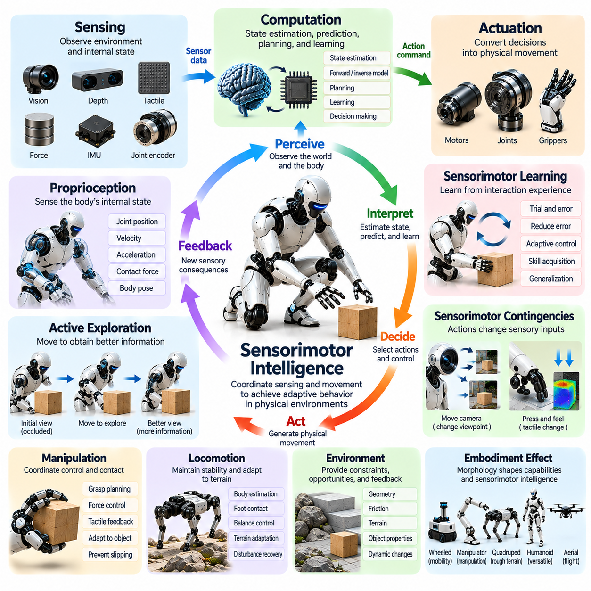{width="7.268055555555556in" height="7.268055555555556in"}

Sensorimotor intelligence refers to the ability of an embodied agent to coordinate sensory perception and motor activity to achieve adaptive behavior in physical environments. It emerges through continuous interactions among sensory signals, motor commands, bodily dynamics, and environmental responses. Rather than treating sensing and movement as separate functions, sensorimotor intelligence integrates them into a unified process of perception, action, learning, and adaptation.

The foundation of sensorimotor intelligence is the relationship between sensory inputs and motor outputs. Sensors provide information about the external environment and the agent\'s internal physical state, while motor systems generate movements that modify both. Each action produces new sensory consequences, establishing a feedback cycle through which the agent continuously adjusts its behavior according to changing physical conditions and task requirements.

Biological sensorimotor intelligence develops through repeated interactions between the nervous system, body, and environment. Humans and animals learn to coordinate vision, touch, proprioception, and movement through exploration and practice. Reaching, grasping, balancing, and walking gradually become coordinated behaviors as neural systems learn the relationships between motor activity and its sensory consequences.

In robotics, sensorimotor intelligence requires integrating perception algorithms, state estimation, control policies, and physical actuation. Cameras, tactile sensors, joint encoders, force sensors, and inertial measurement units provide complementary observations. These measurements support the estimation of body configuration, environmental conditions, and interaction forces, enabling controllers to generate movements appropriate to the current situation.

Proprioception is essential because intelligent movement depends on awareness of the body\'s configuration and dynamics. Joint positions, velocities, accelerations, and applied forces provide information about the robot\'s physical state. By combining proprioceptive measurements with external sensing, an embodied agent can distinguish changes caused by its own movements from those produced by environmental events or unexpected disturbances.

Sensorimotor coordination depends on temporal synchronization between perception and movement. Sensory measurements must be processed quickly enough to support appropriate motor responses, particularly during dynamic interactions. Communication delays, sensor sampling rates, actuator bandwidth, and computational latency influence the quality of coordination. Effective architectures align these processes across the timescales required by each task.

Sensorimotor learning allows agents to acquire movement skills through experience rather than relying entirely on predefined control rules. Repeated actions reveal how motor commands influence body motion and sensory observations. Learning algorithms use these relationships to improve coordination, reduce prediction errors, and refine control strategies. Over time, the agent develops behavioral capabilities adapted to its morphology and operating environment.

Internal models provide an important computational mechanism for sensorimotor intelligence. A forward model predicts the sensory or physical consequences of a motor command, while an inverse model estimates the actions needed to achieve a desired outcome. These models support anticipation, planning, and correction. Their predictions can be continuously updated using differences between expected and observed physical responses.

Sensorimotor contingencies describe systematic relationships between movement and resulting sensory changes. When a robot rotates its camera, visual observations change according to viewpoint geometry. When a robotic finger presses against an object, tactile signals vary with contact pressure and material properties. Learning these contingencies helps agents understand how their actions transform sensory information and reveal environmental structure.

Active exploration is a fundamental expression of sensorimotor intelligence. An agent may deliberately move its sensors, reposition its body, or manipulate an object to obtain information unavailable through passive observation. A robot can probe an unfamiliar surface to estimate stiffness or rotate an object to reveal hidden features. Such exploratory movements connect information acquisition directly with physical action.

Sensorimotor intelligence is particularly important for manipulation tasks requiring continuous contact regulation. A robotic hand must coordinate finger positions, contact forces, and tactile feedback while handling objects with different shapes and materials. Small changes in grip pressure may prevent slipping or excessive deformation. Successful manipulation therefore depends on adapting motor behavior to sensory evidence throughout the interaction.

Locomotion requires equally sophisticated sensorimotor coordination. A legged robot must estimate body orientation, foot contact, velocity, and terrain conditions while controlling joint movements. Unexpected ground irregularities can alter balance and momentum within a single step. Rapid sensory feedback and coordinated motor corrections allow the robot to maintain stability and continue moving despite uncertain environmental conditions.

Robot morphology strongly influences the development of sensorimotor capabilities. Joint arrangement, actuator characteristics, sensor placement, compliance, and mechanical constraints determine which movements and observations are available. A soft gripper may achieve stable contact through passive deformation, while a rigid robotic hand requires more precise force regulation. Sensorimotor intelligence consequently reflects the interaction between learning and physical design.

Reinforcement learning provides one approach to acquiring sensorimotor policies through interaction. Agents explore actions, observe their consequences, and improve behavior according to reward signals. Imitation learning offers another approach by transferring movement patterns from demonstrations. Both methods require appropriate sensory representations and training experiences that capture the physical dynamics relevant to successful deployment.

Robust sensorimotor intelligence must account for uncertainty, noise, and changing physical conditions. Sensor errors, actuator limitations, payload variations, and unexpected contact can disrupt previously learned coordination. Adaptive controllers and online estimation methods help compensate for these changes. The objective is not merely accurate movement under ideal conditions but reliable behavior when environmental and mechanical properties vary.

For Physical AI, sensorimotor intelligence provides the operational foundation for connecting learned representations with real-world action. It enables robots to transform sensory evidence into coordinated movement while using physical outcomes to improve future decisions. Integrating perception, prediction, motor control, and experiential learning is therefore essential for developing autonomous systems capable of adaptive manipulation, locomotion, and interaction.

Ultimately, sensorimotor intelligence demonstrates that intelligent physical behavior arises through the continuous integration of sensing and movement. Perception guides motor activity, actions generate new information, and learning progressively improves the relationship between them. This reciprocal process allows embodied agents to develop practical skills, respond to uncertainty, and operate effectively within complex and changing environments.

감각운동 지능(Sensorimotor Intelligence)은 체화 에이전트(Embodied Agent)가 물리적 환경(Physical Environment)에서 적응적 행동(Adaptive Behavior)을 수행하기 위해 감각 인식(Sensory Perception)과 운동 활동(Motor Activity)을 조정하는 능력을 의미한다. 이는 감각 신호(Sensory Signal), 운동 명령(Motor Command), 신체 동역학(Bodily Dynamics), 환경 반응(Environmental Response) 사이의 지속적인 상호작용을 통해 형성된다. 감각운동 지능은 감지(Sensing)와 움직임(Movement)을 별개의 기능으로 취급하는 대신 인식(Perception), 행동(Action), 학습(Learning), 적응(Adaptation)을 통합된 과정으로 연결한다.

감각운동 지능의 기초는 감각 입력(Sensory Input)과 운동 출력(Motor Output) 사이의 관계이다. 센서(Sensor)는 외부 환경(External Environment)과 에이전트의 내부 물리적 상태(Internal Physical State)에 관한 정보를 제공하며, 운동 시스템(Motor System)은 이 두 요소를 변화시키는 움직임을 생성한다. 각각의 행동은 새로운 감각적 결과(Sensory Consequence)를 발생시키며, 이를 통해 에이전트가 변화하는 물리적 조건과 작업 요구사항(Task Requirement)에 따라 행동을 지속적으로 조정하는 피드백 순환(Feedback Cycle)이 형성된다.

생물학적 감각운동 지능(Biological Sensorimotor Intelligence)은 신경계(Nervous System), 신체(Body), 환경(Environment) 사이의 반복적인 상호작용을 통해 발달한다. 인간과 동물은 탐색(Exploration)과 연습(Practice)을 통해 시각(Vision), 촉각(Touch), 고유수용감각(Proprioception), 움직임을 조정하는 방법을 학습한다. 뻗기(Reaching), 파지(Grasping), 균형 유지(Balancing), 보행(Walking)은 신경 시스템(Neural System)이 운동 활동과 그 감각적 결과 사이의 관계를 학습함에 따라 점차 조정된 행동(Coordinated Behavior)으로 발전한다.

로보틱스(Robotics)에서 감각운동 지능을 구현하려면 인식 알고리즘(Perception Algorithm), 상태 추정(State Estimation), 제어 정책(Control Policy), 물리적 구동(Physical Actuation)을 통합해야 한다. 카메라(Camera), 촉각 센서(Tactile Sensor), 관절 엔코더(Joint Encoder), 힘 센서(Force Sensor), 관성 측정 장치(Inertial Measurement Unit)는 상호 보완적인 관측 정보(Observation)를 제공한다. 이러한 측정값은 신체 구성(Body Configuration), 환경 조건(Environmental Condition), 상호작용 힘(Interaction Force)의 추정을 지원하며, 제어기(Controller)가 현재 상황에 적합한 움직임을 생성할 수 있도록 한다.

고유수용감각(Proprioception)은 지능적 움직임(Intelligent Movement)이 신체의 구성과 동역학(Dynamics)에 대한 인식에 의존하기 때문에 필수적이다. 관절 위치(Joint Position), 속도(Velocity), 가속도(Acceleration), 작용력(Applied Force)은 로봇의 물리적 상태(Physical State)에 관한 정보를 제공한다. 체화 에이전트는 고유수용감각 측정값(Proprioceptive Measurement)과 외부 감지(External Sensing)를 결합하여 자신의 움직임으로 발생한 변화와 환경적 사건(Environmental Event) 또는 예상하지 못한 외란(Unexpected Disturbance)에 의해 발생한 변화를 구별할 수 있다.

감각운동 협응(Sensorimotor Coordination)은 인식과 움직임 사이의 시간적 동기화(Temporal Synchronization)에 의존한다. 특히 동적 상호작용(Dynamic Interaction)에서는 적절한 운동 반응(Motor Response)을 지원할 수 있을 만큼 감각 측정값을 신속하게 처리해야 한다. 통신 지연(Communication Delay), 센서 샘플링 속도(Sensor Sampling Rate), 액추에이터 대역폭(Actuator Bandwidth), 계산 지연시간(Computational Latency)은 협응의 품질에 영향을 미친다. 효과적인 아키텍처(Effective Architecture)는 각 작업에서 요구하는 시간 척도(Timescale)에 맞추어 이러한 과정을 정렬한다.

감각운동 학습(Sensorimotor Learning)은 에이전트가 사전에 정의된 제어 규칙(Predefined Control Rule)에 전적으로 의존하지 않고 경험을 통해 운동 기술(Movement Skill)을 습득할 수 있도록 한다. 반복적인 행동은 운동 명령이 신체 움직임(Body Motion)과 감각 관측(Sensory Observation)에 어떤 영향을 미치는지 드러낸다. 학습 알고리즘(Learning Algorithm)은 이러한 관계를 활용하여 협응을 개선하고, 예측 오차(Prediction Error)를 줄이며, 제어 전략(Control Strategy)을 정교하게 만든다. 시간이 지남에 따라 에이전트는 자신의 형태학(Morphology)과 작동 환경(Operating Environment)에 적응된 행동 능력(Behavioral Capability)을 발전시킨다.

내부 모델(Internal Model)은 감각운동 지능을 구현하는 중요한 계산 메커니즘(Computational Mechanism)을 제공한다. 순방향 모델(Forward Model)은 운동 명령의 감각적 또는 물리적 결과를 예측하며, 역모델(Inverse Model)은 원하는 결과(Desired Outcome)를 달성하는 데 필요한 행동을 추정한다. 이러한 모델은 예상(Anticipation), 계획(Planning), 보정(Correction)을 지원한다. 또한 예상된 물리적 반응(Expected Physical Response)과 실제 관측된 반응(Observed Physical Response) 사이의 차이를 활용하여 예측값을 지속적으로 갱신할 수 있다.

감각운동 수반관계(Sensorimotor Contingency)는 움직임과 그 결과 발생하는 감각 변화(Sensory Change) 사이의 체계적인 관계를 설명한다. 로봇이 카메라를 회전시키면 시각적 관측(Visual Observation)은 관측 시점의 기하학(Viewpoint Geometry)에 따라 변화한다. 로봇 손가락(Robotic Finger)이 물체를 누르면 촉각 신호(Tactile Signal)는 접촉 압력(Contact Pressure)과 재료 특성(Material Property)에 따라 달라진다. 이러한 수반관계를 학습하면 에이전트는 자신의 행동이 감각 정보를 어떻게 변화시키고 환경 구조(Environmental Structure)를 어떻게 드러내는지 이해할 수 있다.

능동 탐색(Active Exploration)은 감각운동 지능의 근본적인 표현이다. 에이전트는 수동적 관측(Passive Observation)만으로 획득할 수 없는 정보를 얻기 위해 의도적으로 센서를 움직이거나, 신체 위치를 변경하거나, 물체를 조작할 수 있다. 로봇은 익숙하지 않은 표면(Unfamiliar Surface)을 탐침(Probe)하여 강성(Stiffness)을 추정하거나, 물체를 회전시켜 숨겨진 특징(Hidden Feature)을 드러낼 수 있다. 이러한 탐색적 움직임(Exploratory Movement)은 정보 획득(Information Acquisition)을 물리적 행동(Physical Action)과 직접 연결한다.

감각운동 지능은 지속적인 접촉 조절(Contact Regulation)이 필요한 조작 작업(Manipulation Task)에서 특히 중요하다. 로봇 손(Robotic Hand)은 서로 다른 형상(Shape)과 재료(Material)를 가진 물체를 다루는 동안 손가락 위치(Finger Position), 접촉력(Contact Force), 촉각 피드백(Tactile Feedback)을 조정해야 한다. 파지 압력(Grip Pressure)의 작은 변화만으로도 미끄러짐(Slipping)이나 과도한 변형(Excessive Deformation)을 방지할 수 있다. 따라서 성공적인 조작(Successful Manipulation)은 상호작용 전반에 걸쳐 감각적 증거(Sensory Evidence)에 맞추어 운동 행동(Motor Behavior)을 적응시키는 능력에 의존한다.

이동(Locomotion)에도 정교한 감각운동 협응이 필요하다. 다리형 로봇(Legged Robot)은 관절 움직임(Joint Movement)을 제어하는 동시에 신체 방향(Body Orientation), 발 접촉(Foot Contact), 속도, 지형 조건(Terrain Condition)을 추정해야 한다. 예상하지 못한 지면의 불규칙성(Ground Irregularity)은 단일 보행 단계(Step) 내에서도 균형(Balance)과 운동량(Momentum)을 변화시킬 수 있다. 빠른 감각 피드백(Sensory Feedback)과 조정된 운동 보정(Motor Correction)은 로봇이 불확실한 환경 조건에서도 안정성을 유지하고 이동을 지속할 수 있도록 한다.

로봇 형태학(Robot Morphology)은 감각운동 능력(Sensorimotor Capability)의 발달에 큰 영향을 미친다. 관절 배열(Joint Arrangement), 액추에이터 특성(Actuator Characteristic), 센서 배치(Sensor Placement), 순응성(Compliance), 기계적 제약(Mechanical Constraint)은 가능한 움직임과 관측의 범위를 결정한다. 소프트 그리퍼(Soft Gripper)는 수동적 변형(Passive Deformation)을 통해 안정적인 접촉을 달성할 수 있지만, 강체형 로봇 손(Rigid Robotic Hand)은 더욱 정밀한 힘 조절(Force Regulation)이 필요하다. 따라서 감각운동 지능은 학습과 물리적 설계(Physical Design) 사이의 상호작용을 반영한다.

강화학습(Reinforcement Learning)은 상호작용을 통해 감각운동 정책(Sensorimotor Policy)을 습득하는 하나의 접근 방법을 제공한다. 에이전트는 행동을 탐색하고, 그 결과를 관측하며, 보상 신호(Reward Signal)에 따라 행동을 개선한다. 모방학습(Imitation Learning)은 시연(Demonstration)으로부터 움직임 패턴(Movement Pattern)을 전이하는 또 다른 접근 방법이다. 두 방법 모두 적절한 감각 표현(Sensory Representation)과 실제 배포(Deployment)의 성공에 관련된 물리적 동역학(Physical Dynamics)을 반영하는 학습 경험(Training Experience)이 필요하다.

강건한 감각운동 지능(Robust Sensorimotor Intelligence)은 불확실성(Uncertainty), 잡음(Noise), 변화하는 물리적 조건을 고려해야 한다. 센서 오류(Sensor Error), 액추에이터 한계(Actuator Limitation), 탑재 하중 변화(Payload Variation), 예상하지 못한 접촉(Unexpected Contact)은 이전에 학습된 협응을 방해할 수 있다. 적응형 제어기(Adaptive Controller)와 온라인 추정 방법(Online Estimation Method)은 이러한 변화를 보상하는 데 도움을 준다. 목표는 이상적인 조건에서 정확한 움직임을 구현하는 것뿐만 아니라 환경적 및 기계적 특성이 변화할 때에도 신뢰할 수 있는 행동(Reliable Behavior)을 유지하는 것이다.

피지컬 AI(Physical AI)에서 감각운동 지능은 학습된 표현(Learned Representation)을 현실 세계의 행동(Real-World Action)과 연결하는 운영적 기반(Operational Foundation)을 제공한다. 감각운동 지능은 로봇이 감각적 증거를 조정된 움직임(Coordinated Movement)으로 변환하는 동시에 물리적 결과(Physical Outcome)를 활용하여 미래의 의사결정(Future Decision)을 개선할 수 있도록 한다. 따라서 인식, 예측(Prediction), 운동 제어(Motor Control), 경험 기반 학습(Experiential Learning)을 통합하는 것은 적응형 조작(Adaptive Manipulation), 이동, 상호작용을 수행할 수 있는 자율 시스템(Autonomous System)을 개발하는 데 필수적이다.

궁극적으로 감각운동 지능은 지능적인 물리적 행동(Intelligent Physical Behavior)이 감지와 움직임의 지속적인 통합(Continuous Integration)을 통해 형성된다는 점을 보여준다. 인식은 운동 활동을 안내하고, 행동은 새로운 정보를 생성하며, 학습은 이들 사이의 관계를 점진적으로 개선한다. 이러한 상호적 과정(Reciprocal Process)을 통해 체화 에이전트는 실용적인 기술(Practical Skill)을 발전시키고, 불확실성에 대응하며, 복잡하고 변화하는 환경(Complex and Changing Environment)에서 효과적으로 작동할 수 있다.

##  

## 01.07. Active Perception and Affordances

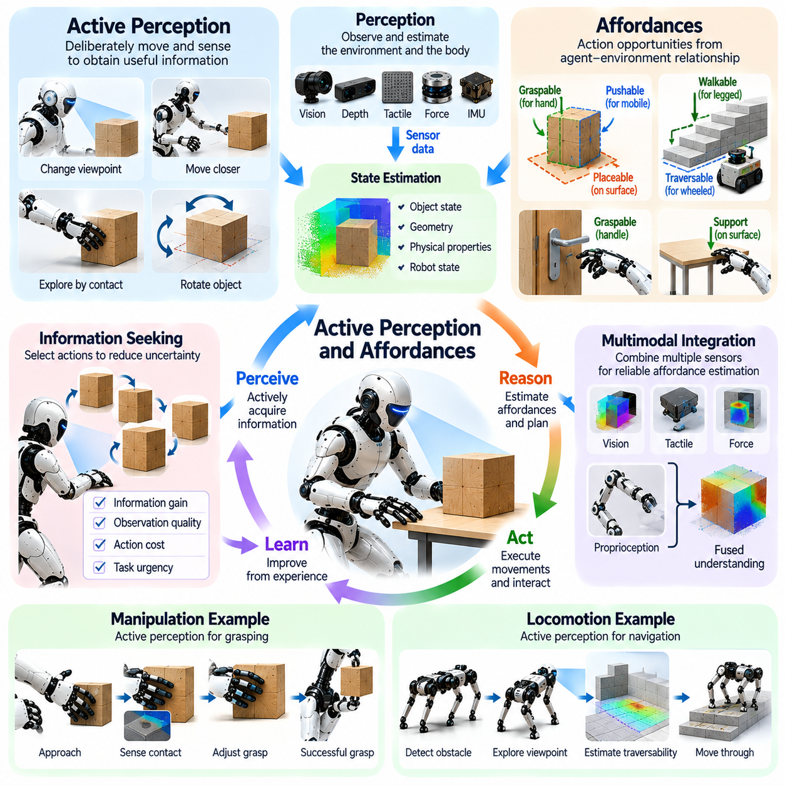{width="7.268055555555556in" height="7.268055555555556in"}

Active perception refers to the process through which an embodied agent deliberately selects movements and sensing strategies to acquire information relevant to its objectives. Unlike passive perception, which processes observations from a fixed viewpoint, active perception treats information gathering as an intentional behavior. The agent changes its position, sensor orientation, or interaction with objects to improve environmental understanding and support reliable decisions.

Affordances describe the opportunities for action that emerge from relationships between an agent\'s physical capabilities and environmental properties. An object does not possess the same actionable meaning for every agent. A handle may be graspable by a robotic hand, while a narrow passage may be traversable by a compact mobile robot. Affordance perception therefore connects environmental observations with the actions an embodied system can realistically perform.

Active perception and affordances are closely related because identifying an action opportunity often requires purposeful exploration. A robot may need to change its viewpoint to determine whether a handle is accessible or inspect a surface before deciding whether it can support locomotion. Perceptual actions reduce uncertainty about environmental properties, while affordance estimates guide the selection of movements that can achieve task objectives.

The theoretical foundation of active perception emphasizes that sensing and acting form an integrated feedback process. An agent generates actions that modify sensory inputs, interprets the resulting observations, and selects further actions according to its goals. This process challenges architectures that treat perception as a completed stage preceding action. Instead, environmental understanding develops continuously through interaction between the body and its surroundings.

Affordances are relational rather than purely geometric properties. Whether an object can be lifted depends not only on its shape but also on its mass, surface friction, and the robot\'s payload capacity. Similarly, whether terrain is traversable depends on ground conditions, robot morphology, and locomotion capabilities. Accurate affordance estimation therefore requires combining environmental information with knowledge of the agent\'s physical limitations.

Active vision provides a practical example of purposeful information acquisition. A robotic camera can change position or orientation to reduce occlusion, improve depth estimation, or reveal object surfaces. A mobile robot may approach an unfamiliar obstacle from multiple viewpoints to determine its geometry. These actions demonstrate that sensor placement and movement planning directly influence the quality of information available for decision-making.

Active tactile perception extends this principle to physical contact. A robotic manipulator may press, slide, or tap an object to estimate stiffness, texture, friction, or structural stability. Such information may be difficult to obtain reliably from visual observations alone. Controlled exploratory contact transforms the body into an information-gathering instrument, allowing the agent to infer properties that determine appropriate manipulation strategies.

The selection of perceptual actions can be formulated as an information-seeking problem. An intelligent agent estimates which movement is likely to reduce uncertainty about relevant environmental states. Information gain, observation quality, action cost, and task urgency may influence this selection. Effective active perception balances the value of additional knowledge against the time, energy, and physical risks associated with obtaining it.

Affordance learning enables robots to discover actionable relationships through experience. By attempting grasps, pushing objects, or traversing surfaces, an agent observes which interactions succeed under particular conditions. Learning algorithms associate sensory features and body states with possible action outcomes. These relationships support future decisions while remaining sensitive to changes in object properties and robot capabilities.

Perception of affordances often requires multimodal sensory integration. Vision provides information about shape, position, and visible surface characteristics, while tactile and force sensors reveal contact conditions and mechanical resistance. Proprioceptive measurements describe the robot\'s configuration and available movement range. Combining these sources produces more reliable estimates of whether a proposed action is physically feasible.

Uncertainty is unavoidable because environmental observations are incomplete and sensor measurements contain noise. An apparent grasping surface may be slippery, an object may be heavier than expected, or an obstacle may conceal additional geometry. Active perception addresses these uncertainties by acquiring targeted observations before or during execution. The agent can delay commitment, select exploratory actions, or revise its strategy when evidence is insufficient.

Affordances also depend on task context and intended outcomes. A surface may afford support during climbing, temporary placement during manipulation, or sliding during object transport. The same environmental feature can therefore support different actions depending on the robot\'s objective. Context-sensitive affordance reasoning connects physical opportunities with task planning and helps agents select interactions that are useful rather than merely possible.

Robot morphology strongly influences which affordances can be perceived and exploited. A dexterous robotic hand may manipulate small handles, while a soft gripper may conform to irregular objects. A quadruped can exploit footholds that are inaccessible to a wheeled platform. These differences demonstrate that affordance representations should incorporate embodiment-specific capabilities rather than assuming identical action opportunities across robotic systems.

Active perception and affordance reasoning also contribute to robust behavior under changing conditions. When an expected grasp fails or terrain becomes unstable, the robot can gather additional sensory evidence and reconsider available actions. This feedback process supports recovery without requiring a complete environmental model in advance. Adaptation emerges through repeated evaluation of action possibilities and their observed consequences.

In Physical AI, active perception and affordances provide complementary mechanisms for connecting environmental understanding with purposeful physical behavior. Active perception determines how an agent acquires task-relevant information, while affordance reasoning identifies what actions the environment permits relative to the agent\'s capabilities. Together, they support autonomous exploration, adaptive manipulation, navigation, and decision-making in uncertain environments.

Ultimately, intelligent interaction requires more than recognizing objects or reconstructing environmental geometry. An embodied agent must determine what information is missing, how to acquire it, and which actions are physically achievable and useful. Active perception transforms sensing into goal-directed exploration, while affordances transform observations into actionable possibilities. Their integration is fundamental to adaptive and context-aware robotic intelligence.

능동 인식(Active Perception)은 체화 에이전트(Embodied Agent)가 자신의 목표와 관련된 정보를 획득하기 위해 움직임과 감지 전략(Sensing Strategy)을 의도적으로 선택하는 과정을 의미한다. 고정된 관측 시점(Fixed Viewpoint)에서 얻은 정보를 처리하는 수동 인식(Passive Perception)과 달리, 능동 인식은 정보 수집(Information Gathering)을 의도적인 행동(Intentional Behavior)으로 취급한다. 에이전트는 환경에 대한 이해(Environmental Understanding)를 개선하고 신뢰할 수 있는 의사결정(Reliable Decision-Making)을 지원하기 위해 자신의 위치, 센서 방향(Sensor Orientation), 물체와의 상호작용(Object Interaction)을 변화시킨다.

행동유도성(Affordance)은 에이전트의 물리적 능력(Physical Capability)과 환경 특성(Environmental Property) 사이의 관계에서 발생하는 행동 기회(Opportunity for Action)를 설명한다. 동일한 물체라도 모든 에이전트에게 같은 행동 가능성(Actionable Possibility)을 제공하는 것은 아니다. 손잡이(Handle)는 로봇 손(Robotic Hand)으로 파지할 수 있으며, 좁은 통로(Narrow Passage)는 소형 모바일 로봇(Compact Mobile Robot)이 통과할 수 있다. 따라서 행동유도성 인식(Affordance Perception)은 환경 관측(Environmental Observation)을 체화 시스템이 실제로 수행할 수 있는 행동과 연결한다.

능동 인식과 행동유도성은 행동 기회를 식별하기 위해 목적 지향적 탐색(Purposeful Exploration)이 필요한 경우가 많다는 점에서 밀접하게 관련된다. 로봇은 손잡이에 접근할 수 있는지 판단하기 위해 관측 시점(Viewpoint)을 변경하거나, 특정 표면이 이동을 지지할 수 있는지 결정하기 전에 해당 표면을 검사해야 할 수 있다. 지각적 행동(Perceptual Action)은 환경 특성에 대한 불확실성(Uncertainty)을 줄이며, 행동유도성 추정(Affordance Estimation)은 작업 목표(Task Objective)를 달성할 수 있는 움직임을 선택하도록 안내한다.

능동 인식의 이론적 기반(Theoretical Foundation)은 감지(Sensing)와 행동(Action)이 통합된 피드백 과정(Integrated Feedback Process)을 형성한다는 점을 강조한다. 에이전트는 감각 입력(Sensory Input)을 변화시키는 행동을 생성하고, 그 결과 얻어진 관측(Observation)을 해석하며, 자신의 목표에 따라 추가 행동을 선택한다. 이러한 과정은 인식을 행동에 앞서 완료되는 단계로 취급하는 아키텍처(Architecture)에 도전한다. 대신 환경에 대한 이해는 신체(Body)와 주변 환경(Surroundings) 사이의 상호작용을 통해 지속적으로 발전한다.

행동유도성은 순수한 기하학적 특성(Purely Geometric Property)이 아니라 관계적 특성(Relational Property)이다. 물체를 들어 올릴 수 있는지는 물체의 형상(Shape)뿐만 아니라 질량(Mass), 표면 마찰(Surface Friction), 로봇의 적재 용량(Payload Capacity)에 따라 달라진다. 마찬가지로 지형을 통과할 수 있는지 여부는 지면 조건(Ground Condition), 로봇 형태학(Robot Morphology), 이동 능력(Locomotion Capability)에 의존한다. 따라서 정확한 행동유도성 추정에는 환경 정보(Environmental Information)와 에이전트의 물리적 한계(Physical Limitation)에 관한 지식을 결합해야 한다.

능동 시각(Active Vision)은 목적 지향적 정보 획득(Purposeful Information Acquisition)의 실용적인 사례를 제공한다. 로봇 카메라(Robotic Camera)는 가림(Occlusion)을 줄이고, 깊이 추정(Depth Estimation)을 개선하거나, 물체 표면(Object Surface)을 드러내기 위해 위치나 방향을 변경할 수 있다. 모바일 로봇(Mobile Robot)은 익숙하지 않은 장애물(Unfamiliar Obstacle)의 기하학적 형상(Geometry)을 파악하기 위해 여러 관측 시점에서 접근할 수 있다. 이러한 행동은 센서 배치(Sensor Placement)와 이동 계획(Motion Planning)이 의사결정에 사용할 수 있는 정보의 품질(Information Quality)에 직접적인 영향을 미친다는 점을 보여준다.

능동 촉각 인식(Active Tactile Perception)은 이러한 원리를 물리적 접촉(Physical Contact)으로 확장한다. 로봇 매니퓰레이터(Robotic Manipulator)는 물체를 누르거나, 미끄러뜨리거나, 두드려서 강성(Stiffness), 질감(Texture), 마찰(Friction), 구조적 안정성(Structural Stability)을 추정할 수 있다. 이러한 정보는 시각적 관측(Visual Observation)만으로는 신뢰성 있게 획득하기 어려울 수 있다. 제어된 탐색적 접촉(Controlled Exploratory Contact)은 신체를 정보 수집 도구(Information-Gathering Instrument)로 전환하여 적절한 조작 전략(Manipulation Strategy)을 결정하는 물리적 특성을 추론할 수 있도록 한다.

지각적 행동(Perceptual Action)의 선택은 정보 탐색 문제(Information-Seeking Problem)로 정식화할 수 있다. 지능형 에이전트(Intelligent Agent)는 어떤 움직임이 관련 환경 상태(Environmental State)에 대한 불확실성을 줄일 가능성이 높은지 추정한다. 정보 이득(Information Gain), 관측 품질(Observation Quality), 행동 비용(Action Cost), 작업 긴급성(Task Urgency)은 이러한 선택에 영향을 미칠 수 있다. 효과적인 능동 인식은 추가 지식(Additional Knowledge)의 가치와 이를 획득하는 데 필요한 시간(Time), 에너지(Energy), 물리적 위험(Physical Risk) 사이의 균형을 유지한다.

행동유도성 학습(Affordance Learning)은 로봇이 경험을 통해 실행 가능한 관계(Actionable Relationship)를 발견할 수 있도록 한다. 에이전트는 파지(Grasping)를 시도하거나, 물체를 밀거나, 표면을 통과하면서 특정 조건에서 어떤 상호작용이 성공하는지 관측한다. 학습 알고리즘(Learning Algorithm)은 감각 특징(Sensory Feature)과 신체 상태(Body State)를 가능한 행동 결과(Action Outcome)와 연관시킨다. 이러한 관계는 물체 특성과 로봇 능력의 변화에 민감하게 대응하면서 향후 의사결정을 지원한다.

행동유도성 인식에는 다중 모달 감각 통합(Multimodal Sensory Integration)이 필요한 경우가 많다. 시각(Vision)은 형상, 위치(Position), 눈에 보이는 표면 특성(Visible Surface Characteristic)에 관한 정보를 제공하며, 촉각 및 힘 센서(Tactile and Force Sensor)는 접촉 조건(Contact Condition)과 기계적 저항(Mechanical Resistance)을 드러낸다. 고유수용감각 측정값(Proprioceptive Measurement)은 로봇의 구성(Configuration)과 사용 가능한 운동 범위(Movement Range)를 설명한다. 이러한 정보원을 결합하면 제안된 행동이 물리적으로 실행 가능한지에 대해 더욱 신뢰할 수 있는 추정값을 얻을 수 있다.

환경 관측은 불완전하고 센서 측정값(Sensor Measurement)에는 잡음(Noise)이 포함되므로 불확실성을 완전히 제거할 수는 없다. 파지하기에 적합해 보이는 표면이 실제로는 미끄러울 수 있고, 물체가 예상보다 무거울 수 있으며, 장애물이 추가적인 기하학적 구조를 가리고 있을 수도 있다. 능동 인식은 실행 전이나 실행 중에 목표에 맞는 관측(Targeted Observation)을 획득함으로써 이러한 불확실성에 대응한다. 에이전트는 증거(Evidence)가 충분하지 않을 때 행동 확정을 지연하거나, 탐색적 행동(Exploratory Action)을 선택하거나, 전략(Strategy)을 수정할 수 있다.

행동유도성은 작업 맥락(Task Context)과 의도한 결과(Intended Outcome)에 따라서도 달라진다. 하나의 표면은 등반(Climbing) 중에는 지지(Support)를 제공하고, 조작 중에는 임시 배치(Temporary Placement)를 허용하며, 물체 운반(Object Transport) 중에는 미끄럼 이동(Sliding)을 가능하게 할 수 있다. 따라서 동일한 환경 특징(Environmental Feature)이라도 로봇의 목표에 따라 서로 다른 행동을 지원할 수 있다. 상황 인식 기반 행동유도성 추론(Context-Sensitive Affordance Reasoning)은 물리적 행동 기회를 작업 계획(Task Planning)과 연결하여 에이전트가 단순히 가능한 행동이 아니라 실제로 유용한 상호작용을 선택하도록 지원한다.

로봇 형태학(Robot Morphology)은 어떤 행동유도성을 인식하고 활용할 수 있는지에 큰 영향을 미친다. 정교한 로봇 손(Dexterous Robotic Hand)은 작은 손잡이를 조작할 수 있으며, 소프트 그리퍼(Soft Gripper)는 불규칙한 형상의 물체에 맞추어 변형될 수 있다. 사족보행 로봇(Quadruped Robot)은 바퀴형 플랫폼(Wheeled Platform)이 접근할 수 없는 발 디딤 지점(Foothold)을 활용할 수 있다. 이러한 차이는 행동유도성 표현(Affordance Representation)이 모든 로봇 시스템에 동일한 행동 기회를 가정하는 대신 신체 형태별 능력(Embodiment-Specific Capability)을 반영해야 한다는 점을 보여준다.

능동 인식과 행동유도성 추론(Affordance Reasoning)은 변화하는 조건에서 강건한 행동(Robust Behavior)을 구현하는 데에도 기여한다. 예상한 파지가 실패하거나 지형이 불안정해지면 로봇은 추가적인 감각적 증거(Sensory Evidence)를 수집하고 사용 가능한 행동을 다시 검토할 수 있다. 이러한 피드백 과정(Feedback Process)은 사전에 완전한 환경 모델(Environmental Model)을 구축하지 않고도 복구(Recovery)를 지원한다. 적응(Adaptation)은 행동 가능성과 실제로 관측된 결과(Observed Consequence)를 반복적으로 평가하는 과정에서 형성된다.

피지컬 AI(Physical AI)에서 능동 인식과 행동유도성은 환경에 대한 이해를 목적 지향적 물리 행동(Purposeful Physical Behavior)과 연결하는 상호 보완적 메커니즘(Complementary Mechanism)을 제공한다. 능동 인식은 에이전트가 작업 관련 정보(Task-Relevant Information)를 획득하는 방법을 결정하며, 행동유도성 추론은 에이전트의 능력에 비추어 환경이 허용하는 행동을 식별한다. 이 두 요소는 함께 자율 탐색(Autonomous Exploration), 적응형 조작(Adaptive Manipulation), 항법(Navigation), 불확실한 환경에서의 의사결정(Decision-Making)을 지원한다.

궁극적으로 지능적 상호작용(Intelligent Interaction)을 구현하려면 단순히 물체를 인식(Object Recognition)하거나 환경의 기하학적 구조를 재구성(Environmental Geometry Reconstruction)하는 것 이상의 능력이 필요하다. 체화 에이전트는 어떤 정보가 부족한지, 그 정보를 어떻게 획득할 수 있는지, 어떤 행동이 물리적으로 실행 가능하고 유용한지를 판단해야 한다. 능동 인식은 감지를 목표 지향적 탐색(Goal-Directed Exploration)으로 전환하며, 행동유도성은 관측을 실행 가능한 행동 가능성(Actionable Possibility)으로 변환한다. 이 두 개념의 통합은 적응적이고 상황 인식 기반(Context-Aware)의 로봇 지능(Robotic Intelligence)을 구현하기 위한 근본적인 기반이다.

##  

## 01.08. Physical Interaction and Learning

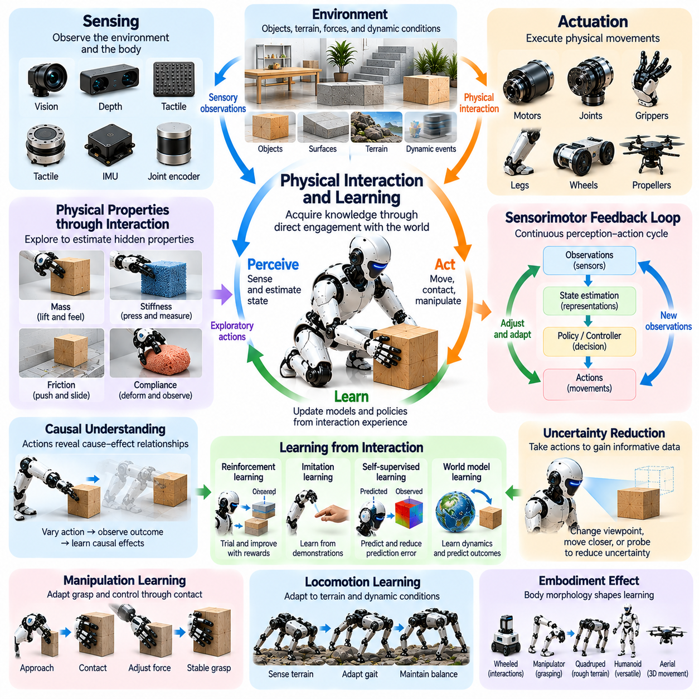{width="7.268055555555556in" height="7.268055555555556in"}

Physical interaction and learning describe how embodied agents acquire knowledge and develop intelligent behavior through direct engagement with the physical world. Unlike systems that learn exclusively from static datasets, embodied agents experience the consequences of their actions through movement, contact, and environmental feedback. These interactions generate information about physical properties, causal relationships, and task constraints that cannot always be obtained through passive observation.

Physical interaction transforms the environment into an active source of learning experiences. When a robot pushes an object, grasps a tool, or moves across unfamiliar terrain, its sensors capture the resulting changes in motion, force, and contact. These observations reveal relationships between actions and outcomes. By repeatedly interacting with its surroundings, the robot develops models that support prediction, planning, and adaptive control.

The foundation of interaction-based learning is the perception-action feedback loop. Sensory observations inform motor commands, while executed actions generate new observations that update the agent\'s understanding. This reciprocal process allows learning to occur continuously during task execution. Rather than separating knowledge acquisition from physical behavior, embodied intelligence treats both as interconnected aspects of adaptation.

Physical interaction provides access to properties that may remain hidden in visual information. Object mass, friction, stiffness, compliance, and surface resistance often require direct contact for reliable estimation. A robotic manipulator can lift an object to estimate its weight or press against a surface to evaluate deformation. Such exploratory actions allow the agent to construct physically grounded representations of its environment.

Learning through interaction also supports causal understanding. Passive observations may reveal correlations between events, but controlled actions can help determine how specific interventions influence physical outcomes. A robot that varies its applied force while pushing an object can observe changes in acceleration and displacement. These experiences provide evidence for learning causal relationships that support more reliable physical reasoning.

Sensorimotor learning enables robots to discover relationships between motor commands and resulting sensory changes. Repeated movements reveal how joint configurations, actuator forces, and contact conditions influence body motion. Learning algorithms use these experiences to refine control policies and predictive models. Over time, the robot develops coordinated movement skills that reflect both its mechanical characteristics and environmental constraints.

Exploration plays a central role because intelligent agents must encounter informative experiences before they can learn effective behaviors. Random exploration may reveal unexpected possibilities, while goal-directed exploration selects actions likely to reduce uncertainty. Effective strategies balance information acquisition with task progress, energy consumption, and safety. This balance becomes especially important when experiments involve physical hardware.

Reinforcement learning provides a computational framework for acquiring behavior through interaction. An agent executes actions, observes state transitions, and receives rewards associated with task outcomes. Through repeated experience, it improves policies that maximize expected cumulative reward. In physical robotics, however, exploration must account for actuator limitations, collision risks, equipment wear, and the cost of collecting real-world experience.

Self-supervised learning offers another mechanism for extracting knowledge from physical interaction. A robot can use its own actions and subsequent sensory observations to generate training signals without requiring manual labels. Predicting object motion, contact events, or future sensor measurements creates learning objectives grounded in physical experience. Prediction errors then provide information for refining internal representations and world models.

Imitation learning can accelerate physical skill acquisition by using demonstrations from humans or other robotic systems. Demonstrations provide examples of successful movement patterns and interaction strategies, reducing the need for extensive trial-and-error exploration. However, differences in morphology, sensing, and actuator capabilities may require adaptation before demonstrated behaviors can be transferred successfully.

Manipulation tasks illustrate the importance of learning through contact. A robot handling unfamiliar objects must adapt gripping forces, finger placement, and movement trajectories according to sensory feedback. Repeated interactions reveal which strategies prevent slipping, excessive deformation, or unstable grasping. These experiences support increasingly reliable manipulation across objects with different shapes, materials, and mechanical properties.

Locomotion learning similarly depends on interaction with environmental dynamics. A legged robot experiences changing ground reaction forces, friction, and body momentum while moving across different surfaces. These experiences can improve foot placement, balance regulation, and gait adaptation. Learning effective locomotion requires understanding how the robot\'s morphology and control actions interact with terrain characteristics.

Physical learning is strongly influenced by embodiment because the body determines which experiences are possible. Joint arrangements, sensor placement, actuator performance, and mechanical compliance shape the available action space and observable consequences. A soft robotic gripper may learn contact strategies through passive deformation, while a rigid manipulator may require more precise force regulation. Learned intelligence therefore remains connected to physical design.

Uncertainty and variability create major challenges for interaction-based learning. Sensor noise, changing payloads, unexpected contacts, and differences in environmental conditions can invalidate previously learned relationships. Adaptive estimation and online learning allow robots to revise internal models as new evidence becomes available. Robust systems must distinguish temporary disturbances from persistent changes that require behavioral adaptation.

Simulation can reduce the cost and risk of acquiring physical experience. Robots may practice manipulation, locomotion, and interaction strategies in simulated environments before deployment. However, discrepancies in friction, contact dynamics, actuator behavior, and sensing can limit transfer to real hardware. Combining simulation-based training with carefully controlled real-world interaction helps improve policy reliability and physical adaptability.

For Physical AI, physical interaction and learning establish a foundation for developing agents that improve through experience rather than relying exclusively on predefined knowledge. Actions generate observations, observations support model refinement, and updated models guide future behavior. This continuous learning process connects perception, control, embodiment, and environmental understanding into an adaptive intelligent system.

Ultimately, physical interaction is both a means of accomplishing tasks and a mechanism for acquiring intelligence. Through exploration, contact, feedback, and repeated experimentation, embodied agents discover how their actions influence the world. Integrating these experiences into predictive models and control policies enables more capable, robust, and adaptable robotic behavior in complex real-world environments.

물리적 상호작용과 학습(Physical Interaction and Learning)은 체화 에이전트(Embodied Agent)가 물리적 세계(Physical World)와 직접 상호작용하면서 지식을 획득하고 지능적 행동(Intelligent Behavior)을 발전시키는 과정을 설명한다. 정적인 데이터셋(Static Dataset)만으로 학습하는 시스템과 달리, 체화 에이전트는 움직임(Movement), 접촉(Contact), 환경 피드백(Environmental Feedback)을 통해 자신의 행동이 초래하는 결과를 경험한다. 이러한 상호작용은 수동적 관측(Passive Observation)만으로는 항상 획득할 수 없는 물리적 특성(Physical Property), 인과관계(Causal Relationship), 작업 제약(Task Constraint)에 관한 정보를 생성한다.

물리적 상호작용(Physical Interaction)은 환경(Environment)을 능동적인 학습 경험(Learning Experience)의 원천으로 전환한다. 로봇이 물체를 밀거나, 도구를 파지하거나, 익숙하지 않은 지형을 이동할 때 센서(Sensor)는 움직임, 힘(Force), 접촉에서 발생하는 변화를 포착한다. 이러한 관측(Observation)은 행동(Action)과 결과(Outcome) 사이의 관계를 드러낸다. 로봇은 주변 환경과 반복적으로 상호작용함으로써 예측(Prediction), 계획(Planning), 적응형 제어(Adaptive Control)를 지원하는 모델(Model)을 발전시킨다.

상호작용 기반 학습(Interaction-Based Learning)의 기초는 인식-행동 피드백 루프(Perception-Action Feedback Loop)이다. 감각 관측(Sensory Observation)은 운동 명령(Motor Command)에 필요한 정보를 제공하며, 실행된 행동은 에이전트의 이해를 갱신하는 새로운 관측을 생성한다. 이러한 상호적 과정(Reciprocal Process)은 작업 실행(Task Execution) 중에도 학습이 지속적으로 이루어질 수 있도록 한다. 체화 지능(Embodied Intelligence)은 지식 획득(Knowledge Acquisition)과 물리적 행동(Physical Behavior)을 분리하는 대신 적응(Adaptation)의 상호 연결된 측면으로 취급한다.

물리적 상호작용은 시각 정보(Visual Information)에 드러나지 않을 수 있는 특성에 접근할 수 있도록 한다. 물체 질량(Object Mass), 마찰(Friction), 강성(Stiffness), 순응성(Compliance), 표면 저항(Surface Resistance)은 신뢰할 수 있는 추정을 위해 직접적인 접촉이 필요한 경우가 많다. 로봇 매니퓰레이터(Robotic Manipulator)는 물체를 들어 올려 무게(Weight)를 추정하거나 표면을 눌러 변형(Deformation)을 평가할 수 있다. 이러한 탐색 행동(Exploratory Action)을 통해 에이전트는 환경에 대한 물리적 기반 표현(Physically Grounded Representation)을 구성할 수 있다.

상호작용을 통한 학습은 인과적 이해(Causal Understanding)도 지원한다. 수동적 관측은 사건 사이의 상관관계(Correlation)를 드러낼 수 있지만, 제어된 행동(Controlled Action)은 특정 개입(Intervention)이 물리적 결과(Physical Outcome)에 어떤 영향을 미치는지 판단하는 데 도움을 준다. 로봇이 물체를 밀면서 가하는 힘(Applied Force)을 변화시키면 가속도(Acceleration)와 변위(Displacement)의 변화를 관측할 수 있다. 이러한 경험은 더욱 신뢰할 수 있는 물리적 추론(Physical Reasoning)을 지원하는 인과관계를 학습하기 위한 증거(Evidence)를 제공한다.

감각운동 학습(Sensorimotor Learning)은 로봇이 운동 명령과 그 결과 발생하는 감각 변화(Sensory Change) 사이의 관계를 발견할 수 있도록 한다. 반복적인 움직임은 관절 구성(Joint Configuration), 액추에이터 힘(Actuator Force), 접촉 조건(Contact Condition)이 신체 움직임(Body Motion)에 어떤 영향을 미치는지 드러낸다. 학습 알고리즘(Learning Algorithm)은 이러한 경험을 활용하여 제어 정책(Control Policy)과 예측 모델(Predictive Model)을 개선한다. 시간이 지남에 따라 로봇은 자신의 기계적 특성(Mechanical Characteristic)과 환경 제약(Environmental Constraint)을 반영하는 조정된 운동 기술(Coordinated Movement Skill)을 발전시킨다.

탐색(Exploration)은 지능형 에이전트(Intelligent Agent)가 효과적인 행동을 학습하기 전에 유용한 정보를 제공하는 경험(Informative Experience)을 확보해야 한다는 점에서 핵심적인 역할을 한다. 무작위 탐색(Random Exploration)은 예상하지 못한 가능성을 발견할 수 있으며, 목표 지향적 탐색(Goal-Directed Exploration)은 불확실성(Uncertainty)을 줄일 가능성이 높은 행동을 선택한다. 효과적인 탐색 전략(Exploration Strategy)은 정보 획득(Information Acquisition)과 작업 진행(Task Progress), 에너지 소비(Energy Consumption), 안전성(Safety) 사이의 균형을 유지한다. 이러한 균형은 실험에 물리적 하드웨어(Physical Hardware)가 사용될 때 특히 중요하다.

강화학습(Reinforcement Learning)은 상호작용을 통해 행동을 습득하기 위한 계산 프레임워크(Computational Framework)를 제공한다. 에이전트는 행동을 실행하고, 상태 전이(State Transition)를 관측하며, 작업 결과와 관련된 보상(Reward)을 받는다. 반복적인 경험을 통해 기대 누적 보상(Expected Cumulative Reward)을 최대화하는 정책(Policy)을 개선한다. 그러나 물리적 로보틱스(Physical Robotics)에서 탐색은 액추에이터 한계(Actuator Limitation), 충돌 위험(Collision Risk), 장비 마모(Equipment Wear), 실제 환경 경험(Real-World Experience)을 수집하는 비용을 고려해야 한다.

자기지도학습(Self-Supervised Learning)은 물리적 상호작용에서 지식을 추출하는 또 다른 메커니즘을 제공한다. 로봇은 수동으로 작성된 레이블(Manual Label) 없이도 자신의 행동과 그에 따른 감각 관측을 활용하여 학습 신호(Training Signal)를 생성할 수 있다. 물체 움직임(Object Motion), 접촉 사건(Contact Event), 미래 센서 측정값(Future Sensor Measurement)을 예측하는 것은 물리적 경험(Physical Experience)에 기반한 학습 목표(Learning Objective)를 형성한다. 이후 예측 오차(Prediction Error)는 내부 표현(Internal Representation)과 세계 모델(World Model)을 개선하기 위한 정보를 제공한다.

모방학습(Imitation Learning)은 인간이나 다른 로봇 시스템(Robotic System)의 시연(Demonstration)을 활용하여 물리적 기술 습득(Physical Skill Acquisition)을 가속화할 수 있다. 시연은 성공적인 움직임 패턴(Movement Pattern)과 상호작용 전략(Interaction Strategy)의 사례를 제공하므로 광범위한 시행착오 탐색(Trial-and-Error Exploration)의 필요성을 줄인다. 그러나 형태학(Morphology), 감지(Sensing), 액추에이터 성능(Actuator Capability)의 차이로 인해 시연된 행동(Demonstrated Behavior)을 성공적으로 전이(Transfer)하기 전에 적응(Adaptation)이 필요할 수 있다.

조작 작업(Manipulation Task)은 접촉을 통한 학습(Learning Through Contact)의 중요성을 보여준다. 익숙하지 않은 물체를 다루는 로봇은 감각 피드백(Sensory Feedback)에 따라 파지력(Gripping Force), 손가락 배치(Finger Placement), 이동 궤적(Movement Trajectory)을 조정해야 한다. 반복적인 상호작용은 어떤 전략이 미끄러짐(Slipping), 과도한 변형(Excessive Deformation), 불안정한 파지(Unstable Grasping)를 방지하는지 드러낸다. 이러한 경험은 서로 다른 형상(Shape), 재료(Material), 기계적 특성(Mechanical Property)을 가진 물체에 대한 조작 신뢰성(Manipulation Reliability)을 점진적으로 높인다.

이동 학습(Locomotion Learning) 역시 환경 동역학(Environmental Dynamics)과의 상호작용에 의존한다. 다리형 로봇(Legged Robot)은 다양한 표면을 이동하면서 변화하는 지면 반력(Ground Reaction Force), 마찰, 신체 운동량(Body Momentum)을 경험한다. 이러한 경험은 발 배치(Foot Placement), 균형 조절(Balance Regulation), 보행 적응(Gait Adaptation)을 개선할 수 있다. 효과적인 이동을 학습하려면 로봇의 형태학과 제어 행동(Control Action)이 지형 특성(Terrain Characteristic)과 어떻게 상호작용하는지 이해해야 한다.

물리적 학습(Physical Learning)은 신체가 어떤 경험을 할 수 있는지를 결정하기 때문에 체화(Embodiment)의 영향을 크게 받는다. 관절 배열(Joint Arrangement), 센서 배치(Sensor Placement), 액추에이터 성능(Actuator Performance), 기계적 순응성(Mechanical Compliance)은 사용 가능한 행동 공간(Action Space)과 관측 가능한 결과(Observable Consequence)를 형성한다. 소프트 로봇 그리퍼(Soft Robotic Gripper)는 수동적 변형(Passive Deformation)을 통해 접촉 전략(Contact Strategy)을 학습할 수 있지만, 강체형 매니퓰레이터(Rigid Manipulator)는 더욱 정밀한 힘 조절(Force Regulation)이 필요할 수 있다. 따라서 학습된 지능(Learned Intelligence)은 물리적 설계(Physical Design)와 긴밀하게 연결된다.

불확실성과 변동성(Variability)은 상호작용 기반 학습에서 주요한 과제를 발생시킨다. 센서 잡음(Sensor Noise), 변화하는 탑재 하중(Payload), 예상하지 못한 접촉(Unexpected Contact), 환경 조건의 차이는 이전에 학습된 관계를 더 이상 유효하지 않게 만들 수 있다. 적응형 추정(Adaptive Estimation)과 온라인 학습(Online Learning)은 새로운 증거가 확보됨에 따라 로봇이 내부 모델을 수정할 수 있도록 한다. 강건한 시스템(Robust System)은 일시적인 외란(Temporary Disturbance)과 행동 적응(Behavioral Adaptation)이 필요한 지속적인 변화(Persistent Change)를 구별해야 한다.

시뮬레이션(Simulation)은 물리적 경험을 획득하는 데 필요한 비용과 위험을 줄일 수 있다. 로봇은 실제 배포(Deployment)에 앞서 시뮬레이션 환경(Simulated Environment)에서 조작, 이동, 상호작용 전략을 연습할 수 있다. 그러나 마찰, 접촉 동역학(Contact Dynamics), 액추에이터 동작(Actuator Behavior), 감지 특성의 차이는 실제 하드웨어(Real Hardware)로의 전이(Transfer)를 제한할 수 있다. 시뮬레이션 기반 학습(Simulation-Based Training)과 신중하게 통제된 실제 환경 상호작용(Real-World Interaction)을 결합하면 정책 신뢰성(Policy Reliability)과 물리적 적응성(Physical Adaptability)을 개선하는 데 도움이 된다.

피지컬 AI(Physical AI)에서 물리적 상호작용과 학습은 사전에 정의된 지식(Predefined Knowledge)에만 의존하지 않고 경험을 통해 발전하는 에이전트를 개발하기 위한 기반(Foundation)을 확립한다. 행동은 관측을 생성하고, 관측은 모델 개선(Model Refinement)을 지원하며, 갱신된 모델은 미래 행동(Future Behavior)을 안내한다. 이러한 지속적인 학습 과정(Continuous Learning Process)은 인식(Perception), 제어(Control), 체화, 환경 이해(Environmental Understanding)를 하나의 적응형 지능 시스템(Adaptive Intelligent System)으로 연결한다.

궁극적으로 물리적 상호작용은 작업을 수행하는 수단인 동시에 지능을 획득하는 메커니즘(Mechanism)이다. 체화 에이전트는 탐색, 접촉, 피드백(Feedback), 반복적인 실험(Repeated Experimentation)을 통해 자신의 행동이 세계에 어떤 영향을 미치는지 발견한다. 이러한 경험을 예측 모델과 제어 정책에 통합하면 복잡한 현실 세계 환경(Complex Real-World Environment)에서 더욱 높은 능력(Capability), 강건성(Robustness), 적응성(Adaptability)을 갖춘 로봇 행동(Robotic Behavior)을 구현할 수 있다.

##  

## 01.09. Embodied Agency and Autonomy

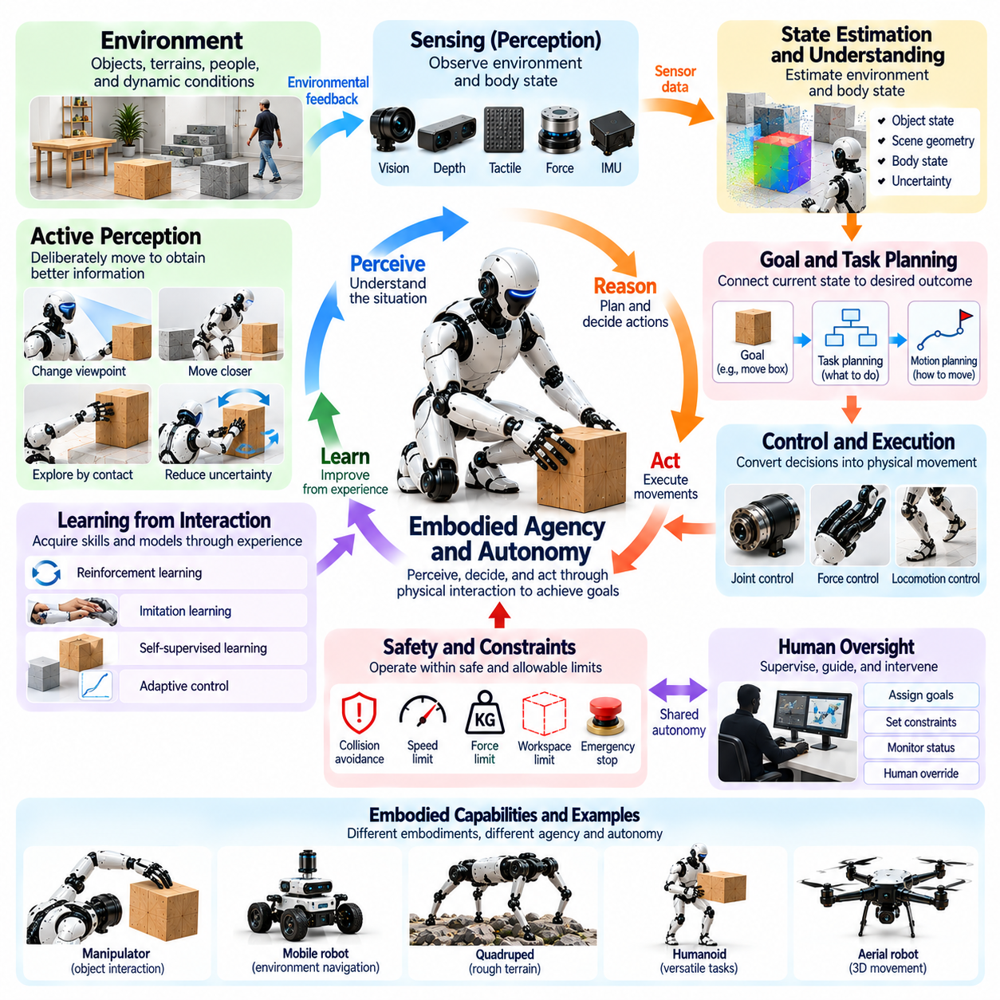{width="7.268055555555556in" height="7.268055555555556in"}

Embodied agency refers to the capacity of a physical agent to initiate, regulate, and adapt its actions through interactions with the environment. Unlike a passive machine that executes predetermined commands, an embodied agent uses sensory information, internal objectives, and physical capabilities to influence its surroundings. Agency emerges when perception, decision-making, and action form a coordinated process that produces purposeful behavior under changing conditions.

Autonomy describes the degree to which an embodied system can pursue objectives without continuous external intervention. An autonomous robot must perceive relevant conditions, select appropriate actions, monitor their consequences, and respond to unexpected events. Autonomy does not necessarily imply unrestricted independence. Practical systems operate within assigned goals, safety constraints, operational boundaries, and mechanisms for human supervision.

Embodied agency and autonomy are related but distinct concepts. Agency concerns the ability to generate actions that meaningfully influence the environment, whereas autonomy concerns the independence with which those actions are selected and managed. A remotely operated robot possesses physical agency through its actions but limited decision-making autonomy. A fully autonomous platform must additionally determine how to accomplish objectives within its permitted operating conditions.

The physical body plays a fundamental role in determining the scope of agency. Robot morphology, actuator capabilities, sensor placement, and mechanical constraints establish which actions can be performed and which environmental changes can be detected. A mobile robot can navigate accessible spaces, while a manipulator can alter object configurations through contact. These embodiment-specific capabilities define the practical boundaries of autonomous behavior.

Perception provides the information necessary for an agent to understand its operational situation. Cameras, depth sensors, tactile sensors, proprioceptive measurements, and other sensing mechanisms reveal environmental conditions and bodily states. However, sensory information is often incomplete or uncertain. Autonomous agents must combine observations with internal models to estimate relevant conditions and determine whether additional information is required.

Goal-directed behavior is a defining characteristic of embodied agency. An agent must connect its current physical state with a desired outcome and identify actions capable of reducing the difference between them. Task planning determines intermediate objectives, while motion planning and control translate those objectives into executable movements. Effective agency requires maintaining this relationship between intention, physical feasibility, and observed results.

Decision-making under uncertainty is essential because real environments cannot be predicted completely. Obstacles may move, objects may slip, and terrain conditions may change unexpectedly. An autonomous robot must evaluate available actions using incomplete information and revise its decisions as new evidence becomes available. Robust autonomy therefore depends on continuous estimation, prediction, feedback, and adaptation rather than fixed action sequences.

Embodied agency also requires the ability to initiate information-gathering actions. A robot may reposition its sensors to inspect an obstacle, probe an unfamiliar object, or explore an alternative route before committing to a task. These actions demonstrate that autonomous behavior includes purposeful perception as well as physical execution. The agent actively shapes the information available for subsequent decisions.

Learning expands agency by enabling robots to improve their behavior through experience. Reinforcement learning, imitation learning, and adaptive control can help agents acquire strategies for navigation, manipulation, and interaction. However, learned policies remain constrained by physical capabilities and training conditions. Reliable autonomy requires evaluating whether previously acquired behaviors remain appropriate when environmental or mechanical conditions change.

Self-monitoring allows an embodied agent to assess whether its actions are producing intended outcomes. Internal state estimation, task-progress tracking, and prediction-error analysis provide evidence of successful or unsuccessful execution. When deviations occur, the system may adjust control commands, revise its plan, or request assistance. Such monitoring transforms autonomy from independent action generation into sustained management of task execution.

Safety establishes essential boundaries for autonomous agency. Physical robots can exert forces, collide with obstacles, and affect people or equipment. Autonomous decisions must therefore respect limits on speed, force, workspace, energy, and contact conditions. Safety monitoring, emergency stopping, and human override mechanisms provide safeguards when learned or planned behavior becomes unreliable or exceeds authorized operating conditions.

Human oversight remains important even in highly autonomous systems. Supervisors may assign objectives, establish operational constraints, approve sensitive actions, or intervene during exceptional situations. Shared autonomy combines machine decision-making with human judgment, allowing responsibility to be distributed according to task complexity and risk. Effective human-robot collaboration requires transparent system status and predictable intervention mechanisms.

Autonomy can be organized hierarchically across different levels of decision-making. Low-level controllers regulate immediate physical behavior, while higher-level processes select tasks, plan routes, and manage priorities. Coordination between these levels allows a robot to respond rapidly to disturbances without losing sight of broader objectives. The resulting architecture connects reactive control with deliberative planning and long-term task management.

For Physical AI, embodied agency and autonomy represent the transition from intelligent computation to independent physical task execution. An autonomous embodied system must integrate perception, planning, learning, control, and safety within the capabilities of its physical platform. Its effectiveness depends not merely on selecting appropriate actions but on executing them reliably, evaluating their consequences, and adapting to changing real-world conditions.

Ultimately, embodied agency establishes the capacity to influence the physical world purposefully, while autonomy determines how independently that capacity can be exercised. Together, they enable robots to pursue objectives through continuous interaction with their environments. Developing reliable embodied autonomy requires coordinated advances in physical design, perception, decision-making, adaptive learning, safety engineering, and human supervision.

체화된 행위주체성(Embodied Agency)은 물리적 에이전트(Physical Agent)가 환경(Environment)과의 상호작용을 통해 자신의 행동을 시작하고, 조절하며, 적응시키는 능력을 의미한다. 사전에 결정된 명령(Predetermined Command)을 실행하는 수동적 기계(Passive Machine)와 달리, 체화 에이전트(Embodied Agent)는 감각 정보(Sensory Information), 내부 목표(Internal Objective), 물리적 능력(Physical Capability)을 활용하여 주변 환경에 영향을 미친다. 행위주체성(Agency)은 인식(Perception), 의사결정(Decision-Making), 행동(Action)이 조정된 과정(Coordinated Process)을 형성하여 변화하는 조건에서도 목적 지향적 행동(Purposeful Behavior)을 생성할 때 나타난다.

자율성(Autonomy)은 체화 시스템(Embodied System)이 지속적인 외부 개입(External Intervention) 없이 목표를 추구할 수 있는 정도를 설명한다. 자율 로봇(Autonomous Robot)은 관련 환경 조건을 인식하고, 적절한 행동을 선택하며, 그 결과를 모니터링(Monitoring)하고, 예상하지 못한 사건에 대응해야 한다. 자율성이 반드시 제한 없는 독립성(Unrestricted Independence)을 의미하는 것은 아니다. 실제 시스템은 할당된 목표(Assigned Goal), 안전 제약(Safety Constraint), 운영 경계(Operational Boundary), 인간 감독(Human Supervision)을 위한 메커니즘(Mechanism) 내에서 작동한다.

체화된 행위주체성과 자율성은 서로 관련되어 있지만 구별되는 개념이다. 행위주체성은 환경에 의미 있는 영향을 미치는 행동을 생성하는 능력과 관련되며, 자율성은 그러한 행동을 선택하고 관리하는 과정에서의 독립성(Independence)과 관련된다. 원격 조작 로봇(Remotely Operated Robot)은 자신의 행동을 통해 물리적 행위주체성(Physical Agency)을 가지지만 의사결정 자율성(Decision-Making Autonomy)은 제한적이다. 완전 자율 플랫폼(Fully Autonomous Platform)은 허용된 운영 조건(Permitted Operating Condition) 내에서 목표를 달성하는 방법까지 스스로 결정해야 한다.

물리적 신체(Physical Body)는 행위주체성의 범위를 결정하는 데 근본적인 역할을 한다. 로봇 형태학(Robot Morphology), 액추에이터 능력(Actuator Capability), 센서 배치(Sensor Placement), 기계적 제약(Mechanical Constraint)은 수행할 수 있는 행동과 감지할 수 있는 환경 변화를 규정한다. 모바일 로봇(Mobile Robot)은 접근 가능한 공간을 이동할 수 있으며, 매니퓰레이터(Manipulator)는 접촉을 통해 물체의 배치(Object Configuration)를 변경할 수 있다. 이러한 신체 형태별 능력(Embodiment-Specific Capability)은 자율적 행동(Autonomous Behavior)의 실질적인 경계(Practical Boundary)를 정의한다.

인식은 에이전트가 자신의 운영 상황(Operational Situation)을 이해하는 데 필요한 정보를 제공한다. 카메라(Camera), 깊이 센서(Depth Sensor), 촉각 센서(Tactile Sensor), 고유수용감각 측정값(Proprioceptive Measurement), 기타 감지 메커니즘(Sensing Mechanism)은 환경 조건(Environmental Condition)과 신체 상태(Bodily State)를 파악할 수 있도록 한다. 그러나 감각 정보는 불완전하거나 불확실한 경우가 많다. 자율 에이전트(Autonomous Agent)는 관측(Observation)과 내부 모델(Internal Model)을 결합하여 관련 조건을 추정하고 추가 정보가 필요한지 판단해야 한다.

목표 지향적 행동(Goal-Directed Behavior)은 체화된 행위주체성을 정의하는 핵심적인 특성이다. 에이전트는 현재 물리적 상태(Current Physical State)를 원하는 결과(Desired Outcome)와 연결하고, 두 상태 사이의 차이를 줄일 수 있는 행동을 식별해야 한다. 작업 계획(Task Planning)은 중간 목표(Intermediate Objective)를 결정하며, 운동 계획(Motion Planning)과 제어(Control)는 이러한 목표를 실행 가능한 움직임(Executable Movement)으로 변환한다. 효과적인 행위주체성은 의도(Intention), 물리적 실행 가능성(Physical Feasibility), 관측된 결과(Observed Result) 사이의 관계를 지속적으로 유지해야 한다.

불확실성 하의 의사결정(Decision-Making Under Uncertainty)은 실제 환경을 완벽하게 예측할 수 없기 때문에 필수적이다. 장애물(Obstacle)은 움직일 수 있고, 물체는 미끄러질 수 있으며, 지형 조건(Terrain Condition)은 예상하지 못하게 변화할 수 있다. 자율 로봇은 불완전한 정보(Incomplete Information)를 활용하여 가능한 행동을 평가하고 새로운 증거(Evidence)가 확보되면 결정을 수정해야 한다. 따라서 강건한 자율성(Robust Autonomy)은 고정된 행동 순서(Fixed Action Sequence)가 아니라 지속적인 추정(Estimation), 예측(Prediction), 피드백(Feedback), 적응(Adaptation)에 의존한다.

체화된 행위주체성은 정보를 수집하기 위한 행동(Information-Gathering Action)을 스스로 시작하는 능력도 요구한다. 로봇은 작업을 수행하기 전에 장애물을 검사하기 위해 센서 위치를 변경하거나, 익숙하지 않은 물체를 탐색적으로 접촉하거나, 대체 경로(Alternative Route)를 조사할 수 있다. 이러한 행동은 자율적 행동이 물리적 실행(Physical Execution)뿐만 아니라 목적 지향적 인식(Purposeful Perception)도 포함한다는 점을 보여준다. 에이전트는 이후 의사결정에 활용할 수 있는 정보를 능동적으로 형성한다.

학습(Learning)은 로봇이 경험(Experience)을 통해 행동을 개선할 수 있도록 함으로써 행위주체성을 확장한다. 강화학습(Reinforcement Learning), 모방학습(Imitation Learning), 적응형 제어(Adaptive Control)는 에이전트가 항법(Navigation), 조작(Manipulation), 상호작용(Interaction)을 위한 전략을 습득하도록 지원할 수 있다. 그러나 학습된 정책(Learned Policy)은 물리적 능력과 훈련 조건(Training Condition)의 제약을 받는다. 신뢰할 수 있는 자율성(Reliable Autonomy)을 확보하려면 환경 또는 기계적 조건이 변화할 때 이전에 학습한 행동이 여전히 적절한지 평가해야 한다.

자기 모니터링(Self-Monitoring)은 체화 에이전트가 자신의 행동이 의도한 결과를 생성하고 있는지 평가할 수 있도록 한다. 내부 상태 추정(Internal State Estimation), 작업 진행 추적(Task-Progress Tracking), 예측 오차 분석(Prediction-Error Analysis)은 실행의 성공 또는 실패를 판단하기 위한 증거를 제공한다. 편차(Deviation)가 발생하면 시스템은 제어 명령(Control Command)을 조정하거나, 계획을 수정하거나, 지원을 요청할 수 있다. 이러한 모니터링은 자율성을 독립적인 행동 생성(Independent Action Generation)에서 지속적인 작업 실행 관리(Sustained Task Execution Management)로 발전시킨다.

안전성(Safety)은 자율적 행위주체성(Autonomous Agency)에 필수적인 경계 조건(Essential Boundary Condition)을 설정한다. 물리적 로봇은 힘을 가하거나, 장애물과 충돌하거나, 사람과 장비에 영향을 미칠 수 있다. 따라서 자율적 의사결정은 속도(Speed), 힘(Force), 작업 공간(Workspace), 에너지(Energy), 접촉 조건(Contact Condition)에 대한 제한을 준수해야 한다. 안전 모니터링(Safety Monitoring), 비상 정지(Emergency Stopping), 인간 우선 제어 메커니즘(Human Override Mechanism)은 학습되거나 계획된 행동이 신뢰성을 잃거나 허가된 운영 조건(Authorized Operating Condition)을 초과할 때 보호 수단(Safeguard)을 제공한다.

고도의 자율 시스템(Highly Autonomous System)에서도 인간 감독(Human Oversight)은 여전히 중요하다. 감독자(Supervisor)는 목표를 할당하고, 운영 제약(Operational Constraint)을 설정하며, 민감한 행동(Sensitive Action)을 승인하거나, 예외적인 상황(Exceptional Situation)에 개입할 수 있다. 공유 자율성(Shared Autonomy)은 기계 의사결정(Machine Decision-Making)과 인간 판단(Human Judgment)을 결합하여 작업 복잡성(Task Complexity)과 위험(Risk)에 따라 책임을 분배할 수 있도록 한다. 효과적인 인간-로봇 협업(Human-Robot Collaboration)을 위해서는 투명한 시스템 상태(Transparent System Status)와 예측 가능한 개입 메커니즘(Predictable Intervention Mechanism)이 필요하다.

자율성은 서로 다른 의사결정 수준(Decision-Making Level)에 걸쳐 계층적으로 구성될 수 있다. 저수준 제어기(Low-Level Controller)는 즉각적인 물리적 행동을 조절하며, 상위 수준 프로세스(Higher-Level Process)는 작업을 선택하고, 경로를 계획하며, 우선순위(Priority)를 관리한다. 이러한 수준 사이의 조정(Coordination)을 통해 로봇은 더 넓은 목표(Broader Objective)를 유지하면서도 외란(Disturbance)에 신속하게 대응할 수 있다. 그 결과 형성되는 아키텍처(Architecture)는 반응형 제어(Reactive Control)를 숙고적 계획(Deliberative Planning) 및 장기 작업 관리(Long-Term Task Management)와 연결한다.

피지컬 AI(Physical AI)에서 체화된 행위주체성과 자율성은 지능형 계산(Intelligent Computation)에서 독립적인 물리적 작업 실행(Independent Physical Task Execution)으로의 전환을 의미한다. 자율 체화 시스템(Autonomous Embodied System)은 물리적 플랫폼(Physical Platform)의 능력 범위 내에서 인식, 계획, 학습, 제어, 안전성을 통합해야 한다. 시스템의 효과성(Effectiveness)은 단순히 적절한 행동을 선택하는 것뿐만 아니라 이를 신뢰성 있게 실행하고, 결과를 평가하며, 변화하는 실제 환경 조건(Real-World Condition)에 적응하는 능력에 달려 있다.

궁극적으로 체화된 행위주체성은 물리적 세계에 목적을 가지고 영향을 미칠 수 있는 능력을 확립하며, 자율성은 이러한 능력을 얼마나 독립적으로 발휘할 수 있는지를 결정한다. 두 개념은 함께 로봇이 환경과 지속적으로 상호작용하면서 목표를 추구할 수 있도록 한다. 신뢰할 수 있는 체화 자율성(Embodied Autonomy)을 개발하려면 물리적 설계(Physical Design), 인식, 의사결정, 적응형 학습(Adaptive Learning), 안전 공학(Safety Engineering), 인간 감독의 조화로운 발전이 필요하다.

##  

## 01.10. Embodiment Adaptation and Generalization

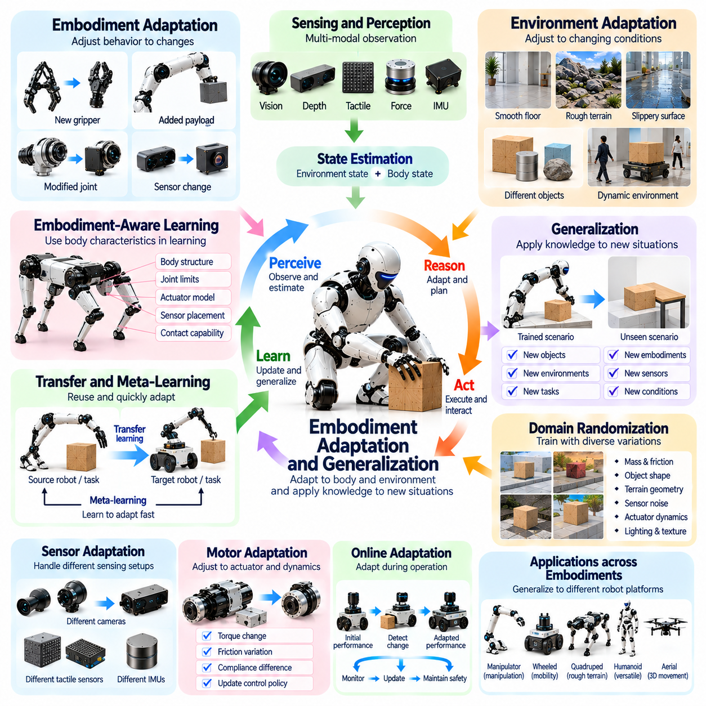{width="7.268055555555556in" height="7.268055555555556in"}

Embodiment adaptation refers to the ability of an intelligent agent to adjust its behavior according to changes in its physical body, sensory capabilities, and environmental conditions. Generalization describes the capacity to apply previously acquired knowledge to unfamiliar situations, tasks, or robotic platforms. Together, these capabilities enable embodied systems to operate beyond the specific configurations and experiences encountered during initial training.

The relationship between embodiment and intelligence creates distinctive challenges for adaptation. A robot\'s morphology, actuator dynamics, sensor placement, and mechanical constraints determine how actions produce physical consequences. When these characteristics change, previously learned control policies may become less effective. Successful adaptation requires recognizing such differences and adjusting perception, prediction, and motor coordination accordingly.

Embodiment adaptation can occur when a robot experiences changes in its own physical configuration. Replacing a gripper, modifying a joint mechanism, or attaching an additional payload alters the relationship between motor commands and resulting movements. An adaptive system must update its internal representations to account for these changes. This capability reduces dependence on manually redesigned controllers whenever hardware configurations are modified.

Environmental adaptation addresses changes in external operating conditions. A mobile robot trained on smooth indoor floors may encounter uneven terrain, slippery surfaces, or unexpected obstacles. Similarly, a manipulator may handle objects with unfamiliar shapes, weights, and friction properties. Adaptation enables the robot to revise movement strategies using sensory feedback and accumulated experience while maintaining task performance.

Generalization requires learning relationships that remain useful across different observations and operating conditions. Instead of memorizing individual movements, an agent can acquire representations of physical principles, object interactions, and task objectives. Such representations may support behavior in unfamiliar situations when the underlying relationships remain sufficiently similar. However, generalization is limited when new conditions differ substantially from previous experience.

Morphological generalization concerns transferring knowledge between robotic bodies with different physical structures. A manipulation strategy learned using one robotic arm may not directly apply to another arm with different joint arrangements or workspace limitations. Transfer requires identifying shared task relationships while accounting for embodiment-specific constraints. Common representations of end-effector motion and contact objectives can support this process.

Sensor adaptation is necessary when sensing configurations or measurement characteristics change. Different cameras, tactile sensors, and inertial measurement units may produce observations with different resolutions, noise levels, and coordinate systems. An embodied agent must align these measurements with its internal state representations. Calibration, sensor fusion, and representation learning help maintain reliable perception despite changes in sensing hardware.

Motor adaptation focuses on adjusting control behavior when actuator properties or mechanical dynamics vary. Changes in motor torque, joint friction, transmission efficiency, or structural compliance can alter the relationship between commands and motion. Adaptive controllers estimate these variations and modify control parameters accordingly. Learning-based approaches may additionally update policies using observed differences between predicted and actual responses.

Transfer learning provides a mechanism for reusing knowledge acquired from previous tasks or platforms. A robot may initialize a new policy using representations learned during related manipulation or locomotion activities. Fine-tuning then adjusts the policy to the new embodiment and environment. Effective transfer can reduce training time and physical experimentation, although inappropriate transferred assumptions may degrade performance or create safety risks.

Meta-learning extends adaptation by training agents to adjust rapidly when encountering new conditions. Rather than optimizing only for one task, meta-learning methods expose the system to multiple related tasks and variations during training. The resulting learning procedure can support faster adaptation using limited new experience. Its effectiveness depends on whether training variations adequately represent the challenges encountered during deployment.

Domain randomization is widely used to improve robustness across physical variations. During simulation training, parameters such as mass, friction, actuator response, sensor noise, and environmental geometry are varied. This exposes the agent to diverse operating conditions and discourages dependence on a single simulated configuration. However, randomization must cover relevant real-world differences without introducing unrealistic assumptions that undermine learning.

Online adaptation allows an embodied agent to update its behavior while operating in a changing environment. Continuous state estimation, prediction-error monitoring, and policy adjustment can compensate for gradual changes in physical dynamics. Such adaptation must remain computationally efficient and respect safety constraints. Unrestricted online learning may introduce instability, making bounded updates and performance monitoring essential for reliable deployment.

Embodiment-aware representations improve generalization by explicitly incorporating physical characteristics into learning models. Joint topology, actuator limits, body dimensions, sensor locations, and contact capabilities can be encoded as contextual information. A policy conditioned on these properties may support multiple robot configurations. This approach distinguishes transferable task knowledge from the physical constraints that determine how actions must be executed.

Evaluation of adaptation and generalization requires testing beyond familiar training conditions. Experiments should include unseen objects, altered payloads, sensor disturbances, different terrain properties, and modified robot configurations. Performance must be assessed through task success, recovery capability, safety, and adaptation efficiency. Reliable evaluation distinguishes genuine transferable competence from performance based on narrow environmental assumptions.

For Physical AI, embodiment adaptation and generalization are essential for deploying intelligent systems across diverse platforms and environments. Robots must retain useful knowledge while adjusting to differences in morphology, sensing, actuation, and physical interaction. Combining transferable representations, adaptive control, experiential learning, and systematic validation enables more flexible deployment without requiring complete retraining for every configuration.

Ultimately, embodiment adaptation and generalization demonstrate that physical intelligence must remain responsive to differences between bodies and environments. Adaptation modifies behavior when physical conditions change, while generalization extends learned capabilities to unfamiliar situations. Their integration supports robotic systems that can reuse experience, accommodate hardware variations, recover from disturbances, and perform reliably across increasingly diverse real-world tasks.

체화 적응(Embodiment Adaptation)은 지능형 에이전트(Intelligent Agent)가 자신의 물리적 신체(Physical Body), 감각 능력(Sensory Capability), 환경 조건(Environmental Condition)의 변화에 따라 행동을 조정하는 능력을 의미한다. 일반화(Generalization)는 이전에 획득한 지식(Acquired Knowledge)을 익숙하지 않은 상황, 작업 또는 로봇 플랫폼(Robotic Platform)에 적용하는 능력을 설명한다. 이러한 두 가지 능력은 체화 시스템(Embodied System)이 초기 훈련(Initial Training) 과정에서 경험한 특정 구성(Configuration)과 경험의 범위를 넘어 작동할 수 있도록 한다.

체화(Embodiment)와 지능(Intelligence) 사이의 관계는 적응(Adaptation)에 고유한 과제를 발생시킨다. 로봇의 형태학(Morphology), 액추에이터 동역학(Actuator Dynamics), 센서 배치(Sensor Placement), 기계적 제약(Mechanical Constraint)은 행동이 어떤 물리적 결과(Physical Consequence)를 생성하는지 결정한다. 이러한 특성이 변화하면 이전에 학습된 제어 정책(Control Policy)의 효과가 감소할 수 있다. 성공적인 적응을 위해서는 이러한 차이를 인식하고 인식(Perception), 예측(Prediction), 운동 협응(Motor Coordination)을 적절하게 조정해야 한다.

체화 적응은 로봇 자체의 물리적 구성(Physical Configuration)이 변화할 때 발생할 수 있다. 그리퍼(Gripper)를 교체하거나, 관절 메커니즘(Joint Mechanism)을 수정하거나, 추가 탑재 하중(Additional Payload)을 부착하면 운동 명령(Motor Command)과 그에 따른 움직임 사이의 관계가 달라진다. 적응형 시스템(Adaptive System)은 이러한 변화를 반영하기 위해 내부 표현(Internal Representation)을 갱신해야 한다. 이러한 능력은 하드웨어 구성(Hardware Configuration)이 변경될 때마다 제어기(Controller)를 수동으로 재설계해야 하는 의존성을 줄인다.

환경 적응(Environmental Adaptation)은 외부 운영 조건(External Operating Condition)의 변화에 대응한다. 매끄러운 실내 바닥(Smooth Indoor Floor)에서 훈련된 모바일 로봇(Mobile Robot)은 고르지 않은 지형(Uneven Terrain), 미끄러운 표면(Slippery Surface), 예상하지 못한 장애물(Unexpected Obstacle)을 마주할 수 있다. 마찬가지로 매니퓰레이터(Manipulator)는 익숙하지 않은 형상(Shape), 무게(Weight), 마찰 특성(Friction Property)을 가진 물체를 다룰 수 있다. 적응은 로봇이 감각 피드백(Sensory Feedback)과 축적된 경험(Accumulated Experience)을 활용하여 작업 성능(Task Performance)을 유지하면서 운동 전략(Movement Strategy)을 수정할 수 있도록 한다.

일반화는 서로 다른 관측(Observation)과 운영 조건에서도 유용하게 유지되는 관계를 학습할 것을 요구한다. 에이전트는 개별적인 움직임을 암기하는 대신 물리적 원리(Physical Principle), 물체 상호작용(Object Interaction), 작업 목표(Task Objective)에 대한 표현을 획득할 수 있다. 이러한 표현은 기본적인 관계가 충분히 유사하게 유지되는 경우 익숙하지 않은 상황에서도 행동을 지원할 수 있다. 그러나 새로운 조건이 이전 경험(Previous Experience)과 크게 다르면 일반화 능력은 제한된다.

형태학적 일반화(Morphological Generalization)는 서로 다른 물리적 구조(Physical Structure)를 가진 로봇 신체(Robotic Body) 사이에서 지식을 전이(Transfer)하는 것을 의미한다. 하나의 로봇 팔(Robotic Arm)에서 학습한 조작 전략(Manipulation Strategy)은 관절 배열(Joint Arrangement)이나 작업 공간 제약(Workspace Constraint)이 다른 로봇 팔에 직접 적용되지 않을 수 있다. 전이를 위해서는 신체 형태별 제약(Embodiment-Specific Constraint)을 고려하면서 공통적인 작업 관계(Shared Task Relationship)를 식별해야 한다. 말단효과기 운동(End-Effector Motion)과 접촉 목표(Contact Objective)에 대한 공통 표현(Common Representation)은 이러한 과정을 지원할 수 있다.

센서 적응(Sensor Adaptation)은 감지 구성(Sensing Configuration)이나 측정 특성(Measurement Characteristic)이 변화할 때 필요하다. 서로 다른 카메라(Camera), 촉각 센서(Tactile Sensor), 관성 측정 장치(Inertial Measurement Unit)는 해상도(Resolution), 잡음 수준(Noise Level), 좌표계(Coordinate System)가 다른 관측값을 생성할 수 있다. 체화 에이전트(Embodied Agent)는 이러한 측정값을 자신의 내부 상태 표현(Internal State Representation)과 정렬해야 한다. 보정(Calibration), 센서 융합(Sensor Fusion), 표현 학습(Representation Learning)은 감지 하드웨어(Sensing Hardware)가 변경되더라도 신뢰할 수 있는 인식을 유지하도록 지원한다.

운동 적응(Motor Adaptation)은 액추에이터 특성(Actuator Property)이나 기계적 동역학(Mechanical Dynamics)이 변화할 때 제어 행동(Control Behavior)을 조정하는 데 초점을 맞춘다. 모터 토크(Motor Torque), 관절 마찰(Joint Friction), 전달 효율(Transmission Efficiency), 구조적 순응성(Structural Compliance)의 변화는 명령과 움직임 사이의 관계를 변경할 수 있다. 적응형 제어기(Adaptive Controller)는 이러한 변화를 추정하고 제어 매개변수(Control Parameter)를 적절하게 수정한다. 학습 기반 접근법(Learning-Based Approach)은 예측된 반응(Predicted Response)과 실제 반응(Actual Response) 사이에서 관측된 차이를 활용하여 정책을 추가로 갱신할 수 있다.

전이학습(Transfer Learning)은 이전 작업이나 플랫폼에서 획득한 지식을 재사용하기 위한 메커니즘(Mechanism)을 제공한다. 로봇은 관련된 조작(Manipulation) 또는 이동(Locomotion) 활동에서 학습한 표현을 활용하여 새로운 정책(Policy)을 초기화할 수 있다. 이후 미세조정(Fine-Tuning)은 해당 정책을 새로운 체화 구조와 환경에 맞게 조정한다. 효과적인 전이는 훈련 시간(Training Time)과 물리적 실험(Physical Experimentation)을 줄일 수 있지만, 부적절하게 전이된 가정(Transferred Assumption)은 성능을 저하시키거나 안전 위험(Safety Risk)을 발생시킬 수 있다.

메타학습(Meta-Learning)은 에이전트가 새로운 조건에 직면했을 때 빠르게 적응하도록 훈련함으로써 적응 능력을 확장한다. 메타학습 방법은 하나의 작업만 최적화하는 대신 훈련 과정에서 시스템을 여러 관련 작업(Related Task)과 다양한 변형(Variation)에 노출시킨다. 그 결과 형성된 학습 절차(Learning Procedure)는 제한된 새로운 경험(Limited New Experience)만으로도 더 빠른 적응을 지원할 수 있다. 이러한 접근법의 효과는 훈련 중 사용된 변형이 실제 배포(Deployment) 과정에서 마주하는 과제를 얼마나 적절하게 반영하는지에 달려 있다.

도메인 무작위화(Domain Randomization)는 물리적 변동(Physical Variation)에 대한 강건성(Robustness)을 개선하기 위해 널리 사용된다. 시뮬레이션 훈련(Simulation Training) 과정에서 질량(Mass), 마찰(Friction), 액추에이터 응답(Actuator Response), 센서 잡음(Sensor Noise), 환경 기하학(Environmental Geometry)과 같은 매개변수를 변화시킨다. 이를 통해 에이전트는 다양한 운영 조건에 노출되며 단일 시뮬레이션 구성(Simulated Configuration)에 대한 의존성을 줄일 수 있다. 그러나 무작위화는 학습을 저해하는 비현실적인 가정(Unrealistic Assumption)을 도입하지 않으면서 실제 환경의 관련 차이를 충분히 포함해야 한다.

온라인 적응(Online Adaptation)은 체화 에이전트가 변화하는 환경에서 작동하는 동안 자신의 행동을 갱신할 수 있도록 한다. 지속적인 상태 추정(State Estimation), 예측 오차 모니터링(Prediction-Error Monitoring), 정책 조정(Policy Adjustment)은 물리적 동역학(Physical Dynamics)의 점진적인 변화를 보상할 수 있다. 이러한 적응은 계산 효율성(Computational Efficiency)을 유지하면서 안전 제약(Safety Constraint)을 준수해야 한다. 제한 없는 온라인 학습(Online Learning)은 불안정성(Instability)을 유발할 수 있으므로 신뢰할 수 있는 배포를 위해서는 제한된 갱신(Bounded Update)과 성능 모니터링(Performance Monitoring)이 필수적이다.

체화 인식 표현(Embodiment-Aware Representation)은 물리적 특성을 학습 모델(Learning Model)에 명시적으로 포함함으로써 일반화를 개선한다. 관절 위상 구조(Joint Topology), 액추에이터 한계(Actuator Limit), 신체 치수(Body Dimension), 센서 위치(Sensor Location), 접촉 능력(Contact Capability)을 맥락 정보(Contextual Information)로 인코딩(Encoding)할 수 있다. 이러한 특성을 조건으로 사용하는 정책(Conditioned Policy)은 여러 로봇 구성을 지원할 수 있다. 이 접근법은 전이 가능한 작업 지식(Transferable Task Knowledge)과 행동의 실행 방법을 결정하는 물리적 제약을 구별한다.

적응과 일반화의 평가(Evaluation)는 익숙한 훈련 조건을 넘어서는 시험을 요구한다. 실험에는 학습하지 않은 물체(Unseen Object), 변경된 탑재 하중(Altered Payload), 센서 교란(Sensor Disturbance), 서로 다른 지형 특성(Terrain Property), 수정된 로봇 구성(Modified Robot Configuration)이 포함되어야 한다. 성능은 작업 성공률(Task Success), 복구 능력(Recovery Capability), 안전성(Safety), 적응 효율성(Adaptation Efficiency)을 통해 평가해야 한다. 신뢰할 수 있는 평가는 진정한 전이 가능 역량(Transferable Competence)과 제한된 환경적 가정(Narrow Environmental Assumption)에 의존하는 성능을 구별한다.

피지컬 AI(Physical AI)에서 체화 적응과 일반화는 다양한 플랫폼과 환경에 지능형 시스템(Intelligent System)을 배포하기 위한 필수 요소이다. 로봇은 형태학, 감지(Sensing), 구동(Actuation), 물리적 상호작용(Physical Interaction)의 차이에 적응하면서 유용한 지식을 유지해야 한다. 전이 가능한 표현(Transferable Representation), 적응형 제어(Adaptive Control), 경험 기반 학습(Experiential Learning), 체계적 검증(Systematic Validation)을 결합하면 모든 구성에 대해 완전한 재훈련(Complete Retraining)을 수행하지 않고도 더욱 유연한 배포(Flexible Deployment)가 가능해진다.

궁극적으로 체화 적응과 일반화는 물리적 지능(Physical Intelligence)이 서로 다른 신체와 환경 사이의 차이에 지속적으로 대응할 수 있어야 한다는 점을 보여준다. 적응은 물리적 조건이 변화할 때 행동을 수정하며, 일반화는 학습된 능력(Learned Capability)을 익숙하지 않은 상황으로 확장한다. 이 두 능력의 통합은 경험을 재사용하고, 하드웨어 변형(Hardware Variation)을 수용하며, 외란(Disturbance)으로부터 복구하고, 점점 더 다양해지는 실제 작업(Real-World Task)에서 신뢰성 있게 수행할 수 있는 로봇 시스템을 지원한다.

##  

## 01.11. From Embodied Intelligence to Physical AI

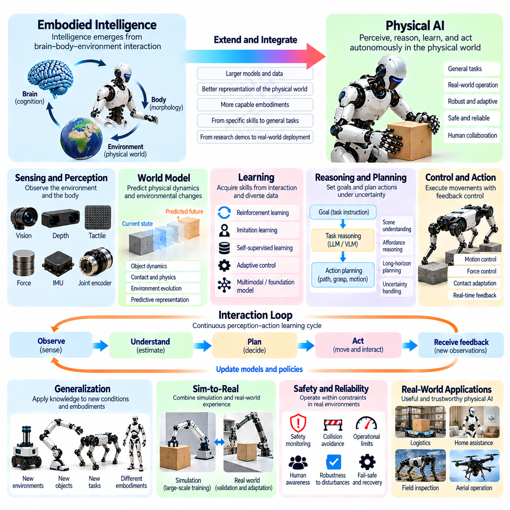{width="7.268055555555556in" height="7.268055555555556in"}

The transition from embodied intelligence to Physical AI represents the development of intelligent systems that can perceive, reason, learn, and act within the physical world. Embodied intelligence establishes that cognition emerges through interactions among the body, control processes, and environment. Physical AI extends this foundation into computational and engineering architectures capable of performing autonomous tasks under real-world physical constraints.

Embodied intelligence emphasizes the inseparable relationship between perception, action, and bodily dynamics. Intelligent behavior is not produced by computation alone but through continuous feedback between sensory observations and physical consequences. Physical AI builds upon this principle by integrating machine learning, robotics, control theory, and physical modeling into systems that transform environmental information into purposeful actions.

The body provides the physical foundation through which artificial intelligence interacts with its surroundings. Morphology, actuator capabilities, sensor placement, mechanical compliance, and structural constraints influence both perception and action. Physical AI must therefore treat embodiment as an integral part of intelligent system design rather than a passive mechanism for executing decisions generated independently of physical conditions.

Perception forms the connection between physical environments and computational representations. Cameras, depth sensors, tactile sensors, force sensors, and proprioceptive measurements provide complementary information about objects, motion, contact, and bodily states. Physical AI combines these observations through sensor fusion and state estimation, enabling agents to construct representations that support prediction, planning, and real-time control.

Action transforms intelligent predictions into measurable physical outcomes. A robot must convert task objectives into motion commands while respecting kinematic limits, dynamic constraints, contact forces, and environmental uncertainty. Successful execution requires continuous feedback rather than relying exclusively on predetermined trajectories. This interaction between planned actions and observed consequences provides the operational basis for adaptive physical intelligence.

Learning enables Physical AI systems to improve their capabilities through experience. Reinforcement learning, imitation learning, self-supervised learning, and adaptive control provide complementary mechanisms for acquiring physical skills. Interaction data reveals relationships between actions and outcomes, allowing models and policies to improve over time. However, learning must remain grounded in the physical capabilities and safety requirements of deployed systems.

World models extend embodied intelligence by representing how physical environments evolve in response to actions. These models may predict object motion, contact events, robot dynamics, and changes in environmental conditions. By evaluating possible future outcomes, Physical AI agents can select actions that better satisfy task objectives. Prediction errors provide additional information for refining models and adapting behavior when actual outcomes differ from expectations.

Foundation models introduce opportunities to connect broad semantic understanding with embodied physical capabilities. Vision-language models can support object recognition, instruction interpretation, and task reasoning, while vision-language-action models attempt to connect multimodal observations with executable actions. Their effectiveness depends on grounding abstract representations in robot-specific sensing, dynamics, and control constraints.

The transition toward Physical AI also requires integrating multiple timescales of intelligence. High-level reasoning identifies objectives and selects strategies, while intermediate planning determines feasible actions and low-level control regulates immediate physical behavior. These processes must exchange information continuously. A robot may revise its task plan when unexpected contact, environmental changes, or mechanical limitations invalidate previous assumptions.

Physical AI architectures must account for uncertainty throughout perception, planning, and execution. Sensor noise, incomplete observations, model inaccuracies, and changing environmental conditions can produce unexpected outcomes. Probabilistic estimation, feedback control, online adaptation, and uncertainty-aware planning help maintain reliable behavior. Robust physical intelligence requires recognizing limitations and responding appropriately when confidence in predicted outcomes decreases.

Generalization is essential for extending embodied capabilities beyond narrow training conditions. Robots must transfer useful knowledge across unfamiliar objects, environments, tasks, and sometimes different physical platforms. Embodiment-aware representations help distinguish shared task relationships from morphology-specific constraints. Successful transfer requires adapting learned policies to differences in sensing, actuation, contact dynamics, and available movement capabilities.

Simulation and real-world experimentation provide complementary environments for developing Physical AI. Simulation supports large-scale training, controlled evaluation, and exploration of potentially hazardous scenarios without exposing hardware to unnecessary risks. Physical deployment reveals discrepancies involving friction, compliance, sensing, and actuator behavior. Combining both approaches supports iterative refinement and more reliable transfer from virtual training to actual operation.

Safety and reliability distinguish deployable Physical AI from experimental demonstrations of embodied intelligence. Autonomous robots interact with people, equipment, and dynamic environments where incorrect actions can cause physical harm. Practical architectures therefore require operational limits, monitoring, fault detection, recovery mechanisms, and human intervention capabilities. Safety must remain integrated with learning and control rather than treated as an independent final requirement.

Physical AI can support diverse robotic embodiments, including autonomous mobile robots, manipulators, humanoids, quadrupeds, and aerial vehicles. Each platform presents different mobility, sensing, actuation, and interaction capabilities. Although common learning and reasoning principles may be shared, their implementation must reflect platform-specific constraints. This diversity highlights the importance of modular architectures and transferable representations.

The engineering development of Physical AI requires coordinated optimization across hardware, software, data, and operational processes. Improvements in algorithms alone cannot compensate for inadequate sensing, insufficient actuator performance, or unsuitable morphology. Likewise, advanced hardware cannot produce intelligent behavior without effective perception and control. System-level integration determines whether individual capabilities become reliable autonomous performance.

Ultimately, the progression from embodied intelligence to Physical AI transforms theoretical principles of body-environment interaction into practical intelligent machines. Embodied intelligence explains why physical experience, morphology, and sensorimotor coordination matter, while Physical AI provides methods for implementing these principles at operational scale. Their integration establishes a foundation for adaptive, autonomous, and physically grounded intelligence capable of meaningful real-world action.

체화 지능(Embodied Intelligence)에서 피지컬 AI(Physical AI)로의 전환은 물리적 세계(Physical World)에서 인식(Perception), 추론(Reasoning), 학습(Learning), 행동(Action)을 수행할 수 있는 지능형 시스템(Intelligent System)의 발전을 의미한다. 체화 지능은 신체(Body), 제어 과정(Control Process), 환경(Environment) 사이의 상호작용을 통해 인지(Cognition)가 형성된다는 원리를 확립한다. 피지컬 AI는 이러한 기반을 실제 세계의 물리적 제약(Real-World Physical Constraint) 아래에서 자율 작업(Autonomous Task)을 수행할 수 있는 계산 및 엔지니어링 아키텍처(Computational and Engineering Architecture)로 확장한다.

체화 지능은 인식, 행동, 신체 동역학(Bodily Dynamics) 사이의 분리할 수 없는 관계를 강조한다. 지능적 행동(Intelligent Behavior)은 계산(Computation)만으로 생성되는 것이 아니라 감각 관측(Sensory Observation)과 물리적 결과(Physical Consequence) 사이의 지속적인 피드백(Feedback)을 통해 형성된다. 피지컬 AI는 이러한 원리를 기반으로 기계학습(Machine Learning), 로보틱스(Robotics), 제어 이론(Control Theory), 물리 모델링(Physical Modeling)을 통합하여 환경 정보(Environmental Information)를 목적 지향적 행동(Purposeful Action)으로 변환하는 시스템을 구축한다.

신체는 인공지능(Artificial Intelligence)이 주변 환경과 상호작용할 수 있도록 하는 물리적 기반(Physical Foundation)을 제공한다. 형태학(Morphology), 액추에이터 능력(Actuator Capability), 센서 배치(Sensor Placement), 기계적 순응성(Mechanical Compliance), 구조적 제약(Structural Constraint)은 인식과 행동 모두에 영향을 미친다. 따라서 피지컬 AI는 체화(Embodiment)를 물리적 조건과 독립적으로 생성된 결정을 실행하는 수동적 메커니즘(Passive Mechanism)이 아니라 지능형 시스템 설계(Intelligent System Design)의 필수 구성 요소(Integral Component)로 취급해야 한다.

인식은 물리적 환경(Physical Environment)과 계산적 표현(Computational Representation)을 연결한다. 카메라(Camera), 깊이 센서(Depth Sensor), 촉각 센서(Tactile Sensor), 힘 센서(Force Sensor), 고유수용감각 측정값(Proprioceptive Measurement)은 물체(Object), 움직임(Motion), 접촉(Contact), 신체 상태(Bodily State)에 관한 상호 보완적인 정보(Complementary Information)를 제공한다. 피지컬 AI는 센서 융합(Sensor Fusion)과 상태 추정(State Estimation)을 통해 이러한 관측을 결합하여 예측(Prediction), 계획(Planning), 실시간 제어(Real-Time Control)를 지원하는 표현을 구성할 수 있도록 한다.

행동은 지능적 예측(Intelligent Prediction)을 측정 가능한 물리적 결과(Measurable Physical Outcome)로 변환한다. 로봇은 운동학적 한계(Kinematic Limit), 동역학적 제약(Dynamic Constraint), 접촉력(Contact Force), 환경 불확실성(Environmental Uncertainty)을 준수하면서 작업 목표(Task Objective)를 운동 명령(Motion Command)으로 변환해야 한다. 성공적인 실행(Successful Execution)을 위해서는 사전에 결정된 궤적(Predetermined Trajectory)에만 의존하는 것이 아니라 지속적인 피드백이 필요하다. 계획된 행동(Planned Action)과 관측된 결과(Observed Consequence) 사이의 이러한 상호작용은 적응형 물리 지능(Adaptive Physical Intelligence)의 운영 기반(Operational Basis)을 제공한다.

학습은 피지컬 AI 시스템이 경험(Experience)을 통해 자신의 능력을 개선할 수 있도록 한다. 강화학습(Reinforcement Learning), 모방학습(Imitation Learning), 자기지도학습(Self-Supervised Learning), 적응형 제어(Adaptive Control)는 물리적 기술(Physical Skill)을 습득하기 위한 상호 보완적인 메커니즘(Complementary Mechanism)을 제공한다. 상호작용 데이터(Interaction Data)는 행동과 결과 사이의 관계를 드러내어 모델(Model)과 정책(Policy)이 시간이 지남에 따라 개선되도록 한다. 그러나 학습은 실제 배포된 시스템(Deployed System)의 물리적 능력과 안전 요구사항(Safety Requirement)에 기반해야 한다.

세계 모델(World Model)은 물리적 환경이 행동에 반응하여 어떻게 변화하는지를 표현함으로써 체화 지능을 확장한다. 이러한 모델은 물체 움직임(Object Motion), 접촉 사건(Contact Event), 로봇 동역학(Robot Dynamics), 환경 조건(Environmental Condition)의 변화를 예측할 수 있다. 피지컬 AI 에이전트(Physical AI Agent)는 가능한 미래 결과(Future Outcome)를 평가하여 작업 목표를 더욱 효과적으로 충족하는 행동을 선택할 수 있다. 예측 오차(Prediction Error)는 실제 결과가 예상과 다를 때 모델을 개선하고 행동을 적응시키기 위한 추가 정보를 제공한다.

파운데이션 모델(Foundation Model)은 광범위한 의미적 이해(Semantic Understanding)를 체화된 물리적 능력(Embodied Physical Capability)과 연결할 수 있는 기회를 제공한다. 시각-언어 모델(Vision-Language Model)은 물체 인식(Object Recognition), 명령 해석(Instruction Interpretation), 작업 추론(Task Reasoning)을 지원할 수 있으며, 시각-언어-행동 모델(Vision-Language-Action Model)은 다중 모달 관측(Multimodal Observation)을 실행 가능한 행동(Executable Action)과 연결하려고 한다. 이러한 모델의 효과성(Effectiveness)은 추상적 표현(Abstract Representation)을 로봇별 감지(Robot-Specific Sensing), 동역학(Dynamics), 제어 제약(Control Constraint)에 기반하여 연결하는 데 달려 있다.

피지컬 AI로의 전환은 서로 다른 시간 척도(Time Scale)의 지능을 통합하는 것도 요구한다. 상위 수준 추론(High-Level Reasoning)은 목표를 식별하고 전략(Strategy)을 선택하며, 중간 수준 계획(Intermediate Planning)은 실행 가능한 행동을 결정하고, 저수준 제어(Low-Level Control)는 즉각적인 물리적 행동을 조절한다. 이러한 과정은 지속적으로 정보를 교환해야 한다. 예상하지 못한 접촉, 환경 변화(Environmental Change), 기계적 한계(Mechanical Limitation)로 인해 이전 가정(Previous Assumption)이 더 이상 유효하지 않게 되면 로봇은 작업 계획(Task Plan)을 수정할 수 있다.

피지컬 AI 아키텍처(Physical AI Architecture)는 인식, 계획, 실행(Execution)의 전 과정에서 불확실성(Uncertainty)을 고려해야 한다. 센서 잡음(Sensor Noise), 불완전한 관측(Incomplete Observation), 모델 부정확성(Model Inaccuracy), 변화하는 환경 조건은 예상하지 못한 결과를 발생시킬 수 있다. 확률적 추정(Probabilistic Estimation), 피드백 제어(Feedback Control), 온라인 적응(Online Adaptation), 불확실성 인식 계획(Uncertainty-Aware Planning)은 신뢰할 수 있는 행동을 유지하도록 지원한다. 강건한 물리 지능(Robust Physical Intelligence)은 자신의 한계를 인식하고 예측 결과에 대한 신뢰도(Confidence)가 감소할 때 적절하게 대응할 수 있어야 한다.

일반화(Generalization)는 제한된 훈련 조건(Training Condition)을 넘어 체화된 능력(Embodied Capability)을 확장하는 데 필수적이다. 로봇은 익숙하지 않은 물체, 환경, 작업, 때로는 서로 다른 물리적 플랫폼(Physical Platform) 사이에서 유용한 지식을 전이(Transfer)해야 한다. 체화 인식 표현(Embodiment-Aware Representation)은 공통적인 작업 관계(Shared Task Relationship)와 형태학별 제약(Morphology-Specific Constraint)을 구별하도록 지원한다. 성공적인 전이를 위해서는 학습된 정책(Learned Policy)을 감지(Sensing), 구동(Actuation), 접촉 동역학(Contact Dynamics), 사용 가능한 운동 능력(Movement Capability)의 차이에 맞게 적응시켜야 한다.

시뮬레이션(Simulation)과 실제 환경 실험(Real-World Experimentation)은 피지컬 AI를 개발하기 위한 상호 보완적인 환경을 제공한다. 시뮬레이션은 하드웨어(Hardware)를 불필요한 위험에 노출하지 않으면서 대규모 훈련(Large-Scale Training), 통제된 평가(Controlled Evaluation), 잠재적으로 위험한 시나리오(Hazardous Scenario)의 탐색을 지원한다. 실제 환경 배포(Physical Deployment)는 마찰(Friction), 순응성(Compliance), 감지, 액추에이터 동작(Actuator Behavior)과 관련된 차이를 드러낸다. 두 접근법을 결합하면 반복적인 개선(Iterative Refinement)과 가상 훈련(Virtual Training)에서 실제 작동(Actual Operation)으로의 더욱 신뢰할 수 있는 전이를 지원할 수 있다.

안전성(Safety)과 신뢰성(Reliability)은 실제 배포 가능한 피지컬 AI(Deployable Physical AI)를 체화 지능의 실험적 시연(Experimental Demonstration)과 구별하는 핵심 요소이다. 자율 로봇(Autonomous Robot)은 사람, 장비, 동적 환경(Dynamic Environment)과 상호작용하며, 잘못된 행동은 물리적 피해(Physical Harm)를 초래할 수 있다. 따라서 실용적인 아키텍처(Practical Architecture)에는 운영 한계(Operational Limit), 모니터링(Monitoring), 결함 감지(Fault Detection), 복구 메커니즘(Recovery Mechanism), 인간 개입 능력(Human Intervention Capability)이 필요하다. 안전성은 독립적인 최종 요구사항(Final Requirement)으로 취급되는 것이 아니라 학습 및 제어와 통합되어야 한다.

피지컬 AI는 자율 이동 로봇(Autonomous Mobile Robot), 매니퓰레이터(Manipulator), 휴머노이드(Humanoid), 사족보행 로봇(Quadruped Robot), 비행체(Aerial Vehicle)를 포함한 다양한 로봇 체화 형태(Robotic Embodiment)를 지원할 수 있다. 각 플랫폼은 서로 다른 이동성(Mobility), 감지, 구동, 상호작용 능력(Interaction Capability)을 가진다. 공통적인 학습 및 추론 원리(Learning and Reasoning Principle)를 공유할 수 있지만, 실제 구현(Implementation)은 플랫폼별 제약(Platform-Specific Constraint)을 반영해야 한다. 이러한 다양성은 모듈형 아키텍처(Modular Architecture)와 전이 가능한 표현(Transferable Representation)의 중요성을 강조한다.

피지컬 AI의 엔지니어링 개발(Engineering Development)은 하드웨어, 소프트웨어(Software), 데이터(Data), 운영 프로세스(Operational Process) 전반에 걸친 조정된 최적화(Coordinated Optimization)를 요구한다. 알고리즘(Algorithm)의 개선만으로는 부적절한 감지, 부족한 액추에이터 성능(Actuator Performance), 적합하지 않은 형태학을 보완할 수 없다. 마찬가지로 첨단 하드웨어(Advanced Hardware)도 효과적인 인식과 제어가 없다면 지능적 행동을 생성할 수 없다. 시스템 수준 통합(System-Level Integration)은 개별 능력이 신뢰할 수 있는 자율 성능(Autonomous Performance)으로 발전할 수 있는지를 결정한다.

궁극적으로 체화 지능에서 피지컬 AI로의 발전은 신체-환경 상호작용(Body-Environment Interaction)에 관한 이론적 원리(Theoretical Principle)를 실용적인 지능형 기계(Practical Intelligent Machine)로 전환한다. 체화 지능은 물리적 경험(Physical Experience), 형태학, 감각운동 협응(Sensorimotor Coordination)이 중요한 이유를 설명하며, 피지컬 AI는 이러한 원리를 실제 운영 규모(Operational Scale)에서 구현하기 위한 방법을 제공한다. 두 영역의 통합은 실제 세계에서 의미 있는 행동(Meaningful Real-World Action)을 수행할 수 있는 적응적(Adaptive), 자율적(Autonomous), 물리적 기반 지능(Physically Grounded Intelligence)의 토대를 확립한다.
