**Volume 03. Embodiment and Morphology**

# Chapter 02. Morphological Computation

## 02.01. What is Morphological Computation

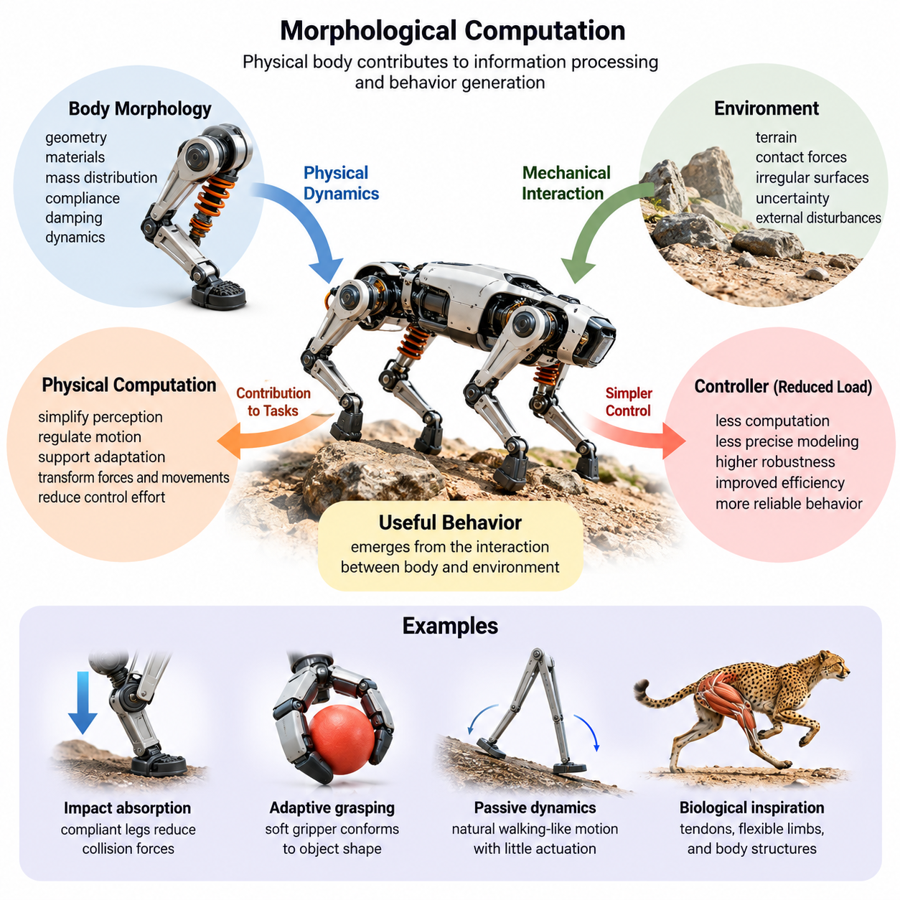{width="7.268055555555556in" height="7.268055555555556in"}

형태적 연산(Morphological Computation)은 물리적 신체(Physical Body)의 구조(Structure), 재료(Materials), 동역학(Dynamics)이 기존에는 명시적인 계산 제어(Computational Control)를 필요로 했던 기능을 수행하는 데 기여하는 현상을 의미한다. 체화 지능(Embodied Intelligence)에서 연산(Computation)은 프로세서(Processor)나 신경망(Neural Network)에만 국한되지 않는다. 신체와 환경 사이의 기계적 상호작용(Mechanical Interaction)은 모든 반응을 지속적으로 계산하지 않고도 인지(Perception)를 단순화하고, 움직임을 조절하며, 적응적 행동(Adaptive Behavior)을 지원할 수 있다.

형태적 연산(Morphological Computation)의 핵심 원리는 물리적 형태(Physical Form)가 정보 처리(Information Processing)와 행동 조절(Behavioral Regulation)에 참여할 수 있다는 것이다. 로봇의 기하학적 구조(Geometry), 관절 배치(Joint Arrangement), 질량 분포(Mass Distribution), 탄성(Elasticity), 감쇠(Damping)는 외부 힘에 대한 반응을 결정한다. 이러한 특성이 자연스럽게 유용한 행동을 생성하면 기계 시스템(Mechanical System)은 기존에 디지털 제어기(Digital Controller)가 담당하던 기능적 작업의 일부를 수행하게 된다.

전통적인 로봇 아키텍처(Conventional Robotic Architecture)는 일반적으로 감지(Sensing), 연산(Computation), 구동(Actuation)을 서로 구분된 기능 단계로 분리한다. 센서(Sensor)는 환경 조건을 측정하고, 제어기(Controller)는 적절한 명령을 계산하며, 액추에이터(Actuator)는 해당 명령을 실행한다. 형태적 연산(Morphological Computation)은 물리적 상호작용이 디지털 제어(Digital Control)가 필요해지기 전에 힘과 움직임을 직접 조정된 반응으로 변환할 수 있다는 점에서 이러한 엄격한 분리 개념에 새로운 관점을 제시한다.

간단한 사례로 지면 접촉(Ground Contact) 과정에서 충격을 흡수하는 유연한 로봇 다리(Compliant Robotic Leg)를 들 수 있다. 충돌을 처리하기 위해 필요한 모든 조정을 제어기(Controller)가 계산하는 대신, 탄성 구성 요소(Elastic Component)가 변형되면서 기계적 에너지(Mechanical Energy)를 일시적으로 저장한다. 이후 원래 형태로 복원되는 과정에서 움직임의 회복을 지원한다. 따라서 신체는 자체적인 물리적 특성을 통해 충격 관리(Impact Management)와 동적 조절(Dynamic Regulation)에 기여한다.

이 개념은 지능과 행동을 두뇌(Brain), 신체(Body), 환경(Environment) 사이의 상호작용 결과로 이해하는 체화 지능(Embodied Intelligence)과 밀접하게 관련된다. 형태적 연산(Morphological Computation)은 이러한 상호작용에서 신체가 수행하는 구체적인 역할을 강조한다. 지능(Intelligence)은 추상적 추론(Abstract Reasoning)이나 학습된 정책(Learned Policy)뿐만 아니라 변화하는 조건에 대한 물리 시스템의 반응을 형성하는 기계적 특성(Mechanical Characteristics)에서도 나타난다.

이러한 맥락에서 연산(Computation)이라는 용어는 신중하게 해석해야 한다. 스프링(Spring)이 에너지를 저장한다는 이유만으로 소프트웨어 명령(Software Instruction)을 실행하거나 기호적 추론(Symbolic Reasoning)을 수행하는 것은 아니다. 그러나 스프링의 변형(Deformation)은 물리적 입력(Physical Input)을 기능적으로 유용한 출력(Functional Output)으로 변환할 수 있다. 형태적 연산(Morphological Computation)은 이러한 신체 동역학(Body Dynamics)이 제어(Control), 협응(Coordination), 적응(Adaptation), 정보 처리(Information Processing)에 의미 있게 기여하는 현상을 설명한다.

기계적 순응성(Mechanical Compliance)은 형태적 연산(Morphological Computation)과 관련된 가장 대표적인 메커니즘(Mechanism) 중 하나이다. 유연한 구조(Compliant Structure)는 외력이 작용하면 변형되어 접촉 조건(Contact Condition)의 불확실성을 수용할 수 있다. 이러한 특성은 실제 환경에 불규칙한 표면(Irregular Surface), 예측하기 어려운 충돌(Unpredictable Collision), 정확한 형상이나 기계적 특성을 사전에 알기 어려운 물체가 존재하기 때문에 로봇공학(Robotics)에서 특히 중요하다.

탄성(Elasticity)과 감쇠(Damping)는 서로 보완적인 물리적 조절(Physical Regulation) 기능을 제공한다. 탄성 요소(Elastic Element)는 에너지를 저장하고 방출하는 반면, 감쇠는 에너지를 소산하고 불필요한 진동(Oscillation)을 억제한다. 두 특성이 결합되면 지속적인 고주파 보정 명령(High-Frequency Corrective Command) 없이도 상호작용을 안정화할 수 있다. 따라서 적절하게 선택된 기계적 특성(Mechanical Properties)은 제어 부담(Control Effort)을 줄이면서 동적 작업(Dynamic Task)의 강건성(Robustness)을 향상시킬 수 있다.

수동 동역학(Passive Dynamics)은 또 다른 중요한 기반을 제공한다. 기계 시스템(Mechanical System)은 기하학적 구조(Geometry), 관성(Inertia), 중력(Gravity), 접촉 조건(Contact Condition)에 의해 유용한 움직임 패턴(Motion Pattern)을 나타낼 수 있다. 수동 동역학 보행기(Passive Dynamic Walker)는 적절하게 설계된 다리 구조가 특정 경사면에서 동력 구동(Powered Actuation)이 거의 없거나 전혀 없이 보행과 유사한 움직임을 생성할 수 있음을 보여준다. 이러한 사례는 조정된 움직임(Coordinated Movement)에 항상 정교한 중앙집중식 궤적 제어(Centralized Trajectory Control)가 필요한 것은 아니라는 사실을 보여준다.

형태적 연산(Morphological Computation)은 물리적 설계(Physical Design)와 제어 복잡도(Control Complexity) 사이의 관계에도 영향을 미친다. 부적절하게 설계된 신체는 불안정하거나 비효율적인 동역학(Dynamics)을 보완하기 위해 정교한 알고리즘(Algorithm)을 필요로 할 수 있다. 반대로 목표 작업에 적합하게 설계된 신체는 자연스럽게 움직임을 바람직한 행동으로 제한할 수 있다. 이는 제어기(Controller)가 생성해야 하는 보정 범위를 줄이고 효율성(Efficiency), 응답성(Responsiveness), 신뢰성(Reliability)을 향상시킬 수 있다.

로봇 이동(Robotic Locomotion)에서 신체 형태(Body Morphology)는 힘이 다리(Leg), 관절(Joint), 발(Foot), 지지 구조(Supporting Structure)를 통해 전달되는 방식을 결정한다. 다리의 순응성(Leg Compliance)은 충격 하중(Impact Load)을 줄이고, 발의 기하학적 구조(Foot Geometry)는 접촉 안정성(Contact Stability)을 높이며, 질량 분포(Mass Distribution)는 균형(Balance)에 영향을 미친다. 이러한 특성은 지형(Terrain) 및 이동 속도(Movement Speed)와 상호작용하여 모든 조정을 소프트웨어(Software)에 의존하지 않고 물리적 동역학이 이동 제어(Locomotion Control)에 기여하도록 한다.

형태적 연산(Morphological Computation)은 로봇 조작(Robotic Manipulation)에서도 동일하게 중요하다. 소프트 그리퍼(Soft Gripper)는 재료 변형(Material Deformation)을 통해 서로 다른 형상의 물체에 맞춰 변형되므로 정밀한 기하학적 재구성(Geometric Reconstruction)과 개별 손가락 위치 제어(Finger Position Control)의 필요성을 줄일 수 있다. 접촉력(Contact Force)은 유연한 표면에 분산되어 안정적인 파지(Stable Grasp)를 형성하는 데 기여한다. 이러한 기계적 설계(Mechanical Design)는 기존에는 광범위한 감지와 제어가 필요했던 불확실성의 일부를 효과적으로 처리한다.

생물학적 유기체(Biological Organism)는 형태(Morphology)가 적응적 행동(Adaptive Behavior)을 지원하는 방식을 보여주는 중요한 사례를 제공한다. 힘줄(Tendon)은 달리기 과정에서 에너지를 저장하고 방출하며, 유연한 사지(Flexible Limb)는 불규칙한 지형에 적응하고, 신체 구조(Body Structure)는 기계적 하중(Mechanical Load)을 분산한다. 이러한 메커니즘은 신경 제어(Neural Control)를 대체하는 것이 아니라 함께 작동한다. 이는 생물학적 지능(Biological Intelligence)이 신경계(Nervous System)와 물리적 신체 사이의 조정된 상호작용에 의존한다는 사실을 보여준다.

형태(Morphology)와 환경적 상호작용(Environmental Interaction) 사이의 관계는 특히 중요하다. 신체의 연산적 기여(Computational Contribution)는 작동 환경과 독립적으로 평가하기 어려운 경우가 많다. 유연한 구조(Compliant Structure)는 불규칙한 지형에서 성능을 향상시킬 수 있지만 정밀 위치 제어(Precision Positioning)에서는 불필요한 진동을 유발할 수 있다. 따라서 형태적 연산(Morphological Computation)은 작업 의존적(Task-Dependent)이며 전체 신체-환경 시스템(Body--Environment System)의 맥락에서 이해해야 한다.

물리적 필터링(Physical Filtering)은 형태적 연산(Morphological Computation)을 이해하는 또 다른 유용한 관점이다. 기계적 구조(Mechanical Structure)는 동적 특성(Dynamic Characteristics)에 따라 외란(Disturbance)을 감쇠하고, 빠른 변동을 완화하며, 특정 힘을 선택적으로 전달할 수 있다. 서스펜션 시스템(Suspension System), 유연한 관절(Compliant Joint), 유연한 접촉면(Flexible Contact Surface)은 환경적 외란이 민감한 구성 요소로 전달되거나 능동적 보정(Active Correction)을 요구하기 전에 그 영향을 줄일 수 있다.

형태(Morphology)의 연산적 역할은 동역학 시스템 이론(Dynamical Systems Theory)을 통해서도 이해할 수 있다. 로봇의 물리적 상태(Physical State)는 힘(Force), 제약 조건(Constraint), 재료 특성(Material Property), 환경 조건(Environmental Condition) 사이의 상호작용에 따라 변화한다. 적절한 기계적 설계(Mechanical Design)는 안정적인 끌개(Stable Attractor), 선호되는 움직임 패턴(Preferred Movement Pattern), 예측 가능한 반응(Predictable Response)을 형성할 수 있다. 제어기는 모든 행동을 명시적인 명령으로 생성하는 대신 이러한 자연적인 동역학을 활용할 수 있다.

그러나 형태적 연산(Morphological Computation)이 감지(Sensing), 계획(Planning), 지능형 제어(Intelligent Control)의 필요성을 제거한다고 해석해서는 안 된다. 수동적 기계 반응(Passive Mechanical Response)만으로는 모든 작업 요구사항을 독립적으로 충족할 수 없으며, 특히 목표가 변경되거나 환경 조건이 신체의 설계 가정을 벗어나는 경우에는 더욱 그렇다. 효과적인 로봇 시스템은 기계적 지능(Mechanical Intelligence)을 피드백 제어(Feedback Control), 인지(Perception), 학습(Learning), 의사결정(Decision-Making)과 결합하여 신뢰할 수 있는 행동을 구현한다.

형태적 연산(Morphological Computation)과 전통적인 기계공학(Conventional Mechanical Engineering)의 차이는 주로 기능적 관점(Functional Perspective)과 분석적 관점(Analytical Perspective)에 있다. 기계공학자는 오랫동안 스프링(Spring), 댐퍼(Damper), 링크 기구(Linkage), 유연한 메커니즘(Compliant Mechanism)을 활용하여 성능을 향상시켜 왔다. 형태적 연산은 이러한 물리적 특성이 정보 처리(Information Processing), 행동 협응(Behavioral Coordination), 계산적 제어 부담(Computational Control Demand)의 감소와 관련된 기능을 어떻게 수행하는지 분석함으로써 기존 관점을 확장한다.

형태적 연산(Morphological Computation)의 정량화(Quantification)는 여전히 중요한 연구 과제(Research Challenge)이다. 연구자들은 정보 이론(Information Theory), 동적 의존성(Dynamical Dependence), 제어 노력(Control Effort), 물리적 상태와 미래 행동 사이의 관계를 기반으로 다양한 측정 방법을 연구한다. 그러나 이 개념의 모든 해석을 보편적으로 포괄하는 단일 지표(Single Metric)는 존재하지 않는다. 따라서 의미 있는 평가(Evaluation)를 위해서는 명확하게 정의된 작업(Task), 시스템 경계(System Boundary), 대안적인 신체-제어기 구성(Body--Controller Configuration)과의 비교가 필요하다.

에너지 효율성(Energy Efficiency)은 형태적 연산(Morphological Computation)을 로봇 설계에 적용하는 실용적인 동기를 제공한다. 기계적 구조가 자연스럽게 충격을 흡수하거나 에너지를 회수하고 움직임을 안정화하면 액추에이터(Actuator)가 수행해야 하는 보정 작업이 줄어들 수 있다. 그러나 이러한 이점은 작동 조건(Operating Condition)과 설계 선택(Design Choice)에 따라 달라진다. 과도한 순응성(Excessive Compliance), 부적절한 공진(Resonance), 기계적 손실(Mechanical Loss)은 오히려 에너지 소비를 증가시킬 수 있다.

형태적 연산(Morphological Computation)은 중요한 공학적 상충관계(Engineering Trade-Off)도 수반한다. 기계적 반응(Mechanical Response)은 물리적 동역학에서 직접 발생하므로 빠른 경우가 많지만, 제작 이후에는 변경하기 어려울 수 있다. 특정 작업에 특화된 형태(Specialized Morphology)는 예상된 조건에서 뛰어난 성능을 발휘할 수 있지만 익숙하지 않은 작업에는 적응하기 어려울 수 있다. 따라서 설계자는 수동적 기능(Passive Functionality), 기계적 범용성(Mechanical Versatility), 제어 가능성(Controllability), 변화하는 요구사항에 대한 적응 능력(Adaptability) 사이의 균형을 고려해야 한다.

피지컬 AI(Physical AI) 시스템에서 형태적 연산(Morphological Computation)은 지능을 하드웨어-소프트웨어 공동 설계(Hardware--Software Co-Design)를 통해 개발해야 한다는 점을 시사한다. 로봇 신체(Robot Body)를 다른 곳에서 생성된 결정을 실행하는 수동적인 플랫폼(Passive Platform)으로만 취급해서는 안 된다. 신체의 기하학적 구조(Geometry), 재료(Materials), 관절(Joints), 접촉 메커니즘(Contact Mechanisms)은 목표 행동을 지원하도록 선택할 수 있으며, 이를 통해 학습 알고리즘(Learning Algorithm)과 제어기(Controller)가 유리한 물리적 동역학(Physical Dynamics)을 활용하도록 할 수 있다.

로봇이 복잡하고 불확실하며 인간 중심적인 환경(Human-Centered Environment)에서 작동하게 될수록 이러한 관점은 더욱 중요해진다. 모바일 로봇(Mobile Robot), 매니퓰레이터(Manipulator), 휴머노이드(Humanoid), 사족보행 로봇(Quadruped Robot), 소프트 로봇(Soft Robot)은 서로 다른 기계적 문제(Mechanical Challenge)에 직면하므로 요구되는 형태적 특성(Morphological Requirements)도 근본적으로 다르다. 형태적 연산에 대한 이해는 상호작용을 개선하고 불필요한 제어 부담을 줄이며 강건한 물리적 자율성(Robust Physical Autonomy)을 지원하는 신체 설계의 개념적 기반을 제공한다.

궁극적으로 형태적 연산(Morphological Computation)은 지능(Intelligence)과 물리적 체화(Physical Embodiment) 사이의 관계를 새롭게 정의한다. 신체를 별도의 계산 시스템(Computational System)에 의해 제어되는 수동적 도구로 보는 대신, 물리적 구조(Physical Structure)를 행동(Behavior)에 능동적으로 기여하는 요소로 인식한다. 이러한 설계 철학(Design Philosophy)은 역학(Mechanics), 재료(Materials), 환경적 상호작용(Environmental Interaction), 계산적 제어(Computational Control)를 통합하여 체화 지능(Embodied Intelligence)과 피지컬 AI(Physical AI)를 구현하는 통합적 접근 방식(Unified Approach)을 형성한다.

## 02.02. Body as a Computational Resource

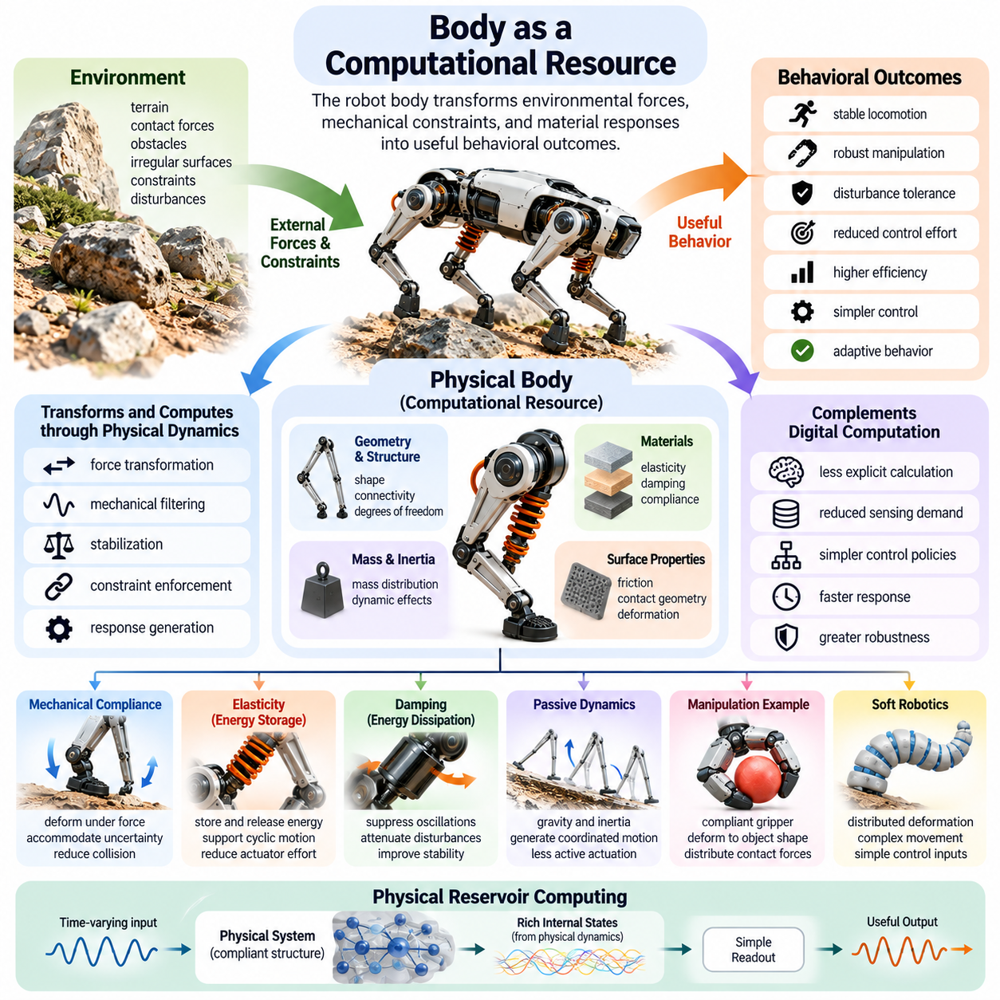{width="7.268055555555556in" height="7.268055555555556in"}

로봇의 물리적 신체(Physical Body)는 환경적 힘(Environmental Forces), 기계적 제약(Mechanical Constraints), 재료 반응(Material Responses)을 유용한 행동 결과(Behavioral Outcomes)로 변환함으로써 연산 자원(Computational Resource)으로 기능할 수 있다. 체화 시스템(Embodied System)은 디지털 프로세서(Digital Processor)에만 의존하는 대신 물리적 구조(Physical Structure)를 활용하여 제어(Control)와 상호작용(Interaction)을 단순화한다. 이러한 관점은 연산(Computation)이 소프트웨어(Software), 하드웨어(Hardware), 주변 환경의 동역학(Environmental Dynamics)에 분산될 수 있음을 보여준다.

전통적인 컴퓨팅 아키텍처(Conventional Computing Architecture)에서 정보(Information)는 전자 회로(Electronic Circuit)와 알고리즘(Algorithm)을 통해 표현되고 처리되며 변환된다. 로봇의 신체는 물리적 특성(Physical Properties)이 움직임과 상호작용에 지속적으로 영향을 미친다는 점에서 다르게 작동한다. 관절 강성(Joint Stiffness), 구조적 유연성(Structural Flexibility), 관성(Inertia), 표면 마찰(Surface Friction)은 명시적인 수치 계산(Numerical Calculation) 없이도 반응을 형성할 수 있다. 이러한 특성은 디지털 연산(Digital Computation)을 보완하는 작업 관련 변환(Task-Relevant Transformation)을 제공한다.

신체를 연산 자원(Computational Resource)으로 취급한다고 해서 기계적 구성 요소(Mechanical Component)가 기호적 추론(Symbolic Reasoning)을 수행하거나 기존의 소프트웨어 명령(Software Instruction)을 실행한다는 의미는 아니다. 대신 물리적 동역학(Physical Dynamics)은 필터링(Filtering), 안정화(Stabilization), 제약 조건 적용(Constraint Enforcement), 반응 생성(Response Generation)과 유사한 기능을 구현할 수 있다. 이러한 기능이 로봇의 목표 달성에 기여하면 제어기(Controller)에 필요한 처리량이나 능동적 개입(Active Intervention)을 줄일 수 있다.

기본적인 메커니즘(Mechanism)은 외부 힘(External Force)을 구조화된 기계적 반응(Structured Mechanical Response)으로 변환하는 것이다. 유연한 로봇 사지(Compliant Robotic Limb)가 장애물(Obstacle)에 접촉하면 변형(Deformation)은 기하학적 구조(Geometry), 강성(Stiffness), 작용하는 힘(Applied Force)에 따라 결정된다. 그 결과 발생하는 움직임은 외란(Disturbance)의 일부를 자동으로 수용한다. 이러한 물리적 변환(Physical Transformation)은 보정용 액추에이터 명령(Corrective Actuator Command)을 결정하기 위해 필요했던 일부 명시적 계산(Explicit Calculation)을 대체할 수 있다.

신체의 연산적 기여(Computational Contribution)는 기하학적 구조(Geometry), 연결 구조(Connectivity), 재료 분포(Material Distribution), 기계적 자유도(Mechanical Degrees of Freedom)를 포함하는 형태(Morphology)에 크게 영향을 받는다. 이러한 특성은 힘이 시스템 내부에서 전달되는 방식과 서로 다른 구성 요소가 상호작용하는 방식을 결정한다. 신중하게 설계된 형태는 의도된 행동(Intended Behavior)을 지원하면서 바람직하지 않은 움직임(Undesirable Movement)을 제한하는 예측 가능한 반응(Predictable Response)을 생성할 수 있다.

기계적 순응성(Mechanical Compliance)은 물리적 연산(Physical Computation)의 특히 중요한 사례를 제공한다. 탄성 관절(Elastic Joint)과 유연한 구조(Flexible Structure)는 센서 측정(Sensor Measurement)이나 소프트웨어 결정(Software Decision)을 기다리지 않고 접촉력(Contact Force)에 지속적으로 반응한다. 이러한 변형은 위치 오차(Positioning Error)를 수용하고, 하중(Load)을 분산하며, 충돌의 심각도(Collision Severity)를 줄일 수 있다. 이러한 반응은 상호작용 조건이 디지털 제어기(Digital Controller)의 안정적인 반응 속도보다 빠르게 변화하는 경우 특히 유용하다.

기계적 에너지(Mechanical Energy)의 저장과 방출 역시 신체 동역학(Body Dynamics)이 기능적 처리(Functional Processing)를 지원하는 방식을 보여준다. 스프링(Spring), 힘줄(Tendon), 탄성 구조(Elastic Structure)는 변형 과정에서 에너지를 일시적으로 저장하고 복원 과정에서 일부를 반환한다. 이동(Locomotion) 과정에서 이러한 메커니즘은 반복적인 움직임 주기(Movement Cycle)를 지원하고 액추에이터의 작동 부담(Actuator Effort)을 줄일 수 있다. 그 효과는 기계적 특성을 작동 조건(Operating Conditions)과 움직임 주파수(Movement Frequencies)에 적절하게 일치시키는 데 달려 있다.

감쇠(Damping)는 물리적으로 구현되는 또 다른 조절 방식(Physical Regulation)을 제공한다. 기계적 감쇠(Mechanical Damping)와 재료 감쇠(Material Damping)는 에너지를 소산하여 진동(Oscillation)을 줄이고 외란(Disturbance)의 전달을 제한한다. 로봇 매니퓰레이터(Robotic Manipulator)에서 적절한 감쇠는 접촉이나 빠른 움직임 중에 발생하는 불필요한 진동(Vibration)을 억제할 수 있다. 이러한 행동은 능동적 제어(Active Control)가 필요해지기 전에 기계적 구조가 특정 동적 반응(Dynamic Response)을 약화한다는 점에서 필터링(Filtering)과 유사하다.

신체 구조(Body Structure)와 환경적 제약(Environmental Constraints) 사이의 관계도 중요하다. 접촉면(Contact Surface), 관절 한계(Joint Limit), 기계적 링크 기구(Mechanical Linkage)는 가능한 움직임의 범위를 제한한다. 이러한 제한은 물리적으로 바람직하지 않은 구성(Undesirable Configuration)을 제거함으로써 제어 문제(Control Problem)를 단순화할 수 있다. 로봇은 모든 제약 조건을 소프트웨어로 계산하는 대신 움직임을 유용한 구성으로 자연스럽게 유도하는 기계적 배치(Mechanical Arrangement)를 활용할 수 있다.

수동 기계 시스템(Passive Mechanical System)은 경우에 따라 고유한 동역학(Intrinsic Dynamics)을 통해 조정된 행동(Coordinated Behavior)을 생성할 수 있다. 수동 동역학 보행(Passive Dynamic Walking)은 적절한 조건에서 중력(Gravity), 관성(Inertia), 다리의 기하학적 구조(Leg Geometry), 지면 접촉(Ground Contact)이 보행과 유사한 움직임을 생성할 수 있음을 보여준다. 이러한 시스템은 작동 범위(Operating Range)가 제한적이지만 움직임 협응(Movement Coordination)의 일부가 지속적인 중앙집중식 연산(Centralized Computation)이 아닌 물리적 구성(Physical Organization)에서 나타날 수 있음을 보여준다.

로봇 조작(Robotic Manipulation)에서 유연한 그리퍼(Compliant Gripper)는 신체의 기하학적 구조(Body Geometry)가 불확실한 물체와의 상호작용을 단순화하는 방식을 보여준다. 유연한 손가락(Flexible Finger)은 물체 표면을 따라 변형되며 접촉력(Contact Force)이 국부적인 기하학적 구조(Local Geometry)와 재료 강성(Material Stiffness)에 따라 분산되도록 한다. 이러한 행동은 정확한 물체 모델(Object Model)과 개별적으로 계산된 접촉 위치(Contact Position)의 필요성을 줄인다. 그리퍼의 물리적 구조는 파지(Grasping)에 필요한 적응 과정의 일부를 수행한다.

소프트 로봇 시스템(Soft Robotic System)은 분산된 변형(Distributed Deformation)을 통해 이러한 원리를 확장한다. 소프트 로봇의 신체에는 구동(Actuation)과 환경 접촉(Environmental Contact)에 집합적으로 반응하는 기계적으로 결합된 자유도(Mechanically Coupled Degrees of Freedom)가 다수 존재한다. 제어기는 모든 변형을 독립적으로 명령하는 대신 재료 특성(Material Properties)과 구조적 제약(Structural Constraints)을 활용할 수 있다. 이를 통해 비교적 단순한 제어 입력(Control Input)으로 복잡한 움직임을 구현할 수 있지만 정밀한 모델링(Precise Modeling)은 여전히 어려울 수 있다.

물리적 리저버 컴퓨팅(Physical Reservoir Computing)은 신체 동역학(Body Dynamics)과 정보 처리(Information Processing) 사이의 관계를 더욱 명시적으로 설명한다. 이 접근 방식에서 복잡한 물리 시스템(Physical System)은 시간에 따라 변화하는 입력(Time-Varying Input)을 풍부한 내부 상태(Internal State)로 변환한다. 이후 비교적 단순한 판독 메커니즘(Readout Mechanism)이 이러한 상태에서 유용한 정보를 추출할 수 있다. 유연한 구조(Compliant Structure)와 소프트 재료(Soft Material)는 시간적 신호(Temporal Signal)를 처리하기 위한 물리적 리저버(Physical Reservoir)로 연구되어 왔다.

물리적 리저버 컴퓨팅(Physical Reservoir Computing)은 기계적 동역학(Mechanical Dynamics)이 기억과 유사한 행동(Memory-Like Behavior)을 제공할 수 있음을 보여준다. 탄성 변형(Elastic Deformation), 감쇠(Damping), 결합 운동(Coupled Motion)은 이전 입력(Previous Input)의 흔적을 제한된 시간 동안 유지한다. 이러한 일시적 상태(Transient State)는 이후의 반응에 영향을 미쳐 물리 시스템이 최근 상호작용 이력(Interaction History)의 일부를 인코딩(Encoding)할 수 있도록 한다. 그러나 이러한 기억은 일반적으로 작업 의존적(Task-Dependent)이며 지속적인 디지털 데이터 저장(Persistent Digital Data Storage)과 근본적으로 다르다.

신체의 연산적 가치(Computational Value)는 동역학(Dynamics)과 수행 작업(Task) 사이의 관계에 따라 결정된다. 충격 흡수(Impact Absorption)에 최적화된 유연한 구조(Compliant Structure)는 높은 강성(High Stiffness)이 필요한 정밀 위치 제어(Precision Positioning)에서는 성능이 저하될 수 있다. 마찬가지로 수동 안정화 메커니즘(Passive Stability Mechanism)은 제한된 작동 범위에서 효과적일 수 있지만 극심한 외란(Extreme Disturbance)에는 충분하지 않을 수 있다. 따라서 물리적 연산(Physical Computation)은 형태적 특성(Morphological Characteristics)이 관련 기능 요구사항(Functional Requirements)을 지원할 때만 유익하다.

이러한 작업 의존성(Task Dependence)은 형태 선택(Morphology Selection)을 지능형 시스템 설계(Intelligent System Design)의 중요한 요소로 만든다. 엔지니어는 강도(Strength), 무게(Weight), 제조 제약(Manufacturing Constraints)뿐만 아니라 물리적 구조가 수행할 수 있는 제어 기능(Control Functions)도 고려해야 한다. 탄성(Elasticity), 감쇠(Damping), 기하학적 구조(Geometry), 질량 분포(Mass Distribution)를 적절하게 선택하면 피드백 요구사항(Feedback Requirements)을 단순화할 수 있다. 반대로 부적절한 선택은 불안정성(Instability), 과도한 진동(Excessive Oscillation), 제어하기 어려운 비선형 행동(Nonlinear Behavior)을 유발할 수 있다.

신체는 입력되는 물리적 신호(Physical Signal)를 기계적으로 변형함으로써 감각 처리(Sensory Processing)에도 기여할 수 있다. 유연한 외피(Flexible Covering), 순응성 인터페이스(Compliant Interface), 구조적 필터(Structural Filter)는 외부 힘이 내장 센서(Embedded Sensor)에 전달되는 방식을 변화시킨다. 이러한 변환은 잡음(Noise)을 감쇠하고 압력(Pressure)을 분산하거나 특정 상호작용 패턴(Interaction Pattern)을 강조할 수 있다. 따라서 감지 성능(Sensing Performance)은 센서 요소(Sensing Element)를 둘러싼 물리적 특성에도 부분적으로 의존한다.

기계적 전처리(Mechanical Preprocessing)는 촉각 인지(Tactile Perception)에서 특히 유용할 수 있다. 유연한 손가락 끝(Compliant Fingertip)은 표면 전체에 접촉 압력(Contact Pressure)을 분산하여 물체의 기하학적 구조(Object Geometry)와 작용하는 힘(Applied Force)을 반영하는 변형 패턴(Deformation Pattern)을 생성한다. 내장 촉각 센서(Embedded Tactile Sensor)는 모든 미세한 접촉 상호작용(Microscopic Contact Interaction)을 직접 관찰하는 대신 그 결과로 나타나는 물리적 상태(Physical State)를 측정한다. 따라서 손가락 끝의 재료와 구조는 인지 알고리즘(Perception Algorithm)이 활용할 수 있는 정보에 영향을 미친다.

형태적 연산(Morphological Computation)과 피드백 제어(Feedback Control)의 관계는 경쟁적이기보다 상호 보완적(Complementary)이다. 수동적 기계 반응(Passive Mechanical Response)은 빠른 국부 외란(Local Disturbance)을 처리할 수 있으며, 디지털 제어기(Digital Controller)는 변화하는 목표(Changing Objectives), 협응(Coordination), 상위 수준의 의사결정(Higher-Level Decision-Making)을 관리한다. 이러한 기능 분담(Function Division)은 제어 대역폭 요구사항(Control Bandwidth Requirements)과 연산 작업량(Computational Workload)을 줄일 수 있다. 그러나 전체 성능은 여전히 적절한 감지(Sensing), 구동(Actuation), 시스템 통합(System Integration)에 달려 있다.

형태적 연산(Morphological Computation)은 에너지 효율성(Energy Efficiency)과 하드웨어 신뢰성(Hardware Reliability)에도 영향을 미친다. 기계적 구조가 외란(Disturbance)을 흡수하거나 자연스럽게 움직임을 지원하면 액추에이터(Actuator)에 필요한 보정 동작(Corrective Action)이 감소할 수 있다. 액추에이터 활동(Actuator Activity)의 감소는 적절한 조건에서 에너지 소비(Energy Consumption)와 열 부하(Thermal Loading)를 낮출 수 있다. 그러나 전체적인 이점을 평가할 때는 기계적 손실(Mechanical Loss), 피로(Fatigue), 유지보수 요구사항(Maintenance Requirements)을 함께 고려해야 한다.

학습 기반 로봇공학(Learning-Based Robotics)에서 신체 동역학(Body Dynamics)은 인공지능 모델(Artificial Intelligence Model)이 학습해야 하는 정책(Policy)에 영향을 미친다. 접촉을 자연스럽게 안정화하는 형태(Morphology)는 필요한 보정 행동(Corrective Behavior)의 수를 줄여 학습 문제(Learning Problem)를 단순화할 수 있다. 반대로 매우 유연하거나 강하게 결합된 구조(Strongly Coupled Structure)는 모델링 불확실성(Modeling Uncertainty)을 증가시킬 수 있다. 따라서 효과적인 학습(Effective Learning)은 물리적 설계(Physical Design)와 제어 행동의 표현(Control Action Representation) 사이의 상호작용에 의존한다.

물리적 연산(Physical Computation)과 일반화(Generalization) 사이의 관계는 익숙하지 않은 환경(Unfamiliar Environment)에서 특히 중요하다. 수동적 순응성(Passive Compliance)은 명시적인 재학습(Retraining) 없이도 표면 형상(Surface Geometry)이나 물체 위치(Object Position)의 변화에 대응할 수 있다. 그러나 이러한 능력은 기계적 특성(Mechanical Properties)과 작동 조건(Operating Conditions)에 의해 제한된다. 형태적 연산(Morphological Computation)은 특정 형태의 강건성(Robustness)을 지원하지만 범용 지능(General-Purpose Intelligence)이나 무제한적인 적응성(Unrestricted Adaptability)을 자동으로 제공하지는 않는다.

신체를 연산 자원(Computational Resource)으로 평가하려면 대안적인 제어 아키텍처(Alternative Control Architecture)와 기능적 기여(Functional Contribution)를 비교해야 한다. 관련 평가 지표(Evaluation Metrics)에는 제어 노력(Control Effort), 에너지 소비(Energy Consumption), 외란 억제(Disturbance Rejection), 작업 정확도(Task Accuracy), 응답 시간(Response Time), 강건성(Robustness)이 포함된다. 정보 이론적 접근(Information-Theoretic Approach)은 물리적 동역학이 상태 전이(State Transition)에 미치는 영향을 추가로 분석할 수 있다. 이러한 평가는 실제 연산적 이점(Computational Benefit)과 단순히 기계적 강도(Mechanical Strength)가 증가하여 발생한 성능 개선을 구분해야 한다.

이러한 관점의 보다 광범위한 중요성은 피지컬 AI(Physical AI) 시스템의 아키텍처(Architecture)를 재정의한다는 데 있다. 지능(Intelligence)은 수동적인 기계 장치(Passive Mechanical Device)에 명령을 전달하는 소프트웨어 모델(Software Model)에만 존재할 필요가 없다. 대신 연산(Computation), 형태(Morphology), 구동(Actuation), 환경 동역학(Environmental Dynamics) 사이의 조정된 상호작용을 통해 유용한 기능(Useful Functionality)이 나타날 수 있다. 신체는 적응적이고 신뢰할 수 있는 행동(Adaptive and Reliable Behavior)을 달성하는 능동적인 참여 요소(Active Participant)가 된다.

궁극적으로 신체를 연산 자원(Computational Resource)으로 이해하는 관점은 기계적 구조(Mechanical Structure)와 지능형 제어기(Intelligent Controller)의 공동 설계(Joint Design)를 촉진한다. 물리적 특성(Physical Properties)은 안정화(Stabilization), 필터링(Filtering), 적응(Adaptation), 에너지 관리(Energy Management)를 제공할 수 있으며, 디지털 연산(Digital Computation)은 유연성(Flexibility), 계획(Planning), 학습 기반 의사결정(Learned Decision-Making)을 담당한다. 이러한 요소의 통합(Integration)은 복잡한 물리적 작업(Physical Task)을 더욱 높은 효율성(Efficiency), 강건성(Robustness), 기능적 일관성(Functional Coherence)으로 수행하는 체화 시스템(Embodied System)을 개발하기 위한 기반을 제공한다.

## 02.03. Passive Dynamics and Self Stabilization

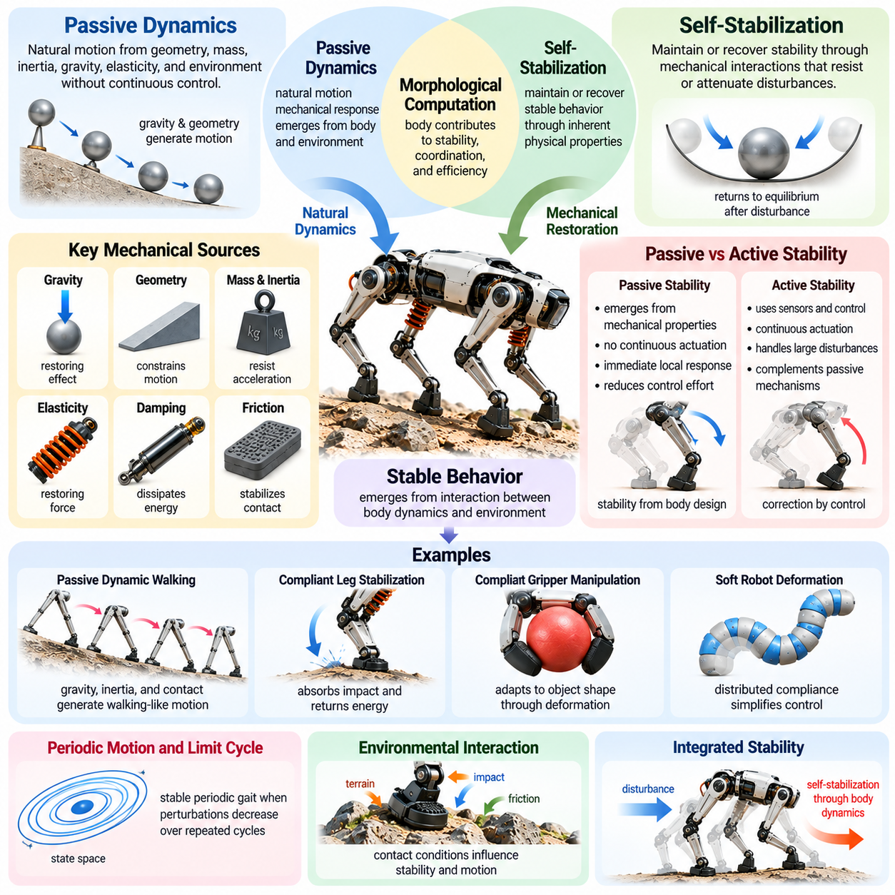{width="7.268055555555556in" height="7.268055555555556in"}

수동 동역학(Passive Dynamics)은 기하학적 구조(Geometry), 질량 분포(Mass Distribution), 관성(Inertia), 중력(Gravity), 탄성(Elasticity), 환경적 상호작용(Environmental Interaction)에서 발생하는 물리 시스템(Physical System)의 자연스러운 움직임과 기계적 반응(Mechanical Response)을 의미한다. 이러한 행동은 지속적인 능동 제어(Active Control) 없이 발생한다. 로봇공학(Robotics)에서 수동 동역학은 적절하게 설계된 기계적 구조(Mechanical Structure)가 움직임 협응(Movement Coordination), 안정성(Stability), 에너지 효율성(Energy Efficiency)에 직접 기여할 수 있음을 보여준다.

자기 안정화(Self-Stabilization)는 시스템이 고유한 물리적 특성(Inherent Physical Properties)을 통해 안정적인 작동 상태(Stable Operating Condition)를 유지하거나 회복하려는 경향을 의미한다. 자기 안정화 메커니즘(Self-Stabilizing Mechanism)은 피드백 제어기(Feedback Controller)에 전적으로 의존하는 대신 기계적 상호작용(Mechanical Interaction)을 활용하여 외란(Disturbance)에 저항하거나 그 영향을 완화한다. 이러한 능력은 물리적 구조가 신뢰할 수 있는 행동(Reliable Behavior)을 유지하는 데 직접 참여할 수 있다는 점에서 체화 지능(Embodied Intelligence)에 특히 중요하다.

수동 동역학(Passive Dynamics)과 자기 안정화(Self-Stabilization) 사이의 관계는 형태적 연산(Morphological Computation)의 핵심 요소이다. 로봇의 신체(Robot Body)는 기계적 특성(Mechanical Characteristics)을 통해 외부 외란(External Disturbance)을 복원 움직임(Restoring Movement)으로 변환할 수 있다. 기하학적 구조(Geometry), 관성(Inertia), 순응성(Compliance), 접촉 조건(Contact Condition)이 적절하게 조정되면 결과적인 동역학은 명시적인 보정 명령(Corrective Command)의 필요성을 줄일 수 있다. 따라서 안정성(Stability)은 부분적으로 물리적 설계(Physical Design)의 특성이 된다.

수동 안정성(Passive Stability)과 능동 제어 안정성(Actively Controlled Stability) 사이에는 근본적인 차이가 존재한다. 수동 안정성은 지속적인 보정 구동(Corrective Actuation) 없이 기계적 특성에서 발생하는 반면, 능동 안정성(Active Stability)은 센서(Sensor), 제어 알고리즘(Control Algorithm), 액추에이터(Actuator)에 의존한다. 실제 로봇의 상당수는 두 메커니즘을 결합한다. 수동 구조(Passive Structure)는 즉각적인 국부 반응(Local Response)을 제공하고, 능동 제어기(Active Controller)는 보다 광범위한 작동 조건을 조절하며 기계적 한계를 초과하는 외란을 보상한다.

수동 안정화(Passive Stabilization)의 가장 단순한 사례는 중력(Gravity)과 기계적 기하학적 구조(Mechanical Geometry)에서 찾아볼 수 있다. 매달린 질량(Suspended Mass)은 자연스럽게 위치 에너지(Potential Energy)가 낮은 상태로 이동하려는 경향이 있으며, 적절한 형상의 흔들림 구조(Rocking Structure)는 작은 외란 이후 평형 상태(Equilibrium)로 복귀할 수 있다. 이러한 행동은 계산된 제어 명령이 아니라 중력에 의한 복원 효과(Gravitational Restoring Effect)에서 발생한다. 그 효과는 시스템의 기하학적 구조, 에너지 소산(Energy Dissipation), 외란의 크기(Disturbance Magnitude)에 따라 달라진다.

탄성(Elasticity)은 수동 안정화(Passive Stabilization)의 또 다른 중요한 원천이다. 스프링(Spring)과 유연한 구성 요소(Compliant Component)는 평형 구성(Equilibrium Configuration)에서 벗어나면 복원력(Restoring Force)을 생성한다. 로봇 관절(Robotic Joint)과 사지(Limb)에서 이러한 힘은 외부 외란 이후 원하는 위치를 회복하는 데 기여할 수 있다. 적절한 강성(Stiffness)은 신체가 중간 수준의 편차(Moderate Deviation)를 수용하면서 과도한 변형(Excessive Deformation)에 저항하도록 하여 안정적인 기계적 상호작용(Stable Mechanical Interaction)에 기여한다.

감쇠(Damping)는 기계적 에너지(Mechanical Energy)를 소산하고 불필요한 진동(Oscillation)을 억제함으로써 탄성(Elasticity)을 보완한다. 충분한 감쇠가 없으면 탄성 시스템(Elastic System)은 복원력이 존재하더라도 외란 이후 계속 진동할 수 있다. 기계적 댐퍼(Mechanical Damper), 재료 이력현상(Material Hysteresis), 마찰(Friction)은 이러한 진동을 줄일 수 있다. 복원 강성(Restoring Stiffness)과 에너지 소산(Energy Dissipation)의 결합은 평형 상태(Equilibrium)를 향한 안정적인 수렴(Stable Convergence)을 지원하는 경우가 많다.

수동 동역학(Passive Dynamics)은 로봇이 반복적인 접촉(Repeated Contact)이 발생하는 환경에서 움직일 때 더욱 복잡해진다. 이동(Locomotion) 과정에서 발(Foot)과 지면(Ground)의 상호작용은 충격(Impact), 마찰(Friction), 변화하는 지지 조건(Support Condition)을 발생시킨다. 이러한 상호작용은 신체의 기하학적 구조(Body Geometry)와 기계적 매개변수(Mechanical Parameter)에 따라 움직임을 안정화하거나 불안정하게 만들 수 있다. 따라서 접촉 동역학(Contact Dynamics)을 이해하는 것은 수동적 행동(Passive Behavior)을 활용하는 로봇을 설계할 때 필수적이다.

수동 동역학 보행(Passive Dynamic Walking)은 형태 기반 이동(Morphology-Supported Locomotion)의 특히 중요한 사례이다. 적절한 조건에서 다리형 메커니즘(Legged Mechanism)은 중력(Gravity), 관성(Inertia), 간헐적인 지면 접촉(Intermittent Ground Contact)을 활용하여 완만한 경사면을 내려갈 수 있다. 기계적 구성(Mechanical Configuration)은 각 관절의 궤적(Joint Trajectory)을 지속적으로 명령하지 않고도 반복 가능한 보행 패턴(Repeatable Walking Pattern)을 생성한다. 이는 조정된 보행 행동(Coordinated Gait Behavior)이 물리 시스템의 자연적인 동역학에서 나타날 수 있음을 보여준다.

수동 보행(Passive Walking)의 안정성은 정적 평형(Static Equilibrium)보다 주기적 운동(Periodic Motion)을 통해 분석되는 경우가 많다. 보행 로봇(Walking Robot)은 지지 단계(Support Phase) 사이를 반복적으로 전환하며, 작은 편차(Small Deviation)는 연속적인 걸음에 걸쳐 감소하거나 증가할 수 있다. 안정적인 주기 보행(Stable Periodic Walking)은 기준 보행(Nominal Gait) 근처에서 발생한 외란이 반복 주기에 따라 감소할 때 나타난다. 이러한 동적 안정성(Dynamic Stability)은 균형 잡힌 자세로 정지해 있는 것과는 다르다.

극한 주기(Limit Cycle)는 반복 가능한 이동 패턴(Repeatable Locomotion Pattern)을 이해하기 위한 수학적 프레임워크(Mathematical Framework)를 제공한다. 극한 주기는 동역학 시스템(Dynamical System)의 상태 공간(State Space)에서 나타나는 주기적 궤적(Periodic Trajectory)을 의미한다. 주기가 국부적으로 끌어당기는 특성(Locally Attracting Property)을 가지면 충분히 작은 교란(Perturbation) 이후 주변 궤적이 해당 주기로 수렴한다. 로봇 형태(Robot Morphology)와 접촉 역학(Contact Mechanics)은 이러한 안정적인 주기의 존재 여부와 외란 억제(Disturbance Rejection) 성능에 영향을 미친다.

기계적 자기 안정화(Mechanical Self-Stabilization)는 신체가 협응 문제(Coordination Problem)의 일부를 처리하도록 하여 이동 제어(Locomotion Control)의 복잡도를 줄일 수 있다. 제어기(Controller)는 각 관절의 움직임을 독립적으로 계산하는 대신 자연 진동(Natural Oscillation)과 기계적 결합(Mechanical Coupling)을 활용할 수 있다. 이러한 접근 방식은 제어 대역폭(Control Bandwidth)과 액추에이터 작동 부담(Actuator Effort)을 줄일 수 있다. 그러나 수동 안정성(Passive Stability)은 일반적으로 작동 속도(Operating Speed), 지형 조건(Terrain Condition), 기계적 매개변수(Mechanical Parameter)에 민감하다.

질량 분포(Mass Distribution)와 회전 관성(Rotational Inertia)은 수동 안정성(Passive Stability)에 큰 영향을 미친다. 로봇의 질량 중심(Center of Mass) 위치는 중력 모멘트(Gravitational Moment)에 영향을 미치며, 질량의 분포는 각가속도(Angular Acceleration)에 대한 저항을 결정한다. 무거운 구성 요소(Heavy Component)를 적절하게 배치하면 특정 안정성 특성(Stability Characteristics)을 개선할 수 있다. 그러나 질량 중심을 낮추거나 관성을 증가시키는 것이 모든 움직임에서 동적 성능(Dynamic Performance)을 보편적으로 향상시키는 것은 아니다.

신체 분절(Body Segment) 사이의 기계적 결합(Mechanical Coupling)도 조정된 움직임(Coordinated Motion)을 지원할 수 있다. 스프링(Spring), 링크 기구(Linkage), 유연한 구조(Flexible Structure)는 관절 사이에 힘을 전달하여 개별 제어기 사이의 명시적인 통신(Explicit Communication) 없이도 상관된 반응(Correlated Response)을 생성한다. 이러한 결합은 움직임을 동기화(Synchronization)하거나 외란(Disturbance)을 분산하는 데 기여할 수 있다. 그 유용성은 결과적으로 발생하는 자연스러운 움직임이 로봇의 목표 작업(Intended Task)과 작동 환경(Operating Environment)에 얼마나 부합하는지에 따라 달라진다.

자기 안정화(Self-Stabilization)는 불규칙한 지형(Uneven Terrain)에서 작동하는 다리형 로봇(Legged Robot)에 특히 중요하다. 유연한 발(Compliant Foot)과 사지(Limb)는 지면 높이(Ground Height)의 변화를 수용하면서 충격력(Impact Force)을 줄일 수 있다. 수동적 기계 반응(Passive Mechanical Response)은 접촉 즉시 발생하므로 상위 수준의 제어 조정(Higher-Level Control Adjustment)이 완료되기 전에 국부적 적응(Local Adaptation)을 제공한다. 이러한 특성은 지형의 불확실성(Terrain Uncertainty)으로 인해 정확한 접촉 예측(Contact Prediction)이 어려운 상황에서 강건성(Robustness)을 향상시킬 수 있다.

사족보행 로봇(Quadruped Robot)은 수동 안정성(Passive Stability)과 능동 안정성(Active Stability)이 함께 작동하는 방식을 보여준다. 다리 순응성(Leg Compliance)과 신체 관성(Body Inertia)은 외란에 대한 즉각적인 반응에 영향을 미치며, 피드백 제어기(Feedback Controller)는 발 배치(Foot Placement), 관절 토크(Joint Torque), 신체 자세(Body Posture)를 조정한다. 적절하게 설계된 수동적 특성(Passive Characteristics)은 이러한 보정을 단순화할 수 있다. 그러나 다양한 지형에서 신뢰할 수 있는 이동을 구현하려면 일반적으로 감지(Sensing)와 능동 제어(Active Control)의 협응이 필요하다.

휴머노이드 로봇(Humanoid Robot)은 이족보행(Bipedal Locomotion)에서 지지 영역(Support Region)이 지속적으로 변화하고 단일 지지 단계(Single-Support Phase)와 이중 지지 단계(Double-Support Phase) 사이의 전환이 빈번하게 발생하기 때문에 추가적인 안정성 문제(Stability Challenge)에 직면한다. 수동적 순응성(Passive Compliance)은 충격 하중(Impact Load)을 줄이고 접촉 외란(Contact Disturbance)을 완화할 수 있지만 임의의 조건에서 균형(Balance)을 보장할 수는 없다. 강건한 휴머노이드 작동(Robust Humanoid Operation)을 위해서는 운동량(Momentum), 발 배치(Foot Placement), 전신 운동(Whole-Body Motion)에 대한 능동적 조절(Active Regulation)이 여전히 필수적이다.

수동 안정화(Passive Stabilization)는 로봇 조작(Robotic Manipulation)에도 적용된다. 유연한 엔드 이펙터(Compliant End Effector)는 삽입 작업(Insertion Task)이나 파지 작업(Grasping Task)에서 작은 정렬 오차(Alignment Error)를 수용할 수 있다. 기계적 복원력(Mechanical Restoring Force)과 접촉 기하학(Contact Geometry)은 구성 요소가 서로 적합한 배치(Compatible Configuration)를 향하도록 유도할 수 있다. 이는 매우 정밀한 위치 명령(Positioning Command)의 필요성을 줄이지만 과도한 순응성(Excessive Compliance)은 정확도(Accuracy), 힘 전달(Force Transmission), 조작 속도(Manipulation Speed)를 저하시킬 수 있다.

기계적 지능(Mechanical Intelligence)이라는 개념은 이러한 사례에서 자연스럽게 도출된다. 물리적 구조(Physical Structure)는 모든 외란을 소프트웨어에서 명시적으로 표현하지 않고도 기하학적 구조(Geometry), 탄성(Elasticity), 감쇠(Damping), 환경 접촉(Environmental Contact)을 통해 유용한 반응을 생성할 수 있다. 이러한 행동은 기계적 힘이 변위(Displacement)나 움직임(Motion)에 반응하여 변화한다는 점에서 국부 피드백(Local Feedback)과 유사하다. 그러나 기계적 조절(Mechanical Regulation)은 센서 기반 계산 피드백(Sensor-Based Computational Feedback)과 구분되어야 한다.

에너지 효율성(Energy Efficiency)은 수동 동역학(Passive Dynamics)을 활용하는 중요한 동기이다. 탄성 구조(Elastic Structure)는 기계적 에너지(Mechanical Energy)를 일시적으로 저장하고 이후 움직임에서 일부를 반환하여 액추에이터 작업(Actuator Work)을 줄일 수 있다. 수동 보행 메커니즘(Passive Walking Mechanism)은 유리한 조건에서 중력(Gravity)과 기계적 협응(Mechanical Coordination)이 움직임을 지속시킬 수 있음을 보여준다. 그러나 마찰(Friction), 충격(Impact), 감쇠(Damping), 부적절한 공진(Resonance)은 에너지를 소산하고 효율 향상을 제한할 수 있다.

수동 안정화(Passive Stabilization)의 효과는 작동 조건(Operating Conditions)에 크게 의존한다. 작은 외란에서 안정성을 유지하는 메커니즘도 교란(Perturbation)이 끌림 영역(Region of Attraction)을 벗어나면 실패할 수 있다. 탑재 하중(Payload), 표면 마찰(Surface Friction), 이동 속도(Movement Speed), 구조적 강성(Structural Stiffness)의 변화는 안정성 특성(Stability Properties)을 변화시킬 수 있다. 따라서 수동적 행동(Passive Behavior)은 정상 조건(Nominal Conditions)에서만 평가할 것이 아니라 실제적인 환경 변화(Realistic Environmental Variations) 전반에 걸쳐 검증해야 한다.

엔지니어는 수학적 모델(Mathematical Model), 수치 시뮬레이션(Numerical Simulation), 물리적 실험(Physical Experiment)을 사용하여 수동 안정성(Passive Stability)을 분석한다. 평형점(Equilibrium Point) 주변의 선형화(Linearization)는 국부 안정성 특성(Local Stability Characteristics)을 밝혀낼 수 있으며, 비선형 분석(Nonlinear Analysis)은 더 큰 편차와 복잡한 접촉 상호작용(Contact Interaction)을 다룬다. 주기적 이동(Periodic Locomotion)에서는 푸앵카레 사상(Poincaré Map)과 플로케 승수(Floquet Multiplier)를 활용하여 연속적인 움직임 주기 사이에서 교란이 증가하는지 감소하는지 평가한다.

자기 안정화(Self-Stabilization)를 고려한 설계에서는 기계적 응답성(Mechanical Responsiveness)과 적응성(Adaptability) 사이의 균형이 필요하다. 높은 강성(High Stiffness)은 강한 복원력(Restoring Force)을 제공할 수 있지만 과도한 충격(Excessive Impact)을 전달할 수 있으며, 낮은 강성(Low Stiffness)은 순응성(Compliance)을 향상시키지만 불필요한 진동(Oscillation)을 유발할 수 있다. 감쇠(Damping)는 진동(Vibration)을 억제하지만 유용한 에너지(Useful Energy)도 소산한다. 따라서 성공적인 형태 설계(Morphology Design)는 목표 움직임(Intended Movement)과 외란 환경(Disturbance Environment)에 적합한 기계적 매개변수(Mechanical Parameters)를 선택하는 데 달려 있다.

피지컬 AI(Physical AI)에서 수동 동역학(Passive Dynamics)과 자기 안정화(Self-Stabilization)는 형태(Morphology)와 지능형 제어(Intelligent Control)를 통합하기 위한 기반을 제공한다. 신체(Body)는 즉각적인 기계적 외란(Mechanical Disturbance)을 처리할 수 있으며, 학습 기반 제어기(Learning-Based Controller)나 모델 기반 제어기(Model-Based Controller)는 복잡한 목표(Complex Goals)와 변화하는 조건(Changing Conditions)을 관리한다. 이러한 기능 분산(Functional Distribution)은 기계적 설계가 작업에 적절하게 부합할 때 응답성(Responsiveness)을 향상시키고 불필요한 연산(Unnecessary Computation)을 줄일 수 있다.

궁극적으로 수동 동역학(Passive Dynamics)은 안정적인 행동(Stable Behavior)이 항상 명시적인 디지털 계산(Explicit Digital Calculation)에서 발생하는 것은 아니라는 사실을 보여준다. 기계적 기하학적 구조(Mechanical Geometry), 관성(Inertia), 탄성(Elasticity), 감쇠(Damping), 환경적 상호작용(Environmental Interaction)은 함께 복원 반응(Restoring Response)과 조정된 움직임(Coordinated Movement)을 생성할 수 있다. 이러한 물리적 특성을 기능적 자원(Functional Resource)으로 활용함으로써 로봇 설계자는 자연적인 기계적 안정성(Natural Mechanical Stability)과 적응적 계산 지능(Adaptive Computational Intelligence)을 결합한 체화 시스템(Embodied System)을 개발할 수 있다.

## 02.04. Compliance Elasticity and Damping

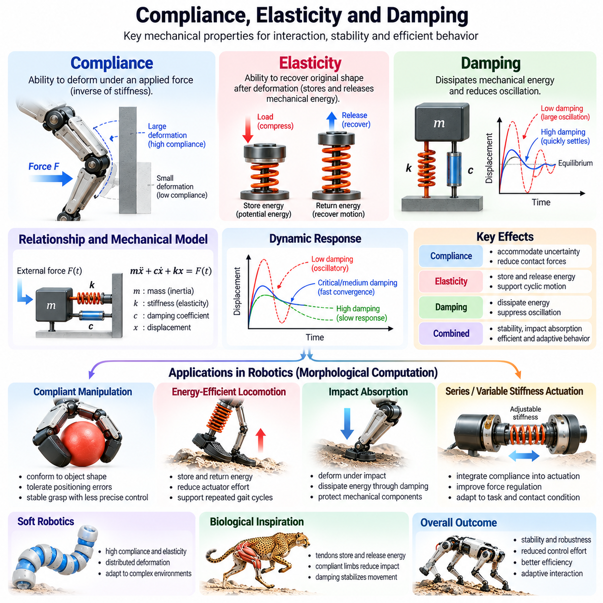{width="7.268055555555556in" height="7.268055555555556in"}

순응성(Compliance), 탄성(Elasticity), 감쇠(Damping)는 로봇 신체(Robotic Body)가 외력(External Force), 변형(Deformation), 운동(Motion)에 어떻게 반응하는지를 결정하는 기본적인 기계적 특성(Mechanical Properties)이다. 형태적 연산(Morphological Computation)에서 이러한 특성은 물리적 구조(Physical Structure)가 디지털 제어(Digital Control)에 전적으로 의존하지 않고 상호작용을 조절하도록 한다. 이들의 조정된 작용은 다양한 로봇 플랫폼(Robotic Platform)의 안정성(Stability), 충격 흡수(Impact Absorption), 에너지 효율성(Energy Efficiency), 적응성(Adaptability)에 영향을 미친다.

순응성(Compliance)은 가해진 힘(Force)이나 토크(Torque)에 반응하여 기계 시스템(Mechanical System)이 변형되는 능력을 의미한다. 적절한 선형 조건(Linear Conditions)에서 순응성은 일반적으로 강성(Stiffness)의 역수로 이해된다. 순응성이 높은 구조(Highly Compliant Structure)는 비교적 작은 하중(Load)에서도 큰 변형이 발생하는 반면, 강성이 높은 구조(Stiff Structure)는 변위(Displacement)에 저항한다. 순응성은 재료 특성(Material Properties), 관절 메커니즘(Joint Mechanism), 구조적 기하학(Structural Geometry), 전용 탄성 요소(Elastic Component)에서 발생할 수 있다.

탄성(Elasticity)은 가해진 하중(Applied Load)이 제거되었을 때 재료(Material)나 기계적 구조(Mechanical Structure)가 변형 이전의 원래 형상으로 회복되는 능력을 의미한다. 탄성 요소(Elastic Element)는 변형 과정에서 기계적 위치 에너지(Mechanical Potential Energy)를 저장하고 복원 과정에서 이를 방출한다. 로봇공학(Robotics)에서 스프링(Spring), 유연한 보(Flexible Beam), 힘줄(Tendon), 탄성중합체 재료(Elastomeric Material)는 충격 흡수(Impact Absorption), 에너지 회수(Energy Recovery), 기계적으로 조정된 움직임(Mechanically Coordinated Movement)을 지원하는 탄성 반응(Elastic Response)을 제공한다.

감쇠(Damping)는 기계적 에너지(Mechanical Energy)를 소산하고 진동 운동(Oscillatory Motion)을 감소시키는 메커니즘(Mechanism)을 의미한다. 에너지를 저장하고 반환하는 이상적인 탄성 요소(Ideal Elastic Element)와 달리, 감쇠 요소(Damping Element)는 기계적 에너지를 열(Heat)이나 다른 소산 형태(Dissipative Form)로 변환한다. 점성 감쇠(Viscous Damping), 마찰 감쇠(Frictional Damping), 재료 이력현상(Material Hysteresis)은 대표적인 메커니즘이다. 이러한 효과는 진동 제어(Vibration Control), 불필요한 움직임 억제(Unwanted Movement Suppression), 기계적 상호작용 안정화(Mechanical Interaction Stabilization)에 필수적이다.

순응성(Compliance), 탄성(Elasticity), 감쇠(Damping)는 밀접하게 관련되어 있지만 서로 구별되는 기계적 특성(Mechanical Characteristics)을 나타낸다. 순응성은 하중에 따른 변형의 크기(Deformation Magnitude)를 결정하고, 탄성은 회복 가능한 변형(Recoverable Deformation)과 저장 에너지(Stored Energy)를 지배하며, 감쇠는 운동 중 에너지 소산(Energy Dissipation)을 제어한다. 이러한 특성의 결합 효과는 로봇이 외란(Disturbance), 접촉력(Contact Force), 변화하는 환경 조건(Environmental Conditions)에 반응하는 방식을 결정한다.

단순화된 스프링-댐퍼 시스템(Spring-Damper System)은 이러한 특성의 상호작용을 보여준다. 외력(External Force)이 유연한 메커니즘(Compliant Mechanism)을 변위시키면 선형 가정(Linear Assumption)에서 탄성 강성(Elastic Stiffness)은 변위에 비례하는 복원력(Restoring Force)을 생성한다. 감쇠(Damping)는 속도(Velocity)와 관련된 반대 방향의 힘을 발생시킨다. 이러한 힘은 관성(Inertia)과 함께 시스템이 평형 상태(Equilibrium)로 부드럽게 복귀하는지, 반복적으로 진동하는지, 외란에 지나치게 느리게 반응하는지를 결정한다.

강성(Stiffness), 감쇠(Damping), 관성(Inertia) 사이의 균형은 고유 진동수(Natural Frequency)와 감쇠비(Damping Ratio)를 포함한 중요한 동적 특성(Dynamic Characteristics)을 결정한다. 감쇠가 낮으면 장시간 지속되는 진동(Prolonged Oscillation)이 발생할 수 있으며, 감쇠가 과도하면 복원 속도(Recovery Speed)가 느려질 수 있다. 적절한 매개변수 선택(Parameter Selection)은 기계 시스템이 외란을 흡수하고 원하는 구성(Desired Configuration)으로 복귀하도록 한다. 그러나 최적값(Optimal Value)은 로봇의 작업(Task), 기하학적 구조(Geometry), 하중 조건(Loading Conditions), 작동 환경(Operating Environment)에 따라 달라진다.

형태적 연산(Morphological Computation)에서 순응성(Compliance)은 물리적 구조가 모든 상호작용에 대해 명시적인 보정 명령(Explicit Corrective Command)을 요구하지 않고 불확실성(Uncertainty)을 수용하도록 한다. 유연한 로봇 팔(Compliant Robotic Arm)은 예상하지 못한 장애물(Unexpected Obstacle)에 접촉했을 때 약간 변형되어 접촉력(Contact Force)을 줄일 수 있다. 이러한 기계적 반응(Mechanical Response)은 변형을 통해 직접 발생하므로 상위 수준의 제어 알고리즘(Higher-Level Control Algorithm)이 개입하기 전에 신체가 상호작용의 일부를 처리할 수 있다.

순응성(Compliance)은 접촉이 많은 조작 작업(Contact-Rich Manipulation Task)에서 특히 중요하다. 삽입(Insertion), 조립(Assembly), 파지(Grasping) 과정에서 강체 구성 요소(Rigid Component)가 상호작용하면 작은 위치 오차(Positioning Error)도 상당한 힘을 발생시킬 수 있다. 유연한 관절(Compliant Joint)이나 엔드 이펙터(End Effector)는 제어된 변형(Controlled Deformation)을 통해 이러한 오차를 수용한다. 이러한 행동은 끼임(Jamming)을 줄이고 접촉 안정성(Contact Stability)을 개선하며 운동 계획(Motion Planning)과 위치 결정 시스템(Positioning System)에 요구되는 정밀도를 낮출 수 있다.

탄성(Elasticity)은 반복적인 운동 주기(Movement Cycle)에서 에너지를 저장하고 반환함으로써 로봇 이동(Robotic Locomotion)에 기여한다. 다리형 로봇(Legged Robot)에서 유연한 요소(Compliant Element)는 지면 접촉(Ground Contact) 중 압축되고 추진(Propulsion) 과정에서 저장된 에너지를 방출할 수 있다. 적절하게 조정되면 이러한 과정은 액추에이터 작업(Actuator Work)을 줄이고 효율적인 이동(Efficient Locomotion)을 지원한다. 그 효과는 보행 타이밍(Gait Timing), 기계적 손실(Mechanical Loss), 지형 특성(Terrain Characteristics), 액추에이터 협응(Actuator Coordination)에 따라 달라진다.

감쇠(Damping)는 발과 지면의 상호작용(Foot-Ground Interaction)에서 필수적이다. 충격(Impact)은 급격한 힘의 변화(Rapid Force Change)와 구조적 진동(Structural Vibration)을 발생시킬 수 있기 때문이다. 기계적 감쇠(Mechanical Damping)는 충격 에너지(Impact Energy)의 일부를 소산하고 로봇 전체로 전달되는 진동을 감소시킨다. 적절한 감쇠는 접촉 일관성(Contact Consistency)을 개선하고 기계적 구성 요소(Mechanical Component)를 보호할 수 있다. 그러나 과도한 감쇠는 이동에 활용할 수 있는 에너지를 불필요하게 소모할 수 있다.

직렬 탄성 액추에이터(Series Elastic Actuator)는 순응성(Compliance)을 구동 시스템(Actuation System)에 의도적으로 통합하는 방법을 보여준다. 탄성 요소(Elastic Element)는 모터 구동 메커니즘(Motor-Driven Mechanism)과 기계적 부하(Mechanical Load) 사이에 배치되어 제어된 변형을 통해 힘을 전달한다. 이러한 변형을 측정하면 힘 추정(Force Estimation)과 피드백 제어(Feedback Control)를 지원할 수 있다. 직렬 탄성(Series Elasticity)은 힘 조절(Force Regulation)과 충격 허용성(Impact Tolerance)을 개선할 수 있지만 추가적인 동역학(Additional Dynamics)과 대역폭 제한(Bandwidth Limitation)을 발생시킨다.

가변 강성 액추에이터(Variable Stiffness Actuator)는 작동 중 기계적 강성(Mechanical Stiffness)을 변경할 수 있도록 하여 이러한 개념을 확장한다. 로봇은 불확실한 접촉(Uncertain Contact) 중에는 비교적 낮은 강성(Low Stiffness)을 사용하고, 정밀 위치 제어(Precision Positioning)나 힘 전달(Force Transmission)이 필요한 경우에는 높은 강성(High Stiffness)을 사용할 수 있다. 이러한 적응성(Adaptability)은 제어기가 활용할 수 있는 기계적 행동(Mechanical Behavior)의 범위를 확장한다. 그러나 가변 강성 메커니즘(Variable Stiffness Mechanism)은 추가적인 설계 복잡도(Design Complexity), 질량(Mass), 제어 요구사항(Control Requirements)을 수반한다.

소프트 로봇공학(Soft Robotics)은 변형 가능한 재료(Deformable Material)가 로봇 구조의 상당 부분을 구성하기 때문에 순응성(Compliance)과 탄성(Elasticity)에 크게 의존한다. 실리콘 탄성중합체(Silicone Elastomer), 유연한 고분자(Flexible Polymer), 공압 챔버(Pneumatic Chamber)는 구동(Actuation)과 접촉(Contact) 중 분산 변형(Distributed Deformation)을 가능하게 한다. 이러한 특성은 소프트 그리퍼(Soft Gripper)와 연속체 로봇(Continuum Robot)이 불규칙한 물체에 맞춰 변형되도록 한다. 기계적 적응성(Mechanical Adaptability)은 일부 제어 요구사항을 줄이지만 비선형 모델링(Nonlinear Modeling)의 어려움을 발생시킨다.

재료 선택(Material Selection)은 순응성(Compliance), 탄성(Elasticity), 감쇠(Damping)에 큰 영향을 미친다. 금속(Metal)은 일반적으로 비교적 높은 강성(Stiffness)을 제공하는 반면, 탄성중합체(Elastomer)와 유연한 고분자(Flexible Polymer)는 큰 변형(Large Deformation)을 지원할 수 있다. 복합재료(Composite Material)와 공학적 구조(Engineered Structure)는 방향별 강성(Directional Stiffness)과 에너지 소산(Energy Dissipation)을 조정할 수 있는 추가적인 가능성을 제공한다. 설계자는 피로(Fatigue), 크리프(Creep), 온도 민감성(Temperature Sensitivity), 기계적 특성의 장기적 변화(Long-Term Changes in Mechanical Properties)도 고려해야 한다.

구조적 기하학(Structural Geometry)은 기본 재료가 비교적 단단하더라도 순응성(Compliance)을 생성할 수 있다. 얇은 보(Thin Beam), 플렉셔 힌지(Flexure Hinge), 격자 구조(Lattice Structure), 관절형 메커니즘(Articulated Mechanism)은 가해진 하중(Applied Load)에 따라 예측 가능한 변형(Predictable Deformation)을 발생시킬 수 있다. 재료 순응성(Material Compliance)과 구조적 순응성(Structural Compliance)의 구분은 기계적 행동(Mechanical Behavior)이 재료 특성과 기하학적 구조 모두에 의존한다는 점에서 중요하다. 적절한 구조 설계(Structural Design)는 변형을 특정 영역에 집중시키고 힘 전달(Force Transmission)을 유도할 수 있다.

이방성 순응성(Anisotropic Compliance)은 가해진 하중의 방향(Loading Direction)에 따라 변형이 달라지는 기계적 행동(Mechanical Behavior)을 의미한다. 로봇 메커니즘(Robotic Mechanism)은 한 축(Axis)에서는 높은 강성을 유지하면서 다른 축에서는 유연하게 변형되도록 설계할 수 있다. 이러한 방향성 행동(Directional Behavior)은 중요한 방향에서 지지력(Support)이나 정밀도(Precision)를 유지하면서 선택된 외란(Selected Disturbance)을 수용할 수 있기 때문에 조립(Assembly), 조작(Manipulation), 이동(Locomotion)에 유용하다.

순응성(Compliance)과 감쇠(Damping)는 기계 시스템(Mechanical System)을 통한 정보 전달(Information Transmission)에도 영향을 미친다. 접촉력(Contact Force)은 내장 센서(Embedded Sensor)로 측정하거나 액추에이터 행동(Actuator Behavior)에서 추론할 수 있는 변형 패턴(Deformation Pattern)을 생성한다. 기계적 구조(Mechanical Structure)는 고주파 외란(High-Frequency Disturbance)을 감쇠하면서 상대적으로 느린 상호작용 신호(Interaction Signal)를 보존할 수 있다. 따라서 물리적 특성(Physical Properties)은 정보가 디지털 인지(Digital Perception)와 제어 알고리즘(Control Algorithm)에 전달되기 전에 예비 필터링(Preliminary Filtering)을 수행할 수 있다.

기계적 순응성(Mechanical Compliance)과 능동 임피던스 제어(Active Impedance Control) 사이의 관계는 특히 중요하다. 기계적 순응성은 물리적 구조(Physical Structure)에서 발생하는 반면, 임피던스 제어(Impedance Control)는 액추에이터(Actuator)와 피드백(Feedback)을 사용하여 힘과 운동 사이의 관계(Force-Motion Relationship)를 조절한다. 이러한 접근 방식을 결합하면 상호작용 성능(Interaction Performance)을 개선할 수 있다. 물리적 순응성(Physical Compliance)은 즉각적인 반응을 제공하고, 능동 제어(Active Control)는 변화하는 목표(Changing Objectives)와 환경 조건(Environmental Conditions)에 따라 행동을 조정한다.

안전성(Safety)은 기계적 특성(Mechanical Properties)을 선택할 때 고려해야 하는 또 다른 주요 요소이다. 유연한 구조(Compliant Structure)는 최대 접촉력(Peak Contact Force)을 줄이고 사람이나 물체와의 예상하지 못한 상호작용(Unexpected Interaction)을 수용할 수 있다. 감쇠(Damping)는 접촉 이후 반발(Rebound)을 제한하고 진동(Oscillation)을 억제할 수 있다. 그러나 저장된 탄성 에너지(Stored Elastic Energy), 액추에이터 출력(Actuator Power), 충돌 속도(Collision Velocity), 시스템 기하학(System Geometry)도 상해 위험(Injury Risk)에 영향을 미치므로 순응성만으로 안전성이 보장되는 것은 아니다.

기계적 설계(Mechanical Design)에는 순응성(Compliance), 정밀도(Precision), 하중 용량(Load Capacity), 응답성(Responsiveness) 사이의 불가피한 상충관계(Trade-Off)가 존재한다. 과도한 유연성(Excessive Flexibility)은 위치 정확도(Positioning Accuracy)를 낮추고 구조적 진동(Structural Oscillation)을 유발할 수 있으며, 과도한 강성(Excessive Stiffness)은 충격력(Impact Force)과 정렬 오차(Alignment Error)에 대한 민감도를 높일 수 있다. 마찬가지로 감쇠가 부족하면 지속적인 진동(Persistent Vibration)이 발생할 수 있고, 감쇠가 과도하면 효율성(Efficiency)이 감소하고 동적 응답(Dynamic Response)이 느려질 수 있다.

시뮬레이션(Simulation)과 실험적 특성 평가(Experimental Characterization)는 적절한 기계적 매개변수(Mechanical Parameters)를 선택하는 데 필수적이다. 엔지니어는 강성 측정(Stiffness Measurement), 힘-변위 곡선(Force-Displacement Curve), 진동 시험(Vibration Test), 동적 시스템 식별(Dynamic System Identification)을 활용하여 관련 특성을 추정한다. 수치 모델(Numerical Model)은 변형(Deformation)과 접촉 행동(Contact Behavior)을 예측할 수 있지만 비선형 재료(Nonlinear Material)와 복잡한 마찰(Complex Friction)은 불확실성(Uncertainty)을 발생시킬 수 있다. 실제 작동 조건(Realistic Operating Conditions)에서 성능을 검증하려면 물리적 시험(Physical Testing)이 여전히 필요하다.

피지컬 AI(Physical AI)에서 순응성(Compliance), 탄성(Elasticity), 감쇠(Damping)는 인지(Perception), 학습(Learning), 제어 아키텍처(Control Architecture)와 함께 고려해야 한다. 외란(Disturbance)을 자연스럽게 흡수하는 형태(Morphology)는 학습된 제어기(Learned Controller)가 생성해야 하는 행동을 단순화할 수 있다. 반대로 부적절하게 선택된 기계적 특성(Mechanical Properties)은 불확실성(Uncertainty)을 증가시키고 제어를 불안정하게 만들 수 있다. 따라서 효과적인 시스템 설계(System Design)를 위해서는 물리적 동역학(Physical Dynamics)과 계산 지능(Computational Intelligence)의 조정된 최적화(Coordinated Optimization)가 필요하다.

궁극적으로 순응성(Compliance), 탄성(Elasticity), 감쇠(Damping)는 기계적 특성(Mechanical Properties)이 체화 지능(Embodied Intelligence)을 위한 기능적 자원(Functional Resource)이 될 수 있음을 보여준다. 순응성은 상호작용의 불확실성(Interaction Uncertainty)을 수용하고, 탄성은 복원 행동(Restoring Behavior)과 에너지 저장(Energy Storage)을 제공하며, 감쇠는 에너지 소산(Energy Dissipation)과 진동(Vibration)을 조절한다. 이러한 특성의 통합(Integration)은 로봇 신체(Robotic Body)가 능동적 지능 제어(Active Intelligent Control)를 보완하면서 안정성(Stability), 적응성(Adaptability), 효율적인 물리적 상호작용(Efficient Physical Interaction)에 직접 기여하도록 한다.

## 02.05. Mechanical Feedback and Physical Filtering

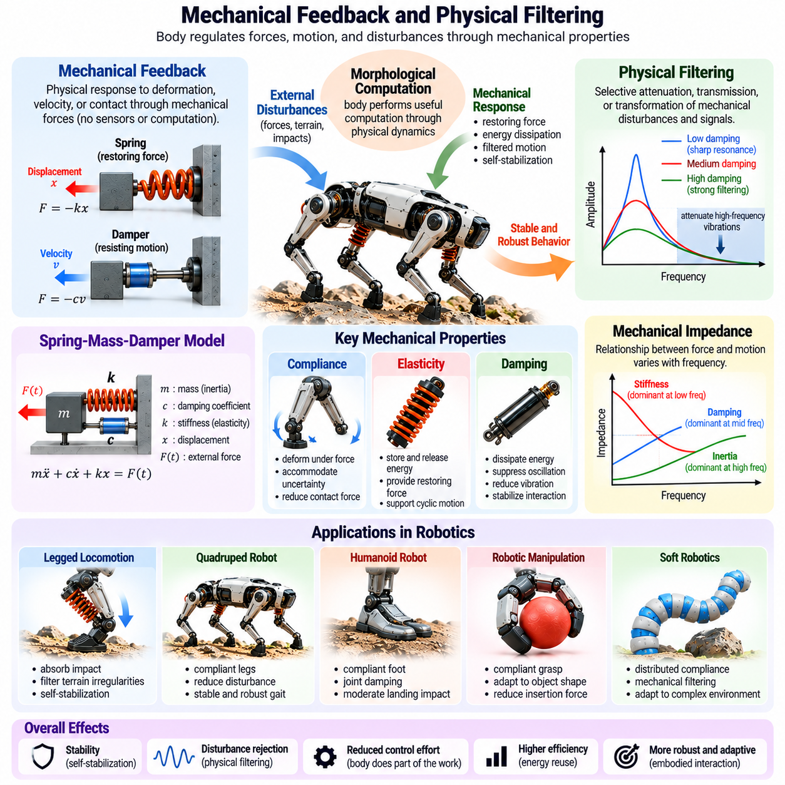{width="7.268055555555556in" height="7.268055555555556in"}

기계적 피드백(Mechanical Feedback)과 물리적 필터링(Physical Filtering)은 로봇 구조(Robotic Structure)가 고유한 기계적 특성(Inherent Mechanical Properties)을 통해 힘(Force), 운동(Motion), 외란(Disturbance)을 조절하는 방식을 설명한다. 형태적 연산(Morphological Computation)에서 이러한 메커니즘은 신체(Body)가 일반적으로 감지(Sensing)와 능동 제어(Active Control)를 필요로 하는 기능을 수행하도록 한다. 기하학적 구조(Geometry), 강성(Stiffness), 감쇠(Damping), 관성(Inertia)을 활용함으로써 로봇은 안정성(Stability), 강건성(Robustness), 효율적인 상호작용(Efficient Interaction)을 지원하는 즉각적인 물리적 반응(Physical Response)을 구현할 수 있다.

기계적 피드백(Mechanical Feedback)은 물리 시스템(Physical System)이 자체 변위(Displacement), 속도(Velocity), 접촉 조건(Contact Conditions)에 반응하여 기계적으로 생성된 힘(Mechanically Generated Force)을 발생시키는 현상이다. 스프링(Spring)은 변위가 발생하면 복원력(Restoring Force)을 생성하고, 댐퍼(Damper)는 상대 운동(Relative Motion)에 저항한다. 이러한 반응은 디지털 측정(Digital Measurement)이나 연산(Computation) 없이 국부적인 피드백 유사 관계(Local Feedback-Like Relationship)를 형성한다. 그 효과는 기계적 구성(Mechanical Configuration)과 상호작용이 발생하는 조건에 따라 달라진다.

기존의 피드백 제어(Conventional Feedback Control)와 달리 기계적 피드백(Mechanical Feedback)은 반드시 센서(Sensor), 프로세서(Processor), 명시적인 제어 알고리즘(Explicit Control Algorithm)을 필요로 하지는 않는다. 물리적 상태(Physical State)와 기계적 반응(Mechanical Response) 사이의 관계가 시스템 구조(System Structure)에 직접 내재되어 있기 때문이다. 따라서 계산 및 통신 지연(Computational Communication Delay) 없이 외란(Disturbance)에 신속하게 반응할 수 있다. 그러나 기계적 피드백은 일반적으로 능동 제어(Active Control)보다 프로그래밍 가능성(Programmability)이 낮으며 물리적 설계(Physical Design)의 제약을 받는다.

물리적 필터링(Physical Filtering)은 기계적 외란(Mechanical Disturbance)과 신호(Signal)를 선택적으로 감쇠(Attenuation), 전달(Transmission), 변환(Transformation)하는 과정을 의미한다. 유연한 구조(Compliant Structure)는 동적 특성(Dynamic Characteristics)에 따라 느린 움직임은 전달하면서 고주파 충격(High-Frequency Impact)은 흡수할 수 있다. 따라서 기계적 필터(Mechanical Filter)는 로봇 내부에서 어떤 힘과 진동이 전파되는지에 영향을 미친다. 이러한 행동은 질량(Mass), 강성(Stiffness), 감쇠(Damping), 기하학적 구조(Geometry), 접촉 조건(Contact Conditions)에 의해 결정된다.

스프링-질량-댐퍼 시스템(Spring-Mass-Damper System)은 기계적 피드백(Mechanical Feedback)과 필터링(Filtering)을 이해하기 위한 기본 모델(Basic Model)을 제공한다. 탄성 강성(Elastic Stiffness)은 복원력(Restoring Force)을 생성하고, 감쇠(Damping)는 에너지를 소산하며, 관성(Inertia)은 가속도(Acceleration)에 저항한다. 이러한 요소는 함께 외부 가진(External Excitation)에 대한 시스템의 반응을 결정한다. 매개변수(Parameter)에 따라 결과적인 동역학(Dynamics)은 외란을 억제하거나 공진(Resonance)을 증폭하거나 힘 전달(Force Transmission)을 지연시킬 수 있다.

주파수 응답(Frequency Response)은 기계 시스템(Mechanical System)이 서로 다른 주파수(Frequency)의 외란에 다르게 반응하기 때문에 물리적 필터링(Physical Filtering)에서 중요한 개념이다. 서스펜션 메커니즘(Suspension Mechanism)은 느린 지형 변화(Terrain Variation)에 반응하면서 충분히 높은 주파수의 진동(High-Frequency Vibration)을 감쇠할 수 있다. 그러나 기계적 공진(Mechanical Resonance)에 가까운 주파수에서는 움직임이 증폭될 수 있다. 따라서 효과적인 필터링을 위해서는 고유 진동수(Natural Frequency), 감쇠비(Damping Ratio), 작동 조건(Operating Conditions)을 신중하게 고려해야 한다.

기계적 임피던스(Mechanical Impedance)는 가해진 힘(Applied Force)과 그 결과로 발생하는 운동(Resulting Motion) 사이의 관계를 설명하는 유용한 프레임워크(Framework)를 제공한다. 동적 시스템(Dynamic System)에서 임피던스는 관성(Inertia), 감쇠(Damping), 강성(Stiffness)에 의존하며 주파수에 따라 그 특성이 달라진다. 적절한 임피던스 특성(Impedance Characteristics)은 상호작용 안정성(Interaction Stability)을 향상시키고 불필요한 움직임(Unwanted Motion)을 줄일 수 있다. 따라서 기계적 설계(Mechanical Design)는 신체가 환경과 힘 및 에너지를 교환하는 방식을 결정한다.

순응성(Compliance)은 변형(Deformation)이 접촉력(Contact Force)을 자동으로 변화시키기 때문에 기계적 피드백(Mechanical Feedback)에서 핵심적인 역할을 한다. 로봇 팔(Robotic Arm)이 장애물(Obstacle)에 접촉하면 유연한 관절(Compliant Joint)은 하중에 따라 변형되어 상호작용 힘(Interaction Force)을 변화시킨다. 이러한 반응은 제어기(Controller)의 개입을 기다리지 않고 급격한 최대 힘(Peak Force)을 줄일 수 있다. 이와 같은 행동은 접촉 조건(Contact Conditions)이 불확실하거나 빠르게 변화하는 상황에서 특히 유용하다.

감쇠(Damping)는 진동(Vibration)과 진동성 운동(Oscillation)에 관련된 에너지를 소산함으로써 물리적 필터링(Physical Filtering)에 기여한다. 재료 이력현상(Material Hysteresis), 점성 요소(Viscous Element), 마찰(Friction)은 불필요한 기계적 반응(Mechanical Response)을 억제할 수 있다. 로봇 관절(Robotic Joint)과 구조물(Structure)에서 감쇠는 빠른 움직임이나 충격 이후 발생하는 잔류 진동(Residual Vibration)을 줄일 수 있다. 그러나 과도한 감쇠(Excessive Damping)는 움직임을 느리게 하고 회수할 수 있는 에너지를 소산할 수 있다.

관성(Inertia) 역시 속도의 급격한 변화(Rapid Velocity Change)에 저항함으로써 기계적 필터링(Mechanical Filtering)에 영향을 미친다. 관성이 큰 신체(Body)는 짧은 시간 동안 발생하는 외란(Short-Duration Disturbance)에 상대적으로 작게 반응할 수 있지만, 결과적인 힘과 복원 행동(Recovery Behavior)은 전체 시스템에 따라 달라진다. 질량 분포(Mass Distribution)는 회전 운동(Rotational Motion)과 병진 운동(Translational Motion)에 서로 다른 영향을 미친다. 따라서 관성은 독립적인 안정화 메커니즘(Stabilization Mechanism)으로 취급하기보다 강성(Stiffness) 및 감쇠(Damping)와 함께 고려해야 한다.

기계적 피드백(Mechanical Feedback)은 로봇 이동(Robotic Locomotion) 과정에서 특히 중요해진다. 발과 지면의 접촉(Foot-Ground Contact)은 상위 수준 제어 시스템(Higher-Level Control System)의 응답 속도를 초과할 수 있는 급격한 힘의 변화(Rapid Force Change)를 발생시킨다. 유연한 발(Compliant Foot), 탄성 관절(Elastic Joint), 감쇠 요소(Damping Element)는 즉각적인 기계적 적응(Mechanical Accommodation)을 제공한다. 이러한 반응은 충격 전달(Impact Transmission)을 줄이고 접촉 일관성(Contact Consistency)을 향상시켜 불규칙한 지형(Uneven Terrain)에서 더욱 신뢰할 수 있는 이동을 지원한다.

사족보행 로봇(Quadruped Robot)에서 기계적으로 유연한 다리(Mechanically Compliant Leg)는 지형의 불규칙성(Terrain Irregularity)을 흡수하고 접촉 하중(Contact Load)을 분산할 수 있다. 이러한 수동적 반응(Passive Response)은 관절 토크(Joint Torque), 신체 자세(Body Posture), 발 배치(Foot Placement)에 대한 능동적 조정(Active Adjustment)을 보완한다. 적절한 기계적 필터링(Mechanical Filtering)은 로봇 본체(Main Body)에 전달되는 외란(Disturbance)의 강도를 줄인다. 그러나 다양한 지형에서 안정적인 이동(Stable Locomotion)을 구현하려면 여전히 감지(Sensing), 협응(Coordination), 능동 제어(Active Control)가 필요하다.

휴머노이드 로봇(Humanoid Robot)은 보행(Walking), 달리기(Running), 물리적 상호작용(Physical Interaction) 과정에서 기계적 필터링(Mechanical Filtering)의 이점을 얻는다. 유연한 발 구조(Compliant Foot Structure)는 착지 충격(Landing Impact)을 완화하고, 관절 감쇠(Joint Damping)는 불필요한 진동(Oscillation)을 감소시킨다. 이러한 메커니즘은 접촉 전환(Contact Transition)의 품질을 향상시키고 액추에이터 응력(Actuator Stress)을 줄일 수 있다. 그러나 균형 조절(Balance Regulation)은 여전히 전신 동역학(Whole-Body Dynamics), 운동량 관리(Momentum Management), 능동 피드백(Active Feedback)에 의존한다.

기계적 피드백(Mechanical Feedback)은 로봇 조작(Robotic Manipulation)에서도 중요한 가치를 가진다. 삽입(Insertion)이나 조립(Assembly) 과정에서 유연한 메커니즘(Compliant Mechanism)은 접촉력(Contact Force)의 방향을 바꾸고 작은 정렬 오차(Alignment Error)를 수용할 수 있다. 원격 순응 중심 장치(Remote Center Compliance Device)는 기계적 기하학( Mechanical Geometry)이 접촉 하중(Contact Loading)에 따라 보정 움직임(Corrective Motion)을 유도하는 방식을 보여준다. 이러한 메커니즘은 유용한 힘-변위 관계(Force-Displacement Relationship)를 하드웨어(Hardware)에 직접 내재화하여 특정 정밀 작업(Precision Task)을 단순화한다.

소프트 로봇 그리퍼(Soft Robotic Gripper)는 분산된 기계적 피드백(Distributed Mechanical Feedback)의 또 다른 사례이다. 유연한 손가락(Flexible Finger)은 물체의 기하학적 형상(Object Geometry)과 접촉 압력(Contact Pressure)에 따라 변형되면서 파지 표면(Grasping Surface) 전체에 힘을 재분배한다. 이러한 적응(Adaptation)은 모든 접촉점(Contact Point)을 개별적으로 제어하지 않고 발생한다. 결과적인 물리적 상호작용(Physical Interaction)은 파지 강건성(Grasp Robustness)을 향상시킬 수 있지만 물체 특성(Object Properties)과 재료 비선형성(Material Nonlinearity)이 성능에 영향을 미친다.

물리적 필터링(Physical Filtering)은 접촉 정보(Contact Information)가 센서(Sensor)에 도달하는 방식을 결정함으로써 촉각 감지(Tactile Sensing)에도 기여한다. 유연한 센서 피복(Compliant Sensor Covering)은 측정값이 기록되기 전에 압력(Pressure)을 분산하고 변형 패턴(Deformation Pattern)을 변화시킨다. 이러한 기계적 전처리(Mechanical Preprocessing)는 불필요한 진동을 감쇠하거나 특정 접촉 특징(Contact Feature)을 강조할 수 있다. 따라서 센서 해석(Sensor Interpretation)에서는 주변 재료(Material)와 구조(Structure)가 발생시키는 필터링 효과(Filtering Effect)를 고려해야 한다.

기계적 신호 전달(Mechanical Signal Transmission)이 항상 유익한 것은 아니다. 필터링(Filtering)은 불필요한 외란뿐만 아니라 유용한 정보(Useful Information)도 제거할 수 있기 때문이다. 과도한 순응성(Excessive Compliance)은 빠른 접촉 사건(Rapid Contact Event)을 불명확하게 만들 수 있으며, 강한 감쇠(Strong Damping)는 미끄러짐 감지(Slip Detection)에 필요한 진동 특징(Vibration Signature)을 억제할 수 있다. 설계자는 기계적 보호(Mechanical Protection)와 감지 대역폭(Sensing Bandwidth), 정보 보존(Information Preservation) 사이의 균형을 유지해야 한다. 적절한 균형은 로봇의 인지 목표(Perception Objectives)와 상호작용 목표(Interaction Objectives)에 따라 달라진다.

기계적 피드백(Mechanical Feedback)과 능동 피드백 제어(Active Feedback Control)는 상호 보완적인 관계를 가진다. 기계적 구조(Mechanical Structure)는 즉각적인 국부 반응(Local Response)을 제공하고, 디지털 제어기(Digital Controller)는 시스템 상태(System State)를 추정하여 작업 요구사항(Task Requirements)에 따라 행동을 조정한다. 능동 임피던스 제어(Active Impedance Control)는 액추에이터 명령(Actuator Command)을 통해 겉보기 강성(Apparent Stiffness)과 감쇠(Damping)를 추가로 조절할 수 있다. 물리적 피드백(Physical Feedback)과 계산적 피드백(Computational Feedback)을 결합하면 두 메커니즘의 동적 상호작용(Dynamic Interaction)이 적절하게 조정되는 경우 성능을 향상시킬 수 있다.

기계적 필터링(Mechanical Filtering)을 능동 제어(Active Control)와 결합할 때는 제어 시스템 안정성(Control-System Stability)에 특별한 주의가 필요하다. 구조적 유연성(Structural Flexibility)은 추가적인 동적 모드(Dynamic Mode)를 발생시키며, 감지 지연(Sensing Delay)과 액추에이터 대역폭 제한(Actuator Bandwidth Limitation)은 피드백 행동(Feedback Behavior)에 영향을 미친다. 부적절하게 조정된 제어기(Poorly Tuned Controller)는 기계적 공진(Mechanical Resonance)을 유발하거나 불안정한 상호작용(Unstable Interaction)을 발생시킬 수 있다. 따라서 신뢰할 수 있는 작동을 위해서는 기계적 동역학(Mechanical Dynamics)과 제어 루프(Control Loop)의 통합 모델링(Integrated Modeling)이 필수적이다.

에너지 효율성(Energy Efficiency)은 기계적 피드백(Mechanical Feedback)과 필터링(Filtering)을 활용하는 또 다른 동기이다. 수동 구조(Passive Structure)는 불필요한 액추에이터 보정 동작(Corrective Actuator Activity)을 줄이고 지속적인 계산 개입(Computational Intervention) 없이 외란을 흡수할 수 있다. 탄성 요소(Elastic Component)는 변형 과정에서 저장된 에너지의 일부를 회수할 수 있다. 그러나 감쇠(Damping)와 마찰(Friction)은 에너지를 소산하므로 외란 억제 성능(Disturbance Rejection Performance)의 향상이 반드시 전체 에너지 소비(Total Energy Consumption)의 감소를 의미하지는 않는다.

기계적 피드백(Mechanical Feedback)은 예상하지 못한 상호작용(Unexpected Interaction)에서 접촉력(Contact Force)을 완화함으로써 안전성(Safety)을 향상시킬 수도 있다. 유연한 접촉면(Compliant Interface)은 최대 힘(Peak Force)을 줄일 수 있으며, 감쇠(Damping)는 반발(Rebound)과 진동(Oscillation)을 제한한다. 이러한 특성은 협동 로봇(Collaborative Robot)과 인간 중심 환경(Human-Centered Environment)에서 중요하다. 그러나 안전성은 충돌 속도(Collision Speed), 유효 질량(Effective Mass), 저장 에너지(Stored Energy), 액추에이터 행동(Actuator Behavior), 전체 시스템 아키텍처(System Architecture)에 따라 달라진다.

기계적 필터링(Mechanical Filtering)을 평가하려면 힘 전달(Force Transmission), 진동 감쇠(Vibration Attenuation), 주파수 응답(Frequency Response), 외란 복원(Disturbance Recovery)에 대한 측정이 필요하다. 실험 방법(Experimental Method)에는 충격 시험(Impact Testing), 주파수 스윕(Frequency Sweep), 힘-변위 특성 평가(Force-Displacement Characterization), 시스템 식별(System Identification)이 포함된다. 시뮬레이션(Simulation)은 매개변수 선택(Parameter Selection)을 지원할 수 있지만 접촉 비선형성(Contact Nonlinearity)과 재료 변동(Material Variation)은 대표적인 작동 조건(Representative Operating Conditions)에서 실험적으로 검증해야 한다.

형태적 연산(Morphological Computation)은 기계적 반응(Mechanical Response)을 지능적 행동(Intelligent Behavior)에 대한 기능적 기여(Functional Contribution)로 간주함으로써 이러한 메커니즘을 더 넓은 관점에서 해석한다. 신체(Body)는 단순히 제어기(Controller)의 명령을 전달하는 것이 아니라 구조적 특성(Structural Properties)에 따라 물리적 상호작용(Physical Interaction)을 변환한다. 적절한 형태(Morphology)는 제어 복잡도(Control Complexity)를 줄이고 강건한 적응(Robust Adaptation)을 지원할 수 있지만 이러한 이점은 작업 요구사항(Task Requirements)에 따라 달라진다.

피지컬 AI 시스템(Physical AI System)에서 기계적 피드백(Mechanical Feedback)과 물리적 필터링(Physical Filtering)은 감지(Sensing), 구동(Actuation), 학습 알고리즘(Learning Algorithm)과 함께 설계되어야 한다. 기계적 구조(Mechanical Structure)는 빠르게 발생하는 국부 외란(Local Disturbance)을 처리하고, 계산 지능(Computational Intelligence)은 변화하는 목표(Changing Goals)와 복잡한 환경 불확실성(Environmental Uncertainty)을 관리할 수 있다. 이러한 조정된 아키텍처(Coordinated Architecture)는 물리적 구성 요소(Physical Component)와 디지털 구성 요소(Digital Component) 사이에 기능적 책임(Functional Responsibility)을 분산하여 응답성(Responsiveness)과 신뢰성(Reliability)이 높은 행동을 구현할 가능성을 향상시킨다.

궁극적으로 기계적 피드백(Mechanical Feedback)과 물리적 필터링(Physical Filtering)은 로봇 신체(Robotic Body)가 자체 동역학(Own Dynamics)을 통해 상호작용을 조절할 수 있음을 보여준다. 강성(Stiffness), 순응성(Compliance), 감쇠(Damping), 관성(Inertia), 기하학적 구조(Geometry)는 외란(Disturbance)이 어떻게 변환(Transformation), 전달(Transmission), 감쇠(Attenuation)되는지를 결정한다. 이러한 물리적 메커니즘(Physical Mechanism)을 능동 제어(Active Control)와 신중하게 통합하면 안정적이고 효율적이며 적응 가능한 체화 지능(Embodied Intelligence)을 위한 기반을 제공할 수 있다.

## 02.06. Morphology and Control Complexity

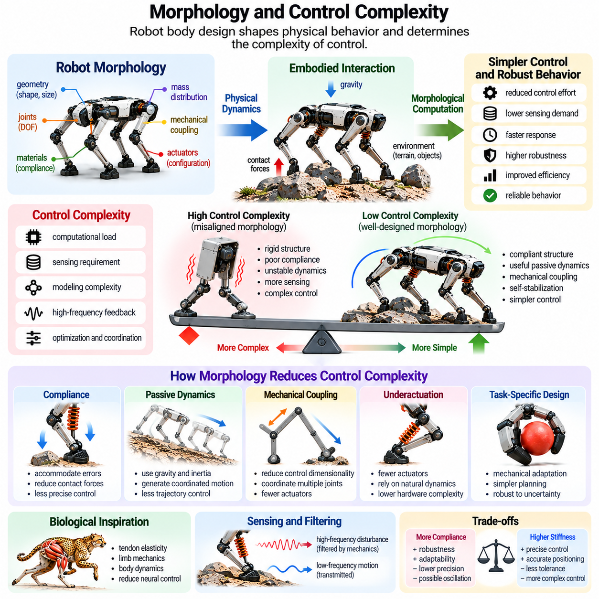{width="7.268055555555556in" height="7.268055555555556in"}

로봇 형태(Robot Morphology)는 기계적 구조(Mechanical Structure), 관절(Joint), 재료(Material), 환경적 상호작용(Environmental Interaction)이 물리적 행동(Physical Behavior)을 형성하는 방식을 결정함으로써 제어 복잡도(Control Complexity)에 직접적인 영향을 미친다. 적절하게 설계된 신체(Body)는 자연적인 동역학(Natural Dynamics)을 통해 움직임 협응(Movement Coordination)과 외란 억제(Disturbance Rejection)를 단순화할 수 있다. 형태적 연산(Morphological Computation)에서 이러한 관계는 지능적 행동(Intelligent Behavior)이 알고리즘(Algorithm)뿐만 아니라 로봇 시스템(Robotic System)의 물리적 구성(Physical Organization)에서도 발생한다는 것을 의미한다.

제어 복잡도(Control Complexity)는 원하는 로봇 행동(Desired Robotic Behavior)을 구현하는 데 필요한 연산(Computation), 감지(Sensing), 모델링(Modeling), 협응(Coordination)의 요구사항을 의미한다. 복잡한 제어기(Complex Controller)는 상세한 동역학 모델(Dynamic Model), 고주파 피드백(High-Frequency Feedback), 광범위한 상태 추정(State Estimation), 최적화(Optimization)를 필요로 할 수 있다. 형태(Morphology)는 제어 가능한 변수(Controllable Variable)의 수, 기계적 제약(Mechanical Constraint), 물리적 상호작용 중 활용할 수 있는 자연적 반응(Natural Response)을 결정함으로써 이러한 요구사항에 영향을 미친다.

형태(Morphology)와 제어(Control) 사이의 관계는 단순히 관절(Joint)이나 액추에이터(Actuator)의 수를 줄이는 문제가 아니다. 자유도(Degrees of Freedom)가 적은 로봇은 협응하기 쉬울 수 있지만 다양한 작업(Task)에 적응하는 능력은 제한될 수 있다. 반대로 관절을 추가하면 유연성(Flexibility)은 높아지지만 제어 요구사항(Control Demands)도 증가할 수 있다. 효과적인 형태 설계(Morphology Design)는 기계적 능력(Mechanical Capability)과 이를 활용하는 데 필요한 계산 자원(Computational Resources) 사이의 균형을 유지한다.

기계적 순응성(Mechanical Compliance)은 작은 위치 오차(Positioning Error)와 외부 외란(External Disturbance)을 자동으로 수용함으로써 제어 복잡도(Control Complexity)를 줄일 수 있다. 유연한 매니퓰레이터(Compliant Manipulator)는 지속적인 보정 명령(Corrective Command) 없이 변형(Deformation)을 통해 접촉 조건(Contact Condition)에 적응할 수 있다. 이러한 물리적 적응(Physical Adaptation)은 특정 감지 및 제어 요구사항(Sensing and Control Requirements)을 줄이지만 과도한 순응성(Excessive Compliance)은 진동(Oscillation)을 유발하고 정밀 위치 제어(Precise Positioning)를 복잡하게 만들 수 있다.

수동 동역학(Passive Dynamics)은 제어를 단순화하는 또 다른 메커니즘(Mechanism)을 제공한다. 중력(Gravity), 관성(Inertia), 기계적 결합(Mechanical Coupling)을 활용하도록 설계된 로봇은 모든 관절 궤적(Joint Trajectory)을 명시적으로 명령하지 않고도 조정된 움직임(Coordinated Movement)을 생성할 수 있다. 수동 동역학 보행 로봇(Passive Dynamic Walker)은 신체 기하학(Body Geometry)과 환경적 상호작용(Environmental Interaction)에서 보행 패턴(Gait Pattern)이 발생할 수 있음을 보여준다. 이후 능동 제어(Active Control)는 속도(Speed), 방향(Direction), 수동 안정성 한계(Passive Stability Limit)를 초과하는 외란의 조절에 집중할 수 있다.

기계적 결합(Mechanical Coupling)은 제어 문제(Control Problem)의 유효 차원(Effective Dimensionality)을 줄일 수 있다. 링크 기구(Linkage), 힘줄(Tendon), 스프링(Spring), 공유 액추에이터(Shared Actuator)는 물리적 제약(Physical Constraint)을 통해 여러 관절의 움직임을 조정한다. 각 움직임을 독립적으로 제어하는 대신 시스템은 기계적으로 정의된 관계(Mechanically Defined Relationship)를 따른다. 이러한 결합은 명령 생성(Command Generation)을 단순화할 수 있지만 독립적인 운동(Independent Motion)을 제한하고 작업이 변경될 때 적응성(Adaptability)을 낮출 수도 있다.

과소구동 로봇(Underactuated Robot)은 기계적 구조(Mechanical Structure)와 제어 요구사항(Control Requirements) 사이의 관계를 보여준다. 이러한 시스템은 기계적 자유도(Mechanical Degrees of Freedom)보다 독립적인 액추에이터(Independent Actuator)의 수가 적으며, 수동 동역학(Passive Dynamics), 접촉 제약(Contact Constraint), 기계적 결합(Mechanical Coupling)에 의존하여 움직임을 조정한다. 과소구동(Underactuation)은 하드웨어 복잡도(Hardware Complexity)와 에너지 소비(Energy Consumption)를 줄일 수 있다. 그러나 운동 계획(Planning), 제어 가능성(Controllability), 외란 복원(Disturbance Recovery)을 더욱 어렵게 만들 수도 있다.

형태(Morphology)는 작업별 행동(Task-Specific Behavior)을 기계적 설계(Mechanical Design)에 직접 내재화함으로써 제어를 단순화할 수 있다. 유연한 손가락(Flexible Finger)을 가진 그리퍼(Gripper)는 서로 다른 형상의 물체에 자연스럽게 적응하여 정밀한 접촉점 계획(Contact-Point Planning)의 필요성을 줄인다. 마찬가지로 유연한 삽입 메커니즘(Compliant Insertion Mechanism)은 작은 정렬 오차(Alignment Error)를 수용할 수 있다. 이러한 사례는 기계적 적응(Mechanical Adaptation)이 지능형 제어(Intelligent Control)의 필요성을 완전히 제거하지 않으면서 특정 계산 작업(Computational Operation)을 대체할 수 있음을 보여준다.

제어 차원(Control Dimensionality)이라는 개념은 고자유도 로봇(High-Degree-of-Freedom Robot)에서 특히 중요하다. 휴머노이드(Humanoid)와 정교한 매니퓰레이터(Dexterous Manipulator)는 움직임을 조정해야 하는 다수의 관절(Joint)을 포함할 수 있다. 기계적 제약(Mechanical Constraint)과 자연적인 운동 패턴(Natural Motion Pattern)은 의미 있는 구성(Meaningful Configuration)의 범위를 제한할 수 있다. 제어기(Controller)는 이러한 관계를 활용하여 모든 관절을 독립적으로 최적화하는 대신 저차원 운동 표현(Lower-Dimensional Movement Representation) 내에서 작동할 수 있다.

생물학적 운동 제어(Biological Motor Control)는 이러한 접근 방식에 영감을 제공한다. 동물(Animal)은 신경 명령(Neural Command), 근육 특성(Muscle Properties), 골격 기하학(Skeletal Geometry), 환경적 힘(Environmental Force) 사이의 상호작용을 통해 복잡한 신체를 조정한다. 힘줄 탄성(Tendon Elasticity)과 사지 역학(Limb Mechanics)은 모든 기계적 세부 사항을 명시적으로 신경 조절(Neural Regulation)하지 않고도 움직임에 기여한다. 로봇공학(Robotics)은 제어 알고리즘(Control Algorithm)과 물리적 구조(Physical Structure) 사이에 기능적 책임(Functional Responsibility)을 분산함으로써 유사한 원리를 적용한다.

기계적 시너지(Mechanical Synergy)는 구조적 결합(Structural Coupling)이나 공유 구동(Shared Actuation)에서 발생하는 조정된 관절 행동(Coordinated Joint Behavior)을 의미한다. 로봇 손(Robotic Hand)에서 힘줄 배치(Tendon Routing)와 유연한 관절(Compliant Joint)은 비교적 적은 수의 모터(Motor)로 조정된 손가락 굽힘(Coordinated Finger Closure)을 생성할 수 있다. 이러한 메커니즘은 관절 움직임 사이의 관계를 내재화하여 특정 파지 작업(Grasping Operation)을 단순화한다. 그러나 고정된 기계적 시너지(Fixed Mechanical Synergy)는 독립적인 손가락 조작(Independent Finger Manipulation)과 작업 범용성(Task Versatility)을 제한할 수 있다.

제어 복잡도(Control Complexity)는 기계적 행동(Mechanical Behavior)의 예측 가능성(Predictability)에도 영향을 받는다. 안정적이고 반복 가능한 동역학(Stable and Repeatable Dynamics)을 가진 구조는 예측하기 어려운 진동(Unpredictable Oscillation)이나 마찰(Friction)을 나타내는 구조보다 보정 개입(Corrective Intervention)이 덜 필요할 수 있다. 특성이 잘 규명된 순응성(Compliance)과 감쇠(Damping)는 모델 신뢰성(Model Reliability)을 향상시킬 수 있다. 반대로 비선형 변형(Nonlinear Deformation), 백래시(Backlash), 변화하는 접촉 조건(Variable Contact Condition)은 불확실성(Uncertainty)을 증가시키고 제어를 복잡하게 만들 수 있다.

형태 설계(Morphological Design)는 특정 물리적 상태(Physical State)가 기계적으로 자기 조절(Mechanical Self-Regulation)되도록 함으로써 감지 부담(Sensing Burden)을 줄일 수 있다. 유연한 서스펜션(Compliant Suspension)은 모든 변위(Displacement)를 명시적으로 측정하지 않고도 중간 수준의 표면 불규칙성(Surface Irregularity)을 수용할 수 있다. 기계적 감쇠(Mechanical Damping)는 고주파 진동(High-Frequency Vibration)이 민감한 구성 요소(Sensitive Component)에 도달하기 전에 억제할 수 있다. 그러나 환경 해석(Environmental Interpretation)이나 정밀한 상태 추정(Precise State Estimation)이 필요한 경우 수동적 조절(Passive Regulation)이 감지(Sensing)를 대체하지는 못한다.

형태(Morphology)의 계산적 이점(Computational Advantage)은 의도된 작업(Intended Task)에 크게 의존한다. 특수 목적 로봇(Specialized Robot)은 신중하게 최적화된 기계적 구조(Mechanical Structure)를 활용하여 반복 작업(Repetitive Operation)을 효율적으로 수행할 수 있다. 범용 로봇(General-Purpose Robot)은 물체(Object), 환경(Environment), 목표(Objective)의 더 넓은 변화를 처리해야 한다. 따라서 고도로 특화된 형태(Highly Specialized Morphology)는 제한된 작동 범위(Narrow Operating Range)에서 제어를 단순화할 수 있지만 그 범위를 벗어나면 제약을 증가시킬 수 있다.

따라서 형태적 복잡도(Morphological Complexity)와 제어 복잡도(Control Complexity) 사이에는 작업 의존적 상충관계(Task-Dependent Trade-Off)가 존재한다. 스프링(Spring), 유연한 관절(Compliant Joint), 기계적 링크(Mechanical Linkage)를 추가하면 소프트웨어 요구사항(Software Requirements)은 줄어들 수 있지만 기계적 설계(Mechanical Design), 보정(Calibration), 유지보수(Maintenance)의 부담은 증가할 수 있다. 하드웨어(Hardware)를 단순화하면 복잡도가 감지(Sensing)와 연산(Computation)으로 이동할 수 있다. 시스템 수준 최적화(System-Level Optimization)는 제어 알고리즘(Control Algorithm)을 독립적으로 평가하는 대신 이러한 비용을 함께 고려해야 한다.

개루프 제어(Open-Loop Control)와 폐루프 제어(Closed-Loop Control)의 구분은 형태(Morphology)의 영향을 설명하는 데 도움이 된다. 기계적으로 안정적인 시스템(Mechanically Stable System)은 비교적 단순한 개루프 명령(Open-Loop Command)만으로도 유용한 움직임을 수행할 수 있다. 안정성이 낮은 시스템(Less Stable System)은 더 빈번한 피드백 보정(Feedback Correction)을 필요로 한다. 그러나 개루프 성능(Open-Loop Performance)은 모델에 반영되지 않은 외란(Unmodeled Disturbance)에 취약하며, 수동 동역학(Passive Dynamics)이 유리한 경우에도 신뢰할 수 있는 작동을 위해서는 일반적으로 피드백(Feedback)이 도움이 된다.

형태(Morphology)는 능동 제어기(Active Controller)에 요구되는 대역폭(Bandwidth)에도 영향을 미친다. 기계적 구조(Mechanical Structure)는 접촉력(Contact Force)에 즉각적으로 반응하여 디지털 제어기(Digital Controller)가 모든 빠른 외란(Rapid Disturbance)을 보정해야 할 필요성을 줄일 수 있다. 적절한 순응성(Compliance)과 감쇠(Damping)는 고주파 상호작용(High-Frequency Interaction)을 완화할 수 있다. 그러나 유연한 구조(Flexible Structure)는 신중한 제어 설계(Control Design)가 필요한 공진(Resonance)을 발생시킬 수 있으므로 대역폭 요구사항이 항상 감소하는 것은 아니다.

학습 기반 로봇 제어(Learning-Based Robotic Control)는 원하는 행동(Desired Behavior)을 자연스럽게 지원하는 형태(Morphology)로부터 이점을 얻을 수 있다. 수동 역학(Passive Mechanics)이 이미 유용한 안정성(Stability)이나 접촉 적응(Contact Adaptation)을 제공하면 강화학습(Reinforcement Learning)에 필요한 보정 행동(Corrective Action)이 줄어들 수 있다. 기계적 제약(Mechanical Constraint)은 탐색(Exploration)을 물리적으로 의미 있는 움직임(Physically Meaningful Movement)으로 제한할 수도 있다. 그러나 복잡한 비선형 형태(Complex Nonlinear Morphology)는 행동의 결과(Action Consequence)를 예측하기 어렵게 만들어 학습 난이도(Learning Difficulty)를 높일 수 있다.

형태와 제어의 공동 설계(Co-Design of Morphology and Control)는 물리적 구조(Physical Structure)와 제어 정책(Control Policy)을 함께 최적화함으로써 이러한 상호작용을 다룬다. 하드웨어(Hardware)를 먼저 선정하고 이후 소프트웨어(Software)를 개발하는 대신 엔지니어는 기하학적 구조(Geometry), 강성(Stiffness), 구동(Actuation), 감지(Sensing)의 변화가 구현 가능한 행동(Achievable Behavior)에 어떤 영향을 미치는지 평가한다. 시뮬레이션(Simulation)과 물리적 실험(Physical Experiment)은 이러한 과정을 안내할 수 있다. 결과적인 설계는 역학(Mechanics)과 연산(Computation) 사이에 복잡도를 효과적으로 분산하는 것을 목표로 한다.

에너지 소비(Energy Consumption)는 형태 인식 제어(Morphology-Aware Control)를 이해하는 또 다른 관점을 제공한다. 수동 탄성 요소(Passive Elastic Element)는 에너지를 저장하고 반환할 수 있으며, 기계적 결합(Mechanical Coupling)은 불필요한 액추에이터 동작(Actuator Activity)을 줄일 수 있다. 제어기(Controller)는 고유 진동수(Natural Frequency)와 조정된 운동 패턴(Coordinated Motion Pattern)을 활용하여 효율성(Efficiency)을 높일 수 있다. 그러나 추가 질량(Added Mass), 마찰(Friction), 감쇠 손실(Damping Loss), 부적절한 기계적 제약(Unsuitable Mechanical Constraint)은 이러한 이점을 상쇄할 수 있다.

제어 단순화(Control Simplification)를 평가할 때는 강건성(Robustness)도 고려해야 한다. 정상 조건(Nominal Conditions)에서 보정 명령(Corrective Command)이 적게 필요한 로봇이라도 탑재 하중(Payload), 지형(Terrain), 접촉 특성(Contact Properties)이 변화하면 성능이 저하될 수 있다. 기계적 자기 안정화(Mechanical Self-Stabilization)는 흔히 제한된 외란 범위(Limited Disturbance Range)에서 작동한다. 따라서 효과적인 설계는 유용한 수동적 행동(Passive Behavior)과 예상하지 못한 조건을 처리할 수 있는 충분한 능동 제어 권한(Active Control Authority)을 결합한다.

형태(Morphology)가 제어 복잡도(Control Complexity)에 미치는 영향을 평가하려면 측정 가능한 기준(Measurable Criteria)이 필요하다. 관련 지표(Indicator)에는 계산 부하(Computational Load), 제어 주파수(Control Frequency), 모델 복잡도(Model Complexity), 감지 요구사항(Sensing Requirements), 액추에이터 작동 부담(Actuator Effort), 추종 정확도(Tracking Accuracy), 외란 복원(Disturbance Recovery)이 포함된다. 비교는 동등한 작업(Equivalent Task)과 작동 조건(Operating Conditions)에서 수행해야 한다. 연산량 감소(Reduction in Computation)는 필수적인 성능(Performance), 적응성(Adaptability), 안전성(Safety) 요구사항이 유지될 때만 의미가 있다.

피지컬 AI 아키텍처(Physical AI Architecture)는 빠른 국부 조절(Rapid Local Regulation)을 기계적 구조(Mechanical Structure)에 할당하고 상위 수준의 적응(Higher-Level Adaptation)을 계산 지능(Computational Intelligence)에 할당함으로써 형태(Morphology)를 활용할 수 있다. 기계적 순응성(Mechanical Compliance)은 즉각적인 접촉 변화(Contact Variation)를 처리하고, 인지(Perception)와 계획(Planning)은 복잡한 환경 조건(Environmental Conditions)을 해석한다. 학습 기반 제어기(Learning-Based Controller)는 시간이 지남에 따라 행동을 개선할 수 있다. 이러한 계층적 기능 분산(Layered Functional Distribution)은 물리적 동역학(Physical Dynamics)과 지능적 의사결정(Intelligent Decision-Making) 사이의 효율적인 협응을 지원한다.

궁극적으로 형태(Morphology)와 제어 복잡도(Control Complexity)는 체화 로봇 설계(Embodied Robotic Design)에서 분리할 수 없는 요소이다. 적절한 기계적 구조(Mechanical Structure)는 협응(Coordination), 순응성(Compliance), 필터링(Filtering), 안정화(Stabilization)를 신체(Body)에 내재화함으로써 특정 제어 문제(Control Problem)를 단순화할 수 있다. 그러나 물리적 단순화(Physical Simplification)는 새로운 제약(Constraint)과 불확실성(Uncertainty)을 발생시킬 수 있다. 따라서 효과적인 피지컬 AI(Physical AI)는 기계적 지능(Mechanical Intelligence), 계산적 제어(Computational Control), 적응성(Adaptability), 시스템 수준 성능(System-Level Performance) 사이의 균형을 필요로 한다.

## 02.07. Morphological Computation in Locomotion

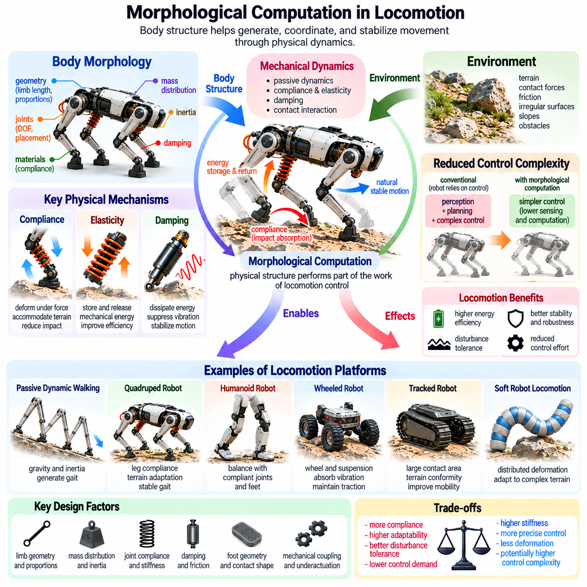{width="7.268055555555556in" height="7.268055555555556in"}

이동에서의 형태적 연산(Morphological Computation in Locomotion)은 로봇의 물리적 구조(Physical Structure)가 움직임의 생성(Generation), 협응(Coordination), 안정화(Stabilization)에 기여하는 방식을 설명한다. 이동 시스템(Locomotion System)은 계산적 제어(Computational Control)에 전적으로 의존하는 대신 신체 기하학(Body Geometry), 관성(Inertia), 탄성(Elasticity), 감쇠(Damping), 환경 접촉(Environmental Contact)을 활용한다. 이러한 기계적 특성(Mechanical Properties)은 움직임을 직접 형성하여 물리적 동역학(Physical Dynamics)이 지속적인 감지(Sensing)와 제어(Control)를 필요로 하는 기능을 수행하도록 한다.

이동(Locomotion)은 로봇과 환경(Environment) 사이의 반복적인 상호작용(Repeated Interaction)을 포함하므로 형태(Morphology)의 영향이 특히 크다. 지면과의 모든 접촉(Ground Contact)은 사지 기하학(Limb Geometry), 재료 특성(Material Properties), 신체 질량(Body Mass), 이동 속도(Movement Speed)에 따라 달라지는 힘을 발생시킨다. 이러한 힘은 가속도(Acceleration), 균형(Balance), 에너지 전달(Energy Transfer)에 영향을 미친다. 신체가 접촉에 유리하게 반응하도록 설계함으로써 엔지니어는 특정 제어 요구사항(Control Requirements)을 줄이면서 이동 효율성(Movement Efficiency)을 향상시킬 수 있다.

수동 동역학 보행(Passive Dynamic Walking)은 이동에서의 형태적 연산(Morphological Computation in Locomotion)을 보여주는 기초적인 사례이다. 적절하게 설계된 다리형 메커니즘(Legged Mechanism)은 중력(Gravity), 관성(Inertia), 간헐적인 발 접촉(Intermittent Foot Contact)을 이용하여 완만한 경사면을 걸어 내려갈 수 있다. 기하학적 구조(Geometry)와 질량 분포(Mass Distribution)는 관절 궤적(Joint Trajectory)을 지속적으로 지정하지 않고도 조정된 움직임(Coordinated Movement)을 생성한다. 이는 명시적인 계산 명령(Explicit Computational Command)이 아니라 기계적 동역학(Mechanical Dynamics)에서 인식 가능한 보행 패턴(Gait Pattern)이 나타날 수 있음을 보여준다.

수동 보행(Passive Walking)의 안정성(Stability)은 신체 형태(Body Morphology)와 주기적 운동(Periodic Motion) 사이의 관계에 따라 달라진다. 각 걸음(Step)에서 로봇은 연속적인 움직임(Continuous Movement)을 수행하면서 불연속적인 접촉 전환(Discrete Contact Transition)을 거친다. 충분히 작은 외란(Disturbance)이 연속적인 주기(Successive Cycle)에 걸쳐 감소하면 안정적인 보행(Stable Walking)이 나타난다. 사지 비율(Limb Proportion), 관절 마찰(Joint Friction), 발 곡률(Foot Curvature), 질량 분포(Mass Distribution)는 결과적인 보행(Gait)이 안정적으로 유지되는지에 영향을 미친다.

탄성 요소(Elastic Element)는 움직임 중 기계적 에너지(Mechanical Energy)를 저장하고 방출함으로써 수동 이동(Passive Locomotion)을 확장한다. 스프링(Spring), 유연한 힘줄(Compliant Tendon), 유연한 관절(Flexible Joint)은 하중이 가해지는 동안 에너지를 흡수하고 추진(Propulsion) 과정에서 그 일부를 반환할 수 있다. 이러한 행동은 생물학적 이동(Biological Locomotion)에서 나타나는 탄성 에너지 교환(Elastic Energy Exchange)과 유사하다. 적절하게 조정된 탄성은 액추에이터 작업(Actuator Work)을 줄이고 효율적인 이동(Efficient Movement)을 지원할 수 있지만 작동 시점(Timing)과 기계적 손실(Mechanical Loss)은 여전히 중요하다.

감쇠(Damping)는 충격(Impact)과 불필요한 진동(Unwanted Oscillation)에 관련된 에너지를 소산함으로써 이동(Locomotion)을 조절한다. 착지(Landing) 과정에서 기계적 감쇠(Mechanical Damping)는 진동(Vibration)을 줄이고 로봇 구조(Robot Structure)를 통한 힘 전달(Force Transmission)을 완화할 수 있다. 적절한 감쇠는 접촉 일관성(Contact Consistency)과 외란 복원(Disturbance Recovery)을 개선한다. 그러나 과도한 감쇠(Excessive Damping)는 유용한 탄성 에너지(Elastic Energy)를 소산하고 반복적인 운동 주기(Movement Cycle)에서 액추에이터가 수행해야 하는 작업을 증가시킬 수 있다.

다리 형태(Leg Morphology)는 사지 길이(Limb Length), 분절 비율(Segment Proportion), 관절 배치(Joint Placement), 질량 분포(Mass Distribution)가 기계적 지레 효과(Mechanical Leverage)와 동적 응답(Dynamic Response)을 결정하기 때문에 이동 성능(Locomotion Performance)에 큰 영향을 미친다. 긴 다리(Long Leg)는 보폭(Stride Length)을 증가시킬 수 있지만 회전 관성(Rotational Inertia)이나 구조적 하중(Structural Loading)을 증가시킬 수도 있다. 짧고 조밀한 사지(Compact Limb)는 특정 안정성 특성(Stability Characteristics)을 개선하면서 도달 범위(Reach)를 제한할 수 있다. 효과적인 형태는 목표 보행(Intended Gait), 지형(Terrain), 작동 속도(Operating Speed)에 따라 달라진다.

발 기하학(Foot Geometry)은 형태적 연산(Morphological Computation)을 위한 또 다른 중요한 메커니즘을 제공한다. 곡면형 발(Curved Foot)은 구름 접촉(Rolling Contact)과 걸음 전환(Step Transition)에 영향을 미칠 수 있으며, 유연한 발바닥(Compliant Sole)은 불규칙한 표면(Irregular Surface)에 압력을 분산한다. 접촉 형상(Contact Shape)은 압력 중심(Center of Pressure), 마찰 상호작용(Frictional Interaction), 기계적 안정성(Mechanical Stability)에 영향을 미친다. 따라서 적절한 발 설계(Foot Design)는 모든 접촉 사건(Contact Event)을 상세하게 제어하지 않고도 움직임을 유도하고 지형 변화(Terrain Variation)를 수용할 수 있다.

스프링 부하 역진자 모델(Spring-Loaded Inverted Pendulum Model)은 단순화된 기계적 구조(Simplified Mechanical Structure)가 달리기(Running)와 도약(Hopping)의 중요한 특성을 어떻게 표현할 수 있는지 보여준다. 유연한 다리(Compliant Leg)는 움직이는 신체 질량(Body Mass)을 지지하는 스프링(Spring)과 유사하게 작동한다. 지지 단계(Stance Phase)에서는 운동 에너지(Kinetic Energy)와 탄성 에너지(Elastic Energy) 사이에 에너지 전달(Energy Transfer)이 발생한다. 이러한 기계적 관계(Mechanical Relationship)는 조정된 신체 동역학(Coordinated Body Dynamics)과 주기적인 지면 접촉(Periodic Ground Contact)에서 반복적인 탄성 운동(Bouncing Motion)이 어떻게 발생하는지 설명하는 데 도움이 된다.

사족보행 이동(Quadruped Locomotion)은 다리 순응성(Leg Compliance), 신체 유연성(Body Flexibility), 기계적으로 결합된 움직임(Mechanically Coupled Movement)을 통해 형태적 연산(Morphological Computation)의 이점을 얻는다. 유연한 사지(Compliant Limb)는 중간 수준의 지형 불규칙성(Terrain Irregularity)을 수용하며, 신체 동역학(Body Dynamics)은 지지하는 다리(Supporting Leg) 사이에 힘이 분산되는 방식에 영향을 미친다. 수동적 기계 반응(Passive Mechanical Response)은 능동적 보행 협응(Active Gait Coordination)을 보완한다. 그 효과는 보행 유형(Gait Type), 접촉 순서(Contact Sequence), 탑재 하중(Payload), 환경 조건(Environmental Conditions)에 따라 달라진다.

이족보행(Bipedal Locomotion)과 휴머노이드 이동(Humanoid Locomotion)에서 형태(Morphology)는 질량 중심 배치(Center-of-Mass Placement), 발 치수(Foot Dimensions), 관절 순응성(Joint Compliance), 분절 관성(Segment Inertia)을 통해 균형(Balance)에 영향을 미친다. 수동 역학(Passive Mechanics)은 충격(Impact)을 완화하고 자연스러운 운동 패턴(Natural Movement Pattern)에 기여할 수 있다. 그러나 동적 균형(Dynamic Balance)은 일반적으로 운동량(Momentum)과 발 배치(Foot Placement)에 대한 능동적 조절(Active Regulation)을 필요로 한다. 따라서 형태적 연산은 전신 피드백 제어(Whole-Body Feedback Control)를 대체하는 것이 아니라 보완한다.

바퀴형 로봇(Wheeled Robot)도 이동 과정에서 형태(Morphology)를 활용한다. 바퀴 반경(Wheel Radius), 타이어 순응성(Tire Compliance), 서스펜션 기하학(Suspension Geometry), 질량 분포(Mass Distribution)는 견인력(Traction), 진동 전달(Vibration Transmission), 장애물 통과(Obstacle Traversal)에 영향을 미친다. 수동 서스펜션 메커니즘(Passive Suspension Mechanism)은 표면 불규칙성(Surface Irregularity)을 수용하고 차체(Chassis)에 전달되는 외란(Disturbance)을 줄인다. 이러한 물리적 반응(Physical Response)은 운동 조절(Motion Regulation)의 일부 측면을 단순화할 수 있지만 조향(Steering)과 내비게이션(Navigation)에는 여전히 적절한 제어가 필요하다.

궤도형 이동(Tracked Locomotion)은 접촉 기하학(Contact Geometry)이 더 넓은 지면 영역(Ground Area)에 하중(Load)을 분산하는 방식을 보여준다. 궤도 유연성(Track Flexibility)과 서스펜션 특성(Suspension Characteristics)은 지형 추종성(Terrain Conformity)과 견인력(Traction)에 영향을 미친다. 이러한 기계적 특성(Mechanical Properties)은 특정 불규칙 지형(Uneven Surface)이나 변형 가능한 지면(Deformable Surface)에서 이동 성능을 향상시킬 수 있다. 그러나 추가적인 마찰(Friction), 선회 저항(Turning Resistance), 기계적 손실(Mechanical Loss)이 발생하므로 형태 선택(Morphology Selection) 과정에서 이러한 상충관계(Trade-Off)를 고려해야 한다.

연체형 이동(Soft-Bodied Locomotion)은 유연한 재료(Compliant Material), 구동(Actuation), 환경 저항(Environmental Resistance) 사이의 상호작용을 통해 분산 변형(Distributed Deformation)을 활용하여 움직임을 생성한다. 소프트 크롤링 로봇(Soft Crawling Robot)은 신체 굽힘(Body Bending), 방향성 마찰(Directional Friction), 순차적 변형(Sequential Deformation)을 활용할 수 있다. 이러한 물리적 구조(Physical Structure)는 모든 재료 요소(Material Element)를 독립적으로 제어하지 않고도 국부 운동(Local Motion)을 조정할 수 있다. 그러나 비선형 변형(Nonlinear Deformation)과 접촉 행동(Contact Behavior)은 모델링(Modeling)과 정밀 제어(Precise Control)를 복잡하게 만들 수 있다.

생체모방 이동(Bio-Inspired Locomotion)은 형태(Morphology)가 다양한 환경에서 효율적인 움직임(Efficient Movement)을 지원하는 방식을 보여준다. 힘줄(Tendon), 유연한 척추(Flexible Spine), 분절된 신체(Segmented Body), 유연한 발(Compliant Foot)은 생물학적 유기체(Biological Organism)의 움직임에 기여한다. 로봇 시스템(Robotic System)은 이러한 원리를 적용하여 유용한 기계적 협응(Mechanical Coordination)을 구현할 수 있다. 목표는 반드시 생물학적 해부학(Biological Anatomy)을 정확하게 재현하는 것이 아니라 원하는 이동 행동(Desired Locomotion Behavior)을 지원하는 물리적 메커니즘(Physical Mechanism)을 식별하는 것이다.

기계적 공진(Mechanical Resonance)은 구동(Actuation)이 로봇 구조(Robot Structure)의 고유 진동수(Natural Frequency)와 조정될 때 이동을 지원할 수 있다. 적절한 동적 모드(Dynamic Mode)에 가까운 주기적 가진(Periodic Excitation)은 비교적 작은 입력(Modest Input)으로도 상당한 움직임을 생성할 수 있다. 그러나 공진은 불필요한 진동(Unwanted Vibration)을 증폭하고 안정성(Stability)을 저하시킬 수도 있다. 따라서 설계자는 유익한 리듬 동역학(Beneficial Rhythmic Dynamics)과 잠재적으로 파괴적인 진동 행동(Destructive Oscillatory Behavior)을 구분해야 한다.

형태적 연산(Morphological Computation)은 이동 제어(Locomotion Control)의 유효 차원(Effective Dimensionality)을 줄일 수 있다. 기계적 링크(Mechanical Linkage), 유연한 결합(Compliant Coupling), 자연적인 동역학적 관계(Natural Dynamic Relationship)는 관절이 함께 움직이는 방식을 제약한다. 모든 자유도(Degree of Freedom)를 독립적으로 명령하는 대신 제어기(Controller)는 더 적은 수의 의미 있는 변수(Meaningful Variable)를 조절할 수 있다. 이러한 접근 방식은 협응(Coordination)을 단순화할 수 있지만 고정된 기계적 관계(Fixed Mechanical Relationship)는 익숙하지 않은 지형(Unfamiliar Terrain)에 대한 적응을 제한할 수 있다.

지형 상호작용(Terrain Interaction)은 물리적 접촉 조건(Physical Contact Condition)이 지속적으로 변화하기 때문에 형태 의존적 이동(Morphology-Dependent Locomotion)의 핵심 요소이다. 표면 강성(Surface Stiffness), 마찰(Friction), 경사(Slope), 장애물 기하학(Obstacle Geometry)은 로봇에 작용하는 힘을 변화시킨다. 유연한 구조(Compliant Structure)는 일부 변화를 자동으로 수용할 수 있지만 그 효과는 기계적 작동 범위(Mechanical Range)와 하중 조건(Loading Conditions)에 의해 제한된다. 강건한 이동(Robust Locomotion)을 위해서는 형태(Morphology)와 능동 제어(Active Control)가 함께 불확실성(Uncertainty)을 처리해야 한다.

에너지 효율성(Energy Efficiency)은 형태적 연산(Morphological Computation)을 활용하는 중요한 동기를 제공한다. 탄성 에너지 회수(Elastic Energy Recovery), 유리한 질량 분포(Favorable Mass Distribution), 기계적으로 조정된 움직임(Mechanically Coordinated Motion)은 불필요한 액추에이터 작동 부담(Actuator Effort)을 줄일 수 있다. 그러나 충격(Impact), 마찰(Friction), 감쇠(Damping), 구조적 변형(Structural Deformation)은 에너지를 소산할 수도 있다. 따라서 수동 메커니즘(Passive Mechanism)이 항상 에너지 소비(Energy Consumption)를 줄인다고 가정하기보다 전체 운동 주기(Complete Movement Cycle)를 통해 개선 효과를 평가해야 한다.

학습 기반 이동 제어기(Learning-Based Locomotion Controller)는 안정적인 움직임(Stable Movement)을 자연스럽게 지원하는 기계적 구조(Mechanical Structure)를 활용할 수 있다. 강화학습(Reinforcement Learning)은 구동(Actuation)을 수동 동역학(Passive Dynamics) 및 환경 접촉(Environmental Contact)과 조정하는 제어 정책(Control Policy)을 발견할 수 있다. 적절한 형태(Morphology)는 탐색(Exploration)과 외란 복원(Disturbance Recovery)의 일부 측면을 단순화할 수 있다. 반대로 부적절하게 조합된 강성(Stiffness), 관성(Inertia), 접촉 기하학(Contact Geometry)은 학습 난이도(Learning Difficulty)를 높이고 달성 가능한 성능(Achievable Performance)을 제한할 수 있다.

형태와 이동 제어의 공동 설계(Co-Design of Morphology and Locomotion Control)는 기계적 매개변수(Mechanical Parameter)와 제어 정책(Control Policy)을 상호작용하는 설계 변수(Design Variable)로 고려한다. 엔지니어는 사지 치수(Limb Dimensions), 관절 강성(Joint Stiffness), 액추에이터 배치(Actuator Placement), 이동 전략(Movement Strategy)을 함께 최적화할 수 있다. 시뮬레이션(Simulation)은 다양한 구성을 평가할 기회를 제공하며, 물리적 실험(Physical Experiment)은 재료 비선형성(Material Nonlinearity)과 접촉 불확실성(Contact Uncertainty)을 드러낸다. 이러한 통합 과정(Integrated Process)은 실제적인 작동 조건(Realistic Operating Conditions)에서 신뢰할 수 있는 성능을 달성하는 것을 목표로 한다.

이동에서의 형태적 연산(Morphological Computation in Locomotion)을 평가하려면 안정성(Stability), 에너지 소비(Energy Consumption), 속도(Speed), 지형 적응성(Terrain Adaptability), 제어 부담(Control Effort)을 검토해야 한다. 관련 측정 지표(Measurement Metrics)에는 이동 수송 비용(Cost of Transport), 외란 복원(Disturbance Recovery), 액추에이터 출력(Actuator Power), 보행 변동성(Gait Variability), 접촉력 분포(Contact-Force Distribution)가 포함된다. 비교에서는 동등한 작업 조건(Equivalent Task Conditions)과 성능 요구사항(Performance Requirements)을 유지해야 한다. 계산 부담 감소(Reduced Computational Effort)는 이동 품질(Movement Quality)과 안전성(Safety)이 허용 가능한 수준으로 유지될 때만 의미가 있다.

피지컬 AI(Physical AI)에서 이동 형태(Locomotion Morphology)는 인지(Perception), 계획(Planning), 적응형 제어(Adaptive Control)가 작동할 수 있는 물리적 기반(Physical Foundation)을 제공한다. 기계적 구조(Mechanical Structure)는 즉각적인 접촉 반응(Contact Response)을 처리하고, 계산 시스템(Computational System)은 지형(Terrain)을 해석하고 이동 목표(Movement Objective)를 조정한다. 이러한 책임 분담(Division of Responsibility)은 물리적 메커니즘(Physical Mechanism)과 디지털 메커니즘(Digital Mechanism)이 적절하게 조정될 때 응답성(Responsiveness)과 강건성(Robustness)을 향상시킬 수 있다.

궁극적으로 이동에서의 형태적 연산(Morphological Computation in Locomotion)은 움직임 지능(Movement Intelligence)이 로봇의 신체(Body), 제어기(Controller), 환경(Environment)에 분산되어 있음을 보여준다. 기하학적 구조(Geometry), 순응성(Compliance), 탄성(Elasticity), 감쇠(Damping), 관성(Inertia), 접촉 역학(Contact Mechanics)은 함께 보행 생성(Gait Generation)과 안정성(Stability)을 형성한다. 이러한 물리적 자원(Physical Resource)을 적응형 제어(Adaptive Control)와 통합하면 체화 로봇 시스템(Embodied Robotic System)이 더욱 효율적이고 회복력이 높으며 다양한 환경에 대응할 수 있는 이동(Locomotion)을 구현할 수 있다.

## 02.08. Morphological Computation in Manipulation

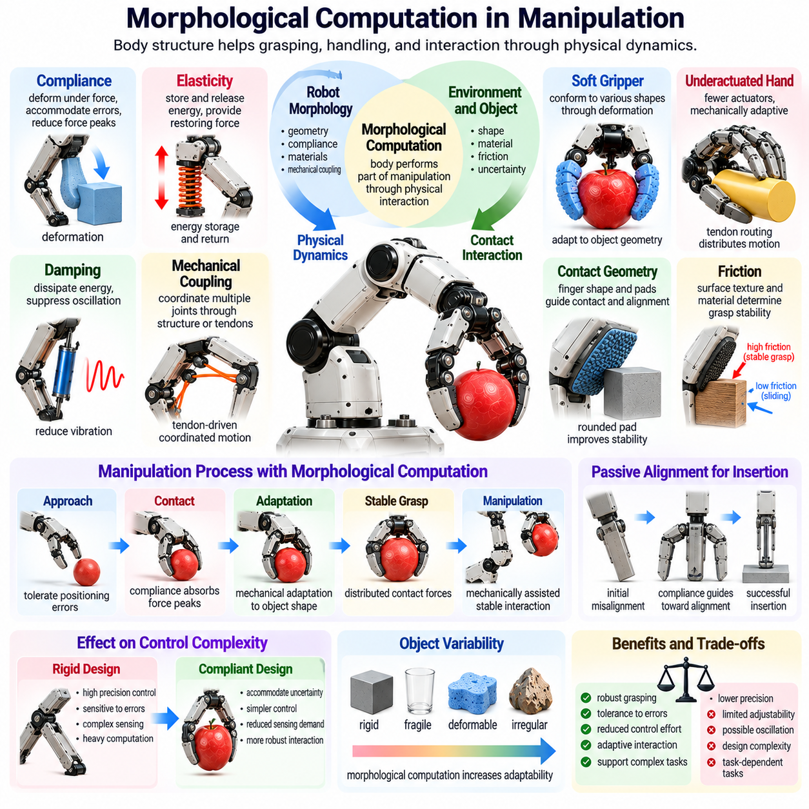{width="7.268055555555556in" height="7.268055555555556in"}

조작에서의 형태적 연산(Morphological Computation in Manipulation)은 로봇의 물리적 구조(Physical Structure)가 물체 파지(Grasping), 취급(Handling), 위치 결정(Positioning), 상호작용(Interaction)에 기여하는 방식을 설명한다. 조작 시스템(Manipulation System)은 정밀한 감지(Precise Sensing)와 계산적 제어(Computational Control)에 전적으로 의존하는 대신 기하학적 구조(Geometry), 순응성(Compliance), 탄성(Elasticity), 마찰(Friction), 기계적 결합(Mechanical Coupling)을 활용한다. 이러한 특성은 로봇 신체(Body)가 접촉 불확실성(Contact Uncertainty)을 수용하고 물리적 상호작용(Physical Interaction)을 통해 유용한 행동(Useful Behavior)을 생성하도록 한다.

로봇 조작(Robotic Manipulation)은 매니퓰레이터(Manipulator), 물체(Object), 주변 환경(Surrounding Environment) 사이의 복잡한 관계를 포함한다. 접촉력(Contact Force)은 표면 기하학(Surface Geometry), 재료 특성(Material Properties), 관절 구성(Joint Configuration), 운동 방향(Movement Direction)에 따라 달라진다. 강체 구성 요소(Rigid Component)가 상호작용할 때 작은 위치 오차(Positioning Error)도 상당한 힘을 발생시킬 수 있다. 적절한 형태(Morphology)는 이러한 상호작용을 기계적으로 유도되는 반응(Mechanically Guided Response)으로 전환하여 감지(Sensing), 계획(Planning), 피드백 제어(Feedback Control)에 대한 일부 요구사항을 줄인다.

순응성(Compliance)은 조작에서의 형태적 연산(Morphological Computation in Manipulation)을 구성하는 핵심 메커니즘(Central Mechanism)이다. 유연한 관절(Flexible Joint), 탄성 힘줄(Elastic Tendon), 변형 가능한 접촉 표면(Deformable Contact Surface)은 로봇이 물리적 변형(Physical Deformation)을 통해 작은 오차를 수용하도록 한다. 엔드 이펙터(End Effector)가 예상하지 못한 제약(Unexpected Constraint)에 직면하면 순응성은 최대 힘(Peak Force)을 줄이고 운동 방향을 변경할 수 있다. 이러한 즉각적인 반응(Immediate Response)은 모든 조정(Adjustment)을 계산하지 않고도 구성 요소(Component)를 보호하고 안정적인 상호작용(Stable Interaction)을 지원한다.

소프트 로봇 그리퍼(Soft Robotic Gripper)는 기계적 특성(Mechanical Properties)이 파지(Grasping)를 단순화하는 방식을 보여준다. 변형 가능한 손가락(Deformable Finger)은 서로 다른 형상의 물체(Object)에 적응하면서 여러 표면에 접촉 압력(Contact Pressure)을 분산한다. 모든 물체에 대해 정확한 손가락 위치(Finger Position)를 계산하는 대신 그리퍼(Gripper)는 재료 변형(Material Deformation)을 이용하여 접촉(Contact)을 형성한다. 이러한 적응성(Adaptability)은 파지 강건성(Grasp Robustness)을 향상시킬 수 있지만 과도한 유연성(Excessive Softness)은 위치 결정 정확도(Positioning Accuracy)와 하중 지지 능력(Load Capacity)을 감소시킬 수 있다.

과소구동 로봇 손(Underactuated Robotic Hand)은 기계적으로 조정되는 조작(Mechanically Coordinated Manipulation)의 또 다른 사례이다. 이러한 메커니즘은 관절 자유도(Joint Degrees of Freedom)보다 독립적으로 제어되는 액추에이터(Independently Controlled Actuator)의 수가 적다. 힘줄 배치(Tendon Routing), 관절 스프링(Joint Spring), 접촉 제약(Contact Constraint)은 파지 과정에서 손가락이 자신의 구성(Configuration)을 조정하도록 한다. 기계적 결합(Mechanical Coupling)은 액추에이터 힘(Actuator Force)을 관절 사이에 분배하여 명령 복잡도(Command Complexity)를 줄이지만 개별 손가락 움직임(Individual Finger Movement)에 대한 독립적인 제어를 제한한다.

기계적 시너지(Mechanical Synergy)는 공유 구동(Shared Actuation)이나 구조적 제약(Structural Constraint)에서 발생하는 조정된 움직임(Coordinated Movement)을 의미한다. 로봇 손(Robotic Hand)에서는 하나의 액추에이터(Actuator)가 힘줄 네트워크(Tendon Network)를 통해 여러 손가락 관절(Finger Joint)을 구동할 수 있다. 접촉이 발생하면 유연한 관절(Compliant Joint)은 물체 기하학(Object Geometry)에 따라 움직임과 힘을 재분배한다. 이러한 메커니즘은 파지 협응(Grasp Coordination)을 하드웨어(Hardware)에 내재화하여 모든 관절 궤적(Joint Trajectory)을 독립적으로 계산하지 않고도 유용한 적응(Adaptation)을 가능하게 한다.

접촉 기하학(Contact Geometry)은 상호작용하는 표면의 형상(Surface Shape)이 힘을 움직임으로 변환하는 방식을 결정하므로 조작(Manipulation)에서 중요한 역할을 한다. 둥근 손가락 끝(Rounded Fingertip), 유연한 패드(Compliant Pad), 형상이 설계된 가이드(Shaped Guide)는 물체 정렬(Object Alignment)과 힘 분포(Force Distribution)에 영향을 미칠 수 있다. 적절한 기하학적 구조(Geometry)는 물체가 안정적인 구성(Stable Configuration)에 도달하도록 유도할 수 있다. 이러한 기계적 효과(Mechanical Effect)는 접촉 조건(Contact Condition)이 의도된 작동 범위(Intended Operating Range) 내에 있을 때 파지 획득(Grasp Acquisition), 삽입(Insertion), 위치 결정(Positioning)을 단순화할 수 있다.

마찰(Friction)은 형태 의존적 조작(Morphology-Dependent Manipulation)의 또 다른 핵심 요소이다. 표면 질감(Surface Texture), 접촉 압력(Contact Pressure), 재료 구성(Material Composition)은 미끄러짐(Sliding)에 대한 저항에 영향을 미친다. 높은 마찰(High Friction)은 파지 유지(Grasp Retention)를 개선할 수 있으며, 제어된 미끄러짐(Controlled Sliding)은 재위치 결정(Repositioning)과 조립(Assembly)을 지원할 수 있다. 기계적 설계(Mechanical Design)는 이러한 효과의 균형을 유지해야 한다. 과도한 마찰(Excessive Friction)은 끼임(Jamming)을 유발할 수 있고, 부족한 마찰(Insufficient Friction)은 의도하지 않은 물체 움직임(Unintended Object Motion)을 발생시킬 수 있기 때문이다.

수동적 기계 정렬(Passive Mechanical Alignment)은 조립 작업(Assembly Operation)에서 특히 유용하다. 구성 요소(Component)가 약간 잘못 정렬된 경우 강체 위치 제어(Rigid Position Control)는 큰 접촉력(Contact Force)이나 삽입 실패(Insertion Failure)를 유발할 수 있다. 유연한 메커니즘(Compliant Mechanism)은 삽입되는 구성 요소가 적합한 구성(Compatible Configuration)을 향해 회전(Rotation)하거나 병진 이동(Translation)하도록 허용할 수 있다. 원격 중심 순응 장치(Remote Center Compliance Device)는 기계적 기하학(Mechanical Geometry)과 유연성(Flexibility)이 접촉이 많은 삽입 작업(Contact-Rich Insertion Task)에서 정렬을 지원하는 방식을 보여준다.

탄성(Elasticity)은 복원력(Restoring Force)을 생성하고 기계적 에너지(Mechanical Energy)를 저장함으로써 조작(Manipulation)에 기여한다. 스프링(Spring)은 손가락을 미리 정의된 구성(Predefined Configuration)으로 복귀시키거나 적절한 변위 범위(Displacement Range)에서 접촉 압력(Contact Pressure)을 유지할 수 있다. 탄성 요소(Elastic Element)는 빠른 파지 닫힘(Rapid Grasp Closure)과 제어된 해제(Controlled Release)를 지원할 수도 있다. 그러나 저장된 에너지(Stored Energy)는 반발(Rebound)이나 오버슈트(Overshoot)를 발생시킬 수 있으므로 예측 가능한 조작(Predictable Manipulation)을 위해서는 감쇠(Damping)와 적절한 강성 선택(Stiffness Selection)이 중요하다.

감쇠(Damping)는 진동(Vibration)을 억제하고 접촉 후 진동 운동(Oscillation)을 감소시킴으로써 조작 동역학(Manipulation Dynamics)을 조절한다. 파지(Grasping)나 물체 배치(Object Placement) 과정에서 힘의 갑작스러운 변화(Sudden Force Change)는 유연한 구조(Flexible Structure)의 진동을 유발할 수 있다. 기계적 감쇠(Mechanical Damping)는 이러한 에너지의 일부를 소산하여 시스템이 안정적인 구성(Stable Configuration)에 도달하도록 돕는다. 과도한 감쇠(Excessive Damping)는 조작 속도를 낮추고 에너지 손실(Energy Loss)을 증가시킬 수 있으므로 감쇠 특성은 의도된 작업(Intended Task)에 맞게 조정해야 한다.

물체 특성(Object Properties)은 형태적 연산(Morphological Computation)의 효과에 큰 영향을 미친다. 강체 물체(Rigid Object), 변형 가능한 재료(Deformable Material), 깨지기 쉬운 구성 요소(Fragile Component), 불규칙한 형상(Irregular Shape)은 서로 다른 기계적 반응(Mechanical Response)을 필요로 한다. 유연한 그리퍼(Compliant Gripper)는 섬세한 물체(Delicate Object)를 효과적으로 취급할 수 있지만 무거운 하중(Heavy Load)이나 정밀한 자세 제어(Precise Orientation Control)에는 어려움을 겪을 수 있다. 따라서 형태(Morphology)는 예상되는 물체 다양성(Object Variability), 접촉력(Contact Force), 조작 요구사항(Manipulation Requirements)에 따라 선택해야 한다.

형태적 연산(Morphological Computation)은 기계적 구조(Mechanical Structure)가 여러 가능한 접촉 구성(Contact Configuration)을 수용하도록 하여 파지 계획(Grasp Planning)의 차원(Dimensionality)을 줄일 수 있다. 제어기(Controller)는 일반적인 닫힘 동작(Closing Motion)을 지정하고, 유연한 손가락(Compliant Finger)은 접촉을 통해 최종 위치(Final Position)를 결정할 수 있다. 이는 모든 접촉점(Contact Point)을 사전에 예측해야 할 필요성을 줄인다. 그러나 물체 인식(Object Recognition), 파지 선택(Grasp Selection), 작업 수준 계획(Task-Level Planning)에는 여전히 정교한 연산(Sophisticated Computation)이 필요할 수 있다.

환경적 제약(Environmental Constraint)도 조작 과정에서 유용한 자원(Useful Resource)이 될 수 있다. 로봇은 물체를 지지 표면(Supporting Surface)에 밀착시켜 정렬(Alignment)을 형성하거나 테이블(Table)을 이용하여 물체의 방향을 변경하는 동안 안정화(Stabilization)할 수 있다. 이러한 전략(Strategy)은 자유 공간 제어(Free-Space Control)에만 의존하지 않고 물리적 접촉(Physical Contact)을 활용한다. 형태(Morphology)는 이러한 상호작용이 물체와 주변 환경에 대해 기계적으로 안정적(Mechanically Stable)이고 제어 가능(Controllable)하며 안전(Safe)한지를 결정한다.

촉각 감지(Tactile Sensing)는 유연한 구조(Compliant Structure)가 접촉력(Contact Force)을 측정 가능한 변형(Measurable Deformation)으로 변환하기 때문에 형태적 연산(Morphological Computation)과 밀접하게 상호작용한다. 유연한 센서 덮개(Flexible Sensor Covering)는 압력을 분산하고 전자적 처리(Electronic Processing) 이전에 촉각 신호(Tactile Signal)를 형성한다. 이러한 기계적 전처리(Mechanical Preprocessing)는 접촉 허용성(Contact Tolerance)을 개선하고 분산된 압력 패턴(Distributed Pressure Pattern)을 드러낼 수 있다. 그러나 과도한 필터링(Excessive Filtering)은 미끄러짐 초기 징후(Incipient Slip)나 짧은 충격(Brief Impact)을 포함한 빠른 사건(Rapid Event)을 감출 수 있다.

기계적 임피던스(Mechanical Impedance)는 매니퓰레이터(Manipulator)가 물체와 힘(Force) 및 운동(Motion)을 교환하는 방식을 이해하기 위한 체계(Framework)를 제공한다. 강성(Stiffness), 감쇠(Damping), 관성(Inertia)은 서로 다른 주파수(Frequency)에서 접촉 외란(Contact Disturbance)에 대한 응답을 결정한다. 적절한 물리적 임피던스(Physical Impedance)는 상호작용 안정성(Interaction Stability)을 개선하고 갑작스러운 하중(Sudden Loading)을 줄일 수 있다. 능동 임피던스 제어(Active Impedance Control)는 작업 요구사항(Task Requirements)과 환경 조건(Environmental Conditions)에 따라 액추에이터 행동(Actuator Behavior)을 조정함으로써 이러한 특성을 보완할 수 있다.

가변 강성 메커니즘(Variable Stiffness Mechanism)은 매니퓰레이터(Manipulator)가 작동 중 기계적 행동(Mechanical Behavior)을 변경하도록 한다. 낮은 강성(Lower Stiffness)은 안전한 접촉(Safe Contact)과 불확실한 물체 획득(Uncertain Object Acquisition)을 지원할 수 있으며, 높은 강성(Higher Stiffness)은 하중 지지(Load Support)나 위치 결정 정밀도(Positioning Precision)를 향상시킬 수 있다. 이러한 유연성(Flexibility)은 구현 가능한 조작 행동(Achievable Manipulation Behavior)의 범위를 확장한다. 그러나 가변 강성 시스템(Variable Stiffness System)은 추가적인 기계적 복잡도(Mechanical Complexity), 보정 요구사항(Calibration Requirements), 제어 과제(Control Challenges)를 발생시킨다.

연속체 매니퓰레이터(Continuum Manipulator)와 소프트 매니퓰레이터(Soft Manipulator)는 분산 변형(Distributed Deformation)을 통해 형태적 연산(Morphological Computation)을 확장한다. 유연한 신체(Flexible Body)는 장애물(Obstacle)이나 물체 표면(Object Surface)에 맞추어 굽혀지고 적응하여 좁거나 불규칙한 공간(Confined or Irregular Space)에서 상호작용을 가능하게 한다. 움직임(Motion)은 구동(Actuation), 재료 탄성(Material Elasticity), 환경적 제약(Environmental Constraint)의 결합된 효과에서 발생한다. 이러한 적응성(Adaptability)은 유용하지만 비선형 변형(Nonlinear Deformation)과 복잡한 접촉 동역학(Complex Contact Dynamics)은 정확한 모델링(Accurate Modeling)을 어렵게 만들 수 있다.

형태(Morphology)는 최대 접촉력(Peak Contact Force)을 제한하고 예상하지 못한 상호작용(Unexpected Interaction)을 수용함으로써 조작 안전성(Manipulation Safety)을 향상시킬 수 있다. 유연한 표면(Compliant Surface)은 국부적인 압력 집중(Local Pressure Concentration)을 줄이고, 기계적 감쇠(Mechanical Damping)는 충격(Impact)과 반발(Rebound)을 완화한다. 이러한 특성은 협동 로봇공학(Collaborative Robotics)과 인간 중심 환경(Human-Centered Environment)에서 중요하다. 그러나 안전성(Safety)은 액추에이터 출력(Actuator Power), 충돌 속도(Collision Velocity), 유효 질량(Effective Mass), 탄성 요소(Elastic Component)에 저장된 에너지(Stored Energy)에도 의존한다.

조작에서의 에너지 효율성(Energy Efficiency in Manipulation)은 기계적 구조(Mechanical Structure)가 에너지를 저장(Store), 전달(Transmit), 소산(Dissipate)하는 방식에 따라 달라진다. 수동 스프링(Passive Spring)은 지속적인 액추에이터 조정(Actuator Adjustment) 없이 특정 힘을 유지할 수 있으며, 기계적으로 결합된 손가락(Mechanically Coupled Finger)은 필요한 모터(Motor)의 수를 줄일 수 있다. 그러나 마찰(Friction), 감쇠(Damping), 변형 손실(Deformation Loss), 액추에이터 비효율성(Actuator Inefficiency)은 이러한 이점을 상쇄할 수 있다. 따라서 에너지 이점(Energy Benefit)은 전체 조작 작업(Complete Manipulation Task)을 기준으로 평가해야 한다.

학습 기반 조작(Learning-Based Manipulation)은 접촉 상호작용(Contact Interaction)을 단순화하는 형태적 특성(Morphological Property)을 활용할 수 있다. 강화학습 정책(Reinforcement Learning Policy)은 순응성(Compliance), 마찰(Friction), 환경적 제약(Environmental Constraint)을 이용하는 파지 및 삽입 전략(Grasping and Insertion Strategy)을 발견할 수 있다. 적절한 형태(Morphology)는 일부 행동(Action)이 불확실성(Uncertainty)에 더 잘 대응하도록 하고 학습된 제어(Learned Control)에 요구되는 정밀도(Precision)를 줄일 수 있다. 반대로 복잡한 재료 행동(Complex Material Behavior)은 변동성(Variability)을 증가시키고 정책 전이(Policy Transfer)를 복잡하게 만들 수 있다.

조작 형태와 제어의 공동 설계(Co-Design of Manipulation Morphology and Control)는 손가락 기하학(Finger Geometry), 관절 순응성(Joint Compliance), 액추에이터 배치(Actuator Placement), 촉각 감지(Tactile Sensing), 제어 전략(Control Strategy)을 함께 최적화하는 과정이다. 시뮬레이션(Simulation)은 후보 구조(Candidate Structure)를 평가할 수 있으며, 물리적 실험(Physical Experiment)은 마찰 효과(Frictional Effect), 재료 비선형성(Material Nonlinearity), 예상하지 못한 접촉 행동(Unexpected Contact Behavior)을 드러낸다. 효과적인 공동 설계(Effective Co-Design)는 필요한 정밀도(Precision), 적응성(Adaptability), 신뢰성(Reliability)을 희생하지 않으면서 의도된 작업(Intended Task)을 지원하는 기계적 특성(Mechanical Property)을 추구한다.

조작에서의 형태적 연산(Morphological Computation in Manipulation)을 평가하려면 파지 성공률(Grasp Success), 접촉 안정성(Contact Stability), 위치 결정 정확도(Positioning Accuracy), 힘 조절(Force Regulation), 외란 허용성(Disturbance Tolerance)을 측정해야 한다. 추가 지표(Additional Indicator)에는 액추에이터 작동 부담(Actuator Effort), 계산 부하(Computational Load), 물체 손상(Object Damage), 다양한 형상과 재료에 대한 성능(Performance Across Different Shapes and Materials)이 포함된다. 비교에서는 동등한 작업 조건(Equivalent Task Conditions)을 유지해야 한다. 제어 복잡도 감소(Reduced Control Complexity)는 필수적인 조작 성능(Essential Manipulation Performance)이 허용 가능한 수준으로 유지될 때만 유익하다.

피지컬 AI(Physical AI)에서 조작 형태(Manipulation Morphology)는 지능적 의사결정(Intelligent Decision-Making)과 물리적 물체 상호작용(Physical Object Interaction) 사이의 인터페이스(Interface)를 제공한다. 기계적 구조(Mechanical Structure)는 즉각적인 접촉 적응(Immediate Contact Adaptation)을 처리하고, 인지(Perception), 계획(Planning), 학습(Learning)은 목표(Goal)와 행동 순서(Action Sequence)를 결정한다. 이러한 통합(Integration)은 하드웨어(Hardware)와 소프트웨어(Software) 사이에 기능적 책임(Functional Responsibility)을 분산하여 불확실한 환경 조건(Uncertain Environmental Conditions)에서 더욱 반응성이 높고 강건한 조작(Responsive and Robust Manipulation)을 가능하게 한다.

궁극적으로 조작에서의 형태적 연산(Morphological Computation in Manipulation)은 유용한 지능(Useful Intelligence)이 로봇 손(Robotic Hand)과 매니퓰레이터(Manipulator)의 기계적 특성(Mechanical Properties)에 내재화될 수 있음을 보여준다. 기하학적 구조(Geometry), 순응성(Compliance), 탄성(Elasticity), 감쇠(Damping), 마찰(Friction), 결합(Coupling)은 물체가 파지(Grasping), 정렬(Alignment), 이동(Movement)되는 방식을 형성한다. 이러한 물리적 자원(Physical Resource)을 적응형 감지(Adaptive Sensing) 및 제어(Control)와 통합하면 효율적이고 신뢰할 수 있으며 다양한 작업에 대응할 수 있는 체화 조작(Embodied Manipulation)을 지원할 수 있다.

## 02.09. Biological Examples and Inspiration

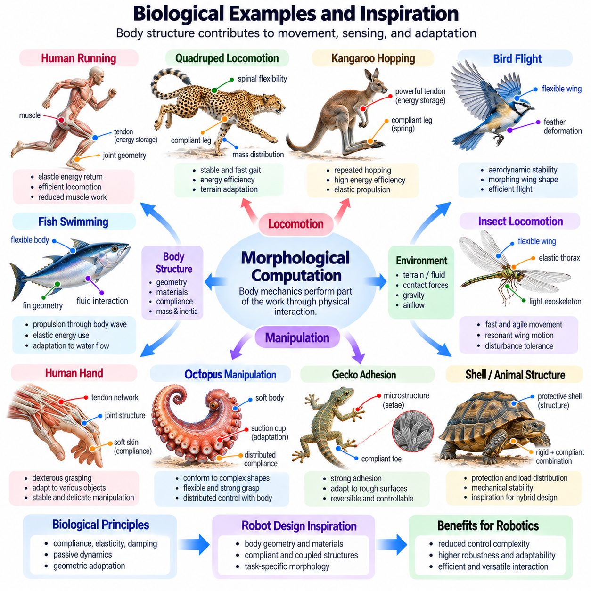{width="7.268055555555556in" height="7.268055555555556in"}

생물학적 유기체(Biological Organism)는 신체(Body)가 움직임(Movement), 감지(Sensing), 적응(Adaptation), 환경적 상호작용(Environmental Interaction)에 직접 기여하기 때문에 형태적 연산(Morphological Computation)의 중요한 사례를 제공한다. 근육(Muscle), 힘줄(Tendon), 골격(Skeleton), 피부(Skin), 결합 조직(Connective Tissue)은 신경 명령(Neural Command)이 완전히 처리되기 전부터 행동(Behavior)을 형성하는 기계적 특성(Mechanical Properties)을 가지고 있다. 이러한 구조는 물리적 형태(Physical Morphology), 신경계(Nervous System), 환경적 힘(Environmental Force) 사이의 조정된 상호작용을 통해 지능(Intelligence)이 어떻게 나타날 수 있는지 보여준다.

생물학에서의 형태적 연산(Morphological Computation in Biology)은 신체(Body)가 신경 제어(Neural Control)와 독립적으로 작동한다는 의미가 아니다. 오히려 기계적 구조(Mechanical Structure)와 신경 과정(Neural Process)이 행동 생성(Behavior Generation)에 대한 책임을 공유한다. 신경계(Nervous System)는 목표(Goal)를 설정하고 활동(Activity)을 조정하는 반면, 신체 동역학(Body Dynamics)은 많은 즉각적인 물리적 반응(Immediate Physical Response)을 조절한다. 이러한 기능 분산(Functional Distribution)은 모든 움직임의 세부 사항을 명시적으로 신경 제어할 필요성을 줄이고 변화하는 조건에 대한 빠른 적응(Rapid Adaptation)을 지원한다.

인간 보행(Human Walking)은 형태(Morphology)가 조정된 이동(Coordinated Locomotion)에 기여하는 방식을 보여준다. 사지 비율(Limb Proportion), 관절 기하학(Joint Geometry), 근육 탄성(Muscle Elasticity), 힘줄 강성(Tendon Stiffness)은 보폭 패턴(Stride Pattern)과 에너지 교환(Energy Exchange)에 영향을 미친다. 보행 중 중력(Gravitational Force)과 진자형 사지 운동(Pendulum-Like Limb Motion)은 전방 이동(Forward Progression)에 기여한다. 신경 제어(Neural Control)는 균형(Balance)과 적응(Adaptation)에 필수적이지만 신체의 기계적 특성(Mechanical Properties)은 움직임을 조직화하고 불필요한 근육 작용(Muscular Effort)을 줄이는 데 도움이 된다.

인간 달리기(Human Running)는 탄성 에너지 저장(Elastic Energy Storage)과 회수(Energy Recovery)의 중요성을 보여준다. 힘줄(Tendon), 특히 아킬레스건(Achilles Tendon)은 하중이 가해질 때 늘어나고 추진(Propulsion) 과정에서 저장된 에너지의 일부를 반환한다. 이러한 메커니즘(Mechanism)은 필요한 능동적 근육 작업(Active Muscle Work)의 양을 제한함으로써 반복적인 움직임의 대사 비용(Metabolic Cost)을 줄일 수 있다. 그 효과는 이동 속도(Movement Speed), 힘줄 강성(Tendon Stiffness), 근육 활성화(Muscle Activation), 협응(Coordination)에 따라 달라진다.

동물 이동(Animal Locomotion)은 수동적 기계 안정화(Passive Mechanical Stabilization)의 추가적인 사례를 제공한다. 달리기 중 유연한 사지(Compliant Limb)는 충격(Impact)을 흡수하고 신체 움직임(Body Motion)에 영향을 미치는 복원력(Restoring Force)을 생성한다. 다리 강성(Leg Stiffness), 기하학적 구조(Geometry), 질량 분포(Mass Distribution)의 적절한 조합은 안정적인 리듬 운동(Stable Rhythmic Movement)에 기여할 수 있다. 신경 피드백(Neural Feedback)은 특히 큰 외란(Large Disturbance)이 발생할 때 중요하지만 기계적 반응(Mechanical Response)은 상대적으로 느린 감각 보정(Sensory Correction)이 완료되기 전에 작동할 수 있다.

스프링 부하 역진자 모델(Spring-Loaded Inverted Pendulum Model)은 달리는 동물(Running Animal)의 여러 특성을 표현한다. 이 모델에서는 신체 질량(Body Mass)이 지면 접촉(Ground Contact) 중 에너지를 저장하고 방출하는 유연한 다리(Compliant Leg)에 의해 지지된다. 단순화된 모델이지만 다리 탄성(Leg Elasticity)과 전방 운동량(Forward Momentum)이 상호작용하여 반복적인 탄성 운동(Bouncing Motion)을 생성하는 방식을 설명한다. 또한 기계적으로 보조되는 이동(Mechanically Assisted Locomotion)을 수행하는 다리형 로봇(Legged Robot)을 설계하기 위한 유용한 기반을 제공한다.

사족보행 포유류(Quadrupedal Mammal)는 신체 형태(Body Morphology)가 보행 선택(Gait Selection)과 협응(Coordination)에 영향을 미치는 방식을 보여준다. 사지 길이(Limb Length), 척추 유연성(Spinal Flexibility), 근육 배열(Muscle Arrangement), 신체 질량 분포(Body Mass Distribution)는 걷기(Walking), 속보(Trotting), 질주(Galloping)에 영향을 미친다. 유연한 척추 구조(Flexible Spinal Structure)는 빠른 이동 중 보폭 확장(Stride Extension)과 에너지 전달(Energy Transfer)에 기여할 수 있다. 이러한 관찰은 유연한 사지(Compliant Limb), 관절형 신체(Articulated Body), 적응형 보행 제어기(Adaptive Gait Controller)를 결합하는 로봇 설계에 영감을 제공한다.

캥거루 이동(Kangaroo Locomotion)은 탄성 에너지 관리(Elastic Energy Management)의 독특한 사례를 제공한다. 긴 힘줄(Long Tendon)과 특수화된 뒷다리 구조(Specialized Hindlimb Structure)는 운동 주기(Movement Cycle) 전반에 걸쳐 에너지를 저장하고 반환함으로써 반복적인 도약(Hopping)을 지원한다. 기계적 탄성(Mechanical Elasticity)은 효율적인 추진(Efficient Propulsion)에 기여하지만 근육 활동(Muscular Activity)과 신경 협응(Neural Coordination)은 여전히 필요하다. 로봇 도약 시스템(Robotic Hopping System)은 유연한 다리(Compliant Leg)와 적절하게 조정된 스프링 메커니즘(Spring Mechanism)을 통해 유사한 원리를 활용할 수 있다.

조류 비행(Bird Flight)은 형태(Morphology)와 환경적 힘(Environmental Force)이 상호작용하여 제어된 움직임(Controlled Movement)을 생성하는 방식을 보여준다. 날개 형상(Wing Shape), 깃털 유연성(Feather Flexibility), 관절 구성(Joint Configuration)은 양력(Lift), 항력(Drag), 공기역학적 안정성(Aerodynamic Stability)에 영향을 미친다. 수동 변형(Passive Deformation)은 모든 표면을 지속적으로 조정하지 않고도 기류(Airflow)에 반응하여 날개 기하학(Wing Geometry)을 변경할 수 있다. 이러한 원리는 로봇 항공기(Robotic Aircraft)의 가변형 날개(Morphing Wing)와 유연한 공기역학 구조(Flexible Aerodynamic Structure)에 영감을 제공한다.

어류 이동(Fish Locomotion)은 유연한 신체(Flexible Body)와 주변 유체(Surrounding Fluid) 사이의 상호작용을 보여준다. 신체 곡률(Body Curvature), 지느러미 기하학(Fin Geometry), 근육 활성화(Muscle Activation), 유체 저항(Fluid Resistance)은 함께 추진(Propulsion)을 결정한다. 유연한 꼬리(Flexible Tail)는 탄성 에너지(Elastic Energy)를 저장하고 유체역학적 힘(Hydrodynamic Force)과 상호작용하여 유영 패턴(Swimming Pattern)을 형성할 수 있다. 생체모방 수중 로봇(Bio-Inspired Underwater Robot)은 강체 프로펠러(Rigid Propeller)에만 의존하는 대신 유연한 지느러미(Compliant Fin)와 분산 구동(Distributed Actuation)을 통해 이러한 관계를 활용한다.

곤충(Insect)은 비교적 작은 신경계(Nervous System)와 기계적으로 특수화된 신체(Mechanically Specialized Body)를 이용하여 뛰어난 이동 능력(Locomotion Capability)을 보여준다. 외골격(Exoskeleton), 유연한 관절(Compliant Joint), 탄성 구조(Elastic Structure)는 빠른 움직임(Rapid Movement)과 외란 허용성(Disturbance Tolerance)에 기여한다. 달리기 중 기계적 다리 반응(Mechanical Leg Response)은 짧은 시간 척도(Short Timescale)에서 안정화(Stabilization)를 지원할 수 있다. 곤충 모방 로봇(Insect-Inspired Robot)은 유사한 구조적 원리(Structural Principle)를 이용하여 간결한 제어 아키텍처(Compact Control Architecture)로 빠른 다리 협응(Fast Leg Coordination)과 강건한 움직임(Robust Movement)을 구현한다.

곤충 비행(Insect Flight)은 구조적 탄성(Structural Elasticity)이 동적 행동(Dynamic Behavior)에 영향을 미치는 방식도 보여준다. 유연한 날개(Flexible Wing)는 공기역학적 하중(Aerodynamic Loading)에 따라 변형되어 각 날갯짓 주기(Stroke)에서 유효 형상(Effective Shape)이 변화한다. 흉부 탄성(Thoracic Elasticity)은 진동하는 날개 운동(Oscillatory Wing Motion) 중 에너지를 저장하고 반환할 수 있다. 이러한 기계적 상호작용(Mechanical Interaction)은 공기역학적 힘 생성(Aerodynamic Force Production)과 에너지 요구량(Energetic Requirements)에 영향을 미치며, 공진 구조(Resonant Structure)와 유연한 날개 재료(Compliant Wing Material)를 활용하는 날갯짓 로봇(Flapping-Wing Robot)에 영감을 제공한다.

인간 손(Human Hand)은 형태(Morphology)가 조작(Manipulation)을 지원하는 중요한 생물학적 사례이다. 손가락 비율(Finger Proportion), 관절 배열(Joint Arrangement), 힘줄 네트워크(Tendon Network), 부드러운 손가락 끝 조직(Soft Fingertip Tissue)은 파지 형성(Grasp Formation)에 기여한다. 유연한 피부(Compliant Skin)는 접촉력(Contact Force)을 분산하고 물체 사이의 작은 기하학적 차이(Geometric Difference)를 수용한다. 신경 제어(Neural Control)는 파지 목표(Grasp Objective)를 결정하며, 기계적 구조(Mechanical Structure)는 조작 중 접촉 적응(Contact Adaptation)과 힘 전달(Force Transmission)을 지원한다.

인간의 힘줄 네트워크(Human Tendon Network)는 기계적 결합(Mechanical Coupling)이 여러 관절(Joint)을 조정하는 방식을 보여준다. 힘줄(Tendon)은 해부학적 구조(Anatomical Structure)를 가로질러 근육 힘(Muscle Force)을 전달하며, 인대(Ligament)와 관절 제약(Joint Constraint)은 허용 가능한 움직임(Allowable Movement)에 영향을 미친다. 이러한 관계는 특정 관절 운동(Joint Motion)의 독립성을 줄이고 기능적 협응 패턴(Functional Coordination Pattern)을 형성한다. 로봇 손(Robotic Hand)은 힘줄 구동(Tendon-Driven Actuation), 유연한 관절(Compliant Joint), 기계적으로 결합된 손가락(Mechanically Coupled Finger)을 통해 관련 원리를 적용한다.

문어 팔(Octopus Arm)은 체화 조작(Embodied Manipulation)에 대한 다른 접근 방식을 보여준다. 강체 골격 사지(Rigid Skeletal Limb)와 달리 근육성 정수압 구조(Muscular Hydrostat Structure)는 연조직(Soft Tissue)의 조정된 변형(Coordinated Deformation)을 통해 움직임을 생성한다. 국부적인 기계적 특성(Local Mechanical Properties)은 굽힘(Bending), 신장(Extension), 물체 형상 적응(Object Conformity)에 기여한다. 분산 신경 제어(Distributed Neural Control)는 이러한 특성과 상호작용하며, 복잡한 환경에 적응할 수 있는 연속체 매니퓰레이터(Continuum Manipulator)와 소프트 로봇 팔(Soft Robotic Arm)에 영감을 제공한다.

코끼리 코(Elephant Trunk)는 유연한 생물학적 조작(Flexible Biological Manipulation)의 또 다른 사례이다. 근육 구조(Muscular Structure)는 기존의 강체 관절(Rigid Joint) 없이 굽힘(Bending), 신장(Extension), 비틀림(Twisting), 파지(Grasping)를 가능하게 한다. 분산 변형(Distributed Deformation)은 코가 다양한 형상과 크기의 물체(Object)와 상호작용하도록 한다. 코끼리 코 모방 로봇 매니퓰레이터(Trunk-Inspired Robotic Manipulator)는 유연한 구조(Compliant Structure)와 연속적인 굽힘(Continuous Bending)을 이용하여 다목적 움직임(Versatile Movement)을 구현하지만 정밀 제어(Precise Control)는 여전히 어려운 과제로 남아 있다.

생물학적 피부(Biological Skin)는 기계적 필터링(Mechanical Filtering)과 촉각 상호작용(Tactile Interaction)을 통해 형태적 연산(Morphological Computation)에 기여한다. 피부의 층상 구조(Layered Structure)는 압력(Pressure)을 분산하고 표면 특징(Surface Feature)에 따라 변형되며 접촉 중 마찰(Friction)에 영향을 미친다. 기계수용기(Mechanoreceptor)는 그 결과로 나타나는 변형 패턴(Deformation Pattern)을 감지하여 물리적 전처리(Physical Preprocessing)와 신경 감지(Neural Sensing)를 연결한다. 로봇 촉각 피부(Robotic Tactile Skin)는 유사한 원리를 적용하여 접촉 허용성(Contact Tolerance)을 개선하고 물체 상호작용(Object Interaction)에 대한 더욱 풍부한 정보(Richer Information)를 제공할 수 있다.

포유류(Mammal)의 수염 기반 감지(Whisker-Based Sensing)는 형태(Morphology)가 환경 접촉(Environmental Contact)을 유용한 감각 정보(Sensory Information)로 변환하는 방식을 보여준다. 수염 길이(Whisker Length), 강성(Stiffness), 곡률(Curvature), 장착 특성(Mounting Properties)은 접촉 중 굽힘(Bending)에 영향을 미친다. 이러한 기계적 반응(Mechanical Response)은 신경 해석(Neural Interpretation) 이전에 물체 위치(Object Position)와 표면 상호작용(Surface Interaction)의 일부 특성을 부호화한다. 인공 수염 센서(Artificial Whisker Sensor)는 근접 감지(Proximity Detection), 접촉 위치 추정(Contact Localization), 표면 탐색(Surface Exploration)에 유사한 메커니즘을 활용한다.

생물학적 형태(Biological Morphology)는 보호 반응(Protective Response)에도 기여한다. 연조직(Soft Tissue), 연골(Cartilage), 관절 구조(Joint Structure)는 충격 중 기계적 하중(Mechanical Load)을 흡수하거나 재분배한다. 이러한 수동 메커니즘(Passive Mechanism)은 능동적 보정 운동(Active Corrective Movement)이 발생하기 전에 최대 힘(Peak Force)을 줄일 수 있다. 로봇 시스템(Robotic System)은 특히 불확실한 접촉(Uncertain Contact)이나 인간과의 상호작용(Human Interaction)이 포함된 응용 분야에서 유연한 외피(Compliant Covering), 탄성 관절(Elastic Joint), 기계적 감쇠(Mechanical Damping)를 이용하여 관련 효과를 구현한다.

진화(Evolution)는 적응 자원(Adaptive Resource)으로서의 형태(Morphology)를 이해하는 더 넓은 관점을 제공한다. 생물학적 구조(Biological Structure)는 유전적 변이(Inherited Variation), 발달 과정(Developmental Process), 환경적 압력(Environmental Pressure), 기능적 제약(Functional Constraint) 사이의 상호작용을 통해 형성된다. 움직임(Movement), 감지(Sensing), 생존(Survival)을 개선하는 특성(Feature)은 여러 세대에 걸쳐 정착될 수 있다. 로봇공학(Robotics)은 생물학적 설계(Biological Design)가 공학적 응용(Engineered Application)에 보편적으로 최적이라고 가정하지 않으면서도 이러한 결과에서 영감을 얻을 수 있다.

발달(Development)과 학습(Learning)은 형태(Morphology)와 행동(Behavior) 사이의 상호작용을 추가로 보여준다. 유기체(Organism)가 성장함에 따라 사지 비율(Limb Proportion), 근력(Muscle Strength), 조직 강성(Tissue Stiffness)의 변화는 운동 동역학(Movement Dynamics)을 변경한다. 신경 제어(Neural Control)는 경험(Experience)을 통해 이러한 변화하는 물리적 특성(Physical Properties)에 적응한다. 발달 로봇공학(Developmental Robotics)은 기계적 구성(Mechanical Configuration)이나 물리적 능력(Physical Capability)의 변화와 함께 제어 전략(Control Strategy)이 적응하도록 함으로써 관련 과정을 연구한다.

생물학적 영감(Biological Inspiration)은 엔지니어가 해부학(Anatomy)을 문자 그대로 복제하기보다 기능적 원리(Functional Principle)를 식별할 때 가장 효과적이다. 힘줄 탄성(Tendon Elasticity)은 에너지 회수(Energy Recovery)를, 유연한 피부(Compliant Skin)는 접촉 적응(Contact Adaptation)을, 유연한 사지(Flexible Limb)는 수동적 외란 허용성(Passive Disturbance Tolerance)을 시사한다. 이러한 원리를 로봇공학(Robotics)에 적용하려면 제조 방법(Manufacturing Method), 액추에이터 특성(Actuator Characteristics), 재료 내구성(Material Durability), 제어 요구사항(Control Requirements)을 고려해야 한다. 생물학적 유사성(Biological Similarity)만으로 공학적 성능(Engineering Performance)이 보장되는 것은 아니다.

생체모방 형태적 연산(Bio-Inspired Morphological Computation)을 평가하려면 비교 가능한 조건(Comparable Conditions)에서 물리적 구조(Physical Structure)가 행동(Behavior)에 미치는 영향을 검토해야 한다. 유용한 측정 지표(Measurement Metrics)에는 에너지 효율성(Energy Efficiency), 외란 복원(Disturbance Recovery), 접촉 안정성(Contact Stability), 제어 부담(Control Effort), 적응성(Adaptability)이 포함된다. 실험(Experiment)은 가능한 경우 기계적 특성(Mechanical Properties)과 능동 제어(Active Control)의 기여를 구분해야 한다. 이러한 구분은 생물학적 원리(Biological Principle)가 로봇 구현(Robotic Implementation)에서 실질적인 이점(Genuine Advantage)을 제공하는지 판단하는 데 도움이 된다.

피지컬 AI(Physical AI)에서 생물학적 사례(Biological Example)는 기계적 지능(Mechanical Intelligence)을 인지(Perception), 학습(Learning), 적응형 제어(Adaptive Control)와 통합하도록 유도한다. 신체(Body)는 즉각적인 물리적 반응(Immediate Physical Response)을 제공하는 반면, 계산 시스템(Computational System)은 환경 조건(Environmental Conditions)을 해석하고 상위 수준 행동(Higher-Level Behavior)을 조절한다. 이러한 관계는 지능(Intelligence)이 재료(Material), 구조(Structure), 센서(Sensor), 제어기(Controller), 환경적 상호작용(Environmental Interaction)에 분산되는 로봇 아키텍처(Robotic Architecture)를 지원한다.

궁극적으로 생물학적 사례(Biological Example)는 형태(Morphology)가 단순히 신경 연산(Neural Computation)을 수동적으로 지지하는 요소가 아니라 지능적인 물리적 행동(Intelligent Physical Behavior)에 능동적으로 기여하는 요소임을 보여준다. 탄성 힘줄(Elastic Tendon), 유연한 사지(Compliant Limb), 유연한 날개(Flexible Wing), 소프트 매니퓰레이터(Soft Manipulator), 촉각 조직(Tactile Tissue)은 모두 환경(Environment)과의 상호작용을 형성한다. 이러한 메커니즘(Mechanism)을 이해하면 효율적이고 적응성이 높으며 강건한 체화 로봇 시스템(Embodied Robotic System)을 개발하는 데 유용한 지침을 얻을 수 있다.

## 02.10. Quantifying Morphological Computation

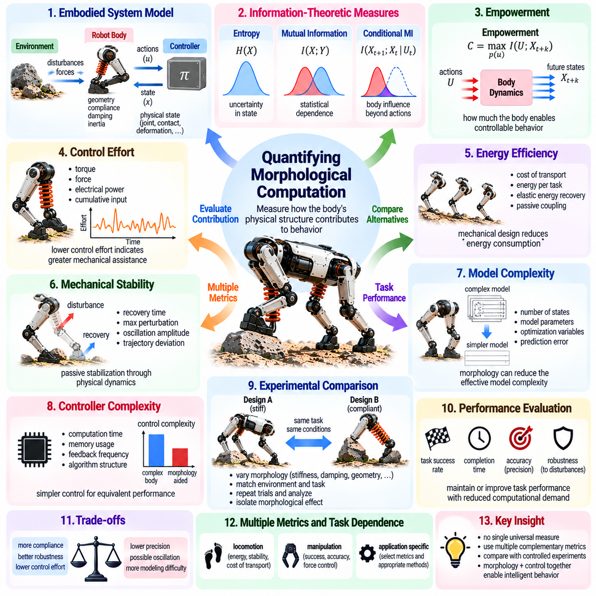{width="7.268055555555556in" height="7.268055555555556in"}

형태적 연산의 정량화(Quantifying Morphological Computation)는 로봇의 물리적 구조(Physical Structure)가 다른 경우라면 계산적 제어(Computational Control)를 필요로 할 행동(Behavior)에 얼마나 기여하는지를 측정하는 과정이다. 핵심 과제(Central Challenge)는 신체 동역학(Body Dynamics)의 영향을 제어기(Controller) 및 환경적 상호작용(Environmental Interaction)의 영향과 구분하는 것이다. 정량적 방법(Quantitative Method)은 기계적 특성(Mechanical Properties)이 움직임(Movement)을 형성하고 반응(Response)을 안정화하며 명시적인 정보 처리(Explicit Information Processing)의 필요성을 줄이는 방식을 식별하고자 한다.

형태적 연산(Morphological Computation)은 단일한 보편적 측정값(Universal Measurement)으로 충분히 표현할 수 없다. 그 기여도(Contribution)는 작업(Task), 물리적 시스템(Physical System), 작동 조건(Operating Conditions), 연산의 정의(Definition of Computation)에 따라 달라진다. 유연한 메커니즘(Compliant Mechanism)은 접촉 조절(Contact Regulation)을 단순화하는 반면 정밀한 위치 결정(Precise Positioning)을 복잡하게 만들 수 있다. 따라서 평가(Evaluation)에는 정보 처리(Information Processing), 제어 부담(Control Effort), 기계적 행동(Mechanical Behavior), 작업 성능(Task Performance)을 포괄하는 여러 상호보완적 측정 지표(Complementary Measures)가 필요하다.

유용한 출발점은 체화 시스템(Embodied System)을 상태(State), 제어 행동(Control Action), 환경적 상호작용(Environmental Interaction)을 통해 모델링(Modeling)하는 것이다. 상태에는 관절 위치(Joint Position), 속도(Velocity), 접촉력(Contact Force), 변형 변수(Deformation Variable)가 포함될 수 있다. 제어 행동은 액추에이터 명령(Actuator Command)을 나타내며, 외부 영향(External Influence)은 외란(Disturbance)과 환경적 힘(Environmental Force)을 설명한다. 이러한 변수들이 시간에 따라 어떻게 변화하는지 관찰하면 물리적 동역학(Physical Dynamics)이 행동에 기여하는 정도를 식별하는 데 도움이 된다.

정보 이론(Information Theory)은 형태적 연산(Morphological Computation)을 분석하기 위한 하나의 체계(Framework)를 제공한다. 엔트로피(Entropy)는 변수(Variable)의 불확실성(Uncertainty)을 측정하며, 상호정보량(Mutual Information)은 변수 사이의 통계적 의존성(Statistical Dependence)을 측정한다. 연구자는 미래의 물리적 상태(Future Physical State)가 현재 신체 상태(Current Body State), 행동(Action), 환경 조건(Environmental Condition)에 얼마나 강하게 의존하는지 조사할 수 있다. 이러한 관계는 기계적 동역학(Mechanical Dynamics)과 능동 제어(Active Control) 사이에 정보(Information)가 어떻게 분산되는지 이해하는 데 도움을 준다.

조건부 상호정보량(Conditional Mutual Information)은 상태 전이(State Transition)에 대한 서로 다른 영향(Influence)을 구분하는 데 도움이 될 수 있다. 예를 들어 적용된 행동(Applied Action)을 조건으로 고려하면서 미래 상태(Future State)가 현재 상태(Current State)에 얼마나 의존하는지 조사할 수 있다. 강한 의존성(Strong Dependence)은 기존의 물리적 동역학(Physical Dynamics)이 후속 행동(Subsequent Behavior)에 상당히 기여한다는 것을 나타낼 수 있다. 그러나 통계적 의존성(Statistical Dependence)만으로 신체(Body)가 유용한 연산(Useful Computation)을 수행하거나 성능 향상(Improved Performance)의 원인이 된다는 사실을 입증할 수는 없다.

정보 이론적 접근 방식(Information-Theoretic Approach) 중 하나는 제어 입력(Control Input)에 대한 물리적 상태 전이(Physical State Transition)의 영향을 측정한다. 행동(Action)을 고려한 이후에도 이전 물리적 상태(Previous Physical State)로부터 미래 상태(Future State)를 높은 정확도로 예측할 수 있다면 시스템은 상당한 자율 동역학(Autonomous Dynamics)을 나타낼 수 있다. 다른 정식화(Alternative Formulation)는 행동이 상태 전이를 얼마나 강하게 결정하는지 조사한다. 이러한 측정 방법은 체화(Embodiment)의 서로 다른 측면을 포착하므로 상호 교환 가능한 지표(Interchangeable Metric)로 취급해서는 안 된다.

역량성(Empowerment)이라는 개념은 체화된 정보 처리(Embodied Information Processing)를 이해하는 또 다른 관점을 제공한다. 역량성은 일반적으로 채널 용량 정식화(Channel-Capacity Formulation)를 통해 에이전트(Agent)의 행동(Action)이 미래 상태(Future State)에 미칠 수 있는 잠재적 영향력(Potential Influence)을 측정한다. 형태(Morphology)는 가능한 상태 전이(Possible State Transition)를 제약하거나 가능하게 함으로써 이 값에 영향을 미친다. 유리한 기계적 특성(Favorable Mechanical Properties)을 가진 신체는 제어 가능한 가능성(Controllable Possibilities)을 증가시킬 수 있지만 역량성 자체가 형태적 연산의 직접적인 측정값(Direct Measure)은 아니다.

제어 부담(Control Effort)은 기계적 보조(Mechanical Assistance)를 측정하는 실용적인 방법을 제공한다. 연구자는 작업 수행 중 액추에이터 토크(Actuator Torque), 힘(Force), 전력(Electrical Power), 누적 제어 입력(Cumulative Control Input)을 정량화할 수 있다. 형태적 수정(Morphological Modification)이 동등한 성능(Equivalent Performance)을 유지하면서 액추에이터 작동 부담(Actuator Effort)을 줄인다면 이는 유용한 기계적 기여(Useful Mechanical Contribution)의 증거가 된다. 이러한 비교에서는 질량(Mass), 마찰(Friction), 속도(Speed), 작동 조건(Operating Conditions)의 차이를 고려해야 한다.

에너지 효율성(Energy Efficiency)은 이동(Locomotion)과 조작(Manipulation)에서 특히 중요하다. 수송 비용(Cost of Transport)은 에너지 소비(Energy Expenditure)를 운반되는 중량(Transported Weight)과 이동 거리(Distance)에 연관시키며, 조작 효율성(Manipulation Efficiency)은 완료된 작업당 에너지(Energy per Completed Task)를 고려할 수 있다. 탄성 에너지 회수(Elastic Energy Recovery)와 수동적 기계 결합(Passive Mechanical Coupling)은 이러한 지표를 개선할 수 있다. 그러나 에너지 소비(Energy Consumption)가 낮다고 해서 반드시 형태적 연산(Morphological Computation)이 더 크다는 의미는 아니다. 액추에이터 효율(Actuator Efficiency)과 제어 전략(Control Strategy)도 영향을 미치기 때문이다.

기계적 안정성(Mechanical Stability)은 측정 가능한 또 다른 차원(Measurable Dimension)을 제공한다. 외란 복원 시간(Disturbance Recovery Time), 최대 복원 가능 교란(Maximum Recoverable Perturbation), 진동 진폭(Oscillation Amplitude), 궤적 편차(Trajectory Deviation)는 시스템이 외부 영향(External Influence)에 어떻게 반응하는지를 설명한다. 추가적인 보정 명령(Corrective Command) 없이 외란을 감쇠하는 형태(Morphology)는 수동 안정화(Passive Stabilization)를 제공할 수 있다. 통제된 실험(Controlled Experiment)은 이러한 효과를 능동 피드백(Active Feedback)에 의해 발생하는 개선 효과와 구분할 수 있다.

모델 복잡도(Model Complexity)는 형태(Morphology)가 제어에 필요한 계산적 표현(Computational Representation)을 단순화하는지 보여줄 수 있다. 관련 지표(Indicator)에는 모델링된 상태(Modelled State)의 수, 필요한 매개변수(Required Parameter), 최적화 변수(Optimization Variable), 예측 오차(Prediction Error)가 포함된다. 기계적 제약(Mechanical Constraint)은 움직임의 유효 차원(Effective Dimensionality)을 줄일 수 있다. 그러나 유연하거나 비선형적인 구조(Compliant or Nonlinear Structure)는 특정 물리적 상호작용(Physical Interaction)을 단순화하면서도 모델링 난이도(Modeling Difficulty)를 높일 수 있다.

제어기 복잡도(Controller Complexity)는 계산 시간(Computational Time), 메모리 소비(Memory Consumption), 피드백 주파수(Feedback Frequency), 알고리즘 구조(Algorithmic Structure)를 통해 평가할 수 있다. 동등한 작업(Equivalent Task)을 더 단순한 제어(Simple Control)로 수행하는 로봇은 유리한 형태(Favorable Morphology)의 이점을 얻고 있을 수 있다. 그러나 제어기 구현(Controller Implementation)의 차이는 비교 결과를 왜곡할 수 있다. 신뢰할 수 있는 평가(Reliable Assessment)를 위해서는 비교 가능한 최적화 절차(Optimization Procedure), 감지 가정(Sensing Assumption), 하드웨어 성능(Hardware Capability), 성능 제약(Performance Constraint)이 필요하다.

실험적 분리(Experimental Isolation)는 성능 차이(Performance Difference)를 형태(Morphology)에 귀속시키는 데 필수적이다. 연구자는 다른 변수들을 가능한 한 일정하게 유지하면서 강성(Stiffness), 감쇠(Damping), 기하학적 구조(Geometry), 기계적 결합(Mechanical Coupling)이 서로 다른 로봇을 비교할 수 있다. 동일하게 설정된 외란(Matched Disturbance)과 작업(Task)에 대해 반복 시험(Repeated Trial)을 수행하면 재현성(Reproducibility)을 확립하는 데 도움이 된다. 하드웨어 차이(Hardware Difference)를 완전히 분리할 수 없는 경우에는 그 영향을 무시하지 않고 문서화(Document)해야 한다.

궁극적으로 형태적 연산의 정량화(Quantifying Morphological Computation)를 위해서는 정보 이론적 분석(Information-Theoretic Analysis)을 기계적 측정(Mechanical Measurement) 및 작업 수준 평가(Task-Level Evaluation)와 결합해야 한다. 어떤 단일 지표(Single Metric)도 로봇의 신체(Body)에 얼마나 많은 지능(Intelligence)이 존재하는지를 완전히 규명할 수 없다. 강력한 증거(Strong Evidence)는 식별 가능한 물리적 메커니즘(Identifiable Physical Mechanism)이 통제된 조건(Controlled Conditions)에서 행동(Behavior)을 개선하고 특정 제어 요구사항(Control Demands)을 줄이거나 강건성(Robustness)을 높인다는 사실을 입증하는 데서 얻어진다.

## 02.11. Morphological Computation Example [w/Code]

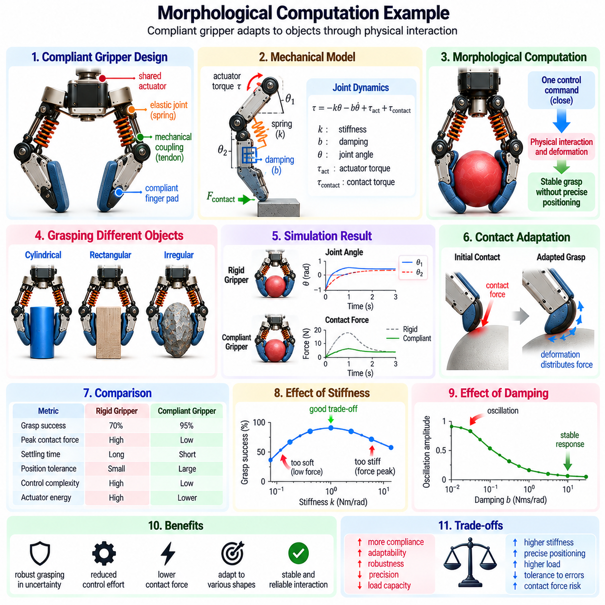{width="7.268055555555556in" height="7.268055555555556in"}

형태적 연산(Morphological Computation)의 실제 사례는 정밀한 손가락 위치 결정(Precise Finger Positioning) 없이도 물체에 적응하는 유연한 로봇 그리퍼(Compliant Robotic Gripper)를 통해 설명할 수 있다. 이 그리퍼(Gripper)는 유연한 관절(Flexible Joint), 탄성 요소(Elastic Element), 기계적으로 결합된 손가락(Mechanically Coupled Finger)을 이용하여 접촉력(Contact Force)을 분산한다. 물리적 구조(Physical Structure)가 적응 과정(Adaptation Process)의 일부를 수행하므로 비교적 단순한 제어기(Simple Controller)로도 서로 다른 물체 형상(Object Geometry)에 대해 안정적인 파지(Stable Grasp)를 구현할 수 있다.

원통형(Cylindrical), 직사각형(Rectangular), 불규칙한 형상(Irregular Shape)의 물체를 취급하도록 설계된 양지형 로봇 그리퍼(Two-Finger Robotic Gripper)를 고려해 보자. 각 손가락(Finger)은 탄성 요소(Elastic Element)로 연결된 두 개의 회전 관절(Rotational Joint)을 포함하며, 공유 액추에이터(Shared Actuator)가 닫힘 운동(Closing Motion)을 생성한다. 손가락은 처음에 공통 명령(Common Command)에 따라 물체를 향해 움직인다. 접촉(Contact)이 발생하면 관절 순응성(Joint Compliance)에 의해 손가락 분절(Finger Segment)이 물체의 표면 기하학(Surface Geometry)에 따라 위치를 조정할 수 있다.

기존의 강체 그리퍼(Conventional Rigid Gripper)에서는 적절한 손가락 궤적(Finger Trajectory)을 결정하기 위해 정확한 물체 기하학(Object Geometry)과 접촉 위치(Contact Location)가 필요할 수 있다. 위치 오차(Position Error)는 과도한 힘(Excessive Force)이나 불안정한 접촉(Unstable Contact)을 발생시킬 수 있다. 유연한 그리퍼(Compliant Gripper)는 변형(Deformation)을 통해 중간 수준의 기하학적 불확실성(Geometric Uncertainty)을 수용하므로 이러한 요구사항을 줄인다. 모든 관절 보정(Joint Correction)을 계산하는 대신 제어기(Controller)는 액추에이터 운동(Actuator Motion)이나 힘(Force)을 조절하고, 기계적 특성(Mechanical Properties)이 국부적인 접촉 적응(Local Contact Adaptation)을 결정한다.

이 사례는 관절 각도(Joint Angle), 강성 계수(Stiffness Coefficient), 감쇠 계수(Damping Coefficient), 액추에이터 입력(Actuator Input)을 포함하는 단순화된 기계적 모델(Simplified Mechanical Model)로 표현할 수 있다. 각 손가락 관절(Finger Joint)은 구동(Actuation), 탄성 복원력(Elastic Restoring Force), 감쇠(Damping), 물체 접촉(Object Contact)에서 발생하는 토크(Torque)를 받는다. 결과적인 움직임(Resulting Motion)은 이러한 기여 요소(Contribution) 사이의 균형에 따라 달라진다. 이러한 정식화(Formulation)는 기계적 동역학(Mechanical Dynamics)이 상호작용 중 그리퍼 구성(Gripper Configuration)을 결정하는 데 직접 참여한다는 것을 보여준다.

관절 탄성(Joint Elasticity)은 평형 위치(Equilibrium Position)로부터의 각변위(Angular Displacement)에 비례하는 복원 토크(Restoring Torque)를 통해 모델링할 수 있다. 선형 비틀림 스프링(Linear Torsional Spring)의 경우 토크(Torque)는 강성(Stiffness)에 각변위(Angular Displacement)를 곱한 값의 음수와 같다는 관계로 표현된다. 이러한 복원 작용(Restoring Action)은 관절이 선호하는 구성(Preferred Configuration)으로 돌아가도록 유도한다. 파지(Grasping) 과정에서 접촉력(Contact Force)은 이러한 움직임에 반대 방향으로 작용하며, 물체 기하학(Object Geometry)에 의해 부분적으로 결정되는 평형 상태(Equilibrium State)를 형성한다.

기계적 감쇠(Mechanical Damping)는 각속도(Angular Velocity)에 비례하면서 운동 방향과 반대로 작용하는 토크(Torque)로 표현할 수 있다. 감쇠는 접촉 후 진동(Oscillation)을 줄이고 손가락이 안정적인 구성(Stable Configuration)에 도달하도록 돕는다. 탄성 효과(Elastic Effect)와 감쇠 효과(Damping Effect)를 결합하면 중간 수준의 외란(Disturbance)을 수용하는 유연한 응답(Compliant Response)이 생성된다. 과도한 강성(Excessive Stiffness)은 접촉력(Contact Force)을 증가시키고, 부족한 감쇠(Insufficient Damping)는 장시간 지속되는 진동(Prolonged Vibration)을 유발할 수 있으므로 적절한 매개변수 선택(Parameter Selection)이 중요하다.

공유 액추에이터(Shared Actuator)는 손가락 움직임(Finger Movement) 사이에 기계적 결합(Mechanical Coupling)을 형성한다. 접촉 전에는 두 손가락이 비교적 대칭적인 패턴(Symmetric Pattern)으로 닫힐 수 있다. 한 손가락이 물체에 먼저 접촉하면 해당 손가락의 움직임은 제약(Constraint)을 받지만 나머지 메커니즘(Mechanism)은 계속 적응한다. 힘줄 배치(Tendon Routing)와 차동 기구 설계(Differential Design)에 따라 액추에이터 변위(Actuator Displacement)나 힘(Force)이 재분배될 수 있다. 이를 통해 모든 관절에 독립적인 위치 명령(Independent Position Command)을 제공하지 않고도 형상 적응(Shape Adaptation)이 가능해진다.

단순화된 시뮬레이션(Simplified Simulation)은 관절 동역학(Joint Dynamics)의 수치 적분(Numerical Integration)을 이용하여 이러한 효과를 보여줄 수 있다. 모델(Model)은 액추에이터 토크(Actuator Torque), 스프링 힘(Spring Force), 감쇠(Damping), 접촉 반력(Contact Reaction)에 따라 관절 각도(Joint Angle)와 각속도(Angular Velocity)를 갱신한다. 접촉(Contact)은 손가락 표면(Finger Surface)이 이상화된 물체 경계(Idealized Object Boundary)를 침투할 때 복원력(Restoring Force)을 생성하는 유연한 페널티 모델(Compliant Penalty Model)로 근사할 수 있다. 이러한 근사(Approximation)는 개념적 분석(Conceptual Analysis)을 지원하지만 실제 접촉 역학(Real Contact Mechanics)의 모든 측면을 표현하지는 못한다.

시뮬레이션(Simulation)은 그리퍼(Gripper)가 열린 상태에서 물체(Object)가 손가락 사이에 배치된 조건으로 시작한다. 닫힘 명령(Closing Command)을 적용하면서 시스템은 관절 궤적(Joint Trajectory), 접촉력(Contact Force), 액추에이터 작동 부담(Actuator Effort)을 기록한다. 손가락이 물체에 접근하는 동안 움직임은 기계적 결합(Mechanical Coupling)을 따른다. 접촉이 시작되면 탄성 변형(Elastic Deformation)이 손가락 구성(Finger Configuration)을 재분배하고, 메커니즘(Mechanism)이 안정적인 파지(Stable Grasp) 또는 기계적 한계(Mechanical Limit)에 도달할 때까지 이러한 과정이 지속된다.

형태적 연산(Morphological Computation)을 평가하기 위해 유연한 그리퍼(Compliant Gripper)를 강체 설계(Rigid Design) 또는 독립 제어형 기준 설계(Independently Controlled Reference Design)와 비교할 수 있다. 두 시스템은 동일하게 설정된 물체 위치(Object Position)와 하중 조건(Loading Condition)에서 동등한 파지 작업(Equivalent Grasping Task)을 수행해야 한다. 관련 측정 지표(Measurement Metrics)에는 파지 성공률(Grasp Success), 최대 접촉력(Peak Contact Force), 안정화 시간(Settling Time), 액추에이터 에너지(Actuator Energy), 제어 복잡도(Control Complexity)가 포함된다. 메커니즘마다 서로 다른 능력(Capability)을 가질 수 있으므로 차이를 신중하게 해석해야 한다.

순응성(Compliance)의 예상되는 이점 중 하나는 작은 위치 오차(Positioning Error)에 대한 민감도(Sensitivity)를 줄이는 것이다. 물체가 기준 위치(Nominal Location)에서 약간 이동하더라도 손가락은 정밀한 기하학적 보정(Precise Geometric Correction) 없이 변형되고 접촉을 유지할 수 있다. 따라서 제어기(Controller)는 덜 상세한 물체 정보(Object Information)를 이용하여 작동할 수 있다. 그러나 이러한 이점은 사용 가능한 관절 운동 범위(Available Joint Travel), 접촉 마찰(Contact Friction), 강성(Stiffness), 충분한 유지력(Holding Force)을 생성하는 그리퍼의 능력에 의해 제한된다.

두 번째 이점은 초기 접촉(Initial Contact) 중 힘 조절(Force Regulation)과 관련된다. 탄성 요소(Elastic Element)는 강체 메커니즘(Rigid Mechanism)에서 큰 힘을 발생시킬 수 있는 변위(Displacement)의 일부를 흡수한다. 감쇠(Damping)는 과도 응답(Transient Response)을 완화하고 진동(Oscillation)을 줄일 수 있다. 그러나 유연한 메커니즘(Compliant Mechanism)이 자동으로 안전한 접촉(Safe Contact)을 보장하는 것은 아니다. 액추에이터 명령(Actuator Command), 접근 속도(Approach Velocity), 저장된 탄성 에너지(Stored Elastic Energy), 기계적 스토퍼(Mechanical Stop)는 여전히 최대 힘(Maximum Force)을 결정하는 중요한 요소이다.

이 실험(Experiment)은 순응성(Compliance)과 정밀도(Precision) 사이의 상충관계(Trade-Off)도 조사할 수 있다. 낮은 강성(Lower Stiffness)은 일반적으로 더 큰 기하학적 적응(Geometric Adaptation)을 허용하지만 물체 변위(Object Displacement)를 증가시키거나 위치 반복 정밀도(Positional Repeatability)를 감소시킬 수 있다. 높은 강성(Higher Stiffness)은 변형 저항(Resistance to Deformation)을 개선하지만 정렬 오차(Alignment Error)에 대한 민감도(Sensitivity)를 증가시킬 수 있다. 강성(Stiffness)과 감쇠(Damping)를 변화시킴으로써 엔지니어는 파지 강건성(Grasp Robustness), 안정화 행동(Settling Behavior), 위치 결정 정확도(Positioning Accuracy) 사이의 균형을 유지하는 작동 영역(Operating Region)을 식별할 수 있다.

정보 이론적 분석(Information-Theoretic Analysis)은 시스템을 조사하는 추가적인 방법을 제공한다. 반복 시험(Repeated Trial)을 통해 관절 상태(Joint State), 액추에이터 명령(Actuator Command), 접촉 측정값(Contact Measurement)을 기록할 수 있다. 조건부 상호정보량(Conditional Mutual Information)은 액추에이터 입력(Actuator Input)을 고려한 이후에도 미래 관절 구성(Future Joint Configuration)이 이전 기계적 상태(Previous Mechanical State)에 얼마나 강하게 의존하는지 보여줄 수 있다. 이러한 결과는 통계적 관계(Statistical Relationship)를 특성화하지만 유용한 연산(Useful Computation)이 형태(Morphology) 내부에서 발생한다는 사실을 독립적으로 입증할 수는 없다.

이 사례는 형태적 연산(Morphological Computation)이 기계적 설계(Mechanical Design), 제어(Control), 환경적 접촉(Environmental Contact) 사이의 상호작용을 통해 나타난다는 것을 보여준다. 그리퍼의 기하학적 구조(Geometry), 탄성(Elasticity), 감쇠(Damping), 결합(Coupling)은 상세한 계산적 보정(Computational Correction)이 필요하기 전에 파지 행동(Grasping Behavior)의 일부를 결정한다. 그러나 그 효과는 통제된 비교 실험(Controlled Comparison)을 통해 검증해야 한다. 여기서 얻을 수 있는 더 넓은 교훈은 신중하게 설계된 물리적 구조(Physical Structure)가 감지(Sensing), 계획(Planning), 적응형 제어(Adaptive Control)의 필요성을 유지하면서도 특정 로봇 작업(Robotic Task)을 단순화할 수 있다는 것이다.
