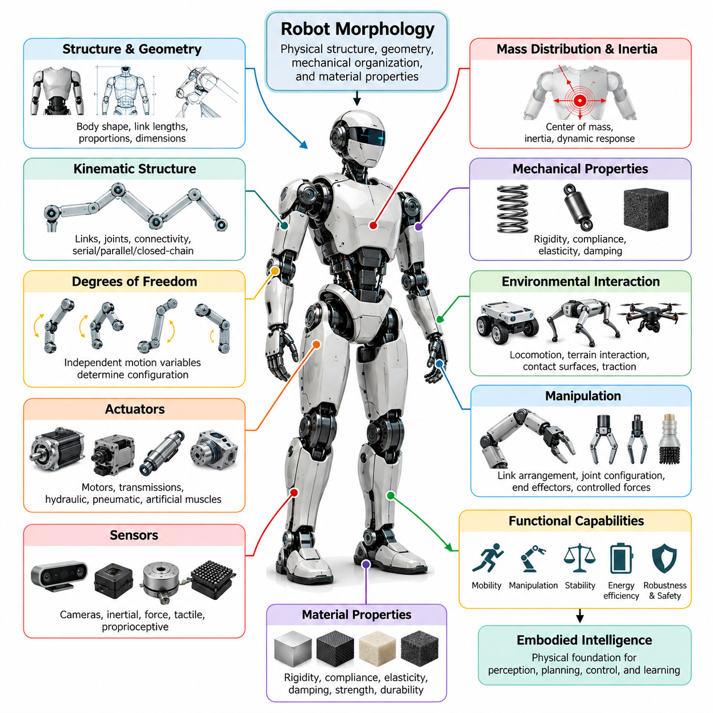
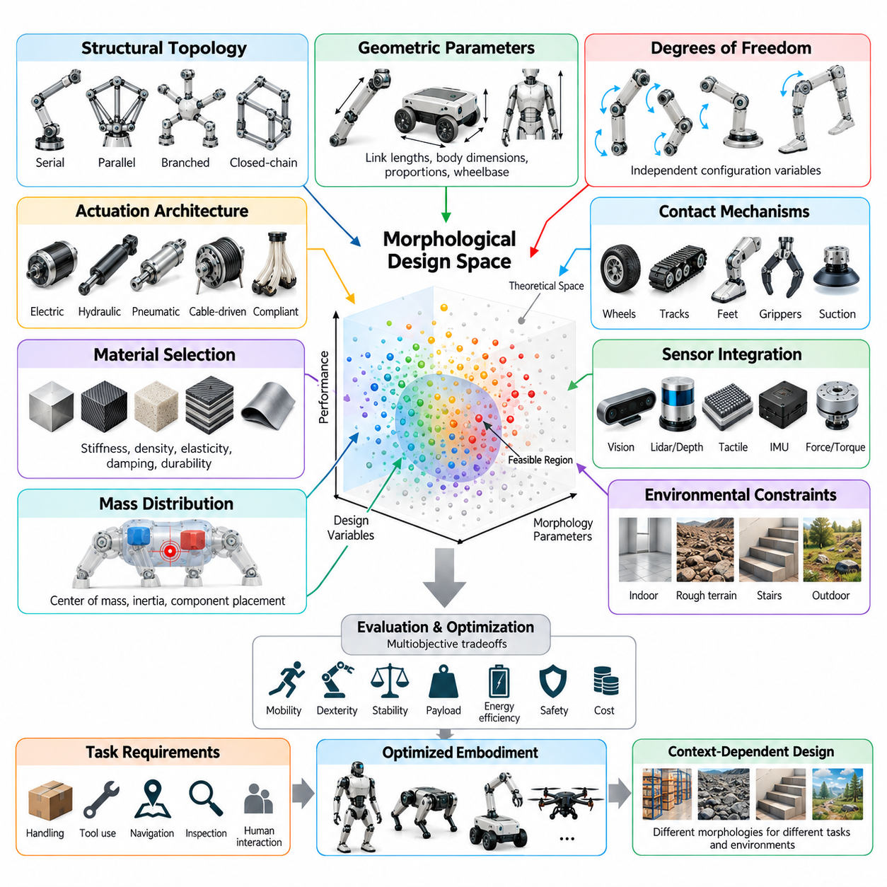
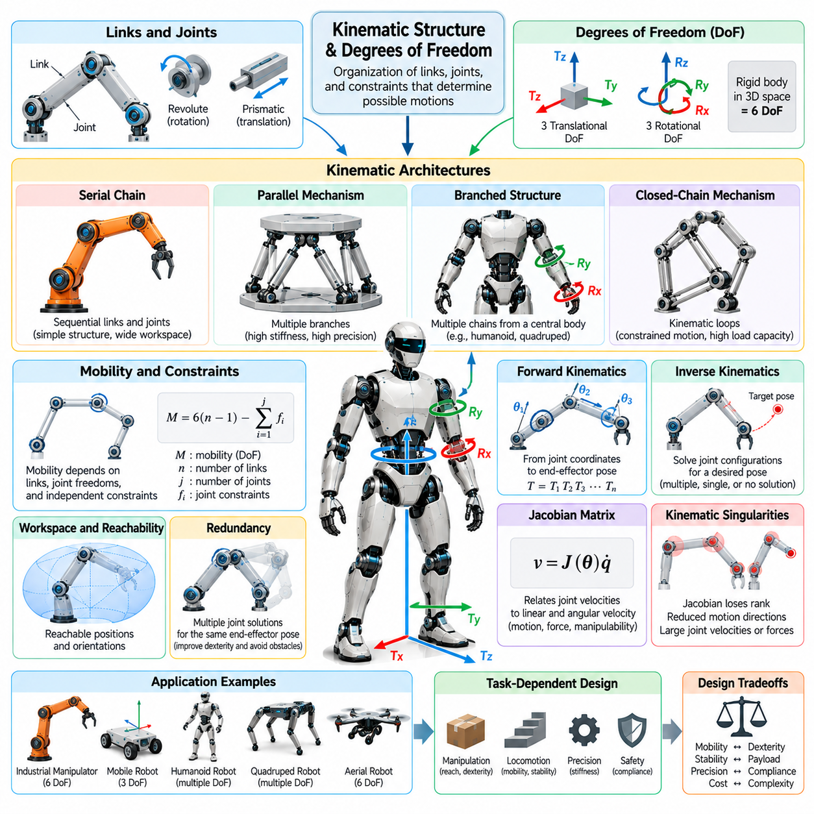
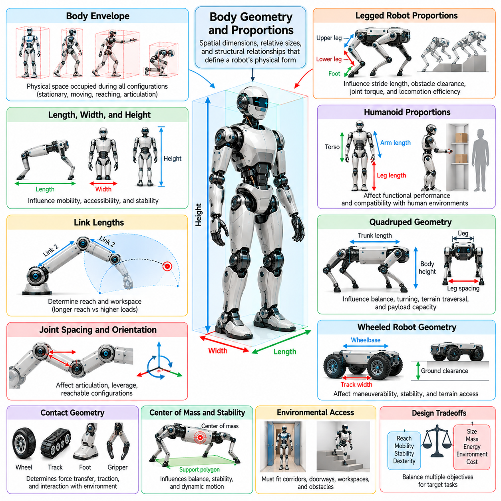
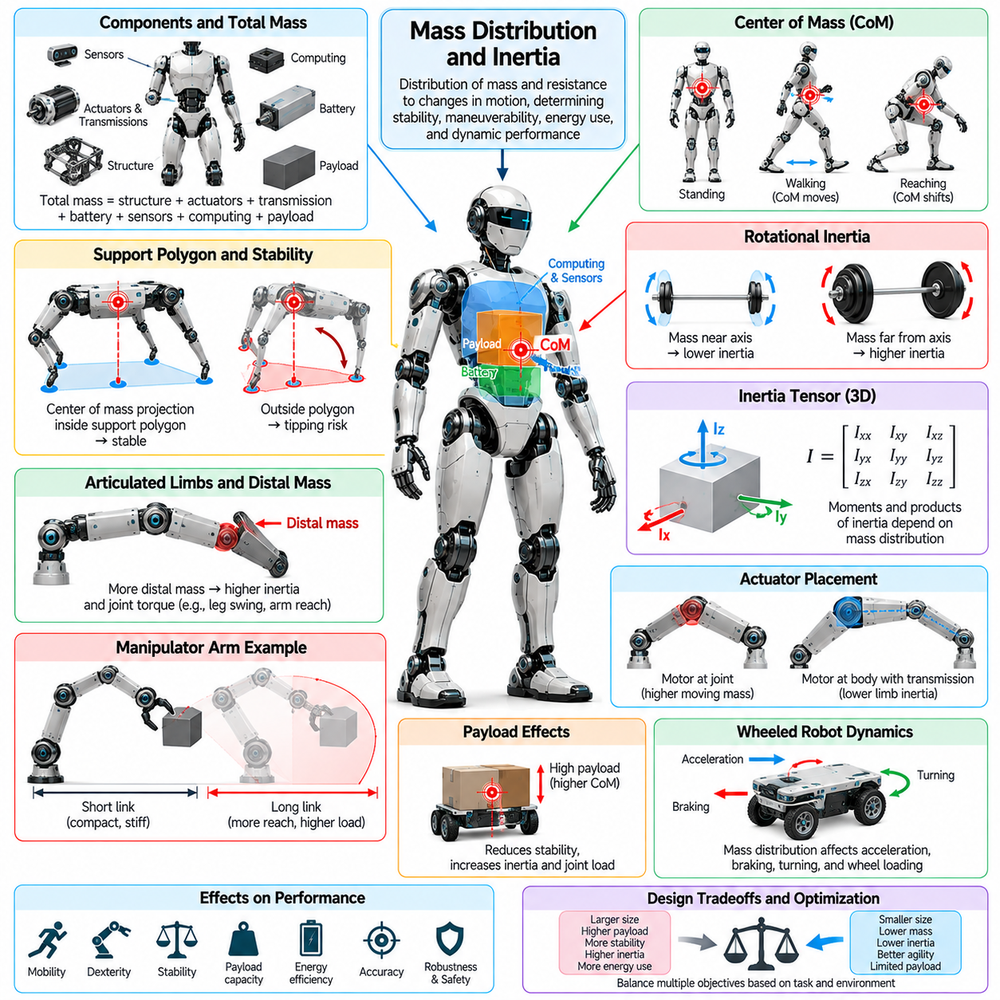
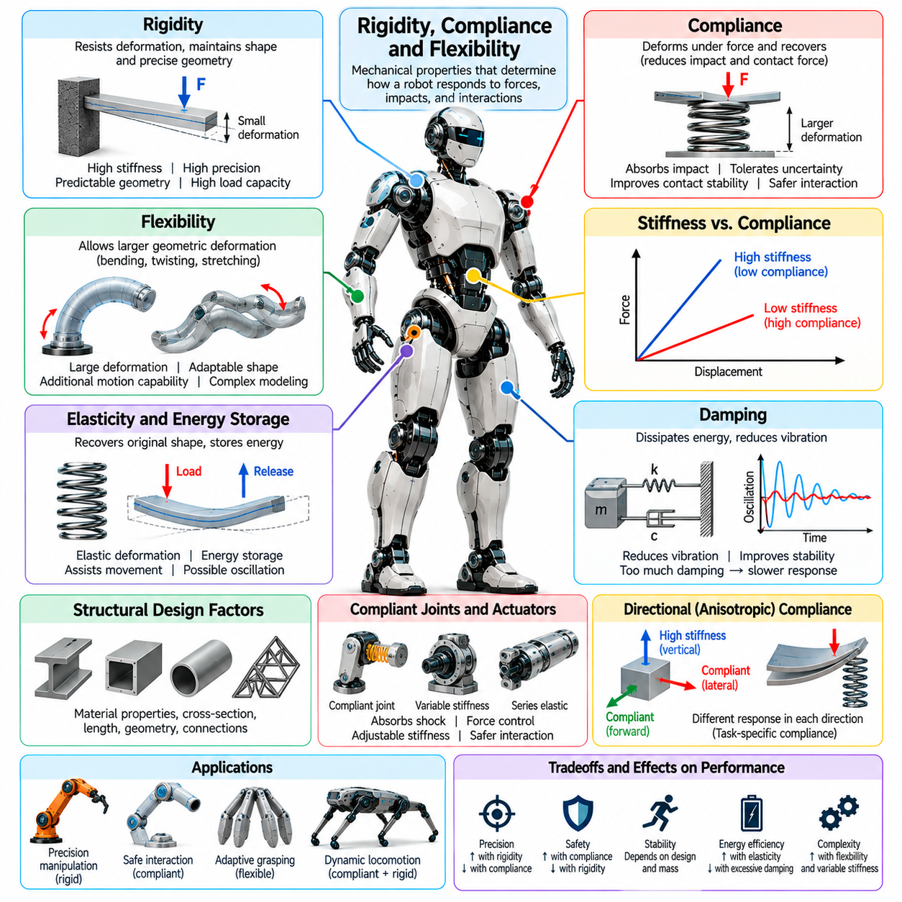
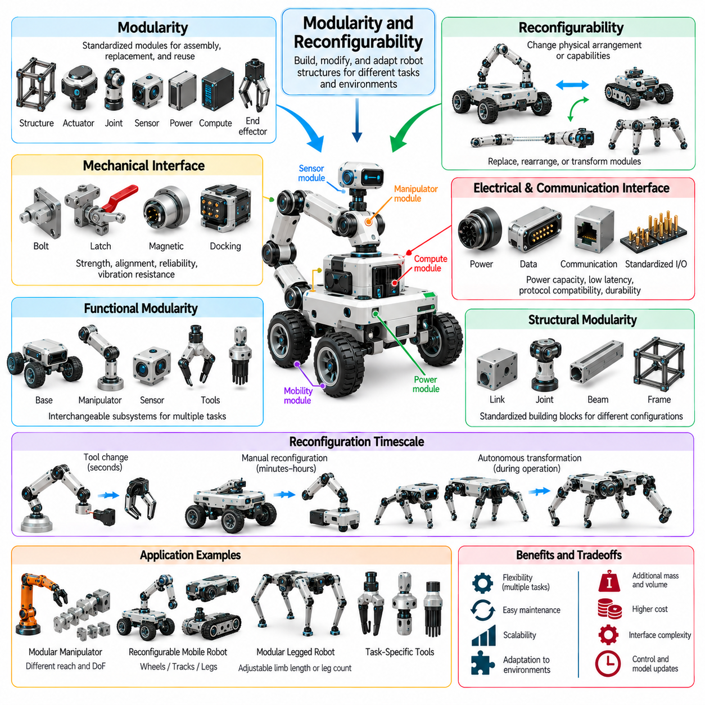
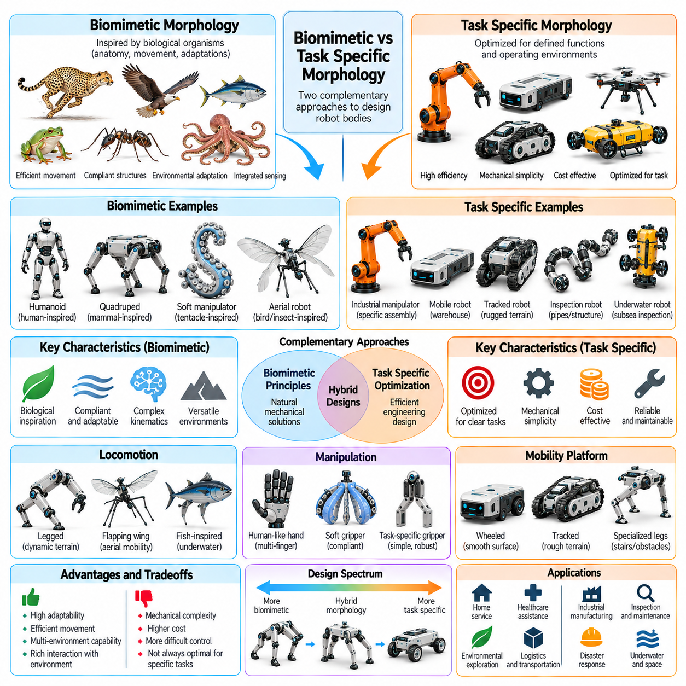
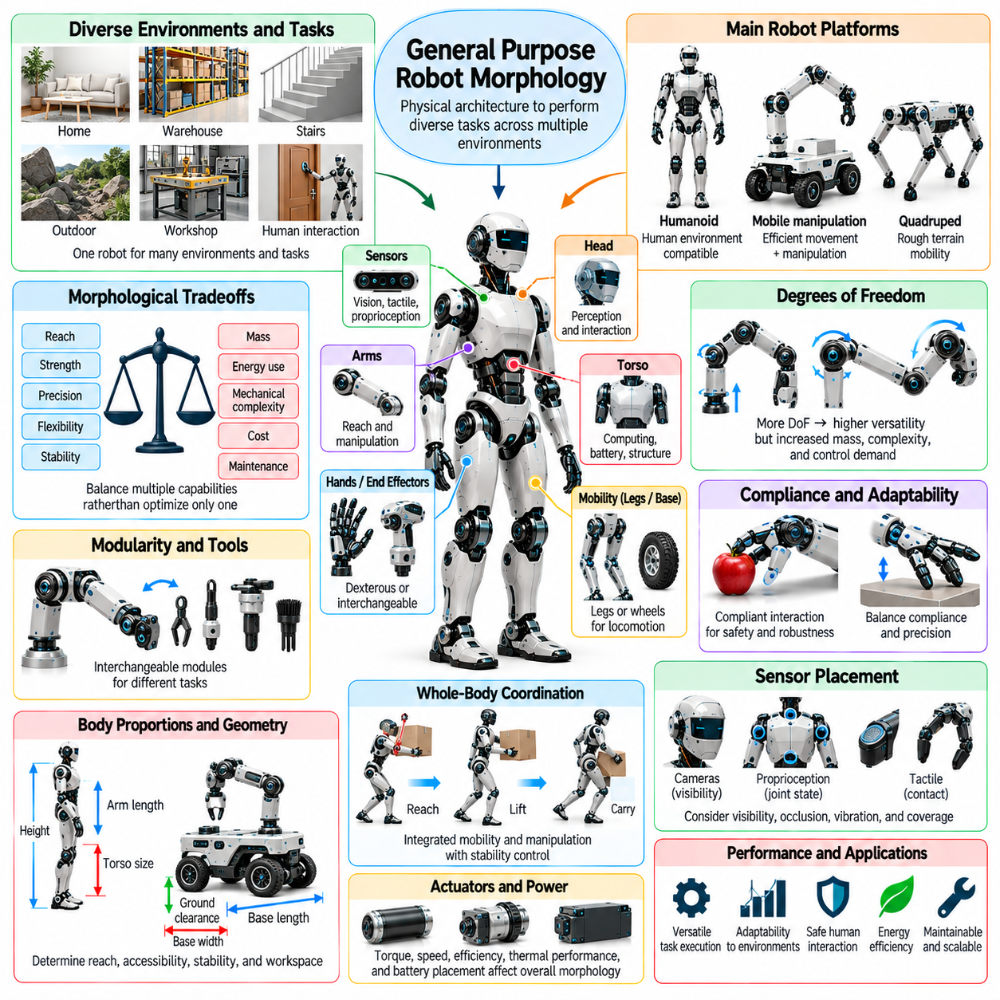
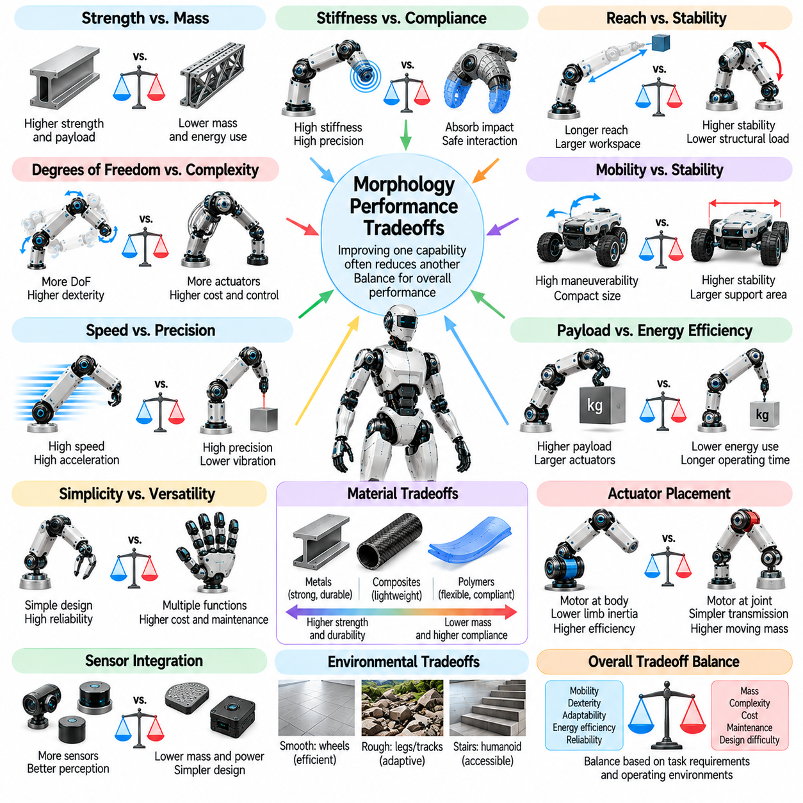

**Volume 03. Embodiment and Morphology**

# Chapter 03. Robot Morphology

## 03.01. Defining Robot Morphology

{width="7.268055555555556in" height="7.268055555555556in"}

Robot morphology refers to the physical structure, geometric configuration, mechanical organization, and material properties that define a robot\'s body and determine how it interacts with the environment. It encompasses the arrangement of links, joints, actuators, sensors, supporting structures, and contact surfaces. Morphology establishes the physical capabilities and limitations within which perception, planning, control, and learning operate.

In robotics, morphology extends beyond external appearance or mechanical shape. It describes the organization of physical components and the relationships among them, including kinematic connectivity, degrees of freedom, structural stiffness, mass distribution, and actuator placement. These characteristics determine how forces and motions propagate through the body, influencing mobility, manipulation, stability, energy consumption, and environmental interaction.

Robot morphology can be understood as the physical foundation of embodied intelligence. An intelligent controller does not operate independently of its mechanical platform because every command must be translated into physical motion through the robot\'s structure. The body\'s geometry, dynamics, and material characteristics influence which actions are possible, how efficiently they can be performed, and how reliably the robot responds to disturbances.

A fundamental distinction exists between morphology and control architecture. Morphology defines the physical mechanisms available for generating motion and interacting with the world, while control determines how those mechanisms are coordinated. Although sophisticated algorithms can improve performance, they cannot completely overcome structural limitations such as insufficient reach, inadequate traction, restricted joint motion, or unfavorable mass distribution.

The kinematic structure of a robot is one of the most important elements of morphology. It describes how rigid or deformable bodies are connected through joints and other mechanical constraints. Serial, parallel, branched, and closed-chain configurations provide different motion capabilities. Their arrangement determines reachable workspace, motion redundancy, mechanical constraints, and the complexity of coordinating movement across multiple components.

Degrees of freedom describe the independent variables required to specify a robot\'s configuration. A manipulator with multiple rotational joints can position and orient its end effector within a workspace, while a mobile robot may require additional coordinates to represent its position and heading. Increasing the number of degrees of freedom can improve dexterity and adaptability, but it also introduces additional mechanical, sensing, and control complexity.

Body geometry and proportions strongly influence robotic functionality. Link lengths, wheelbase dimensions, limb proportions, body width, and ground clearance determine how a robot navigates physical spaces and interacts with surrounding objects. A compact mobile platform may maneuver effectively through narrow passages, whereas a larger platform may accommodate heavier payloads and wider support structures at the expense of accessibility.

Mass distribution and inertia are equally fundamental morphological characteristics. The location of heavy components affects the center of mass, rotational resistance, and dynamic response of the robot. Concentrating mass near the body center can reduce limb inertia in legged systems, while positioning payloads improperly may reduce stability. These relationships directly influence acceleration, balance, actuator requirements, and energy efficiency.

Mechanical properties such as rigidity, compliance, elasticity, and damping determine how the robot responds to external forces. Rigid structures can provide precise positioning and efficient force transmission, while compliant elements can absorb impacts and accommodate uncertain contact conditions. Appropriate combinations of these properties allow morphology to contribute to stability, robustness, and safe physical interaction without relying exclusively on active control.

Actuator configuration also forms an essential part of robot morphology. Motors, transmissions, hydraulic systems, pneumatic mechanisms, and artificial muscles differ in force generation, speed, responsiveness, and integration requirements. Their locations and mechanical connections influence joint torque, transmission losses, thermal behavior, and overall body dynamics. Actuator selection must therefore be considered together with structural design rather than as an isolated component decision.

Sensor placement contributes to the functional morphology of an embodied system. Cameras, inertial sensors, force sensors, tactile arrays, and proprioceptive devices acquire information from positions determined by the physical body. Their locations affect visibility, measurement sensitivity, contact awareness, and observability of motion. Consequently, morphology influences not only how a robot acts but also how effectively it perceives its own state and surroundings.

The relationship between morphology and environmental interaction becomes especially apparent during locomotion. Wheeled robots depend on wheel arrangement, traction, and terrain clearance, whereas legged robots rely on limb geometry, foot placement, and coordinated ground contact. Aerial robots require propulsion arrangements and aerodynamic structures appropriate for flight. Each morphology establishes distinct movement capabilities and environmental constraints.

Manipulation illustrates another important morphological dependency. Robot arms require suitable link arrangements, joint configurations, and end effectors to reach objects and apply controlled forces. Grippers with rigid fingers may offer precise positioning, while compliant grippers can adapt to irregular object shapes. The physical structure determines available grasp configurations, contact stability, force distribution, and the range of objects that can be handled.

Robot morphology may be fixed, adjustable, or reconfigurable. Fixed morphology provides a stable mechanical architecture optimized for anticipated tasks, whereas adjustable mechanisms can modify dimensions, posture, or contact configurations during operation. Reconfigurable robots extend this principle by changing their structural organization. Such capabilities can improve versatility but introduce additional mechanical complexity, coordination requirements, and reliability challenges.

Biological organisms provide valuable references for understanding morphological diversity. Humans, quadrupeds, birds, insects, and aquatic animals demonstrate how different body structures support specialized forms of locomotion and manipulation. Robotics can adopt selected biological principles without reproducing entire organisms. Biomimetic morphology emphasizes useful biological mechanisms, whereas task-specific engineering may favor simpler structures that achieve equivalent functional objectives.

Morphology also influences the computational requirements of intelligent behavior. Well-designed mechanical structures can naturally constrain motion, absorb disturbances, and stabilize interactions through passive physical dynamics. These properties may reduce the burden on active feedback controllers. This relationship connects robot morphology with morphological computation, in which physical structure and material behavior contribute directly to the overall information-processing and control process.

Within Physical AI, morphology affects the relationship between learned policies and executable actions. A policy trained for a particular joint configuration may not transfer directly to another robot with different dimensions, actuation limits, or contact mechanisms. Effective cross-embodiment learning therefore requires representations that account for physical differences. Morphology-aware models can help associate abstract task objectives with the action capabilities of specific robotic bodies.

Morphological design involves balancing competing engineering objectives rather than maximizing a single performance measure. Increasing structural rigidity may improve precision while reducing impact tolerance. Longer limbs may expand reach but increase inertia and torque requirements. Additional joints may improve dexterity while raising cost, weight, and maintenance demands. These tradeoffs make morphology a multidimensional design problem involving mechanics, control, energy, and operational requirements.

The suitability of a morphology must ultimately be evaluated relative to its intended tasks and operating environment. Industrial manipulators prioritize repeatability, payload capacity, and workspace coverage, while autonomous mobile robots emphasize maneuverability and terrain compatibility. Humanoid robots may benefit from human-environment compatibility, whereas quadrupeds can exploit distributed ground contacts. No single morphological configuration is optimal for every application.

Robot morphology is therefore not merely a passive container for artificial intelligence but an active determinant of physical capability and intelligent behavior. Its structure shapes perception, motion, interaction, learning, and adaptability throughout the robotic system. Understanding morphology as an integrated combination of geometry, kinematics, dynamics, materials, actuation, and sensing provides the foundation for designing effective embodied Physical AI systems.

## 03.02. Morphological Design Space

{width="7.268055555555556in" height="7.268055555555556in"}

The morphological design space represents the complete range of physical configurations that can be considered when developing a robotic system. It includes alternative body structures, geometric proportions, joint arrangements, material properties, actuator configurations, and sensor placements. Each combination defines a potential robot embodiment with distinct capabilities, limitations, and interaction characteristics that influence its suitability for particular tasks.

Unlike a single mechanical design, the morphological design space describes a multidimensional collection of possible robot bodies. Its dimensions may include continuous variables such as link lengths, body dimensions, and mass distribution, alongside discrete choices such as joint types, limb counts, and structural topology. Exploring this space allows engineers to compare fundamentally different embodiments rather than merely adjusting the parameters of an existing platform.

The boundaries of the design space are established by physical laws, engineering feasibility, operational requirements, and available technologies. Material strength, actuator torque, manufacturing tolerances, power capacity, and environmental constraints restrict which configurations can be realized. Consequently, the theoretically imaginable design space is substantially larger than the feasible region containing robots that can be manufactured and operated reliably.

Structural topology is a fundamental dimension of morphological design. Robots may employ serial chains, parallel mechanisms, branched structures, closed kinematic loops, or combinations of these architectures. Topology determines how mechanical components connect and how motion and forces propagate through the body. Because changing topology can alter the robot\'s fundamental capabilities, topology selection often precedes detailed geometric optimization.

Geometric parameters provide another major set of design variables. Link lengths, joint spacing, body height, wheelbase, limb proportions, and contact surface dimensions determine the robot\'s physical envelope and reachable workspace. Small geometric adjustments may significantly affect maneuverability, stability, and manipulation performance. These parameters must therefore be evaluated in relation to both intended movements and environmental restrictions.

Degrees of freedom define the number of independently controllable configuration variables available to the robot. Increasing joint count can expand motion flexibility, improve obstacle avoidance, and provide alternative solutions to manipulation tasks. However, additional degrees of freedom introduce greater actuator requirements, mechanical complexity, and control coordination demands. Selecting an appropriate configuration requires balancing functional versatility against system cost and complexity.

Actuation architecture expands the design space beyond purely geometric considerations. Electric motors, hydraulic actuators, pneumatic systems, cable-driven mechanisms, and compliant actuation technologies provide different combinations of force, speed, efficiency, and responsiveness. Their placement affects structural packaging, transmission losses, and moving mass. Thus, actuator selection and mechanical morphology should be treated as coupled design decisions.

Material selection introduces stiffness, density, elasticity, damping, and durability as morphological variables. Lightweight rigid structures may support precise high-speed motion, while flexible or compliant materials can improve adaptation to uncertain contact conditions. Hybrid constructions combine materials with different mechanical properties to distribute rigidity and flexibility where needed. These choices directly influence dynamic behavior, energy efficiency, and interaction safety.

Mass distribution and inertial characteristics further differentiate possible robot configurations. Battery placement, actuator positioning, payload location, and structural reinforcement influence the center of mass and resistance to acceleration. In legged robots, reducing distal limb mass can improve swing efficiency, while mobile platforms often benefit from low centers of gravity. Morphological design must therefore consider component placement as carefully as external dimensions.

The design space also includes alternative mechanisms for environmental contact. Wheels, tracks, feet, grippers, suction devices, and compliant surfaces establish different relationships between the robot and its surroundings. Contact geometry influences traction, force transmission, manipulation stability, and terrain compatibility. A configuration optimized for smooth industrial floors may perform poorly on irregular terrain, illustrating the task-dependent nature of morphological suitability.

Sensor integration adds another dimension to morphological exploration. Camera positions, tactile sensor coverage, inertial measurement locations, and force sensing interfaces affect the information available to the control system. Sensor placement must account for visibility, mechanical protection, wiring, vibration, and physical accessibility. A mechanically efficient configuration may require modification if its structure obstructs essential sensing or limits environmental awareness.

Morphological design is inherently a multiobjective optimization problem because improvements in one capability frequently reduce performance elsewhere. Greater reach may increase actuator torque requirements, while additional structural reinforcement raises total mass. Higher compliance can improve contact tolerance but reduce positioning precision. Designers must identify acceptable tradeoffs among mobility, dexterity, stability, payload capacity, energy consumption, safety, and manufacturing cost.

Task requirements provide the principal criteria for evaluating candidate morphologies. A warehouse transport robot emphasizes payload support, maneuverability, and operational endurance, whereas an industrial manipulator prioritizes workspace coverage, positioning accuracy, and force capability. Humanoid platforms may emphasize compatibility with human-designed infrastructure. These differences explain why morphological design cannot be reduced to a universally optimal mechanical configuration.

Environmental characteristics further shape the feasible and desirable regions of the design space. Narrow corridors constrain body width, stairs impose requirements on locomotion geometry, and uneven terrain demands suitable clearance and contact mechanisms. Outdoor environments introduce weather resistance, impact tolerance, and variable surface conditions. Effective morphological design therefore requires explicit consideration of the environments in which the robot will operate.

Biological inspiration can provide useful starting points for exploring unfamiliar regions of the design space. Human limbs, animal locomotion systems, insect appendages, and flexible biological structures demonstrate diverse solutions to physical interaction problems. However, biological similarity does not automatically imply engineering superiority. Task-specific robotic morphology may outperform biomimetic alternatives when manufacturing constraints, energy requirements, or operational objectives differ.

Modularity and reconfigurability introduce the possibility of changing morphology after initial construction. Modular robots can exchange components or alter structural arrangements, while reconfigurable mechanisms can modify dimensions, contact configurations, or kinematic relationships during operation. These capabilities expand the accessible range of embodiments but introduce additional interfaces, mechanical constraints, and coordination challenges that must be evaluated systematically.

Computational modeling enables systematic exploration of large morphological design spaces. Kinematic analysis identifies reachable configurations, dynamic simulation estimates forces and energy requirements, and structural analysis evaluates deformation and mechanical stress. Optimization algorithms can compare candidate designs using defined objectives and constraints. Nevertheless, simulation results depend on model fidelity and must be validated through physical testing when practical.

Artificial intelligence can support morphological exploration through evolutionary algorithms, Bayesian optimization, generative design, and learning-based evaluation. Such methods search combinations of structural and mechanical parameters that may be difficult to investigate manually. Their effectiveness depends on meaningful objective functions, realistic constraints, and reliable performance estimates. Automated search does not eliminate the need for engineering judgment or experimental verification.

An important extension is the joint optimization of morphology and control. A body that performs poorly under one controller may achieve substantially better results with a different control strategy. Conversely, an effective controller may depend on specific mechanical characteristics that are absent from another embodiment. Evaluating morphology independently of control can therefore produce misleading conclusions about the true performance potential of a robotic configuration.

The morphological design space also influences transfer learning and general-purpose Physical AI. Robots with different structures may share task objectives while requiring different action representations and control mappings. Morphology-conditioned policies can incorporate body-specific parameters to improve adaptation across embodiments. Understanding the relationships among candidate morphologies provides a foundation for developing learning systems capable of operating across heterogeneous robotic platforms.

Practical exploration of the design space requires balancing performance with reliability, maintainability, scalability, and lifecycle cost. A theoretically superior morphology may be unsuitable if it requires fragile components, excessive calibration, or expensive manufacturing processes. Engineering evaluation must therefore consider not only immediate task performance but also deployment conditions, repairability, component availability, and long-term operational efficiency.

The morphological design space provides a systematic framework for understanding how physical embodiment shapes robotic intelligence and performance. By representing topology, geometry, materials, actuation, sensing, and dynamic properties as interconnected design variables, engineers can explore alternative embodiments and identify suitable configurations. This perspective establishes the foundation for morphology optimization, hardware-software co-design, and adaptable Physical AI systems.

## 03.03. Kinematic Structure and Degrees of Freedom

{width="7.268055555555556in" height="7.268055555555556in"}

Kinematic structure describes the organization of rigid or deformable links connected by joints and mechanical constraints that determine a robot\'s possible motions. It establishes the geometric relationships among body segments and defines how changes in joint configurations produce movement. Together with degrees of freedom, kinematic structure provides a fundamental mathematical framework for analyzing robot mobility, workspace, dexterity, and mechanical capabilities.

A robot\'s kinematic architecture is commonly represented as a system of links and joints. Links form the structural elements of the mechanism, while joints permit or constrain relative motion between connected components. The arrangement of these elements determines the robot\'s motion pathways and configuration possibilities. This structural representation separates geometric motion relationships from the forces and torques responsible for producing movement.

Degrees of freedom, commonly abbreviated as DoF, represent the number of independent coordinates required to describe a mechanical system\'s configuration. A rigid body moving freely in three-dimensional space has six degrees of freedom, consisting of three translational and three rotational coordinates. Mechanical joints and structural constraints reduce the number of independent motions available, thereby determining the mobility of the overall robotic mechanism.

Revolute and prismatic joints are fundamental building blocks of robotic kinematic structures. A revolute joint permits rotation around a defined axis, while a prismatic joint allows translation along a specified direction. More complex joints may provide multiple independent motions or impose coupled constraints. The combination of joint types, orientations, and connectivity determines how a robot transforms internal joint movement into external physical action.

Serial kinematic chains connect links sequentially from a base toward an end effector. Industrial robotic arms frequently use this architecture because it provides a relatively straightforward relationship between joint motion and end-effector positioning. Each joint contributes to the resulting configuration, allowing the mechanism to reach different positions and orientations. However, errors, deflections, and mechanical loads may accumulate along the chain.

Parallel kinematic structures connect a moving platform to a base through multiple mechanical branches. These architectures can distribute loads across several links and provide high structural stiffness under suitable configurations. Their closed-loop constraints often improve mechanical rigidity but complicate kinematic analysis and workspace determination. Parallel mechanisms are commonly considered for applications requiring precision, rapid motion, or substantial load support.

Branched kinematic structures appear in humanoid robots, quadrupeds, and other multi-limbed systems. A central body connects to multiple chains representing arms, legs, heads, or specialized appendages. Each branch contributes local motion capabilities while remaining mechanically coupled through the shared body. This arrangement enables coordinated locomotion and manipulation but requires careful treatment of whole-body motion and contact constraints.

Closed-chain mechanisms contain kinematic loops in which multiple paths connect mechanical components. These loops introduce geometric constraints that restrict otherwise independent joint motions. As a result, the number of physical joints does not necessarily equal the mechanism\'s degrees of freedom. Closed-chain structures can improve load distribution and mechanical stability, but their motion analysis requires satisfying the relationships imposed by loop closure.

Kinematic mobility depends on the number of links, joint freedoms, and independent mechanical constraints. Mobility formulas provide preliminary estimates of mechanism freedom, although their applicability depends on assumptions about constraint independence and mechanism geometry. Redundant or dependent constraints can produce exceptions to simple counting rules. Accurate analysis therefore requires examining the actual geometric and mechanical relationships within the structure.

Forward kinematics determines the position and orientation of a robot component from known joint coordinates. It uses transformations that describe the relative positions and orientations of successive links. By combining these transformations, the pose of an end effector can be calculated with respect to a reference frame. Forward kinematics provides a foundation for motion prediction, robot visualization, coordinate transformation, and model-based control.

Inverse kinematics addresses the complementary problem of determining joint configurations that achieve a desired position or orientation. Depending on the robot\'s structure, a target pose may have one solution, multiple solutions, or no feasible solution. Joint limits, obstacles, and mechanical constraints further restrict available configurations. Inverse kinematics is essential for converting task-level motion objectives into executable joint commands.

The Jacobian matrix describes the local relationship between joint velocities and the linear and angular velocity of a robot component. It provides information about instantaneous motion capability, force transmission, and sensitivity to joint movement. Jacobian analysis supports velocity control, differential inverse kinematics, and manipulability evaluation. Its mathematical properties also help identify configurations where certain movements become difficult or impossible.

Kinematic singularities occur when the Jacobian loses rank and the robot experiences a reduction in locally achievable motion directions or changes in mechanical advantage. Near singular configurations, small desired end-effector motions may require large joint velocities. Such conditions can reduce control accuracy and create operational limitations. Effective robot design and trajectory planning must therefore account for singularity locations and their practical consequences.

Kinematic redundancy exists when a robot has more independent degrees of freedom than are required for a specified task. A seven-degree-of-freedom manipulator, for example, can possess additional configuration flexibility when performing a six-dimensional end-effector positioning task. This redundancy may support obstacle avoidance, joint-limit avoidance, and posture optimization while maintaining the desired end-effector pose.

The reachable workspace represents the set of positions that a robot component can attain through feasible joint configurations. A more restrictive dexterous workspace includes positions where required orientations can also be achieved. Workspace geometry depends on link dimensions, joint arrangements, motion limits, and mechanical interference. Evaluating workspace is essential for determining whether a robot morphology can accomplish its intended operational tasks.

Joint limits impose physical boundaries on the robot\'s configuration space. Rotational joints may have restricted angular ranges, while prismatic joints have finite travel distances. Mechanical interference, cable routing, and structural packaging can introduce additional restrictions. These limitations affect reachable poses, trajectory feasibility, and the availability of alternative configurations, particularly in compact or highly articulated robotic systems.

Kinematic structure also influences the relationship between mobility and stability. Legged robots may possess many articulated joints, but ground contact imposes additional constraints during stance. A supporting foot can temporarily restrict body motion, while changes in contact configuration alter the system\'s effective mobility. Understanding these relationships is essential for analyzing walking, balancing, climbing, and coordinated whole-body movement.

Mobile robot kinematics introduces additional considerations involving rolling constraints and platform motion. Differential-drive robots typically cannot translate sideways instantaneously without changing orientation, whereas omnidirectional platforms may support more flexible planar movement. These differences arise from wheel arrangement and contact constraints rather than simply the number of actuators. Consequently, mobility must be evaluated through the complete kinematic structure.

Humanoid robots combine multiple kinematic chains with floating-base motion and changing environmental contacts. Their effective configuration includes torso, arm, leg, and head coordinates together with the body\'s spatial pose. During locomotion, contact conditions determine which motions are constrained and which remain available. Coordinating these degrees of freedom enables whole-body manipulation, balance recovery, and interaction with human-designed environments.

The number of degrees of freedom influences both physical versatility and computational complexity. Additional joints can expand reachable configurations and enable more adaptable behavior, but they also increase sensing requirements, actuator count, calibration demands, and control dimensionality. A larger configuration space may complicate planning and learning. Effective morphology therefore requires selecting degrees of freedom according to task requirements rather than maximizing joint count.

Kinematic structure must also be considered alongside dynamic properties such as mass distribution, inertia, stiffness, and actuator capabilities. Two robots with similar joint arrangements may exhibit substantially different performance because of variations in link mass or mechanical compliance. Kinematic feasibility alone does not guarantee that a motion can be executed safely or efficiently. Dynamic constraints and physical interaction requirements must therefore complement geometric analysis.

Within Physical AI, kinematic representations provide essential information for planning, learning, and action generation. Robot policies must account for joint connectivity, motion constraints, reachable configurations, and embodiment-specific capabilities. Graph-based representations can encode links and joints as structured relationships, supporting morphology-aware learning and cross-embodiment adaptation. Such representations help connect abstract behavioral objectives with physically executable actions.

Kinematic structure and degrees of freedom establish the geometric foundation of robot morphology by defining how mechanical components connect and move. Their analysis reveals the relationship between structural architecture, reachable workspace, dexterity, mobility, and control complexity. Understanding these principles enables engineers to design robotic bodies whose physical capabilities align with operational requirements while supporting reliable and adaptable embodied intelligence.

## 03.04. Body Geometry and Proportions

{width="7.268055555555556in" height="7.268055555555556in"}

Body geometry and proportions describe the spatial dimensions, relative sizes, and structural relationships that define a robot\'s physical form. These characteristics include body length, width, height, link dimensions, limb proportions, joint spacing, and contact geometry. Together, they determine how a robot occupies space, reaches objects, maintains stability, and interacts with its surroundings during locomotion and manipulation.

Geometry represents the measurable shape and dimensions of individual robotic components, while proportions describe the relationships among those dimensions. Two robots may share similar kinematic structures yet exhibit substantially different capabilities because their link lengths, body sizes, or limb ratios differ. Understanding these relationships is essential for translating abstract mechanical architectures into practical embodiments suited to specific operational requirements.

The overall body envelope establishes the physical space occupied by a robot throughout its operating configurations. This envelope determines compatibility with corridors, doorways, workstations, storage areas, and other environmental structures. A robot must be evaluated not only in its stationary configuration but also during movement, turning, reaching, and articulation, when its effective dimensions may change significantly.

Body length, width, and height influence mobility, accessibility, and mechanical stability. A narrow mobile platform may navigate confined passages more effectively, while a wider platform can provide a larger support region under appropriate loading conditions. Increased height may improve sensor visibility or manipulation reach but can also raise the center of mass. Geometric design therefore requires balancing environmental access against functional capability.

Link lengths are fundamental geometric parameters in articulated robotic systems. In manipulators, they determine the distance an end effector can reach and influence the shape of the accessible workspace. Longer links may extend operational reach but increase bending moments, structural deflection, and actuator torque requirements. Shorter links can improve compactness and mechanical rigidity while limiting the range of achievable configurations.

Joint spacing and orientation determine how individual body segments move relative to one another. Closely spaced joints can support compact articulation, while larger separations may improve leverage or expand reachable configurations. The placement of joint axes also affects mechanical interference and motion coupling. Consequently, geometric proportions must be considered together with kinematic structure rather than optimized independently.

Limb proportions strongly influence the locomotion capabilities of legged robots. The relative lengths of upper and lower leg segments affect stride length, foot placement, obstacle clearance, and joint torque requirements. Longer limbs may enable greater step reach but introduce higher structural loads and potentially greater swing inertia. Appropriate proportions depend on terrain characteristics, expected gait patterns, and desired movement efficiency.

In humanoid robots, body proportions influence both functional performance and compatibility with human environments. Arm length affects access to work surfaces, leg length influences stepping geometry, and torso dimensions determine the arrangement of internal components. Human-like proportions can facilitate interaction with existing infrastructure, but exact anatomical replication is not always necessary or advantageous for robotic performance.

Quadruped robots illustrate the importance of relationships among trunk length, leg spacing, and limb dimensions. A longer trunk may provide additional payload space and alter the distribution of supporting contacts, while shorter body dimensions can improve compact maneuvering. Leg placement influences the support polygon and available stepping configurations. These relationships affect balance, turning capability, terrain traversal, and dynamic locomotion.

For wheeled mobile robots, wheelbase and track width are major geometric design parameters. Wheelbase describes the longitudinal spacing between relevant wheel axes, while track width represents lateral wheel separation. These dimensions influence turning behavior, weight transfer, and resistance to tipping. Their effects depend on steering architecture, wheel arrangement, suspension characteristics, and the robot\'s operating environment.

Ground clearance determines the vertical space available between a robot\'s lower structure and the supporting terrain. Greater clearance can improve obstacle traversal and reduce interference with uneven surfaces. However, increasing clearance may require larger wheels, longer suspension travel, or elevated structural components. Such changes can affect mass distribution, overall height, and stability, creating important geometric tradeoffs.

Contact geometry determines how robotic bodies transfer forces to the environment. Wheel diameter, tire width, foot dimensions, and gripper surface shape influence contact conditions and mechanical interaction. Larger contact regions may distribute loads more effectively under suitable conditions, while smaller contacts can improve access to restricted spaces. Actual performance also depends on material properties, surface friction, compliance, and applied forces.

Geometric proportions influence the location and movement of the center of mass, although geometry alone does not determine mass distribution. The relative dimensions of limbs, structural members, and component compartments affect where heavy elements can be positioned. During articulation, changes in body configuration can shift the center of mass relative to supporting contacts. Designers must therefore evaluate geometry together with component masses and operating postures.

Robot proportions also influence inertial behavior during acceleration and rotation. Long structural members can increase rotational inertia when significant mass is distributed away from the rotation axis. Compact configurations may reduce inertia and support faster directional changes, depending on component placement. These relationships affect actuator sizing, energy consumption, dynamic response, and the achievable speed of coordinated movement.

Manipulation performance depends on geometric relationships among the base, arm links, wrist, and end effector. Appropriate proportions determine whether a robot can approach objects from useful directions while avoiding collisions with its own structure. A large reachable workspace does not necessarily guarantee effective dexterity throughout that workspace. Joint limits, singularities, and mechanical interference must also be considered when evaluating geometric suitability.

Sensor placement introduces additional geometric requirements. Camera height and orientation influence visibility, while sensor separation can affect measurement geometry and spatial coverage. Protruding sensors may improve environmental observation but increase collision exposure and overall dimensions. Effective body design integrates sensing requirements with structural protection, accessibility, and the geometric constraints imposed by the intended operating environment.

The relationship between body geometry and structural strength is particularly important in large or high-payload robots. Increasing link length or body span can increase bending moments and deformation under comparable loading conditions. Maintaining stiffness may require larger cross sections, reinforcement, or alternative materials. Consequently, geometric scaling affects structural mass, actuator requirements, and energy efficiency rather than merely changing external dimensions.

Geometric scaling does not preserve all mechanical properties proportionally. When similar shapes are enlarged uniformly, volume and mass generally increase faster than linear dimensions, assuming constant material density. Structural loads, inertia, and available actuator performance may therefore scale differently. These effects explain why a successful small robotic morphology cannot always be enlarged directly without substantial mechanical redesign.

Body geometry can also support passive mechanical behavior. Curved contact surfaces, appropriately shaped feet, compliant structural profiles, and carefully selected limb proportions can influence how forces develop during movement. Such features may improve contact transitions, impact absorption, or natural motion tendencies. This relationship connects geometric design with morphological computation, where physical structure contributes to functional behavior.

Geometric design must account for manufacturing, assembly, and maintenance requirements. Compact structures may improve accessibility in confined environments but leave insufficient space for motors, batteries, cooling systems, or wiring. Complex shapes may offer functional advantages while increasing manufacturing difficulty and repair costs. Practical proportions must therefore accommodate component packaging, structural interfaces, and long-term serviceability.

Optimization of body geometry involves evaluating multiple competing objectives under realistic constraints. Engineers may adjust link lengths, body dimensions, joint positions, and contact geometry to improve reach, mobility, stability, or energy efficiency. Simulation and physical testing help identify suitable combinations, while sensitivity analysis reveals which parameters most strongly affect performance. The resulting design represents a compromise among task requirements and engineering limitations.

Within Physical AI, body geometry and proportions also influence learned control policies and embodied representations. A policy developed for one set of limb dimensions may behave differently when applied to another robot with altered proportions. Geometry-aware models can incorporate link dimensions, joint locations, and body configuration information to improve adaptation. Such representations support morphology-aware control and learning across different robotic embodiments.

Body geometry and proportions establish the spatial foundation through which robot morphology becomes physically functional. Their influence extends from workspace and environmental compatibility to stability, structural loading, dynamic behavior, and control requirements. Effective geometric design requires integrating kinematic, dynamic, material, and operational considerations so that the robot\'s physical form supports reliable, efficient, and adaptable embodied intelligence.

## 03.05. Mass Distribution and Inertia

{width="7.268055555555556in" height="7.268055555555556in"}

Mass distribution and inertia are fundamental characteristics of robot morphology that determine how a robotic body responds to forces, accelerations, and changes in motion. Mass distribution describes how the total weight-bearing material and components are arranged throughout the structure, while inertia characterizes resistance to changes in velocity. Together, these properties influence stability, maneuverability, energy consumption, actuator requirements, and dynamic performance.

The total mass of a robot includes structural members, actuators, transmissions, batteries, sensors, computing hardware, and payloads. However, total mass alone cannot adequately describe dynamic behavior because component placement determines how forces and moments affect the system. Two robots with identical masses and external dimensions may exhibit different acceleration, balance, and rotational characteristics when their internal components are arranged differently.

The center of mass represents the weighted average position of all mass elements within a robotic system. Its location depends on the mass and position of every component, including movable limbs and attached payloads. As joints move or objects are manipulated, the center of mass may shift relative to the robot\'s supporting contacts. Understanding this movement is essential for evaluating balance, load transfer, and stability during dynamic operations.

A low center of mass often improves resistance to tipping in mobile platforms operating on relatively level surfaces. Placing heavy batteries and actuators near the lower chassis can reduce overturning tendencies during acceleration or turning. However, stability also depends on support geometry, contact forces, terrain conditions, and dynamic motion. Lowering the center of mass is therefore beneficial in many applications but does not independently guarantee stability.

The support polygon describes the region formed by ground contact points under appropriate contact assumptions. During quasi-static operation on level ground, the projection of the center of mass relative to this region provides a useful indication of balance. When the projected center of mass approaches a support boundary, tipping risk may increase. Dynamic locomotion requires additional consideration of momentum, contact forces, and acceleration beyond this simplified criterion.

Rotational inertia describes a body\'s resistance to changes in angular velocity around a specified axis. Unlike total mass, rotational inertia depends strongly on how far individual mass elements are located from that axis. Concentrating mass near a rotation axis generally reduces the corresponding moment of inertia, while distributing mass farther away increases it. This relationship directly affects the torque required for angular acceleration and directional changes.

The inertia tensor provides a more complete mathematical description of rotational inertia in three-dimensional space. It represents moments of inertia about coordinate axes together with products of inertia that describe coupling between rotational directions. Its values depend on body geometry, mass distribution, and the selected reference frame. Accurate inertia tensors are important for predicting rotational dynamics and developing reliable model-based controllers.

In articulated robots, each link contributes mass and inertia to the overall dynamic behavior. The effective inertia experienced by an actuator depends on joint configuration and the distribution of mass throughout connected links. As the robot changes posture, the relationship between joint torques and resulting accelerations also changes. Dynamic models must therefore account for configuration-dependent inertia rather than treating the entire mechanism as a fixed rigid body.

Actuator placement is an important morphological decision because motors and transmissions can represent substantial portions of robot mass. Positioning heavy actuators near the central body may reduce the inertia of moving limbs, particularly in legged robots. Remote actuation through cables, belts, or other transmissions can support this arrangement. However, additional transmission complexity, compliance, friction, and maintenance requirements must be considered.

Distal mass refers to mass located toward the ends of articulated limbs, away from proximal joints. Increasing distal mass generally raises the rotational inertia experienced during limb acceleration and deceleration. In quadrupeds and humanoids, lightweight lower legs and feet can reduce swing effort and improve rapid leg repositioning. These benefits must be balanced against structural strength, contact durability, and the requirements of local actuation.

Manipulator performance is strongly influenced by mass distribution along the arm. Heavy distal links or end effectors increase joint loading and may require larger actuators, particularly when the arm operates at extended reach. Such configurations can also increase structural deflection and energy consumption. Designers often seek suitable compromises among payload capacity, reach, stiffness, and moving mass to achieve effective manipulation performance.

Payload placement introduces additional changes in center of mass and inertia. A mobile robot carrying a heavy load above its chassis may experience reduced tipping resistance, while a manipulator holding an object at extended reach experiences increased joint moments. Payload geometry and orientation also influence rotational inertia. Consequently, payload-aware control must consider both the mass of an object and its spatial relationship to the robotic body.

Mass distribution affects acceleration, braking, and turning behavior in wheeled mobile robots. Longitudinal acceleration can transfer normal loading between front and rear wheels, while lateral acceleration influences loading across the vehicle width. These effects modify available traction and can influence wheel slip or tipping tendencies. Chassis geometry, suspension characteristics, tire properties, and center-of-mass height jointly determine the resulting dynamic response.

For legged locomotion, mass distribution influences balance recovery, gait transitions, and whole-body coordination. Heavy upper bodies may require greater corrective moments during disturbances, while centrally concentrated mass can reduce certain rotational inertias. Limb motion also redistributes momentum throughout the system. Effective locomotion control must account for these changing relationships when coordinating foot placement, ground reaction forces, and body orientation.

Humanoid robots present particularly complex inertial interactions because their arms, legs, torso, and head move relative to one another. Arm swinging can influence whole-body angular momentum, while torso posture changes the location of the center of mass. During walking or manipulation, coordinated motion is required to maintain feasible contact forces and balance. Accurate mass and inertia models support whole-body control and dynamic stabilization.

In aerial robots, mass distribution influences flight stability, maneuverability, and propulsion requirements. The center of mass should be considered relative to the thrust arrangement and aerodynamic forces to avoid unnecessary control moments. Battery placement and payload positioning can significantly alter rotational inertia and control response. Aircraft morphology must therefore integrate structural geometry, propulsion placement, and inertial properties during design.

Energy consumption is closely related to mass and inertia because actuators must generate forces and torques to accelerate robotic components. Greater mass generally increases translational acceleration demands, while larger rotational inertia increases angular acceleration requirements. However, total energy consumption also depends on trajectories, gravity, friction, regeneration, and actuator efficiency. Reducing inertia can improve efficiency in many repetitive or highly dynamic tasks.

Mass distribution also influences mechanical stress and structural requirements. Concentrated loads may create high local stresses, while heavy components positioned far from structural supports can increase bending moments. Reinforcement can improve durability but adds mass and may alter inertial characteristics. This interaction creates an iterative design problem in which structural strength, component placement, and dynamic efficiency must be evaluated together.

Accurate identification of mass properties is essential for simulation and control. Computer-aided design models can estimate component masses, centers of mass, and inertia tensors when material properties and geometry are known. Physical measurements and system identification can refine these estimates after assembly. Differences between modeled and actual inertial properties may reduce prediction accuracy, particularly during rapid motion or contact-rich manipulation.

Mass and inertia are not necessarily constant throughout a robot\'s operation. Articulated motion changes the spatial distribution of components, while payload pickup, release, and tool exchange can modify total system mass. Fuel consumption or movable internal equipment may introduce further variations in specialized platforms. Adaptive estimation and payload-aware control can help maintain performance when these properties change during operation.

Morphological optimization can treat mass distribution and inertia as explicit design variables. Engineers may relocate batteries, modify structural thickness, select lightweight materials, or reposition actuators to improve dynamic behavior. Optimization objectives can include stability margins, acceleration capability, energy efficiency, and actuator loading. These objectives must be balanced against packaging, thermal management, manufacturing feasibility, and maintenance accessibility.

Within Physical AI, mass and inertia information supports physically grounded planning and learning. Policies that account for body mass, payload changes, and inertial characteristics can generate actions better matched to the robot\'s dynamic capabilities. Morphology-conditioned models may improve adaptation across platforms with different mass properties. Such representations help connect learned behavior with the mechanical realities of physical interaction.

Mass distribution and inertia establish the dynamic foundation of robot morphology by determining how the body responds to motion and external forces. Their influence extends across locomotion, manipulation, balance, energy efficiency, and actuator design. Effective robotic systems require coordinated consideration of geometry, component placement, structural strength, and control so that physical embodiment supports stable, efficient, and adaptable intelligent behavior.

## 03.06. Rigidity Compliance and Flexibility

{width="7.268055555555556in" height="7.268055555555556in"}

Rigidity, compliance, and flexibility are fundamental mechanical characteristics that determine how a robot\'s body responds to forces, impacts, and environmental interactions. Rigidity describes resistance to deformation, compliance describes displacement produced by applied forces, and flexibility refers to the capacity for deformation or bending. These properties influence precision, safety, stability, energy efficiency, and the adaptability of robotic morphology.

Rigid structures are commonly used in industrial manipulators, precision mechanisms, and high-load robotic platforms. Their primary advantage is maintaining predictable geometric relationships between links and joints under external loading. High structural stiffness can improve positioning accuracy and reduce unwanted deflection. However, excessive rigidity may transmit collision forces directly through the mechanism, increasing mechanical stress and interaction risks.

Compliance allows robotic structures to deform when subjected to external forces and recover when those forces are removed, provided the deformation remains within the elastic range. This behavior can reduce impact loads, accommodate positioning errors, and improve contact stability. Compliance may originate from materials, joints, actuators, or dedicated elastic elements. Its effectiveness depends on deformation direction, magnitude, and mechanical response.

Flexibility describes the ability of a component or structure to undergo substantial geometric deformation. Flexible robotic elements may bend, twist, stretch, or change shape depending on their material composition and structural design. Unlike ideal rigid links, flexible components can exhibit distributed deformation along their length. Such behavior creates additional motion possibilities but also complicates modeling, sensing, and precise control.

Stiffness and compliance are closely related but represent different mechanical perspectives. Stiffness expresses the force or torque required to produce a specified displacement or rotation, while compliance expresses the resulting deformation under an applied load. In linear systems, compliance is mathematically related to the inverse of stiffness. Real robotic structures may exhibit nonlinear, direction-dependent, or configuration-dependent mechanical responses.

Elasticity describes the ability of materials and structures to recover their original shape after deformation. Springs, elastomers, flexible beams, and compliant joints can temporarily store mechanical energy during loading. This stored energy may subsequently assist movement or reduce actuator effort. However, elastic recovery can also produce oscillations, requiring appropriate damping and control strategies to maintain stable robotic behavior.

Damping determines how mechanical energy is dissipated during deformation and motion. Without sufficient damping, compliant structures may oscillate after impacts or rapid movements. Excessive damping, however, can increase energy losses and reduce responsiveness. Effective morphological design balances stiffness, elasticity, and damping according to the robot\'s intended operating conditions, dynamic requirements, and interaction characteristics.

Structural rigidity depends on material properties, cross-sectional geometry, component dimensions, and connection architecture. A long, slender link may deform significantly under loading even when manufactured from a relatively stiff material. Reinforcement, larger cross sections, and alternative structural layouts can increase rigidity. These modifications may also increase mass and inertia, creating tradeoffs between precision, weight, and dynamic performance.

Joint compliance is particularly important because joints connect moving links and transmit forces throughout the mechanism. Elastic elements may be incorporated into joint assemblies to absorb shocks and reduce peak loading. Compliant joints can improve physical interaction and tolerance to unexpected contact. Nevertheless, joint deformation introduces differences between commanded actuator positions and actual link configurations, requiring suitable sensing and compensation.

Series elastic actuators incorporate elastic elements between motors and driven loads. The deformation of these elements can provide information about transmitted force or torque when stiffness is appropriately characterized. Such architectures support force control, impact tolerance, and safer physical interaction. Their disadvantages may include reduced mechanical bandwidth, additional components, and more complex control requirements compared with rigid transmission systems.

Variable stiffness mechanisms allow robotic joints or structures to modify their resistance to deformation during operation. High stiffness may support precise positioning or heavy-load manipulation, while lower stiffness can improve adaptability during uncertain contact. Variable stiffness can be achieved through adjustable mechanical arrangements or specialized actuation systems. These capabilities expand behavioral versatility but introduce additional design and control complexity.

Directional compliance enables a robot to respond differently to forces applied along different axes. A structure may remain stiff in directions requiring accurate positioning while allowing deformation in directions associated with contact or impact. This anisotropic behavior can be created through material orientation, structural geometry, or compliant mechanisms. Directional compliance is especially valuable when tasks involve predictable force directions.

In robotic manipulation, compliance helps accommodate uncertainty in object location, shape, and contact conditions. A compliant gripper can conform to irregular surfaces and distribute contact forces across an object. This adaptability may reduce the need for extremely precise positioning during grasping. However, excessive compliance can reduce grasp stability or limit the ability to apply controlled forces during demanding manipulation tasks.

Legged robots benefit from carefully designed compliance in their limbs and feet. Elastic structures can absorb landing impacts, accommodate uneven terrain, and temporarily store energy during stance. Appropriate compliance may support smoother locomotion and reduce peak actuator loading. However, poorly tuned elasticity can produce unwanted bouncing, unstable contact transitions, or inefficient movement under changing gait conditions.

Soft robotics extends flexibility and compliance into the primary structure of the robot. Soft bodies may use elastomers, flexible composites, pneumatic chambers, or other deformable materials to generate movement. Their continuous deformation can enable adaptation to complex environments and delicate objects. However, soft structures often require specialized sensing, nonlinear mechanical models, and control approaches suited to distributed deformation.

Rigid and compliant components can be combined within hybrid robotic morphologies. A rigid central frame may provide structural support and accurate component alignment, while compliant limbs, joints, or contact surfaces absorb disturbances. This arrangement allows designers to allocate mechanical properties according to functional requirements. Hybrid structures are particularly useful when robots must combine precise motion with uncertain physical interaction.

Compliance also affects the transmission of forces between robots and their environments. During contact, compliant elements can reduce peak forces by allowing deformation over time and distance. This behavior may improve interaction tolerance, but it does not automatically guarantee safety. Effective protection depends on impact energy, contact geometry, mechanical limits, damping, and the performance of the robot\'s sensing and control systems.

Mechanical compliance can contribute to morphological computation by allowing physical structures to perform part of the adaptation normally assigned to active control. A compliant foot may conform to terrain without requiring detailed surface reconstruction. Similarly, an elastic gripper may adapt to object geometry through passive deformation. These effects can simplify certain control tasks, although they cannot replace sensing and feedback in all situations.

The interaction between compliance and control is central to robotic performance. Controllers designed for rigid mechanisms may become unstable or inaccurate when substantial structural flexibility is present. Flexible dynamics introduce additional states, resonances, and delays between actuator commands and physical motion. Appropriate control strategies may incorporate force feedback, impedance control, vibration suppression, and models of elastic deformation.

Material selection strongly influences the balance among rigidity, compliance, and flexibility. Metals and fiber-reinforced composites can provide high stiffness, while elastomers and flexible polymers support larger recoverable deformations. Composite structures may combine materials to produce targeted mechanical responses. Selection must also consider fatigue resistance, temperature sensitivity, manufacturing methods, environmental durability, and long-term property changes.

Mechanical properties may change with operating conditions and accumulated usage. Repeated loading can cause fatigue, permanent deformation, or degradation of elastic components. Temperature variations may alter material stiffness and damping characteristics. Consequently, compliance and rigidity must be evaluated throughout the robot\'s expected service life rather than only under initial laboratory conditions. Inspection and maintenance are essential for preserving predictable behavior.

Within Physical AI, rigidity, compliance, and flexibility shape the relationship between learned actions and physical outcomes. Morphology-aware models can incorporate stiffness, damping, and deformation characteristics to predict contact behavior more accurately. Policies trained across different mechanical properties may become more adaptable to changes in embodiment. Integrating mechanical intelligence with perception and control supports more robust interaction in uncertain environments.

Effective robotic morphology requires selecting rigidity, compliance, and flexibility according to task demands rather than treating any single property as universally superior. Rigid structures support geometric precision, compliant mechanisms accommodate contact uncertainty, and flexible bodies enable substantial shape adaptation. Their coordinated design determines how efficiently and safely a robot converts control decisions into physical behavior across diverse operating conditions.

## 03.07. Modularity and Reconfigurability

{width="7.268055555555556in" height="7.268055555555556in"}

Modularity and reconfigurability are important characteristics of robot morphology that determine how robotic structures can be assembled, modified, and adapted to different tasks. Modularity divides a robot into standardized functional units, while reconfigurability enables changes in physical arrangement or mechanical capabilities. Together, these principles support flexible deployment, maintenance, scalability, and adaptation across diverse operating environments.

A modular robot consists of components designed to function individually or as part of an integrated system. Modules may include structural links, actuators, joints, sensors, power units, computing devices, and end effectors. Standardized mechanical and electrical interfaces allow these components to be connected or replaced. The resulting architecture supports systematic assembly and modification without requiring a complete redesign of the robotic platform.

Reconfigurability refers to the ability of a robot to alter its structural arrangement, functional organization, or physical capabilities. Changes may involve replacing modules, modifying joint connections, adjusting body dimensions, or rearranging locomotion mechanisms. Some robots require manual reconfiguration, while others can change their morphology autonomously. The degree of reconfigurability depends on mechanical architecture, interface design, and control capabilities.

Modularity and reconfigurability are related but distinct concepts. A modular robot may contain interchangeable components without being capable of changing its structure during operation. Conversely, a robot may possess adjustable geometry or transformable mechanisms without using independently replaceable modules. Understanding this distinction is essential when evaluating adaptability, maintenance requirements, and the practical complexity of morphological transformation.

Mechanical interfaces establish the physical foundation of modular robotic systems. Connection mechanisms must provide sufficient structural strength, alignment accuracy, and resistance to vibration or repeated loading. Interfaces may use bolts, latches, magnetic couplings, or specialized docking mechanisms. Their design affects assembly speed, connection reliability, load transmission, and the feasibility of repeated structural reconfiguration.

Electrical and communication interfaces are equally important because modules must exchange power, signals, and control information. Standardized connectors and communication protocols can simplify integration across different components. However, power capacity, communication latency, electromagnetic compatibility, and connector durability impose practical constraints. Effective modularity therefore requires coordinated mechanical, electrical, and software interface design.

Functional modularity organizes robot capabilities into separable subsystems. A mobile platform may support interchangeable sensor packages, manipulators, batteries, or specialized tools. Such arrangements allow the same base architecture to serve multiple applications without redesigning every component. Functional modularity can reduce development effort and simplify maintenance, although interface overhead may increase system mass, volume, and cost.

Structural modularity focuses on assembling physical links, joints, and support elements into different mechanical configurations. Standardized building blocks can create manipulators with different reaches, mobile platforms with alternative wheel arrangements, or robots with varying numbers of limbs. The resulting design space expands as modules are combined. Nevertheless, mechanical compatibility does not guarantee that every configuration will be stable, controllable, or useful.

Self-reconfigurable robots can modify their physical structure through coordinated movement and reconnection of modules. Individual units may detach, relocate, and reconnect to produce new body geometries or locomotion arrangements. Such systems offer potential advantages in changing environments and tasks requiring multiple body forms. Their implementation remains challenging because autonomous docking, alignment, power transfer, and distributed coordination must operate reliably.

Reconfiguration can occur at different timescales depending on the mechanism and application. Tool replacement may take seconds, manual structural changes may require substantial downtime, and autonomous shape transformations may occur during operation. Faster reconfiguration generally requires additional actuators, connectors, sensing, and control functionality. Designers must determine whether the expected adaptability justifies the associated mechanical complexity and resource consumption.

Modular manipulators demonstrate how reconfigurability can extend operational flexibility. Interchangeable links and joints allow arm length, degrees of freedom, payload capacity, and workspace geometry to be adjusted for different tasks. A shorter configuration may improve compactness and stiffness, while a longer arrangement can expand reach. However, each configuration changes the robot\'s kinematics, inertia, and actuator loading, requiring corresponding model updates.

Mobile robots can benefit from interchangeable locomotion modules that support different terrain conditions. Wheeled configurations may provide efficient movement on smooth surfaces, while tracked or legged arrangements can improve mobility in certain irregular environments. Hybrid platforms may combine multiple locomotion mechanisms. Reconfiguration decisions must consider ground clearance, traction, stability, energy efficiency, and the mechanical constraints of the supporting chassis.

Modular legged robots can adjust limb length, joint arrangement, or the number of supporting legs through structural changes. Such modifications influence gait possibilities, support geometry, and terrain adaptability. However, changes in limb configuration also affect balance, mass distribution, and whole-body dynamics. Reliable operation therefore requires control policies and motion planners that account for the current morphology rather than assuming a fixed mechanical structure.

Reconfigurable morphology introduces additional requirements for robot modeling and control. Each structural arrangement may produce different kinematic chains, degrees of freedom, joint limits, and dynamic parameters. Controllers must identify the active configuration and update relevant models before executing motion. Configuration-aware planning can help determine feasible actions, while automated model generation may reduce the engineering effort required to support numerous arrangements.

Modular architectures can improve fault tolerance when damaged components can be isolated or replaced. A failed actuator, sensor, or structural module may be exchanged without rebuilding the entire robot. In some self-reconfigurable systems, remaining modules may reorganize to preserve limited functionality. However, redundancy and recovery depend on available modules, interface integrity, and control capabilities. Modularity alone does not guarantee fault-tolerant behavior.

Scalability is another important advantage of modular robotic design. A common set of components can support multiple robot sizes, payload classes, and application requirements. Shared modules may simplify manufacturing, inventory management, and system upgrades. Nevertheless, scaling a design introduces challenges involving structural loading, power distribution, communication capacity, and mechanical stiffness. Standardization must accommodate these variations without compromising reliability.

Modularity also creates engineering tradeoffs involving weight, efficiency, and structural performance. Detachable connections and standardized interfaces often require additional material, fasteners, electrical contacts, and protective structures. These elements can increase mass and reduce stiffness compared with highly integrated designs. The advantages of interchangeability must therefore be evaluated against penalties in packaging density, mechanical rigidity, energy consumption, and manufacturing cost.

Reconfiguration planning involves selecting a suitable morphology for a particular task or environment. The robot may need to compare alternative configurations according to reachability, mobility, stability, payload capacity, and energy requirements. Transformation cost and operational downtime also influence the decision. Effective planning must consider both the performance of the resulting structure and the resources required to achieve that configuration.

Simulation environments provide valuable tools for evaluating modular and reconfigurable robots before physical assembly. Engineers can generate alternative structures, calculate kinematic properties, estimate dynamic behavior, and test control strategies. Automated design exploration can identify promising module combinations under task constraints. However, simulation results must be validated against physical limitations such as connector tolerances, structural deformation, and actuator performance.

Within Physical AI, modularity and reconfigurability create opportunities for morphology-aware learning and adaptive embodiment. Learning systems can incorporate module identity, connectivity, geometry, and actuator capabilities into their representations. Policies conditioned on these properties may transfer across related configurations more effectively than policies designed for one fixed body. Graph-based models are particularly relevant because modular structures naturally form networks of connected components.

The relationship between morphology and intelligence becomes especially important when robots can select or modify their own physical configurations. Task planning may determine not only what actions to perform but also which body arrangement best supports those actions. This creates a joint optimization problem involving structural design, control, and environmental interaction. Reconfigurable robots therefore extend adaptation beyond software behavior into the physical organization of the robotic body.

Practical deployment requires careful management of module identification, compatibility, calibration, and lifecycle information. Replaced or rearranged components may require updated coordinate frames, communication settings, safety limits, and maintenance records. Automated discovery and configuration management can reduce integration errors. Reliable modular systems must also verify connection integrity and operational readiness before executing movements that depend on newly assembled structures.

Modularity and reconfigurability expand the design possibilities of robot morphology by allowing physical capabilities to be assembled, exchanged, and transformed. Their value depends on balancing adaptability against structural complexity, interface overhead, control requirements, and operational reliability. When integrated with morphology-aware planning and Physical AI, these principles support robotic systems capable of adapting both their behavior and their physical structure to changing tasks and environments.

## 03.08. Biomimetic vs Task Specific Morphology

{width="7.268055555555556in" height="7.268055555555556in"}

Biomimetic and task-specific morphology represent two complementary approaches to designing robotic bodies. Biomimetic morphology draws inspiration from biological organisms, including their anatomy, movement, and mechanical adaptations. Task-specific morphology prioritizes structures optimized for defined operational requirements. Both approaches influence mobility, manipulation, energy efficiency, adaptability, and the relationship between physical embodiment and intelligent behavior.

Biomimetic design begins by examining how living organisms solve physical challenges through body structure and movement. Biological systems demonstrate sophisticated relationships among skeletal geometry, muscles, tendons, compliant tissues, and sensory organs. These arrangements have evolved under environmental and physiological constraints. Robotics can extract useful mechanical principles without necessarily reproducing every anatomical detail of the original organism.

Task-specific morphology begins with an explicit definition of the intended function and operating environment. Designers identify required motions, payload capacities, workspace dimensions, terrain conditions, and performance constraints. Mechanical structures are then selected to satisfy these requirements efficiently. This approach may produce forms that differ substantially from biological organisms because engineering objectives do not always match evolutionary constraints.

Humanoid robots illustrate biomimetic morphology through their approximate reproduction of human body organization. Arms, legs, torso, and articulated hands provide structures compatible with many human-designed environments. Such proportions can support tool use, stair climbing, and manipulation at conventional workstations. However, human-like morphology introduces balance challenges, numerous joints, and mechanical complexity that may be unnecessary for specialized industrial tasks.

Quadruped robots frequently adopt anatomical principles observed in mammals. Four articulated legs provide multiple supporting contacts and allow movement across irregular terrain. Limb proportions, joint arrangements, and compliant elements may be inspired by animal locomotion. Nevertheless, robotic quadrupeds often simplify biological anatomy and employ actuator configurations chosen for manufacturing, control, and maintenance rather than strict anatomical fidelity.

Biomimetic manipulation systems draw inspiration from human hands, animal grasping structures, and flexible biological appendages. Anthropomorphic hands can provide diverse grasp configurations, while tendon-driven mechanisms resemble aspects of biological muscle transmission. Soft grippers inspired by tentacles or compliant tissues can conform to irregular objects. Each design translates selected biological principles into mechanical capabilities suitable for robotic manipulation.

Task-specific manipulators often achieve superior efficiency for narrowly defined operations by avoiding unnecessary articulation. A two-finger industrial gripper may reliably handle standardized components without reproducing the complexity of a human hand. Vacuum grippers can manipulate suitable surfaces using comparatively simple mechanisms. Such designs demonstrate that functional effectiveness depends on task compatibility rather than anatomical similarity.

Biological locomotion offers valuable examples of mechanical adaptation to different environments. Birds use wings for aerodynamic lift, fish exploit flexible bodies and fins for propulsion, and insects employ articulated legs for varied terrain. Robotic systems can investigate these principles to develop new movement strategies. However, biological solutions must be adapted to available actuators, materials, power systems, and control technologies.

Task-specific mobile robots commonly use wheels, tracks, or specialized mechanisms selected for predictable operating conditions. Wheeled platforms can provide efficient transportation on smooth industrial floors, while tracked vehicles may distribute loads across challenging surfaces. These architectures do not require close biological equivalents to perform effectively. Their mechanical simplicity can reduce manufacturing costs, energy consumption, and control complexity.

The distinction between biomimetic and task-specific morphology is not absolute. Biological inspiration can inform a highly specialized robot, while a task-oriented design may incorporate selected anatomical features. A robotic leg might use tendon-inspired elasticity while employing nonbiological joint arrangements. Such hybrid approaches allow designers to retain useful natural principles while modifying structural details to satisfy engineering requirements.

Energy efficiency provides an important basis for comparing morphological approaches. Biological organisms frequently exploit elastic energy storage, passive dynamics, and coordinated muscle activation during movement. Robots can reproduce selected principles through springs, compliant joints, and mechanically efficient gait structures. However, engineered mechanisms may outperform biological analogues in repetitive tasks where operating conditions are tightly controlled.

Mechanical complexity is another major consideration. Biomimetic structures may require numerous joints, specialized transmissions, compliant elements, and distributed sensing systems. These features can increase adaptability but also introduce calibration, maintenance, and control challenges. Task-specific designs can eliminate unnecessary degrees of freedom and simplify mechanical interfaces, although reduced complexity may limit flexibility when operational requirements change.

Environmental compatibility strongly influences morphological selection. Robots operating in homes, hospitals, and human workplaces may benefit from human-inspired dimensions and manipulation capabilities. In contrast, automated warehouses and manufacturing facilities often support platforms designed around standardized infrastructure. A morphology should therefore be evaluated according to the geometry, accessibility, hazards, and interaction requirements of its intended environment.

Biomimetic morphology can provide advantages when environments are uncertain or physically complex. Flexible limbs, adaptive feet, and compliant gripping surfaces may accommodate variations in terrain and object geometry. These features can reduce dependence on exact environmental models. Nevertheless, biological resemblance alone does not guarantee robustness, and specialized engineered structures may perform better when uncertainty is limited or predictable.

Task-specific morphology supports optimization around measurable performance objectives. Engineers can minimize mass, reduce energy consumption, maximize payload capacity, or improve cycle time by tailoring body geometry and actuator arrangements. Such optimization may produce unconventional structures with excellent performance in their intended applications. However, highly specialized morphology can become inefficient or unsuitable when tasks or environmental conditions change.

Biomimetic design also faces limitations arising from differences between biological and engineered materials. Muscles, tendons, bones, and living tissues exhibit mechanical properties that conventional motors and structural materials cannot reproduce exactly. Biological organisms also rely on growth, healing, and metabolic processes unavailable to most robots. Effective biomimicry therefore requires translating functional principles rather than assuming direct anatomical imitation will provide equivalent performance.

The relationship between morphology and control differs across these approaches. Biomimetic systems may exploit compliant mechanics, coordinated limb motion, and passive physical responses to simplify certain control problems. Task-specific robots may use highly constrained mechanisms that reduce the number of decisions required during operation. Both approaches can distribute functional responsibility between physical structure and computational control according to application needs.

Within Physical AI, morphology influences the observations, actions, and experiences available to learning systems. Human-like bodies may support transfer from demonstrations involving human movement, although differences in dynamics and actuation remain important. Task-specific robots can benefit from narrower action spaces and more predictable contact conditions. Learning effectiveness depends on matching model representations and training data to the robot\'s actual embodiment.

Morphology-aware learning can help evaluate biological inspiration and engineering specialization within a common framework. Models may incorporate body geometry, joint connectivity, compliance, actuator limits, and environmental interactions. Simulation can compare alternative embodiments under standardized tasks, while physical experiments reveal differences not captured by simplified models. This approach supports evidence-based morphological selection rather than relying primarily on visual resemblance.

Hybrid morphological design combines biological principles with task-driven engineering optimization. A warehouse manipulator may use a compliant, tendon-inspired gripper mounted on a conventional industrial arm. A legged inspection robot may incorporate animal-inspired limb geometry while using simplified joints and modular actuators. These combinations illustrate how functional requirements can guide the selective adoption of biological mechanisms.

Morphological selection must also consider lifecycle factors beyond immediate task performance. Manufacturing feasibility, component availability, repairability, safety, certification, and operating costs can influence the suitability of a design. A biologically inspired mechanism may offer impressive movement capabilities but require complex maintenance. Conversely, a specialized robot may provide excellent reliability while offering limited opportunities for future adaptation.

The choice between biomimetic and task-specific morphology is ultimately a question of matching physical structure to operational objectives. Biomimetic approaches provide a rich source of adaptable mechanical principles, while task-specific approaches emphasize measurable efficiency and functional specialization. Combining their strengths enables robotic systems to balance versatility, simplicity, robustness, and performance while supporting increasingly capable embodied intelligence.

## 03.09. General Purpose Robot Morphology

{width="7.268055555555556in" height="7.268055555555556in"}

General-purpose robot morphology refers to the physical architecture of robots designed to perform diverse tasks across multiple environments rather than a narrowly defined operation. Such robots must balance mobility, manipulation, perception, stability, and adaptability within a single embodiment. Their morphology determines which actions are physically possible and how efficiently those actions can be executed under changing conditions.

Unlike task-specific robots, general-purpose platforms cannot optimize every structural feature for one repetitive activity. A configuration suitable for lifting heavy objects may be inefficient for delicate manipulation or movement through confined spaces. Designers therefore seek balanced mechanical capabilities rather than maximum performance in one dimension. This requires evaluating tradeoffs among reach, strength, precision, flexibility, and energy consumption.

Morphological versatility depends on the range of physical interactions supported by the robot\'s body. A versatile platform may need to transport objects, operate tools, navigate obstacles, and interact safely with people. These activities impose different requirements on body geometry, actuator placement, joint mobility, and contact surfaces. General-purpose design attempts to accommodate these demands without excessive mechanical complexity.

Humanoid morphology is frequently considered for general-purpose robotics because many human environments are organized around human dimensions and capabilities. Arms, hands, legs, and an articulated torso can support interaction with doors, stairs, shelves, and conventional tools. However, human-like geometry does not automatically provide general intelligence or superior efficiency. Its practical value depends on the intended operating environment.

Mobile manipulation offers an alternative architecture that combines a mobile base with one or more robotic arms. Wheeled platforms can provide efficient movement on structured floors while manipulators perform object handling and tool operations. This arrangement may offer greater stability and lower locomotion complexity than legged systems. Its limitations include restricted terrain access, base geometry, and workspace constraints.

Degrees of freedom strongly influence the versatility of general-purpose robots. Additional joints can expand reachable configurations, improve obstacle avoidance, and support manipulation in constrained environments. However, increasing joint count also raises actuator requirements, mechanical mass, sensing demands, and control complexity. Effective morphology provides sufficient articulation without introducing unnecessary redundancy or reliability risks.

Manipulation capability is a central requirement because general-purpose robots must interact with objects of varying shapes, sizes, and mechanical properties. Dexterous hands can support diverse grasp patterns and in-hand adjustments, while simpler grippers may offer greater robustness. Interchangeable end effectors provide another option. The preferred architecture depends on the required balance between dexterity, payload capacity, cost, and maintenance.

Whole-body coordination becomes important when mobility and manipulation are integrated. Reaching, lifting, pushing, and carrying objects can alter the robot\'s center of mass and stability margins. The morphology must provide appropriate support geometry, joint ranges, and actuator capacity for these coupled movements. General-purpose robots therefore require mechanical designs that support coordinated action rather than isolated subsystem performance.

Structural proportions influence how effectively a robot operates across different workspaces. Arm length determines reach, torso height affects access to elevated surfaces, and base dimensions influence stability and passage through narrow spaces. Larger dimensions may improve coverage but increase mass and collision exposure. General-purpose morphology must accommodate representative environments while avoiding dimensions that unnecessarily restrict deployment.

Compliance and mechanical adaptability contribute to versatility during uncertain physical interaction. Compliant joints, flexible contact surfaces, and force-sensitive mechanisms can accommodate positioning errors and reduce impact loads. These properties are useful when handling unfamiliar objects or interacting with people. However, excessive compliance may reduce precision and payload performance, requiring careful integration with stiffness and damping.

Modularity can extend general-purpose capability by allowing tools, sensors, manipulators, and other components to be exchanged. A shared robotic platform may support inspection, material handling, cleaning, or maintenance through different attachments. This approach reduces the need for entirely separate robot designs. Nevertheless, modular interfaces introduce additional weight, compatibility requirements, and mechanical constraints that must be managed.

Power and actuator architecture impose important limits on general-purpose morphology. Diverse tasks require different combinations of torque, speed, precision, and operating duration. High-performance actuators may increase mass, thermal loading, and energy consumption. Battery placement and power distribution also affect balance and packaging. Designers must select components that support broad operational requirements without making the platform excessively heavy.

Sensor placement is another morphological consideration because perception depends partly on the physical arrangement of sensing devices. Cameras, depth sensors, tactile arrays, and proprioceptive sensors must provide useful coverage during movement and manipulation. Occlusion, vibration, and body geometry can reduce observation quality. General-purpose robots benefit from sensor configurations that remain effective across varied postures and operating conditions.

Safety requirements influence body geometry, material selection, and mechanical interaction capabilities. Robots sharing spaces with people must manage contact forces, collision risks, and unintended movements. Rounded surfaces, protected joints, compliant components, and suitable mechanical limits can contribute to safer operation. However, morphological safety measures must be combined with sensing, control, and systematic risk assessment.

General-purpose morphology must also support maintainability and operational reliability. Complex mechanisms can provide broad functionality but introduce additional failure points and servicing requirements. Accessible components, standardized interfaces, and durable structural elements simplify repairs and upgrades. Practical versatility therefore includes the ability to sustain reliable performance across many tasks, not merely the ability to demonstrate diverse movements.

Within Physical AI, general-purpose morphology provides the physical foundation for policies capable of adapting across tasks. Learning systems must account for joint connectivity, actuator limits, body geometry, and contact dynamics when generating actions. A broadly capable physical structure can expand the set of learnable behaviors. However, intelligence cannot compensate for fundamental mechanical limitations such as insufficient reach or inadequate payload capacity.

Embodiment-aware learning can improve coordination between morphological capabilities and computational decision-making. Models may condition their predictions on the robot\'s kinematic structure, inertial properties, and available contact surfaces. Training across varied tasks can reveal which mechanical capabilities are frequently useful. This information can guide iterative redesign, connecting learned behavior with the physical optimization of general-purpose platforms.

Evaluation of general-purpose morphology requires representative task collections rather than isolated performance measurements. Relevant tests may include navigation, grasping, tool use, obstacle negotiation, payload handling, and human interaction. Performance should be assessed through task success, efficiency, reliability, and recovery from disturbances. Such evaluation helps distinguish genuinely versatile embodiments from designs that perform well only in selected demonstrations.

Morphological generality is inherently constrained by physical and economic tradeoffs. No single body architecture can simultaneously maximize speed, strength, dexterity, compactness, endurance, and terrain adaptability. A highly capable humanoid may be unnecessarily complex for warehouse transportation, while a wheeled manipulator may struggle with stairs. General-purpose design therefore targets a useful range of capabilities rather than universal mechanical superiority.

The development of general-purpose robots increasingly involves joint optimization of morphology, hardware, and intelligent control. Mechanical designers establish the available action space, while learning and planning systems determine how that space is used. Feedback from deployment can reveal structural limitations and opportunities for improvement. This iterative process supports embodiments that become progressively better matched to diverse real-world requirements.

A successful general-purpose robot morphology combines sufficient mechanical versatility with manageable complexity, energy consumption, and operational risk. Its effectiveness depends on how well mobility, manipulation, perception, stability, and maintainability are integrated into one coherent physical architecture. In Physical AI, this balance enables intelligent systems to translate adaptable computational behavior into reliable physical action across changing tasks and environments.

## 03.10. Morphology Performance Tradeoffs

{width="7.268055555555556in" height="7.268055555555556in"}

Robot morphology involves fundamental performance tradeoffs because structural decisions influence multiple capabilities simultaneously. Body geometry, joint arrangement, material properties, and actuator placement affect mobility, precision, strength, stability, and efficiency. Improving one characteristic may reduce another. Effective morphological design therefore requires evaluating overall system performance rather than maximizing individual mechanical properties.

A central tradeoff exists between structural strength and system mass. Stronger links, reinforced joints, and larger supporting frames can improve payload capacity and mechanical durability. However, additional material increases mass and inertia, requiring greater actuator torque and energy consumption. Designers must achieve sufficient strength while minimizing unnecessary weight, particularly in mobile, legged, and aerial robotic systems.

Stiffness and compliance introduce another important compromise. High stiffness supports accurate positioning, predictable geometry, and efficient force transmission during precision tasks. Compliance can absorb impacts, accommodate contact uncertainty, and improve interaction tolerance. Excessive stiffness increases collision loads, while excessive compliance reduces positioning accuracy. Appropriate mechanical behavior depends on the expected forces and operating conditions.

Reach and manipulation capability must be balanced against stability and structural loading. Longer robotic arms expand the accessible workspace and improve access to distant objects. However, increased link length can amplify bending moments, joint torques, and positioning errors. Extended configurations may also shift the overall center of mass. Consequently, greater reach often requires stronger structures, additional counterbalancing, or reduced payload capacity.

Increasing degrees of freedom can improve dexterity, obstacle avoidance, and adaptability to constrained workspaces. Additional joints allow robots to approach objects from more directions and perform complex movements. However, every added degree of freedom introduces mechanical components, actuator requirements, sensing demands, and control complexity. Morphological optimization must distinguish useful articulation from unnecessary redundancy.

Mobility and stability frequently compete in mobile robot design. A wide wheelbase or support polygon can improve resistance to tipping, particularly during acceleration or payload handling. Yet larger dimensions may reduce maneuverability in narrow passages and increase platform mass. Compact robots can navigate confined environments more easily but may have smaller stability margins. The preferred geometry depends on terrain, payload, and operating space.

Speed and precision impose conflicting requirements on mechanical architecture. Lightweight links and powerful actuators can support rapid movement, but high acceleration may produce vibration, elastic deformation, and positioning errors. Increasing stiffness or adding damping can improve motion accuracy, although these modifications may increase weight or energy losses. High-performance systems require coordinated mechanical design and trajectory control.

Payload capacity must be considered together with actuator size, energy consumption, and thermal performance. Larger motors and transmissions can generate greater forces and torques, enabling heavier loads. However, increased actuator mass raises the forces required for movement and may reduce operating endurance. Continuous loading also generates heat that must be dissipated. Sustainable payload performance therefore differs from short-duration peak capability.

Energy efficiency is strongly influenced by morphology because physical structure determines how forces and motion are generated. Lightweight bodies, favorable transmission ratios, and elastic energy storage can reduce energy requirements under suitable conditions. However, mechanisms optimized for one movement pattern may become inefficient during other tasks. General-purpose robots must balance energy performance across representative operating scenarios.

Mechanical simplicity and functional versatility form another important tradeoff. Specialized robots can use constrained mechanisms to perform repetitive operations with high reliability and efficiency. More versatile robots require additional joints, sensors, interchangeable tools, or reconfigurable structures. These features expand operational capability but increase cost, maintenance requirements, and potential failure points. Greater versatility is valuable only when supported by actual task demand.

Material selection introduces compromises among stiffness, strength, weight, flexibility, and durability. Metals can provide predictable mechanical behavior and high load capacity, while composites may offer favorable stiffness-to-weight ratios. Polymers and elastomers can support compliant interactions but may exhibit temperature sensitivity or long-term deformation. Material choices must account for manufacturing feasibility, environmental exposure, and expected service life.

Actuator placement influences both dynamic performance and mechanical complexity. Positioning motors near the robot\'s central body can reduce distal limb inertia and improve movement efficiency. However, remote actuation may require cables, belts, or other transmissions that introduce friction, elasticity, and maintenance demands. Locating actuators directly at joints simplifies some transmission arrangements but increases moving mass. The optimal architecture depends on task dynamics.

Sensor integration also creates morphological tradeoffs. Additional cameras, tactile sensors, and proprioceptive devices can improve environmental awareness and contact estimation. Nevertheless, sensors require mounting space, wiring, processing resources, and protection from mechanical damage. Their placement may create occlusions or alter mass distribution. Effective morphology integrates sensing capabilities without unnecessarily compromising movement, structural integrity, or reliability.

Safety requirements can constrain performance-oriented morphological choices. Reduced moving mass, compliant contact surfaces, and protected joints may decrease collision risks during human interaction. However, protective structures can increase weight, while compliant mechanisms may limit stiffness or force transmission. Safety cannot be achieved through morphology alone. Mechanical safeguards must operate alongside perception, control, and application-specific risk assessment.

Manufacturing cost and maintainability are essential considerations in morphology optimization. Highly integrated structures may reduce mass and improve stiffness but make component replacement difficult. Modular architectures simplify servicing and upgrades while introducing interface overhead and additional connections. Designers must evaluate production complexity, component accessibility, repair time, and lifecycle cost rather than considering initial mechanical performance alone.

Morphological tradeoffs are often nonlinear and dependent on operating conditions. Increasing arm length may produce disproportionate changes in deflection or joint loading, while small shifts in mass distribution can alter stability during dynamic motion. Performance also changes with payload, posture, terrain, and speed. Consequently, evaluations based on a single nominal configuration may overlook limitations encountered during real-world operation.

Multi-objective optimization provides a systematic framework for exploring competing morphological requirements. Candidate designs can be evaluated against criteria such as mass, reach, payload, energy consumption, stability, and manufacturing cost. Pareto-optimal solutions represent configurations where improving one objective requires sacrificing another. This approach helps engineers identify balanced alternatives without assuming that one design is universally superior.

Simulation and physical testing are complementary tools for analyzing morphological tradeoffs. Kinematic and dynamic models can estimate workspace, joint loading, energy demand, and stability across candidate structures. Finite element analysis can examine stress and deformation, while experiments reveal friction, compliance, manufacturing variation, and unexpected contact behavior. Reliable design decisions require validating simulated advantages under representative operating conditions.

Within Physical AI, morphological tradeoffs influence the capabilities and limitations of learned control policies. A learning algorithm cannot fully overcome insufficient actuator torque, restricted workspace, or unstable body geometry. Conversely, well-designed mechanical structures can simplify control by providing passive stability or adaptive compliance. Morphology-aware learning can evaluate how physical design choices affect task success, robustness, and policy transfer.

Co-design of morphology and control treats mechanical architecture and intelligent behavior as interconnected optimization variables. A compliant limb may require a different control strategy from a rigid counterpart, while an additional joint may create useful motion options only when planning algorithms exploit them. Iterative evaluation can reveal which structural changes produce meaningful improvements. This process connects physical design decisions with measurable task performance.

The optimal robot morphology is not necessarily the lightest, strongest, fastest, or most flexible configuration. It is the architecture that achieves an appropriate balance of capabilities under defined operational constraints. Successful design integrates mechanical performance, energy efficiency, safety, reliability, adaptability, and lifecycle requirements. In Physical AI, understanding these tradeoffs is essential for creating embodiments that support robust and effective intelligent action.
