**Volume 03. Embodiment and Morphology**

# Chapter 04. Mobile Base Morphology

## 04.01. Mobile Base Morphology Overview

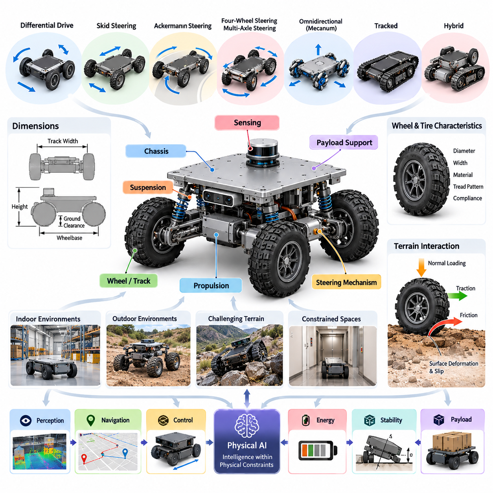{width="7.268055555555556in" height="7.268055555555556in"}

모바일 베이스 형태학(Mobile Base Morphology)은 환경 내에서 이동하도록 설계된 로봇 플랫폼(Robot Platform)의 물리적 구성(Physical Configuration), 구조적 배치(Structural Arrangement), 이동 구조(Locomotion Architecture)를 의미한다. 여기에는 섀시(Chassis), 바퀴(Wheel), 궤도(Track), 조향 장치(Steering Mechanism), 현가장치(Suspension), 추진 구성요소(Propulsion Component), 탑재하중 지지 구조(Payload-Supporting Structure)가 포함된다. 이러한 요소들은 로봇의 이동, 안정성 유지, 지면과의 상호작용 방식을 결정한다.

피지컬 AI(Physical AI)에서 모바일 베이스 형태학(Mobile Base Morphology)은 단순한 기계 설계(Mechanical Design) 이상의 의미를 가진다. 물리적 구조(Physical Structure)는 인식(Perception), 내비게이션(Navigation), 제어(Control), 에너지 소비(Energy Consumption), 자율 행동(Autonomous Behavior)에 직접적인 영향을 미친다. 로봇의 지능(Intelligence)은 신체가 가진 능력과 제약조건 내에서 작동해야 한다. 따라서 모바일 베이스 설계는 센싱(Sensing), 계획(Planning), 학습(Learning), 지능형 이동(Intelligent Motion)을 구현하는 물리적 기반이 된다.

모바일 플랫폼(Mobile Platform)의 형태학은 사용 가능한 자유도(Degrees of Freedom), 운동 제약조건(Motion Constraints), 회전 능력(Turning Capabilities), 장애물과의 상호작용을 결정한다. 일부 플랫폼은 방향을 변경하지 않고 측면으로 이동할 수 있지만, 다른 플랫폼은 목표 지점에 도달하기 위해 곡선 궤적(Curved Trajectory)을 따라야 한다. 이러한 차이는 경로 계획(Path Planning), 궤적 생성(Trajectory Generation), 장애물 회피(Obstacle Avoidance), 자율 내비게이션(Autonomous Navigation)의 계산 복잡도에 영향을 준다.

모바일 로봇 플랫폼(Mobile Robotic Platform)은 일반적으로 이동 방식(Locomotion Mechanism)과 조향 방식(Steering Mechanism)에 따라 분류된다. 차동 구동 시스템(Differential-Drive System)은 독립적으로 제어되는 바퀴를 이용하여 전진과 회전 운동을 생성한다. 스키드 조향 플랫폼(Skid-Steering Platform)은 바퀴 또는 궤도의 속도 차이를 이용하여 방향을 전환한다. 애커먼 조향 시스템(Ackermann-Steering System)은 조정된 조향 기하학(Steering Geometry)을 통해 횡방향 타이어 미끄러짐을 줄이면서 차량과 유사한 움직임을 구현한다.

사륜 조향(Four-Wheel Steering)과 다축 조향(Multi-Axle Steering) 구조는 기동성(Maneuverability)과 하중 분산(Load Distribution)의 유연성을 높인다. 이러한 구성은 회전 반경(Turning Radius)을 줄이고 방향 제어(Directional Control)를 개선하며 대형 로봇 차량(Large Robotic Vehicle)을 지원할 수 있다. 그러나 조향 복잡도가 증가하면 추가 구동기(Actuator), 기계적 링크(Mechanical Linkage), 보정(Calibration), 제어 협조(Control Coordination) 등의 요구사항도 함께 증가한다.

전방향 모바일 베이스(Omnidirectional Mobile Base)는 평면상의 여러 방향으로 이동할 수 있어 향상된 기동성을 제공한다. 메카넘 휠(Mecanum Wheel)과 특수 전방향 휠(Omnidirectional Wheel) 구성은 바퀴 속도를 협조적으로 제어하여 횡방향 이동(Lateral Motion), 종방향 이동(Longitudinal Motion), 회전 운동(Rotational Motion)을 생성한다. 이러한 플랫폼은 제한된 실내 환경(Constrained Indoor Environment)에서 유용하지만, 성능은 지면 상태와 바퀴-지면 접촉 특성(Wheel-Ground Contact Characteristics)에 크게 의존한다.

궤도형 모바일 플랫폼(Tracked Mobile Platform)은 차량의 중량을 비교적 넓은 접촉 면적(Contact Area)에 분산시키며 변형되거나 불규칙한 지형에서 효과적인 견인력(Traction)을 제공한다. 이러한 구조는 건설(Construction), 농업(Agriculture), 검사(Inspection), 실외 로봇(Outdoor Robotics) 분야에서 활용된다. 장애물 극복 능력(Obstacle Negotiation)과 접지압(Ground Pressure) 측면의 장점은 조향 손실(Steering Loss), 기계적 마모(Mechanical Wear), 에너지 소비, 지면 손상 가능성과 함께 평가해야 한다.

하이브리드 모바일 베이스(Hybrid Mobile Base)는 단일 이동 구조로 효율적인 주행이 어려운 환경에 대응하기 위해 여러 이동 메커니즘(Locomotion Mechanism)을 결합한다. 대표적인 예로 바퀴-궤도 결합(Wheel-Track Combination), 관절형 바퀴 조립체(Articulated Wheel Assembly), 지면 접촉 구성을 변경할 수 있는 플랫폼이 있다. 이러한 시스템은 운용 다양성(Operational Versatility)을 확장하지만 추가적인 기계 통합(Mechanical Integration), 센싱(Sensing), 협조 제어(Coordinated Control)가 필요하다.

바퀴와 타이어의 특성(Wheel and Tire Characteristics)은 로봇과 환경 사이의 직접적인 기계적 접촉면(Mechanical Interface)을 정의하므로 모바일 베이스 형태학의 핵심 요소이다. 바퀴 직경(Wheel Diameter), 폭(Width), 재료(Material), 트레드 패턴(Tread Pattern), 유연성(Compliance)은 견인력(Traction), 구름 저항(Rolling Resistance), 진동(Vibration), 장애물 통과 능력에 영향을 미친다. 따라서 바퀴 선택은 지형 특성, 탑재하중, 속도, 내구성 요구사항을 반영해야 한다.

바퀴와 지형의 상호작용(Wheel-Terrain Interaction)은 명령된 운동이 실제 물리적 이동으로 안정적으로 변환될 수 있는지를 결정한다. 마찰(Friction), 수직 하중(Normal Loading), 표면 변형(Surface Deformation), 바퀴 미끄러짐(Wheel Slip)은 이동 효율과 위치 추정 정확도(Localization Accuracy)에 영향을 준다. 매끄러운 산업용 바닥에서는 예측 가능한 접촉 조건이 정밀한 이동을 지원하지만, 흙, 자갈, 젖은 표면, 불규칙한 지형에서는 상당한 불확실성(Uncertainty)이 발생한다.

휠베이스(Wheelbase), 윤거(Track Width), 최저지상고(Ground Clearance), 전체 섀시 높이(Chassis Height)와 같은 기하학적 치수(Geometric Dimensions)는 이동 성능에 큰 영향을 준다. 긴 휠베이스는 종방향 안정성(Longitudinal Stability)을 개선할 수 있지만 회전 공간 요구사항을 증가시키고 돌파각(Breakover Angle) 측면의 장애물 통과 능력을 제한할 수 있다. 넓은 윤거는 횡방향 안정성(Lateral Stability)을 향상시키지만 주행 공간을 증가시킨다. 최저지상고는 섀시 간섭 없이 장애물을 통과할 수 있는 능력을 결정한다.

플랫폼 치수(Platform Dimensions)와 환경 제약조건(Environmental Constraints)의 관계는 창고(Warehouse), 공장(Factory), 병원(Hospital), 상업용 건물(Commercial Building)에서 운용되는 자율이동로봇(Autonomous Mobile Robot, AMR)에 특히 중요하다. 출입문 폭(Door Width), 복도 치수(Corridor Dimensions), 엘리베이터 용량(Elevator Capacity), 바닥 단차(Floor Transition), 회전 공간(Turning Space)은 실제적인 형태학적 제약조건을 형성한다. 기계적 성능이 우수하더라도 플랫폼의 형상 때문에 작업 공간에 안정적으로 접근할 수 없다면 적합하지 않을 수 있다.

현가장치 구조(Suspension Architecture)는 모바일 베이스가 지형의 불규칙성을 수용하면서 바퀴 접촉을 유지하고 탑재 구성요소를 보호하는 방식을 결정한다. 수동 현가장치(Passive Suspension)는 스프링(Spring), 댐퍼(Damper), 기계적 링크(Mechanical Linkage)를 이용하여 외란(Disturbance)을 흡수한다. 관절형 섀시(Articulated Chassis)는 플랫폼의 각 부분이 불규칙한 지형을 따라 움직이도록 하며, 능동 현가장치(Active Suspension)는 운용 조건에 따라 차체 자세(Body Posture)나 바퀴 하중(Wheel Loading)을 조정할 수 있다.

질량 분포(Mass Distribution)는 견인력(Traction), 제동(Braking), 가속(Acceleration), 전복 저항성(Tipping Resistance)에 영향을 미치는 중요한 형태학적 요소이다. 배터리(Battery), 모터(Motor), 컴퓨팅 하드웨어(Computing Hardware), 센서(Sensor), 탑재하중(Payload)의 배치는 무게중심(Center of Gravity)과 회전 관성(Rotational Inertia)을 결정한다. 부적절한 질량 분포는 안정성을 저하시키고 특정 바퀴에 과도한 하중을 발생시키며 경사면 주행이나 급격한 기동 능력을 제한할 수 있다.

탑재하중 용량(Payload Capacity)은 탑재하중의 무게중심 위치와 변동성(Variability)을 함께 고려하여 평가해야 한다. 고정된 산업용 컨테이너를 운반하는 모바일 베이스는 로봇 매니퓰레이터(Robot Manipulator)나 수직 이동 리프팅 장치(Vertical Lifting Mechanism)를 지지하는 플랫폼과 서로 다른 안정성 조건을 가진다. 탑재하중의 이동은 바퀴 하중과 전복 여유도(Tipping Margin)를 변화시킬 수 있으므로 구조 형상, 현가장치 동작, 운동 제어를 통합적으로 고려해야 한다.

실내와 실외 운용 환경(Indoor and Outdoor Operating Environments)은 근본적으로 다른 형태학적 설계 우선순위를 요구한다. 실내 플랫폼은 일반적으로 소형 치수(Compact Dimensions), 정밀 기동성(Precise Maneuverability), 저소음(Low Noise), 예측 가능한 바닥 접촉, 인간 환경과의 호환성(Human Environment Compatibility)을 강조한다. 반면 실외 플랫폼은 최저지상고, 내후성(Weather Resistance), 견인력, 현가장치 이동 범위(Suspension Travel), 불확실한 지형에 대한 적응성을 중시한다.

고하중 모바일 베이스(Heavy-Payload Mobile Base)는 구조 보강(Structural Reinforcement), 적절한 구동 메커니즘(Drive Mechanism), 신중한 하중 전달(Load Transfer) 관리가 필요하다. 질량이 증가하면 모터, 변속기(Transmission), 브레이크(Brake), 베어링(Bearing), 섀시 구성요소에 대한 요구도 증가한다. 또한 제동거리(Stopping Distance), 열적 거동(Thermal Behavior), 에너지 소비, 바닥 하중(Floor Loading)에 영향을 미치므로 탑재하중 용량과 기동성, 운용 안전성, 기계적 효율 사이의 균형이 필요하다.

험지 주행 모바일 로봇(Rough-Terrain Mobile Robot)은 불규칙한 지면 형상(Ground Geometry), 가변적인 마찰(Variable Friction), 급경사(Steep Slope), 간헐적인 접촉(Intermittent Contact)으로 인한 추가적인 문제에 직면한다. 이러한 로봇의 형태학은 안정성이나 견인력을 과도하게 잃지 않으면서 장애물을 극복할 수 있어야 한다. 대형 바퀴, 관절형 구조, 현가장치, 적절한 중량 분포는 이동성을 개선하지만 크기, 복잡성, 에너지 효율 측면에서 절충관계(Tradeoff)를 발생시킨다.

에너지 효율(Energy Efficiency)은 모바일 베이스 형태학과 밀접하게 연결되어 있다. 바퀴 구성(Wheel Configuration), 구동계 효율(Drivetrain Efficiency), 차량 질량(Vehicle Mass), 구름 저항(Rolling Resistance), 조향 동작(Steering Behavior)은 이동에 필요한 기계적 일(Mechanical Work)을 결정한다. 정밀한 횡방향 위치 제어에 최적화된 플랫폼은 동일한 운송 조건에서 일반적인 바퀴형 구조보다 더 많은 에너지를 소비할 수 있다. 따라서 형태학적 결정은 배터리 용량, 운용 시간, 충전 인프라(Charging Infrastructure)에 영향을 미친다.

모바일 베이스 형태학은 탑재 센싱(Onboard Sensing)과 위치 추정(Localization)의 효과에도 영향을 준다. 섀시 높이, 진동 특성(Vibration Characteristics), 센서 장착 위치(Sensor Mounting Location), 바퀴-지면 상호작용은 측정 품질(Measurement Quality)과 운동 추정(Motion Estimation)에 영향을 미친다. 바퀴 미끄러짐은 주행거리 추정(Odometry) 오차를 발생시킬 수 있으며, 기계적 진동은 관성 측정(Inertial Measurement)과 시각 관측(Visual Observation)의 품질을 저하시킬 수 있다. 따라서 기계 설계와 인식 구조를 함께 고려해야 한다.

형태학과 제어의 관계(Morphology-Control Relationship)는 지능형 모바일 플랫폼(Intelligent Mobile Platform) 설계에서 특히 중요하다. 차동 구동(Differential Drive), 애커먼 조향(Ackermann Steering), 전방향 구동(Omnidirectional Drive) 시스템은 서로 다른 운동학적 제약조건(Kinematic Constraints)과 동적 응답(Dynamic Response)을 가진다. 제어기(Controller)는 원하는 궤적을 구동기 명령(Actuator Command)으로 변환할 때 이러한 특성을 반영해야 한다. 물리적 제약을 무시하면 실행 불가능한 운동, 과도한 바퀴 미끄러짐, 불안정한 동작이 발생할 수 있다.

형태학적 계산(Morphological Computation)은 기계 구조 자체의 물리적 거동이 제어를 단순화할 수 있다는 관점에서 모바일 베이스 설계를 이해하도록 한다. 수동 현가장치(Passive Suspension), 유연한 타이어(Compliant Tire), 적절한 질량 분포는 지속적인 보정 계산 없이도 외란을 흡수할 수 있다. 따라서 효과적인 기계 설계는 플랫폼의 자연적인 동역학(Natural Dynamics)을 활용하여 제어 부담(Control Effort)을 줄이고 강건성(Robustness)을 향상시킬 수 있다.

모바일 베이스 형태학은 기능 안전(Functional Safety) 요구사항도 수용해야 한다. 제동 구조(Braking Architecture), 기계적 안정성(Mechanical Stability), 보호 구조(Protective Structure), 이동 구성요소의 배치는 운용 위험(Operational Hazard)에 영향을 미친다. 인간과 공간을 공유하는 로봇은 예측 가능한 정지 동작(Stopping Behavior), 제어된 접촉력(Contact Force), 예상 가능한 외란에 대한 충분한 안정성이 필요하다. 안전은 기계, 전기, 센싱, 제어 설계를 통합하여 확보해야 한다.

모바일 베이스 형태학의 선택은 궁극적으로 이동성(Mobility), 안정성(Stability), 탑재하중(Payload), 에너지 효율(Energy Efficiency), 비용(Cost), 유지보수성(Maintainability), 환경 적합성(Environmental Compatibility)을 포함하는 다목적 공학 문제(Multi-Objective Engineering Problem)이다. 모든 운용 조건에서 최적의 성능을 제공하는 단일 구조는 존재하지 않는다. 설계자는 이동 구조, 기하학적 배치, 지원 기계 구조를 선택하기 전에 임무 요구사항(Mission Requirements)과 물리적 제약조건을 평가해야 한다.

시뮬레이션(Simulation)과 물리적 시험(Physical Testing)은 서로 다른 형태학적 구성을 평가하는 데 필수적이다. 운동학 모델(Kinematic Model)은 실행 가능한 운동을 규정하고, 동역학 모델(Dynamic Model)은 가속도, 하중 전달, 견인력, 안정성을 추정한다. 지형 시뮬레이션(Terrain Simulation)과 시제품 실험(Prototype Experiment)은 단순화된 모델에서 간과할 수 있는 한계를 드러낸다. 이러한 방법을 결합하면 체계적인 비교가 가능하며 실제 운용 환경에 배치하기 전 불확실성을 줄일 수 있다.

피지컬 AI(Physical AI) 시스템에서 모바일 베이스(Mobile Base)는 단순한 운송 장치(Passive Transportation Mechanism)가 아니라 체화 지능(Embodied Intelligence)의 능동적 구성요소(Active Component)로 이해해야 한다. 플랫폼의 형상(Geometry), 접촉 역학(Contact Mechanics), 동역학적 특성(Dynamic Properties)은 자율 제어기(Autonomous Controller)가 활용할 수 있는 관측(Observation)과 행동(Action)의 범위를 형성한다. 따라서 효과적인 모바일 로봇 개발은 형태학, 인식, 계획, 학습, 제어의 협력적 최적화(Coordinated Optimization)를 통해 신뢰할 수 있는 물리적 지능(Physical Intelligence)을 구현해야 한다.

## 04.02. Differential Skid and Ackermann Drive

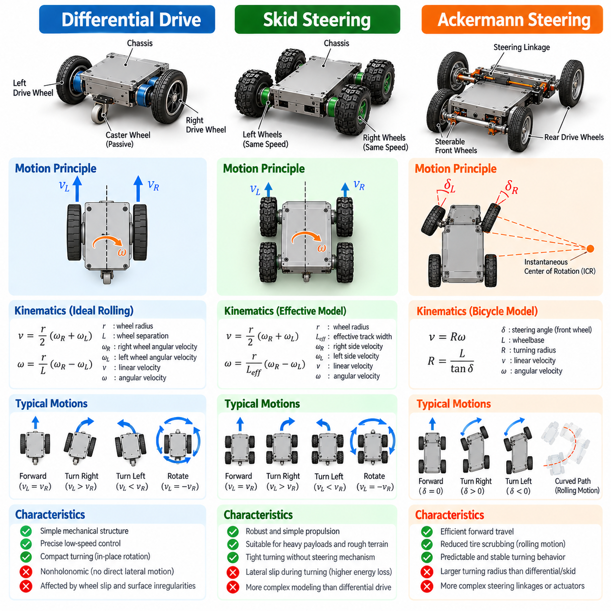{width="7.268055555555556in" height="7.268055555555556in"}

차동 구동(Differential Drive), 스키드 조향(Skid Steering), 애커먼 조향(Ackermann Steering)은 바퀴형 모바일 로봇(Wheeled Mobile Robot)에 사용되는 세 가지 기본적인 이동 구조(Locomotion Architecture)이다. 각 구성은 구동기 힘(Actuator Force)이 병진 운동(Translational Motion)과 회전 운동(Rotational Motion)으로 변환되는 방식을 결정한다. 이러한 기계적 구조는 서로 다른 운동학적 제약조건(Kinematic Constraints), 회전 능력(Turning Capabilities), 에너지 요구사항(Energy Requirements), 지형 상호작용(Terrain Interaction)을 형성하므로 구동 방식 선택은 모바일 로봇 형태학(Mobile Robot Morphology)의 핵심 설계 결정이다.

차동 구동 시스템(Differential-Drive System)은 일반적으로 섀시(Chassis)의 양쪽에 배치된 두 개의 독립 구동 바퀴(Independently Driven Wheel)를 사용한다. 추가적인 수동 캐스터 휠(Passive Caster Wheel)이나 지지 메커니즘(Support Mechanism)은 직접적인 추진력을 생성하지 않으면서 균형을 유지한다. 구동 바퀴의 상대적인 회전 속도(Rotational Velocity)를 제어함으로써 로봇은 전진, 후진, 곡선 궤적(Curved Trajectory) 추종, 수직축(Vertical Axis)을 중심으로 한 회전을 수행할 수 있다.

차동 구동(Differential Drive)의 기본 원리는 로봇의 선속도(Linear Velocity)가 구동 바퀴의 평균 접선속도(Tangential Velocity)에 의해 결정되고, 각속도(Angular Velocity)는 바퀴 속도의 차이에 의해 결정된다는 것이다. 양쪽 바퀴의 속도가 같으면 직선 운동(Straight Motion)이 발생하고, 속도가 다르면 회전 운동이 생성된다. 두 바퀴가 동일한 속도로 반대 방향으로 회전하면 로봇은 구동축(Drive Axle)의 중간 지점을 중심으로 거의 제자리 회전(In-Place Rotation)을 수행할 수 있다.

차동 구동 운동학(Differential-Drive Kinematics)은 일반적으로 바퀴 반경(Wheel Radius), 바퀴 간 거리(Wheel Separation), 개별 바퀴의 각속도(Wheel Angular Velocity)를 이용하여 표현된다. 이상적인 구름 조건(Ideal Rolling Conditions)에서 전진 속도(Forward Velocity)는 바퀴 반경과 평균 바퀴 각속도의 곱으로 계산된다. 각속도는 바퀴 반경에 오른쪽과 왼쪽 바퀴의 각속도 차이를 곱한 값을 바퀴 간 거리로 나누어 계산한다.

차동 구동 형태학(Differential-Drive Morphology)의 대표적인 특징은 비홀로노믹 운동 제약조건(Nonholonomic Motion Constraint)이다. 플랫폼은 방향을 먼저 변경하지 않고 직접적인 횡방향 병진 운동(Lateral Translation)을 생성할 수 없다. 로봇은 전진 운동과 회전 운동을 순차적으로 조합하여 다양한 평면 자세(Planar Configuration)에 도달할 수 있지만, 순간적인 운동(Instantaneous Motion)은 바퀴 정렬(Wheel Alignment)과 지면과의 구름 접촉(Rolling Contact)에 의해 제한된다.

차동 구동 플랫폼(Differential-Drive Platform)은 자율이동로봇(Autonomous Mobile Robot), 교육용 로봇(Educational Robotics), 실내 배송 시스템(Indoor Delivery System), 소형 서비스 로봇(Compact Service Robot)에 널리 사용된다. 이러한 구조가 널리 활용되는 이유는 기계적 단순성(Mechanical Simplicity), 적은 구성요소 수(Low Component Count), 비교적 간단한 제어(Straightforward Control), 제한된 공간에서의 우수한 기동성(Maneuverability) 때문이다. 그러나 바퀴 미끄러짐(Wheel Slip), 캐스터 동작(Caster Behavior), 불균일한 하중(Uneven Loading), 지면 불규칙성(Surface Irregularities)은 이동 정확도를 저하시킬 수 있다.

스키드 조향 시스템(Skid-Steering System)은 차량의 왼쪽과 오른쪽에 서로 다른 종방향 속도(Longitudinal Velocity)를 부여하여 방향을 변경한다. 일반적인 조향 시스템(Conventional Steering System)과 달리 바퀴 또는 궤도는 회전 중에도 대체로 섀시와 정렬된 상태를 유지한다. 방향 전환은 지면 접촉 요소(Ground-Contact Element)의 횡방향 미끄러짐(Lateral Sliding)에 의해 발생하며, 이를 통해 차량의 방향을 변경하는 데 필요한 힘과 모멘트(Force and Moment)가 생성된다.

스키드 조향 형태학(Skid-Steering Morphology)은 일반적으로 네 개 이상의 바퀴를 사용하며, 각 측면의 여러 바퀴가 기계적 또는 전자적으로 협조 제어된다. 궤도형 차량(Tracked Vehicle)도 왼쪽과 오른쪽 궤도의 상대 속도를 제어하는 유사한 원리를 사용한다. 이러한 구성은 높은 탑재하중(Heavy Payload), 산업 환경(Industrial Environment), 농업 기계(Agricultural Machinery), 험지 주행 로봇 플랫폼(Rough-Terrain Robotic Platform)에 적합한 견고한 추진 구조(Robust Propulsion Architecture)를 제공한다.

스키드 조향(Skid Steering)은 명령 수준(Command Level)에서 차동 구동(Differential Drive)과 유사하지만 실제 물리적 거동(Physical Behavior)은 훨씬 복잡하다. 차동 구동 모델(Differential-Drive Model)은 일반적으로 횡방향 미끄러짐이 없는 이상적인 구름 운동(Ideal Rolling)을 가정하지만, 스키드 조향 차량은 회전할 때 횡방향 미끄러짐에 의존한다. 따라서 회전 특성은 마찰(Friction), 수직 하중 분포(Normal Force Distribution), 바퀴 구성(Wheel Configuration), 지형 변형(Terrain Deformation), 차량 질량(Vehicle Mass)에 따라 달라진다.

스키드 조향 차량(Skid-Steering Vehicle)의 순간 회전 중심(Instantaneous Center of Rotation)은 운용 조건에 따라 이동할 수 있다. 양쪽 측면의 속도 차이와 요 운동(Yaw Motion)의 관계를 나타내는 유효 윤거(Effective Track Width)는 실제 바퀴 그룹 사이의 물리적 거리와 다를 수 있다. 따라서 정확한 운동 예측에는 실험적으로 식별된 매개변수(Experimentally Identified Parameters), 경험적 보정 모델(Empirical Correction Model), 바퀴-지면 상호작용(Wheel-Ground Interaction)의 동역학적 표현(Dynamic Representation)이 필요한 경우가 많다.

스키드 조향 플랫폼(Skid-Steering Platform)은 복잡한 조향 링크(Steering Linkage)를 제거하고 작은 회전 반경(Tight Turning Radius)을 구현할 수 있다는 실용적인 장점을 가진다. 분산된 지면 접촉(Distributed Ground Contact)은 상당한 하중을 지지하고 불규칙한 지형에서 이동성을 개선할 수 있다. 그러나 회전 과정에서 횡방향 마찰(Lateral Friction), 타이어 마모(Tire Wear), 토양 교란(Soil Disturbance), 추가적인 에너지 손실(Energy Loss)이 발생하며, 잦은 방향 전환 시 이러한 영향이 커질 수 있다.

애커먼 조향(Ackermann Steering)은 조향 가능한 바퀴(Steerable Wheel)의 방향을 변경하여 곡선 경로(Curved Path)를 따라 이동하도록 하는 근본적으로 다른 메커니즘을 사용한다. 이 조향 기하학(Steering Geometry)은 이상적인 저속 회전(Low-Speed Turning)에서 각 바퀴의 구름 방향(Rolling Direction)이 공통의 순간 회전 중심(Instantaneous Center of Rotation)에서 만나도록 설계된다. 이러한 배치는 횡방향 타이어 끌림(Lateral Tire Scrubbing)을 줄이고 효율적인 차량형 운동(Vehicle-Like Motion)을 지원한다.

일반적인 애커먼 조향 플랫폼(Ackermann-Steered Platform)에서는 앞바퀴가 조향을 담당하고 뒷바퀴가 추진력을 제공하지만, 다른 구동계 구성(Drivetrain Arrangement)도 가능하다. 안쪽 앞바퀴(Inner Front Wheel)는 바깥쪽 앞바퀴(Outer Front Wheel)보다 작은 회전 반경을 따라 이동하므로 일반적으로 더 큰 조향각(Steering Angle)이 필요하다. 기계적 링크(Mechanical Linkage) 또는 독립 제어 조향 구동기(Independently Controlled Steering Actuator)가 이러한 기하학적 관계를 구현한다.

애커먼 운동학(Ackermann Kinematics)은 두 개의 앞바퀴를 하나의 등가 조향 바퀴(Equivalent Steering Wheel)로, 두 개의 뒷바퀴를 하나의 등가 뒷바퀴로 통합하는 자전거 모델(Bicycle Model)을 이용하여 근사하는 경우가 많다. 이 모델에서 회전 곡률(Turning Curvature)은 조향각(Steering Angle)과 휠베이스(Wheelbase)에 의해 결정된다. 이러한 근사 모델(Approximation Model)은 특히 저속 궤적 계획(Low-Speed Trajectory Planning), 차량 위치 추정(Vehicle Localization), 모델 기반 제어(Model-Based Control)에 유용하다.

차동 구동 로봇(Differential-Drive Robot)과 달리 일반적인 애커먼 조향 차량(Ackermann-Steered Vehicle)은 제자리 회전(In-Place Rotation)을 수행할 수 없다. 최소 회전 반경(Minimum Turning Radius)은 휠베이스(Wheelbase), 조향각 제한(Steering Angle Limits), 기계적 형상(Mechanical Geometry)에 의해 제약된다. 이러한 한계는 좁은 복도, 적재 구역(Loading Area), 밀집된 환경(Dense Environment)에서의 내비게이션(Navigation)에 영향을 준다. 그러나 애커먼 조향은 연속적인 곡선 궤적을 따라 이동하는 차량에서 일반적으로 효율적이고 예측 가능한 운동을 제공한다.

차동 구동(Differential Drive), 스키드 조향(Skid Steering), 애커먼 조향(Ackermann Steering) 중 어떤 방식을 선택할지는 의도된 운용 환경(Operational Environment)에 크게 의존한다. 차동 구동은 소형 실내 내비게이션(Compact Indoor Navigation)과 빈번한 방향 변경에 적합하다. 스키드 조향은 기계적 견고성(Mechanical Robustness), 분산 견인력(Distributed Traction), 지형 적응성(Terrain Adaptability)을 강조한다. 애커먼 조향은 효율적인 방향성 주행(Directional Travel), 부드러운 회전(Smooth Turning), 차량 규모의 운송 작업(Vehicle-Scale Transportation Task)에 특히 적합하다.

에너지 소비(Energy Consumption)는 이러한 구조를 비교하는 또 다른 중요한 기준이다. 차동 구동 플랫폼(Differential-Drive Platform)은 적절한 구름 조건(Rolling Conditions)에서 효율적으로 회전할 수 있지만, 캐스터 마찰(Caster Friction)과 바퀴 미끄러짐(Wheel Slip)으로 손실이 발생할 수 있다. 스키드 조향 시스템(Skid-Steering System)은 일반적으로 회전 중 상당한 횡방향 마찰(Lateral Friction)을 경험한다. 애커먼 조향은 이상적인 구름 운동에서 타이어 끌림(Tire Scrubbing)을 줄이지만 추가적인 조향 메커니즘과 곡선 주행에 필요한 충분한 공간을 요구한다.

안정성 특성(Stability Characteristics)도 세 가지 구성에서 서로 다르게 나타난다. 차동 구동 로봇(Differential-Drive Robot)은 바퀴 배치(Wheel Placement), 지지 캐스터(Supporting Caster), 섀시 형상(Chassis Geometry), 탑재하중 분포(Payload Distribution)에 영향을 받는다. 스키드 조향 차량은 여러 지면 접촉점(Ground-Contact Point)과 비교적 넓은 지지 형상(Support Geometry)의 이점을 얻는 경우가 많다. 애커먼 조향 플랫폼은 특히 고속에서 조향으로 발생하는 횡가속도(Lateral Acceleration)와 하중 이동(Load Transfer)을 추가로 고려해야 한다.

제어 구조(Control Architecture)는 모든 바퀴형 로봇을 동일한 플랫폼으로 취급하는 대신 기본적인 형태학(Underlying Morphology)을 반영해야 한다. 차동 구동 제어(Differential-Drive Control)는 원하는 선속도(Linear Velocity)와 각속도(Angular Velocity)를 개별 바퀴 속도로 변환한다. 스키드 조향 제어(Skid-Steering Control)는 불확실한 미끄러짐(Slip)과 가변적인 회전 응답(Turning Response)을 보상해야 한다. 애커먼 제어(Ackermann Control)는 원하는 경로 곡률(Path Curvature)을 조향 명령(Steering Command)으로 변환하면서 추진(Propulsion)과 제동(Braking)을 협조적으로 제어한다.

주행거리 추정(Odometry)과 위치 추정(Localization)의 성능은 선택된 구동 메커니즘(Drive Mechanism)과 밀접하게 관련된다. 차동 구동 주행거리 추정(Differential-Drive Odometry)은 구름 접촉(Rolling Contact)에 대한 가정을 바탕으로 바퀴 엔코더(Wheel Encoder) 측정값을 적분한다. 스키드 조향 주행거리 추정(Skid-Steering Odometry)은 명령된 바퀴 운동이 실제 지면 변위를 유일하게 결정하지 않기 때문에 상당한 누적 오차(Accumulated Error)가 발생할 수 있다. 애커먼 주행거리 추정(Ackermann Odometry)은 바퀴 운동과 조향 기하학을 사용하지만 타이어 미끄러짐과 보정 오차(Calibration Error)에 여전히 민감하다.

피지컬 AI(Physical AI) 시스템은 적응형 추정(Adaptive Estimation), 지형 인식(Terrain Awareness), 학습 기반 제어(Learning-Based Control)를 통해 이러한 플랫폼의 성능을 개선할 수 있다. 바퀴 엔코더(Wheel Encoder), 관성측정장치(Inertial Measurement Unit, IMU), 카메라(Camera), 라이다(LiDAR)를 결합한 센서 융합(Sensor Fusion)은 불완전한 기계 모델(Mechanical Model)에서도 실제 차량 운동을 추정할 수 있다. 학습된 동역학 모델(Learned Dynamics Model)은 마찰, 탑재하중, 타이어 상태, 환경 외란(Environmental Disturbance)의 변화까지 추가로 보상할 수 있다.

형태학 인식 계획(Morphology-Aware Planning)은 동일한 내비게이션 목표(Navigation Objective)라도 구동 구조에 따라 서로 다른 실행 가능한 궤적(Feasible Trajectory)이 필요할 수 있기 때문에 중요하다. 차동 구동 로봇은 작은 공간에서 방향을 변경할 수 있지만, 애커먼 차량은 여러 단계의 기동(Multi-Stage Maneuver)이 필요할 수 있다. 스키드 조향 로봇은 작은 반경으로 회전할 수 있지만 상당한 견인력 손실(Traction Loss)이나 지면 손상(Surface Damage)이 발생할 수 있으므로 경로 계획기(Planner)는 지형에 민감한 이동 비용(Terrain-Sensitive Motion Cost)을 고려해야 한다.

따라서 시뮬레이션(Simulation)과 실험적 검증(Experimental Validation)은 각 구조의 고유한 접촉 역학(Contact Mechanics)과 운동 제약조건(Motion Constraints)을 반영해야 한다. 이상적인 운동학 모델(Ideal Kinematic Model)은 초기 설계를 위한 효율적인 근사치를 제공하지만, 현실적인 평가는 미끄러짐(Slip), 구동기 제한(Actuator Limits), 질량 분포(Mass Distribution), 마찰(Friction), 지형 조건(Terrain Conditions)을 고려해야 한다. 예측된 차량 거동과 실제 차량 거동 사이의 차이를 식별하기 위해서는 하드웨어 시험(Hardware Testing)이 필요하다.

궁극적으로 차동 구동(Differential Drive), 스키드 조향(Skid Steering), 애커먼 조향(Ackermann Steering)은 기계적 형태학(Mechanical Morphology)이 모바일 로봇의 지능(Intelligence)과 운용 능력(Operational Capabilities)을 어떻게 형성하는지 보여준다. 이들의 차이는 단순한 조향 기하학(Steering Geometry)을 넘어 인식(Perception), 위치 추정(Localization), 계획(Planning), 제어(Control), 효율(Efficiency), 안전(Safety)에 영향을 미친다. 적절한 구조를 선택하려면 물리적 설계(Physical Design), 환경 상호작용(Environmental Interaction), 자율 시스템 요구사항(Autonomous System Requirements)을 통합적으로 고려해야 한다.

## 04.03. Four Wheel and Multi Axle Steering

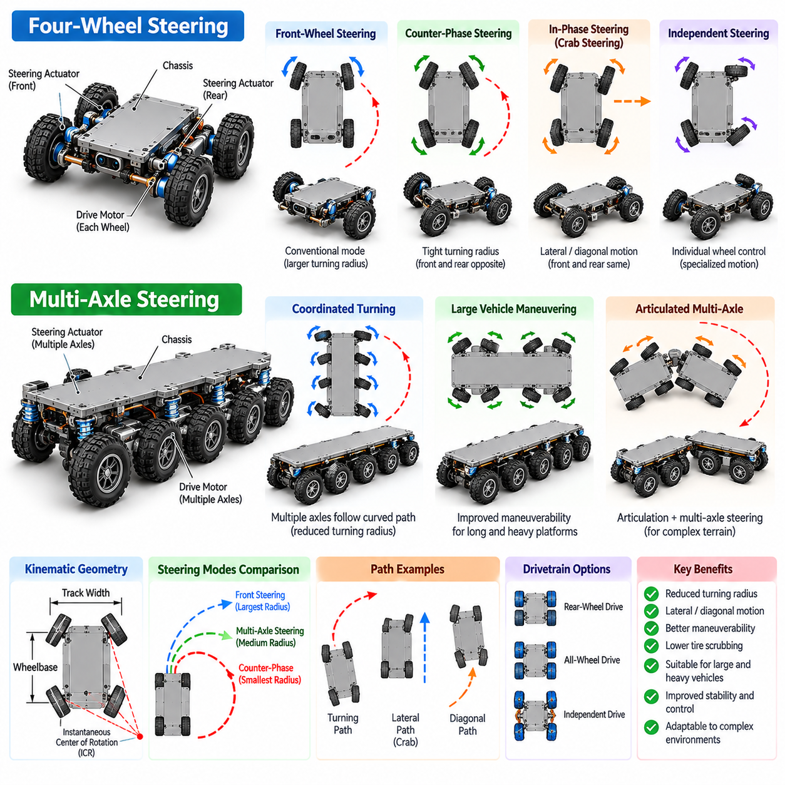{width="7.268055555555556in" height="7.268055555555556in"}

사륜 조향(Four-Wheel Steering)과 다축 조향(Multi-Axle Steering)은 까다로운 운용 조건에서 기동성(Maneuverability), 방향 제어(Directional Control), 이동성(Mobility)을 향상시키기 위해 설계된 고급 모바일 베이스 형태학(Advanced Mobile Base Morphology)이다. 기존의 전륜 조향(Front-Wheel Steering)과 달리 이러한 구조는 여러 바퀴 또는 차축(Axle)의 조향각(Steering Angle)을 협조적으로 제어한다. 기계적 구성(Mechanical Configuration)은 회전 반경(Turning Radius), 횡방향 운동(Lateral Motion), 타이어-지면 상호작용(Tire-Ground Interaction), 안정성(Stability), 제한된 환경에서의 주행 능력에 영향을 미친다.

사륜 조향(Four-Wheel Steering)은 앞바퀴와 뒷바퀴가 모두 차량 섀시(Vehicle Chassis)에 대한 방향을 변경할 수 있도록 한다. 조향 명령(Steering Command)은 기계적으로 연결되거나 전용 구동기(Dedicated Actuator)를 통해 독립적으로 생성될 수 있다. 두 차축에 조향 기능을 분산함으로써 플랫폼은 기존의 이륜 조향 시스템(Two-Wheel Steering System)에서는 구현하기 어려운 운동 패턴(Motion Pattern)을 실현할 수 있으며, 여기에는 더 작은 회전 반경의 궤적과 협조적인 횡방향 변위(Coordinated Lateral Displacement)가 포함된다.

기본적인 운용 모드(Operating Mode) 중 하나는 역위상 조향(Counter-Phase Steering)으로, 앞바퀴와 뒷바퀴가 서로 반대 방향으로 조향되는 방식이다. 이러한 구성은 유효 회전 반경(Effective Turning Radius)을 줄여 대형 플랫폼이 비교적 좁은 공간을 통과할 수 있도록 한다. 역위상 조향은 자율 산업용 차량(Autonomous Industrial Vehicle), 창고 운송 플랫폼(Warehouse Transport Platform), 장애물 주변에서 정밀한 기동이 필요한 모바일 로봇에 특히 유용하다.

또 다른 운용 모드는 동위상 조향(In-Phase Steering)으로, 앞바퀴와 뒷바퀴가 동일한 방향으로 조향되는 방식이다. 조향각이 적절하게 협조 제어되면 차량은 진행 방향(Heading)을 거의 일정하게 유지하면서 대각선 또는 횡방향 병진 운동(Diagonal or Lateral Translation)을 수행할 수 있다. 이러한 운동은 일반적으로 크랩 조향(Crab Steering)이라고 하며, 구조물 옆에 차량을 배치하거나 탑재하중(Payload)을 정렬하고 좁은 통로를 주행하는 데 유용하다.

사륜 조향 시스템(Four-Wheel Steering System)은 추가적인 기동성이 필요하지 않을 때 기존의 전륜 조향 모드(Front-Wheel Steering Mode)로 작동할 수도 있다. 일부 구조는 차량 속도(Vehicle Speed), 운용 조건(Operating Conditions), 내비게이션 목표(Navigation Objectives)에 따라 조향 모드를 전환한다. 저속 운용에서는 회전 반경 감소를 우선할 수 있으며, 고속 운용에서는 방향 안정성(Directional Stability)과 부드러운 횡방향 응답(Lateral Response)을 강조할 수 있다.

사륜 조향의 운동학적 거동(Kinematic Behavior)은 휠베이스(Wheelbase), 윤거(Track Width), 조향각(Steering Angles), 조향축(Steering Axis)의 기하학적 배치(Geometric Arrangement)에 따라 달라진다. 이상적인 구름 조건(Ideal Rolling Conditions)에서는 각 바퀴의 구름 방향(Rolling Direction)이 공통의 순간 회전 중심(Instantaneous Center of Rotation)과 일치하도록 조향 방향을 협조적으로 조정해야 한다. 잘못된 조향 협조(Steering Coordination)는 횡방향 타이어 힘(Lateral Tire Force), 기계적 응력(Mechanical Stress), 불필요한 에너지 소비를 발생시킨다.

독립 바퀴 조향(Independent Wheel Steering)은 각 바퀴에 개별적인 조향 명령을 전달함으로써 이러한 능력을 확장한다. 이러한 시스템은 특수한 운동 패턴(Specialized Motion Pattern), 비대칭 구성(Asymmetric Configuration), 복잡한 기동 요구사항(Complex Maneuvering Requirements)에 대응할 수 있다. 그러나 독립 조향은 구동기 수(Actuator Count), 센서 요구사항(Sensor Requirements), 보정 복잡도(Calibration Complexity), 일관된 바퀴 운동을 유지하기 위한 계산 부담(Computational Effort)을 증가시킨다.

다축 조향(Multi-Axle Steering)은 협조 조향(Coordinated Steering)을 두 개 이상의 차축으로 확장한 구조이다. 세 개 이상의 차축을 가진 차량은 여러 바퀴 그룹(Wheel Group)에 조향 기능(Steering Authority)을 분산하여 기동성을 개선하고 타이어 끌림(Tire Scrubbing)을 줄일 수 있다. 이러한 구조는 중장비 자율 운송 차량(Heavy-Duty Autonomous Transporter), 대형 농업 기계(Large Agricultural Machine), 건설 차량(Construction Vehicle), 무겁거나 비정형적인 탑재하중을 운반하는 특수 로봇 플랫폼(Specialized Robotic Platform)에 특히 적합하다.

긴 휠베이스(Long Wheelbase)를 가진 차량에서는 기존 조향 방식(Conventional Steering)이 큰 회전 반경과 상당한 횡방향 타이어 힘(Lateral Tire Force)을 발생시킬 수 있다. 다축 조향은 원하는 차량 궤적(Vehicle Trajectory)에 따라 추가 차축의 방향을 조정함으로써 이러한 한계를 해결한다. 적절하게 협조된 조향은 긴 플랫폼이 곡선 경로(Curved Path)를 더욱 효율적으로 따라가도록 하면서 타이어-지면 접촉면(Tire-Ground Interface)에서 불필요한 변형과 미끄러짐을 줄인다.

다축 플랫폼(Multi-Axle Platform)의 조향 기하학(Steering Geometry)은 조향 가능한 차축의 수가 증가할수록 더욱 복잡해진다. 각 바퀴는 서로 다른 회전 반경(Turning Radius)을 따라 이동할 수 있으므로 의도된 운동 제약조건(Motion Constraints)을 만족하는 조향각이 필요하다. 기하학적 조향 모델(Geometric Steering Model)은 초기 설계의 기반을 제공하지만, 실제 구현에서는 유연성(Compliance), 조향 오프셋(Steering Offset), 기계적 공차(Mechanical Tolerance), 동적 하중(Dynamic Loading)도 고려해야 한다.

관절형 다축 차량(Articulated Multi-Axle Vehicle)은 섀시의 각 구간이 서로 상대적으로 회전할 수 있기 때문에 추가적인 형태학적 고려사항(Morphological Considerations)이 발생한다. 관절 조인트(Articulation Joint)는 특히 길거나 무거운 플랫폼에서 지형 적응성(Terrain Adaptation)과 기동성을 향상시킬 수 있다. 그러나 관절 운동(Articulation)은 바퀴 방향, 차량 형상, 궤적 추종(Trajectory Tracking) 사이의 관계를 변화시키므로 전체 기계 구조(Mechanical Structure)에 대한 협조적인 모델링(Coordinated Modeling)이 필요하다.

조향 구조(Steering Architecture)는 구동계 구성(Drivetrain Configuration)과 밀접하게 관련된다. 사륜 조향 플랫폼은 후륜 구동(Rear-Wheel Drive), 사륜 구동(All-Wheel Drive), 독립 바퀴 구동(Independently Driven Wheels)을 사용할 수 있다. 회전 중 각 바퀴는 서로 다른 경로를 따라 이동하므로 추진(Propulsion)과 조향(Steering)의 협조가 필수적이다. 적절한 바퀴 속도 배분(Wheel-Speed Allocation)은 구름 운동의 정합성(Rolling Compatibility)을 유지하고 미끄러짐을 줄이며 차량 전체에 견인력 요구(Traction Demand)를 분산시키는 데 도움이 된다.

조향과 견인력(Steering and Traction)의 관계는 마찰이 낮거나 변형 가능한 지면(Low-Friction or Deformable Surface)에서 특히 중요하다. 불균일한 바퀴 하중(Unequal Wheel Loading), 변화하는 마찰계수(Friction Coefficient), 지형 불규칙성(Terrain Irregularity)은 이상적인 운동학적 거동(Ideal Kinematic Behavior)에서 벗어나는 원인이 될 수 있다. 따라서 다축 시스템은 조향 명령, 타이어 힘(Tire Force), 현가장치 거동(Suspension Behavior), 수직 하중 분포(Normal Load Distribution) 사이의 상호작용을 고려해야 한다.

차량 안정성(Vehicle Stability)은 사륜 및 다축 조향 설계에서 또 다른 핵심 고려사항이다. 조향 명령은 횡가속도(Lateral Acceleration)를 발생시키고 바퀴 사이의 하중 이동(Load Transfer)에 영향을 준다. 협조 조향은 기동성을 개선할 수 있지만, 고속에서 급격한 조향은 전복 위험(Rollover Risk)을 증가시키거나 불안정한 과도 응답(Unstable Transient Response)을 발생시킬 수 있다. 안전한 운용을 위해서는 조향 속도(Steering Rate), 차량 속도(Speed), 가속도(Acceleration), 차량 운동(Vehicle Motion)에 대한 적절한 제한이 필요하다.

탑재하중 분포(Payload Distribution)는 이러한 조향 구조의 성능에 상당한 영향을 미친다. 무겁거나 높은 위치에 배치된 탑재하중은 무게중심(Center of Gravity), 회전 관성(Rotational Inertia), 바퀴 하중(Wheel Loading)을 변화시킨다. 자율 운송 플랫폼(Autonomous Transport Platform)에서는 조향 기하학을 탑재하중의 크기와 배치와 함께 평가해야 한다. 무부하 차량(Unloaded Vehicle)에 적합한 구성이 최대 정격하중(Maximum Rated Load)을 운반할 때는 상당히 다른 조종 특성(Handling Characteristics)을 나타낼 수 있다.

현가장치 설계(Suspension Design)도 다축 조향 형태학(Multi-Axle Steering Morphology)과 상호작용한다. 독립 현가장치(Independent Suspension), 강체 차축(Rigid Axle), 관절형 섀시(Articulated Chassis)는 회전과 지형 주행 중 서로 다른 바퀴 접촉 조건(Wheel-Contact Conditions)을 형성한다. 현가장치의 움직임은 조향 기하학과 바퀴 정렬(Wheel Alignment)을 변화시켜 타이어 힘과 궤적 정확도(Trajectory Accuracy)에 영향을 줄 수 있다. 다양한 운용 조건에서 예측 가능한 조향 거동을 유지하려면 통합적인 기계 설계(Integrated Mechanical Design)가 필요하다.

사륜 조향과 다축 조향에는 원하는 차량 운동(Desired Vehicle Motion)을 협조된 바퀴 방향(Coordinated Wheel Orientation)으로 변환하는 제어 알고리즘(Control Algorithm)이 필요하다. 운동학 제어기(Kinematic Controller)는 목표 곡률(Target Curvature), 차량 형상(Vehicle Geometry), 선택된 조향 모드(Selected Steering Mode)를 이용하여 조향각을 계산한다. 고급 제어기(Advanced Controller)는 동역학 모델(Dynamic Model), 구동기 제약조건(Actuator Constraints), 타이어 거동(Tire Behavior), 예측된 차량 응답(Predicted Vehicle Response)을 반영하여 가속, 제동, 복잡한 기동 중에도 정확도를 유지한다.

모델 예측 제어(Model Predictive Control, MPC)는 조향 제한(Steering Limits)과 운동 제약조건(Motion Constraints)을 준수하면서 미래 차량 궤적(Future Vehicle Trajectory)을 고려할 수 있기 때문에 특히 중요하다. 다축 플랫폼에서 제어기는 조향각, 바퀴 속도(Wheel Velocity), 궤적 추종 오차(Trajectory Tracking Error)를 동시에 최적화할 수 있다. 이러한 방법은 기동성을 개선하고 타이어 마모를 줄일 수 있지만, 효과는 모델 정확도(Model Accuracy)와 사용 가능한 계산 자원(Computational Resources)에 따라 달라진다.

정확한 위치 추정(Localization)과 상태 추정(State Estimation)은 협조 조향(Coordinated Steering)에 필수적이다. 바퀴 엔코더(Wheel Encoder), 조향각 센서(Steering-Angle Sensor), 관성측정장치(Inertial Measurement Unit, IMU), 외부 인식 시스템(External Perception System)은 차량 운동에 관한 정보를 제공한다. 센서 융합(Sensor Fusion)은 특히 바퀴 미끄러짐(Wheel Slip), 구동기 지연(Actuator Delay), 불규칙한 지형으로 인해 이상적인 기하학적 예측(Geometric Prediction)과 차이가 발생할 때 의도된 조향 거동과 실제 이동을 구분하는 데 도움이 된다.

형태학 인식 내비게이션(Morphology-Aware Navigation)은 차량의 기준점(Reference Point)만 고려하는 대신 차량 전체의 주행 점유 영역(Swept Volume)을 반영해야 한다. 복잡한 회전 중에는 서로 다른 섀시 구간(Chassis Section)과 탑재하중의 가장 바깥 부분(Payload Extremity)이 상당히 다른 경로를 따라 이동할 수 있다. 따라서 경로 계획기(Path Planner)는 차량 길이(Vehicle Length), 조향 기하학(Steering Geometry), 장애물 이격거리(Obstacle Clearance), 관련 구조 구성요소의 움직임을 고려해야 한다.

사륜 조향과 다축 조향은 중요한 공학적 절충관계(Engineering Tradeoff)를 수반한다. 추가적인 조향 메커니즘(Steering Mechanism)은 기동성을 향상시키지만 기계적 복잡성(Mechanical Complexity), 비용(Cost), 유지보수 요구사항(Maintenance Requirements), 잠재적인 고장 지점(Potential Failure Point)을 증가시킨다. 설계자는 특히 더 단순한 차동 구동(Differential Drive), 스키드 조향(Skid Steering), 기존 애커먼 조향(Conventional Ackermann Steering)으로 임무 요구사항(Mission Requirements)을 충족할 수 있는 경우, 운용상의 이점이 이러한 부담을 정당화하는지 평가해야 한다.

시뮬레이션(Simulation)과 물리적 시험(Physical Testing)은 이러한 구조를 선택하고 검증하는 데 필수적인 근거를 제공한다. 운동학 시뮬레이션(Kinematic Simulation)은 회전 기하학(Turning Geometry)과 경로 실행 가능성(Path Feasibility)을 평가하고, 동역학 시뮬레이션(Dynamic Simulation)은 타이어 힘(Tire Force), 안정성(Stability), 하중 이동(Load Transfer)을 분석한다. 시제품 시험(Prototype Testing)에서는 조향 정확도(Steering Accuracy), 구동기 동기화(Actuator Synchronization), 지형 상호작용(Terrain Interaction), 탑재하중 민감도(Payload Sensitivity), 대표적인 운용 외란(Operational Disturbance) 조건에서의 성능을 평가해야 한다.

피지컬 AI(Physical AI)에서 사륜 조향(Four-Wheel Steering)과 다축 조향(Multi-Axle Steering)은 협조된 기계적 자유도(Coordinated Mechanical Degrees of Freedom)가 자율 시스템(Autonomous System)의 행동 공간(Action Space)을 어떻게 확장하는지 보여준다. 이러한 구조의 효과는 형태학(Morphology), 센싱(Sensing), 계획(Planning), 제어(Control)의 통합에 달려 있다. 조향 구조를 환경 제약조건(Environmental Constraints)과 운용 목표(Operational Objectives)에 맞게 설계하면 지능형 모바일 플랫폼(Intelligent Mobile Platform)은 안전하고 효율적인 물리적 거동(Physical Behavior)을 유지하면서 더 높은 기동성, 정밀성(Precision), 적응성(Adaptability)을 확보할 수 있다.

## 04.04. Omnidirectional and Mecanum Platforms

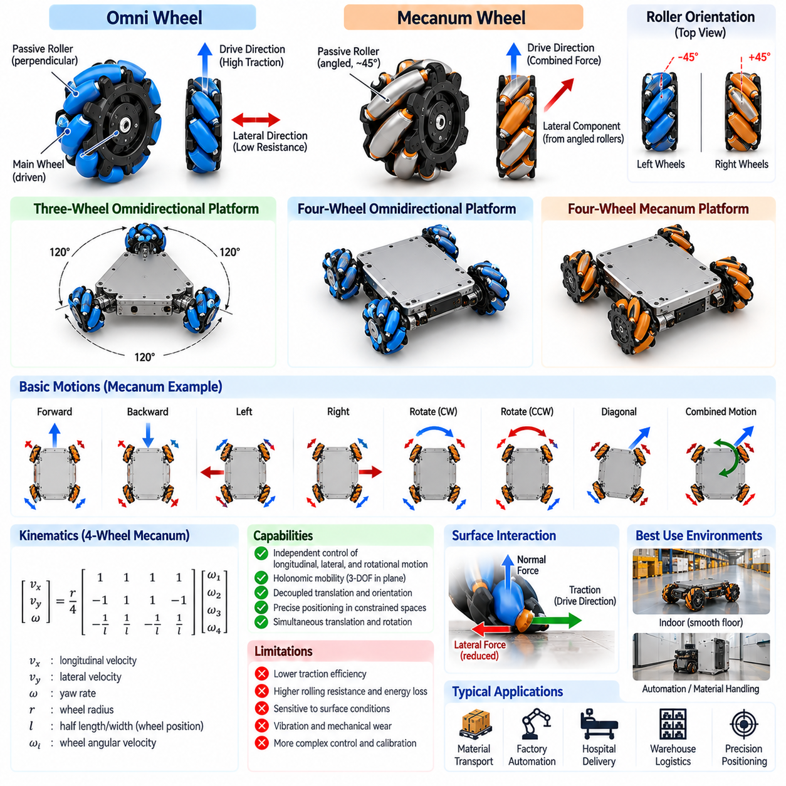{width="7.268055555555556in" height="7.268055555555556in"}

전방향 모바일 플랫폼(Omnidirectional Mobile Platform)은 기존의 차량형 조향(Conventional Vehicle-Like Steering) 없이도 평면상의 여러 방향으로 운동을 생성할 수 있는 로봇 이동 구조(Robotic Locomotion Architecture)의 한 유형이다. 차동 구동(Differential Drive) 또는 애커먼 조향(Ackermann Steering) 로봇과 달리 이러한 플랫폼은 종방향 병진 운동(Longitudinal Translation), 횡방향 병진 운동(Lateral Translation), 회전 운동(Rotational Motion)을 독립적으로 제어할 수 있다. 이러한 이동 능력은 사용 가능한 운동 공간(Motion Space)을 확장하고 제한된 환경에서의 기동성(Maneuverability)을 향상시킨다.

전방향 형태학(Omnidirectional Morphology)의 근본적인 장점은 병진 이동(Translational Movement)과 차체 방향(Body Orientation)을 분리할 수 있다는 것이다. 로봇은 진행 방향(Heading)을 유지하면서 측면으로 이동하거나, 병진 이동과 동시에 회전하거나, 섀시(Chassis)를 이동 방향에 먼저 정렬하지 않고 복잡한 궤적(Complex Trajectory)을 따라 이동할 수 있다. 이러한 능력은 정밀 위치 결정(Precise Positioning), 자동화된 자재 취급(Automated Material Handling), 밀집된 작업 공간(Dense Workspace)에서의 내비게이션(Navigation)에 특히 유용하다.

전방향 이동(Omnidirectional Locomotion)은 일반적으로 한 방향으로는 제어된 운동을 생성하고 다른 방향으로는 수동적인 이동(Passive Movement)을 허용하는 특수 바퀴 메커니즘(Specialized Wheel Mechanism)을 사용하여 구현된다. 옴니 휠(Omni Wheel)과 메카넘 휠(Mecanum Wheel)은 바퀴 둘레에 장착된 롤러(Roller)를 통해 이러한 동작을 구현한다. 롤러의 배치(Roller Arrangement)는 견인력(Traction Force)이 생성될 수 있는 방향과 개별 바퀴의 운동이 결합되는 방식을 결정한다.

일반적인 전방향 바퀴(Omnidirectional Wheel)는 주 바퀴의 구름 방향(Main Wheel Rolling Direction)에 수직으로 배치된 수동 롤러(Passive Roller)를 포함한다. 이러한 롤러는 횡방향 이동(Lateral Movement)에 대한 저항을 줄이는 반면, 주 바퀴의 회전은 구동 방향(Driven Direction)을 따라 견인력(Traction)을 생성한다. 여러 바퀴를 적절한 방향으로 배치하면 모바일 베이스(Mobile Base)는 협조된 바퀴 속도(Coordinated Wheel Velocity)를 통해 독립적인 평면 병진 운동(Planar Translation)과 회전 운동(Rotational Motion)을 생성할 수 있다.

삼륜 전방향 플랫폼(Three-Wheel Omnidirectional Platform)은 일반적으로 섀시(Chassis) 주변에 바퀴를 대칭적으로 배치하고, 각 바퀴의 구동 방향(Wheel Driving Direction)을 완전한 평면 이동성(Full Planar Mobility)을 제공하도록 구성한다. 이러한 소형 기하학적 구조(Compact Geometry)는 정밀한 기동과 비교적 간단한 기계적 통합(Mechanical Integration)을 지원한다. 그러나 운용 조건이 변화하더라도 안정적인 이동을 유지하려면 하중 분포(Load Distribution), 바퀴 접촉 일관성(Wheel Contact Consistency), 견인력 제한(Traction Limitation)을 신중하게 관리해야 한다.

사륜 전방향 플랫폼(Four-Wheel Omnidirectional Platform)은 추가적인 접촉점(Contact Point)을 제공하며 탑재하중 지지(Payload Support)와 기계적 중복성(Mechanical Redundancy)을 개선할 수 있다. 바퀴 배치는 개별 바퀴 속도의 조합을 통해 병진 운동(Translation)과 회전 운동(Rotation)을 생성하도록 구성할 수 있다. 추가적인 바퀴는 하중 분산을 개선할 수 있지만, 불균일한 지면 접촉(Unequal Ground Contact)이나 기하학적 정렬 오차(Geometric Misalignment)는 내부 힘(Internal Force)을 발생시키고 운동 정확도(Motion Accuracy)를 저하시킬 수 있다.

메카넘 휠(Mecanum Wheel)은 바퀴의 주 구름 평면(Primary Rolling Plane)에 대해 일반적으로 약 45도 각도로 장착된 수동 롤러(Passive Roller)를 특징으로 하는 대표적인 전방향 이동 메커니즘(Omnidirectional Mechanism)이다. 바퀴가 회전하면 경사진 롤러(Angled Roller)는 바퀴 방향(Wheel Orientation)과 접촉 기하학(Contact Geometry)에 따라 결정되는 유효 견인 방향(Effective Traction Direction)을 형성한다. 여러 메카넘 휠을 협조적으로 제어하면 평면상의 다양한 방향으로 이동할 수 있다.

일반적인 메카넘 플랫폼(Mecanum Platform)은 직사각형 섀시(Rectangular Chassis) 주변에 배치된 네 개의 독립 구동 바퀴(Independently Driven Wheel)를 사용한다. 롤러 방향(Roller Orientation)은 적절한 바퀴 속도 조합(Wheel-Speed Combination)을 통해 종방향 운동(Longitudinal Motion), 횡방향 운동(Lateral Motion), 회전 운동(Rotational Motion)을 생성할 수 있도록 선택된다. 바퀴의 올바른 배치와 롤러 방향은 필수적이며, 개별 바퀴의 구성을 반대로 설치하면 결과적인 운동 특성이 크게 달라질 수 있다.

전진 또는 후진 운동(Forward or Backward Motion)에서는 횡방향 힘 성분(Lateral Force Component)이 거의 상쇄되고 종방향 성분(Longitudinal Component)이 결합되도록 바퀴 속도를 협조적으로 제어한다. 측면 이동(Sideways Movement)에서는 횡방향 운동을 강화하면서 원하지 않는 종방향 및 회전 성분을 상쇄하도록 바퀴 회전 방향을 선택한다. 회전 운동은 플랫폼 주변에 순 요 모멘트(Net Yaw Moment)를 생성하는 바퀴 속도 패턴(Wheel-Speed Pattern)을 통해 구현된다.

메카넘 플랫폼(Mecanum Platform)은 병진 운동(Translation)과 회전 운동(Rotation)을 동시에 결합하여 복잡한 평면 궤적(Complex Planar Trajectory)을 구현할 수 있다. 이러한 능력은 로봇이 센서 방향(Sensor Orientation)을 유지하거나 장비와 정렬(Alignment)하거나 좁은 공간을 통해 물체를 운송해야 할 때 특히 유용하다. 그러나 명령된 운동(Commanded Motion)은 정확한 바퀴 속도 협조(Wheel-Speed Coordination)와 각 바퀴-지면 접촉점(Wheel-Ground Contact Point)에서의 충분한 견인력에 의존한다.

전방향 플랫폼의 운동학(Omnidirectional Platform Kinematics)은 일반적으로 섀시 속도(Chassis Velocity)와 개별 바퀴 각속도(Individual Wheel Angular Velocity) 사이의 변환(Transformation)으로 표현된다. 섀시 속도에는 종방향 속도(Longitudinal Speed), 횡방향 속도(Lateral Speed), 요 회전 속도(Yaw Rate)가 포함된다. 바퀴 반경(Wheel Radius), 바퀴 배치(Wheel Placement), 롤러 기하학(Roller Geometry), 섀시 치수(Chassis Dimensions)는 순운동학(Forward Kinematics)과 역운동학(Inverse Kinematics) 계산에 사용되는 변환 행렬(Transformation Matrix)을 결정한다.

이상적인 조건(Ideal Conditions)에서 전방향 플랫폼은 독립적으로 제어 가능한 세 개의 평면 자유도(Planar Degrees of Freedom)를 제공할 수 있다. 이러한 특성은 섀시 수준(Chassis Level)에서 홀로노믹 이동성(Holonomic Mobility)으로 설명되는 경우가 많다. 그러나 실제 시스템은 구동기 제한(Actuator Limits), 바퀴 접촉 제약조건(Wheel-Contact Constraints), 마찰(Friction), 기계적 불완전성(Mechanical Imperfections)의 영향을 받으며, 이로 인해 명령된 운동을 정확하게 구현하지 못할 수 있다.

바퀴-지면 상호작용(Wheel-Ground Interaction)은 전방향 이동 성능(Omnidirectional Mobility Performance)을 결정하는 주요 요소이다. 수동 롤러(Passive Roller)는 진동(Vibration), 구름 저항(Rolling Resistance), 불균일한 견인력(Uneven Traction)을 발생시킬 수 있는 추가적인 접촉면(Contact Interface)을 형성한다. 표면 거칠기(Surface Roughness), 이물질(Debris), 바닥 이음부(Floor Joint), 마찰 변화(Friction Variation)는 롤러 접촉(Roller Engagement)에 영향을 줄 수 있다. 따라서 전방향 플랫폼은 일반적으로 비교적 매끄럽고 단단하며 예측 가능한 지면에서 가장 우수한 성능을 발휘한다.

메카넘 휠(Mecanum Wheel)은 경사진 롤러(Angled Roller)가 접촉력을 여러 방향으로 분산시키기 때문에 일반적인 바퀴(Conventional Wheel)에 비해 견인 효율(Traction Efficiency)이 낮은 경우가 많다. 일부 구동기 출력(Actuator Effort)은 섀시 수준에서 서로 상쇄되는 힘 성분(Force Component)을 생성하는 데 사용된다. 이러한 특성은 특히 횡방향 이동(Lateral Movement)이나 저마찰 지면(Low-Friction Surface)에서 운용할 때 에너지 소비를 증가시키고 유효 가속 능력(Effective Acceleration Capability) 또는 탑재하중 용량(Payload Capacity)을 감소시킬 수 있다.

전방향 베이스(Omnidirectional Base)의 기계적 형상(Mechanical Geometry)은 안정성(Stability)과 탑재하중 성능(Payload Performance)에 큰 영향을 미친다. 바퀴 간격(Wheel Spacing), 섀시 치수(Chassis Dimensions), 무게중심 높이(Center-of-Gravity Height), 질량 분포(Mass Distribution)는 전복 저항성(Tipping Resistance)과 가속 중 하중 이동(Load Transfer)을 결정한다. 무겁거나 높은 위치에 탑재하중을 운반하는 플랫폼은 모든 이동 방향에서 충분한 바퀴 접촉과 예측 가능한 운동을 유지하기 위해 신중한 구조 설계(Structural Design)가 필요하다.

현가장치(Suspension)와 바퀴 장착 구조(Wheel Mounting Arrangement)는 전방향 이동이 여러 바퀴 사이의 일관된 접촉(Consistent Contact)에 의존하기 때문에 특히 중요하다. 바닥 높이(Floor Height), 바퀴 직경(Wheel Diameter), 섀시 정렬(Chassis Alignment)의 작은 차이도 수직 하중(Normal Force)을 재분배하고 견인력을 변화시킬 수 있다. 유연한 장착 구조(Compliant Mounting Structure) 또는 신중하게 설계된 현가장치 메커니즘(Suspension Mechanism)은 접촉 일관성을 개선할 수 있지만, 과도한 유연성(Excessive Compliance)은 위치 결정 정확도(Positioning Accuracy)를 저하시킬 수 있다.

전방향 플랫폼의 제어 시스템(Control System)은 구동기 차이(Actuator Differences), 마찰(Friction), 외부 외란(External Disturbances)을 보상하면서 바퀴 속도를 협조적으로 제어해야 한다. 기본 운동학 제어기(Basic Kinematic Controller)는 원하는 섀시 속도(Desired Chassis Velocity)를 개별 모터 명령(Individual Motor Command)으로 변환한다. 보다 고급 제어 방식(Advanced Control Approach)은 바퀴 엔코더(Wheel Encoder), 관성 센서(Inertial Sensor), 외부 위치 추정 시스템(External Localization System)의 피드백(Feedback)을 활용하여 운동 오차(Motion Error)를 보정하고 궤적 추종(Trajectory Tracking)을 개선한다.

정확한 주행거리 추정(Odometry)은 롤러 미끄러짐(Roller Slip)과 불균일한 접촉(Uneven Contact)으로 인해 바퀴 회전(Wheel Rotation)과 실제 섀시 변위(Actual Chassis Displacement) 사이에 차이가 발생할 수 있으므로 어려운 과제이다. 이러한 오차는 특히 횡방향 이동이나 병진 운동과 회전 운동을 결합할 때 두드러질 수 있다. 관성측정장치(Inertial Measurement Unit, IMU), 카메라(Camera), 라이다(LiDAR), 기타 위치 추정 정보원(Localization Source)을 결합한 센서 융합(Sensor Fusion)은 상태 추정(State Estimation)을 개선하고 누적 위치 오차(Accumulated Positioning Error)를 줄일 수 있다.

전방향 이동성(Omnidirectional Mobility)은 경로 계획(Path Planning)과 장애물 회피(Obstacle Avoidance)의 요구사항을 변화시킨다. 로봇은 방향을 변경하지 않고 횡방향으로 이동할 수 있으므로 경로 계획기(Planner)는 기존의 비홀로노믹 플랫폼(Nonholonomic Platform)보다 더 넓은 실행 가능한 운동 범위(Feasible Motion Range)를 활용할 수 있다. 그러나 계획 과정에서는 여전히 섀시 치수(Chassis Dimensions), 장애물 이격거리(Obstacle Clearance), 바퀴 속도 제한(Wheel-Speed Limits), 가속도 제약조건(Acceleration Constraints), 이동 방향별 물리적 비용(Physical Motion Cost)을 고려해야 한다.

피지컬 AI(Physical AI) 응용에서 전방향 플랫폼은 형태학 인식 제어(Morphology-Aware Control)와 학습(Learning)을 위한 유용한 기회를 제공한다. 지능형 제어기(Intelligent Controller)는 변화하는 탑재하중(Payload), 표면 마찰(Surface Friction), 구동기 성능(Actuator Performance)에 따라 바퀴 속도 배분(Wheel-Speed Allocation)을 적응적으로 조정할 수 있다. 학습 기반 방법(Learning-Based Method)은 운동 오차를 식별하고 제어 정책(Control Policy)을 개선할 수 있으며, 물리 기반 모델(Physics-Based Model)은 플랫폼의 기계적 제약조건(Mechanical Constraints)과 접촉 제약조건(Contact Constraints)에 대한 일관성을 유지한다.

일반적인 옴니 휠(Conventional Omni Wheel)과 메카넘 휠(Mecanum Wheel) 중 어떤 방식을 선택할지는 탑재하중 요구사항(Payload Requirements), 섀시 형상(Chassis Geometry), 사용 가능한 공간(Available Space), 지면 조건(Surface Conditions), 기계적 복잡성(Mechanical Complexity)에 따라 달라진다. 옴니 휠 구성(Omni-Wheel Arrangement)은 설계된 견인 방향(Designed Traction Direction)을 따라 효율적인 운동을 제공할 수 있으며, 메카넘 구성(Mecanum Configuration)은 편리한 직사각형 플랫폼 구조(Rectangular Platform Architecture)를 제공한다. 어느 메커니즘도 모든 운용 환경에서 보편적으로 우수하지는 않다.

산업 응용(Industrial Application)에는 자율이동로봇(Autonomous Mobile Robot, AMR), 로봇 운송 카트(Robotic Transport Cart), 제조 플랫폼(Manufacturing Platform), 병원 물류 시스템(Hospital Logistics System), 정밀 위치 결정 차량(Precision Positioning Vehicle)이 포함된다. 이러한 응용은 측면 이동(Sideways Movement), 좁은 공간에서의 기동(Compact Maneuvering), 작업대(Workstation)와의 정확한 정렬(Accurate Alignment)에서 이점을 얻는다. 그러나 실제 운용 적합성(Operational Suitability)은 바닥 품질(Floor Quality), 유지보수 요구사항(Maintenance Requirements), 에너지 효율(Energy Efficiency), 안전 제약조건(Safety Constraints), 예상 탑재하중 변화(Expected Payload Variation)를 기준으로 평가해야 한다.

궁극적으로 전방향 플랫폼(Omnidirectional Platform)과 메카넘 플랫폼(Mecanum Platform)은 특수한 바퀴 형태학(Specialized Wheel Morphology)이 모바일 로봇의 운동 능력(Motion Capabilities)을 어떻게 확장할 수 있는지 보여준다. 이러한 장점은 바퀴 기하학(Wheel Geometry), 구동기 제어(Actuator Control), 지면 접촉(Ground Contact)의 협조된 상호작용에서 발생한다. 성공적인 피지컬 AI 배치(Physical AI Deployment)를 위해서는 이러한 기계적 특성을 인식(Perception), 위치 추정(Localization), 계획(Planning), 적응형 제어(Adaptive Control)와 통합하여 신뢰성 있고 효율적이며 정밀한 자율 이동성(Autonomous Mobility)을 구현해야 한다.

## 04.05. Tracked and Hybrid Platforms

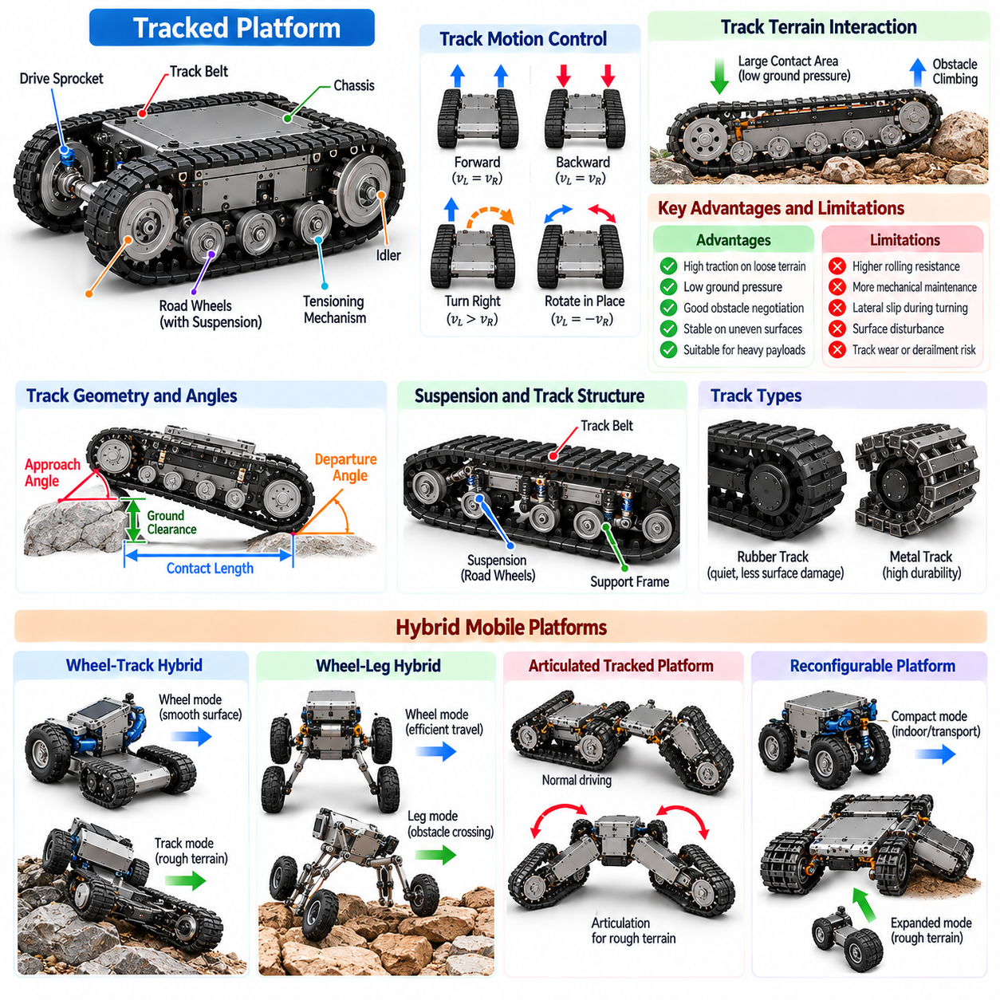{width="7.268055555555556in" height="7.268055555555556in"}

궤도형 및 하이브리드 모바일 플랫폼(Tracked and Hybrid Mobile Platforms)은 기존 바퀴형 시스템(Conventional Wheeled System)이 제한된 견인력(Limited Traction), 부족한 장애물 극복 능력(Obstacle-Crossing Capability), 불안정한 지면 접촉(Unstable Ground Contact)을 경험할 수 있는 환경에서 운용하도록 설계된 특수 이동 구조(Specialized Locomotion Architecture)이다. 이러한 형태학(Morphology)은 지형 적응성(Terrain Adaptability), 하중 분산(Load Distribution), 기계적 견고성(Mechanical Robustness)을 강조한다. 이러한 플랫폼은 특히 실외 로봇공학(Outdoor Robotics), 산업 검사(Industrial Inspection), 건설(Construction), 농업(Agriculture), 긴급 대응(Emergency Response) 분야에서 중요하다.

궤도형 이동(Tracked Locomotion)은 구동 스프로킷(Drive Sprocket), 아이들러(Idler), 지지 롤러(Supporting Roller)를 중심으로 순환하는 연속 벨트(Continuous Belt) 또는 연결식 궤도 조립체(Linked Track Assembly)를 사용한다. 기존 바퀴와 달리 궤도(Track)는 차량과 지형 사이에 확장된 접촉 영역(Extended Contact Region)을 형성한다. 이러한 구조는 차량 중량을 더 넓은 표면적에 분산시켜 접지압(Ground Pressure)을 낮추고 연약하거나 느슨하거나 불규칙한 지면에서 이동성을 향상시킬 수 있다.

궤도형 플랫폼(Tracked Platform)의 기계적 구조(Mechanical Architecture)는 일반적으로 구동 스프로킷(Drive Sprocket), 궤도 벨트(Track Belt), 장력 조절 메커니즘(Tensioning Mechanism), 주행륜(Road Wheel), 구조 지지 프레임(Structural Support Frame)으로 구성된다. 구동 스프로킷은 추진력(Propulsion Force)을 궤도에 전달하고, 아이들러는 궤도의 순환을 안내하며 정렬 상태(Alignment)를 유지한다. 궤도 장력(Track Tension)과 지지 기하학(Support Geometry)은 다양한 하중 조건에서 견인력(Traction), 진동(Vibration), 마모(Wear), 이동 신뢰성(Movement Reliability)에 영향을 미친다.

궤도형 플랫폼은 일반적으로 차동 궤도 속도 제어(Differential Track-Speed Control)를 사용하여 전진, 후진, 회전 운동을 생성한다. 양쪽 궤도가 동일한 속도로 움직이면 차량은 거의 직선으로 이동한다. 서로 다른 궤도 속도(Track Velocity)는 곡선 운동(Curved Motion)을 생성하며, 반대 방향으로 궤도를 구동하면 거의 제자리에서 회전(Near-Stationary Rotation)할 수 있다. 그러나 회전 과정에서는 일반적으로 궤도와 지면 사이에 횡방향 미끄러짐(Lateral Sliding)이 발생한다.

궤도형 차량(Tracked Vehicle)의 운동학(Kinematics)은 스키드 조향 플랫폼(Skid-Steering Platform)과 유사하지만, 동역학(Dynamics)은 분산된 지면 접촉(Distributed Ground Contact)의 영향을 크게 받는다. 궤도 변형(Track Deformation), 지형 마찰(Terrain Friction), 접촉 길이(Contact Length), 토양 저항(Soil Resistance)은 회전 거동(Turning Behavior)에 영향을 미친다. 따라서 이상적인 차동 구동 방정식(Ideal Differential-Drive Equation)은 근사적인 설명만 제공하며, 정확한 예측을 위해서는 실험적으로 보정된 모델(Experimentally Calibrated Model)이나 지형 의존 모델(Terrain-Dependent Model)이 필요할 수 있다.

궤도형 형태학(Tracked Morphology)의 주요 장점은 확장된 접촉 면적(Extended Contact Patch)에 수직 하중(Normal Force)을 분산할 수 있다는 것이다. 이는 변형 가능한 지형(Deformable Terrain)에서 부상성(Flotation)을 개선하고 국부적인 지면 하중(Localized Ground Loading)을 줄일 수 있다. 그러나 실제 성능은 궤도 폭(Track Width), 접촉 길이(Contact Length), 차량 질량(Vehicle Mass), 토양 특성(Soil Properties), 압력 분포(Pressure Distribution)에 따라 달라진다. 궤도가 모든 지면 조건에서 자동으로 우수한 견인력이나 이동성을 보장하는 것은 아니다.

궤도 기하학(Track Geometry)은 장애물 극복(Obstacle Negotiation)에 중요한 역할을 한다. 전방 아이들러(Front Idler), 후방 스프로킷(Rear Sprocket), 지지 롤러(Supporting Roller)의 배치는 진입각(Approach Angle), 이탈각(Departure Angle), 유효 지상고(Effective Ground Clearance)를 결정한다. 전방 궤도 구간을 높게 배치하면 차량이 장애물에 접근하고 접촉하는 데 도움이 되며, 긴 접촉 영역(Long Contact Region)은 안정성을 개선할 수 있지만 회전 저항(Turning Resistance)과 기동의 어려움을 증가시킬 수 있다.

궤도형 플랫폼의 현가장치(Suspension System)는 불규칙한 지형에서도 접촉을 유지하고 탑재 장비(Onboard Equipment)에 전달되는 충격(Shock)을 줄이는 데 도움이 된다. 주행륜 현가장치(Road-Wheel Suspension), 관절형 궤도 조립체(Articulated Track Assembly), 유연한 장착 구조(Compliant Mounting Structure)는 궤도 시스템이 지면의 불규칙성(Ground Irregularity)에 적응하도록 한다. 적절한 현가장치 설계는 험지 운용(Rough-Terrain Operation) 중 견인력의 일관성(Traction Consistency), 기계적 내구성(Mechanical Durability), 센서 안정성(Sensor Stability)을 향상시킨다.

궤도 재료(Track Material)와 제작 구조(Track Construction)는 플랫폼 성능에 상당한 영향을 미친다. 고무 궤도(Rubber Track)는 일반적으로 비교적 조용하게 작동하며 마감된 바닥(Finished Surface)의 손상을 줄일 수 있는 반면, 금속 연결식 궤도(Metal-Linked Track)는 마모가 심한 환경(Abrasive Environment)에서 더 높은 내구성을 제공할 수 있다. 보강 구조(Reinforcement Structure), 트레드 패턴(Tread Pattern), 궤도 유연성(Track Flexibility)은 내마모성(Wear Resistance), 견인력, 구름 손실(Rolling Loss), 다양한 지형과의 적합성(Terrain Compatibility)에 영향을 미친다.

이동성 측면의 장점에도 불구하고 궤도형 플랫폼은 중요한 한계를 가진다. 연속 궤도 시스템(Continuous Track System)은 벨트 장력(Belt Tension), 정렬 상태(Alignment), 이물질 축적(Debris Accumulation), 부품 마모(Component Wear) 때문에 단순한 바퀴형 구조보다 더 많은 기계적 유지보수(Mechanical Maintenance)가 필요할 수 있다. 회전 과정에서는 상당한 마찰 손실(Frictional Loss)과 지면 교란(Surface Disturbance)이 발생할 수 있으며, 궤도 손상(Track Damage)이나 궤도 이탈(Track Derailment)은 운용 가용성(Operational Availability)을 크게 감소시킬 수 있다.

하이브리드 모바일 플랫폼(Hybrid Mobile Platform)은 서로 다른 물리적 제약조건(Physical Constraints)을 가진 환경 전반에서 이동성을 확장하기 위해 여러 이동 메커니즘(Locomotion Mechanism)을 결합한다. 대표적인 예로는 바퀴-궤도 시스템(Wheel-Track System), 바퀴-다리 구성(Wheel-Leg Configuration), 관절형 궤도 플랫폼(Articulated Tracked Platform), 재구성 가능한 지면 접촉 메커니즘(Reconfigurable Ground-Contact Mechanism)이 있다. 이러한 구조의 목적은 한 이동 방식의 효율성과 다른 방식의 지형 적응성 또는 장애물 극복 능력을 결합하는 것이다.

바퀴-궤도 하이브리드 플랫폼(Wheel-Track Hybrid Platform)은 매끄러운 지면에서는 주로 바퀴로 이동하고, 추가적인 지면 접촉이나 지형 주행 능력이 필요할 때 궤도를 사용할 수 있다. 일부 설계는 전개식 궤도 모듈(Deployable Track Module)을 사용하며, 다른 설계는 바퀴와 궤도를 하나의 공통 기계 조립체(Shared Mechanical Assembly)에 통합한다. 이러한 구성은 운용 범용성(Operational Versatility)을 향상시킬 수 있지만, 전환 메커니즘(Transition Mechanism)은 질량(Mass), 복잡성(Complexity), 잠재적 고장 지점(Potential Failure Point)을 증가시킨다.

바퀴-다리 하이브리드 시스템(Wheel-Leg Hybrid System)은 연속적인 구름 운동(Continuous Rolling Motion)과 관절형 다리 구조(Articulated Limb Structure)를 결합한다. 바퀴는 비교적 매끄러운 지면에서 효율적인 이동을 제공하며, 관절형 다리(Articulated Leg)는 몸체 높이(Body Height)를 조절하거나 장애물을 극복하거나 불규칙한 지형에서 접촉을 유지할 수 있다. 이러한 플랫폼은 여러 이동 원리(Locomotion Principles)를 결합함으로써 도달 가능한 작업 공간(Reachable Workspace)을 확장하고 불확실한 환경(Uncertain Environment)에 대한 적응성을 향상시킬 수 있음을 보여준다.

관절형 궤도 로봇(Articulated Tracked Robot)은 움직일 수 있는 궤도 모듈(Movable Track Module)이나 상호 연결된 섀시 구간(Interconnected Chassis Section)을 사용하여 유효 형상(Effective Geometry)을 변경한다. 전방 및 후방 플리퍼(Front and Rear Flipper), 조절식 궤도 암(Adjustable Track Arm), 관절형 몸체 구간(Articulated Body Segment)은 장애물 등반(Obstacle Climbing), 틈새 통과(Gap Crossing), 불규칙한 지형 주행(Uneven Terrain Traversal)을 지원할 수 있다. 이러한 구조의 효과는 협조된 관절 제어(Coordinated Joint Control), 접촉 추정(Contact Estimation), 차량 무게중심(Center of Gravity) 관리에 달려 있다.

재구성 가능한 형태학(Reconfigurable Morphology)은 하이브리드 플랫폼이 지형 조건(Terrain Conditions)과 작업 요구사항(Task Requirements)에 따라 물리적 구조(Physical Structure)를 변경할 수 있도록 한다. 궤도 전개(Track Deployment), 바퀴 위치(Wheel Position), 섀시 높이(Chassis Height), 관절각(Articulation Angle)의 변화는 로봇의 접촉 기하학(Contact Geometry)과 동적 거동(Dynamic Behavior)을 변화시킨다. 이러한 적응성(Adaptability)은 운용 유연성(Operational Flexibility)을 증가시키지만 추가적인 센싱(Sensing), 구동(Actuation), 제어(Control) 요구사항을 발생시킨다.

이동 모드(Locomotion Mode) 사이의 전환은 하이브리드 로봇(Hybrid Robot)의 핵심 설계 과제이다. 바퀴에서 궤도로 전환하거나 관절형 모듈(Articulated Module)을 조절하면 접촉력 분포(Contact Force Distribution)와 사용 가능한 운동 제약조건(Motion Constraints)이 변화한다. 적절하게 협조되지 않은 전환은 불안정성(Instability), 과도한 구동기 하중(Excessive Actuator Loading), 일시적인 견인력 상실(Temporary Loss of Traction)을 초래할 수 있다. 신뢰성 있는 전환에는 적절한 기계적 동작 순서(Mechanical Sequencing)와 피드백 제어(Feedback Control)가 필요하다.

질량 분포(Mass Distribution)와 무게중심 배치(Center-of-Gravity Placement)는 궤도형 및 하이브리드 플랫폼 모두에서 필수적인 고려사항이다. 무거운 구동 부품(Drive Component), 배터리(Battery), 탑재하중(Payload), 관절형 메커니즘(Articulated Mechanism)은 등판(Climbing), 내리막 주행(Descending), 회전(Turning) 중 안정성에 영향을 미친다. 낮은 무게중심(Low Center of Gravity)은 일반적으로 전복 저항성(Tipping Resistance)을 향상시키며, 이동 가능한 구성요소(Movable Component)는 구성이 변화함에 따라 동적 안정성 평가(Dynamic Stability Evaluation)가 필요할 수 있다.

에너지 효율(Energy Efficiency)은 궤도형 및 하이브리드 이동 모드(Locomotion Mode)에 따라 상당히 달라진다. 궤도는 어려운 지형에서 유용한 견인력을 제공할 수 있지만, 단단한 지면에서는 기존 바퀴보다 더 높은 구름 손실(Rolling Loss)과 조향 손실(Steering Loss)이 발생할 수 있다. 하이브리드 플랫폼은 효율적인 이동 모드를 선택하여 에너지 소비를 줄일 가능성이 있지만, 추가된 구동기(Actuator), 동력전달장치(Transmission), 구조 질량(Structural Mass)이 이러한 이점의 일부를 상쇄할 수 있다.

제어 시스템(Control System)은 추진(Propulsion), 조향(Steering), 지형 접촉(Terrain Contact), 형태학적 구성(Morphological Configuration) 사이의 복잡한 상호작용을 고려해야 한다. 기본적인 궤도형 플랫폼은 차동 궤도 속도 명령(Differential Track-Speed Command)을 사용할 수 있지만, 관절형 및 하이브리드 시스템은 추가 관절(Joint)이나 메커니즘의 협조 제어(Coordinated Control)가 필요하다. 모델 기반 제어(Model-Based Control)와 적응형 피드백(Adaptive Feedback)은 변화하는 지형 조건에서 안정성과 운동 정확도(Motion Accuracy)를 향상시킬 수 있다.

정확한 위치 추정(Localization)은 궤도 미끄러짐(Track Slip), 토양 변형(Soil Deformation), 불규칙한 접촉(Irregular Contact)이 상당한 주행거리 추정 오차(Odometry Error)를 발생시킬 수 있기 때문에 어렵다. 바퀴 또는 궤도 엔코더(Wheel or Track Encoder)의 측정값이 실제 지면 변위(Actual Ground Displacement)를 직접 나타내지 못할 수 있다. 관성측정장치(Inertial Measurement Unit, IMU), 시각적 주행거리 추정(Visual Odometry), 라이다(LiDAR), 지형 인식 추정 방법(Terrain-Aware Estimation Method)을 결합하면 위치 추정 신뢰성(Localization Reliability)을 개선하고 비정형 환경(Unstructured Environment)에서 자율 내비게이션(Autonomous Navigation)을 지원할 수 있다.

지형 인식(Terrain Perception)은 지능형 궤도형 및 하이브리드 로봇(Intelligent Tracked and Hybrid Robot)에서 특히 중요한 역할을 한다. 카메라(Camera), 깊이 센서(Depth Sensor), 라이다(LiDAR)는 장애물 형상(Obstacle Geometry), 경사(Slope), 표면 거칠기(Surface Roughness), 잠재적인 주행 가능성(Traversability)을 추정할 수 있다. 피지컬 AI 시스템(Physical AI System)은 이러한 정보를 활용하여 이동 모드(Locomotion Mode)를 선택하고, 관절 구조(Articulation)를 조절하고, 속도를 제어하며, 현재 형태학이 비효율적이거나 안전하지 않게 될 수 있는 상황을 예측할 수 있다.

형태학 인식 계획(Morphology-Aware Planning)은 환경을 통과하는 경로뿐만 아니라 해당 경로를 주행하는 데 필요한 물리적 구성(Physical Configuration)도 고려해야 한다. 하이브리드 로봇은 연약한 지형(Soft Terrain)에 진입하기 전에 궤도를 전개하거나 장애물을 오르기 전에 관절형 모듈(Articulated Module)의 위치를 조정해야 할 수 있다. 따라서 계획 과정에서는 안정성(Stability), 이격거리(Clearance), 구동기 제약조건(Actuator Constraints)을 준수하면서 공간 궤적(Spatial Trajectory)과 구성 변경(Configuration Change)을 협조적으로 조정해야 한다.

안전성(Safety)과 신뢰성(Reliability)은 궤도형 및 하이브리드 플랫폼이 위험하거나 예측하기 어려운 환경에서 자주 운용되기 때문에 특히 중요하다. 기계적 보호(Mechanical Protection), 비상 정지(Emergency Stopping), 구동기 모니터링(Actuator Monitoring), 고장 감지(Fault Detection)는 지형으로 인해 발생하는 하중(Terrain-Induced Load)과 이동 기능 고장(Mobility Failure)의 가능성을 고려해야 한다. 재구성 가능한 메커니즘(Reconfigurable Mechanism)은 끼임 위험 지점(Pinch Point)과 추가적인 고장 모드(Failure Mode)도 발생시키므로 적절한 보호 설계(Protective Design)가 필요하다.

시뮬레이션(Simulation)과 실험적 검증(Experimental Validation)에는 현실적인 궤도-지면 상호작용(Track-Ground Interaction), 지형 변형(Terrain Deformation), 마찰(Friction), 현가장치 동역학(Suspension Dynamics), 구성 의존 안정성(Configuration-Dependent Stability)을 반영해야 한다. 단순화된 모델(Simplified Model)은 초기 개발에 유용하지만, 예상하지 못한 접촉 거동(Contact Behavior)과 기계적 한계(Mechanical Limitation)를 식별하기 위해서는 현장 시험(Field Testing)이 필수적이다. 대표적인 지형 시험(Representative Terrain Trial)은 안전한 운용 범위(Safe Operating Boundary)와 신뢰성 있는 제어 전략(Reliable Control Strategy)을 수립하는 데 도움이 된다.

궁극적으로 궤도형 및 하이브리드 플랫폼(Tracked and Hybrid Platforms)은 모바일 베이스 형태학(Mobile Base Morphology)이 기존 바퀴형 이동(Conventional Wheeled Locomotion)의 한계를 극복하도록 어떻게 적응될 수 있는지 보여준다. 이러한 플랫폼의 가치는 확장된 지면 접촉(Extended Ground Contact), 특수한 장애물 극복 기하학(Specialized Obstacle-Negotiation Geometry), 구성 변경이 가능한 기계 구조(Configurable Mechanical Structure)에서 비롯된다. 성공적인 피지컬 AI 통합(Physical AI Integration)을 위해서는 다양한 환경에서 신뢰성 있는 이동성을 구현할 수 있도록 형태학(Morphology), 인식(Perception), 계획(Planning), 제어(Control), 에너지 관리(Energy Management)를 협조적으로 설계해야 한다.

## 04.06. Wheel Tire and Terrain Interaction

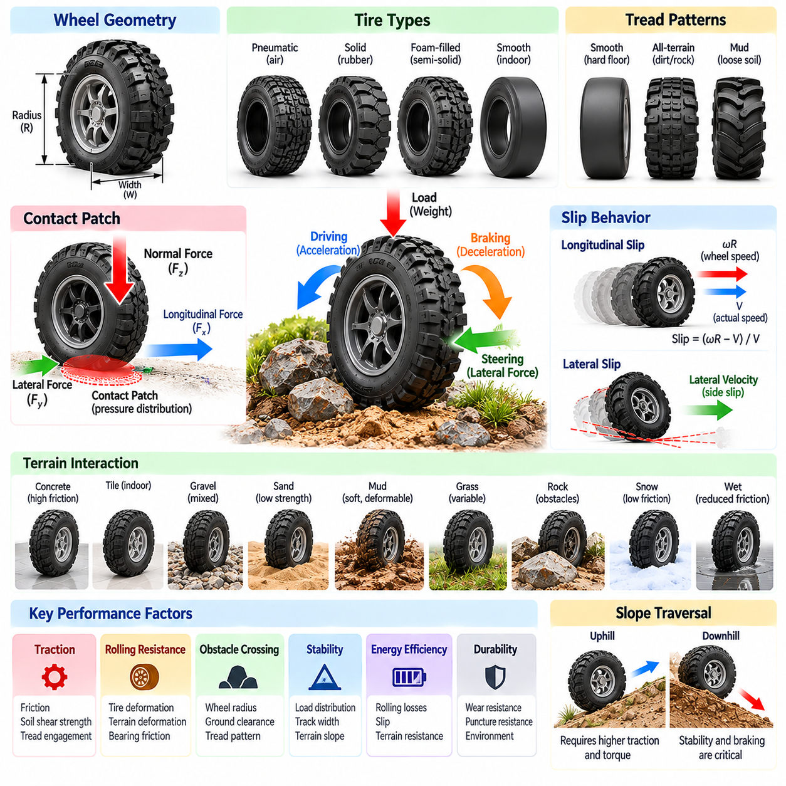{width="7.268055555555556in" height="7.268055555555556in"}

바퀴, 타이어 및 지형 상호작용(Wheel, Tire, and Terrain Interaction)은 플랫폼과 운용 환경 사이에서 기계적 힘(Mechanical Force)이 전달되는 방식을 결정하기 때문에 모바일 로봇 형태학(Mobile Robot Morphology)의 기본적인 요소이다. 바퀴 기하학(Wheel Geometry), 타이어 재료(Tire Material), 표면 조건(Surface Conditions), 접촉 역학(Contact Mechanics)은 견인력(Traction), 안정성(Stability), 에너지 효율(Energy Efficiency), 이동성(Mobility)에 복합적으로 영향을 미친다. 이러한 관계를 이해하는 것은 다양한 지형 조건에서 신뢰성 있는 자율 플랫폼(Autonomous Platform)을 설계하는 데 필수적이다.

바퀴(Wheel)는 바퀴형 로봇(Wheeled Robot)과 지면 사이의 주요 기계적 접촉부(Mechanical Interface) 역할을 한다. 바퀴 반경(Wheel Radius), 폭(Width), 구조적 강성(Structural Stiffness), 표면 형상(Surface Profile)은 구름 저항(Rolling Resistance), 장애물 극복(Obstacle Negotiation), 하중 분포(Load Distribution)에 영향을 미친다. 일반적으로 큰 바퀴는 작은 장애물을 넘는 능력을 향상시키며, 작은 바퀴는 소형 플랫폼 설계(Compact Platform Design)에 유리하다. 그러나 바퀴 치수(Wheel Dimensions)는 모터 토크(Motor Torque), 차량 질량(Vehicle Mass), 설치 가능 공간(Available Installation Space)과 함께 평가해야 한다.

타이어 구조(Tire Construction)는 이동성에 큰 영향을 미치는 추가적인 기계적 특성(Mechanical Properties)을 제공한다. 공기압 타이어(Pneumatic Tire)는 내부 공기압(Internal Air Pressure)과 유연한 측벽(Flexible Sidewall)을 통해 유연성(Compliance)을 제공하여 표면의 불규칙한 형상에 따라 변형될 수 있다. 솔리드 타이어(Solid Tire)는 펑크 저항성(Puncture Resistance)과 유지보수 요구사항 감소라는 장점이 있지만 더 큰 진동을 전달할 수 있다. 폼 충전 타이어(Foam-Filled Tire)와 반고체 타이어(Semi-Solid Tire)는 구조와 운용 조건에 따라 중간적인 특성을 제공한다.

타이어-지면 접촉면(Tire-Ground Contact Patch)은 수직력(Normal Force), 종방향 힘(Longitudinal Force), 횡방향 힘(Lateral Force)이 전달되는 영역이다. 접촉면의 크기와 압력 분포(Pressure Distribution)는 타이어 강성(Tire Stiffness), 공기압(Inflation Pressure), 작용 하중(Applied Load), 지형 특성(Terrain Properties)에 따라 달라진다. 접촉 조건(Contact Conditions)은 제동(Braking), 가속(Acceleration), 조향(Steering), 진동(Vibration)에 영향을 미친다. 정확한 모델링(Modeling)을 위해서는 타이어 변형(Tire Deformation)과 지지 표면(Supporting Surface)의 기계적 응답(Mechanical Response)을 모두 고려해야 한다.

견인력(Traction)은 과도한 미끄러짐(Slipping) 없이 유용한 힘을 생성할 수 있는 바퀴의 능력을 의미한다. 단단한 지면(Firm Surface)에서 사용 가능한 견인력은 마찰(Friction)과 수직 하중(Normal Loading)의 영향을 크게 받는다. 변형 가능한 지형(Deformable Terrain)에서는 토양 전단 강도(Soil Shear Strength), 다짐(Compaction), 트레드 침투(Tread Penetration)도 중요해진다. 따라서 동일한 타이어라도 콘크리트(Concrete), 자갈(Gravel), 모래(Sand), 진흙(Mud), 젖은 표면(Wet Surface)에서 상당히 다른 견인 특성(Traction Characteristics)을 나타낼 수 있다.

종방향 슬립(Longitudinal Slip)은 바퀴의 원주 속도(Circumferential Speed)와 지면에 대한 실제 전진 운동(Actual Forward Motion)이 서로 다를 때 발생한다. 가속 중 과도한 구동 토크(Drive Torque)는 바퀴 헛돎(Wheel Spin)을 유발할 수 있으며, 급격한 제동(Aggressive Braking)은 바퀴 잠김(Wheel Lockup)을 발생시킬 수 있다. 견인력을 생성하기 위해 일정 수준의 제어된 슬립(Controlled Slip)이 필요할 수 있지만, 과도한 슬립은 에너지를 낭비하고 마모(Wear)를 증가시키며 바퀴 기반 운동 추정(Wheel-Based Motion Estimation)의 정확도를 감소시킨다.

횡방향 슬립(Lateral Slip)은 바퀴가 의도된 구름 방향(Intended Rolling Direction)에 대해 측면으로 이동할 때 발생한다. 이러한 현상은 조향(Steering), 선회(Cornering), 저마찰 표면(Low-Friction Surface)에서의 운용 중 특히 중요하다. 타이어 변형(Tire Deformation)과 횡방향 접촉력(Lateral Contact Force)은 조향 입력(Steering Input)과 실제 궤적(Actual Trajectory) 사이의 관계를 결정한다. 과도한 횡방향 슬립은 경로 추종 오차(Path-Tracking Error)를 증가시키고 방향 안정성(Directional Stability)을 저하시킬 수 있다.

구름 저항(Rolling Resistance)은 바퀴가 표면을 따라 이동하면서 소산되는 에너지(Energy Dissipation)를 나타낸다. 타이어 변형(Tire Deformation), 재료 내부의 이력 현상(Material Hysteresis), 베어링 마찰(Bearing Friction), 지형 변형(Terrain Deformation)이 이러한 저항에 기여한다. 부드러운 타이어(Soft Tire)와 변형 가능한 지면(Deformable Ground)은 에너지 손실(Energy Loss)을 증가시킬 수 있으며, 매끄러운 표면에서 강성이 높은 바퀴(Rigid Wheel)는 더 효율적으로 구를 수 있다. 그러나 구름 저항을 최소화하는 것만으로 충분한 견인력이나 승차 품질(Ride Quality)이 보장되는 것은 아니다.

바퀴 반경(Wheel Radius)은 이동성과 구동계 요구사항(Drivetrain Requirements)에 모두 영향을 미친다. 바퀴 반경을 증가시키면 장애물 극복 능력(Obstacle-Crossing Capability)이 향상되고 작은 표면 불규칙성(Surface Irregularity)의 상대적인 영향이 줄어들 수 있다. 그러나 동일한 지면 구동력(Ground Force)을 생성하려면 그에 비례하여 더 큰 바퀴 토크(Wheel Torque)가 필요하다. 큰 바퀴는 회전 관성(Rotational Inertia), 질량(Mass), 패키징 제약조건(Packaging Constraints)도 증가시킬 수 있으므로 이동성, 가속 성능(Acceleration), 기계적 효율(Mechanical Efficiency) 사이의 절충관계(Tradeoff)가 발생한다.

바퀴 폭(Wheel Width)은 접지압(Ground Pressure), 접촉 기하학(Contact Geometry), 연약한 지형(Soft Terrain)으로 가라앉는 현상에 대한 저항에 영향을 미친다. 넓은 타이어(Wide Tire)는 하중을 더 큰 면적에 분산시켜 모래나 느슨한 토양(Loose Soil)에서 이동성을 개선할 수 있다. 그러나 넓은 접촉 영역(Wide Contact Region)은 조향 저항(Steering Resistance), 질량, 구름 손실(Rolling Loss)을 증가시킬 수 있다. 최적의 바퀴 폭은 지형 강도(Terrain Strength), 탑재하중 분포(Payload Distribution), 직선 주행(Straight-Line Travel)과 회전(Turning) 사이의 예상 운용 비중에 따라 달라진다.

트레드 패턴(Tread Pattern)은 타이어가 서로 다른 표면과 상호작용하는 방식에 영향을 미친다. 매끄러운 트레드(Smooth Tread)는 깨끗하고 단단한 바닥에서 일관된 접촉을 제공할 수 있으며, 돌출부가 큰 트레드 블록(Aggressive Tread Block)은 느슨한 토양이나 진흙에서 기계적 맞물림(Mechanical Engagement)을 개선할 수 있다. 홈(Groove)은 물 배출(Water Displacement)에 도움이 될 수 있지만, 성능은 속도(Speed), 하중(Load), 표면 조건(Surface Conditions)에 따라 달라진다. 트레드 선택(Tread Selection)은 견인력, 소음(Noise), 진동(Vibration), 마모(Wear), 바닥 적합성(Floor Compatibility) 사이의 균형을 고려해야 한다.

지형 특성(Terrain Properties)은 바퀴-지면 상호작용(Wheel-Ground Interaction)에 상당한 불확실성(Uncertainty)을 발생시킨다. 표면 거칠기(Surface Roughness), 경사(Slope), 수분(Moisture), 입자 크기(Particle Size), 토양 점착력(Soil Cohesion)은 추진(Propulsion)과 조향에 사용할 수 있는 힘에 영향을 미친다. 겉보기에 균일한 지형도 국부적인 마찰 변화(Friction Variation)나 지지 강도(Bearing Strength)의 차이를 포함할 수 있다. 따라서 자율 로봇(Autonomous Robot)은 지형 특성을 고정된 기계적 매개변수(Fixed Mechanical Parameter)가 아니라 변화하는 환경 조건(Variable Environmental Condition)으로 취급해야 한다.

변형 가능한 지형(Deformable Terrain)에서 바퀴 성능은 차량과 토양 사이의 상호작용을 연구하는 지반 차량역학(Terramechanics)과 밀접하게 관련된다. 바퀴 하중(Wheel Loading)은 침하(Sinkage)와 토양 변형(Soil Deformation)을 발생시키며, 추진력(Propulsion Force)은 부분적으로 지면 내부에서 발생하는 전단력(Shear Force)에 의존한다. 과도한 침하는 주행 저항(Motion Resistance)을 증가시키고 차량을 움직이지 못하게 할 수 있다. 타이어 치수(Tire Dimensions), 공기압(Inflation Pressure), 트레드 기하학(Tread Geometry), 차량 중량(Vehicle Weight)은 이러한 현상에 복합적으로 영향을 미친다.

경사면 주행(Slope Traversal)은 추가적인 견인력 및 안정성 요구사항(Traction and Stability Requirements)을 발생시킨다. 오르막 주행(Uphill Movement)에서는 중력(Gravity)으로 인해 추진에 필요한 종방향 힘(Longitudinal Force)이 증가하며, 내리막 주행(Downhill Movement)에서는 제어된 제동(Controlled Braking)이 필요하다. 횡경사 주행(Cross-Slope Operation)은 횡방향 하중 이동(Lateral Load Transfer)을 발생시키고 미끄러짐(Sliding)이나 전복 위험(Rollover Risk)을 증가시킬 수 있다. 안전한 이동성은 사용 가능한 마찰력(Available Friction), 무게중심 위치(Center-of-Gravity Location), 바퀴 배치(Wheel Placement), 접촉력 분포(Contact Force Distribution)에 따라 달라진다.

동적 하중 이동(Dynamic Load Transfer)은 가속(Acceleration), 제동(Braking), 회전(Turning) 중 개별 바퀴에 작용하는 수직력(Normal Force)을 변화시킨다. 이러한 변화는 각 접촉점(Contact Point)에서 사용 가능한 견인력을 변경하고 추진 및 조향 명령의 효과에 영향을 미친다. 불균일한 바퀴 하중(Unequal Wheel Loading)은 일부 바퀴가 미끄러지는 동안 다른 바퀴는 상당한 견인력을 유지하는 상황을 발생시킬 수 있다. 협조된 구동계 제어(Coordinated Drivetrain Control)는 힘을 더욱 효과적으로 분산하는 데 도움이 된다.

현가장치(Suspension)와 타이어 유연성(Tire Compliance)은 불규칙한 지면에서 바퀴가 얼마나 일관되게 접촉을 유지하는지 결정하기 위해 상호작용한다. 현가장치 메커니즘(Suspension Mechanism)은 비교적 큰 지형 변화(Terrain Variation)에 대응하고, 타이어 변형(Tire Deformation)은 작은 불규칙성을 흡수한다. 적절한 조합은 견인력 연속성(Traction Continuity)을 개선하고 충격 전달(Shock Transmission)을 줄이며 탑재 센서(Onboard Sensor)를 보호한다. 그러나 과도한 유연성(Excessive Compliance)은 진동(Oscillation)을 발생시키고 정밀한 운동 제어(Precise Motion Control)를 저하시킬 수 있다.

바퀴 재료 선택(Wheel Material Selection)은 내구성(Durability)과 환경 적합성(Environmental Compatibility)에도 영향을 미친다. 고무 화합물(Rubber Compound)은 마찰(Friction), 탄성(Elasticity), 내마모성(Wear Resistance)의 다양한 조합을 제공하며, 폴리우레탄 바퀴(Polyurethane Wheel)는 실내 산업용 플랫폼(Indoor Industrial Platform)에 자주 사용된다. 금속 바퀴(Metal Wheel)나 강성이 매우 높은 바퀴(Highly Rigid Wheel)는 특수 환경에 적합할 수 있지만 표면 손상(Surface Damage)과 진동을 증가시킬 수 있다. 재료 선택은 온도(Temperature), 화학물질 노출(Chemical Exposure), 바닥 조건(Floor Conditions), 유지보수 요구사항(Maintenance Requirements)을 반영해야 한다.

바퀴-지면 상호작용(Wheel-Ground Interaction)은 주행거리 추정(Odometry)과 위치 추정 정확도(Localization Accuracy)에 직접적인 영향을 미친다. 기존 바퀴 엔코더(Conventional Wheel Encoder)는 바퀴 회전과 지면 이동 사이에 예측 가능한 관계가 있다고 가정하여 회전 운동(Rotational Motion)으로부터 변위(Displacement)를 추정한다. 슬립(Slip), 타이어 변형(Tire Deformation), 유효 반경 변화(Changing Effective Radius), 불규칙한 지형(Uneven Terrain)은 이러한 가정을 위반한다. 관성 센싱(Inertial Sensing), 시각적 주행거리 추정(Visual Odometry), 외부 위치 추정 측정값(External Localization Measurement)을 통합하면 누적 위치 오차(Accumulated Positioning Error)를 줄일 수 있다.

지형 인식 제어 시스템(Terrain-Aware Control System)은 변화하는 접촉 조건(Contact Conditions)에 맞추어 추진 및 조향 명령(Propulsion and Steering Commands)을 조정한다. 견인력 제어(Traction Control)는 과도한 바퀴 헛돎(Wheel Spin)을 제한할 수 있으며, 슬립 추정(Slip Estimation)은 명령된 운동(Commanded Motion)과 실제 운동(Actual Motion) 사이의 차이를 식별하는 데 도움이 된다. 고급 제어기(Advanced Controller)는 추정된 표면 특성(Estimated Surface Properties)에 따라 토크 배분(Torque Allocation), 가속도 제한(Acceleration Limits), 궤적 선택(Trajectory Selection)을 조정한다. 이러한 적응은 기계적 구조를 완전히 변경하지 않고도 이동성을 개선한다.

피지컬 AI(Physical AI)는 인식(Perception), 예측(Prediction), 적응형 의사결정(Adaptive Decision-Making)을 통합함으로써 지형 상호작용(Terrain Interaction)을 기존 피드백 제어(Conventional Feedback Control)의 범위 이상으로 확장한다. 카메라(Camera), 깊이 센서(Depth Sensor), 기타 센싱 시스템(Sensing System)은 실제 접촉이 발생하기 전에 표면 특성(Surface Characteristics)을 식별할 수 있다. 학습 모델(Learned Model)은 이전 경험(Previous Experience)을 바탕으로 주행 가능성(Traversability)을 추정하거나 슬립을 예측할 수 있으며, 물리 기반 제약조건(Physics-Based Constraints)은 예측이 불확실할 때 안전한 운용을 유지하는 데 도움이 된다.

형태학 인식 계획(Morphology-Aware Planning)은 제안된 경로(Proposed Path)가 선택된 바퀴 및 타이어 구성(Wheel and Tire Configuration)으로 물리적으로 주행 가능한지 고려해야 한다. 기하학적으로 장애물이 없는 경로(Geometrically Clear Route)라도 견인력 부족(Insufficient Traction), 과도한 침하(Excessive Sinkage), 급경사(Steep Slope), 표면 불규칙성(Surface Irregularity) 때문에 적합하지 않을 수 있다. 계획 시스템(Planning System)은 후보 궤적(Candidate Trajectory)을 평가할 때 지상고(Ground Clearance), 바퀴 치수(Wheel Dimensions), 추정 마찰(Estimated Friction), 지형 강도(Terrain Strength)를 반영해야 한다.

실험적 특성 분석(Experimental Characterization)은 단순화된 마찰 모델(Simplified Friction Model)이 실제 타이어와 지형 사이의 모든 상호작용을 표현할 수 없기 때문에 필수적이다. 시험(Testing)에서는 대표적인 하중(Representative Load)과 환경 조건(Environmental Conditions)에서 견인력(Traction), 슬립(Slip), 구름 저항(Rolling Resistance), 진동(Vibration), 마모(Wear), 장애물 통과(Obstacle Traversal)를 평가해야 한다. 여러 표면에서 수집한 측정값(Measurements)은 타이어 설계(Tire Design)를 선택하고 개발 과정에서 사용되는 시뮬레이션 모델(Simulation Model)을 보정하는 근거를 제공한다.

궁극적으로 바퀴, 타이어 및 지형 상호작용(Wheel, Tire, and Terrain Interaction)은 모바일 로봇의 성능(Mobile Robot Performance)이 기계적 형태학(Mechanical Morphology)과 환경 물리학(Environmental Physics) 사이의 결합(Coupling)에서 발생한다는 사실을 보여준다. 효과적인 설계(Effective Design)를 위해서는 단일 특성을 최적화하기보다 견인력(Traction), 구름 효율(Rolling Efficiency), 내구성(Durability), 안정성(Stability), 제어 정확도(Control Accuracy) 사이의 균형을 유지해야 한다. 접촉 역학(Contact Mechanics)을 인식(Perception), 계획(Planning), 적응형 제어(Adaptive Control)와 통합하면 피지컬 AI 플랫폼(Physical AI Platform)이 다양하고 불확실한 환경에서 더욱 신뢰성 있게 운용될 수 있다.

## 04.07. Wheelbase Track Width and Ground Clearance

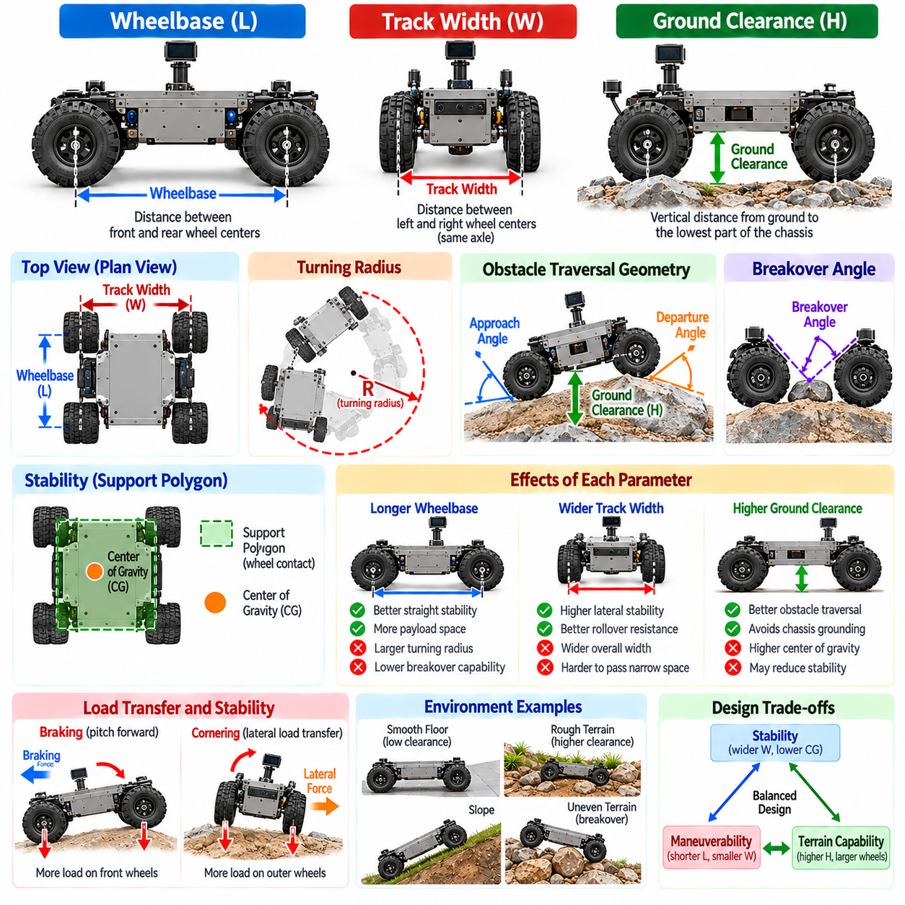{width="7.268055555555556in" height="7.268055555555556in"}

휠베이스(Wheelbase), 윤거(Track Width), 지상고(Ground Clearance)는 바퀴형 로봇 플랫폼(Wheeled Robotic Platform)의 기계적 비율(Mechanical Proportions)과 이동 특성(Mobility Characteristics)을 정의하는 기본적인 기하학적 매개변수(Geometric Parameters)이다. 이러한 치수는 기동성(Maneuverability), 안정성(Stability), 장애물 통과 능력(Obstacle Traversal), 지형 적합성(Terrain Compatibility)에 영향을 미친다. 치수의 선택은 의도된 운용 환경(Operating Environment), 탑재하중 요구사항(Payload Requirements), 조향 구조(Steering Architecture), 로봇 임무(Robot Mission)에 의해 부과되는 물리적 제약조건(Physical Constraints)을 반영해야 한다.

휠베이스(Wheelbase)는 전륜 차축(Front Wheel Axle)과 후륜 차축(Rear Wheel Axle)의 중심 사이에 있는 종방향 거리(Longitudinal Distance)이다. 이는 회전 기하학(Turning Geometry), 피치 안정성(Pitch Stability), 하중 분포(Load Distribution)의 중요한 특성을 결정한다. 일반적으로 긴 휠베이스(Long Wheelbase)는 방향 안정성(Directional Stability)을 향상시키고 부품과 탑재하중을 배치할 수 있는 공간을 더 많이 제공한다. 그러나 회전 반경(Turning Radius)을 증가시키고, 특히 기존 조향 시스템(Conventional Steering System)에서는 제한된 환경에서의 주행을 더욱 어렵게 만들 수 있다.

짧은 휠베이스(Short Wheelbase)는 소형 차량 구조(Compact Vehicle Construction)를 지원하며 좁은 공간에서 기동성을 향상시킬 수 있다. 이는 더 작은 회전 반경을 가능하게 하고 도킹(Docking)이나 위치 재조정(Repositioning)에 필요한 종방향 공간(Longitudinal Space)을 줄일 수 있다. 그러나 짧은 휠베이스는 가속으로 인한 피치 운동(Acceleration-Induced Pitch Motion)과 불규칙한 지형(Uneven Terrain)에 대한 민감도를 높일 수 있다. 따라서 설계자는 소형화(Compactness)와 안정성, 현가장치 거동(Suspension Behavior), 탑재하중 배치 요구사항(Payload Positioning Requirements) 사이의 균형을 유지해야 한다.

윤거(Track Width)는 동일한 차축(Axle)에 있는 좌우 바퀴 중심선(Centerline) 사이의 횡방향 거리(Lateral Distance)이다. 이는 횡방향 전복(Lateral Tipping)에 대한 저항성과 선회(Cornering) 중 하중 분포에 큰 영향을 미친다. 일반적으로 넓은 윤거(Wide Track Width)는 지지 기반(Support Base)을 확장하여 횡방향 안정성(Lateral Stability)을 향상시킨다. 그러나 차량의 전체 폭(Overall Vehicle Width)도 증가시켜 좁은 복도(Corridor), 출입구(Doorway), 산업 작업 공간(Industrial Workspace)으로의 접근을 제한할 수 있다.

휠베이스(Wheelbase)와 윤거(Track Width)의 관계는 모바일 베이스(Mobile Base)의 전체 점유 면적(Footprint)과 기하학적 비율(Geometric Proportions)을 결정한다. 길고 좁은 플랫폼(Long and Narrow Platform)은 상당한 종방향 지지(Longitudinal Support)를 제공할 수 있지만 횡방향 안정성은 제한적일 수 있다. 짧고 넓은 플랫폼(Short and Wide Platform)은 측면 전복(Sideways Tipping)에 대한 저항성이 높지만 피치 특성(Pitch Characteristics)과 기동 특성(Maneuvering Characteristics)은 다르게 나타날 수 있다. 균형 잡힌 비율(Balanced Proportions)은 예상 운동 패턴(Expected Motion Patterns)과 환경 제약조건(Environmental Constraints)에 따라 달라진다.

지상고(Ground Clearance)는 지정된 하중 조건(Specified Loading Conditions)에서 지면(Ground Surface)과 차량의 가장 낮은 관련 구조 부품(Lowest Relevant Structural Component) 사이의 수직 거리(Vertical Distance)이다. 이는 플랫폼이 하부 구조(Underside)와 접촉하지 않고 장애물을 통과할 수 있는지를 결정한다. 지상고를 평가할 때는 섀시 구조(Chassis Structure), 배터리 하우징(Battery Enclosure), 구동 부품(Drive Component), 현가장치 요소(Suspension Element), 주 프레임(Main Frame) 아래로 돌출될 수 있는 기타 부품을 고려해야 한다.

높은 지상고(High Ground Clearance)는 불규칙한 지형(Uneven Terrain), 작은 암석(Small Rock), 표면 전이 구간(Surface Transition), 특정 장애물을 통과하는 능력을 향상시킨다. 또한 불규칙한 표면을 통과할 때 섀시 하부 접촉(Chassis Grounding)이 발생할 가능성을 줄일 수 있다. 그러나 지상고를 높이면 내부 질량 분포(Internal Mass Distribution)를 신중하게 관리하지 않는 한 무게중심(Center of Gravity)이 상승하고 안정성이 감소할 수 있다. 따라서 그 이점은 차량 전체의 기하학적 구조(Vehicle Geometry)에 따라 달라진다.

낮은 지상고(Low Ground Clearance)는 매끄러운 산업용 바닥(Smooth Industrial Floor)에서 운용하는 실내 자율이동로봇(Indoor Autonomous Mobile Robot)에 적합한 경우가 많다. 이는 소형 패키징(Compact Packaging), 낮은 탑재하중 배치(Low Payload Placement), 잠재적인 안정성 향상을 지원한다. 그러나 지상고가 낮은 플랫폼은 바닥 이음부(Floor Joint), 문턱(Threshold), 경사로(Ramp), 케이블(Cable), 예상하지 못한 이물질(Debris)을 통과하는 데 어려움을 겪을 수 있다. 실내 환경에서도 최소 장애물 조건(Minimum Obstacle Requirements)과 지상고 요구사항(Clearance Requirements)을 신중하게 평가해야 한다.

휠베이스(Wheelbase)와 지상고(Ground Clearance)는 함께 모바일 로봇의 브레이크오버 능력(Breakover Capability)에 영향을 미친다. 브레이크오버(Breakover)는 차량이 바퀴 사이의 하부 구조(Underside)와 접촉할 수 있는 돌출 장애물(Raised Obstacle)이나 지형의 마루(Terrain Crest)를 통과할 때 발생하는 상황과 관련된다. 동일한 지상고에서 긴 휠베이스는 일반적으로 하부 접촉(Grounding)의 위험을 증가시킨다. 지상고를 높이거나 섀시 하부 형상(Chassis Underside)을 변경하면 이러한 장애물을 통과하는 능력을 향상시킬 수 있다.

진입각(Approach Angle)과 이탈각(Departure Angle)은 장애물 통과 능력(Obstacle Traversal)을 평가할 때 지상고를 보완하는 요소이다. 진입각은 차량 전방(Front of Vehicle)이 구조적 간섭(Structural Interference) 없이 장애물에 접근할 수 있는 최대 경사 형상을 나타낸다. 이탈각은 차량 후방(Rear of Vehicle)에 해당하는 조건을 나타낸다. 이러한 각도는 바퀴 배치(Wheel Placement), 오버행 치수(Overhang Dimensions), 타이어 반경(Tire Radius), 섀시 형상(Chassis Shape)에 따라 달라진다.

플랫폼의 전방 및 후방 오버행(Front and Rear Overhang)은 유효 이동 영역(Effective Mobility Envelope)에 영향을 미친다. 과도한 오버행(Excessive Overhang)은 경사로 진입(Ramp Entry), 장애물 통과(Obstacle Crossing), 표면 간 전이(Surface Transition) 중 구조적 접촉(Structural Contact)을 발생시킬 수 있다. 오버행을 줄이면 지상고 관련 기하학(Clearance Geometry)이 개선되지만 부품 배치 공간(Packaging Space)과 구성요소 배치(Component Placement)가 제한될 수 있다. 따라서 설계자는 각 치수를 독립적으로 최적화하기보다 휠베이스, 바퀴 위치(Wheel Position), 섀시 경계(Chassis Boundaries)를 함께 조정해야 한다.

차량 안정성(Vehicle Stability)은 무게중심(Center of Gravity)과 바퀴-지면 접촉점(Wheel-Ground Contact Point)으로 형성되는 지지 다각형(Support Polygon) 사이의 관계에 따라 달라진다. 정적 운용(Static Operation) 중에는 전복을 방지하기 위해 무게중심의 투영점(Projected Center of Gravity)이 지지 영역(Support Region) 내부에 있어야 한다. 휠베이스와 윤거는 이 영역의 종방향 및 횡방향 범위(Longitudinal and Lateral Extent)를 결정하며, 지상고는 무게중심 높이(Center-of-Gravity Height)에 간접적으로 영향을 미칠 수 있다.

동적 운용(Dynamic Operation)에서는 가속(Acceleration), 제동(Braking), 회전(Turning)이 관성력(Inertial Force)과 하중 이동(Load Transfer)을 발생시키므로 추가적인 안정성 고려사항이 필요하다. 좁은 윤거(Narrow Track Width)는 특히 높은 위치에 탑재하중(Elevated Payload)이 있는 경우 급격한 횡방향 기동(Aggressive Lateral Maneuver) 중 전복 가능성(Rollover Susceptibility)을 증가시킬 수 있다. 짧은 휠베이스는 제동이나 가속 중 피치 민감도(Pitch Sensitivity)를 높일 수 있다. 안전한 운용을 위해서는 기하학적 설계(Geometric Design)와 적절한 운동 제한(Motion Limits)이 필요하다.

탑재하중 특성(Payload Characteristics)은 이러한 기하학적 매개변수(Geometric Parameters)를 선택하는 데 핵심적인 요소이다. 무거운 하중(Heavy Load)은 바퀴 하중(Wheel Loading), 구조 변형(Structural Deformation), 무게중심 위치(Center-of-Gravity Position)를 변화시킨다. 높거나 비대칭적으로 배치된 탑재하중(Elevated or Asymmetrically Positioned Payload)은 무부하 플랫폼(Unloaded Platform)이 균형 잡힌 상태로 보이더라도 안정성 여유(Stability Margin)를 감소시킬 수 있다. 설계자는 공칭 탑재하중(Nominal Payload)과 최대 탑재하중(Maximum Payload) 조건 모두에서 휠베이스, 윤거, 지상고를 평가해야 한다.

조향 구조(Steering Architecture)는 휠베이스와 윤거가 기동성에 미치는 영향을 변화시킨다. 애커먼 조향 차량(Ackermann-Steered Vehicle)에서는 휠베이스가 주어진 조향각(Steering Angle)에서 달성 가능한 회전 반경(Turning Radius)에 큰 영향을 미친다. 차동 구동(Differential Drive)과 스키드 조향(Skid Steering) 플랫폼은 더 작은 반경으로 회전할 수 있지만, 점유 면적(Footprint)과 주행 점유 영역(Swept Volume)은 여전히 이동을 제한한다. 사륜 조향(Four-Wheel Steering)과 전방향 메커니즘(Omnidirectional Mechanism)은 추가적인 유연성을 제공하지만 기하학적 한계(Geometric Limitations)를 완전히 제거하지는 못한다.

모바일 베이스의 유효 주행 점유 영역(Effective Swept Volume)은 공칭 점유 면적(Nominal Footprint)만으로 결정되지 않는다. 회전 중에는 섀시 모서리(Chassis Corner), 장착된 센서(Mounted Sensor), 탑재하중 돌출부(Payload Extension), 보호 구조물(Protective Structure)이 바퀴 궤적(Wheel Trajectory) 바깥의 영역을 차지할 수 있다. 길거나 넓은 차량은 장애물 주변에서 추가적인 이격거리(Additional Clearance)가 필요할 수 있다. 따라서 운동 계획기(Motion Planner)는 실행 가능한 경로(Feasible Path)를 평가할 때 차체 전체 형상(Complete Body Geometry)을 고려해야 한다.

바퀴 직경(Wheel Diameter)은 지상고와 전체 섀시 비율(Overall Chassis Proportions)에 영향을 미친다. 큰 바퀴(Larger Wheel)는 장애물 접촉 및 극복(Obstacle Engagement)을 개선하고 과도한 현가장치 이동량(Suspension Travel) 없이 더 높은 지상고를 확보할 수 있도록 한다. 그러나 추가적인 부품 배치 공간(Packaging Space)이 필요하고 구동계 토크 요구사항(Drivetrain Torque Requirements)을 증가시킬 수 있다. 작은 바퀴(Smaller Wheel)는 저상형 설계(Low-Profile Design)에 유리하지만 비교적 작은 표면 불연속부(Surface Discontinuity)에도 걸릴 수 있다.

현가장치 기하학(Suspension Geometry)은 운용 중 유효 휠베이스(Effective Wheelbase), 윤거(Track Width), 지상고(Ground Clearance)를 변화시킬 수 있다. 바퀴 이동량(Wheel Travel), 현가장치 압축(Suspension Compression), 관절 운동(Articulated Motion)은 접촉점(Contact Point)과 구조 부품(Structural Component)의 상대적 위치를 변경한다. 무부하 상태(Unloaded Condition)에서 지상고 요구사항을 충족하는 플랫폼도 무거운 탑재하중이나 동적 하중(Dynamic Loading)에서는 지상고가 감소할 수 있다. 설계 평가(Design Evaluation)에는 이러한 구성 의존적 변화(Configuration-Dependent Variation)를 포함해야 한다.

지형 경사(Terrain Slope)도 기하학적 구조와 안정성 사이의 관계를 변화시킨다. 오르막 또는 내리막 주행(Uphill or Downhill Travel) 중에는 무게중심의 투영점(Projected Center of Gravity)이 지지 영역(Support Region)에 대해 이동한다. 횡경사 주행(Cross-Slope Travel)은 횡방향 안정성 여유(Lateral Stability Margin)를 감소시키고 미끄러짐(Sliding)이나 전복(Tipping)의 위험을 증가시킬 수 있다. 따라서 실외 이동성(Outdoor Mobility)을 위해서는 휠베이스, 윤거, 지상고, 타이어 견인력(Tire Traction), 탑재하중 높이(Payload Height)를 함께 평가해야 한다.

중하중 플랫폼(Heavy-Duty Platform)에서는 휠베이스나 윤거를 증가시키면 하중 분포(Load Distribution)를 개선하고 추가 차축(Additional Axle)이나 구조 보강재(Structural Reinforcement)를 배치할 공간을 확보할 수 있다. 그러나 치수가 커지면 회전(Turning), 운송 가능성(Transportability), 제한된 구역(Restricted Area)에서의 운용과 관련된 문제가 발생한다. 다축 조향(Multi-Axle Steering), 관절형 섀시 구조(Articulated Chassis Structure), 조절식 현가장치 시스템(Adjustable Suspension System)은 이러한 기하학적 한계의 일부를 보완할 수 있다.

형태학 최적화(Morphology Optimization)는 개별적인 설계 선호도(Isolated Design Preference)에 의존하기보다 측정 가능한 성능 목표(Measurable Performance Objectives)에 따라 기하학적 매개변수를 선택하는 과정이다. 후보 구성(Candidate Configuration)은 회전 반경(Turning Radius), 장애물 이격거리(Obstacle Clearance), 전복 저항성(Tipping Resistance), 탑재하중 용량(Payload Capacity), 에너지 소비(Energy Consumption)를 기준으로 평가할 수 있다. 다목적 최적화(Multi-Objective Optimization)는 하나의 기하학적 특성을 개선하면 다른 특성에 부정적인 영향을 줄 수 있기 때문에 균형 잡힌 해결책(Balanced Solution)을 식별하는 데 도움이 된다.

시뮬레이션(Simulation)은 물리적 시제품(Physical Prototype)을 제작하기 전에 기하학적 절충관계(Geometric Tradeoff)를 탐색하는 효과적인 방법을 제공한다. 운동학 모델(Kinematic Model)은 회전 거동(Turning Behavior)과 경로 실행 가능성(Path Feasibility)을 추정하고, 동역학 모델(Dynamic Model)은 하중 이동(Load Transfer)과 안정성(Stability)을 평가한다. 지형 시뮬레이션(Terrain Simulation)은 하부 접촉(Grounding), 장애물 극복(Obstacle Negotiation), 현가장치 움직임(Suspension Movement)을 평가할 수 있다. 실제 접촉 조건(Real Contact Conditions)과 구조 변형(Structural Deformation)은 이상적인 모델과 다를 수 있으므로 실험적 검증(Experimental Validation)이 여전히 필요하다.

피지컬 AI 시스템(Physical AI System)은 이러한 기하학적 특성(Geometric Characteristics)을 인식(Perception), 계획(Planning), 제어(Control)에 통합할 수 있다. 로봇은 통로(Opening)의 폭이 충분한지, 장애물이 지상고 한계(Clearance Capability)를 초과하는지, 경사면(Slope)이 안정성을 위협하는지 추정할 수 있다. 형태학 인식 의사결정(Morphology-Aware Decision-Making)은 고정된 기계적 치수(Fixed Mechanical Dimensions)와 적응형 행동(Adaptive Behavior)을 연결하여 자율 시스템(Autonomous System)이 물리적 한계(Physical Limitations)에 부합하는 경로와 운동 전략(Motion Strategy)을 선택하도록 한다.

궁극적으로 휠베이스(Wheelbase), 윤거(Track Width), 지상고(Ground Clearance)는 모바일 로봇 형태학(Mobile Robot Morphology)의 상호 연결된 기하학적 기반(Interconnected Geometric Foundation)을 형성한다. 이들의 복합적인 효과는 플랫폼이 소형화(Compactness), 안정성(Stability), 탑재하중 지지(Payload Support), 지형 접근성(Terrain Accessibility) 사이에서 얼마나 효과적으로 균형을 유지하는지를 결정한다. 성공적인 설계(Successful Design)를 위해서는 기하학적 비율(Geometric Proportions)을 조향(Steering), 현가장치(Suspension), 바퀴 선택(Wheel Selection), 센싱(Sensing), 지능형 제어(Intelligent Control)와 통합하여 안전하고 신뢰성 있는 자율 이동성(Autonomous Mobility)을 구현해야 한다.

## 04.08. Suspension and Articulated Morphology

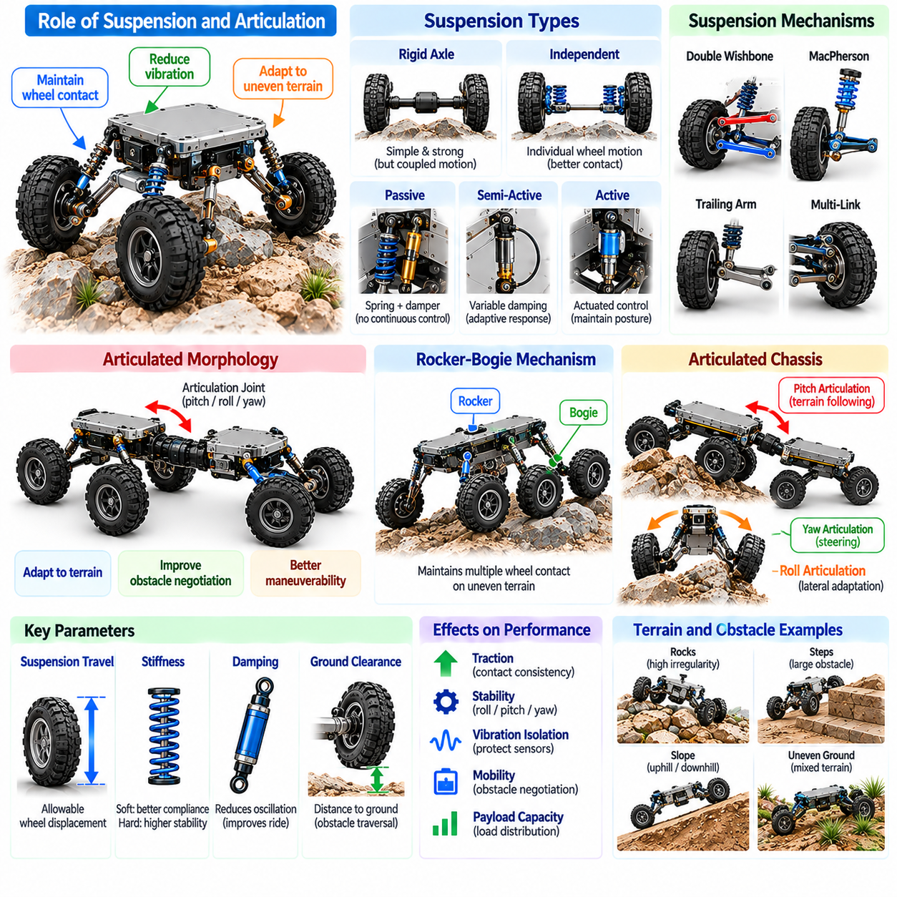{width="7.268055555555556in" height="7.268055555555556in"}

현가장치(Suspension)와 관절형 형태학(Articulated Morphology)은 플랫폼이 불규칙한 지형(Uneven Terrain)에 적응하고, 기계적 하중(Mechanical Load)을 분산하며, 안정적인 지면 접촉(Ground Contact)을 유지하는 방식을 결정하기 때문에 모바일 로봇 설계(Mobile Robot Design)의 핵심 요소이다. 현가장치 시스템(Suspension System)은 바퀴와 섀시(Chassis) 사이의 상대 운동(Relative Motion)을 관리하며, 관절형 구조(Articulated Structure)는 차체 구간(Body Segment) 사이에 제어 가능한 움직임을 제공한다. 이들은 함께 이동성(Mobility), 견인력(Traction), 안정성(Stability), 진동 절연(Vibration Isolation), 운용 신뢰성(Operational Reliability)에 영향을 미친다.

현가장치(Suspension)의 주요 기능은 로봇 섀시(Robot Chassis)로 전달되는 충격(Shock)을 줄이면서 효과적인 바퀴-지면 접촉(Wheel-Ground Contact)을 유지하는 것이다. 차량이 돌출부(Bump), 함몰부(Depression), 불규칙한 표면(Irregular Surface)을 통과할 때 현가장치 메커니즘(Suspension Mechanism)은 개별 바퀴 또는 바퀴 그룹(Wheel Group)이 주 차체(Main Body)에 대해 상대적으로 움직이도록 한다. 이러한 움직임은 견인력을 유지하고 센서(Sensor), 배터리(Battery), 액추에이터(Actuator), 컴퓨팅 장비(Computing Equipment)를 과도한 기계적 교란(Mechanical Disturbance)으로부터 보호하는 데 도움이 된다.

현가장치 형태학(Suspension Morphology)은 기계적 배치(Mechanical Arrangement), 유연성 특성(Compliance Characteristics), 사용 가능한 자유도(Degrees of Freedom)에 따라 분류할 수 있다. 일반적인 구성에는 강체 차축 현가장치(Rigid Axle Suspension), 독립 현가장치(Independent Suspension), 로커-보기 메커니즘(Rocker-Bogie Mechanism), 관절형 바퀴 조립체(Articulated Wheel Assembly)가 포함된다. 각 구조는 바퀴 변위(Wheel Displacement), 섀시 운동(Chassis Motion), 하중 이동(Load Transfer) 사이에서 서로 다른 관계를 형성하므로 적합성은 지형 조건(Terrain Conditions)과 임무 요구사항(Mission Requirements)에 따라 달라진다.

강체 차축 현가장치(Rigid Axle Suspension)는 공통 구조 부재(Common Structural Member)를 통해 바퀴를 연결하여 바퀴의 움직임이 기계적으로 결합(Mechanically Coupled)되도록 한다. 이러한 배치는 구조적 강도(Structural Strength), 예측 가능한 정렬 상태(Predictable Alignment), 비교적 간단한 유지보수(Simple Maintenance)를 제공할 수 있다. 그러나 한쪽 바퀴의 변위(Displacement)가 반대쪽 바퀴에 영향을 미치고 교란(Disturbance)을 섀시로 전달할 수 있으므로, 매우 불규칙한 지형에서는 접촉 일관성(Contact Consistency)이 감소할 수 있다.

독립 현가장치(Independent Suspension)는 인접 바퀴와의 기계적 결합(Mechanical Coupling)을 줄이면서 개별 바퀴가 수직으로 움직이도록 한다. 컨트롤 암(Control Arm), 링크 기구(Linkage), 스프링(Spring), 댐퍼(Damper)는 바퀴 궤적(Wheel Trajectory)과 지형 교란(Terrain Disturbance)에 대한 응답을 결정한다. 이러한 구조는 접촉 일관성(Contact Consistency)을 향상시키고 섀시 진동(Chassis Vibration)을 줄일 수 있지만, 추가 부품(Additional Components), 정렬 요구사항(Alignment Requirements), 유지보수 복잡성(Maintenance Complexity)이 증가한다.

수동 현가장치(Passive Suspension)는 지형 변화(Terrain Variation)에 대응하기 위해 지속적인 액추에이터 명령(Actuator Command) 대신 기계적 특성(Mechanical Properties)을 활용한다. 스프링(Spring)은 탄성 에너지(Elastic Energy)를 저장하고 방출하며, 댐퍼(Damper)는 에너지를 소산하고 진동(Oscillation)을 감소시킨다. 적절하게 선택된 강성(Stiffness)과 감쇠 특성(Damping Characteristics)은 과도한 차체 운동(Body Motion) 없이 플랫폼이 표면 불규칙성(Surface Irregularity)에 적응하도록 한다. 그 효과는 차량 질량(Vehicle Mass), 탑재하중 분포(Payload Distribution), 운용 속도(Operating Speed)에 따라 달라진다.

능동 현가장치(Active Suspension)는 제어되는 액추에이터(Controlled Actuator)를 사용하여 측정된 조건에 따라 바퀴 위치(Wheel Position), 현가장치 힘(Suspension Force), 섀시 자세(Chassis Attitude)를 변경한다. 센서(Sensor)는 차체 운동(Body Motion), 바퀴 변위(Wheel Displacement), 지형 기하학(Terrain Geometry)에 관한 정보를 제공한다. 제어 알고리즘(Control Algorithm)은 안정성(Stability), 승차 품질(Ride Quality), 탑재하중 방향(Payload Orientation)을 개선하도록 현가장치 거동을 조정할 수 있다. 그러나 능동 시스템(Active System)은 추가적인 에너지(Energy), 센싱(Sensing), 연산(Computation), 고장 관리(Fault Management)를 필요로 한다.

반능동 현가장치(Semi-Active Suspension)는 능동 현가장치에 필요한 전체 힘을 지속적으로 공급하지 않으면서 감쇠(Damping) 또는 기타 제어 가능한 기계적 특성(Controllable Mechanical Properties)을 조절하는 중간 접근법(Intermediate Approach)을 제공한다. 가변 댐퍼(Variable Damper)는 비교적 낮은 에너지 요구사항(Energy Requirements)을 유지하면서 변화하는 운용 조건(Operating Conditions)에 대응할 수 있다. 이러한 시스템은 유용한 적응성(Adaptability)을 제공하지만, 성능은 기존 수동 기계 구조(Passive Mechanical Structure)의 한계에 의해 제약된다.

관절형 형태학(Articulated Morphology)은 섀시 구간(Chassis Section), 바퀴 모듈(Wheel Module), 구조적 분절(Structural Segment) 사이에 상대 회전(Relative Rotation)이나 변위(Displacement)를 허용하는 관절(Joint)을 도입한다. 이러한 관절은 지형 조건이 변화함에 따라 모바일 로봇이 유효 기하학적 구조(Effective Geometry)를 변경할 수 있도록 한다. 관절 구조(Articulation)는 장애물 극복(Obstacle Negotiation), 지면 접촉(Ground Contact), 기동성(Maneuverability)을 향상시킬 수 있지만, 플랫폼의 운동학적 관계(Kinematic Relationships)를 변화시키고 추가적인 안정성 고려사항(Stability Considerations)을 발생시킨다.

로커-보기 메커니즘(Rocker-Bogie Mechanism)은 행성 탐사 로버(Planetary Exploration Rover)에 사용되는 대표적인 관절형 현가장치(Articulated Suspension)이다. 로커 암(Rocker Arm)과 보기 링크(Bogie Linkage)는 연결된 기계 구조(Mechanical Structure) 전체에 바퀴 운동(Wheel Motion)을 분산시켜 여러 바퀴가 불규칙한 지형과 지속적으로 접촉하도록 한다. 이러한 배치는 저속 장애물 통과(Low-Speed Obstacle Traversal)를 지원하고 기존 스프링(Conventional Spring)에 대한 의존도를 줄이지만, 그 거동은 링크 기하학(Linkage Geometry)과 하중 조건(Loading Conditions)에 따라 달라진다.

관절형 섀시 시스템(Articulated Chassis System)은 모바일 로봇을 회전 관절(Rotational Joint)로 연결된 전방 및 후방 구간(Front and Rear Sections)으로 나눌 수 있다. 이러한 관절은 지형 높이 차이(Terrain Height Difference)에 적응하거나, 차체 관절 운동(Body Articulation)을 통해 조향(Steering)을 수행하거나, 장애물 주변의 기동성을 개선할 수 있다. 설계에 따라 관절 운동(Articulation)은 수동형(Passive), 능동 제어형(Actively Controlled), 특정 운동축(Motion Axis)으로 기계적으로 제한된 형태(Mechanically Constrained)로 구현될 수 있다.

관절의 위치(Joint Location)와 방향(Joint Orientation)은 이동 성능(Mobility Performance)에 큰 영향을 미친다. 피치 관절 운동(Pitch Articulation)은 종방향 지형 변화(Longitudinal Terrain Variation)에 대응하는 데 도움이 되며, 롤 관절 운동(Roll Articulation)은 횡방향으로 불규칙한 표면에서 바퀴 접촉(Wheel Contact)을 개선할 수 있다. 요 관절 운동(Yaw Articulation)은 조향 기능(Steering Capability)을 제공할 수 있다. 여러 관절축(Articulation Axes)을 결합하면 적응성이 증가하지만 기계 설계(Mechanical Design), 상태 추정(State Estimation), 협조 제어(Coordinated Control)도 복잡해진다.

현가장치 이동량(Suspension Travel)은 섀시에 대한 바퀴 또는 현가장치 메커니즘의 허용 변위(Allowable Displacement)를 의미한다. 더 큰 이동량(Greater Travel)은 더 큰 지형 불규칙성(Terrain Irregularity)에 대응하고 접촉 연속성(Contact Continuity)을 개선할 수 있다. 그러나 과도한 이동량(Excessive Travel)은 구조적 치수(Structural Dimensions)를 증가시키거나 조향 기하학(Steering Geometry)을 변화시키고 바람직하지 않은 차체 운동(Undesirable Body Motion)을 발생시킬 수 있다. 따라서 현가장치 이동량은 바퀴 직경(Wheel Diameter), 지상고(Ground Clearance), 예상 장애물 형상(Expected Obstacle Geometry)과 함께 조정해야 한다.

현가장치 강성(Suspension Stiffness)은 플랫폼이 정적 하중(Static Load)과 동적 교란(Dynamic Disturbance)에 반응하는 방식에 영향을 미친다. 높은 강성(High Stiffness)은 정밀한 위치 결정(Precise Positioning)을 지원하고 차체 변형(Body Deflection)을 줄일 수 있지만 더 큰 충격력(Impact Force)을 전달할 수 있다. 낮은 강성(Low Stiffness)은 유연성(Compliance)과 충격 흡수(Shock Absorption)를 개선하지만 진동(Oscillation)과 자세 변화(Attitude Variation)를 증가시킬 수 있다. 적절한 강성 선택(Stiffness Selection)을 위해서는 탑재하중 안정성(Payload Stability), 지형 적응(Terrain Adaptation), 운동 제어 정확도(Motion-Control Accuracy) 사이의 균형이 필요하다.

감쇠(Damping)는 교란이 발생한 이후 현가장치 진동(Suspension Oscillation)이 얼마나 빠르게 감소하는지를 결정한다. 감쇠가 부족하면(Insufficient Damping) 진동이 장시간 지속되며, 과도한 감쇠(Excessive Damping)는 현가장치 응답(Suspension Response)을 제한하고 급격한 지형 변화(Rapid Terrain Change) 중 전달되는 힘을 증가시킬 수 있다. 요구되는 감쇠 특성(Desired Damping Characteristics)은 플랫폼 질량(Platform Mass), 현가장치 기하학(Suspension Geometry), 운용 속도(Operating Velocity), 가진 주파수(Excitation Frequency)에 따라 달라진다. 적절한 튜닝(Tuning)은 기계적 안정성(Mechanical Stability)과 센서 측정 품질(Sensor Measurement Quality)을 향상시킨다.

하중 분포(Load Distribution)는 현가장치 및 관절형 형태학(Suspension and Articulated Morphology)과 밀접하게 연결되어 있다. 불규칙한 지형(Uneven Terrain)은 바퀴 사이의 수직력(Normal Force)을 재분배하여 일부 접촉점(Contact Point)이 견인력(Traction)을 잃고 다른 접촉점에는 과도한 하중이 작용하도록 할 수 있다. 현가장치 메커니즘(Suspension Mechanism)과 관절형 링크(Articulated Linkage)는 이러한 변화에 대응하는 데 도움이 된다. 이들의 기하학적 구조(Geometry)와 유연성(Compliance)은 하중이 얼마나 효과적으로 분산되는지, 추진(Propulsion)에 필요한 충분한 견인력이 유지되는지를 결정한다.

무게중심(Center of Gravity)은 현가장치 및 관절 구성(Suspension and Articulation Configuration)이 변화함에 따라 지지 영역(Support Region)과의 상대적 관계가 달라진다. 차체 롤(Body Roll), 피치(Pitch), 관절 운동(Joint Motion)은 등판(Climbing), 회전(Turning), 불규칙한 지형 통과(Uneven Ground Traversal) 중 안정성 여유(Stability Margin)를 변화시킬 수 있다. 높은 위치에 배치된 탑재하중(Elevated Payload)은 이러한 영향을 증폭시킨다. 따라서 안정성 분석(Stability Analysis)은 차량의 공칭 정적 치수(Nominal Static Dimensions)에만 의존하지 않고 구성에 따른 기하학적 변화(Configuration-Dependent Geometry)를 고려해야 한다.

현가장치 거동(Suspension Behavior)은 인식(Perception)과 위치 추정(Localization)에도 영향을 미친다. 섀시 진동(Chassis Vibration)과 자세 변화(Attitude Change)는 카메라 영상(Camera Image), 라이다 측정값(LiDAR Measurement), 관성 센서 측정값(Inertial Sensor Reading)에 영향을 준다. 과도한 움직임(Excessive Motion)은 지도 작성(Mapping)과 장애물 탐지(Obstacle Detection)의 성능을 저하시킬 수 있으며, 예측 가능한 현가장치 동역학(Predictable Suspension Dynamics)은 더욱 정확한 센서 보정(Sensor Compensation)을 지원할 수 있다. 상태 추정(State Estimation)에서는 섀시, 바퀴, 관절형 구성요소(Articulated Component) 사이의 상대 운동(Relative Movement)을 고려해야 한다.

관절형 플랫폼(Articulated Platform)의 제어 시스템(Control System)은 기계적 제약조건(Mechanical Constraints)을 준수하면서 추진(Propulsion), 조향(Steering), 관절 운동(Joint Motion)을 조정해야 한다. 운동학 모델(Kinematic Model)은 관절 운동이 차량 기하학(Vehicle Geometry)을 변화시키는 방식을 설명하며, 동역학 모델(Dynamic Model)은 힘(Force), 관성(Inertia), 지형 상호작용(Terrain Interaction)을 표현한다. 고급 제어기(Advanced Controller)는 액추에이터 한계(Actuator Limits)를 초과하지 않으면서 접촉 유지(Contact Maintenance), 안정성 향상(Stability Improvement), 장애물 극복(Obstacle Negotiation)을 위해 관절 위치(Joint Position)나 현가장치 응답(Suspension Response)을 조정할 수 있다.

형태학 인식 계획(Morphology-Aware Planning)은 제안된 경로(Proposed Route)를 따라 현가장치 이동량(Suspension Travel)과 관절 구성(Articulation Configuration)을 고려함으로써 기존 내비게이션(Conventional Navigation)을 확장한다. 어떤 경로는 기하학적으로 접근 가능(Geometrically Accessible)하더라도 하부 접촉(Grounding)이나 불안정성(Instability)을 피하기 위해 특정 관절각(Joint Angle) 또는 차체 방향(Body Orientation)이 필요할 수 있다. 계획 알고리즘(Planning Algorithm)은 어려운 통과 구간(Difficult Passage)에 대한 운동 시퀀스(Motion Sequence)를 선택하기 전에 지형 프로파일(Terrain Profile), 접촉 조건(Contact Conditions), 구성 실행 가능성(Configuration Feasibility)을 평가할 수 있다.

에너지 효율(Energy Efficiency)은 추가적인 설계 절충관계(Design Tradeoff)를 발생시킨다. 수동 현가장치(Passive Suspension)는 일반적으로 직접적인 제어 에너지(Control Energy)를 거의 필요로 하지 않지만, 능동 관절 운동(Active Articulation)과 능동 현가장치(Active Suspension)는 조정 과정에서 전력을 소비한다. 그러나 개선된 지형 접촉(Terrain Contact)은 바퀴 슬립(Wheel Slip), 불필요한 가속(Unnecessary Acceleration), 기계적 손실(Mechanical Losses)을 줄일 수 있다. 총에너지 소비(Total Energy Consumption)를 평가하려면 추진(Propulsion), 구동(Actuation), 구조 질량(Structural Mass), 구성 변경 빈도(Frequency of Configuration Changes)를 함께 고려해야 한다.

신뢰성(Reliability)과 유지보수성(Maintainability)은 현가장치 관절(Suspension Joint), 베어링(Bearing), 댐퍼(Damper), 관절형 메커니즘(Articulated Mechanism)이 반복 하중(Repeated Loading)과 환경 노출(Environmental Exposure)을 경험하기 때문에 중요하다. 먼지(Dust), 습기(Moisture), 충격(Impact), 피로(Fatigue)는 기계적 성능(Mechanical Performance)을 저하시킬 수 있다. 보호 밀봉(Protective Sealing), 적절한 윤활(Appropriate Lubrication), 접근하기 쉬운 부품(Accessible Component), 상태 모니터링(Condition Monitoring)은 기능 유지에 도움이 된다. 추가 자유도(Additional Degrees of Freedom)는 측정 가능한 이동성 향상(Measurable Mobility Benefits)을 통해 정당화되어야 한다.

시뮬레이션(Simulation)과 실험적 시험(Experimental Testing)은 현가장치 및 관절형 형태학(Suspension and Articulated Morphology)을 검증하는 데 필수적이다. 다물체 동역학 모델(Multibody Dynamics Model)은 대표적인 지형(Representative Terrain)에서 바퀴 접촉(Wheel Contact), 하중 이동(Load Transfer), 차체 자세(Body Attitude), 관절력(Joint Force)을 예측할 수 있다. 물리적 시험(Physical Test)에서는 장애물 통과(Obstacle Traversal), 진동 절연(Vibration Isolation), 견인력 연속성(Traction Continuity), 구조적 내구성(Structural Durability), 다양한 탑재하중 조건(Varying Payload Conditions)에서의 거동을 평가해야 한다. 시험 결과는 기하학적 구조(Geometry), 유연성(Compliance), 제어 매개변수(Control Parameters)의 개선을 지원한다.

궁극적으로 현가장치 및 관절형 형태학(Suspension and Articulated Morphology)은 기계적 구조(Mechanical Structure)가 모바일 로봇의 적응형 지능(Adaptive Intelligence)에 직접적으로 기여하는 방식을 보여준다. 이러한 메커니즘은 접촉력(Contact Force)을 관리하고, 교란(Disturbance)을 흡수하며, 차체 구성(Body Configuration)을 변경함으로써 플랫폼이 주행할 수 있는 환경의 범위를 확장한다. 인식(Perception), 계획(Planning), 상태 추정(State Estimation), 제어(Control)와 성공적으로 통합되면 피지컬 AI 시스템(Physical AI System)은 더욱 안정적이고 신뢰성 있으며 지형에 적응하는 자율 이동성(Terrain-Adaptive Autonomous Mobility)을 구현할 수 있다.

## 04.09. Payload Center of Gravity and Stability

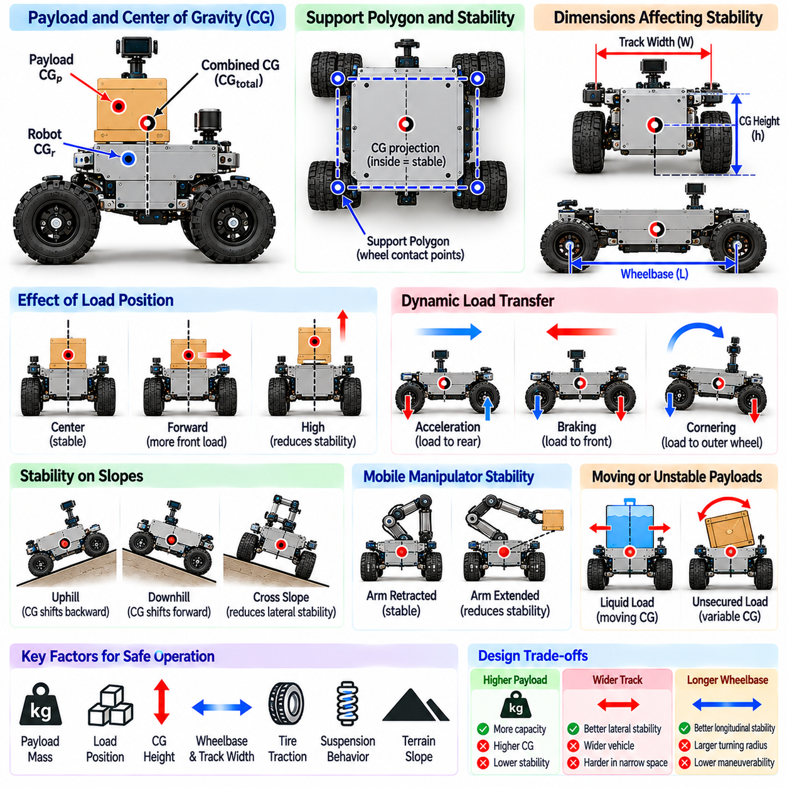{width="7.268055555555556in" height="7.268055555555556in"}

탑재하중(Payload), 무게중심(Center of Gravity), 안정성(Stability)은 모바일 로봇 형태학(Mobile Robot Morphology)에서 밀접하게 연결된 요소로, 플랫폼이 하중을 얼마나 안전하게 지지하고 운반할 수 있는지를 결정한다. 탑재하중의 질량(Payload Mass)과 배치(Placement)는 바퀴 하중(Wheel Loading), 견인력(Traction), 제동(Braking), 전복 저항성(Tipping Resistance)에 영향을 미친다. 효과적인 설계를 위해서는 적재(Loading), 이동(Movement), 하역(Unloading) 과정에서 발생하는 변화를 포함하여 로봇과 탑재하중을 하나의 기계 시스템(Mechanical System)으로 평가해야 한다.

탑재하중 용량(Payload Capacity)은 지정된 구조적 한계(Structural Limits), 안정성 한계(Stability Limits), 성능 한계(Performance Limits) 내에서 모바일 플랫폼(Mobile Platform)이 운반할 수 있는 최대 하중(Maximum Load)을 의미한다. 이는 모터 토크(Motor Torque)나 섀시 강도(Chassis Strength)만으로 결정되지 않는다. 바퀴 정격 하중(Wheel Ratings), 현가장치 용량(Suspension Capacity), 제동 능력(Braking Capability), 배터리 성능(Battery Performance), 지형 조건(Terrain Conditions)도 제한 요소로 작용한다. 평지(Level Ground)에서 특정 탑재하중에 대해 정격이 지정된 플랫폼도 경사면(Slope)이나 불규칙한 지형(Uneven Surface)에서는 더 낮은 하중 한계(Load Limit)가 필요할 수 있다.

무게중심(Center of Gravity)은 로봇과 탑재하중에 작용하는 합성 중력(Combined Gravitational Force)이 효과적으로 작용하는 지점이다. 무게중심의 위치는 배터리(Battery), 모터(Motor), 구조 부품(Structural Component), 센서(Sensor), 운반 물체(Transported Object)의 질량과 위치에 따라 달라진다. 탑재하중이 추가되거나 재배치되면 결합 무게중심(Combined Center of Gravity)이 이동한다. 이러한 변화는 차량의 총질량(Total Vehicle Mass)이 허용 한계(Allowable Limits) 이내에 있더라도 안정성에 상당한 영향을 미칠 수 있다.

무게중심 높이(Center-of-Gravity Height)는 가속도(Acceleration)와 횡방향 힘(Lateral Force)이 전복 거동(Tipping Behavior)에 미치는 영향을 결정하므로 특히 중요하다. 낮은 무게중심(Low Center of Gravity)은 일반적으로 전복 모멘트(Overturning Moment)를 감소시켜 안정성을 향상시킨다. 높은 위치에 배치된 탑재하중(Elevated Payload)은 회전(Turning)과 제동(Braking) 중 관성력(Inertial Force)의 모멘트 효과를 증가시킨다. 설계자는 전체 질량 분포(Overall Mass Distribution)를 개선하기 위해 무거운 배터리와 구동계 부품(Drivetrain Components)을 섀시 하부(Chassis Base) 가까이에 배치하는 경우가 많다.

지지 다각형(Support Polygon)은 차량을 지지하는 유효 지면 접촉점(Effective Ground-Contact Points)을 연결하여 형성된다. 평탄한 지형(Level Terrain)의 정적 조건(Static Conditions)에서 안정성을 유지하려면 무게중심의 수직 투영점(Vertical Projection of the Center of Gravity)이 이 영역 내부에 있어야 한다. 투영된 무게중심(Projected Center of Gravity)과 지지 다각형 경계(Polygon Boundary) 사이의 거리는 정적 안정성 여유(Static Stability Margin)를 나타내는 유용한 지표이다. 이 경계에 가까워질수록 전복 가능성(Tipping Susceptibility)이 증가한다.

휠베이스(Wheelbase)와 윤거(Track Width)는 지지 영역(Support Region)의 치수를 결정하고 종방향 안정성(Longitudinal Stability)과 횡방향 안정성(Lateral Stability)에 영향을 미친다. 긴 휠베이스(Longer Wheelbase)는 전방 또는 후방 전복(Forward or Backward Tipping)에 대한 저항성을 향상시킬 수 있으며, 넓은 윤거(Wider Track)는 일반적으로 측면 전복(Sideways Tipping)에 대한 저항성을 증가시킨다. 그러나 이러한 치수를 증가시키면 기동성(Maneuverability)과 부품 배치(Packaging)에도 영향을 미친다. 따라서 안정성 향상은 운용 공간 제약조건(Operational Space Constraints)과 함께 평가해야 한다.

종방향 하중 분포(Longitudinal Load Distribution)는 전륜(Front Wheel)과 후륜(Rear Wheel)에 작용하는 수직력(Normal Force)의 크기를 결정한다. 탑재하중을 전방으로 이동시키면 전륜 하중(Front-Wheel Loading)이 증가하고, 후방으로 이동시키면 후륜 하중(Rear-Wheel Loading)이 증가한다. 불균일한 하중 분포(Unequal Loading)는 제동 성능(Braking Performance), 사용 가능한 견인력(Available Traction), 조향 거동(Steering Behavior)을 변화시킬 수 있다. 총 탑재하중 질량(Total Payload Mass)이 허용 범위 내에 있더라도 특정 위치에 중량이 과도하게 집중되면 개별 바퀴나 현가장치 부품(Suspension Components)에 과부하(Overload)가 발생할 수 있다.

횡방향 하중 불균형(Lateral Load Imbalance)은 탑재하중이 차량의 종방향 중심선(Longitudinal Centerline)에서 벗어나 배치될 때 발생한다. 이로 인해 무게중심이 한쪽으로 이동하고 해당 방향의 안정성 여유(Stability Margin)가 감소한다. 비대칭 적재(Asymmetric Loading)는 특히 회전(Turning)이나 횡경사 주행(Cross-Slope Travel) 중 위험해진다. 따라서 탑재하중 배치 지침(Payload Placement Guidelines)에는 허용 가능한 횡방향 편차(Acceptable Lateral Offsets)와 적재 구성(Loading Configurations)을 명시해야 한다.

동적 안정성(Dynamic Stability)은 차량 가속도(Vehicle Acceleration)가 관성 효과(Inertial Effects)를 발생시키고 바퀴 접촉력(Wheel Contact Forces)을 변화시키기 때문에 정적 안정성(Static Stability)과 다르다. 가속 중에는 하중이 후방으로 이동하는 경향이 있으며, 제동 중에는 전방으로 이동한다. 선회(Cornering)는 횡방향 하중 이동(Lateral Load Transfer)을 발생시켜 안쪽 바퀴(Inner Wheels)의 하중을 감소시킬 수 있다. 이러한 효과는 무게중심 높이(Center-of-Gravity Height), 가속도 크기(Acceleration Magnitude), 현가장치 거동(Suspension Behavior), 플랫폼 기하학(Platform Geometry)에 따라 달라진다.

전복 위험(Rollover Risk)은 전복 모멘트(Overturning Moment)가 중력(Gravity)과 사용 가능한 지지 기하학(Support Geometry)에 의해 생성되는 복원 모멘트(Restoring Moment)를 초과할 때 증가한다. 높은 탑재하중 배치(High Payload Placement), 좁은 윤거(Narrow Track Width), 급격한 회전(Sharp Turning), 높은 속도(Elevated Speed)가 이러한 상황에 기여할 수 있다. 저마찰 표면(Low-Friction Surface)에서는 전복보다 미끄러짐(Sliding)이 먼저 발생할 수 있지만, 충분한 견인력(Traction)이 확보되었다고 해서 전복 방지(Rollover Prevention)가 보장되는 것은 아니다. 접촉 역학(Contact Mechanics)과 차체 동역학(Body Dynamics)을 모두 고려해야 한다.

경사면 운용(Slope Operation)은 로봇의 지지 기하학(Support Geometry)에 대한 중력 방향(Direction of Gravity)이 달라지기 때문에 추가적인 안정성 문제를 발생시킨다. 오르막 주행(Uphill Travel)에서는 무게중심 투영점(Center-of-Gravity Projection)이 후방 지지 경계(Rear Support Boundary) 쪽으로 이동하고, 내리막 주행(Downhill Travel)에서는 전방으로 이동한다. 횡경사 이동(Cross-Slope Movement)은 횡방향 안정성 여유(Lateral Stability Margin)를 감소시킨다. 안전 경사 한계(Safe Slope Limits)는 탑재하중 구성(Payload Configuration), 표면 견인력(Surface Traction), 현가장치 응답(Suspension Response)에 따라 달라진다.

현가장치 및 관절형 형태학(Suspension and Articulated Morphology)은 운용 중 하중 분포(Load Distribution)와 유효 지지 영역(Effective Support Region)을 변화시킬 수 있다. 압축(Compression), 바퀴 이동량(Wheel Travel), 차체 관절 운동(Body Articulation)은 접촉점 위치(Contact-Point Positions)와 섀시 자세(Chassis Attitude)를 변경한다. 이러한 변화는 지형 접촉(Terrain Contact)을 개선할 수 있지만 안정성 여유(Stability Margins)도 변화시킨다. 따라서 안정성 평가(Stability Assessment)에는 공칭 섀시 기하학(Nominal Chassis Geometry)에만 의존하지 않고 실제적인 현가장치 구성(Realistic Suspension Configurations)을 포함해야 한다.

운반 물체(Transported Object)가 견고하게 고정되지 않은 경우 탑재하중 이동(Payload Movement)은 추가적인 불확실성(Uncertainty)을 발생시킨다. 액체 용기(Liquid Container), 매달린 하중(Suspended Load), 느슨하게 구속된 물체(Loosely Constrained Materials)는 가속이나 회전 중 이동할 수 있다. 이러한 움직임은 과도 힘(Transient Forces)을 발생시키고 결합 무게중심(Combined Center of Gravity)을 변화시킬 수 있다. 기계적 구속 장치(Mechanical Restraints), 제어된 가속 프로파일(Controlled Acceleration Profiles), 적절한 탑재하중 고정 장치(Payload Fixtures)는 이러한 위험을 줄인다.

이동형 매니퓰레이터(Mobile Manipulator)는 로봇 팔(Robotic Arm)이 질량 분포(Mass Distribution)를 변화시키고 운용 중 반작용력(Reaction Forces)을 발생시키기 때문에 추가적인 안정성 문제에 직면한다. 로봇 팔을 섀시 점유 영역(Chassis Footprint) 밖으로 뻗으면 결합 무게중심(Combined Center of Gravity)이 지지 경계(Support Boundary) 쪽으로 이동할 수 있다. 물체를 들어 올리거나 가속하면 추가적인 모멘트(Additional Moments)가 발생한다. 따라서 안전한 이동 조작(Mobile Manipulation)을 위해서는 모바일 베이스(Mobile Base)와 매니퓰레이터(Manipulator)의 협조 제어(Coordinated Control)가 필요하다.

제동 성능(Braking Performance)은 최대 허용 탑재하중(Maximum Permitted Payload)과 대표적인 지형 조건(Representative Terrain Conditions)에서 평가해야 한다. 질량이 증가하면 정지 과정에서 소산해야 하는 운동 에너지(Kinetic Energy)가 증가하며, 하중 이동(Load Transfer)은 개별 바퀴에서 사용 가능한 견인력(Available Traction)을 변화시킨다. 제동 거리(Braking Distance)는 속도(Speed), 타이어-지면 상호작용(Tire-Ground Interaction), 제동 능력(Braking Capability), 제어 응답(Control Response)에 따라 달라진다. 비상 정지 요구사항(Emergency Stopping Requirements)은 불리한 적재 조건(Unfavorable Loading Conditions)을 고려해야 한다.

탑재하중 안정성(Payload Stability)은 구조 설계(Structural Design)와 부품 내구성(Component Durability)에도 영향을 미친다. 집중 하중(Concentrated Load)은 섀시 부재(Chassis Members), 장착 브래킷(Mounting Brackets), 현가장치 관절(Suspension Joints)에 국부 응력(Localized Stress)을 발생시킬 수 있다. 반복적인 가속(Repeated Acceleration)과 진동(Vibration)은 정적 하중(Static Load)이 정격 한계(Rated Limits) 이내에 있더라도 피로 손상(Fatigue Damage)을 발생시킬 수 있다. 구조 해석(Structural Analysis)에서는 대표적인 운용 조건(Representative Operating Conditions)에서 하중 전달 경로(Load Paths), 부착 지점(Attachment Points), 동적 증폭(Dynamic Amplification)을 검토해야 한다.

질량 분포(Mass Distribution)는 무거운 탑재하중이 구름 저항(Rolling Resistance), 가속 요구량(Acceleration Demands), 등판 구동력(Climbing Effort)을 증가시키기 때문에 에너지 소비(Energy Consumption)에 영향을 미친다. 균형이 맞지 않는 하중(Poorly Balanced Loads)은 타이어 변형(Tire Deformation), 불균일한 마모(Uneven Wear), 조향 손실(Steering Losses)을 증가시킬 수도 있다. 무거운 부품을 아래쪽으로 이동시키면 안정성이 향상되지만 유지보수(Maintenance)가 복잡해지거나 지상고(Ground Clearance)가 감소할 수 있다. 효율적인 형태학(Efficient Morphology)을 위해서는 에너지 성능(Energy Performance), 기계적 접근성(Mechanical Accessibility), 안전성(Safety) 사이의 균형이 필요하다.

안정성 모니터링(Stability Monitoring)은 관성 측정(Inertial Measurements), 바퀴 하중 추정(Wheel-Load Estimates), 현가장치 변위(Suspension Displacement), 탑재하중 정보(Payload Information)를 결합할 수 있다. 관성 측정 장치(Inertial Measurement Unit, IMU)는 가속도(Acceleration)와 각운동(Angular Motion) 데이터를 제공하며, 추가 센서(Additional Sensors)는 섀시 기울기(Chassis Inclination)나 접촉력(Contact Forces)을 추정할 수 있다. 센서 융합(Sensor Fusion)은 변화하는 안정성 조건(Stability Conditions)을 식별할 수 있지만, 가속도, 진동, 불확실한 탑재하중 특성(Uncertain Payload Properties)은 해석을 복잡하게 만든다.

모델 기반 안정성 평가(Model-Based Stability Assessment)는 기하학적 표현(Geometric Representation)과 동역학적 표현(Dynamic Representation)을 사용하여 전복 여유(Tipping Margins)와 허용 가능한 운동(Allowable Motion)을 추정한다. 정적 모델(Static Model)은 지지 경계(Support Boundaries)에 대한 무게중심 투영점(Center-of-Gravity Projection)을 평가하고, 동적 모델(Dynamic Model)은 가속도(Acceleration), 하중 이동(Load Transfer), 변화하는 접촉 조건(Changing Contact Conditions)을 고려한다. 이러한 모델은 현재 탑재하중(Current Payload)에 맞춘 속도 제한(Speed Limits), 궤적 제약조건(Trajectory Constraints), 비상 대응(Emergency Responses)을 지원할 수 있다.

피지컬 AI(Physical AI)는 탑재하중 인식(Payload Perception), 상태 추정(State Estimation), 예측 제어(Predictive Control)를 통합하여 적응형 안정성 관리(Adaptive Stability Management)를 가능하게 한다. 비전 시스템(Vision System)이나 하중 센서(Load Sensor)는 탑재하중의 치수(Dimensions), 배치(Placement), 질량 분포(Mass Distribution)를 추정할 수 있다. 학습 모델(Learned Model)은 익숙하지 않은 운용 조건(Unfamiliar Operating Conditions)에서 안정성 위험(Stability Risks)을 예측하는 데 도움을 줄 수 있다. 그러나 안전 필수 의사결정(Safety-Critical Decisions)은 검증된 물리 모델(Validated Physical Models)과 보수적인 운용 한계(Conservative Operating Limits)에 의해 제약되어야 한다.

형태학 인식 운동 계획(Morphology-Aware Motion Planning)은 탑재하중 구성(Payload Configuration)을 경로 및 궤적 선택(Route and Trajectory Selection)에 반영한다. 무거운 하중을 운반하는 로봇은 더 낮은 선회 속도(Cornering Speed), 완만한 가속(Gentler Acceleration), 급경사(Steep Slope)를 우회하는 대체 경로(Alternative Path)가 필요할 수 있다. 좁은 통로(Narrow Passage)는 차량 방향(Vehicle Orientation)을 제한할 수 있으며, 불규칙한 지형(Uneven Terrain)은 안정성 여유(Stability Margin)를 감소시킬 수 있다. 계획 과정에서는 기하학적 접근 가능성(Geometric Accessibility)과 현재 하중(Current Load)을 운반할 때 발생하는 동적 영향(Dynamic Consequences)을 모두 고려해야 한다.

검증 시험(Validation Testing)에서는 무부하(Empty), 공칭 하중(Nominal Payload), 최대 하중(Maximum Payload), 높은 위치의 하중(Elevated Payload), 비대칭 분포 하중(Asymmetrically Distributed Payload) 구성을 평가해야 한다. 대표적인 시험 절차(Test Procedures)에는 제동(Braking), 선회(Cornering), 경사면 주행(Slope Traversal), 장애물 통과(Obstacle Crossing), 비상 정지(Emergency Stopping)가 포함된다. 바퀴 하중(Wheel Loading), 섀시 자세(Chassis Attitude), 정지 거리(Stopping Distance), 구조 응답(Structural Response)의 측정은 안전 운용 영역(Safe Operating Envelope)을 설정하는 데 도움이 된다. 시험에서는 실제 적재 조건(Real-World Loading Conditions)의 불확실성도 고려해야 한다.

궁극적으로 탑재하중(Payload), 무게중심(Center of Gravity), 안정성(Stability)은 모바일 로봇 형태학(Mobile Robot Morphology)을 실제 운용 하중(Operational Loading)과 분리하여 고려할 수 없다는 사실을 보여준다. 기계적으로 충분한 성능을 갖춘 플랫폼(Mechanically Capable Platform)이라도 질량이 부적절하게 배치되거나 동적 조건(Dynamic Conditions)이 안정성 여유(Stability Margins)를 초과하면 안전하지 않을 수 있다. 구조 설계(Structural Design), 하중 관리(Load Management), 센싱(Sensing), 계획(Planning), 적응형 제어(Adaptive Control)를 통합하면 피지컬 AI 시스템(Physical AI System)은 다양한 탑재하중을 더욱 높은 신뢰성(Reliability)과 안전성(Safety)을 바탕으로 운반할 수 있다.

## 04.10. Indoor vs Outdoor Morphology

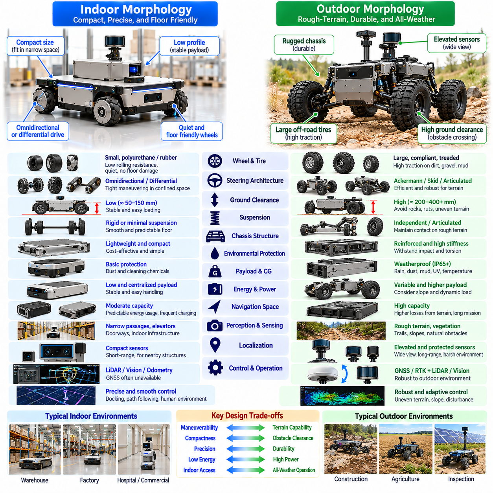{width="7.268055555555556in" height="7.268055555555556in"}

실내 및 실외 모바일 로봇 형태학(Indoor and Outdoor Mobile Robot Morphology)은 통제된 시설(Controlled Facilities)과 개방된 환경(Open Environments)에서 요구되는 서로 다른 물리적 조건(Physical Demands)을 반영한다. 실내 플랫폼(Indoor Platform)은 일반적으로 소형화(Compactness), 기동성(Maneuverability), 정밀성(Precision), 바닥 적합성(Floor Compatibility)을 우선시하는 반면, 실외 로봇(Outdoor Robot)은 지형 적응성(Terrain Adaptability), 내구성(Durability), 환경 보호(Environmental Protection)를 강조한다. 이러한 차이는 섀시 기하학(Chassis Geometry), 이동 메커니즘(Locomotion Mechanism), 현가장치(Suspension), 센싱(Sensing), 전력 시스템(Power System), 제어 전략(Control Strategy)에 영향을 미친다.

실내 모바일 로봇(Indoor Mobile Robot)은 일반적으로 창고 바닥(Warehouse Floor), 공장 복도(Factory Corridor), 상업용 건물(Commercial Building)과 같이 비교적 매끄럽고 예측 가능한 표면에서 운용된다. 따라서 실내 로봇의 형태학은 낮은 지상고(Low Ground Clearance), 소형 바퀴 조립체(Compact Wheel Assembly), 효율적인 하중 지지(Efficient Load Support)를 강조할 수 있다. 실외 로봇은 불규칙한 지면(Irregular Ground), 식생(Vegetation), 자갈(Gravel), 진흙(Mud), 변화하는 경사(Changing Slopes)를 만나므로 견인력(Traction), 장애물 이격거리(Obstacle Clearance), 기계적 내구성(Mechanical Resilience)에 더 많은 주의가 필요하다.

바퀴 선택(Wheel Selection)은 실내와 실외 요구사항 사이의 차이를 잘 보여준다. 실내 플랫폼은 낮은 구름 저항(Low Rolling Resistance), 조용한 운용(Quiet Operation), 최소한의 바닥 손상(Minimal Floor Damage)을 위해 설계된 소형 폴리우레탄 바퀴(Polyurethane Wheel)나 고무 바퀴(Rubber Wheel)를 자주 사용한다. 실외 플랫폼은 일반적으로 유연한 타이어(Compliant Tire)와 지형에 적합한 트레드 패턴(Terrain-Appropriate Tread Pattern)을 갖춘 더 큰 바퀴의 이점을 얻는다. 바퀴 직경(Wheel Diameter), 폭(Width), 재료(Material)는 예상되는 표면 조건(Surface Conditions)과 탑재하중 요구사항(Payload Demands)을 반영해야 한다.

조향 구조(Steering Architecture) 역시 환경의 기하학적 특성(Environmental Geometry)에 따라 달라진다. 차동 구동(Differential Drive)과 전방향 시스템(Omnidirectional System)은 선반(Shelf), 장비(Equipment), 보행자(Pedestrian) 주변에서 좁은 공간 기동(Tight Maneuvering)을 지원하므로 실내에서 유용하다. 실외 플랫폼은 지형과 임무 요구사항(Mission Requirements)에 따라 애커먼 조향(Ackermann Steering), 스키드 조향(Skid Steering), 관절형 메커니즘(Articulated Mechanism)을 선호할 수 있다. 적합한 구성은 회전 능력(Turning Capability), 견인 효율(Traction Efficiency), 기계적 복잡성(Mechanical Complexity), 운용 속도(Operational Speed) 사이의 균형을 고려하여 결정된다.

지상고(Ground Clearance)는 또 다른 중요한 형태학적 차이(Morphological Difference)를 나타낸다. 실내 로봇은 안정적인 탑재하중 배치(Stable Payload Placement)와 제한된 공간에서의 효율적인 주행(Efficient Navigation)을 위해 낮은 섀시(Low Chassis)를 유지하는 경우가 많다. 실외 로봇은 암석(Rock), 바퀴 자국으로 형성된 홈(Rut), 불규칙한 지형(Uneven Terrain)에서 하부 접촉(Grounding)을 방지할 수 있는 충분한 지상고가 필요하다. 지상고를 높이면 장애물 접근성(Obstacle Accessibility)이 향상되지만 무게중심(Center of Gravity)이 상승하여 회전이나 경사면 주행(Slope Traversal) 중 추가적인 안정성 문제가 발생할 수 있다.

현가장치 요구사항(Suspension Requirements)은 운용 환경에 따라 상당히 달라진다. 매끄러운 실내 바닥(Smooth Indoor Floor)에서는 강체 섀시(Rigid Chassis) 또는 최소한의 현가장치 구조(Minimally Suspended Chassis Structure)를 사용할 수 있어 비용과 유지보수를 줄일 수 있다. 실외 이동성(Outdoor Mobility)을 위해서는 지면 접촉(Ground Contact)을 유지하도록 독립 현가장치(Independent Suspension), 관절형 링크(Articulated Linkage), 유연한 바퀴 조립체(Compliant Wheel Assembly)가 필요한 경우가 많다. 현가장치 이동량(Suspension Travel)과 감쇠(Damping)는 장애물 치수(Obstacle Dimensions), 주행 속도(Travel Speed), 탑재하중의 진동 민감도(Payload Sensitivity), 지형 변동성(Terrain Variability)에 따라 선택해야 한다.

섀시 구조(Chassis Construction)는 서로 다른 기계적 하중 조건(Mechanical Loading Conditions)에 대응해야 한다. 실내 플랫폼은 일반적으로 반복적인 가속(Acceleration), 제동(Braking), 도킹(Docking), 탑재하중 취급(Payload Handling) 주기를 경험한다. 실외 로봇은 추가적으로 충격(Impact), 비틀림 하중(Torsional Loading), 진동(Vibration), 불규칙한 바퀴 접촉(Irregular Wheel Contact)을 견뎌야 한다. 구조적 강성(Structural Stiffness), 재료 선택(Material Selection), 관절 설계(Joint Design), 보호 보강(Protective Reinforcement)은 단순히 섀시 질량을 최대화하기보다 예상 하중 스펙트럼(Expected Load Spectrum)을 반영해야 한다.

환경 보호(Environmental Protection)는 실외 형태학(Outdoor Morphology)에서 특히 중요하다. 비(Rain), 먼지(Dust), 진흙(Mud), 습도(Humidity), 자외선(Ultraviolet Radiation), 온도 변화(Temperature Fluctuations)는 기계 및 전자 부품(Mechanical and Electronic Components)의 성능을 저하시킬 수 있다. 보호용 외함(Protective Enclosure), 밀봉재(Seal), 배수 경로(Drainage Path), 내부식성 재료(Corrosion-Resistant Material), 적절한 열 관리(Thermal Management)는 내구성을 향상시킨다. 실내 로봇은 상대적으로 낮은 수준의 방수 및 방진 보호(Weather Protection)만 필요할 수 있지만, 세척용 화학물질(Cleaning Chemicals)과 산업용 먼지(Industrial Dust)는 여전히 고려해야 한다.

탑재하중 배치(Payload Placement)는 실내 및 실외 안정성(Indoor and Outdoor Stability)에 모두 영향을 미친다. 실내 운송 로봇(Indoor Transport Robot)은 적재를 단순화하고 전복 위험(Tipping Risk)을 줄이기 위해 표준화된 컨테이너(Standardized Container)나 팔레트(Pallet)를 낮고 평평한 플랫폼(Low, Flat Platform)에 적재하는 경우가 많다. 실외 로봇은 불규칙한 장비(Irregular Equipment)를 운반하거나 탑재하중 방향(Payload Orientation)이 변화하는 조건에서 운용될 수 있다. 따라서 동적 하중 이동(Dynamic Load Transfer), 경사로 인한 불안정성(Slope-Induced Instability), 현가장치 운동(Suspension Motion)과 무게중심 위치(Center-of-Gravity Position) 사이의 상호작용을 고려해야 한다.

에너지 효율(Energy Efficiency)은 지형(Terrain)과 이동 형태학(Locomotion Morphology)에 의해 결정된다. 실내 로봇은 예측 가능한 구름 저항(Rolling Resistance), 빈번한 충전 기회(Frequent Charging Opportunities), 비교적 안정적인 운용 조건(Stable Operating Conditions)의 이점을 얻는다. 실외 플랫폼은 토양 변형(Soil Deformation), 바퀴 슬립(Wheel Slip), 등판(Climbing), 현가장치 운동(Suspension Movement)으로 인해 추가적인 에너지 손실(Energy Loss)을 경험한다. 따라서 배터리 용량(Battery Capacity), 구동계 기어비(Drivetrain Gearing), 타이어 선택(Tire Selection), 전력 관리(Power Management)는 예상 임무 지속시간(Expected Mission Duration)과 환경 저항(Environmental Resistance)에 맞추어 설계해야 한다.

실내 내비게이션 환경(Indoor Navigation Environment)에는 좁은 통로(Narrow Passage), 엘리베이터(Elevator), 출입구(Doorway), 고정 기반시설(Fixed Infrastructure)이 자주 존재한다. 로봇의 폭(Width), 높이(Height), 회전 반경(Turning Radius), 주행 점유 영역(Swept Volume)은 이러한 제약조건과 호환되어야 한다. 실외 환경은 산책로나 이동 경로의 폭(Trail Width), 식생과의 이격거리(Vegetation Clearance), 지형 불연속부(Terrain Discontinuity), 자연 장애물(Natural Obstacle)과 같은 다른 기하학적 한계를 부과한다. 형태학 선택(Morphology Selection)에서는 공칭 차량 치수(Nominal Vehicle Dimensions)만이 아니라 전체 운용 영역(Complete Operational Envelope)을 고려해야 한다.

인식 시스템(Perception System)은 센서 배치(Sensor Placement)가 가시성(Visibility)과 손상 취약성(Vulnerability)을 결정하기 때문에 형태학과 상호작용한다. 실내 로봇은 주변 구조물(Nearby Structure)에서 안정적으로 장애물을 탐지하기 위해 소형 라이다(Compact LiDAR), 카메라(Camera), 근접 센서(Proximity Sensor)를 사용하는 경우가 많다. 실외 로봇은 불규칙한 지형과 원거리 장애물(Distant Obstacle)을 관찰하기 위해 높게 설치되거나 보호된 센싱 조립체(Protected Sensing Assembly)가 필요할 수 있다. 센서 장착(Sensor Mounting)은 시야각(Field of View), 진동 절연(Vibration Isolation), 환경 노출(Environmental Exposure), 차량 안정성(Vehicle Stability) 사이의 균형을 고려해야 한다.

위치 추정 요구사항(Localization Requirements)도 실내와 실외 배치(Deployment)에 따라 달라진다. 실내 로봇은 일반적으로 위성항법시스템(GNSS) 신호를 사용할 수 없는 환경에서 운용되므로 라이다 지도 작성(LiDAR Mapping), 시각적 위치 추정(Visual Localization), 바퀴 주행거리 추정(Wheel Odometry), 기반시설 참조 정보(Infrastructure References)에 의존한다. 실외 플랫폼은 관성 센싱(Inertial Sensing) 및 시각 센싱(Visual Sensing)과 GNSS를 통합할 수 있지만 신호 차단(Signal Blockage)은 여전히 발생할 수 있다. 바퀴 슬립(Wheel Slip), 현가장치 운동(Suspension Motion), 섀시 관절 운동(Chassis Articulation)은 두 환경 모두에서 위치 추정 정확도(Localization Accuracy)에 영향을 미친다.

인간과의 상호작용(Human Interaction)은 특히 사람이 함께 사용하는 실내 시설(Shared Indoor Facilities)에서 중요한 설계 요구사항(Design Requirements)을 부과한다. 소형 차체 형상(Compact Profile), 둥근 섀시 모서리(Rounded Chassis Edge), 보호 범퍼(Protective Bumper), 가시적인 상태 표시기(Visible Status Indicator), 제어된 정지 동작(Controlled Stopping Behavior)은 작업자(Worker)와 방문자(Visitor) 주변에서 더 안전한 운용을 지원한다. 실외 로봇도 보행자(Pedestrian), 차량(Vehicle), 동물(Animal)을 만날 수 있지만, 추가적으로 더 긴 정지 거리(Longer Stopping Distance)와 예측하기 어려운 지형(Less Predictable Terrain)에 대응해야 한다. 안전성은 물리적 형태학(Physical Morphology)과 검증된 제어 동작(Validated Control Behavior)에 모두 의존한다.

운용 속도(Operating Speed)는 소형화(Compactness)와 안정성(Stability) 사이의 적절한 균형에 영향을 미친다. 실내 로봇은 고속 이동(High-Speed Travel)보다 제어된 저속 기동(Controlled Low-Speed Maneuvering)과 정밀 도킹(Precise Docking)을 우선시하는 경우가 많다. 실외 플랫폼은 개방된 구역(Open Area)을 더 빠르게 이동해야 할 수 있으므로 현가장치 응답(Suspension Response), 제동(Braking), 방향 안정성(Directional Stability)에 대한 요구가 증가한다. 휠베이스(Wheelbase), 윤거(Track Width), 무게중심 높이(Center-of-Gravity Height), 타이어 특성(Tire Characteristics)은 의도된 운용 속도 범위(Intended Speed Envelope)에 맞추어 조정해야 한다.

유지보수 고려사항(Maintenance Considerations)은 실내와 실외 설계를 더욱 구분한다. 실내 플랫폼은 모듈형 바퀴(Modular Wheel), 접근하기 쉬운 배터리(Accessible Battery), 교체 가능한 보호 부품(Replaceable Protective Element), 표준화된 정비 절차(Standardized Service Procedure)의 이점을 얻는다. 실외 시스템은 밀봉(Sealing), 오염물 제거(Contamination Removal), 윤활(Lubrication), 부식 방지(Corrosion Prevention), 기계적 마모(Mechanical Wear)에 추가적인 주의가 필요하다. 정비 용이성(Serviceability)은 접근이 어려운 구조가 가동 중단 시간(Downtime)과 운용 비용(Operating Costs)을 증가시킬 수 있으므로 초기 형태학 설계(Initial Morphology Design) 단계에서 고려해야 한다.

실내외 전환형 로봇(Indoor-Outdoor Transitional Robot)은 통제된 바닥(Controlled Floor)과 불규칙한 외부 표면(Irregular Exterior Surface) 모두에서 작동해야 하므로 더 복잡한 설계 과제(Design Challenge)를 제시한다. 이러한 플랫폼에는 적절한 수준의 지상고(Moderate Ground Clearance), 적응형 타이어(Adaptable Tire), 내후성 외함(Weather-Resistant Enclosure), 실내 정밀성(Indoor Precision)을 유지하는 현가장치(Suspension)가 필요할 수 있다. 또한 출입구와 경사로(Ramp)를 통과할 수 있는 치수를 유지하면서 실외 통행로(Outdoor Pathway)에 필요한 충분한 견인력(Traction)과 지상고를 제공해야 한다.

복합 운용 환경(Hybrid Operating Environment)은 단일 표면 유형(Single Surface Type)에 맞추어 형태학을 최적화하는 방식의 한계를 보여준다. 크고 돌출부가 많은 타이어(Large Aggressive Tire)는 실외 견인력을 개선할 수 있지만 실내에서는 소음(Noise), 진동(Vibration), 바닥 마모(Floor Wear)를 증가시킬 수 있다. 저상형 실내 섀시(Low-Profile Indoor Chassis)는 뛰어난 탑재하중 안정성(Payload Stability)을 제공할 수 있지만 실외 장애물에서 움직이지 못할 수 있다. 균형 잡힌 설계(Balanced Design)를 위해서는 임무 우선순위(Mission Priorities), 환경별 운용 빈도(Environmental Frequency), 허용 가능한 성능 절충(Acceptable Performance Compromises)을 명시적으로 평가해야 한다.

형태학 인식 제어(Morphology-Aware Control)는 지속적인 기계적 재구성(Continuous Mechanical Reconfiguration) 없이 환경 차이를 보완하는 데 도움이 된다. 로봇은 추정된 표면 조건(Estimated Surface Conditions)에 따라 가속(Acceleration), 조향(Steering), 제동(Braking), 궤적 선택(Trajectory Selection)을 조정할 수 있다. 지형 분류(Terrain Classification), 슬립 추정(Slip Estimation), 안정성 모니터링(Stability Monitoring)은 이러한 적응을 지원한다. 그러나 소프트웨어(Software)는 불충분한 지상고(Insufficient Clearance), 부적절한 타이어(Unsuitable Tire), 부족한 구조적 강도(Inadequate Structural Strength)로 인한 근본적인 한계를 제거할 수 없다.

피지컬 AI(Physical AI)는 통합된 인식(Perception), 예측(Prediction), 의사결정(Decision-Making)을 통해 이러한 능력을 확장한다. 플랫폼은 광택 처리된 바닥(Polished Floor)에서 거친 포장도로(Rough Pavement)로의 전이(Transition)를 인식하고, 주행 가능성(Traversability)을 추정하며, 어려운 지형에 진입하기 전에 운용 전략(Operating Strategy)을 변경할 수 있다. 학습 모델(Learned Model)은 환경 해석(Environmental Interpretation)을 개선할 수 있으며, 물리 기반 제약조건(Physics-Based Constraints)은 기계적 안전 한계(Mechanical Safety Limits)를 유지하도록 한다. 그 결과 로봇의 실제 형태학(Actual Morphology)에 기반한 적응형 행동(Adaptive Behavior)이 가능해진다.

형태학 최적화(Morphology Optimization)는 측정 가능한 기준(Measurable Criteria)을 사용하여 실내 및 실외 요구사항을 평가해야 한다. 관련 지표(Metrics)에는 회전 반경(Turning Radius), 장애물 통과 능력(Obstacle-Crossing Capability), 견인력(Traction), 탑재하중 안정성(Payload Stability), 에너지 소비(Energy Consumption), 진동 노출(Vibration Exposure), 환경 내구성(Environmental Durability)이 포함된다. 시뮬레이션(Simulation)은 대표적인 조건(Representative Conditions)에서 후보 구조(Candidate Architecture)를 비교할 수 있으며, 물리적 시험(Physical Testing)은 예상하지 못한 접촉 거동(Contact Behavior), 오염 영향(Contamination Effects), 구조적 한계(Structural Limitations)를 밝혀낸다.

검증 절차(Validation Procedures)는 각 플랫폼에 가장 큰 어려움을 줄 가능성이 있는 조건을 재현해야 한다. 실내 시험(Indoor Testing)은 출입구 통과 여유(Doorway Clearance), 도킹 정밀도(Docking Precision), 바닥 전이(Floor Transition), 보행자 상호작용(Pedestrian Interaction), 반복 운송 주기(Repetitive Transport Cycles)를 강조할 수 있다. 실외 시험(Outdoor Testing)은 경사면(Slope), 느슨한 지형(Loose Terrain), 물 노출(Water Exposure), 장애물(Obstacle), 가변 온도(Variable Temperatures)를 평가해야 한다. 전환형 플랫폼(Transitional Platform)은 환경 경계(Environmental Boundaries)를 통과할 때의 성능과 안전성을 평가하는 복합 시험(Combined Tests)이 필요하다.

궁극적으로 실내 및 실외 형태학(Indoor and Outdoor Morphology)은 단순히 작은 로봇과 큰 로봇을 구분하는 문제가 아니라 시스템 수준의 설계 결정(System-Level Design Decision)을 의미한다. 각 환경은 기하학(Geometry), 이동 메커니즘(Locomotion), 구조(Structure), 센싱(Sensing), 에너지(Energy), 신뢰성(Reliability)에 상호 연결된 요구사항(Interconnected Requirements)을 부과한다. 이러한 요구사항을 형태학 인식 계획(Morphology-Aware Planning)과 적응형 제어(Adaptive Control)에 통합하면 피지컬 AI 플랫폼(Physical AI Platform)은 의도된 운용 환경 영역(Intended Environmental Domains)에서 안전하고 효과적으로 작동할 수 있다.

## 04.11. Heavy Payload and Rough Terrain Morphology

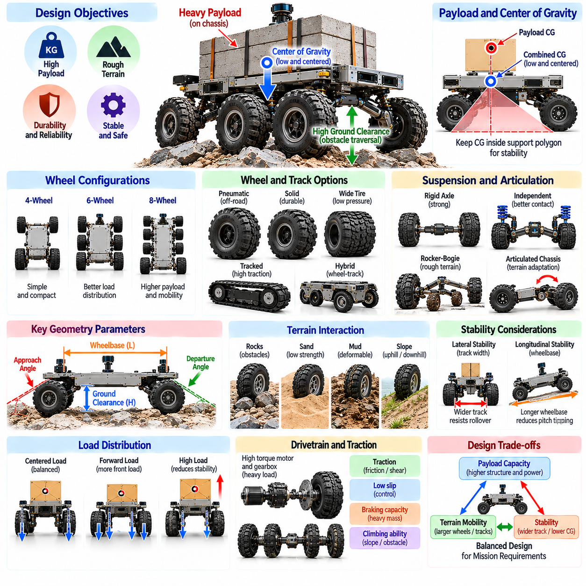{width="7.268055555555556in" height="7.268055555555556in"}

고하중 및 험지 형태학(Heavy-Payload and Rough-Terrain Morphology)은 까다로운 기계적 조건(Mechanical Conditions)과 환경 조건(Environmental Conditions)에서 운용되는 모바일 로봇(Mobile Robot)의 구조적 요구사항(Structural Requirements)과 이동 요구사항(Locomotion Requirements)을 다룬다. 이러한 플랫폼은 불규칙한 표면(Irregular Surfaces)에서도 견인력(Traction), 안정성(Stability), 이동성(Mobility)을 유지하면서 상당한 하중을 지지해야 한다. 이를 위해 섀시 강도(Chassis Strength), 바퀴 구성(Wheel Configuration), 현가장치(Suspension), 구동계 용량(Drivetrain Capacity), 지상고(Ground Clearance), 지형 상호작용(Terrain Interaction)을 통합적으로 고려해야 한다.

고하중 이동성(Heavy-Payload Mobility)은 단순히 모터 출력(Motor Power)이나 구조물 치수(Structural Dimensions)를 증가시키는 것 이상의 문제를 제기한다. 질량이 증가하면 바퀴 하중(Wheel Loads), 구름 저항(Rolling Resistance), 제동 요구량(Braking Demands), 섀시를 통해 전달되는 힘(Forces Transmitted Through the Chassis)이 증가한다. 험지(Rough Terrain)는 불균일한 접촉 조건(Uneven Contact Conditions), 충격 하중(Impact Loading), 예측하기 어려운 견인력(Unpredictable Traction)을 추가한다. 성공적인 형태학 설계(Morphology Design)는 과도한 변형(Excessive Deformation), 불안정성(Instability), 조기 기계적 고장(Premature Mechanical Failure) 없이 이러한 복합적인 영향을 수용해야 한다.

섀시 구조(Chassis Architecture)는 고하중 모바일 플랫폼(Heavy-Duty Mobile Platform)의 구조적 기반(Structural Foundation)을 제공한다. 보강 프레임(Reinforced Frame), 적절한 크기의 가로 부재(Cross-Members), 효율적인 하중 전달 경로(Load Paths)는 탑재하중 장착 지점(Payload Mounting Points)에서 바퀴 또는 트랙(Tracks)으로 힘을 분산한다. 구조 설계(Structural Design)는 굽힘(Bending), 비틀림(Torsion), 반복적인 동적 하중(Repeated Dynamic Loading)에 저항해야 한다. 과도한 보강(Excessive Reinforcement)은 질량을 증가시키므로 강성(Stiffness)과 강도(Strength)는 이동성(Mobility)을 고려하지 않은 채 무조건 최대화하기보다 최적화해야 한다.

탑재하중 분포(Payload Distribution)는 집중 하중(Concentrated Loads)이나 높은 위치의 하중(Elevated Loads)이 안정성을 감소시키고 개별 접촉점(Contact Points)에 과부하를 발생시킬 수 있기 때문에 특히 중요하다. 무거운 부품(Heavy Components)을 기하학적 중심(Geometric Center) 가까이와 지면에 낮게 배치하면 일반적으로 하중 균형(Load Balance)이 개선된다. 그러나 지형 장애물(Terrain Obstacles)과 현가장치 운동(Suspension Motion)은 바퀴 하중(Wheel Loading)을 지속적으로 변화시킨다. 설계자는 대표적인 탑재하중 구성(Payload Configurations)과 관절 운동 상태(Articulation States)에서 결합 무게중심(Combined Center of Gravity)을 평가해야 한다.

바퀴 구성(Wheel Configuration)은 하중 운반 능력(Load-Carrying Capability)과 지형 접근성(Terrain Accessibility)에 큰 영향을 미친다. 4륜 플랫폼(Four-Wheel Platform)은 비교적 단순한 구조를 제공하는 반면, 6륜 및 8륜 구성(Six-Wheel and Eight-Wheel Arrangements)은 추가적인 접촉점(Contact Points)에 하중을 분산할 수 있다. 다축 설계(Multi-Axle Design)는 장애물 통과 능력(Obstacle Negotiation)을 향상시키고 개별 바퀴 하중(Individual Wheel Loading)을 감소시킬 수 있다. 그러나 구동계 부품(Drivetrain Components), 조향 제약조건(Steering Constraints), 기계적 복잡성(Mechanical Complexity), 유지보수 요구사항(Maintenance Requirements)이 증가한다.

바퀴 직경(Wheel Diameter)과 폭(Wheel Width)은 장애물 치수(Obstacle Dimensions), 토양 특성(Soil Properties), 예상 접촉력(Expected Contact Forces)에 따라 선택해야 한다. 큰 바퀴(Larger Wheels)는 더 큰 표면 불규칙성(Surface Irregularities)을 통과할 수 있으며 장애물의 상대적인 영향을 감소시킨다. 넓은 타이어(Wider Tires)는 타이어 구조(Tire Construction)와 공기압(Inflation)에 따라 변형 가능한 지형(Deformable Terrain)에서 접지압(Ground Pressure)을 낮출 수 있다. 이러한 이점은 회전 관성(Rotational Inertia), 조향 저항(Steering Resistance), 부품 배치 요구사항(Packaging Requirements), 구동계 토크(Drivetrain Torque)와 균형을 이루어야 한다.

궤도형 이동 방식(Tracked Locomotion)은 느슨하거나 변형이 심한 지면(Highly Deformable Ground)에서 운용되는 플랫폼의 대안이 된다. 연속 궤도(Continuous Tracks)는 차량 중량(Vehicle Weight)을 넓은 접촉 영역(Contact Region)에 분산하여 침하(Sinkage)를 줄이고 견인력(Traction)을 향상시킬 수 있다. 그러나 궤도는 마찰 손실(Frictional Losses), 마모(Wear), 스키드 회전(Skid Turns) 중 상당한 조향 저항(Steering Resistance)을 발생시킨다. 적합성은 지형 특성(Terrain Characteristics), 차량 질량(Vehicle Mass), 운용 속도(Operating Speed), 유지보수 제약조건(Maintenance Constraints)에 따라 달라진다.

하이브리드 바퀴-궤도 구조(Hybrid Wheel-Track Architecture) 또는 바퀴-다리 구조(Wheel-Leg Architecture)는 단단한 표면(Firm Surfaces)과 까다로운 장애물(Difficult Obstacles)이 혼재된 환경에서 이동성을 확장할 수 있다. 재구성 가능한 메커니즘(Reconfigurable Mechanisms)은 지형 전이(Terrain Transitions)에 대응하도록 접촉 기하학(Contact Geometry)이나 이동 모드(Locomotion Mode)를 변경할 수 있다. 이러한 적응성(Adaptability)은 추가적인 액추에이터(Actuators), 관절(Joints), 센서(Sensors), 제어 요구사항(Control Requirements)을 수반한다. 이동성 향상 효과는 질량(Mass), 에너지 소비(Energy Consumption), 시스템 복잡성(System Complexity)의 증가를 정당화할 수 있어야 한다.

현가장치(Suspension)는 불규칙한 지형에서 접촉을 유지하고 힘을 분산하는 데 필수적이다. 독립 현가장치(Independent Suspension), 워킹 빔(Walking Beam), 로커-보기 메커니즘(Rocker-Bogie Mechanism), 관절형 차축(Articulated Axle)은 바퀴 변위(Wheel Displacement)를 수용하는 서로 다른 접근법을 제공한다. 충분한 현가장치 이동량(Suspension Travel)은 개별 바퀴의 하중이 감소하거나 사라지는 현상(Wheel Unloading)을 방지하는 데 도움이 된다. 그러나 유연성(Compliance)과 관절 운동(Articulation)은 탑재하중 안정성(Payload Stability), 구조적 내구성(Structural Durability), 차량 자세 제어(Vehicle Attitude Control)와 조화를 이루어야 한다.

관절형 섀시 형태학(Articulated Chassis Morphology)은 차체 구간(Body Sections)이 서로 상대적으로 회전할 수 있도록 하여 지형 순응성(Terrain Conformity)을 향상시킨다. 피치 관절 운동(Pitch Articulation)과 롤 관절 운동(Roll Articulation)은 표면 높이 차이(Surface Height Differences)에 대응하는 데 도움이 되며, 요 관절 운동(Yaw Articulation)은 조향을 지원할 수 있다. 이러한 메커니즘은 섀시 비틀림(Chassis Twisting)을 줄이고 불규칙한 지면에서 접촉을 유지할 수 있다. 그러나 관절 운동은 지지 기하학(Support Geometry)을 변화시키므로 관절 하중(Joint Loads)과 안정성 여유(Stability Margins)를 신중하게 평가해야 한다.

지상고(Ground Clearance)와 장애물 기하학(Obstacle Geometry)은 고하중 플랫폼(Heavy-Duty Platform)이 암석(Rocks), 바퀴 자국으로 형성된 홈(Ruts), 능선(Ridges), 불규칙한 지형 전이(Uneven Transitions)를 하부 접촉(Grounding) 없이 통과할 수 있는지를 결정한다. 휠베이스(Wheelbase), 접근각(Approach Angle), 이탈각(Departure Angle), 종단 통과각(Breakover Angle)은 지상고와 상호작용하여 주행 가능성(Traversal Capability)을 결정한다. 지상고를 높이면 장애물 접근성(Obstacle Accessibility)이 향상될 수 있지만 무게중심(Center of Gravity)이 상승할 수 있다. 따라서 고하중 플랫폼은 장애물 통과 능력(Obstacle Negotiation)과 전복 저항성(Rollover Resistance) 사이의 균형을 유지해야 한다.

견인력(Traction)은 수직 하중(Normal Loading), 타이어 또는 궤도 특성(Tire or Track Properties), 지형 강도(Terrain Strength) 사이의 상호작용에 따라 달라진다. 단단한 지면(Firm Ground)에서는 마찰(Friction)이 사용 가능한 추진력(Propulsion Forces)과 제동력(Braking Forces)에 큰 영향을 미친다. 느슨한 토양(Loose Soil)에서는 전단 강도(Shear Strength), 다짐(Compaction), 침하(Sinkage)가 중요해진다. 무거운 플랫폼은 접촉 표면(Contact Surfaces) 아래의 지형이 변형될 때 상당한 저항을 경험할 수 있으므로 접지압(Ground Pressure)과 이동 한계(Mobility Limits)를 신중하게 평가해야 한다.

구동계 용량 선정(Drivetrain Sizing)에서는 탑재하중 질량(Payload Mass), 구름 저항(Rolling Resistance), 경사면 등판(Slope Climbing), 가속(Acceleration), 장애물 통과(Obstacle Traversal)를 고려해야 한다. 모터(Motors), 기어박스(Gearboxes), 축(Shafts), 휠 허브(Wheel Hubs)는 연속 운용 하중(Continuous Operating Loads)과 단시간 최대 요구량(Short-Duration Peak Demands)을 모두 견뎌야 한다. 여러 구동 바퀴(Driven Wheels)에 토크를 분배하면 견인력 활용(Traction Utilization)을 개선할 수 있다. 그러나 구동계 용량(Drivetrain Capacity)만으로는 불충분한 지면 접촉(Insufficient Ground Contact)이나 불안정한 차량 기하학(Unstable Vehicle Geometry)을 극복할 수 없다.

제동 시스템(Braking System)은 질량 증가로 인해 정지 과정에서 소산해야 하는 운동 에너지(Kinetic Energy)가 증가하므로 특별한 주의가 필요하다. 내리막 운용(Downhill Operation)은 추가적인 중력 하중(Gravitational Loading)을 발생시키며, 느슨한 지형(Loose Terrain)은 사용 가능한 제동 견인력(Braking Traction)을 제한할 수 있다. 기계식 브레이크(Mechanical Brakes), 회생 제동(Regenerative Braking), 제어된 감속(Controlled Deceleration)은 정지 성능(Stopping Performance)에 기여할 수 있다. 안전성 분석(Safety Analysis)에서는 최악 조건의 탑재하중(Worst-Case Payload), 경사(Slope), 속도(Speed), 표면 조건(Surface Conditions)을 고려해야 한다.

안정성(Stability)은 결합 무게중심(Combined Center of Gravity)과 유효 지지 영역(Effective Support Region) 사이의 관계에 의해 결정된다. 높은 위치의 탑재하중(Elevated Payloads), 좁은 윤거(Narrow Track Width), 급격한 횡경사(Steep Cross-Slopes)는 전복 가능성(Rollover Susceptibility)을 증가시킬 수 있다. 현가장치 압축(Suspension Compression)과 관절 운동(Articulation)은 접촉점 기하학(Contact-Point Geometry)을 추가적으로 변화시킬 수 있다. 정적 전복 해석(Static Tipping Analysis)은 유용한 초기 한계를 제공하지만, 동적 하중 이동(Dynamic Load Transfer)과 지형으로 인한 외란(Terrain-Induced Disturbances)도 고려해야 한다.

에너지 소비(Energy Consumption)는 무거운 하중을 가속하거나 중력에 대항하여 들어 올리거나 변형 가능한 지형(Deformable Terrain)을 가로질러 운반할 때 증가한다. 바퀴 슬립(Wheel Slip), 토양 다짐(Soil Compaction), 현가장치 손실(Suspension Losses), 비효율적인 기어비(Inefficient Gearing)는 운용 지속시간(Operating Endurance)을 추가로 감소시킬 수 있다. 배터리 용량(Battery Capacity)과 전력 전자장치(Power Electronics)는 과도한 열응력(Thermal Stress) 없이 지속적인 토크 요구량(Sustained Torque Demands)을 지원해야 한다. 에너지 효율적인 형태학(Energy-Efficient Morphology)은 견인력과 구조적 강도를 유지하면서 불필요한 저항을 줄이는 것을 목표로 한다.

환경 내구성(Environmental Durability)은 험지 로봇(Rough-Terrain Robot)이 먼지(Dust), 습기(Moisture), 충격(Impacts), 진동(Vibration), 마모성 물질(Abrasive Materials)에 노출되기 때문에 매우 중요하다. 베어링(Bearings), 관절(Joints), 밀봉재(Seals), 케이블(Cables), 노출된 구동계 부품(Exposed Drivetrain Components)은 오염(Contamination)과 반복적인 기계적 하중(Repeated Mechanical Loading)으로부터 보호해야 한다. 내부식성 재료(Corrosion-Resistant Materials)와 접근하기 쉬운 정비 지점(Accessible Service Points)은 유지보수성(Maintainability)을 향상시킨다. 신뢰성(Reliability)은 전체 운용 수명주기(Operating Lifecycle) 동안 피로(Fatigue), 마모(Wear), 환경적 열화(Environmental Degradation)를 제어하는 데 달려 있다.

지형 인식(Terrain Perception)은 고하중 로봇(Heavy-Duty Robot)이 주변 환경이 차량의 질량과 의도된 운동(Intended Motion)을 지지할 수 있는지 추정하도록 한다. 카메라(Cameras), 라이다(LiDAR), 관성 센서(Inertial Sensors), 바퀴 운동 측정(Wheel-Motion Measurements)은 장애물(Obstacles), 경사(Slopes), 접촉 거동(Contact Behavior)에 관한 정보를 제공한다. 시각적 외관(Visual Appearance)만으로는 토양 지지력(Soil Bearing Strength)이나 숨겨진 위험 요소(Hidden Hazards)를 파악하기 어려울 수 있다. 따라서 인식은 보수적인 가정(Conservative Assumptions) 및 접촉 기반 피드백(Contact-Based Feedback)과 결합되어야 한다.

형태학 인식 경로 계획(Morphology-Aware Planning)은 적재된 플랫폼(Loaded Platform)의 물리적 능력(Physical Capabilities)에 따라 경로를 평가한다. 기하학적으로 개방된 경로(Geometrically Open Path)라도 지반 지지력(Ground Support)이 부족하거나 경사(Slope)가 과도하거나 지상고(Clearance)가 불충분하거나 전복 위험(Rollover Risk)이 높으면 적합하지 않을 수 있다. 계획 시스템(Planning Systems)은 차량 치수(Vehicle Dimensions), 탑재하중 분포(Payload Distribution), 견인력 추정(Traction Estimates), 현가장치 한계(Suspension Limits)를 반영해야 한다. 더 안전한 대체 경로(Safer Alternatives)를 선택하기 위해 이동 거리가 길어지거나 운용 속도를 낮춰야 할 수도 있다.

적응형 제어(Adaptive Control)는 변화하는 지형에 대응하여 토크 분배(Torque Allocation), 조향 명령(Steering Commands), 가속도 한계(Acceleration Limits), 관절 운동 거동(Articulation Behavior)을 조정함으로써 성능을 개선할 수 있다. 슬립 추정(Slip Estimation)은 견인력 손실(Traction Loss)을 탐지하는 데 도움이 되며, 관성 측정(Inertial Measurements)은 과도한 차체 운동(Excessive Body Motion)을 나타낸다. 제어기(Controllers)는 불안정성이 발생할 때 속도를 낮추거나 구동력을 재분배할 수 있다. 이러한 적응은 검증된 구조적 제약조건(Structural Constraints), 액추에이터 제약조건(Actuator Constraints), 안정성 제약조건(Stability Constraints) 내에서 이루어져야 한다.

피지컬 AI(Physical AI)는 지형 이해(Terrain Understanding), 탑재하중 추정(Payload Estimation), 예측 이동성 모델(Predictive Mobility Models)을 통합된 의사결정 과정(Unified Decision Process)으로 결합할 수 있다. 학습된 표현(Learned Representations)은 주행 가능성(Traversability)을 분류하고 어려운 접촉 조건(Difficult Contact Conditions)을 예측하는 데 도움이 될 수 있으며, 물리 기반 모델(Physics-Based Models)은 해석 가능한 안전 경계(Interpretable Safety Boundaries)를 제공한다. 목표는 단순히 무거운 하중을 이동시키는 것이 아니라 불확실성(Uncertainty) 속에서도 기계적으로 실행 가능한 행동(Mechanically Feasible Actions)을 선택하는 것이다.

시뮬레이션(Simulation)과 시험(Testing)은 최대 탑재하중(Maximum Payload), 불규칙한 지면(Uneven Ground), 장애물(Obstacles), 환경 노출(Environmental Exposure)의 대표적인 조합을 재현해야 한다. 다물체 동역학(Multibody Dynamics)과 지반-차량 상호작용 모델(Terramechanics Models)은 접촉력(Contact Forces), 현가장치 이동량(Suspension Travel), 구동계 하중(Drivetrain Loads)을 추정할 수 있다. 물리적 검증(Physical Validation)은 등판(Climbing), 제동(Braking), 구조적 피로(Structural Fatigue), 견인력(Traction), 비상 동작(Emergency Behavior)을 평가해야 한다. 시험 결과는 현실적인 운용 한계 범위(Operating Envelopes)를 설정하고 단순화된 모델(Simplified Models)이 간과할 수 있는 취약점을 밝혀낸다.

궁극적으로 고하중 및 험지 형태학(Heavy-Payload and Rough-Terrain Morphology)은 하중 용량(Load Capacity), 지형 적응성(Terrain Adaptability), 안정성(Stability), 내구성(Durability), 에너지 효율(Energy Efficiency) 사이의 통합적인 균형을 요구한다. 모든 환경에 최적인 단일 바퀴(Wheel), 궤도(Track), 현가장치(Suspension), 섀시 구성(Chassis Configuration)은 존재하지 않는다. 견고한 기계 설계(Robust Mechanical Design)를 지형 인식(Terrain-Aware Perception), 형태학 인식 계획(Morphology-Aware Planning), 적응형 제어(Adaptive Control)와 결합하면 피지컬 AI 플랫폼(Physical AI Platforms)은 까다로운 탑재하중(Demanding Payloads)을 더욱 안전하고 신뢰성 있게 운반할 수 있다.

## 04.12. Mobile Base Morphology Selection [w/Code]

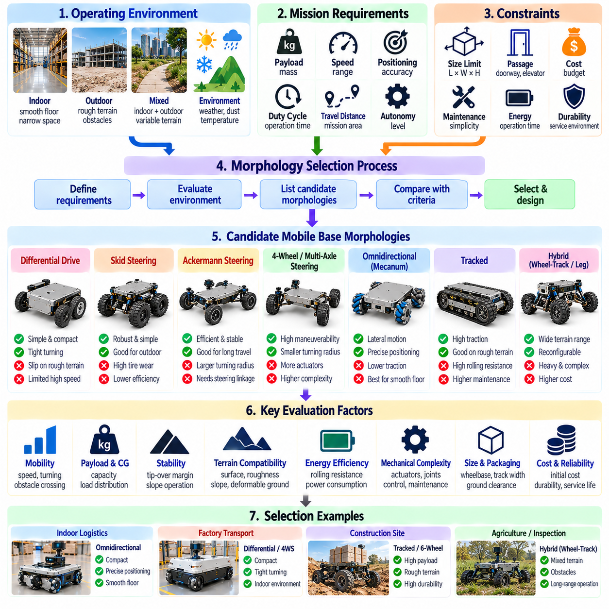{width="7.268055555555556in" height="7.268055555555556in"}

모바일 베이스 형태학 선택(Mobile Base Morphology Selection)은 로봇이 운용 환경(Operating Environment)과 얼마나 효과적으로 상호작용할 수 있는지를 결정하는 핵심적인 공학적 의사결정(Engineering Decision)이다. 선택 과정에서는 이동 능력(Locomotion Capability), 탑재하중 요구사항(Payload Requirements), 지형 조건(Terrain Conditions), 안정성(Stability), 에너지 효율(Energy Efficiency), 운용 제약조건(Operational Constraints)을 고려해야 한다. 설계자는 단일 성능 지표(Performance Metric)에 따라 플랫폼을 선택하기보다 기계적 구조(Mechanical Architecture)가 전체 임무(Complete Mission)를 어떻게 지원하는지 평가해야 한다.

선택 과정은 예상 표면(Expected Surfaces), 경사(Slopes), 장애물(Obstacles), 가용 공간(Available Space), 환경 노출(Environmental Exposure)을 포함하는 운용 설계 영역(Operational Design Domain, ODD)을 명확하게 정의하는 것에서 시작된다. 실내 창고(Indoor Warehouse), 실외 건설 현장(Outdoor Construction Site), 농업 현장(Agricultural Field), 복합 환경(Mixed Environment)은 서로 다른 이동 요구사항(Mobility Requirements)을 부과한다. 대표적인 운용 조건(Representative Operating Conditions)을 정의하면 시연(Demonstration)에서는 우수한 성능을 보이지만 실제 배치(Deployment)에서는 성능이 저하되는 형태학을 선택하는 문제를 방지할 수 있다.

임무 요구사항(Mission Requirements)은 형태학 선택(Morphology Selection)의 기능적 경계(Functional Boundaries)를 설정한다. 탑재하중 질량(Payload Mass), 운송 거리(Transport Distance), 운용 속도(Operating Speed), 위치 정밀도(Positioning Accuracy), 듀티 사이클(Duty Cycle), 요구 자율성(Required Autonomy)은 섀시 치수(Chassis Dimensions)와 구동계 구조(Drivetrain Architecture)에 영향을 미친다. 소형 검사 로봇(Compact Inspection Robot)은 고하중 물류 플랫폼(Heavy-Duty Logistics Platform)과 서로 다른 우선순위를 갖는다. 이러한 요구사항은 후보 구성(Candidate Configurations)을 평가하기 전에 측정 가능한 공학적 사양(Measurable Engineering Specifications)으로 변환해야 한다.

차동 구동 형태학(Differential-Drive Morphology)은 단순한 구조(Simple Construction), 정밀한 저속 운동(Precise Low-Speed Motion), 좁은 공간에서의 회전 능력(Compact Turning Capability)이 필요한 실내 로봇에 적합한 경우가 많다. 독립적인 바퀴 속도 제어(Independent Wheel-Speed Control)는 작은 점유 영역(Small Footprint) 내에서 회전을 가능하게 하여 조향 복잡성(Steering Complexity)을 줄인다. 그러나 차동 구동 플랫폼(Differential-Drive Platform)은 회전 중 바퀴 슬립(Wheel Slip)이 발생할 수 있으며 불규칙한 지형(Uneven Terrain)에서 한계에 직면할 수 있다. 적합성은 견인 조건(Traction Conditions)과 요구 기동성(Required Maneuverability)에 따라 달라진다.

스키드 조향 형태학(Skid-Steering Morphology)은 일부 실외 및 산업용 플랫폼(Outdoor and Industrial Platforms)에 기계적 단순성(Mechanical Simplicity)과 견고한 방향 제어(Robust Directional Control)를 제공한다. 조향은 서로 반대쪽 바퀴 또는 궤도(Opposing Wheels or Tracks) 사이의 차등 운동(Differential Motion)을 통해 이루어지므로 기존의 조향 링크(Conventional Steering Linkages)가 필요하지 않다. 그러나 회전 과정에서 타이어 또는 궤도의 횡방향 슬립(Lateral Tire or Track Slip)이 발생하여 에너지 손실(Energy Losses)과 표면 마모(Surface Wear)가 증가한다. 설계자는 이러한 구조를 평가할 때 지면 마찰(Ground Friction), 탑재하중 질량(Payload Mass), 조향 토크(Steering Torque)를 고려해야 한다.

애커먼 조향(Ackermann Steering)은 효율적인 전진 주행(Efficient Forward Travel), 예측 가능한 회전 거동(Predictable Turning Behavior), 감소된 타이어 끌림(Reduced Tire Scrubbing)이 필요한 플랫폼에 적합하다. 애커먼 기하학(Ackermann Geometry)은 일반적인 조향 조건에서 비교적 낮은 횡방향 슬립(Lateral Slip)으로 구름 운동(Rolling Motion)을 지원한다. 그러나 기존 애커먼 차량(Conventional Ackermann Vehicle)은 일반적으로 차동 구동 로봇보다 더 넓은 회전 공간(Turning Space)이 필요하다. 이러한 형태학은 극단적인 기동성(Extreme Maneuverability)보다 주행 속도(Travel Speed), 방향 안정성(Directional Stability), 장거리 효율(Long-Distance Efficiency)이 중요한 경우에 특히 적합하다.

4륜 조향(Four-Wheel Steering)과 다축 조향(Multi-Axle Steering)은 추가적인 바퀴 방향(Wheel Orientations)을 제어하여 기동성(Maneuverability)을 확장한다. 협조 조향(Coordinated Steering)은 회전 반경(Turning Radius)을 줄이고 경로 추종(Path Tracking)을 개선하며 특수한 운동 모드(Specialized Motion Modes)를 지원할 수 있다. 이러한 장점에는 추가적인 액추에이터(Actuators), 센서(Sensors), 제어 협조(Control Coordination)가 필요하다. 선택 과정에서는 이동성 향상(Mobility Improvement)이 기계적 복잡성(Mechanical Complexity), 보정 작업(Calibration Effort), 유지보수 요구사항(Maintenance Requirements)의 증가를 정당화하는지 고려해야 한다.

전방향 플랫폼(Omnidirectional Platform)과 메카넘 플랫폼(Mecanum Platform)은 기존 차량처럼 방향을 변경하지 않고도 횡방향 이동(Lateral Translation)과 유연한 위치 조정(Flexible Positioning)을 제공한다. 이러한 플랫폼은 정밀 도킹(Precision Docking), 자재 취급(Material Handling), 제한된 실내 배치(Constrained Indoor Layouts)에서의 주행에 유용하다. 성능은 적절한 바닥 조건(Suitable Floor Conditions)과 신뢰할 수 있는 바퀴-지면 접촉(Reliable Wheel-Ground Contact)에 따라 달라진다. 롤러 손실(Roller Losses), 진동(Vibration), 불규칙한 표면에서 감소하는 견인력(Reduced Traction), 탑재하중 한계(Payload Limitations)를 신중하게 평가해야 한다.

궤도형 플랫폼(Tracked Platform)은 느슨한 토양(Loose Soil), 진흙(Mud), 분산된 접촉(Distributed Contact)이 이동성을 향상시킬 수 있는 표면을 포함하는 지형에서 매력적인 선택이다. 확장된 접촉 영역(Extended Contact Region)은 접지압(Ground Pressure)을 감소시키고 변형 가능한 지형(Deformable Terrain)에서 견인력(Traction)을 지원할 수 있다. 그러나 궤도(Tracks)는 구름 손실(Rolling Losses), 기계적 마모(Mechanical Wear), 조향 저항(Steering Resistance)을 증가시킬 수 있다. 궤도가 항상 바퀴보다 우수하다고 가정하기보다 측정된 지형 요구사항(Measured Terrain Demands)에 따라 선택해야 한다.

하이브리드 및 재구성 가능한 형태학(Hybrid and Reconfigurable Morphologies)은 서로 다른 이동 메커니즘(Locomotion Mechanisms)을 결합하여 장애물의 변동성이 매우 높은 환경에 대응한다. 바퀴-궤도 시스템(Wheel-Track System), 바퀴-다리 플랫폼(Wheel-Leg Platform), 관절형 구성(Articulated Configuration)은 기존의 고정형 구조(Conventional Fixed Architectures)보다 주행 가능성(Traversability)을 확장할 수 있다. 그러나 추가적인 관절(Joints)과 액추에이터(Actuators)는 질량(Mass), 비용(Cost), 고장 가능성(Failure Opportunities)을 증가시킨다. 이러한 구조의 이점은 실제적인 임무 조건(Realistic Mission Conditions)에서 더 단순한 대안(Simple Alternatives)과 비교하여 입증되어야 한다.

휠베이스(Wheelbase), 윤거(Track Width), 지상고(Ground Clearance)는 중요한 기하학적 제약조건(Geometric Constraints)을 설정한다. 긴 휠베이스(Long Wheelbase)는 종방향 안정성(Longitudinal Stability)을 향상시킬 수 있지만 기동성(Maneuverability)을 감소시킬 수 있으며, 넓은 윤거(Wider Track)는 통로 접근성(Passage Accessibility)을 희생하는 대신 횡방향 안정성(Lateral Stability)을 증가시킨다. 높은 지상고(Greater Ground Clearance)는 장애물 통과 능력(Obstacle Negotiation)을 향상시키지만 무게중심(Center of Gravity)을 높일 수 있다. 이러한 치수는 독립적으로 최적화하기보다 함께 선정해야 한다.

현가장치 구조(Suspension Architecture)는 지형 불규칙성(Terrain Irregularity), 차량 속도(Vehicle Speed), 탑재하중 민감도(Payload Sensitivity), 요구 접촉 일관성(Required Contact Consistency)을 반영해야 한다. 강체 섀시 구조(Rigid Chassis Structure)는 매끄러운 실내 바닥(Smooth Indoor Floor)에서 충분할 수 있지만, 실외 플랫폼은 유연한 현가장치(Compliant Suspension)나 관절형 메커니즘(Articulated Mechanism)의 이점을 얻는 경우가 많다. 현가장치는 지형 순응성(Terrain Conformity)을 향상시키지만 차체 운동(Body Motion)과 안정성 변화(Stability Changes)를 발생시킬 수 있다. 따라서 접촉 유지(Contact Maintenance), 기계적 단순성(Mechanical Simplicity), 하중 제어(Load Control) 사이의 균형이 필요하다.

탑재하중 분포(Payload Distribution)와 무게중심 위치(Center-of-Gravity Position)는 후보 형태학(Candidate Morphologies)을 평가하는 핵심 요소이다. 무겁거나 높은 위치에 배치된 탑재하중(Heavy or Elevated Payloads)은 가속(Acceleration), 제동(Braking), 회전(Turning) 중 전복 모멘트(Overturning Moments)를 증가시킨다. 설계자는 예상되는 탑재하중 구성(Expected Payload Configurations)에 대해 바퀴 하중(Wheel Loading)과 전복 안정성 여유(Tipping Margins)를 추정해야 한다. 형태학 선택에서는 적재 메커니즘(Loading Mechanisms), 매니퓰레이터 운동(Manipulator Motion), 비대칭 하중(Asymmetric Loads)이나 이동하는 하중(Shifting Loads)의 가능성도 고려해야 한다.

지형 상호작용(Terrain Interaction)은 견인력(Traction), 구름 저항(Rolling Resistance), 침하(Sinkage), 장애물 통과 능력(Obstacle-Crossing Capability), 예상 바퀴 슬립(Expected Wheel Slip)을 통해 평가해야 한다. 표면의 외관(Surface Appearance)만으로는 기계적 지지 조건(Mechanical Support Conditions)을 신뢰성 있게 판단할 수 없다. 따라서 후보 플랫폼(Candidate Platforms)은 대표적인 지형 측정(Representative Terrain Measurements)과 접촉 모델(Contact Models)을 사용하여 평가해야 한다. 단단한 포장도로(Firm Pavement)에서 효율적으로 작동하는 형태학도 느슨하거나 변형 가능한 지면(Loose or Deformable Ground)에서는 비효율적일 수 있다.

에너지 효율(Energy Efficiency)은 운용 비용(Operating Cost)과 임무 지속시간(Mission Endurance)에 모두 영향을 미친다. 바퀴 구성(Wheel Configuration), 구동계 기어비(Drivetrain Gearing), 조향 손실(Steering Losses), 차량 질량(Vehicle Mass), 현가장치 거동(Suspension Behavior)은 에너지 소비(Energy Consumption)에 영향을 준다. 기계적으로 충분한 능력을 갖춘 플랫폼(Mechanically Capable Platform)이라도 전력 요구량(Power Demand)이 사용 가능한 배터리 용량(Available Battery Capacity)을 초과하면 적합하지 않을 수 있다. 설계자는 가속, 회전, 등판, 탑재하중 운송을 포함한 실제적인 듀티 사이클(Realistic Duty Cycles)을 사용하여 후보 형태학을 비교해야 한다.

환경 내구성(Environmental Durability)과 유지보수성(Maintainability)은 이동 성능(Mobility Performance)과 함께 고려해야 한다. 실외 플랫폼에는 밀봉 외함(Sealed Enclosure), 부식 방지(Corrosion Protection), 오염(Contamination)과 충격(Impact)에 강한 부품이 필요할 수 있다. 실내 로봇은 조용한 운용(Quiet Operation), 바닥 보호(Floor Protection), 편리한 정비(Convenient Servicing)를 우선시할 수 있다. 모듈형 구조(Modular Construction)와 접근하기 쉬운 부품(Accessible Components)은 유지보수 시간을 줄이며, 불필요한 기계적 복잡성(Unnecessary Mechanical Complexity)은 수명주기 비용(Lifecycle Costs)을 증가시킬 수 있다.

안전 요구사항(Safety Requirements)은 섀시 기하학(Chassis Geometry), 제동 능력(Braking Capability), 안정성 여유(Stability Margins), 주변 사람이나 장비와의 상호작용(Interaction with People or Equipment)에 영향을 미친다. 형태학은 예측 가능한 정지(Predictable Stopping), 제어된 운동(Controlled Motion), 예상 외란(Expected Disturbances)에서의 안전한 운용(Safe Operation)을 지원해야 한다. 비상 동작(Emergency Behavior)은 최대 탑재하중(Maximum Payload)과 불리한 지형 조건(Unfavorable Terrain Conditions)에서 평가해야 한다. 기계적 한계(Mechanical Limitations)가 해결되지 않은 상태에서는 소프트웨어(Software)만으로 안전성을 확보할 수 없다.

형태학 선택(Morphology Selection)은 센싱(Sensing)과 위치 추정(Localization) 성능에도 영향을 미친다. 섀시 진동(Chassis Vibration), 바퀴 슬립(Wheel Slip), 관절 운동(Articulation), 센서 배치(Sensor Placement)는 측정 품질(Measurement Quality)과 상태 추정(State Estimation)에 영향을 준다. 실내 플랫폼은 라이다(LiDAR)와 시각적 위치 추정(Visual Localization)에 의존할 수 있으며, 실외 시스템은 위성항법시스템(Global Navigation Satellite System, GNSS)과 관성 센싱(Inertial Sensing)을 통합할 수 있다. 센서 구성(Sensor Configurations)은 플랫폼 설계가 완료된 후 추가하기보다 기계적 구조(Mechanical Architecture)의 일부로 평가해야 한다.

체계적인 선택 프레임워크(Systematic Selection Framework)는 가중치가 부여된 임무 기준(Weighted Mission Criteria)에 따라 후보 구조(Candidate Architectures)를 비교한다. 이동성(Mobility), 탑재하중 용량(Payload Capacity), 안정성(Stability), 에너지 효율(Energy Efficiency), 비용(Cost), 신뢰성(Reliability), 유지보수성(Maintainability)은 공통 성능 지표(Common Performance Measures)를 사용하여 평가할 수 있다. 가중치(Weighting)는 운용 우선순위(Operational Priorities)를 반영해야 하지만, 핵심 안전 제약조건(Critical Safety Constraints)은 반드시 충족해야 한다. 절충 분석(Trade-Off Analysis)은 개별적인 장점(Isolated Advantages)보다 균형 잡힌 성능(Balanced Performance)을 제공하는 설계를 식별하는 데 도움이 된다.

시뮬레이션(Simulation)은 운동학(Kinematics), 동역학(Dynamics), 바퀴 하중(Wheel Loading), 장애물 통과(Obstacle Traversal), 에너지 소비(Energy Consumption)를 비교하여 초기 평가(Early Evaluation)를 지원한다. 대표적인 시나리오(Representative Scenarios)에는 정상 운용(Nominal Operation)과 까다로운 경계 조건(Difficult Boundary Conditions)이 포함되어야 한다. 민감도 분석(Sensitivity Analysis)은 탑재하중(Payload), 마찰(Friction), 기하학(Geometry), 현가장치 매개변수(Suspension Parameters)의 변화가 성능에 어떤 영향을 미치는지 밝혀낼 수 있다. 시뮬레이션 결과는 설계 개선(Design Refinement)을 안내하지만 물리적 검증(Physical Validation)을 대체할 수는 없다.

시제품 시험(Prototype Testing)은 단순화된 모델(Simplified Models)이 간과할 수 있는 실제 거동(Real-World Behavior)에 대한 근거를 제공한다. 회전 반경(Turning Radius), 제동 거리(Braking Distance), 등판 능력(Climbing Capability), 바퀴 슬립(Wheel Slip), 진동(Vibration), 전력 소비(Power Consumption)는 대표적인 조건(Representative Conditions)에서 측정해야 한다. 반복 시험(Repeated Testing)은 구조적 마모(Structural Wear)와 유지보수 문제(Maintenance Concerns)도 밝혀낸다. 이후 후보 형태학은 가정(Assumptions)이나 제조사 사양(Manufacturer Specifications)에만 의존하지 않고 검증된 측정값(Validated Measurements)을 사용하여 비교할 수 있다.

피지컬 AI(Physical AI)는 인식(Perception), 계획(Planning), 제어(Control)를 로봇의 기계적 능력(Mechanical Capabilities)과 연결함으로써 형태학 인식 적응(Morphology-Aware Adaptation)의 가능성을 제공한다. 지형 분류(Terrain Classification), 탑재하중 추정(Payload Estimation), 안정성 예측(Stability Prediction)은 속도 선택(Speed Selection)과 경로 계획(Route Planning)을 지원할 수 있다. 학습 모델(Learned Models)은 변화하는 조건(Variable Conditions)에서 성능을 개선할 수 있으며, 검증된 물리적 제약조건(Validated Physical Constraints)은 안전 경계(Safety Boundaries)를 유지한다. 적응형 지능(Adaptive Intelligence)은 적절한 형태학의 성능을 향상시키지만 부적절한 기계적 선택(Poor Mechanical Selection)을 완전히 보완할 수는 없다.

궁극적으로 모바일 베이스 형태학 선택(Mobile Base Morphology Selection)은 기계 설계(Mechanical Design), 환경 상호작용(Environmental Interaction), 센싱(Sensing), 제어(Control), 운용 경제성(Operational Economics)을 연결하는 다학제적 최적화 문제(Multidisciplinary Optimization Problem)이다. 가장 적합한 구조(Most Appropriate Architecture)는 반드시 가장 복잡하거나 기동성이 뛰어난 구조가 아니라, 허용 가능한 위험(Acceptable Risk)과 수명주기 비용(Lifecycle Cost) 내에서 임무 요구사항(Mission Requirements)을 충족하는 구조이다. 체계적인 선택 과정(Disciplined Selection Process)은 피지컬 AI 플랫폼(Physical AI Platforms)이 신뢰성(Reliability), 효율성(Efficiency), 안전성(Safety)을 갖춘 이동성을 확보하도록 한다.
