**Volume 03. Embodiment and Morphology**

# Chapter 05. Manipulator Morphology

## 05.01. Manipulator Morphology Overview

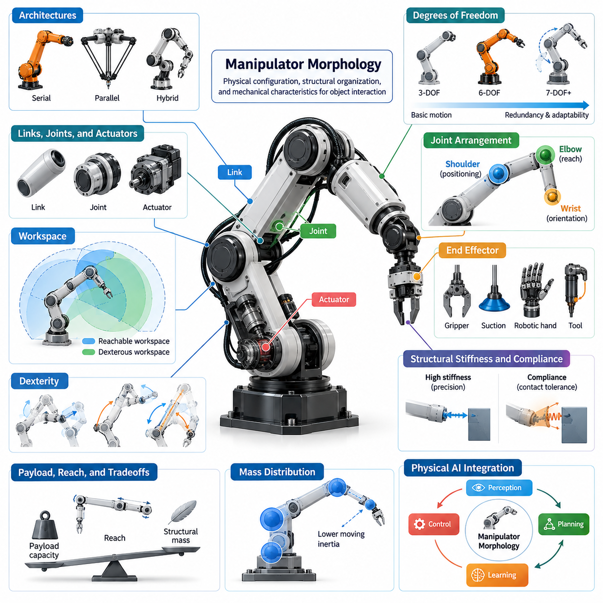{width="7.268055555555556in" height="7.268055555555556in"}

Manipulator morphology refers to the physical configuration, structural organization, and mechanical characteristics of robotic systems designed to interact with objects through controlled motion and force. It encompasses the arrangement of links, joints, actuators, transmission mechanisms, and end effectors. These elements collectively determine how a manipulator reaches, positions, grasps, and transforms objects within its operational environment.

In Physical AI, manipulator morphology is more than a mechanical design consideration because the physical structure directly influences perception, planning, learning, and control. A robot\'s geometry and mechanical properties establish the range of actions it can perform and the constraints under which intelligent behavior emerges. Consequently, manipulation capability depends on the coordinated design of the physical body and its computational intelligence.

A manipulator typically consists of interconnected rigid or compliant links joined through rotational, prismatic, or more complex mechanical connections. Each joint contributes specific motion capabilities, while the overall arrangement defines the manipulator\'s kinematic structure. The resulting configuration determines the reachable workspace, available orientations, mechanical leverage, and ability to perform tasks involving contact with the surrounding environment.

Manipulator architectures are commonly classified into serial, parallel, and hybrid configurations. Serial manipulators arrange joints and links sequentially, providing substantial workspace flexibility and adaptable positioning. Parallel manipulators employ multiple kinematic chains connecting a base to a moving platform, often achieving high structural stiffness and precision. Hybrid systems combine architectural features to balance reach, rigidity, and operational versatility.

Degrees of freedom represent a fundamental characteristic of manipulator morphology because they determine the independent motions available to the system. A conventional six-degree-of-freedom manipulator can generally control the three-dimensional position and orientation of its end effector within feasible configurations. Additional degrees of freedom introduce kinematic redundancy, enabling alternative postures that improve obstacle avoidance, dexterity, and task adaptability.

The distribution of joints along a manipulator significantly affects its functional capabilities. Shoulder-like joints may provide broad positioning movements, elbow-like joints extend reach and adjust arm configuration, and wrist joints enable precise orientation control. Although these anatomical descriptions resemble human arms, industrial manipulators frequently employ different arrangements optimized for manufacturing, assembly, inspection, or specialized handling operations.

Manipulator workspace describes the region of space accessible to the robot\'s end effector under its joint and structural constraints. Reachable workspace includes positions that can be attained with at least one orientation, whereas dexterous workspace considers positions supporting a specified range of orientations. Link lengths, joint limits, mechanical interference, and mounting geometry influence both workspace dimensions and practical accessibility.

Dexterity characterizes the ability of a manipulator to produce controlled movements and forces in different directions. It depends on joint configuration, kinematic relationships, and proximity to singularities, where certain motions become difficult or impossible to generate instantaneously. Morphological design therefore influences not only whether a target can be reached but also how effectively the robot can manipulate objects at that location.

Payload capacity, reach, and structural mass introduce important design tradeoffs. Longer links increase workspace coverage but may also increase bending moments, inertia, and actuator torque requirements. Larger actuators can improve load-handling capability while adding mass and energy consumption. Efficient manipulator morphology balances these competing characteristics according to expected payloads, movement speeds, positioning accuracy, and operational duty cycles.

Mass distribution plays a critical role in manipulator dynamics because the location of structural and actuator mass determines inertia and gravitational loading. Heavy components positioned near the distal joints can increase the torque required for acceleration and deceleration. Designers may therefore locate major actuators closer to the base and transmit motion through belts, cables, gears, or other mechanisms to reduce moving inertia.

Structural stiffness determines how effectively a manipulator maintains its intended configuration under external loads. High stiffness supports accurate positioning and repeatable operations, particularly in machining, precision assembly, and industrial handling. However, excessive rigidity may complicate interactions involving uncertain contact conditions. Morphological design must therefore consider the relationship between structural deformation, task precision, and environmental interaction.

Compliance introduces controlled mechanical flexibility that allows a manipulator to accommodate contact forces and geometric uncertainty. Elastic elements, flexible joints, and compliant transmission systems can absorb impacts and reduce force peaks during interaction. Such properties may simplify certain control problems by allowing the physical structure to passively accommodate small disturbances, although excessive compliance can reduce positioning bandwidth and accuracy.

The end effector forms the physical interface between the manipulator and the objects it handles. Grippers, suction devices, robotic hands, welding tools, and specialized instruments impose different requirements on wrist architecture, payload capacity, and force transmission. A manipulator intended for delicate grasping may prioritize force sensitivity and compliance, while one designed for industrial handling may emphasize gripping strength and structural robustness.

End-effector morphology also influences the diversity of manipulation strategies available to a robot. Simple parallel grippers can efficiently perform many pick-and-place operations, whereas multi-fingered hands support more varied contact configurations and in-hand manipulation. Increased mechanical complexity, however, introduces additional sensing, actuation, and control requirements. The appropriate design depends on object diversity and the intended degree of task generalization.

Single-arm manipulators provide relatively compact solutions for operations that can be performed through one primary contact interface. Dual-arm systems introduce additional capabilities for coordinated grasping, object stabilization, and bimanual manipulation. Their morphology must account for arm placement, overlapping workspaces, collision avoidance, and load distribution. Coordinated operation also requires suitable kinematic relationships between both arms and their shared reference structure.

Mobile manipulation combines an articulated manipulator with a movable platform, extending operational reach beyond a fixed workspace. The morphology of such systems must consider the interaction between arm configuration, base geometry, payload placement, and overall stability. A mobile base may reposition the arm to improve accessibility, but manipulator motion can also shift the combined center of mass and alter tipping margins during operation.

Manipulator morphology strongly affects sensing and perception requirements. Joint encoders provide information about internal configuration, while force sensors, tactile sensors, and cameras support interaction with external objects. Sensor placement must account for visibility, mechanical protection, cable routing, and sensitivity to contact forces. The physical arrangement of sensing components determines which aspects of manipulation can be directly observed and which require estimation.

The relationship between morphology and control becomes particularly important during contact-rich manipulation. A manipulator with high stiffness and precise actuation may require sophisticated force regulation when interacting with uncertain surfaces. A mechanically compliant manipulator can accommodate some disturbances through passive deformation. These differences illustrate how mechanical design changes the complexity and characteristics of the control strategies required for reliable operation.

Morphological computation describes the contribution of physical structure to processes that would otherwise require explicit computational control. In manipulation, compliant fingers can conform to irregular objects, mechanical linkages can coordinate joint motion, and elastic elements can distribute contact forces. Such mechanisms exploit physical interactions to simplify certain manipulation tasks, effectively sharing functional responsibilities between the body and controller.

Manipulator morphology also influences the efficiency of learning-based control. Reinforcement learning and imitation learning policies operate within the action possibilities established by the robot\'s kinematic and dynamic structure. Joint limits, actuator capabilities, mechanical compliance, and workspace constraints shape the learning problem. A morphology aligned with the intended task may reduce the complexity of discovering effective behaviors and improve their reliability.

General-purpose manipulation introduces additional morphological challenges because the robot must accommodate diverse objects, environments, and interaction patterns. Specialized manipulators can optimize mechanical characteristics for narrowly defined tasks, whereas general-purpose systems require broader dexterity and adaptability. Their design often involves balancing reach, payload, speed, compliance, sensing capability, and mechanical complexity without maximizing any single performance dimension.

Modularity and reconfigurability provide mechanisms for adapting manipulator morphology to changing requirements. Interchangeable end effectors, modular joints, adjustable links, and configurable mounting interfaces allow a robotic platform to support different tasks without complete mechanical redesign. However, modular systems introduce interface constraints, additional connection mass, and potential reductions in structural stiffness that must be considered during engineering development.

Morphological evaluation requires quantitative measures that connect physical configuration with operational performance. Common criteria include workspace volume, manipulability, payload capacity, positioning repeatability, structural stiffness, energy consumption, and collision accessibility. These measures should be evaluated across representative tasks rather than isolated configurations because a manipulator may perform well in one region of its workspace while exhibiting limitations elsewhere.

Simulation and digital modeling support systematic investigation of manipulator morphology before physical construction. Kinematic analysis can identify reachable configurations and singularities, while dynamic simulation estimates actuator loads, joint torques, and motion-related energy demands. Contact simulation further supports examination of grasping and interaction behavior. These methods help designers compare alternative structures and identify limitations before prototype development.

The future of manipulator morphology increasingly involves coordinated optimization of mechanical structure, sensing, actuation, and intelligent control. Advances in lightweight materials, compact actuators, compliant mechanisms, and data-driven design methods expand the available morphological design space. Within Physical AI, the central objective is to develop manipulators whose physical capabilities and learned behaviors complement each other, enabling reliable and adaptable interaction with the physical world.

## 05.02. Serial Parallel and Hybrid Manipulators

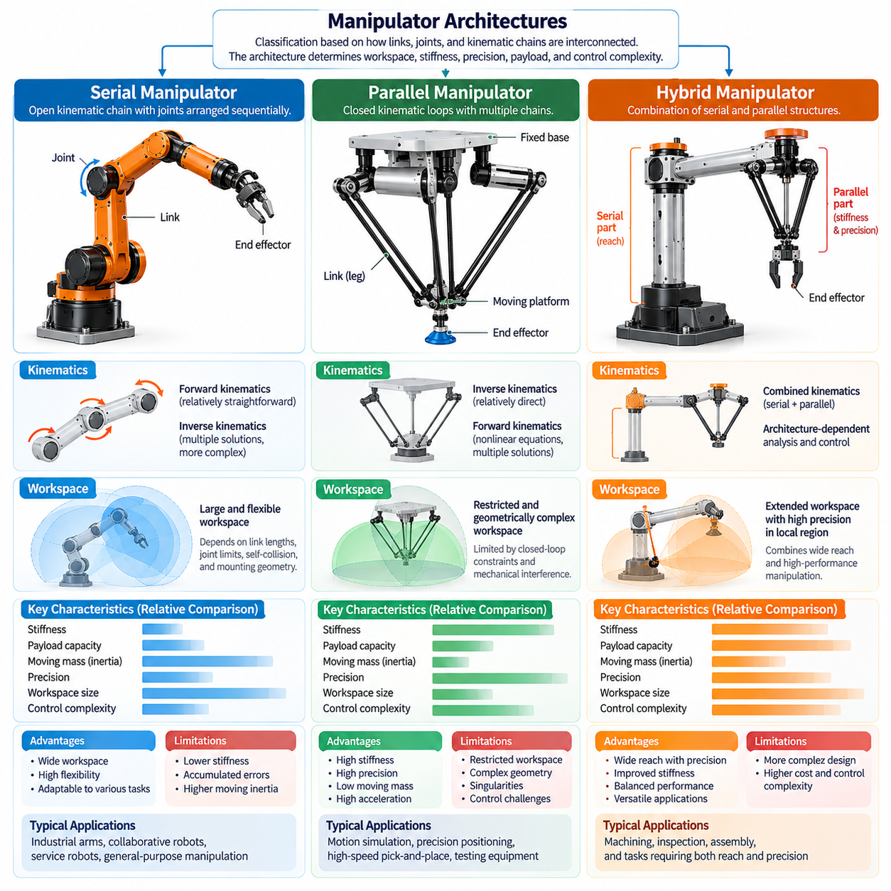{width="7.268055555555556in" height="7.268055555555556in"}

Manipulator architectures can be classified into serial, parallel, and hybrid configurations according to how their links, joints, and kinematic chains are interconnected. These structural arrangements determine how motion and forces propagate through the robot, influencing workspace, stiffness, precision, payload capacity, and control complexity. Selecting an appropriate architecture is therefore a fundamental decision in manipulator morphology and Physical AI system design.

A serial manipulator consists of a sequence of links connected by joints, forming an open kinematic chain between a fixed or mobile base and an end effector. Each joint contributes motion that affects the position and orientation of downstream links. This arrangement provides substantial flexibility in positioning and is widely used in industrial robotic arms, collaborative robots, service manipulators, and general-purpose manipulation platforms.

The kinematic structure of a serial manipulator enables relatively straightforward forward kinematics, where joint positions determine the resulting end-effector pose. Inverse kinematics is more challenging because multiple joint configurations may produce the same target pose. Depending on the robot geometry, analytical or numerical methods can identify feasible configurations while accounting for joint limits, collisions, and task-specific constraints.

Serial manipulators typically offer relatively large reachable workspaces compared with their structural footprint. Their sequential joint arrangement allows the end effector to approach objects from different directions and navigate around obstacles. However, the usable workspace depends on link proportions, joint limits, self-collision constraints, and mounting geometry. Regions near kinematic singularities may also exhibit reduced directional motion capability.

A major limitation of serial manipulators is the accumulation of structural deflection and positioning errors along the kinematic chain. Loads applied at the end effector generate forces and moments that propagate through successive links and joints. Long links and heavy distal components increase bending and actuator requirements. Consequently, high payload capacity and precision often demand stronger structures, larger actuators, and careful dynamic compensation.

Serial manipulator performance is strongly influenced by actuator placement and mass distribution. Actuators mounted directly at distal joints simplify mechanical transmission but increase moving inertia. Remote actuation using cables, belts, or mechanical linkages can reduce distal mass while introducing transmission compliance and friction. Morphological optimization must balance actuator accessibility, mechanical efficiency, structural stiffness, and dynamic responsiveness.

Parallel manipulators employ multiple kinematic chains connecting a common base to a moving platform or end effector. Unlike serial architectures, their mechanical structure contains closed kinematic loops that constrain platform motion through coordinated joint movements. These constraints can distribute external loads across several structural paths, producing high stiffness, favorable payload-to-moving-mass ratios, and precise motion within suitable operating regions.

A Stewart platform represents a well-known parallel manipulator architecture in which six variable-length legs connect a fixed base to a moving platform. Coordinated changes in leg lengths control the platform\'s position and orientation within its feasible workspace. Such mechanisms are used in motion simulation, precision positioning, testing equipment, and specialized robotic applications requiring controlled six-degree-of-freedom movement.

Delta robots provide another important example of parallel manipulation. Their lightweight moving structures and coordinated linkage mechanisms support rapid translational motion with relatively low moving inertia. Many Delta configurations use three parallel kinematic chains to control end-effector position, while additional mechanisms may provide orientation control. These characteristics make them suitable for high-speed sorting, packaging, and repetitive pick-and-place operations.

Parallel manipulators generally provide high structural rigidity because external forces can be supported through multiple mechanical pathways. Their actuators can often be positioned near the fixed base, reducing the inertia of moving components. This arrangement supports rapid acceleration and precise positioning. Nevertheless, actual performance depends on linkage geometry, joint compliance, transmission characteristics, and the distribution of forces across individual chains.

The principal limitation of many parallel manipulators is their restricted and geometrically complex workspace. Closed-loop constraints may limit platform translation and rotation, while mechanical interference can further reduce accessible configurations. Parallel singularities can also cause significant reductions in stiffness or controllability. Consequently, workspace analysis and singularity avoidance are essential aspects of parallel manipulator design and operation.

The kinematic analysis of parallel manipulators differs substantially from that of serial systems. In many common parallel architectures, inverse kinematics can be relatively direct because desired platform positions determine individual actuator coordinates. Forward kinematics may require solving nonlinear constraint equations with multiple possible solutions. Reliable control therefore depends on accurate geometric calibration, configuration identification, and consistent constraint satisfaction.

Hybrid manipulators combine serial and parallel kinematic structures within a single robotic mechanism. Their purpose is to exploit complementary architectural advantages rather than relying exclusively on one configuration. A hybrid system may use parallel mechanisms for rigid positioning and serial joints for extended reach or orientation adjustment. Such combinations enable designers to balance workspace flexibility, structural stiffness, dynamic performance, and mechanical complexity.

One common hybrid arrangement places a serial wrist or additional positioning stage on a parallel mechanism. The parallel subsystem provides rapid or precise translational movement, while the serial subsystem expands orientation capabilities. Another arrangement integrates parallel linkages into selected joints of a serial arm to improve load distribution. These designs demonstrate how local structural choices can influence the performance of the complete manipulator.

Hybrid architectures are particularly relevant when a robotic application requires both extensive motion capability and high mechanical performance. Precision machining, robotic assembly, specialized inspection, and complex handling operations may benefit from combinations of structural rigidity and flexible positioning. However, hybrid mechanisms introduce additional kinematic relationships and mechanical interfaces that require careful integration during design, calibration, and control.

The degrees of freedom available in each architecture depend on its joint arrangement and mechanical constraints. Serial manipulators commonly achieve six or more controllable degrees of freedom through sequential joints. Parallel mechanisms may provide three, four, or six degrees of freedom depending on their geometry. Hybrid manipulators distribute motion capabilities across interconnected subsystems, allowing different structural elements to specialize in positioning or orientation.

Kinematic redundancy provides another important distinction among manipulator architectures. A redundant serial arm can use additional joints to avoid obstacles, maintain favorable configurations, or optimize manipulability. Parallel mechanisms may incorporate actuation redundancy to improve force distribution or dynamic performance. Hybrid architectures can introduce redundancy across subsystems, although the resulting coordination requirements increase computational and control complexity.

Workspace characteristics strongly influence architecture selection. Serial manipulators generally provide flexible access around objects and equipment, making them suitable for environments requiring varied approach directions. Parallel manipulators often provide superior mechanical performance within more restricted regions. Hybrid systems attempt to extend usable workspace while preserving desirable stiffness or speed characteristics, although these benefits depend on the specific structural arrangement.

Payload performance must be evaluated together with reach and dynamic loading. Serial manipulators experience substantial joint torques when carrying heavy objects at extended configurations. Parallel systems can distribute loads through multiple supporting chains, but individual link and actuator limits remain important. Hybrid designs may allocate heavy-load support to parallel structures while using serial elements for positioning flexibility.

Structural stiffness and compliance influence how manipulators interact with their environments. Serial architectures may exhibit configuration-dependent flexibility due to accumulated joint and link deformation. Parallel architectures can achieve high stiffness through closed-loop mechanical constraints. Hybrid systems can combine rigid support structures with compliant or adaptable elements, enabling task-specific interaction characteristics when appropriately designed and controlled.

Dynamic behavior also differs across these architectures because moving mass and inertia are distributed differently. Serial manipulators often accelerate multiple downstream links whenever proximal joints move. Parallel manipulators can reduce moving inertia by locating actuators near the base. Hybrid manipulators require coordinated dynamic models that capture interactions between serial and parallel subsystems, particularly during high-speed motion or contact-intensive tasks.

From a control perspective, serial manipulators benefit from established kinematic and dynamic modeling methods. Parallel manipulators require explicit consideration of closed-loop constraints, internal forces, and configuration-dependent singularities. Hybrid systems combine these challenges and may require hierarchical or coordinated control strategies. In Physical AI, the controller must account for these structural differences when generating feasible actions and predicting physical consequences.

Learning-based manipulation systems are also affected by architectural differences. A policy trained on a serial robot cannot necessarily be transferred directly to a parallel or hybrid mechanism because their action spaces, constraints, and motion capabilities differ. Morphology-aware learning can incorporate joint topology, kinematic relationships, actuator characteristics, and workspace limitations to improve policy adaptation across different manipulator configurations.

Safety and reliability considerations further influence architecture selection. Serial manipulators require careful management of joint limits, collision risks, and payload-induced instability. Parallel mechanisms introduce risks associated with closed-loop constraint violations, singularities, and internal mechanical loading. Hybrid manipulators must coordinate safety constraints across interconnected subsystems. Appropriate sensing, mechanical protection, and runtime monitoring are necessary for reliable physical interaction.

The choice between serial, parallel, and hybrid manipulators should ultimately be guided by task requirements rather than architectural preference. Workspace coverage, payload capacity, precision, speed, energy efficiency, maintainability, and operational safety must be evaluated together. No architecture is universally superior because improvements in one performance dimension frequently introduce limitations in another, making application-specific morphological optimization essential.

Future manipulator development increasingly explores reconfigurable mechanisms, lightweight parallel linkages, modular serial structures, and adaptive hybrid architectures. Advances in materials, actuation, sensing, and computational design may enable systems to achieve more favorable combinations of reach, stiffness, and dexterity. Within Physical AI, understanding these architectures provides the foundation for designing manipulators whose mechanical structure and intelligent control operate as an integrated system.

## 05.03. Degrees of Freedom and Kinematic Redundancy

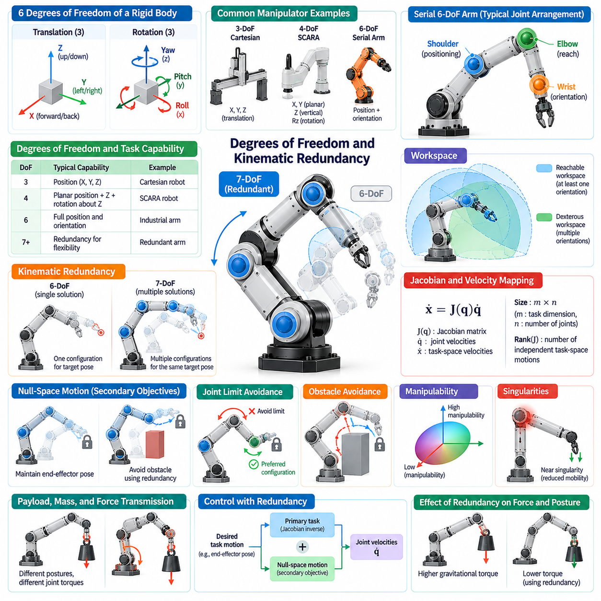{width="7.268055555555556in" height="7.268055555555556in"}

Degrees of freedom (DoF) describe the number of independent variables required to specify a manipulator\'s mechanical configuration. In robotic systems, these variables commonly correspond to revolute or prismatic joint positions. The available degrees of freedom determine the robot\'s fundamental motion capabilities, while its kinematic structure establishes how individual joint movements combine to produce end-effector position and orientation.

A rigid body moving freely in three-dimensional space possesses six degrees of freedom, consisting of three translational and three rotational components. A manipulator intended to control an end effector\'s complete spatial pose generally requires at least six independent task-space motion capabilities. However, joint arrangement, mechanical constraints, and singular configurations determine whether those capabilities can actually be achieved.

Manipulators with fewer than six degrees of freedom can perform valuable tasks when complete spatial positioning and orientation are unnecessary. Three-axis Cartesian robots provide controlled translation, while four-axis SCARA manipulators support planar positioning, vertical movement, and rotation about a vertical axis. These specialized configurations reduce mechanical complexity and can improve efficiency when task requirements match their available motions.

Six-degree-of-freedom serial manipulators are widely used because they can generally control both position and orientation within suitable regions of their workspace. Their joints often provide complementary shoulder, elbow, and wrist movements. Nevertheless, possessing six joints does not guarantee unrestricted motion throughout the workspace, since joint limits, collisions, and kinematic singularities constrain achievable configurations.

Kinematic redundancy occurs when a manipulator possesses more independent joint variables than are necessary for a specified task. A seven-degree-of-freedom arm controlling a six-dimensional end-effector pose is a common example. The additional degree of freedom allows multiple joint configurations to achieve the same target pose, providing flexibility for optimizing posture, avoiding obstacles, and satisfying secondary objectives.

Redundancy is defined relative to task requirements rather than solely by the total number of joints. A six-degree-of-freedom robot performing a three-dimensional positioning task may possess three locally redundant motion directions. Conversely, a robot with many joints may still lack sufficient independent motion capabilities for a particular task because of structural constraints or singularities.

The mathematical relationship between joint motion and end-effector motion is represented by the manipulator Jacobian. This matrix maps joint velocities into task-space velocities and characterizes local motion capabilities. Its dimensions depend on the number of joint variables and task coordinates, while its rank determines how many independent task-space velocity directions can be generated at a particular configuration.

For a redundant manipulator operating away from relevant singularities, multiple joint-velocity solutions can produce the same desired end-effector velocity. The Jacobian pseudoinverse provides one common solution, often minimizing the Euclidean norm of joint velocity. Additional motion can be introduced through the Jacobian null space without changing the instantaneous end-effector velocity.

Null-space motion enables a manipulator to pursue secondary objectives while maintaining its primary task. For example, an arm can move its elbow away from an obstacle while keeping its end effector at a fixed pose. Similar strategies can improve joint-limit avoidance, maintain favorable postures, or reduce selected motion costs. Their effectiveness depends on available redundancy and the surrounding constraints.

Joint limits significantly influence how redundancy can be exploited. Although several configurations may achieve the same target pose, some may approach mechanical stops or create unfavorable transmission conditions. Redundancy-aware control can favor configurations with greater remaining joint travel, reducing the likelihood of reaching boundaries during subsequent movements and improving operational continuity.

Obstacle avoidance is another major advantage of redundant manipulators. Additional joints allow the robot to reshape its arm while preserving the desired end-effector trajectory. This capability is especially valuable in cluttered workspaces, confined assembly environments, and human-shared areas. However, redundancy does not guarantee collision-free motion, since feasible configurations must still satisfy geometric and dynamic constraints.

Manipulability describes the local ability of a manipulator to generate motion in different task-space directions. It is commonly evaluated using Jacobian-based measures that characterize directional sensitivity and proximity to singular configurations. Redundant systems can adjust their internal posture to improve manipulability, although optimizing one measure may compromise reach, clearance, or other task requirements.

Kinematic singularities arise when the Jacobian loses rank, reducing the number of independently achievable instantaneous task-space motions. Near singularities, producing certain end-effector velocities may require disproportionately large joint velocities. Redundant manipulators can sometimes avoid unfavorable singular configurations through alternative postures, but additional degrees of freedom do not eliminate every possible singularity.

Redundancy also affects force transmission and mechanical loading. Different joint configurations can produce the same end-effector pose while requiring different gravitational torques or exhibiting different force amplification characteristics. Configuration optimization can therefore reduce selected actuator loads, improve mechanical efficiency, and maintain useful force capabilities during contact-intensive manipulation.

Dynamic redundancy extends these considerations beyond purely geometric relationships. Joint accelerations, actuator torque limits, inertia, and Coriolis effects influence which motions are physically achievable. A configuration that is favorable from a kinematic perspective may be dynamically inefficient. Effective redundancy resolution therefore considers both motion feasibility and the dynamic characteristics of the manipulator.

Redundancy resolution refers to selecting a particular joint configuration or motion from the multiple possibilities satisfying a primary task. Common approaches include pseudoinverse-based methods, gradient projection, constrained optimization, and hierarchical task control. Each method expresses different priorities concerning accuracy, computational cost, constraint handling, and the coordination of secondary objectives.

Hierarchical control organizes multiple objectives according to their relative importance. A primary task may require accurate end-effector tracking, while secondary tasks maintain joint clearance or improve manipulability. Lower-priority motions are projected into spaces that preserve higher-priority objectives when feasible. Additional constraints may require optimization methods that explicitly account for actuator and collision limits.

The distinction between kinematic redundancy and actuation redundancy is important in manipulator morphology. Kinematic redundancy provides additional configuration variables relative to a task, whereas actuation redundancy introduces more independent actuators than are necessary to control the mechanism\'s available motion. Parallel and hybrid manipulators may exploit actuation redundancy to redistribute forces without increasing their platform mobility.

Mechanical design determines whether additional degrees of freedom provide practical benefits. Joint placement, axis orientation, link proportions, and actuator capabilities influence the useful range of redundant configurations. Poorly positioned additional joints may increase complexity without substantially improving dexterity. Morphological optimization must therefore evaluate redundancy in relation to representative tasks and workspace constraints.

Seven-degree-of-freedom anthropomorphic arms illustrate how redundancy can support human-like reaching behavior. Their shoulder, elbow, and wrist arrangements permit different elbow postures for similar hand poses. This flexibility improves access around objects and allows the robot to adapt its arm configuration during manipulation, although the available postures remain limited by joint geometry and collision conditions.

Dual-arm manipulators introduce additional forms of redundancy when both arms cooperate on a shared task. The relative placement of the hands may be constrained by a grasped object, while the complete system retains freedom to adjust arm postures. Coordinated redundancy resolution can improve collision avoidance, load sharing, and object accessibility, provided that closed-chain constraints are respected.

Mobile manipulators extend redundancy by combining arm joints with movable base coordinates. A robot can sometimes achieve the same end-effector pose through different combinations of base position and arm configuration. This additional flexibility supports workspace extension and improved accessibility, but introduces constraints associated with base mobility, stability, navigation, and coordinated whole-body control.

Learning-based Physical AI systems can exploit redundancy to discover task-specific movement strategies. Reinforcement learning and imitation learning may identify useful postures or motion patterns within the available configuration space. However, redundant action spaces can increase exploration difficulty and complicate generalization. Incorporating kinematic constraints and structured redundancy resolution can improve learning efficiency and reliability.

Morphology-aware control connects degrees of freedom with the physical capabilities and limitations of a particular robot. Policies must account for joint topology, available motion directions, singularities, and actuator constraints rather than assuming that all manipulators share equivalent action spaces. Such representations are important for transferring learned manipulation behaviors between robots with different joint counts and mechanical structures.

The design of manipulator degrees of freedom involves balancing versatility against complexity, mass, cost, and energy consumption. Additional joints may improve adaptability but also require actuators, sensors, transmission mechanisms, and computational resources. The optimal configuration depends on whether the resulting flexibility provides measurable benefits for the intended tasks, environmental conditions, and operational requirements.

In Physical AI, degrees of freedom and kinematic redundancy establish the mechanical foundation for flexible, adaptive manipulation. Their value emerges when structural possibilities are coordinated with perception, planning, optimization, and control. Understanding these relationships enables designers to create manipulators that exploit alternative configurations intelligently while maintaining accuracy, efficiency, safety, and reliable interaction with the physical world.

## 05.04. Link Joint and Wrist Architecture

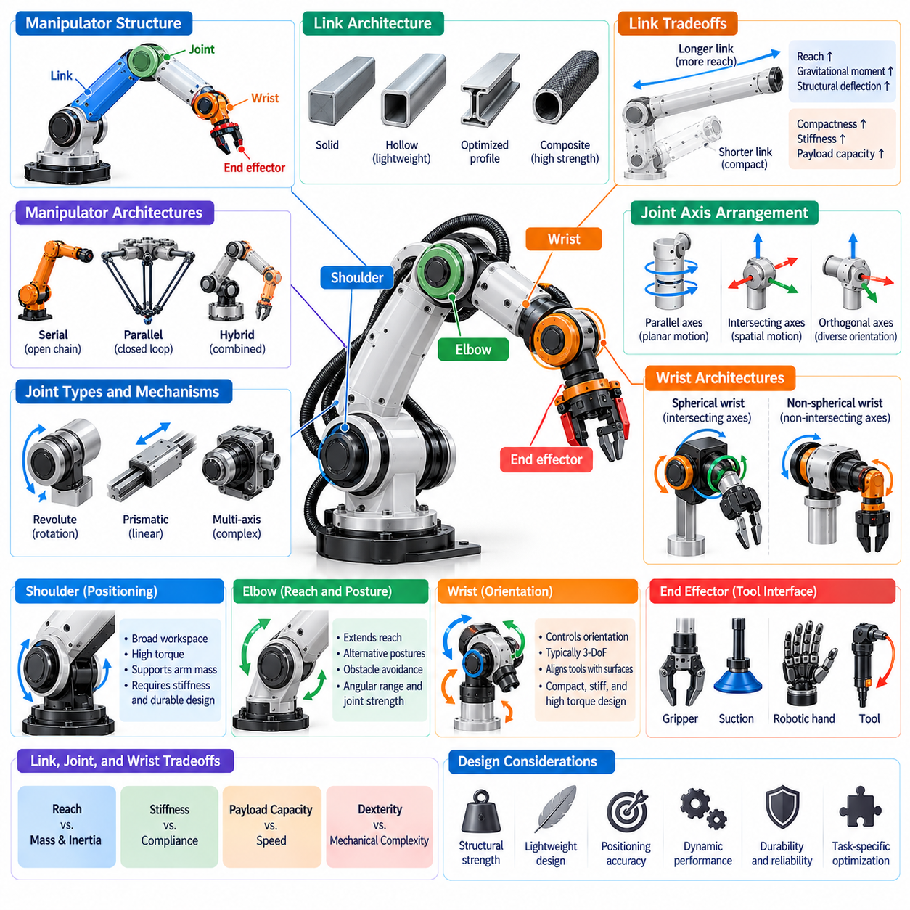{width="7.268055555555556in" height="7.268055555555556in"}

Link, joint, and wrist architecture defines the structural organization of a robotic manipulator and determines how mechanical motion is transmitted from its base to the end effector. Links provide structural connections, joints introduce controlled mobility, and wrist mechanisms establish the final orientation of the manipulation interface. Their coordinated arrangement influences workspace geometry, dexterity, stiffness, payload capacity, and dynamic performance.

Links are the primary structural members connecting adjacent joints within a manipulator. Their geometry, length, cross-sectional shape, and material properties determine mechanical strength, bending stiffness, and mass distribution. Long links increase reach but also amplify gravitational moments and structural deflection. Consequently, link architecture must balance workspace requirements against mechanical loading, actuator capacity, and positioning accuracy.

Link geometry strongly affects the dynamic behavior of a manipulator because structural mass contributes to joint inertia and required actuator torque. Lightweight hollow sections, optimized cross-sectional profiles, and composite materials can reduce moving mass while maintaining sufficient stiffness. However, reducing structural weight may introduce vibration, deformation, or durability limitations that must be evaluated under realistic operating conditions.

The arrangement of links determines the manipulator\'s overall kinematic chain and establishes relationships between joint motion and end-effector displacement. Serial manipulators use sequentially connected links, while parallel mechanisms distribute motion through multiple interconnected chains. Hybrid architectures combine these structural principles. Each configuration produces different characteristics in reach, force transmission, mechanical rigidity, and motion coordination.

Joints provide the relative mobility between connected links and represent the fundamental motion-generating elements of manipulator architecture. Revolute joints enable rotation about defined axes, while prismatic joints produce linear displacement. More complex mechanical arrangements may incorporate multiple rotational axes or constrained coupled motion. The selection and placement of joints determine the manipulator\'s degrees of freedom and available movement patterns.

Joint-axis orientation is particularly important because it determines how individual joint motions contribute to the end-effector pose. Parallel axes can support planar or coordinated movement, while intersecting or orthogonal axes enable more diverse spatial orientations. The geometric relationships between joint axes also influence singularities, manipulability, and inverse kinematics. Careful axis arrangement can simplify control and improve task accessibility.

A conventional industrial manipulator often separates its mechanical functions into positioning and orientation subsystems. Proximal joints near the base provide large-scale arm movement, while distal joints near the end effector refine orientation. Shoulder-like and elbow-like structures determine reach and arm posture, whereas wrist joints provide rotational adjustment. This functional separation supports systematic kinematic design and task-oriented optimization.

The shoulder region commonly contains joints responsible for broad spatial positioning and the movement of major arm segments. Its architecture significantly influences the reachable workspace and the torque required to support downstream mass. Shoulder joints frequently experience substantial gravitational and inertial loads. Their mechanical design therefore requires careful consideration of bearing capacity, actuator sizing, transmission efficiency, and structural rigidity.

Elbow architecture connects major arm segments and provides additional positioning flexibility. In anthropomorphic manipulators, elbow motion changes the effective reach and allows alternative arm postures for similar end-effector positions. Elbow placement also affects obstacle avoidance and access to confined spaces. Its mechanical configuration must balance angular range, joint strength, collision clearance, and the mass of downstream components.

The wrist is the distal mechanism responsible primarily for controlling the orientation of the end effector. A typical three-degree-of-freedom wrist provides rotational adjustments corresponding to different orientation directions. Its geometry influences whether the manipulator can align tools with surfaces, approach objects from desired angles, and perform complex assembly operations. Wrist architecture is therefore central to dexterous manipulation.

A spherical wrist is a common industrial configuration in which three rotational joint axes intersect at a single geometric point. This arrangement allows the manipulator\'s position and orientation calculations to be partially separated under suitable kinematic conditions. Such decoupling can simplify analytical inverse kinematics. Nevertheless, spherical wrists may contain singular configurations where independent orientation control becomes locally restricted.

Non-spherical wrists use rotational axes that do not all intersect at a common point. These architectures may improve packaging, mechanical accessibility, or compatibility with specialized tools. However, wrist rotation can introduce additional translational displacement of the end effector, increasing kinematic coupling. The resulting design requires coordinated position and orientation control to maintain accurate tool trajectories during operation.

Wrist morphology must balance orientation capability with compactness, stiffness, and payload support. Large wrist actuators can improve torque capacity but increase distal mass and inertia. Compact mechanisms reduce moving loads but may limit strength or available rotation. Designers often employ gear reductions, remote actuation, or specialized transmission arrangements to achieve suitable performance without excessive wrist size.

Actuator placement affects the mechanical behavior of links, joints, and wrist assemblies. Direct-drive actuators can reduce transmission complexity and backlash but may require larger motors to generate sufficient torque. Geared systems increase torque density while introducing friction, compliance, and potential positioning errors. Remote actuation can relocate motor mass toward proximal structures, although it adds transmission design challenges.

Bearings, shafts, couplings, and transmission components determine how effectively joint motion is supported and transferred. Bearing selection influences load capacity, rotational accuracy, and mechanical durability. Gear backlash and elastic deformation can reduce positioning precision, particularly during direction changes. High-performance joint architecture therefore requires coordinated design of structural support, actuation, sensing, and mechanical transmission.

Joint range of motion establishes the angular or linear limits within which a manipulator can operate. Larger joint ranges may improve accessibility and reduce the need for base repositioning, but they can complicate cable routing, mechanical protection, and collision management. Joint limits must account for physical stops, transmission constraints, and safe operating margins rather than relying exclusively on software restrictions.

Cable routing and service integration are important architectural considerations because manipulators must carry electrical power, communication signals, and sometimes pneumatic or hydraulic lines. Internal routing can protect cables and improve external clearance, while external routing may simplify maintenance. Wrist assemblies require particular attention because repeated rotation and bending can create fatigue, twisting, and interference risks.

Structural stiffness varies across the manipulator according to link geometry, joint construction, and applied loading. Deformation in proximal joints can produce substantial end-effector displacement because errors propagate through downstream links. Wrist compliance can directly affect tool orientation and contact accuracy. Consequently, stiffness analysis should consider the complete mechanical chain rather than evaluating individual components independently.

Compliance may also be deliberately incorporated into joint and wrist architecture to improve physical interaction. Series elastic actuators, compliant couplings, and flexible transmission elements can absorb impacts and support force-sensitive manipulation. These mechanisms are useful when robots interact with humans, fragile objects, or uncertain surfaces. However, their design must account for reduced mechanical bandwidth and additional control requirements.

Manipulator architecture influences singularity locations and the distribution of dexterity throughout the workspace. Certain joint alignments can reduce the rank of the manipulator Jacobian, limiting available instantaneous motion directions. Wrist singularities commonly occur when rotational axes become aligned. Appropriate joint arrangement, additional degrees of freedom, and redundancy-aware control can reduce exposure to unfavorable configurations.

The relationship between link proportions and joint placement determines whether a manipulator can access targets with useful orientations. Long upper-arm segments may extend reach but restrict maneuverability near the base. Shorter segments can improve compactness while reducing workspace coverage. Morphological design therefore evaluates complete arm configurations, including the interaction between shoulder, elbow, wrist, and end-effector geometry.

Dual-arm and mobile manipulators introduce additional architectural considerations. In dual-arm systems, shoulder spacing and arm geometry determine overlapping workspaces and potential self-collision regions. Mobile manipulators must account for the interaction between arm extension, base stability, and payload distribution. Link and joint architecture should therefore be evaluated within the complete robotic platform rather than as an isolated mechanism.

Simulation-based design enables systematic evaluation of link, joint, and wrist configurations before physical construction. Kinematic models identify reachable poses and singularities, while dynamic simulations estimate actuator torque, inertia, and mechanical loading. Structural analysis can evaluate deformation and vibration characteristics. These methods support iterative refinement of geometry, materials, joint placement, and transmission architecture.

Learning-based Physical AI systems must account for the mechanical characteristics established by manipulator architecture. Joint topology, axis orientation, motion limits, and compliance influence the actions that a learned policy can execute. Morphology-aware representations allow control systems to interpret these constraints and adapt behavior accordingly. This integration is essential when transferring manipulation strategies across robots with different structural configurations.

The design of link, joint, and wrist architecture ultimately requires balancing reach, dexterity, payload, stiffness, mass, energy efficiency, reliability, and manufacturability. No single arrangement is optimal for every manipulation task. Within Physical AI, effective architecture emerges from coordinated mechanical and computational design, enabling manipulators to achieve precise, adaptable, and reliable interaction with objects and their surrounding environments.

## 05.05. Reach Workspace and Dexterity

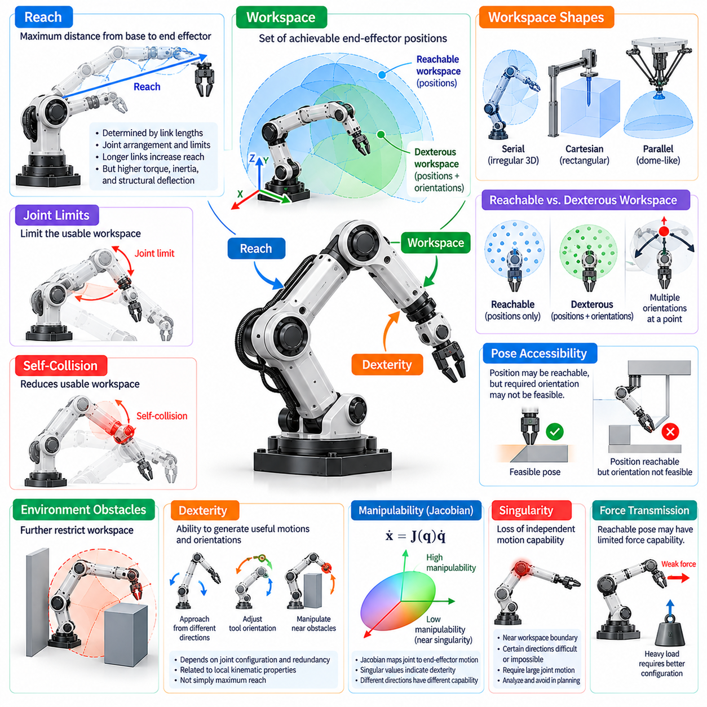{width="7.268055555555556in" height="7.268055555555556in"}

Reach, workspace, and dexterity are fundamental characteristics of manipulator morphology that determine how effectively a robot can interact with objects throughout its environment. Reach describes the maximum spatial extent of the arm, workspace represents the set of achievable end-effector positions or poses, and dexterity characterizes the ability to generate useful motions and orientations. These properties must be evaluated together rather than independently.

Manipulator reach is primarily determined by link lengths, joint arrangement, and mechanical motion limits. Longer links generally extend the maximum distance between the base and end effector, enabling access to distant targets. However, increasing reach also raises gravitational torque, moving inertia, and structural deflection. Consequently, maximum reach alone does not indicate whether a manipulator can perform precise or reliable operations at extended configurations.

The reachable workspace is the collection of positions that the end effector can attain under specified joint and geometric constraints. Its shape depends on manipulator architecture, link proportions, joint-axis orientations, and mounting configuration. Serial manipulators often produce irregular three-dimensional workspaces, while Cartesian and parallel mechanisms exhibit different geometric characteristics. Workspace boundaries are determined by joint limits and structural constraints.

The dexterous workspace is more restrictive than the reachable workspace because it considers orientation capability in addition to position. A position may be reachable even when the end effector cannot achieve every required orientation at that location. This distinction is especially important in assembly, welding, inspection, and grasping applications where tools must approach objects along prescribed directions or maintain specific angular relationships.

Workspace analysis distinguishes between positional accessibility and complete pose accessibility. Positional accessibility determines whether a target point can be reached, whereas pose accessibility evaluates whether a desired combination of position and orientation is feasible. A manipulator may access a shelf location but fail to align its gripper appropriately. Practical workspace evaluation must therefore consider the task-specific poses required for successful interaction.

Joint limits strongly influence usable workspace geometry. Mechanical stops, actuator constraints, and collision avoidance requirements restrict the range of possible configurations. Even when a target lies within the theoretical reach envelope, the corresponding joint solution may violate these constraints. Effective workspace estimation therefore requires realistic joint boundaries and should not rely exclusively on idealized geometric models.

Self-collision further reduces the usable workspace of manipulators with multiple links and complex joint arrangements. An arm may theoretically reach a target while intersecting its own structure or attached equipment. Collision-aware workspace analysis identifies configurations that satisfy both kinematic feasibility and geometric clearance. This becomes particularly important for redundant arms, dual-arm systems, and manipulators operating near their bases.

Environmental obstacles introduce additional workspace restrictions that depend on the surrounding scene. Walls, fixtures, shelves, machinery, and nearby robots may prevent otherwise feasible motions. The resulting collision-free workspace can change as objects move or tasks evolve. Physical AI systems must therefore combine geometric workspace models with perception and motion planning to determine which targets remain safely accessible.

Dexterity describes the ability to position and orient an end effector while maintaining useful freedom of motion. High dexterity allows a manipulator to approach targets from multiple directions, adjust tool orientation, and perform coordinated movements near obstacles. It depends on the number and arrangement of joints, available redundancy, and local kinematic properties rather than simply the maximum distance the arm can reach.

The manipulator Jacobian provides a mathematical description of how joint velocities generate end-effector velocities. Its structure reveals the available instantaneous motion directions at a particular configuration. Jacobian-based measures are commonly used to assess local manipulability and identify configurations with limited directional capability. Such analysis connects geometric design with the practical ability to execute controlled movements.

Manipulability measures quantify aspects of local motion capability, often through singular values or related properties of the Jacobian. A configuration with favorable manipulability may support motion in several directions without requiring excessive joint velocities. However, different metrics emphasize different characteristics, and numerical values depend on coordinate scaling. Evaluation should therefore match the intended task and distinguish translational from rotational performance.

Kinematic singularities occur when the manipulator loses independent instantaneous motion capabilities. Near these configurations, certain end-effector motions may require very large joint velocities or become locally unattainable. Singularities frequently appear near workspace boundaries or particular joint alignments. Their location and severity depend on the architecture, making singularity analysis essential for workspace quality assessment.

Reachability does not guarantee effective force transmission. A manipulator may attain a distant pose but possess limited ability to apply forces in a required direction. Joint torque limits, link geometry, and Jacobian relationships determine the achievable end-effector wrench. Consequently, useful workspace evaluation should consider force capability, payload support, and contact requirements alongside geometric reach.

Payload capacity often decreases as the arm extends because gravitational moments increase with distance from supporting joints. Configurations near maximum reach may also exhibit greater structural deflection and vibration sensitivity. A workspace that is geometrically accessible may therefore contain regions unsuitable for heavy loads or precision tasks. Performance-aware workspace analysis associates reachable poses with loading and accuracy limits.

The orientation capabilities of wrist architecture strongly influence dexterous workspace coverage. A three-axis wrist can provide broad orientation control, but joint limits and wrist singularities may restrict particular poses. Wrist offsets and non-spherical arrangements introduce additional coupling between position and orientation. Designers must evaluate complete arm and wrist kinematics to determine whether required tool approaches remain feasible.

Kinematic redundancy can improve dexterity by providing alternative joint configurations for the same end-effector pose. A seven-degree-of-freedom arm may reposition its elbow while preserving the desired hand position and orientation. This flexibility supports obstacle avoidance, joint-limit management, and manipulability optimization. Nevertheless, redundancy cannot overcome every structural restriction or guarantee access to all desired poses.

Link proportions influence both workspace shape and the distribution of dexterity. Longer upper-arm or forearm segments may improve access to distant regions while producing unfavorable folded configurations near the base. Different link-length ratios change the locations of singularities and the range of achievable postures. Morphological optimization therefore considers workspace coverage and motion quality together.

Manipulator mounting orientation also changes practical workspace accessibility. Floor-mounted, wall-mounted, ceiling-mounted, and mobile configurations expose different regions of the surrounding environment. A ceiling-mounted arm may access equipment from above, while a mobile base can reposition the entire workspace. Mounting decisions should therefore be coordinated with task geometry, obstacle distribution, and operational safety requirements.

Task-oriented workspace analysis evaluates whether the manipulator can complete meaningful operations rather than merely reach isolated points. A pick-and-place task requires feasible grasp, lifting, transfer, and placement poses connected by valid trajectories. Assembly operations may require controlled insertion directions and contact forces. The useful workspace is therefore defined by sequences of feasible actions under task constraints.

Workspace quality can be evaluated using coverage, manipulability, collision clearance, force capability, and trajectory feasibility. Sampling-based methods examine representative joint configurations or target poses, while optimization techniques identify favorable regions. Simulation can reveal unreachable targets, singularities, and excessive actuator demands. These evaluations support quantitative comparison of alternative manipulator morphologies.

Dual-arm manipulation introduces overlapping workspaces where both end effectors can interact with a common object. The size and quality of this overlap depend on shoulder spacing, arm geometry, and joint limits. Cooperative tasks also impose relative pose and collision constraints. Effective dual-arm design therefore considers coordinated dexterity and shared-object accessibility rather than evaluating each arm independently.

Mobile manipulators extend their effective operational workspace by combining arm motion with base movement. Base repositioning can improve approach angles, avoid singular configurations, and access targets beyond the fixed-arm reach envelope. However, platform stability, navigation constraints, and environmental obstacles influence feasible base placements. Whole-body planning must coordinate mobility and manipulation to exploit this expanded capability.

Physical AI systems can use learned models to predict reachability and select favorable manipulation configurations. Learning-based planners may estimate grasp accessibility, collision risk, or task success from geometric and sensory information. Such methods complement analytical kinematics but require validation against physical constraints. Reliable operation depends on combining learned predictions with explicit feasibility and safety checks.

The design of reach, workspace, and dexterity requires balancing geometric coverage with structural performance, actuator capacity, precision, and energy consumption. Increasing arm length or joint count may expand accessible configurations while introducing additional mass and control complexity. Effective morphology is therefore task-dependent, with design priorities determined by the positions, orientations, forces, and trajectories required in actual operation.

Within Physical AI, reach establishes where interaction may occur, workspace determines which configurations are feasible, and dexterity describes how effectively manipulation can be performed within those regions. Their integration with perception, planning, and control enables robots to select actions that are not only geometrically possible but mechanically reliable. This understanding supports manipulators capable of adaptable and precise interaction across diverse environments.

## 05.06. Payload Reach and Mass Tradeoffs

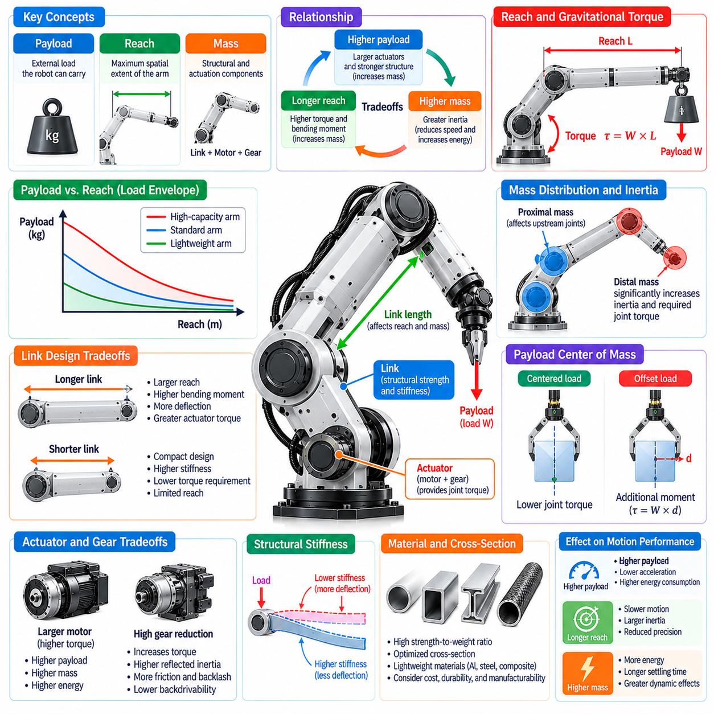{width="7.268055555555556in" height="7.268055555555556in"}

Payload, reach, and mass are tightly coupled characteristics of manipulator morphology that determine lifting capability, workspace coverage, and dynamic performance. Payload describes the external load a manipulator can support under specified conditions, reach defines the spatial extent of its arm, and mass includes the structural and actuation components required for operation. Their relationships establish fundamental mechanical tradeoffs in robotic system design.

Increasing manipulator reach generally increases the torque required to support a given payload. When a load is carried farther from a supporting joint, its gravitational moment increases with the perpendicular distance to the joint axis. This effect is especially important for shoulder and elbow actuators. Consequently, a manipulator designed for long reach and high payload capacity requires careful consideration of joint torque limits and structural strength.

Manipulator payload ratings must be interpreted in relation to operating conditions rather than as universally achievable capacities. Rated payload commonly assumes specified load positions, center-of-mass offsets, motion profiles, and allowable joint loading. A robot capable of carrying a certain mass near its base may not support the same mass at maximum extension. Practical payload evaluation must therefore consider configuration-dependent mechanical limits.

Link length directly influences the relationship between reach and structural loading. Longer links expand accessible workspace but generate greater bending moments under external forces and self-weight. Increased deflection can reduce positioning accuracy and contact stability. Designers may compensate through larger cross sections, stronger materials, or additional reinforcement, although these measures typically increase structural mass and actuator requirements.

Manipulator mass is not distributed uniformly across its mechanical structure. Proximal links and actuators often support the weight of multiple downstream components, while distal masses contribute disproportionately to joint torque and rotational inertia. The placement of motors, transmissions, sensors, and end effectors therefore affects overall performance. Reducing distal mass is often more valuable than achieving an equivalent reduction near the base.

Moving inertia creates additional tradeoffs between payload capacity and dynamic responsiveness. During acceleration, actuators must generate torque to move both the payload and the manipulator\'s own components. Heavy links and distant mass concentrations increase inertia, reducing achievable acceleration or requiring larger motors. Consequently, a manipulator optimized for heavy static loads may exhibit slower movements and greater energy consumption.

The relationship between payload and reach is frequently represented through configuration-dependent load envelopes. These envelopes describe allowable payloads across different arm positions, orientations, and operating conditions. They may be constrained by actuator torque, transmission strength, structural deflection, or stability. Such representations provide more useful design information than a single maximum payload specification.

Actuator sizing is a central factor in payload-reach optimization. Higher joint torque requirements generally demand larger motors, higher gear reductions, or alternative transmission mechanisms. Larger actuators increase mass, which can further raise the loading requirements of upstream joints. This cascading effect creates a mechanical design feedback loop in which improvements in payload capability may increase overall system weight.

Gear reduction can increase available joint torque without requiring proportionally larger motors, but it introduces additional tradeoffs. High reduction ratios may increase reflected inertia, friction, backlash, and transmission complexity. They can also reduce backdrivability and affect force-sensitive interaction. The appropriate transmission architecture depends on whether the manipulator prioritizes lifting capacity, precision, speed, or compliant behavior.

Structural stiffness is another critical constraint in payload and reach selection. Under external loading, links deform according to their geometry, material properties, and support conditions. Longer arms may experience substantial end-effector displacement even when their structural strength remains sufficient. Therefore, a design that satisfies static load capacity requirements may still fail to meet precision or vibration limits.

Material selection provides opportunities to improve the balance between structural mass and mechanical performance. Aluminum alloys, high-strength steels, composites, and advanced lightweight structures offer different combinations of stiffness, strength, density, and manufacturability. High specific stiffness and strength are desirable, but cost, fatigue resistance, thermal behavior, and repairability must also be considered.

Link cross-sectional geometry can significantly improve stiffness without a proportional increase in material mass. Hollow tubes, box sections, ribbed structures, and topology-optimized components distribute material where it contributes most effectively to load resistance. However, manufacturing constraints and local stress concentrations must be evaluated. Lightweight design should preserve durability and reliability under repeated operating cycles.

The location of the payload center of mass affects joint loading beyond the payload\'s total weight. An offset center of mass generates additional moments at the wrist and upstream joints, particularly during rotation or acceleration. Tool geometry and grasp position can therefore change the effective loading of a manipulator. Payload specifications should include center-of-mass offsets and allowable moments rather than mass alone.

Wrist architecture is particularly sensitive to payload and mass tradeoffs because it supports the end effector and any attached object. High-capacity wrist joints require sufficient torque and bearing strength, but heavier wrist assemblies increase the loads experienced by elbow and shoulder joints. Remote actuation, compact transmissions, and lightweight tooling can reduce these effects while preserving orientation capability.

Dynamic payload limits may differ substantially from static payload limits. Rapid acceleration, deceleration, and changes in direction introduce inertial forces that add to gravitational loading. Emergency stops and unexpected contacts can create transient loads exceeding normal operating values. Manipulator design must therefore account for peak torque, thermal limits, structural fatigue, and appropriate safety margins.

Payload capacity also depends on the direction of applied forces and the configuration of the manipulator. Certain postures provide favorable mechanical leverage, while others place joints near their torque limits. The manipulator Jacobian relates joint torques to end-effector forces and moments, enabling configuration-dependent force capability analysis. This relationship is essential for evaluating lifting, pushing, insertion, and contact-intensive tasks.

Energy efficiency is influenced by both mechanical mass and task execution strategy. Heavy moving structures require more energy during repeated acceleration, while inefficient transmissions introduce additional losses. Gravity compensation, balanced link arrangements, and trajectory optimization can reduce actuator demands. However, counterweights and balancing mechanisms add mass and complexity, requiring evaluation at the complete-system level.

Counterbalancing mechanisms can reduce the continuous torque required to support heavy links or payloads. Springs, gas struts, counterweights, and mechanical balancing linkages redistribute gravitational loads across the mechanism. These solutions may improve thermal performance and reduce actuator sizing requirements. Their disadvantages include additional components, altered inertia, maintenance needs, and configuration-dependent balancing accuracy.

Mobile manipulators introduce further tradeoffs because arm reach and payload influence platform stability. Extending a heavy load away from the mobile base shifts the combined center of mass and increases overturning moments. A wider or heavier base may improve stability but reduce mobility and energy efficiency. Coordinated arm and base design must therefore consider load distribution, support geometry, and dynamic motion.

Humanoid and dual-arm manipulators face similar constraints at the whole-body level. Carrying an object with extended arms increases shoulder loading and can shift the system center of mass beyond favorable balance regions. Cooperative lifting may distribute payload forces across both arms, but introduces coordination and grasp constraints. Whole-body planning must account for posture, contact support, and dynamic stability.

Payload-reach optimization is inherently multi-objective because improving one characteristic often degrades another. Increasing link length improves coverage but raises torque and deflection, while stronger structures increase mass and actuator demands. Multi-objective optimization can explore tradeoffs among payload, reach, stiffness, energy consumption, cost, and speed. The preferred solution depends on the operational task distribution.

Simulation and engineering analysis support quantitative evaluation of these tradeoffs. Multibody dynamics models estimate joint torques and inertia, while finite element analysis evaluates stress and deformation. Representative task trajectories reveal peak loads, energy consumption, and thermal requirements. Combining these methods allows designers to compare candidate morphologies before committing to physical prototypes.

Physical AI systems can improve payload utilization through perception and adaptive control. Estimating object mass, center of mass, and grasp geometry enables the controller to predict mechanical loading before executing a movement. Motion planning can then select configurations and trajectories that respect actuator limits and stability constraints. Such adaptation expands practical operating capability without changing the underlying mechanical structure.

Learning-based approaches may further optimize how manipulators distribute loads and select movement strategies. Policies trained with realistic dynamic constraints can favor configurations that reduce joint torque, avoid excessive acceleration, or improve stability. Nevertheless, learned actions must remain bounded by verified mechanical limits. Safety-critical payload handling requires explicit constraint enforcement and reliable state estimation.

The optimal balance among payload, reach, and mass depends on application requirements rather than maximizing individual specifications. Industrial handling may prioritize lifting capacity and durability, while collaborative manipulation may favor low inertia and safe physical interaction. Within Physical AI, effective morphological design combines structural optimization, actuator selection, sensing, and intelligent control to achieve reliable performance across realistic operating conditions.

## 05.07. Stiffness Compliance and Interaction

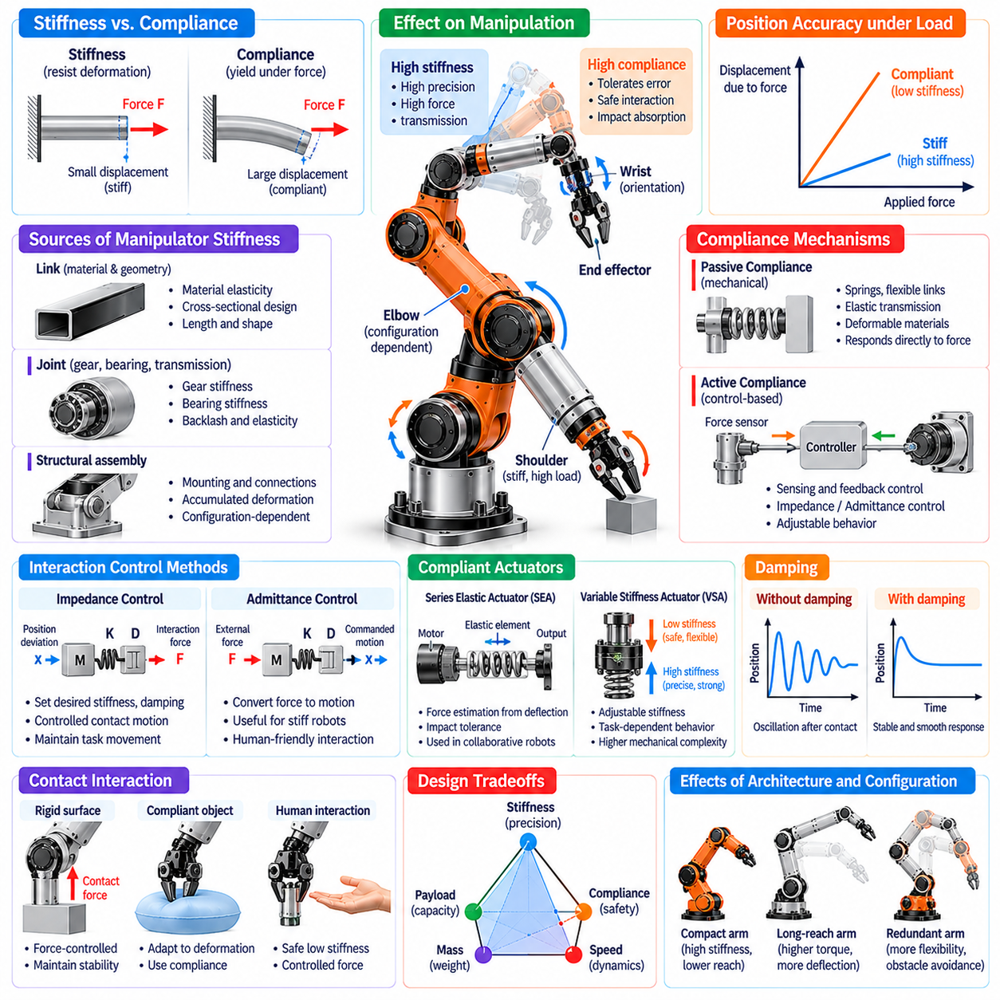{width="7.268055555555556in" height="7.268055555555556in"}

Stiffness, compliance, and interaction are fundamental characteristics of manipulator morphology that determine how a robotic arm responds to external forces and physical contact. Stiffness describes resistance to deformation, while compliance represents the ability to yield under applied loading. Their relationship influences positioning accuracy, force transmission, impact tolerance, and safe interaction with objects, humans, and uncertain environments.

Manipulator stiffness originates from the combined mechanical properties of links, joints, transmissions, bearings, and structural connections. Even when individual components appear rigid, small deformations accumulate throughout the kinematic chain. These effects become significant under heavy payloads or extended configurations. Consequently, effective stiffness must be evaluated at the end effector rather than inferred solely from individual component specifications.

Structural stiffness depends on material elasticity, link geometry, cross-sectional dimensions, and loading direction. Long or slender links generally exhibit greater bending deformation than compact structures of comparable material. Hollow sections and reinforced profiles can improve stiffness-to-mass ratios. However, increasing rigidity often adds weight, raising actuator torque requirements and reducing dynamic responsiveness.

Joint stiffness is particularly important because rotational deformation can produce substantial displacement at the end effector. Gear trains, bearings, couplings, and actuator mounts contribute to joint flexibility. Backlash and transmission elasticity introduce additional positioning uncertainty, especially during force reversals. High-precision manipulators therefore require coordinated mechanical design and compensation for joint-level deformation.

Manipulator stiffness varies with joint configuration and the direction of applied forces. A posture that resists vertical loading effectively may be comparatively flexible under lateral forces. The Jacobian and joint stiffness models can be used to estimate Cartesian stiffness at the end effector. Such configuration-dependent analysis helps identify postures suitable for precision assembly, machining, and controlled contact operations.

Compliance is the inverse relationship to stiffness in a linear mechanical model and describes deformation resulting from applied forces. Controlled compliance allows a manipulator to accommodate positioning errors, surface variations, and unexpected contact. This capability is valuable when manipulating fragile objects or interacting with humans. Excessive compliance, however, can reduce positioning precision and introduce oscillatory behavior.

Passive compliance is produced by physical properties of springs, flexible links, elastic transmissions, and deformable materials. It responds directly to external forces without requiring immediate computational intervention. Passive elements can absorb impacts and distribute contact loads, improving mechanical tolerance. Their behavior is nevertheless constrained by material properties and cannot be adjusted freely during operation.

Active compliance is generated through sensing and feedback control rather than relying exclusively on structural flexibility. Force sensors, torque sensors, and joint measurements enable controllers to modify motion in response to contact. Impedance control and admittance control are common approaches for regulating interaction behavior. Their effectiveness depends on sensing quality, actuator dynamics, control bandwidth, and system stability.

Impedance control establishes a desired dynamic relationship between motion deviation and interaction force. The controller can make a manipulator behave as though it possesses selected stiffness, damping, and inertia characteristics. This approach supports controlled contact with surfaces and objects while maintaining task-directed movement. Stable implementation requires attention to sampling delays, actuator limitations, and environmental dynamics.

Admittance control converts measured external forces into commanded motion, often through a virtual mass-spring-damper model. It is particularly useful for manipulators with stiff mechanical structures and accurate position control. A robot can respond to human guidance or contact forces by adjusting its trajectory. However, inappropriate parameter selection may produce unstable or excessively slow interaction responses.

Series elastic actuators introduce an elastic element between the motor and the driven joint or load. The resulting deflection can provide an estimate of transmitted force and improve impact tolerance. These actuators are useful in collaborative robots and force-controlled manipulation. Nevertheless, added elasticity reduces mechanical bandwidth and requires careful control design to balance responsiveness, force accuracy, and stability.

Variable stiffness actuators extend compliant design by allowing mechanical stiffness to change during operation. They may use adjustable spring geometry, antagonistic actuation, or other mechanisms to regulate resistance to deformation. Low stiffness can support safe contact, while higher stiffness can improve precision or load support. These benefits come with increased mechanical complexity, mass, and control requirements.

Damping is essential for controlling the dynamic consequences of compliance. Elastic components store and release energy, potentially producing oscillations after contact or rapid motion. Mechanical damping and feedback-based damping dissipate or regulate this energy. Appropriate damping improves settling behavior and contact stability, although excessive damping can reduce movement speed and responsiveness.

Contact interaction introduces forces that depend on both robot morphology and environmental properties. Rigid contact between a stiff manipulator and an uncertain surface can generate large transient forces from small positioning errors. Compliant structures and controlled force regulation reduce these effects. Successful interaction therefore requires coordinated consideration of mechanical stiffness, contact geometry, sensing, and control strategy.

Force control is particularly important in tasks where maintaining a specified contact load matters more than following an exact geometric trajectory. Polishing, surface inspection, insertion, and delicate assembly require controlled interaction forces. A manipulator must adjust its motion as environmental constraints change. Reliable force control depends on suitable actuator capabilities, accurate sensing, and appropriate mechanical compliance.

Hybrid position-force control separates task directions according to whether motion or force should be regulated. For example, a robot may track a trajectory along a surface while controlling the force perpendicular to it. This approach reflects the physical constraints imposed by contact. Its implementation requires accurate identification of contact directions and consistent coordination between position and force objectives.

Interaction stability depends on the combined dynamics of the robot, controller, and environment. A controller that performs well in free space may become unstable when contacting a rigid surface. Time delays, friction, sensor noise, and actuator saturation can further complicate behavior. Stability analysis and conservative parameter selection are therefore essential for manipulators operating across uncertain contact conditions.

Passivity provides a useful framework for analyzing physical interaction because it considers how energy is exchanged and dissipated. Passive mechanical elements cannot generate net energy independently, while actively controlled systems require careful management of energy injection. Passivity-oriented control methods can improve robustness during contact, although practical performance still depends on actuator limits and implementation details.

Manipulator morphology influences the location and distribution of compliance throughout the mechanical chain. Compliance near the end effector can improve local contact adaptation, while compliance in proximal joints affects larger arm movements. Distributed compliance may absorb impacts across multiple structures. Designers must determine where flexibility provides useful interaction behavior without compromising overall positioning and load support.

End-effector compliance is particularly valuable for grasping and assembly because it can accommodate small geometric uncertainties. Flexible fingertips, compliant grippers, and remote-center-compliance mechanisms allow limited self-alignment during contact. Such features can reduce the need for extremely precise positioning. However, their deformation characteristics must remain compatible with grasp stability and task-specific force requirements.

Human-robot interaction places additional demands on stiffness and compliance design. Robots operating near people must limit hazardous contact forces and respond predictably to unexpected interference. Lightweight structures, compliant actuation, force sensing, and protective control strategies can contribute to safer behavior. Compliance alone does not guarantee safety, since collision speed, effective inertia, and contact geometry remain important.

Stiffness and compliance also influence manipulation learning and policy transfer. A policy developed for a rigid arm may behave differently on a compliant robot because contact dynamics and motion responses change. Morphology-aware learning can incorporate stiffness, damping, actuator characteristics, and force feedback. These representations help learned controllers adapt to different mechanical structures and interaction conditions.

Simulation of compliant manipulation requires models that capture elastic deformation, damping, friction, and contact dynamics. Simplified rigid-body simulations may fail to predict important interaction effects. More detailed models improve fidelity but increase computational requirements and parameter uncertainty. Experimental identification and real-world validation are therefore necessary for reliable simulation-based design and learning.

The selection of stiffness and compliance should reflect the intended task rather than a universal preference for rigidity or flexibility. Precision machining may demand high structural stiffness, while collaborative handling and uncertain assembly benefit from controlled compliance. Many general-purpose manipulators require both characteristics across different operating modes. Adaptive control and suitable mechanical design can provide this functional balance.

Within Physical AI, stiffness, compliance, and interaction connect mechanical morphology with perception, planning, and intelligent control. Effective manipulators must resist unwanted deformation while yielding appropriately to contact and uncertainty. Integrating structural design, compliant actuation, force sensing, and stable control enables robots to perform accurate, adaptable, and reliable physical manipulation across diverse environments.

## 05.08. End Effector and Hand Interface

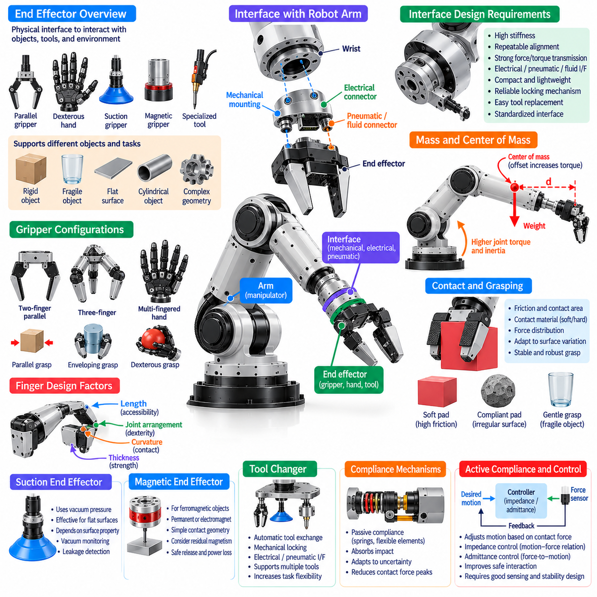{width="7.268055555555556in" height="7.268055555555556in"}

The end effector is the physical interface through which a manipulator interacts directly with objects, tools, and its surrounding environment. Its morphology determines how forces are transmitted, how objects are grasped, and how contact is maintained during manipulation. The interface between the robotic arm and end effector must integrate mechanical attachment, actuation, sensing, and control while preserving accuracy, reliability, and task adaptability.

End effectors include parallel grippers, multi-fingered hands, suction devices, magnetic grippers, and specialized process tools. Each configuration supports different object properties and interaction requirements. A parallel gripper provides relatively simple and reliable grasping, while a dexterous hand offers more complex manipulation capabilities. Selection depends on object geometry, surface conditions, payload, required motions, and operational constraints.

The mechanical interface connects the terminal wrist link to the end-effector assembly and establishes a repeatable structural reference. Mounting flanges, bolt patterns, locating features, and alignment surfaces determine attachment compatibility. The interface must transmit forces and moments without excessive deformation or loosening. Standardized mounting arrangements can simplify tool replacement and support interoperability across manipulator platforms.

Interface stiffness directly influences positioning accuracy and force transmission during manipulation. Even a rigid arm may experience significant tool displacement if the wrist connection or mounting adapter is flexible. Mechanical play, imperfect alignment, and fastening errors can introduce uncertainty. Designers must therefore evaluate the complete structural chain from the final wrist joint through the tool mounting interface to the contact point.

End-effector mass and center-of-mass location affect wrist loading and overall manipulator dynamics. Heavy grippers increase required joint torque and reduce the payload available for manipulated objects. Large offsets introduce additional bending moments and rotational inertia. Compact designs, lightweight materials, and careful actuator placement can improve performance. Tool selection should therefore be coordinated with the arm\'s payload and reach characteristics.

Gripper morphology determines the available grasping strategies and the range of objects that can be handled. Two-finger grippers commonly provide opposing contact surfaces, while three-finger arrangements support more varied object geometries. Multi-fingered robotic hands can perform enveloping, fingertip, and coordinated grasps. Greater mechanical complexity expands manipulation options but also increases sensing, actuation, and control requirements.

Finger geometry strongly influences grasp stability and contact accessibility. Finger length, curvature, thickness, and joint arrangement determine whether the gripper can reach objects in confined spaces or establish useful contact points. Long fingers may improve access but increase bending and deflection. Shorter fingers can provide greater rigidity while restricting reach. Effective designs balance geometric accessibility with mechanical strength.

Grasping performance depends on friction, contact distribution, and the relationship between applied forces and object geometry. Soft contact pads can increase contact area and accommodate surface irregularities. High-friction materials may reduce required gripping force, while compliant fingertips help distribute pressure. However, excessive deformation can reduce positional certainty. Contact materials must therefore match object fragility, environmental conditions, and expected loads.

Underactuated hands use fewer actuators than independent joint degrees of freedom, allowing mechanical coupling to coordinate finger motion. Tendons, linkages, and compliant elements can produce adaptive grasping without controlling every joint separately. This approach reduces actuator count and potentially lowers mass. Nevertheless, underactuation limits independent finger positioning and may complicate precise in-hand manipulation.

Fully actuated dexterous hands provide greater independent control of finger joints and contact configurations. They can reposition objects, adjust grasp forces, and execute coordinated fingertip motions. These capabilities support complex assembly and tool handling but require compact actuators, dense sensing, and sophisticated control. The resulting increases in cost, power consumption, and mechanical complexity must be justified by application requirements.

Suction end effectors use pressure differences to generate holding forces against suitable object surfaces. They are effective for handling flat panels, packaging, and many objects with accessible sealing regions. Their performance depends on surface permeability, roughness, curvature, and vacuum system capacity. Leakage detection and pressure monitoring are important because loss of suction can cause sudden object release.

Magnetic grippers provide another specialized interaction mechanism for compatible ferromagnetic objects. Permanent magnets and electromagnets offer different approaches to holding and releasing loads. Magnetic gripping can simplify contact geometry but introduces limitations involving material compatibility, residual magnetism, and controlled release. Selection must also consider power-loss behavior and the possibility of attracting unintended nearby objects.

Tool changers allow a manipulator to exchange end effectors without manually rebuilding the wrist interface. Mechanical locking mechanisms establish attachment, while electrical, pneumatic, or fluid connections provide supporting services. Automatic tool changing expands task flexibility and reduces the need for dedicated robots. Reliable operation requires repeatable alignment, secure locking, tool identification, and verification of connected utilities.

Electrical and communication interfaces are essential for intelligent end effectors. Power lines, signal connectors, and industrial communication links connect gripper actuators and sensors to the robot controller. Interface architecture must account for voltage requirements, current capacity, bandwidth, electromagnetic interference, and connector durability. Consistent communication protocols simplify integration, diagnostics, and maintenance.

Pneumatic and hydraulic interfaces are used when end effectors require fluid-powered actuation or process functions. Pneumatic grippers offer compact mechanisms and relatively simple force generation, while hydraulic systems can support high-force applications. Tubing, valves, pressure regulation, and sealing introduce additional integration requirements. Designers must account for leakage, response time, energy efficiency, and maintenance accessibility.

Force and tactile sensing enable end effectors to estimate contact conditions rather than relying solely on commanded finger positions. Joint torque measurements, fingertip pressure sensors, and wrist force-torque sensors provide complementary information. These signals help detect contact, regulate gripping force, and identify unexpected loads. Sensor placement and mechanical integration determine the accuracy and usefulness of the resulting feedback.

Tactile sensor arrays can provide spatial information about contact pressure, shear forces, and local deformation. Such measurements support slip detection, object localization, and adaptive grasp adjustment. Their effectiveness depends on sensor resolution, sampling rate, calibration, and mechanical durability. Integrating tactile perception with vision and proprioception improves the ability to manipulate objects under uncertainty.

The tool center point represents a reference location used to define the operational position of an attached tool. Accurate calibration of this point is essential for consistent motion planning and precise interaction. Tool replacement, mechanical wear, and mounting tolerances can change its effective location. Automated calibration and tool identification help maintain reliable geometric relationships between the wrist and working surface.

End-effector control must coordinate grasp acquisition, contact establishment, load support, and release. A grasping sequence may involve approach motion, initial contact detection, force adjustment, lifting, and stability verification. Poor coordination can produce object displacement or excessive contact forces. Reliable manipulation therefore requires integration between arm trajectory planning, hand control, and sensory feedback.

In-hand manipulation extends end-effector functionality beyond simply holding an object. Coordinated finger movements can rotate, translate, or reorient an object without releasing it. This capability depends on contact geometry, available finger degrees of freedom, friction, and force control. Dexterous hands can reduce the need for large arm movements, but stable object manipulation requires accurate contact-state estimation.

Human-compatible manipulation introduces additional requirements for end-effector safety and interaction predictability. Sharp edges, pinch points, excessive gripping forces, and unexpected release can create hazards. Compliant surfaces, force limits, protective covers, and reliable object detection can reduce risk. Safe end-effector design must consider both intentional contact and foreseeable abnormal operating conditions.

End-effector morphology also influences the transfer of learned manipulation policies between robot platforms. A policy developed for a parallel gripper may not directly apply to a multi-fingered hand because available contacts and action spaces differ. Morphology-aware representations can describe finger geometry, actuation limits, and tactile capabilities. Such information supports more effective adaptation across heterogeneous manipulation systems.

Simulation-based development requires accurate representation of end-effector geometry, contact friction, actuator dynamics, and sensor behavior. Simplified contact models may overestimate grasp stability or fail to predict slip and deformation. Experimental calibration helps reduce these discrepancies. Combining simulation with physical testing supports more reliable grasp planning, hardware selection, and learning-based manipulation.

General-purpose Physical AI manipulators benefit from modular end-effector architectures that accommodate changing tasks and object categories. Interchangeable tools, standardized interfaces, adaptable grasp mechanisms, and integrated sensing improve operational flexibility. However, universal functionality can introduce unnecessary mass and complexity. Effective designs balance specialization with reuse according to the expected range of manipulation activities.

Within Physical AI, the end effector transforms arm motion into meaningful physical interaction. Its geometry, actuation, compliance, sensing, and attachment interface jointly determine the quality of grasping and tool use. Integrating these morphological characteristics with perception, planning, and adaptive control enables reliable manipulation of diverse objects while maintaining mechanical compatibility, safety, and operational efficiency.

## 05.09. Single Arm vs Dual Arm Morphology

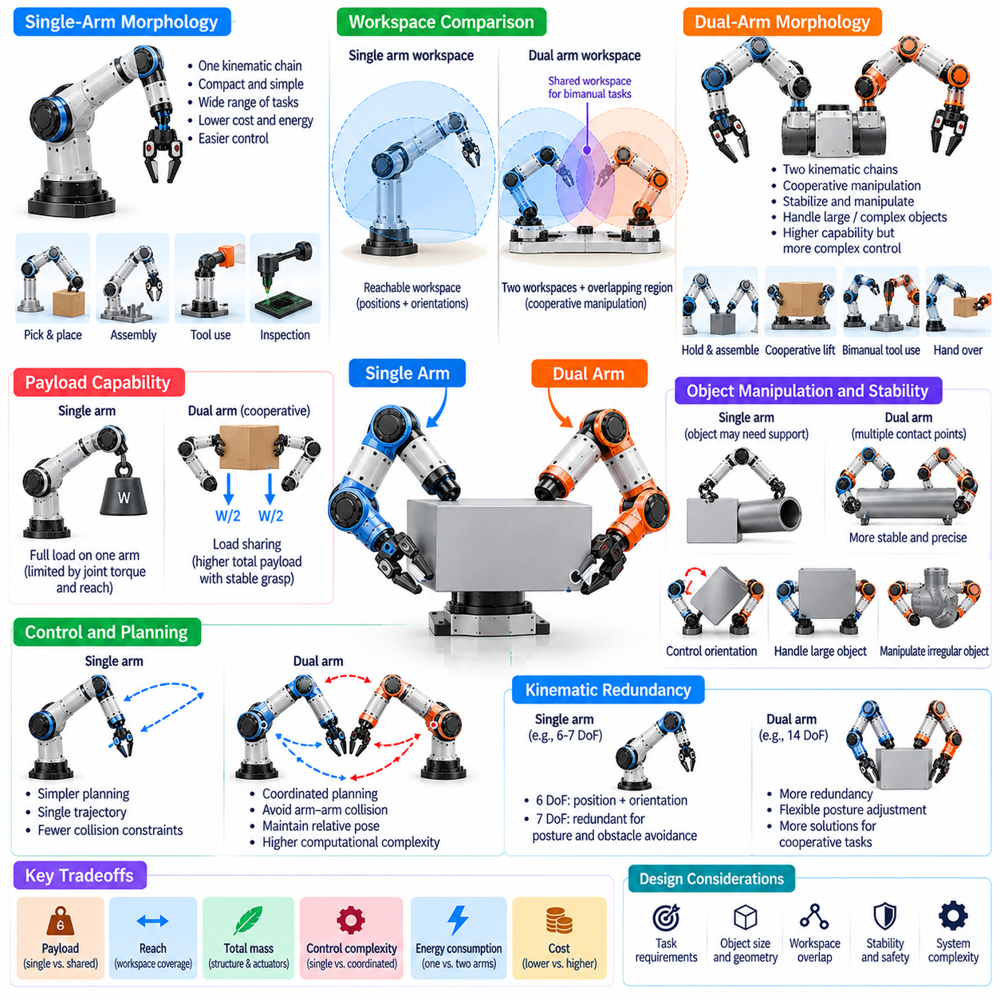{width="7.268055555555556in" height="7.268055555555556in"}

Single-arm and dual-arm morphologies represent two fundamental approaches to robotic manipulation, each offering distinct capabilities and engineering tradeoffs. A single-arm manipulator performs tasks through one kinematic chain, while a dual-arm system coordinates two independently actuated chains. Their differences influence workspace coverage, payload distribution, manipulation dexterity, mechanical complexity, and the ability to interact with objects requiring multiple contact points.

Single-arm manipulators are widely used because their mechanical architecture is relatively compact and straightforward. One arm can perform reaching, grasping, positioning, assembly, and tool operations when the task requires only one active manipulation interface. The reduced number of joints and actuators simplifies control and maintenance. However, tasks requiring simultaneous stabilization and manipulation may demand additional fixtures or external support.

Dual-arm manipulators extend these capabilities by providing two coordinated end effectors that can interact with the same object or perform separate actions. One arm may stabilize a component while the other inserts a fastener or operates a tool. This arrangement supports cooperative manipulation and complex assembly. Nevertheless, the additional arm increases mechanical mass, power requirements, control complexity, and potential collision interactions.

Workspace geometry is a central distinction between single-arm and dual-arm systems. A single arm provides a reachable region determined by its link lengths, joint limits, and mounting position. Dual-arm systems introduce two individual workspaces and an overlapping region where coordinated manipulation is possible. The location and size of this shared workspace depend on shoulder spacing, arm proportions, and joint-axis arrangements.

The overlapping workspace is particularly important for bimanual manipulation because both end effectors must access compatible object poses. A large overlap can support cooperative lifting, handovers, and coordinated assembly, but geometric overlap alone does not guarantee feasible motion. Joint limits, tool orientations, self-collision, and environmental obstacles further restrict usable configurations. Effective design therefore evaluates shared pose accessibility rather than positional overlap alone.

Shoulder placement and arm mounting geometry strongly influence dual-arm performance. Widely separated shoulders may improve access to large objects but reduce comfortable cooperation near the body centerline. Narrow spacing can improve central overlap while increasing arm-to-arm collision risks. Mounting height and orientation also affect task accessibility. These morphological decisions must reflect expected object dimensions, working surfaces, and interaction directions.

Payload capacity differs between single-arm and dual-arm configurations because cooperative handling can distribute external forces across two arms. A single arm must support the required load through one kinematic chain, whereas two arms can share the load under suitable grasp conditions. However, total cooperative payload is not necessarily the sum of individual ratings. Force distribution, object geometry, joint limits, and system stability determine actual capacity.

Dual-arm systems can improve manipulation stability by establishing multiple contact points on an object. Coordinated grasps can resist rotation, control object orientation, and reduce dependence on external fixtures. These advantages are valuable when handling long, flexible, or irregularly shaped objects. Nevertheless, excessive internal forces between the arms can damage objects or overload joints, making coordinated force regulation essential.

Kinematic redundancy increases substantially in dual-arm systems, creating more opportunities for posture adjustment and obstacle avoidance. Two seven-degree-of-freedom arms provide fourteen arm joint degrees of freedom before considering grippers or mobile bases. This flexibility supports alternative configurations for cooperative tasks. However, the larger configuration space increases planning complexity and introduces additional coordination constraints.

Single-arm manipulators often offer simpler motion planning because only one primary arm trajectory must be generated. Collision avoidance and joint-limit management remain necessary, but the number of interacting mechanical chains is limited. Dual-arm planning must account for both trajectories simultaneously. Independent planning may produce conflicting motions, requiring coordinated optimization or hierarchical planning to maintain safe separation.

Bimanual manipulation introduces relative pose constraints between the two end effectors. When both hands rigidly grasp the same object, their positions and orientations are coupled through object geometry. Motion planning must preserve these relationships while moving the object along a desired trajectory. Violating the constraints may generate excessive forces or cause grasp failure. Closed-chain kinematics therefore becomes important in cooperative manipulation.

Force control also becomes more complex when two arms interact through a shared object. The controller must distinguish forces that move the object from internal forces that act between the grasp points. Appropriate internal forces maintain grasp stability without unnecessarily stressing the object. Coordinated impedance control and force allocation can regulate these interactions. Reliable implementation requires accurate sensing and consistent object-contact models.

Single-arm systems may achieve higher efficiency for repetitive tasks involving small objects and well-defined trajectories. Their reduced mechanical complexity often lowers manufacturing cost, energy consumption, and maintenance requirements. Dual-arm systems may be more efficient for tasks that otherwise require external fixtures or repeated object repositioning. Productivity comparisons must therefore consider complete task cycles rather than individual motion speeds.

Dual-arm morphology enables simultaneous and complementary actions that cannot be performed by a conventional single arm alone. One hand may hold packaging while the other extracts an item, or one arm may manipulate a cable while the other positions a connector. Such capabilities are valuable in unstructured environments. However, the advantage depends on reliable coordination and sufficient workspace accessibility for both arms.

Object handover is another important capability of dual-arm manipulators. Transferring an object between hands can extend effective reach, change grasp orientation, or prepare for subsequent operations. A successful handover requires coordinated positioning, overlapping contact, and controlled transfer of support forces. The process introduces temporary multi-contact states that must be monitored to prevent slipping or unintended release.

Mechanical integration becomes more demanding as additional arms are introduced. Dual-arm systems require sufficient structural support for two actuator chains and their combined dynamic loads. Torso or base stiffness influences relative positioning accuracy between the arms. Vibrations generated by one arm may affect the other. Structural design must therefore account for coupled dynamics, mounting rigidity, and whole-system load distribution.

The center of mass and overall stability of a dual-arm robot vary as both arms move. Extending two arms in the same direction can create substantial overturning moments, particularly on mobile platforms. Opposing arm movements may partially balance some loads but cannot guarantee stability. Whole-body planning must consider combined inertia, support geometry, payload placement, and dynamic acceleration during coordinated manipulation.

End-effector selection is closely related to single-arm and dual-arm morphology. A single arm may require a versatile gripper capable of performing several operations independently. Dual-arm systems can combine different end effectors, such as a holding gripper and a precision tool. This specialization expands functional capability but requires compatible coordinate frames, communication interfaces, and coordinated contact strategies.

Perception requirements also differ between these architectures. Single-arm manipulation primarily estimates target poses, grasp locations, and collision-free approaches for one tool. Dual-arm systems must additionally track relative hand positions, shared-object motion, and potential arm-to-arm interference. Occlusion can increase when both arms surround an object. Multi-view sensing and integrated state estimation help maintain reliable coordination.

Control architecture must balance independent arm operation with synchronized cooperative behavior. Each arm may use local joint and Cartesian controllers, while a higher-level coordinator manages shared objectives and constraints. Time synchronization becomes important when both arms support the same load. Delayed or inconsistent commands can generate unwanted internal forces. Robust coordination therefore requires predictable communication and control timing.

Safety considerations increase with dual-arm complexity because more moving structures create additional collision and pinch hazards. Arm-to-arm contact, trapped objects, and unexpected cooperative forces require explicit risk assessment. Protective monitoring should consider the combined motion of both arms rather than treating them as isolated manipulators. Safe operation depends on mechanical safeguards, sensing, motion constraints, and validated control behavior.

Morphology-aware learning can help Physical AI systems select appropriate manipulation strategies for each architecture. Single-arm policies may focus on grasp selection and sequential object handling, while dual-arm policies must learn coordinated contact and force distribution. Training requires representative demonstrations or simulations of coupled motion. Learned behavior must remain constrained by mechanical feasibility, collision limits, and verified safety requirements.

Task allocation provides an important design perspective for dual-arm systems. Some operations benefit from tightly coupled cooperation, while others can be divided into independent subtasks executed simultaneously. The controller must decide when to synchronize both arms and when to allow separate operation. Effective scheduling can reduce idle time and improve throughput. However, concurrent actions must remain compatible with shared workspace and power constraints.

The choice between single-arm and dual-arm morphology depends on task complexity, object properties, workspace requirements, and economic constraints. Single-arm designs are often preferable for compact, repetitive, and clearly structured operations. Dual-arm designs offer advantages for cooperative handling, flexible assembly, and human-like manipulation. The optimal architecture balances additional capability against mechanical cost, planning difficulty, energy use, and reliability.

Within Physical AI, single-arm and dual-arm morphologies define different opportunities for embodied interaction with the environment. Single-arm systems emphasize efficient manipulation through one controlled chain, while dual-arm systems enable coordinated physical cooperation through multiple contacts. Integrating morphology with perception, planning, force control, and adaptive learning allows each architecture to achieve reliable performance across its intended operational tasks.

## 05.10. Mobile Manipulator Morphology

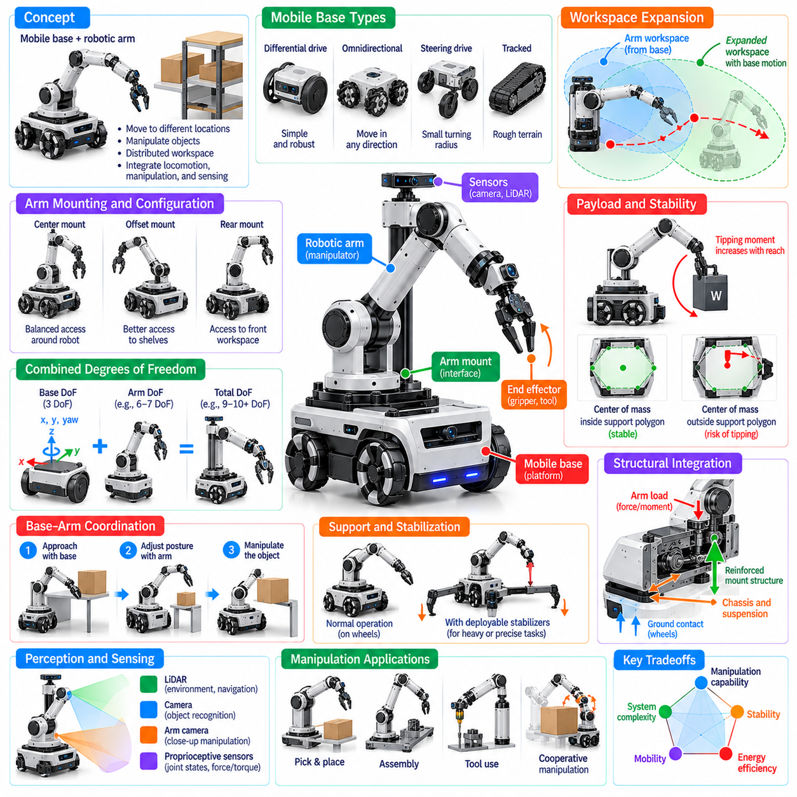{width="7.268055555555556in" height="7.268055555555556in"}

Mobile manipulator morphology combines a mobile platform with one or more robotic arms to enable manipulation across distributed workspaces. Unlike fixed-base manipulators, these systems can reposition their entire body to reach objects and perform tasks at different locations. Their physical architecture integrates locomotion, arm kinematics, structural support, and sensing. Effective design requires balancing mobility, manipulation capability, stability, and operational efficiency.

The mobile base determines how the manipulator moves through its environment and establishes the foundation for arm operation. Wheeled platforms are common because they provide efficient transportation on relatively smooth surfaces. Differential-drive, omnidirectional, and steering-based configurations offer different maneuvering capabilities. Base selection affects positioning accuracy, turning radius, lateral motion, and access to constrained workspaces.

The relationship between the mobile base and robotic arm is a central morphological design consideration. Arm mounting height, horizontal offset, and orientation determine reachable workspace and load distribution. A centrally mounted arm may provide balanced access around the platform, while an offset installation can improve access to shelves or workstations. However, mounting geometry also influences collision clearance, structural loading, and overall stability.

Mobile manipulation expands the effective workspace by combining base motion with arm articulation. A fixed manipulator is limited by its stationary mounting location, whereas a mobile manipulator can approach objects from multiple positions. This flexibility reduces the need for extremely long links. However, reachability depends on navigation constraints, base orientation, arm joint limits, and the availability of safe approach configurations.

The combined kinematic structure introduces additional degrees of freedom beyond those of the arm alone. Base translation and rotation can supplement joint motion, allowing alternative configurations for reaching the same target. These redundant possibilities improve obstacle avoidance and posture optimization. Nevertheless, they require coordinated planning because base movements can alter the geometry and feasibility of ongoing manipulation tasks.

Base-arm coordination is essential for reliable task execution. The robot must determine whether to reposition its platform, extend its arm, or combine both actions to reach a target. Moving the base may improve arm posture and reduce joint loading, while excessive repositioning increases task duration. Coordinated optimization considers reachability, collision clearance, energy consumption, and manipulation accuracy.

Structural integration determines how forces generated by the arm are transmitted into the mobile platform. Manipulation loads pass through the arm mounting structure, chassis, suspension, and ground contact points. Insufficient structural stiffness can cause positioning errors and vibration. Reinforced mounting interfaces and suitable chassis geometry help maintain precision, particularly during force-intensive operations or extended-arm configurations.

Stability becomes especially important when the arm carries a payload away from the platform center. Extended reaches create overturning moments that can shift the combined center of mass toward the support boundary. Acceleration and braking introduce additional dynamic effects. Designers must evaluate payload mass, arm posture, wheel contact geometry, and base acceleration to maintain adequate stability margins throughout operation.

The support polygon provides a useful geometric representation of the region associated with static stability. For wheeled platforms, its effective boundaries depend on ground contact locations and suspension behavior. Keeping the projected center of mass within the support region is generally necessary for static balance on level ground. Dynamic stability additionally requires consideration of inertia, external forces, uneven surfaces, and transient loading.

Mobile manipulator payload capacity cannot be evaluated solely from the arm\'s rated payload. The platform must also withstand the resulting moments and forces without excessive deformation or instability. A payload that is acceptable near the robot body may become unsafe at maximum reach. Practical load limits therefore depend on arm configuration, mounting position, base geometry, and environmental conditions.

Wheel configuration influences manipulation performance because different drive systems impose different motion constraints. Differential-drive platforms require orientation changes to achieve certain lateral displacements, while omnidirectional bases can move sideways without changing heading. Such mobility can improve alignment with workstations. However, wheel slip, floor irregularities, and drive compliance may reduce the accuracy of base positioning.

Some mobile manipulators use deployable stabilizers, locking mechanisms, or support legs during demanding operations. These mechanisms can increase resistance to tipping and reduce unwanted base motion. Their deployment introduces additional hardware, setup time, and operational constraints. The decision to include stabilization equipment depends on expected payloads, required precision, floor conditions, and the frequency of high-force manipulation.

Perception systems must support both navigation and object interaction. Cameras, depth sensors, LiDAR, and proprioceptive measurements provide information about obstacles, robot motion, and manipulation targets. Sensor placement must consider fields of view, occlusion, vibration, and exposure to environmental hazards. Combining base-mounted and arm-mounted sensors can improve situational awareness and local manipulation accuracy.

Localization accuracy directly affects the relationship between the robot and its target objects. Errors in estimated base position can propagate into end-effector placement, particularly when manipulation relies on previously mapped object locations. Visual servoing and local perception can compensate for some navigation uncertainty. Accurate coordinate transformations between the map, base, arm, sensors, and tool are therefore essential.

Navigation and manipulation planning operate at different spatial and temporal scales. Navigation determines how the platform reaches a suitable working region, while manipulation planning establishes feasible arm configurations and contact motions. Treating these processes independently can produce unreachable or unsafe task poses. Integrated planning evaluates candidate base positions together with arm reachability, dexterity, and collision constraints.

Manipulability varies significantly across the combined workspace of a mobile manipulator. Some target locations require awkward joint configurations even when they are geometrically reachable. Repositioning the base can improve joint leverage, available motion directions, and distance from singularities. Morphology-aware planners can use manipulability measures to select configurations that support accurate and robust task execution.

The height and footprint of the mobile platform influence access to furniture, machinery, and storage structures. A tall chassis may prevent the arm from approaching low work surfaces, while a wide base can restrict entry into narrow aisles. Compact platforms improve accessibility but may reduce payload stability. Designers must balance environmental clearance, support dimensions, arm mounting height, and equipment packaging.

Power and communication integration become more demanding when locomotion and manipulation share a mobile architecture. Drive motors, arm actuators, sensors, and onboard computers compete for limited electrical resources. Battery placement also affects the center of mass and chassis packaging. Efficient power distribution, thermal management, and communication networks are necessary to maintain reliable operation during combined movement and manipulation.

Mobile manipulators may perform tasks while stationary or while the base remains in motion. Stationary manipulation simplifies positioning and stability management, whereas manipulation during movement can improve throughput in selected applications. Continuous motion requires tighter coordination between base and arm controllers. Disturbances from acceleration, wheel slip, and changing contact forces must be compensated to preserve task accuracy.

Compliance and force control are particularly important when the mobile base interacts mechanically with the environment through the arm. Contact forces can move or rotate the platform if wheel traction or braking is insufficient. Coordinated impedance control can distribute motion and compliance between the arm and base. Reliable contact operations require accurate force estimation and appropriate constraints on platform movement.

Safety requirements extend across both navigation and manipulation functions. The system must manage collisions involving the chassis, arm links, end effector, and carried objects. Extending an arm changes the robot\'s effective occupied space and may create hazards beyond the base footprint. Safety monitoring must therefore consider whole-body geometry, stopping behavior, payload motion, and nearby human activity.

Task-specific mobile manipulator morphology can range from compact single-arm service robots to industrial platforms carrying powerful manipulators. Some systems prioritize narrow-space navigation and lightweight object handling, while others emphasize payload capacity and precise workstation interaction. The optimal configuration depends on operating environments, task frequency, object characteristics, and maintenance requirements.

Physical AI enables mobile manipulators to adapt their movement and manipulation strategies to changing environmental conditions. Learned policies can support approach-position selection, grasp planning, and coordinated whole-body behavior. However, successful adaptation depends on accurate representations of platform geometry, arm kinematics, contact dynamics, and safety limits. Morphological constraints must remain explicit during learning and deployment.

Mobile manipulator morphology ultimately determines how effectively locomotion and manipulation operate as an integrated physical system. Base geometry, arm placement, structural stiffness, sensing, and stability jointly shape task performance. By coordinating these characteristics with perception, navigation, planning, and adaptive control, mobile manipulators can perform reliable physical operations across changing locations and diverse working environments.

## 05.11. General Purpose Manipulation Morphology

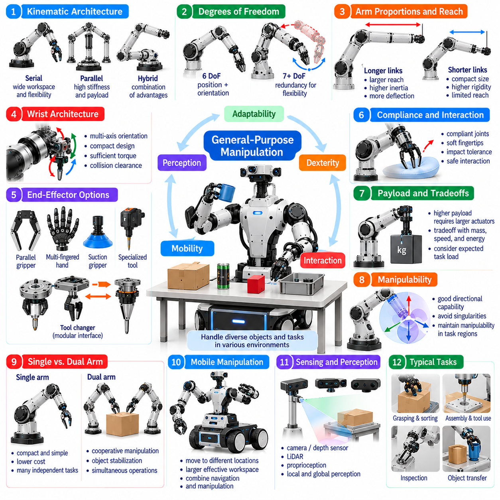{width="7.268055555555556in" height="7.268055555555556in"}

General-purpose manipulation morphology refers to the physical architecture of robotic systems designed to perform diverse manipulation tasks rather than a single specialized operation. Such systems must handle objects with different shapes, sizes, masses, and surface properties while adapting to changing environments. Their morphology integrates arm geometry, joint configuration, end-effector capability, sensing, and compliance to support flexible physical interaction.

Unlike task-specific manipulators optimized for repetitive industrial processes, general-purpose manipulators prioritize adaptability across multiple activities. They may perform grasping, sorting, assembly, tool use, inspection, and object transfer within the same operational environment. This versatility introduces competing design requirements because high payload capacity, compact dimensions, precision, dexterity, and low energy consumption cannot all be maximized simultaneously.

Kinematic architecture provides the foundation for general-purpose manipulation capability. Serial manipulators offer broad reachability and relatively flexible joint arrangements, while parallel structures provide advantages in stiffness and load transmission. Hybrid architectures can combine these characteristics. The selected configuration must provide sufficient workspace coverage, orientation control, and access to objects positioned in diverse spatial arrangements.

Degrees of freedom strongly influence the range of poses and manipulation strategies available to a robot. Six-degree-of-freedom arms can control end-effector position and orientation within their reachable workspace, while additional joints introduce kinematic redundancy. Seven-degree-of-freedom configurations are common in versatile manipulators because they support posture adjustment and obstacle avoidance. However, redundancy increases planning and control complexity.

Arm proportions determine how effectively a general-purpose manipulator operates across different working distances. Long links extend reach but increase inertia, structural deflection, and joint torque requirements. Shorter links improve compactness and may enhance rigidity but restrict accessible regions. Balanced link lengths, suitable joint placement, and appropriate wrist geometry help maintain useful dexterity across near-field and extended-reach tasks.

The wrist architecture is especially important because many manipulation tasks require precise tool orientation near surrounding objects. A compact multi-axis wrist can support insertion, alignment, and tool handling in confined spaces. However, wrist actuators and transmissions contribute mass and mechanical complexity. Designers must balance orientation flexibility, torque capacity, structural stiffness, and collision clearance when selecting wrist morphology.

End-effector versatility is a defining requirement of general-purpose manipulation. Parallel grippers provide reliable object handling with relatively simple control, while multi-fingered hands support more complex grasp configurations and in-hand manipulation. Suction devices and specialized tools extend task coverage. Modular interfaces and automatic tool changers can increase flexibility without requiring every capability to be incorporated into one mechanism.

Dexterous manipulation depends on the relationship between hand morphology and object geometry. Finger length, joint arrangement, contact surfaces, and available actuation determine the achievable grasp types. Highly articulated hands can manipulate diverse objects but require sophisticated sensing and control. Underactuated or compliant grippers offer simpler alternatives that adapt mechanically to object variation, often with reduced independent finger control.

Mechanical compliance improves the ability to interact safely with uncertain objects and environments. Flexible joints, compliant fingertips, and elastic transmission elements can absorb contact disturbances and reduce excessive forces. However, excessive compliance may degrade positioning accuracy and dynamic response. General-purpose systems therefore require carefully selected stiffness and damping characteristics that balance precision, robustness, and safe physical interaction.

Payload capacity must be evaluated together with reach, acceleration, and manipulation precision. A robot capable of lifting heavy objects may require larger actuators and stronger structural components, increasing mass and energy consumption. Conversely, lightweight architectures improve responsiveness but restrict handling capacity. General-purpose morphology should prioritize the expected distribution of task loads rather than maximizing a single payload specification.

Manipulability describes how effectively joint motions generate end-effector movements in different directions. A general-purpose manipulator should maintain useful manipulability across commonly encountered task regions. Joint-axis arrangement, link proportions, and redundancy influence this property. Designs that avoid frequent singular configurations and extreme joint postures can improve precision, force transmission, and operational reliability.

Single-arm and dual-arm configurations provide different approaches to general-purpose capability. A single arm offers compactness, lower cost, and simpler coordination, making it suitable for many independent manipulation tasks. Dual-arm systems enable cooperative handling, object stabilization, and simultaneous operations. However, they introduce additional collision constraints, structural loads, and control requirements that must be justified by expected task diversity.

Mobile manipulation further extends general-purpose functionality by allowing a robot to reposition its manipulation workspace. Combining a mobile base with one or more arms supports interaction with objects distributed across rooms, shelves, and workstations. This flexibility introduces stability, localization, and whole-body coordination challenges. Arm placement, base geometry, and payload distribution must be designed as an integrated morphological system.

Perception hardware is closely connected to manipulation morphology because sensor placement determines the information available during physical interaction. Wrist-mounted cameras, tactile sensors, force-torque sensors, and joint encoders provide complementary measurements. Their effectiveness depends on visibility, calibration, mechanical integration, and communication reliability. General-purpose systems benefit from sensor arrangements that support both global scene understanding and local contact estimation.

Morphology-aware planning connects physical capabilities with task execution. The planner must account for joint limits, reachable poses, collision geometry, payload restrictions, and end-effector characteristics. A grasp that is geometrically possible may still be unsuitable because of poor manipulability or insufficient force capacity. Integrating morphological constraints into planning improves feasibility and reduces failures during unfamiliar manipulation tasks.

Learning-based manipulation introduces additional requirements for morphological consistency and adaptability. Policies trained on one robotic structure may not transfer directly to another because joint configurations, action spaces, and contact mechanisms differ. Morphology-aware representations can describe robot geometry, actuation capabilities, and sensing arrangements. Such representations support more effective policy adaptation across heterogeneous robotic platforms.

Simulation and physical testing are essential for evaluating general-purpose manipulation morphology. Digital models can estimate workspace coverage, joint loading, collision risks, and grasp feasibility before hardware deployment. However, simplified models may not accurately reproduce friction, compliance, backlash, or contact dynamics. Experimental validation is therefore necessary to establish realistic performance limits and improve the reliability of simulation-based optimization.

Modularity supports long-term adaptability by allowing selected components to be replaced or upgraded without redesigning the entire manipulator. Standardized joints, mounting interfaces, communication connections, and interchangeable end effectors simplify maintenance and functional expansion. Nevertheless, modular interfaces can introduce additional mass, compliance, and integration complexity. Their benefits must be balanced against structural and performance requirements.

Reliability and maintainability are important morphological considerations for robots expected to perform varied tasks over extended periods. Complex hands and densely packaged actuators may increase functional capability while making repair and inspection difficult. Accessible components, protected wiring, robust transmissions, and replaceable wear elements improve serviceability. General-purpose designs must support sustained operation rather than only demonstrating isolated dexterous behaviors.

Human-centered environments introduce further constraints involving robot dimensions, reach, contact safety, and interaction predictability. General-purpose manipulators may operate near people, furniture, tools, and fragile objects. Rounded structures, controlled contact forces, collision-aware motion, and compliant interfaces can reduce interaction risks. Morphology must support safe operation across expected tasks while remaining compatible with the intended workspace.

General-purpose capability does not require every possible manipulation function to be implemented in one robot. Excessive mechanical versatility can increase weight, cost, energy demand, and control difficulty without delivering proportional operational benefits. A practical design identifies the most valuable task families and selects morphological features that support them efficiently. This approach emphasizes broad functional coverage rather than unrestricted mechanical complexity.

Morphology optimization can evaluate competing architectures through representative task scenarios. Workspace utilization, dexterity, payload efficiency, energy consumption, collision clearance, and task completion reliability provide complementary performance measures. Multi-objective optimization helps identify balanced configurations rather than maximizing one isolated metric. The resulting morphology should remain effective across variations in object properties and environmental conditions.

Physical AI provides a framework for connecting general-purpose manipulation morphology with perception, reasoning, planning, and adaptive control. The robot must understand not only what action is required but also how its physical structure enables that action. Learned policies can exploit redundancy, compliance, and contact geometry while respecting mechanical limitations. This integration supports flexible manipulation without separating intelligence from embodiment.

General-purpose manipulation morphology ultimately represents a balance between physical versatility and engineering practicality. Arm architecture, joint redundancy, wrist design, end-effector adaptability, sensing, and structural compliance jointly determine operational capability. When these elements are coordinated with intelligent control and validated through diverse tasks, manipulators can achieve reliable, adaptable, and efficient interaction across changing physical environments.
