**Volume 03. Embodiment and Morphology**

# Chapter 06. Humanoid Morphology

## 06.01. Why Human Like Morphology

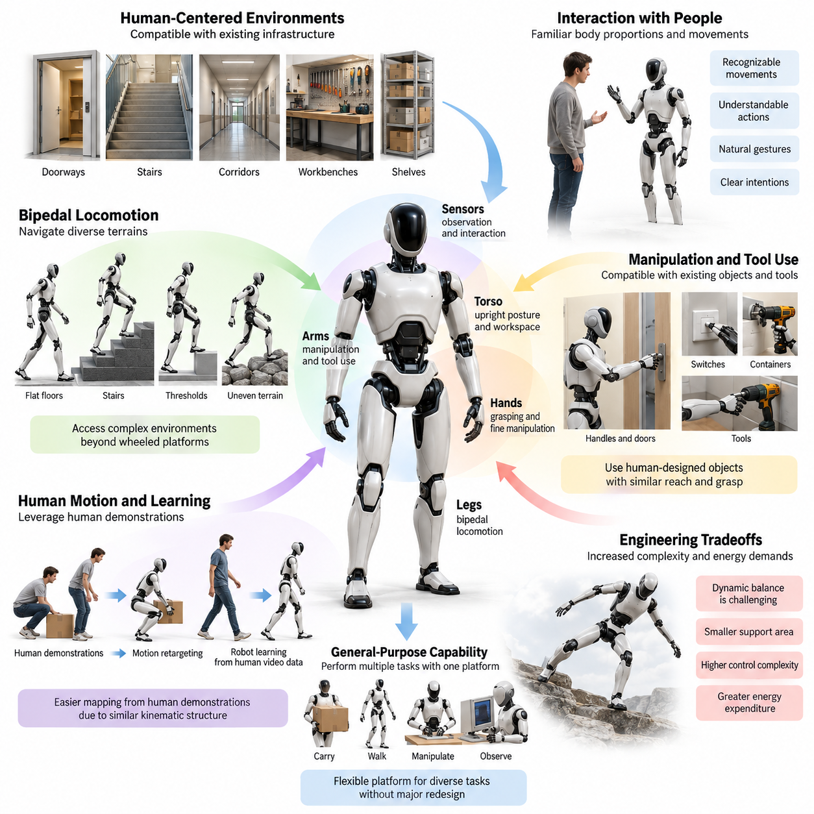{width="7.268055555555556in" height="7.268055555555556in"}

로봇공학(Robotics)에서 인간형 형태(Human-like Morphology)를 채택하는 주요 동기는 물리적 체화(Physical Embodiment)와 인간 활동을 위해 설계된 환경 사이의 관계에 있다. 건물, 도구, 가구, 교통 시스템 및 산업 작업 공간은 대부분 인간의 신체 치수와 운동 능력을 기준으로 구성되어 있다. 인간과 유사한 물리적 구조를 가진 로봇은 대규모 인프라 변경 없이 이러한 환경에서 작동할 가능성이 높다.

휴머노이드 형태(Humanoid Morphology)의 근본적인 장점은 인간과의 외형적 유사성이 아니라 인간 중심 환경(Human-centered Environments)과의 기능적 호환성(Functional Compatibility)에 있다. 휴머노이드 로봇(Humanoid Robot)은 일반적으로 직립 몸통(Upright Torso), 두 개의 관절형 팔(Articulated Arms), 두 다리(Legs), 높은 위치의 감각 시스템(Sensory System)을 결합한다. 이러한 구성은 이동, 조작, 관찰 및 상호작용을 통합된 물리적 구조 안에서 수행할 수 있도록 한다.

인간 환경(Human Environments)은 로봇 설계에 영향을 미치는 기하학적 제약(Geometric Constraints)을 부과한다. 출입문, 계단, 복도, 작업대, 선반 및 제어 패널은 인간의 신장, 도달 범위(Reach), 이동 능력을 전제로 설계된다. 휴머노이드 플랫폼(Humanoid Platform)은 이러한 공간적 관계를 근사함으로써 특수한 기계적 개조 없이 손, 발 및 감각 시스템이 필요한 위치에 접근하도록 할 수 있다.

이족 보행(Bipedal Locomotion)은 인간형 형태를 채택하는 중요한 이유 중 하나이다. 두 개의 관절형 다리는 적절한 제어 및 접촉 조건(Contact Conditions)이 확보되면 계단, 문턱, 불규칙한 지면 및 좁은 통로에서 이동을 지원할 수 있다. 기존 바퀴형 플랫폼(Wheeled Platform)과 달리 다리형 시스템(Legged System)은 발 디딤 위치(Foothold)를 선택적으로 설정하고 불연속적인 지형에 맞춰 신체 자세를 조정할 수 있다.

그러나 이족 보행은 상당한 공학적 과제를 수반한다. 동적 균형(Dynamic Balance)을 유지하려면 관절 운동(Joint Motion), 지면 반력(Ground Reaction Force), 신체 관성(Body Inertia), 외부 교란(External Disturbance)을 지속적으로 조정해야 한다. 두 발의 상대적으로 작은 지지 영역(Support Area)은 외란에 대한 민감도를 증가시킨다. 따라서 휴머노이드 이동은 평탄한 지면에서 바퀴형 이동보다 복잡한 제어와 많은 에너지를 요구하는 경우가 많다.

인간형 상체 형태(Human-like Upper-body Morphology)는 기존 물체 및 도구와의 호환성을 통해 또 다른 중요한 장점을 제공한다. 문, 손잡이, 스위치, 용기, 난간 및 다양한 산업용 기구는 인간의 팔과 손을 기준으로 설계된다. 적절한 조작기(Manipulator)를 갖춘 휴머노이드 로봇은 유사한 도달 방향, 파지 구성(Grasp Configuration), 작업 순서(Operational Sequence)를 사용하여 이러한 물체와 상호작용할 수 있다.

두 팔의 존재는 많은 단일 팔 시스템(Single-arm System)의 능력을 넘어서는 협응 조작(Coordinated Manipulation)을 가능하게 한다. 한 손으로 물체를 안정화하면서 다른 손으로 작업하거나, 양손을 협력적으로 사용하여 부피가 큰 물체를 운반할 수 있다. 이러한 작업에는 어깨, 팔꿈치, 손목, 몸통 및 하체 지지 구조의 협응 운동이 필요하며, 통합 형태(Integrated Morphology)의 중요성을 보여준다.

인간형 손(Anthropomorphic Hand)은 기존 인터페이스를 교체하지 않고 다양한 물체를 조작해야 할 때 특히 중요하다. 여러 손가락, 관절 구조 및 유연한 접촉 표면(Compliant Contact Surface)은 파지, 물체 재배치 및 정밀 조작(Fine Manipulation)을 지원한다. 그러나 인간 손의 복잡성을 재현하면 구동기(Actuator) 요구사항, 기계적 패키징(Mechanical Packaging), 센싱 및 제어 복잡성이 증가한다.

직립 몸통(Upright Torso)은 조작기와 센서를 인간에게 익숙한 작업 영역에 배치함으로써 인간형 기능에 기여한다. 서 있는 휴머노이드는 높은 표면에 접근하고, 인간의 눈높이에서 물체를 검사하며, 일반적인 작업대에서 작업을 수행할 수 있다. 몸통 관절 운동(Torso Articulation)은 도달 가능한 작업 공간(Reachable Workspace)을 확장하고 균형, 인지 및 조작 사이의 협응 조정을 가능하게 한다.

인간형 형태는 로봇과 사람 사이의 상호작용(Human-Robot Interaction)을 개선할 수도 있다. 익숙한 신체 비율과 인식 가능한 움직임 패턴은 관찰자가 로봇의 의도된 행동을 해석하는 데 도움을 줄 수 있다. 머리 방향, 팔 동작, 신체 자세 및 접근 방향은 주의 집중이나 이동 의도를 전달할 수 있지만, 효과적인 의사소통은 형태 자체보다 행동 설계(Behavioral Design)에 의존한다.

인간 동작(Human Motion)과 로봇 학습(Robot Learning)의 관계는 인간형 체화(Anthropomorphic Embodiment)를 채택하는 또 다른 동기를 제공한다. 인간 시연(Human Demonstration)에는 물체 조작, 보행, 협응 및 작업 수행에 관한 유용한 정보가 포함되어 있다. 유사한 운동학적 구조(Kinematic Structure)를 가진 로봇은 근본적으로 다른 신체 구성을 가진 플랫폼보다 시연의 일부 요소를 실행 가능한 행동으로 변환하기 쉬울 수 있다.

동작 재매핑(Motion Retargeting)은 관절 한계(Joint Limits), 신체 비율, 동역학(Dynamics), 구동기 성능의 차이를 고려하면서 인간의 시연 동작을 로봇이 실행할 수 있는 궤적(Trajectory)으로 변환한다. 인간과 로봇의 형태적 유사성은 이러한 매핑의 일부를 단순화할 수 있지만, 직접적인 동작 재현만으로는 충분하지 않다. 로봇 제어기는 질량 분포, 접촉 역학(Contact Mechanics), 자유도(Degrees of Freedom), 안정성 제약의 차이를 고려해야 한다.

인간 영상 데이터(Human Video Data)는 휴머노이드 학습을 위한 확장 가능한 행동 정보의 원천이 될 수 있다. 일상적인 영상에는 도달, 파지, 보행, 들어 올리기 및 물체와의 상호작용 사례가 포함되어 있다. 시각 기반 학습 시스템(Vision-based Learning System)은 이러한 관찰에서 작업 관계와 동작 패턴을 추출할 수 있지만, 시각적 행동을 물리적으로 실행 가능한 로봇 행동으로 변환하는 것은 여전히 중요한 연구 과제이다.

인간형 형태는 범용 로봇 시스템(General-purpose Robotic System)에 관한 연구도 지원한다. 보행, 조작, 관찰 및 상호작용이 가능한 플랫폼은 기본적인 기계 구조를 변경하지 않고 여러 작업 범주를 수행할 수 있다. 이러한 유연성(Flexibility)은 작업 요구사항이 시간에 따라 변화하고 모든 작업에 전용 로봇을 배치하는 것이 비효율적인 환경에서 특히 가치가 높다.

그러나 형태적 범용성(Morphological Generality)이 자동으로 기능적 범용성(Functional Generality)을 만들어 내는 것은 아니다. 휴머노이드가 필요한 사지와 관절을 갖추고 있더라도 특정 작업에 필요한 힘, 정밀도, 지속 작동 능력 또는 제어 성능이 부족할 수 있다. 범용 성능은 기계 설계, 센싱, 구동, 계획(Planning), 학습 및 신뢰할 수 있는 물리적 상호작용의 통합에 달려 있다.

인간형 형태의 선택에는 적응성(Adaptability)과 공학적 효율성(Engineering Efficiency) 사이의 중요한 절충 관계(Tradeoff)가 존재한다. 추가적인 관절은 가능한 운동 능력을 확장하지만 기계적 복잡성, 비용, 유지보수 요구사항 및 고장 가능성을 증가시킨다. 관절이 많은 신체는 제어 공간(Control Space)과 동역학적 상호작용을 복잡하게 하므로 하드웨어 구조와 지능형 제어(Intelligent Control) 사이의 신중한 조정이 필요하다.

에너지 효율(Energy Efficiency) 역시 중요한 고려사항이다. 인간의 보행은 생물학적 근육 특성, 탄성 힘줄(Elastic Tendon), 협응 신경 제어(Coordinated Neural Control), 진화된 신체 역학의 이점을 활용한다. 전기 모터, 동력 전달 장치(Transmission), 강체 구조(Rigid Structure)를 사용하는 로봇은 이러한 장점을 자동으로 재현할 수 없다. 효율적인 휴머노이드 운동을 위해서는 구동기 배치, 관절 유연성, 질량 분포 및 보행 동역학(Gait Dynamics)의 최적화가 필요하다.

형태적 연산(Morphological Computation)은 이러한 설계 결정을 이해하는 데 유용한 관점을 제공한다. 기계적 유연성(Mechanical Compliance), 수동 관절 동역학(Passive Joint Dynamics), 탄성 에너지 저장(Elastic Energy Storage), 적절한 관성 분포(Inertia Distribution)는 능동 제어기(Active Controller)의 부담을 줄일 수 있다. 휴머노이드 신체를 수동적인 기계 장치로만 취급하는 대신 안정화, 충격 흡수 및 협응 운동을 자연스럽게 지원하는 물리적 특성을 활용할 수 있다.

따라서 인간형 신체 비율(Human-like Body Proportions)은 고정된 생물학적 요구사항이 아니라 공학적 설계 변수(Engineering Design Variables)로 해석해야 한다. 팔 길이, 다리 길이, 어깨 너비, 몸통 치수 및 발 형상은 작업 목표에 맞게 조정할 수 있다. 물류창고용 휴머노이드는 적재 능력(Payload Capacity)과 도달 범위를 우선할 수 있으며, 서비스 로봇은 소형화, 안전한 상호작용 및 기동성(Maneuverability)을 강조할 수 있다.

의인화된 외형(Anthropomorphic Appearance)과 의인화된 기능(Anthropomorphic Functionality)의 구분은 특히 중요하다. 로봇이 인간과 호환되는 조작 및 이동 능력의 이점을 얻기 위해 사실적인 얼굴, 인간 피부 또는 정확한 해부학적 비율을 반드시 갖출 필요는 없다. 기능적 휴머노이드 형태(Functional Humanoid Morphology)는 인간의 능력을 기준으로 설계된 환경에서 유용한 작업을 수행하는 데 필요한 물리적 구조에 집중한다.

안전 고려사항(Safety Considerations) 역시 휴머노이드 설계의 가치와 한계에 영향을 미친다. 사람 가까이에서 작동하려면 예측 가능한 움직임, 제어된 접촉력(Controlled Contact Force), 안정적인 자세 및 외란에 대한 신뢰할 수 있는 대응이 필요하다. 인간형 치수는 환경 호환성을 높일 수 있지만, 키가 크고 무거우며 동적 균형을 유지하는 로봇은 적절한 안전장치(Safeguards)가 없으면 충돌 및 낙상 위험을 초래할 수 있다.

경제적 고려사항(Economic Considerations)은 궁극적으로 실제 배치(Practical Deployment)에서 휴머노이드 형태의 타당성을 결정한다. 반복 작업이 이루어지는 구조화된 시설에서는 바퀴형 로봇이나 고정형 조작기(Fixed Manipulator)가 더 높은 신뢰성, 낮은 에너지 소비 및 비용 절감 효과를 제공할 수 있다. 휴머노이드 플랫폼은 환경의 다양성, 인간 중심 인프라 및 복합적인 조작 요구사항이 기계적 단점을 상쇄할 때 더욱 매력적인 선택이 된다.

유용한 설계 원칙은 해부학적 유사성(Anatomical Similarity)이 아니라 작업 범위(Task Coverage)를 기준으로 휴머노이드 형태를 평가하는 것이다. 엔지니어는 어떤 환경 제약이 다리를 필요로 하는지, 어떤 조작 작업이 두 팔의 이점을 활용하는지, 어떤 상호작용에 인간과 호환되는 도달 범위가 필요한지 검토해야 한다. 이러한 요구사항은 완전한 휴머노이드 신체, 이동형 조작기(Mobile Manipulator), 하이브리드 구성(Hybrid Configuration) 중 적절한 해결책을 결정하는 기준이 된다.

피지컬 AI(Physical AI)에서 인간형 형태는 지능형 연산(Intelligent Computation)을 인간 환경의 물리적 구조와 연결하는 전략을 의미한다. 그 가치는 신체 기하학(Body Geometry), 기계 동역학(Mechanical Dynamics), 인지(Perception), 학습 및 제어 사이의 상호작용에서 나타난다. 핵심 목표는 인간 해부학 자체를 재현하는 것이 아니라 유용하고 적응적이며 안전한 물리적 행동을 수행할 수 있는 체화 시스템(Embodied System)을 구현하는 것이다.

## 06.02. Anthropomorphic Body Architecture

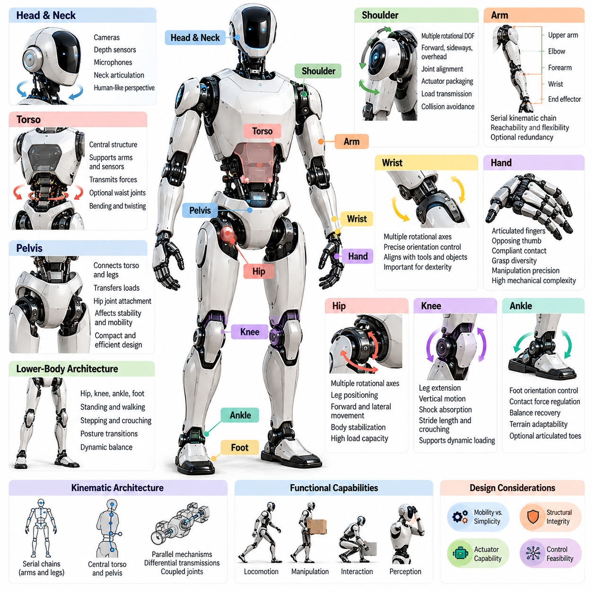{width="7.268055555555556in" height="7.268055555555556in"}

인간형 신체 구조(Anthropomorphic Body Architecture)는 물리적 구성(Physical Configuration)이 인간의 신체와 유사한 로봇의 구조적 조직을 의미한다. 일반적으로 머리(Head), 몸통(Torso), 골반(Pelvis), 두 팔(Arms), 두 다리(Legs)를 하나의 협응된 기계 시스템(Coordinated Mechanical System)으로 통합한다. 그 목적은 인간의 해부학적 구조를 정확하게 복제하는 것이 아니라 인간과 호환되는 이동, 조작, 인지 및 환경 상호작용을 지원하는 기능적 구조를 구현하는 데 있다.

휴머노이드 로봇(Humanoid Robot)의 구조적 기반은 강체(Rigid Body) 또는 유연한 신체 분절(Compliant Body Segment)이 관절(Joint)을 통해 어떻게 연결되는지를 정의하는 운동학적 구조(Kinematic Structure)이다. 이러한 연결은 로봇의 자유도(Degrees of Freedom), 운동 제약(Movement Constraints), 도달 가능한 자세 구성을 결정한다. 잘 설계된 인간형 구조는 인간과 유사한 운동 능력과 기계적 단순성, 구조적 건전성(Structural Integrity), 구동기 성능(Actuator Capability), 제어 실현 가능성(Control Feasibility) 사이의 균형을 유지해야 한다.

몸통(Torso)은 상체(Upper Body)와 하체(Lower Body)를 연결하는 중심 구조 프레임워크(Central Structural Framework)를 형성한다. 몸통은 어깨, 목, 팔 및 내부 구성요소를 지지하면서 골반과 상지(Upper Extremities) 사이의 힘을 전달한다. 설계에 따라 몸통은 강체 구조로 구성되거나 허리 관절(Waist Joint)을 포함하여 이동 및 조작 과정에서 굽힘(Bending), 비틀림(Twisting), 자세 조정(Posture Adjustment)을 수행할 수 있다.

골반(Pelvis)은 몸통과 다리 사이의 기계적 인터페이스(Mechanical Interface) 역할을 한다. 골반은 중력 하중(Gravitational Load)과 동적 하중(Dynamic Load)을 지지하는 다리로 전달하며 고관절(Hip Joint)의 장착 지점을 제공한다. 골반의 형상(Geometry), 강성(Stiffness), 질량 분포(Mass Distribution)는 보행 안정성(Walking Stability), 관절 운동 범위(Joint Range of Motion), 전신 협응(Whole-body Coordination)에 영향을 미친다. 소형 골반은 부품 배치 효율을 높일 수 있지만 구동기 배치와 고관절 운동성을 제한할 수 있다.

머리(Head)와 목(Neck)은 인지(Perception)와 상호작용(Interaction)을 위한 높은 위치의 플랫폼을 제공한다. 카메라(Camera), 깊이 센서(Depth Sensor), 마이크로폰(Microphone) 및 기타 감지 장치를 배치하여 인간과 유사한 관점에서 물체와 사람을 관찰할 수 있다. 목 관절 운동(Neck Articulation)은 센서 방향을 독립적으로 조정하여 관찰 중 신체 전체를 재배치할 필요성을 줄이면서 능동 인지(Active Perception)를 지원한다.

어깨 구조(Shoulder Architecture)는 각 팔을 몸통에 연결하며 상지 운동(Upper-limb Movement)의 범위를 결정한다. 인간의 어깨를 모방한 구조는 일반적으로 여러 회전 자유도(Rotational Degrees of Freedom)를 제공하여 팔을 전방, 측면 및 머리 위로 움직일 수 있도록 한다. 이를 기계적으로 구현하려면 관절 축 정렬(Joint Alignment), 구동기 패키징(Actuator Packaging), 하중 전달(Load Transmission), 몸통 주변의 충돌 회피(Collision Avoidance)를 신중하게 고려해야 한다.

각 인간형 팔(Anthropomorphic Arm)은 일반적으로 상완(Upper Arm), 팔꿈치(Elbow), 전완(Forearm), 손목(Wrist), 말단 효과기(End Effector)로 구성된다. 이러한 분절은 3차원 작업 공간(Three-dimensional Workspace)에서 손의 위치와 방향을 결정할 수 있는 직렬 운동학 체인(Serial Kinematic Chain)을 형성한다. 추가적인 관절 중복성(Joint Redundancy)은 장애물 회피와 조작 유연성을 개선하지만 제어 복잡성을 증가시키고 동일한 손 자세에 대해 더 많은 관절 구성을 발생시킨다.

손목(Wrist)은 전완과 손 사이에서 최종 방향 조정(Final Orientation Adjustment)을 수행한다. 여러 회전축(Rotational Axis)은 어깨나 몸통을 크게 움직이지 않고도 말단 효과기를 도구, 손잡이 및 물체에 정렬할 수 있도록 한다. 손목 구조는 특히 삽입(Insertion), 조립(Assembly), 물체 재배치(Object Repositioning)를 위해 정밀한 방향 제어가 필요한 제한된 공간에서 조작성(Dexterity)에 큰 영향을 미친다.

인간형 손(Anthropomorphic Hand)은 많은 휴머노이드 구조에서 기계적으로 가장 복잡한 구성요소에 해당한다. 관절형 손가락(Articulated Finger), 대립 엄지(Opposing Thumb), 힘줄 구동 메커니즘(Tendon-driven Mechanism), 유연한 접촉 표면(Compliant Contact Surface)을 포함할 수 있다. 손의 설계는 파지 다양성(Grasp Diversity), 조작 정밀도(Manipulation Precision), 물체 형상에 대한 적응성을 결정한다. 그러나 높은 손가락 관절 자유도는 구동기 수, 센싱 요구사항, 기계적 복잡성 및 유지보수 부담을 증가시킨다.

하체 구조(Lower-body Architecture)는 고관절(Hip), 무릎(Knee), 발목(Ankle), 발(Foot)을 중심으로 구성된다. 이러한 요소들은 함께 서기(Standing), 걷기(Walking), 발 내딛기(Stepping), 자세 전환(Posture Transition)을 지원한다. 고관절은 골반에 대한 다리 위치를 조정하고, 무릎은 다리의 신전(Extension)을 제어하며, 발목은 발의 방향과 지면 접촉(Ground Contact)을 조절한다. 이들의 협응 작동은 이족 이동(Bipedal Mobility)과 동적 균형(Dynamic Balance)의 기계적 기반을 형성한다.

고관절 구조(Hip Architecture)는 신체 안정화(Body Stabilization)와 다리 위치 제어(Leg Positioning)를 연결하기 때문에 특히 중요하다. 여러 회전축은 전방 보행(Forward Stepping), 측면 이동(Lateral Movement), 신체 방향 변경을 가능하게 한다. 관절 배치와 기계적 간섭(Mechanical Interference)은 실현 가능한 다리 작업 공간(Leg Workspace)을 결정한다. 설계자는 로봇이 체중을 지탱하거나 이동 중 가속할 때 발생하는 상당한 토크(Torque)도 고려해야 한다.

무릎(Knee)은 주로 다리의 신전(Extension)을 제어하며 신체의 수직 운동(Vertical Body Motion), 충격 흡수(Shock Absorption), 보행 동역학(Walking Dynamics)에 기여한다. 많은 휴머노이드 설계는 주된 굴곡-신전 축(Flexion-extension Axis)을 사용하지만 대체 메커니즘(Alternative Mechanism)을 통해 추가적인 기능을 제공할 수도 있다. 무릎 형상은 보폭(Stride Length), 웅크림 깊이(Crouching Depth), 기계적 지렛대 효과(Mechanical Leverage)에 영향을 미치며 구동기 특성은 동적 하중을 지탱하는 능력을 결정한다.

발목 및 발 구조(Ankle and Foot Architecture)는 휴머노이드 신체와 지지 표면(Supporting Surface) 사이의 상호작용을 지배한다. 발목 관절 운동은 발의 방향을 조정하고 균형 회복(Balance Recovery) 과정에서 접촉력(Contact Force)을 재분배한다. 발의 치수, 발바닥 유연성(Sole Compliance), 마찰 특성(Friction Characteristics), 접촉 형상(Contact Geometry)은 안정성과 지형 적응성(Terrain Adaptability)에 영향을 미친다. 일부 구조는 굴림 접촉(Rolling Contact)과 특정 보행 동작을 개선하기 위해 관절형 발가락(Articulated Toe)을 포함한다.

신체 전체의 관절 배치(Joint Arrangement)는 휴머노이드의 전체 운동학적 위상 구조(Kinematic Topology)를 결정한다. 일반적인 구성은 중심 몸통과 골반을 통해 연결된 팔과 다리에 직렬 체인(Serial Chain)을 사용한다. 그러나 특정 신체 영역에서 강성을 높이고 구동기 질량을 줄이거나 힘 전달을 최적화하기 위해 병렬 메커니즘(Parallel Mechanism), 차동 전달 장치(Differential Transmission), 결합 관절(Coupled Joint)을 도입할 수도 있다.

자유도(Degrees of Freedom)는 해부학적 유사성(Anatomical Resemblance)만이 아니라 기능적 요구사항(Functional Requirements)에 따라 배분해야 한다. 관절 수를 늘리면 조작성(Dexterity), 이동성(Mobility), 중복성(Redundancy)을 확장할 수 있지만 무게, 에너지 소비, 계산 요구량(Computational Demand), 고장 가능성도 증가한다. 효과적인 구조는 불필요한 기계적 복잡성을 피하면서 목표 작업에 충분한 운동 능력을 제공해야 한다.

구동기 배치(Actuator Placement)는 또 다른 기본적인 구조 설계 결정이다. 모터(Motor)와 동력 전달 장치(Transmission)는 관절에 직접 배치하거나 벨트(Belt), 케이블(Cable), 기어(Gear), 링크 메커니즘(Linkage Mechanism)을 통해 원격으로 배치할 수 있다. 근위부 구동기 배치(Proximal Actuator Placement)는 원위부 사지 관성(Distal Limb Inertia)을 줄여 동적 응답성(Dynamic Responsiveness)을 개선할 수 있다. 그러나 원격 구동(Remote Actuation)은 전달계 유연성(Transmission Compliance), 마찰(Friction), 배선 경로 제약(Routing Constraints), 추가적인 기계 설계 문제를 발생시킨다.

질량 분포(Mass Distribution)는 인간형 신체의 성능에 상당한 영향을 미친다. 무거운 구성요소가 관절 축에서 멀리 배치되면 회전 관성(Rotational Inertia)과 구동기 토크 요구량이 증가한다. 배터리(Battery), 컴퓨팅 하드웨어(Computing Hardware) 및 기타 무거운 부품을 몸통이나 골반 근처에 집중시키면 동적 효율(Dynamic Efficiency)을 개선할 수 있다. 그러나 열 관리(Thermal Management), 유지보수 접근성(Maintenance Access), 구조적 제약(Structural Constraints)은 이상적인 부품 배치를 제한할 수 있다.

구조적 강성(Structural Stiffness)과 유연성(Compliance)은 신체 전체에서 조화롭게 설계되어야 한다. 강체 분절(Rigid Segment)은 정확한 위치 제어와 효율적인 하중 전달을 지원하며, 유연한 요소(Compliant Element)는 충격을 흡수하고 불확실한 접촉에 대응할 수 있다. 과도한 유연성은 정밀도를 떨어뜨리거나 진동(Oscillation)을 발생시킬 수 있다. 적절한 조합은 이동 동역학(Locomotion Dynamics), 조작 요구사항, 예상 접촉력 및 로봇의 작동 환경에 따라 달라진다.

전신 협응(Whole-body Coordination)은 인간형 구조의 핵심적인 특징이다. 멀리 있는 물체에 손을 뻗는 동작은 팔, 몸통, 골반 및 지지 다리(Supporting Leg)의 동시 조정을 요구할 수 있다. 이러한 움직임은 공유된 질량(Shared Mass), 운동량(Momentum), 접촉 제약(Contact Constraints)을 통해 기계적으로 결합되어 있다. 따라서 개별 사지(Limb)의 성능은 전체 신체 구성(Whole-body Configuration)과 독립적으로 평가할 수 없다.

센서 통합(Sensor Integration)은 휴머노이드의 기계적 조직(Mechanical Organization)을 반영해야 한다. 관절 엔코더(Joint Encoder)는 위치 측정값을 제공하고, 관성 센서(Inertial Sensor)는 신체 운동을 추정하며, 힘 또는 토크 센서(Force or Torque Sensor)는 물리적 상호작용을 파악한다. 촉각 센서(Tactile Sensor)는 손과 발의 국부적인 접촉 정보(Localized Contact Information)를 제공할 수 있다. 이러한 측정값을 결합하면 신체 구성, 균형 상태 및 상호작용 힘을 추정할 수 있다.

내부 부품 배치(Internal Packaging)는 추가적인 구조적 제약을 발생시킨다. 전기 배선(Electrical Wiring), 통신 네트워크(Communication Network), 냉각 채널(Cooling Channel), 전력 분배(Power Distribution), 기계적 동력 전달 장치는 관절 운동을 방해하지 않으면서 움직이는 구조를 통과해야 한다. 소형 인간형 비율(Compact Anthropomorphic Proportions)은 이러한 통합을 어렵게 만든다. 모듈형 구성요소(Modular Component)와 접근 가능한 인터페이스(Accessible Interface)는 유지보수성(Maintainability), 교체 효율 및 장기적인 시스템 신뢰성(System Reliability)을 개선할 수 있다.

인간과 호환되는 신체 비율(Human-compatible Proportions)은 신체 구조 설계에 유용한 출발점을 제공하지만 정확한 생물학적 치수(Biological Dimensions)가 필수적인 것은 아니다. 설계자는 응용 요구사항에 따라 팔 길이, 어깨 너비, 몸통 높이, 다리 비율 및 발 형상을 변경할 수 있다. 산업용 휴머노이드(Industrial Humanoid)는 힘과 도달 범위를 우선할 수 있으며, 서비스 지향 플랫폼(Service-oriented Platform)은 소형화(Compactness), 기동성(Maneuverability), 안전한 상호작용(Safe Interaction)을 강조할 수 있다.

구조 평가(Architectural Evaluation)는 이동성(Mobility), 조작 능력(Manipulation), 안정성(Stability), 적재 능력(Payload), 에너지 효율(Energy Efficiency), 기계적 신뢰성(Mechanical Reliability)을 함께 고려해야 한다. 한 하위 시스템(Subsystem)의 개선이 다른 영역에서는 불리한 결과를 초래할 수 있다. 더 큰 구동기는 사용 가능한 토크를 증가시키지만 질량도 늘리며, 추가 관절은 유연성을 개선하지만 제어를 복잡하게 만든다. 따라서 효과적인 휴머노이드 설계에는 전체 기계 시스템에 대한 통합 최적화(Integrated Optimization)가 필요하다.

인간형 신체 구조(Anthropomorphic Body Architecture)는 궁극적으로 휴머노이드 로봇의 체화 지능(Embodied Intelligence)을 위한 물리적 기반(Physical Foundation)을 제공한다. 이러한 구조적 조직은 센싱(Sensing), 구동(Actuation), 제어(Control), 환경 상호작용(Environmental Interaction)이 어떻게 협응될 수 있는지를 결정한다. 성공적인 설계는 인간 해부학(Human Anatomy)의 일부 원리를 실용적인 공학 구조(Engineering Structure)로 전환하여 생물학적 복잡성(Biological Complexity)을 정확하게 복제하지 않고도 다양한 물리적 행동(Versatile Physical Behavior)을 가능하게 한다.

## 06.03. Torso Head and Neck Morphology

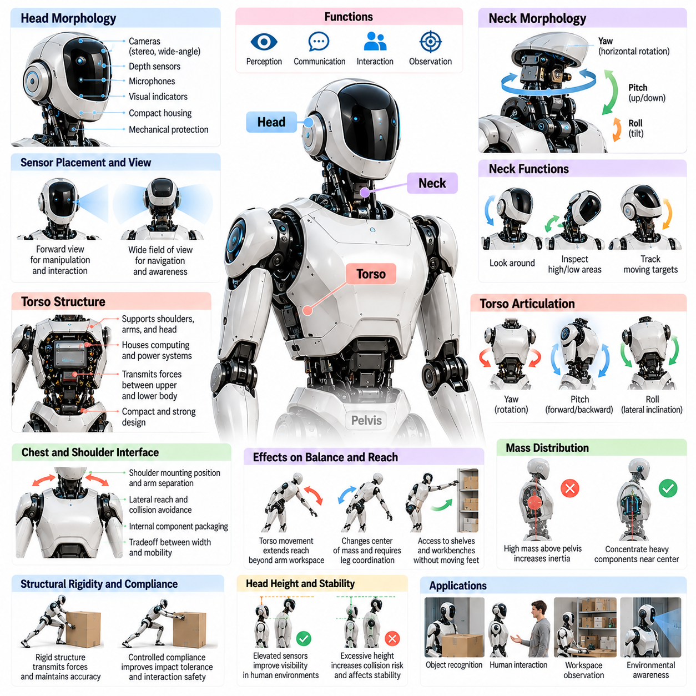{width="7.268055555555556in" height="7.268055555555556in"}

몸통(Torso), 머리(Head), 목(Neck)은 휴머노이드 로봇(Humanoid Robot)의 중심 상체 구조(Central Upper-body Architecture)를 형성하며, 구조적 지지(Structural Support), 센서 위치 설정(Sensory Positioning), 협응 운동(Coordinated Movement)을 제공한다. 이러한 구성요소는 인지(Perception)를 조작(Manipulation) 및 이동(Locomotion)과 연결하면서 균형(Balance), 도달 범위(Reach), 상호작용(Interaction)에 영향을 미친다. 이들의 형태(Morphology)는 로봇이 자세를 유지하고 주변 환경을 관찰하며 물리적 작업 중 신체를 조정하는 능력을 결정한다.

몸통(Torso)은 골반(Pelvis)과 어깨 조립체(Shoulder Assembly) 사이의 주요 구조 프레임워크(Structural Framework) 역할을 한다. 몸통은 팔, 머리, 컴퓨팅 하드웨어(Computing Hardware), 전력 분배 구성요소(Power Distribution Components), 기계적 인터페이스(Mechanical Interface)를 지지한다. 몸통의 형상(Geometry)과 강성(Stiffness)은 신체 전체에서 하중이 전달되는 방식을 결정한다. 잘 설계된 몸통은 충분한 구조적 강도(Structural Strength)를 제공하면서 소형 치수, 적절한 질량 및 필요한 운동성을 유지해야 한다.

인간의 신체를 모방한 몸통 형태(Human-inspired Torso Morphology)는 일반적으로 흉부(Chest), 복부(Abdomen), 허리(Waist)의 구성을 따른다. 그러나 로봇 구현에서는 생물학적 해부학(Biological Anatomy)을 관절로 연결된 강체 분절(Rigid Segment)로 단순화하는 경우가 많다. 이러한 접근법은 예측 가능한 기계적 동작(Mechanical Behavior)을 제공하고 제조 과정을 단순화한다. 결과적으로 형성된 구조는 어깨 운동, 내부 구성요소 배치, 상체와 하체 사이의 힘 전달을 수용해야 한다.

몸통 관절 운동(Torso Articulation)은 상체가 골반에 대해 얼마나 독립적으로 움직일 수 있는지를 결정한다. 일반적인 구성은 수직축 회전(Vertical-axis Rotation), 전후 굽힘(Forward and Backward Bending), 측면 기울임(Lateral Inclination)을 제공한다. 이러한 움직임은 각각 요(Yaw), 피치(Pitch), 롤(Roll)에 대략적으로 대응한다. 추가적인 몸통 자유도(Degrees of Freedom)는 도달 가능한 작업 공간(Reachable Workspace)을 확장하지만 구동기 요구사항(Actuator Requirements), 기계적 복잡성(Mechanical Complexity), 동적 결합(Dynamic Coupling)을 증가시킨다.

허리 관절(Waist Joint)은 팔 자체의 작업 공간을 넘어 조작 능력(Manipulation Capability)을 확장하는 데 특히 중요하다. 몸통을 회전하거나 굽히면 휴머노이드가 발의 위치를 변경하지 않고도 물체에 도달할 수 있다. 이러한 능력은 선반, 작업대 또는 제한된 구조물 근처에서 작업할 때 유용하다. 그러나 큰 몸통 움직임은 질량 중심(Center of Mass)을 이동시키므로 지지 다리(Supporting Legs)의 협응 조정(Coordinated Adjustment)이 필요하다.

몸통 형태(Torso Morphology)는 질량 분포(Mass Distribution)와 회전 관성(Rotational Inertia)을 통해 전신 균형(Whole-body Balance)에도 영향을 미친다. 골반보다 높은 위치에 배치된 무거운 구성요소는 안정화(Stabilization)에 필요한 기계적 노력을 증가시킬 수 있다. 배터리(Battery), 컴퓨팅 장치(Computing Unit) 및 기타 무거운 부품을 신체 중심부에 집중시키면 회전 관성을 줄일 수 있다. 그러나 부품 배치는 열 관리(Thermal Management), 구조적 요구사항(Structural Requirements), 유지보수 요구사항(Maintenance Requirements)도 충족해야 한다.

흉부와 어깨 인터페이스(Chest and Shoulder Interface)는 몸통 형태와 상지 기능(Upper-limb Functionality)을 연결하는 핵심 부분이다. 어깨 장착 위치(Shoulder Mounting Position)는 팔 사이의 간격, 측면 도달 범위(Lateral Reach), 신체와의 잠재적 충돌을 결정한다. 넓은 몸통은 내부 부품 배치와 어깨 운동 여유 공간(Shoulder Clearance)을 개선할 수 있지만 전체 치수를 증가시킨다. 좁은 구성은 제한된 공간에 대한 접근성을 높이지만 팔의 움직임을 제한할 가능성이 있다.

구조적 강성(Structural Rigidity)은 몸통을 통해 조작력(Manipulation Force)을 전달하는 데 필수적이다. 휴머노이드가 물체를 들어 올리거나 밀거나 운반할 때 외력(External Force)은 팔, 어깨, 몸통, 골반 및 지지 발(Supporting Feet)을 통해 전달된다. 과도한 구조 변형(Structural Deformation)은 위치 정확도(Positioning Accuracy)를 감소시키고 제어를 복잡하게 만들 수 있다. 그러나 신중하게 도입된 유연성(Compliance)은 충격 내성(Impact Tolerance)과 물리적 상호작용 안전성(Physical Interaction Safety)을 개선할 수 있다.

머리(Head)는 주로 인지(Perception), 의사소통(Communication), 환경 인식(Environmental Awareness)을 위한 플랫폼 역할을 한다. 인간의 머리와 달리 로봇의 머리는 생물학적 해부학을 재현할 필요가 없다. 머리의 형상은 센서 배치(Sensor Placement), 시야각(Field of View) 요구사항, 기계적 보호(Mechanical Protection), 상호작용 목표(Interaction Objectives)에 따라 결정된다. 카메라(Camera), 깊이 센서(Depth Sensor), 마이크로폰(Microphone), 시각적 표시 장치(Visual Indicator)를 소형 하우징(Compact Housing)에 통합할 수 있다.

머리 위치(Head Positioning)는 시각 인지(Visual Perception)의 품질에 상당한 영향을 미친다. 높은 위치의 센서는 인간 크기의 작업 공간(Human-scale Workspace)을 관찰하고 물체를 인식하며 주변 사람을 감지하는 데 적합한 관점을 제공한다. 그러나 머리 높이가 증가하면 충돌에 취약해지고 불리한 질량 분포가 발생할 수 있다. 센서 배치는 가시성(Visibility), 환경 관측 범위(Environmental Coverage), 보호 성능(Protection), 전반적인 신체 안정성(Body Stability) 사이의 균형을 고려해야 한다.

스테레오 카메라(Stereo Camera)와 깊이 감지 시스템(Depth-sensing System)은 물체 거리(Object Distance)와 3차원 구조(Three-dimensional Structure)를 추정하도록 머리 내부에 배치될 수 있다. 센서 간격과 방향은 깊이 정확도(Depth Accuracy) 및 시야 중첩(Field-of-view Overlap)에 영향을 미친다. 광각 카메라(Wide-angle Camera)는 주변 인식(Peripheral Awareness)을 개선하며, 좁은 시야각은 더 세밀한 정보를 제공할 수 있다. 선택되는 구성은 내비게이션(Navigation), 조작 및 상호작용 요구사항에 따라 달라진다.

목(Neck)은 머리와 몸통 사이의 관절형 연결 구조(Articulated Connection)를 형성한다. 주요 기능은 신체의 큰 움직임과 독립적으로 센서 방향(Sensor Orientation)을 제어하는 것이다. 기본적인 목 구조는 요(Yaw)와 피치(Pitch) 회전을 제공하며, 더 복잡한 구성은 롤(Roll) 또는 추가적인 결합 운동(Coupled Motion)을 포함한다. 이러한 자유도는 로봇이 물체에 주의를 집중하고 높은 표면을 검사하며 움직이는 대상(Moving Target)을 추적하도록 한다.

목의 요 회전(Neck Yaw)은 머리의 수평 회전(Horizontal Rotation)을 가능하게 하여 시각적 탐색(Visual Scanning)과 서로 다른 영역 사이의 주의 전환(Attention Shift)을 지원한다. 피치 운동(Pitch Movement)은 위아래 관찰을 가능하게 하며 바닥 수준의 물체나 머리 위 장비를 검사할 때 유용하다. 롤 조정(Roll Adjustment)은 카메라 방향을 유지하고 특정 신체 움직임을 보상하는 데 기여할 수 있다. 필요한 각도 범위(Angular Range)는 센서 관측 범위(Sensor Coverage)와 작업 요구사항에 따라 결정된다.

능동 인지(Active Perception)는 관절형 머리 및 목 형태(Articulated Head and Neck Morphology)의 주요 기능적 장점이다. 휴머노이드는 고정 센서(Fixed Sensor)에만 의존하는 대신 불확실하거나 중요한 영역으로 감지 시스템(Sensing System)을 의도적으로 향하게 할 수 있다. 이러한 능력은 물체 인식(Object Recognition), 장면 탐색(Scene Exploration), 조작 계획(Manipulation Planning)을 지원한다. 머리 운동을 몸통 및 팔 움직임과 협응시키면 복잡한 작업 중 가시성을 개선할 수 있다.

목의 기계 설계(Mechanical Design)는 운동 능력(Motion Capability), 적재 하중(Payload), 강성(Stiffness), 소형화(Compactness) 사이의 균형을 유지해야 한다. 센서, 보호 하우징(Protective Housing), 통신 장치(Communication Device), 배선(Wiring)은 머리 질량(Head Mass)에 기여한다. 목 구동기(Neck Actuator)는 정확한 방향을 유지하면서 중력 하중(Gravitational Load)과 관성 하중(Inertial Load)을 극복해야 한다. 과도한 머리 관성(Head Inertia)은 응답성을 낮추고 시각 측정값(Visual Measurements)의 품질을 저하시키는 진동(Vibration)을 발생시킬 수 있다.

머리와 목의 움직임은 인식 가능한 주의 신호(Attention Cue)를 제공함으로써 인간-로봇 상호작용(Human-Robot Interaction)에도 기여한다. 머리를 사람이나 물체 쪽으로 향하게 하면 로봇이 현재 어디에 주의를 집중하고 있는지 전달할 수 있다. 이러한 움직임은 공유 환경(Shared Environment)에서 로봇 행동의 예측 가능성(Predictability)을 높일 수 있다. 그러나 머리 방향만으로 신뢰할 수 있는 의사소통이 보장되는 것은 아니며, 안전 필수 상황(Safety-critical Situation)에서는 명시적인 표시 장치(Explicit Indicator)가 필요할 수 있다.

센서 안정화(Sensor Stabilization)는 머리와 목 구조에서 또 다른 중요한 고려사항이다. 보행(Walking)은 몸통을 통해 머리로 전달되는 진동과 충격을 발생시킨다. 기계적 감쇠(Mechanical Damping), 유연한 장착 구조(Compliant Mounting), 능동 안정화(Active Stabilization)는 원하지 않는 센서 움직임을 줄일 수 있다. 이러한 기술은 영상 품질(Image Quality)을 개선하고 특히 불규칙한 지형(Uneven Terrain)에서 이동하는 동안 더욱 신뢰할 수 있는 인지를 지원한다.

몸통, 머리 및 목 형태 사이의 상호작용은 협응된 인지-행동 시스템(Perception-action System)을 형성한다. 휴머노이드는 조작 대상 물체와의 시각적 접촉(Visual Contact)을 유지하기 위해 머리를 돌리면서 도달 범위를 확장하도록 몸통을 회전할 수 있다. 이러한 행동에는 동기화된 관절 제어(Synchronized Joint Control)와 신체 형상에 대한 인식(Body Geometry Awareness)이 필요하다. 기계적 간섭(Mechanical Interference), 센서 가림(Sensor Occlusion), 균형 제약(Balance Constraints)을 동시에 고려해야 한다.

내부 통합(Internal Integration)은 이러한 구조에 센서, 구동기(Actuator), 프로세서(Processor), 통신 인터페이스(Communication Interface), 전력 연결부(Power Connection)를 수용해야 하므로 상당한 과제를 제시한다. 전기 케이블(Electrical Cable)과 데이터 라인(Data Line)은 과도한 굽힘이나 마모 없이 움직이는 관절을 통과해야 한다. 컴퓨팅 구성요소가 밀폐 구조(Enclosed Structure) 내부에 집중되면 열 관리(Thermal Management)가 중요해진다. 모듈형 패키징(Modular Packaging)은 검사, 수리 및 부품 교체를 단순화할 수 있다.

인간형 신체 비율(Human-like Proportions)은 몸통, 머리 및 목의 치수를 결정하는 데 유용한 참고 기준을 제공하지만 정확한 해부학적 유사성(Anatomical Similarity)이 필수적인 것은 아니다. 산업용 조작(Industrial Manipulation)을 위해 설계된 로봇은 넓은 몸통과 소형 머리를 사용할 수 있으며, 서비스 휴머노이드(Service Humanoid)는 좁은 신체와 표현력 있는 머리 움직임(Expressive Head Movement)을 우선할 수 있다. 형태 설계 결정은 작업 공간 형상(Workspace Geometry), 적재 하중 요구사항(Payload Requirements), 센서 관측 범위, 상호작용 목표를 반영해야 한다.

안전 요구사항(Safety Requirements)은 상체 구조(Upper-body Structure)의 치수, 재료 및 운동 한계(Movement Limits)에 영향을 미친다. 둥근 표면(Rounded Surface)과 유연한 외장재(Compliant Covering)는 우발적 접촉(Incidental Contact) 시 부상 위험을 줄일 수 있다. 제어된 목과 몸통 움직임은 주변 사람이나 물체와의 예기치 않은 충돌을 방지할 수 있다. 기계적 스토퍼(Mechanical Stop), 토크 제한(Torque Limitation), 신뢰할 수 있는 고장 대응(Fault Response)은 관절형 상체 구성요소가 공유 공간에서 작동할 때 중요하다.

형태 선택(Morphology Selection) 과정에서는 에너지 효율(Energy Efficiency)과 동적 성능(Dynamic Performance)도 고려해야 한다. 추가적인 몸통 및 목 관절은 유연성을 높이지만 구동기 수, 질량, 전력 소비(Power Consumption)를 증가시킨다. 무거운 머리 조립체(Head Assembly)는 보행 중 더 큰 안정화 노력을 요구한다. 따라서 설계자는 불필요한 기계적 복잡성을 도입하지 않으면서 충분한 인지 및 조작 능력을 제공하는 구성을 추구한다.

몸통, 머리 및 목의 형태(Torso, Head, and Neck Morphology)는 궁극적으로 휴머노이드가 구조적 지지(Structural Support), 인지(Perception), 협응된 상체 운동(Coordinated Upper-body Motion)을 통합하는 방식을 결정한다. 성공적인 구조는 강성(Rigidity), 관절 운동(Articulation), 질량 분포(Mass Distribution), 센서 배치(Sensor Placement), 상호작용 요구사항(Interaction Requirements) 사이의 균형을 유지한다. 이러한 요소를 함께 최적화함으로써 휴머노이드 로봇은 더욱 효과적인 환경 인식(Environmental Awareness), 전신 협응(Whole-body Coordination), 적응형 물리적 행동(Adaptable Physical Behavior)을 구현할 수 있다.

## 06.04. Arm Hand and Upper Body Morphology

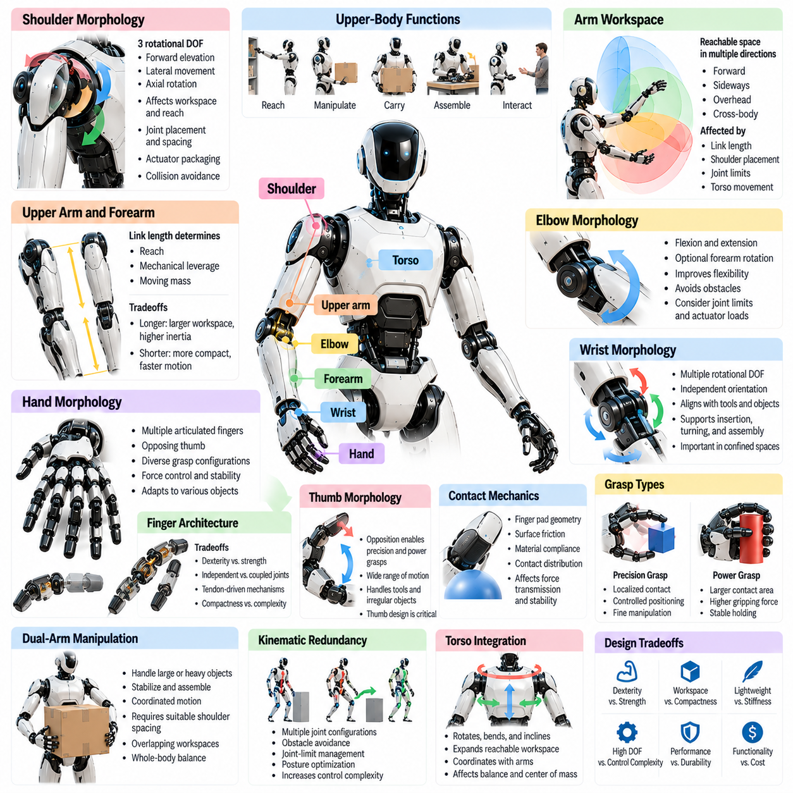{width="7.268055555555556in" height="7.268055555555556in"}

팔, 손 및 상체 형태(Arm, Hand, and Upper-body Morphology)는 휴머노이드 로봇(Humanoid Robot)이 조작(Manipulation), 물체 취급(Object Handling), 물리적 상호작용(Physical Interaction)을 수행하는 기계적 구조(Mechanical Architecture)를 정의한다. 이러한 구조는 어깨(Shoulder), 상완(Upper Arm), 팔꿈치(Elbow), 전완(Forearm), 손목(Wrist), 손(Hand), 몸통 연결부(Torso Connection)를 협응된 운동학적 시스템(Coordinated Kinematic System)으로 통합한다. 이들의 설계는 도달 가능한 작업 공간(Reachable Workspace), 조작성(Dexterity), 적재 능력(Payload Capacity), 인간 중심 환경(Human-oriented Environment)에서 작업을 수행하는 능력을 결정한다.

휴머노이드 로봇의 상체(Upper Body)는 독립적인 팔 운동(Independent Arm Movement)과 여러 신체 분절(Body Segment)이 관여하는 협응 조작(Coordinated Manipulation)을 모두 지원해야 한다. 고정형 산업용 조작기(Fixed Industrial Manipulator)와 달리 휴머노이드 팔은 이동 가능하고 동적 제약(Dynamic Constraints)을 받는 플랫폼에서 작동한다. 따라서 상체 형태는 다양한 조작 작업에 필요한 충분한 유연성(Flexibility)을 유지하면서 균형(Balance), 신체 관성(Body Inertia), 관절 하중(Joint Loading), 상호작용 힘(Interaction Force)을 고려해야 한다.

어깨 형태(Shoulder Morphology)는 팔을 몸통(Torso)에 연결하여 상지 운동성(Upper-limb Mobility)의 기반을 형성한다. 인간의 어깨를 모방한 메커니즘(Human-inspired Shoulder Mechanism)은 일반적으로 세 개의 회전 자유도(Rotational Degrees of Freedom)를 제공하여 전방 거상(Forward Elevation), 측면 운동(Lateral Movement), 축 회전(Axial Rotation)을 가능하게 한다. 이러한 회전축의 배치는 팔의 작업 공간(Arm Workspace), 기계적 간섭(Mechanical Interference), 로봇의 위쪽, 측면 또는 뒤쪽에 있는 물체에 도달하는 능력에 영향을 미친다.

어깨 관절 배치(Shoulder Joint Placement)는 신체 비율(Body Proportions)과 조작 능력(Manipulation Capability) 사이의 관계에 큰 영향을 미친다. 넓은 어깨 간격(Shoulder Spacing)은 대형 물체에 대한 접근성을 높이고 양팔 운반(Dual-arm Carrying)을 용이하게 할 수 있으며, 좁은 구성은 제한된 공간(Confined Space)에서의 작업을 지원할 수 있다. 설계자는 이러한 장점을 몸통 치수(Torso Dimensions), 구동기 배치(Actuator Packaging), 구조적 강성(Structural Stiffness), 팔과 신체 사이의 충돌 위험(Collision Risk)과 균형 있게 고려해야 한다.

상완(Upper Arm)과 전완(Forearm)은 휴머노이드 조작 체인(Humanoid Manipulation Chain)의 주요 구조 링크(Structural Link)를 형성한다. 이들의 길이는 도달 범위(Reach), 기계적 지렛대 효과(Mechanical Leverage), 이동 질량 분포(Moving Mass Distribution)를 결정한다. 긴 링크는 작업 공간을 확장하지만 회전 관성(Rotational Inertia)과 관절 토크 요구량(Joint Torque Requirements)을 증가시킨다. 짧은 링크는 소형화(Compactness)를 개선하고 빠른 운동을 지원할 수 있지만 먼 물체와 작업 표면에 대한 접근을 제한한다.

팔꿈치 형태(Elbow Morphology)는 주로 굴곡과 신전(Flexion and Extension)을 지원하여 손이 서로 다른 거리와 방향에서 물체에 접근할 수 있도록 한다. 일부 휴머노이드 팔은 전완이나 인접 관절을 통해 추가적인 회전 능력(Rotational Capability)을 제공한다. 이러한 구성은 조작 유연성(Manipulation Flexibility)을 개선하고 장애물 회피(Obstacle Avoidance)를 지원하지만 관절 한계(Joint Limits), 기계적 여유 공간(Mechanical Clearances), 구동기 하중(Actuator Loads)을 신중하게 관리해야 한다.

손목(Wrist)은 정밀 조작(Precise Manipulation)에 필요한 최종 방향 조정(Final Orientation Adjustment)을 제공한다. 여러 회전 자유도(Rotational Degrees of Freedom)는 팔의 큰 움직임과 독립적으로 손을 도구, 손잡이 및 물체 표면에 정렬할 수 있도록 한다. 손목 형상(Wrist Geometry)은 특히 주변 작업 공간이 어깨나 팔꿈치 운동을 제한하는 상황에서 삽입(Insertion), 회전(Turning), 파지 조정(Grasp Adjustment), 조립 작업(Assembly Operation)을 수행하는 능력에 영향을 미친다.

운동학적 중복성(Kinematic Redundancy)은 조작성이 높은 휴머노이드 팔(Dexterous Humanoid Arm)의 핵심적인 특징이다. 특정 말단 효과기 자세(End-effector Pose)를 구현하는 데 필요한 자유도보다 더 많은 자유도를 가진 팔은 여러 관절 구성(Joint Configuration)을 통해 동일한 자세를 달성할 수 있다. 이러한 중복성은 장애물 회피(Obstacle Avoidance), 관절 한계 관리(Joint-limit Management), 자세 최적화(Posture Optimization)를 지원한다. 그러나 역운동학(Inverse Kinematics)과 동작 계획(Motion Planning)의 복잡성도 증가시킨다.

손 형태(Hand Morphology)는 휴머노이드가 물체를 얼마나 효과적으로 파지(Grasp), 안정화(Stabilize), 조작(Manipulate)할 수 있는지를 결정한다. 인간형 손(Anthropomorphic Hand)은 일반적으로 여러 관절형 손가락(Articulated Finger)과 대립 엄지(Opposing Thumb)를 결합하여 다양한 파지 구성(Grasp Configuration)을 지원한다. 손의 기계적 구조는 충분한 힘 제어(Force Control)와 접촉 안정성(Contact Stability)을 유지하면서 서로 다른 크기, 형상, 무게 및 표면 특성을 가진 물체를 수용해야 한다.

손가락 구조(Finger Architecture)에는 조작성(Dexterity), 힘(Strength), 소형화(Compactness), 기계적 복잡성(Mechanical Complexity) 사이의 절충 관계(Tradeoff)가 존재한다. 독립 구동 관절(Independently Actuated Joint)은 높은 제어 유연성(Control Flexibility)을 제공하는 반면, 기계적으로 결합되거나 저구동된 손가락(Mechanically Coupled or Underactuated Finger)은 하드웨어를 단순화하고 적응형 파지(Adaptive Grasping)를 개선할 수 있다. 힘줄 구동 메커니즘(Tendon-driven Mechanism)은 원위부 질량(Distal Mass)을 줄일 수 있지만 전달계 마찰(Transmission Friction), 유연성(Compliance), 유지보수 문제를 발생시킨다.

엄지 형태(Thumb Morphology)는 대립 운동(Opposition)을 통해 다양한 정밀 파지(Precision Grasp)와 파워 파지(Power Grasp)를 가능하게 하므로 특히 중요하다. 엄지는 물체 주변에 안정적인 접촉 구성(Stable Contact Configuration)을 형성하기 위해 다른 손가락에 대해 상대적으로 움직여야 한다. 엄지의 관절 배치(Joint Arrangement), 운동 범위(Range of Motion), 가용 힘(Available Force)은 도구, 소형 부품 및 불규칙한 물체를 취급하는 능력에 영향을 미친다. 효과적인 엄지 설계는 단순히 손가락 수를 늘리는 것보다 더 중요할 수 있다.

접촉 역학(Contact Mechanics)은 손의 성능(Hand Performance)에서 핵심적인 역할을 한다. 손가락 패드 형상(Finger Pad Geometry), 표면 마찰(Surface Friction), 재료 유연성(Material Compliance), 접촉 분포(Contact Distribution)는 조작 대상 물체에 힘이 전달되는 방식을 결정한다. 유연한 표면(Compliant Surface)은 기하학적 불확실성(Geometric Uncertainty)을 수용하고 국부 압력(Localized Pressure)을 줄일 수 있으며, 강체 접촉 구조(Rigid Contact Structure)는 정밀한 위치 제어를 지원할 수 있다. 적절한 재료 선택은 예상되는 조작 작업에 따라 달라진다.

정밀 파지(Precision Grasping)와 파워 파지(Power Grasping)의 구분은 인간형 손 설계(Anthropomorphic Hand Design)에 영향을 미친다. 정밀 파지는 물체 위치를 제어하기 위해 손가락 끝의 국부 접촉(Localized Fingertip Contact)을 사용하며, 파워 파지는 더 넓은 접촉 영역(Contact Region)에 힘을 분산시킨다. 범용 휴머노이드 손(General-purpose Humanoid Hand)은 필요에 따라 두 방식을 모두 지원해야 하지만 소형 치수 안에서 높은 정밀도와 상당한 파지력(Gripping Force)을 동시에 달성하는 것은 여전히 어려운 과제이다.

양팔 형태(Dual-arm Morphology)는 크거나 무겁거나 제약된 물체와의 협응 상호작용(Coordinated Interaction)을 가능하게 하여 조작 능력을 확장한다. 한 팔은 부품을 안정화하고 다른 팔은 조립을 수행할 수 있으며, 두 팔이 들어 올리기(Lifting)와 운반(Transport) 과정에서 협력할 수도 있다. 성공적인 협응은 어깨 간격(Shoulder Spacing), 중첩 작업 공간(Overlapping Workspace), 팔 도달 범위(Arm Reach), 몸통과 지지 신체를 통한 힘 분배(Force Distribution) 능력에 달려 있다.

상체 형태(Upper-body Morphology)는 조작력(Manipulation Force)이 전신 안정성(Whole-body Stability)에 영향을 미치는 방식도 결정한다. 전방으로 손을 뻗거나 물체를 들어 올리거나 측면 힘(Lateral Force)을 가하면 로봇의 질량 중심(Center of Mass)이 변화하고 반작용 모멘트(Reaction Moment)가 발생한다. 이러한 효과는 몸통, 골반(Pelvis), 다리(Leg)의 협응 운동(Coordinated Movement)을 통해 보상해야 한다. 따라서 팔 설계는 휴머노이드 전체의 기계적 및 동적 특성(Mechanical and Dynamic Characteristics)과 분리하여 고려할 수 없다.

몸통 관절 운동(Torso Articulation)은 회전(Rotation), 굽힘(Bending), 측면 조정(Lateral Adjustment)을 가능하게 하여 팔의 유효 작업 공간(Effective Workspace)을 확장한다. 휴머노이드는 팔의 신전(Arm Extension)에만 의존하지 않고 어깨 운동과 몸통 운동을 결합하여 물체에 접근할 수 있다. 이러한 능력은 좁은 환경(Narrow Environment)과 전신 조작(Whole-body Manipulation)에서 유용하지만 상체 운동과 균형 제어(Balance Control) 사이에 추가적인 결합(Coupling)을 발생시킨다.

구동기 배치(Actuator Placement)는 상지 동역학(Upper-limb Dynamics)에 큰 영향을 미친다. 어깨나 몸통 근처에 배치된 모터(Motor)는 원위부 관성(Distal Inertia)을 줄여 응답성(Responsiveness)과 에너지 효율(Energy Efficiency)을 개선할 수 있다. 케이블(Cable), 벨트(Belt), 링크(Linkage)를 사용하는 원격 동력 전달 장치(Remote Transmission)는 소형 관절(Compact Joint)을 구현할 수 있지만 마찰(Friction), 탄성(Elasticity), 배선 경로 제약(Routing Constraints)을 발생시킨다. 직접 구동(Direct Drive)과 기어 구동(Geared Configuration)은 토크(Torque), 질량(Mass), 정밀도(Precision), 역구동성(Backdrivability) 사이에서 서로 다른 절충 관계를 제공한다.

구조적 강성(Structural Stiffness)과 유연성(Compliance)은 조작 요구사항(Manipulation Requirements)에 따라 적절하게 분포되어야 한다. 높은 강성은 정확한 위치 제어(Accurate Positioning)와 효율적인 힘 전달(Efficient Force Transmission)을 지원하며, 제어된 유연성(Controlled Compliance)은 접촉 허용성(Contact Tolerance)과 상호작용 안전성(Interaction Safety)을 개선할 수 있다. 과도한 유연성은 진동(Oscillation)을 발생시키거나 정밀도를 감소시킬 수 있다. 따라서 설계자는 링크 재료(Link Materials), 전달계 특성(Transmission Properties), 구동기 제어 특성(Actuator Control Characteristics)을 협응하여 설계해야 한다.

센서 통합(Sensor Integration)은 상체 형태를 신뢰할 수 있는 조작 능력(Reliable Manipulation Capability)으로 전환하는 데 필수적이다. 관절 엔코더(Joint Encoder)는 관절 구성 측정값(Configuration Measurements)을 제공하고, 힘 및 토크 센서(Force and Torque Sensor)는 상호작용 하중(Interaction Load)을 추정하며, 촉각 센서(Tactile Sensor)는 국부 접촉(Local Contact)을 파악한다. 비전 시스템(Vision System)은 물체 자세(Object Pose)와 장면 정보(Scene Information)를 제공한다. 이러한 측정값을 결합하면 폐루프 파지(Closed-loop Grasping), 접촉 감지(Contact Detection), 적응형 조작(Adaptive Manipulation)이 가능해진다.

상체 질량 분포(Upper-body Mass Distribution)는 조작뿐 아니라 이동(Locomotion)에도 영향을 미친다. 무거운 손과 전완은 어깨 토크 요구량(Shoulder Torque Requirements)을 증가시키고 빠른 움직임 중 상당한 관성 효과(Inertial Effect)를 발생시킨다. 가벼운 원위부 구성요소(Lightweight Distal Component)는 이러한 불이익을 줄이지만 적재 능력(Payload)과 구조적 강도(Structural Strength)를 제한할 수 있다. 효과적인 설계에는 구동기 용량(Actuator Capacity), 재료 선택(Material Selection), 부품 배치(Component Placement), 동적 성능(Dynamic Performance) 사이의 균형이 필요하다.

인간과 호환되는 치수(Human-compatible Dimensions)는 팔 길이(Arm Length), 어깨 너비(Shoulder Width), 손목 운동성(Wrist Mobility), 손 크기(Hand Size)를 결정하는 데 유용한 참고 기준을 제공한다. 그러나 정확한 해부학적 복제(Anatomical Replication)가 항상 유리한 것은 아니다. 산업용 휴머노이드(Industrial Humanoid)는 더 강한 손목과 단순화된 그리퍼(Simplified Gripper)가 필요할 수 있으며, 서비스 지향 플랫폼(Service-oriented Platform)은 작은 손과 유연한 메커니즘(Compliant Mechanism)의 이점을 활용할 수 있다. 형태는 외형만이 아니라 작업 요구사항(Task Requirements)을 반영해야 한다.

안전 고려사항(Safety Considerations)은 상체 구조(Upper-body Architecture)의 모든 수준에 영향을 미친다. 둥근 표면(Rounded Surface), 제어된 관절 토크(Controlled Joint Torque), 유연한 접촉(Compliant Contact), 예측 가능한 움직임(Predictable Movement)은 인간-로봇 상호작용(Human-Robot Interaction) 중 위험을 줄일 수 있다. 기계적 스토퍼(Mechanical Stop)와 고장 대응 제어 시스템(Fault-responsive Control System)은 위험한 움직임을 제한하는 데 도움을 준다. 그러나 안전한 작동을 위해서는 신체 형상(Body Geometry), 구동기 성능(Actuator Capability), 제어 행동(Control Behavior), 환경 조건(Environmental Conditions) 사이의 전체적인 상호작용을 평가해야 한다.

팔, 손 및 상체 형태(Arm, Hand, and Upper-body Morphology)는 궁극적으로 피지컬 AI(Physical AI) 시스템에서 휴머노이드 로봇의 조작 잠재력(Manipulation Potential)을 결정한다. 효과적인 구조는 도달 범위(Reach), 조작성(Dexterity), 힘(Strength), 센싱(Sensing), 유연성(Compliance), 전신 협응(Whole-body Coordination)을 일관된 기계 설계(Coherent Mechanical Design)로 통합한다. 핵심 목표는 효율성(Efficiency), 신뢰성(Reliability), 안전한 물리적 상호작용(Safe Physical Interaction)을 유지하면서 인간과 호환되는 환경의 이점을 활용할 수 있는 다목적 조작 능력(Versatile Manipulation Capability)을 구현하는 것이다.

## 06.05. Pelvis Leg and Foot Morphology

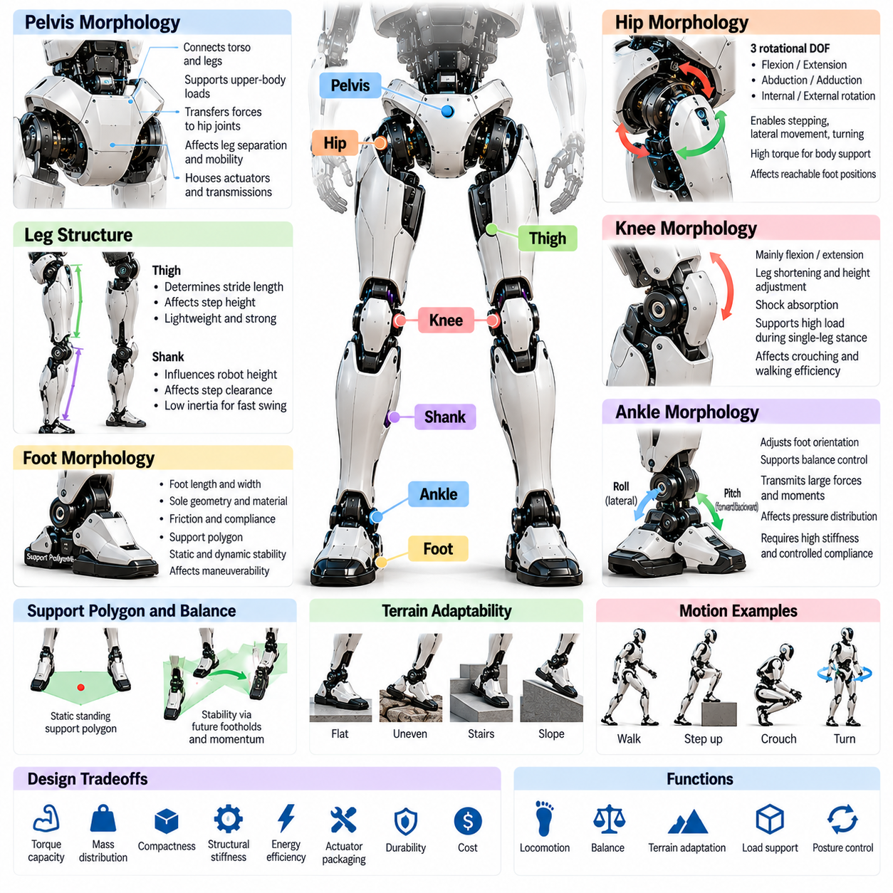{width="7.268055555555556in" height="7.268055555555556in"}

골반, 다리 및 발 형태(Pelvis, Leg, and Foot Morphology)는 휴머노이드 로봇(Humanoid Robot)의 이동(Locomotion), 균형(Balance), 지면 상호작용(Ground Interaction)을 위한 기계적 기반(Mechanical Foundation)을 형성한다. 이러한 구조는 관절형 하중 지지 메커니즘(Articulated Load-bearing Mechanism)을 통해 상체를 지지 표면(Supporting Surface)에 연결한다. 이들의 형상(Geometry), 질량 분포(Mass Distribution), 관절 배치(Joint Arrangement), 유연성(Compliance)은 휴머노이드가 서기, 걷기, 계단 오르기, 충격 흡수 및 변화하는 환경 조건에서 안정성 유지 작업을 얼마나 효과적으로 수행할 수 있는지를 결정한다.

골반(Pelvis)은 몸통(Torso)과 양쪽 다리 사이의 중심 구조 인터페이스(Central Structural Interface) 역할을 한다. 골반은 상체 하중(Upper-body Load)을 지지하면서 중력 및 동적 힘(Gravitational and Dynamic Forces)을 고관절(Hip Joint)을 통해 전달한다. 골반 너비(Pelvic Width), 강성(Stiffness), 형상(Geometry)은 다리 간격(Leg Separation), 관절 운동성(Joint Mobility), 균형 제어(Balance Control)에 영향을 미친다. 골반 설계는 과도한 질량을 증가시키거나 움직임을 제한하지 않으면서 고출력 구동기(Powerful Actuator), 기계적 동력 전달 장치(Mechanical Transmission), 구조적 연결부(Structural Connection)를 수용해야 한다.

인간의 신체를 모방한 골반 구조(Human-inspired Pelvic Architecture)는 하체의 협응 운동(Coordinated Movement)을 지원하면서 양쪽 다리를 위한 좌우 대칭 연결 지점(Bilateral Attachment Points)을 제공한다. 생물학적 해부학(Biological Anatomy)과 달리 로봇의 골반 구조는 강체 프레임(Rigid Frame)과 단순화된 관절 조립체(Simplified Joint Assembly)를 사용하는 경우가 많다. 이러한 구성은 제조 일관성(Manufacturing Consistency)과 하중 전달(Load Transmission)을 개선한다. 그러나 고관절 회전(Hip Rotation), 다리 교차(Leg Crossing), 쪼그리기(Crouching), 동적 발 내딛기(Dynamic Stepping)를 위한 충분한 운동 여유 공간(Clearance)을 유지해야 한다.

고관절 형태(Hip Morphology)는 골반에 대한 각 다리의 주요 방향 및 위치 결정 능력(Orientation and Positioning Capabilities)을 결정한다. 많은 휴머노이드 설계는 굴곡-신전(Flexion-extension), 외전-내전(Abduction-adduction), 내회전-외회전(Internal-external Rotation)에 대응하는 세 개의 회전 자유도(Rotational Degrees of Freedom)를 포함한다. 이러한 움직임은 전방 보행(Forward Stepping), 측면 이동(Lateral Displacement), 방향 전환(Turning), 자세 조정(Posture Adjustment)을 가능하게 한다. 관절축 배치(Joint-axis Arrangement)는 도달 가능한 발 위치(Reachable Foot Positions)와 기계적 간섭(Mechanical Interference)에 큰 영향을 미친다.

고관절 구동기 배치(Hip Actuator Placement)는 토크 용량(Torque Capacity), 질량 분포(Mass Distribution), 기계적 부품 배치(Mechanical Packaging) 사이에서 중요한 절충 관계(Tradeoff)를 형성한다. 체중을 지지하고 보행 중 가속도를 발생시키기 위해서는 강력한 구동기(Powerful Actuator)가 필요하다. 무거운 구성요소를 골반 근처에 배치하면 다리 원위부 관성(Distal Leg Inertia)을 줄여 동적 응답성(Dynamic Responsiveness)을 개선할 수 있다. 그러나 소형 고관절 조립체(Compact Hip Assembly)는 열(Heat), 동력 전달 하중(Transmission Load), 중첩되는 관절 운동(Overlapping Joint Movement)을 관리해야 한다.

대퇴부(Thigh)는 고관절과 무릎(Knee) 사이의 주요 구조 링크(Structural Link)를 형성한다. 대퇴부 길이(Thigh Length)는 보폭 형상(Stride Geometry), 달성 가능한 발 높이(Step Height), 신체 자세 범위(Range of Body Postures)에 영향을 미친다. 긴 대퇴부는 도달 범위(Reach)를 증가시킬 수 있지만 회전 관성(Rotational Inertia)과 굽힘 모멘트(Bending Moment)도 증가시킨다. 대퇴부는 이동 중 반복적인 하중을 받으므로 구조 재료(Structural Material)는 질량을 최소화하면서 충분한 강성(Stiffness)과 피로 저항성(Fatigue Resistance)을 제공해야 한다.

무릎 형태(Knee Morphology)는 주로 굴곡과 신전(Flexion and Extension)을 제공하여 다리 길이 단축(Leg Shortening), 신체 높이 조정(Body Height Adjustment), 충격 흡수(Shock Absorption)를 가능하게 한다. 대부분의 휴머노이드 무릎은 주요 회전축(Dominant Rotational Axis)을 사용하지만, 대안적인 링크 메커니즘(Linkage Mechanism)은 토크 전달(Torque Transmission)과 관절 운동(Joint Motion)을 변화시킬 수 있다. 무릎 형상(Knee Geometry)은 쪼그리기 능력(Crouching Capability), 보행 효율(Walking Efficiency), 장애물 통과 능력(Obstacle Negotiation)에 영향을 미친다. 무릎 설계는 한발 지지(Single-leg Stance)와 동적 전환(Dynamic Transition) 중 발생하는 높은 하중을 지탱해야 한다.

무릎은 보행 중 신체의 수직 운동(Vertical Body Motion)을 제어하는 데도 중요한 역할을 한다. 협응된 무릎 굴곡(Coordinated Knee Flexion)은 착지 중 충격력(Impact Force)을 줄이고 질량 중심 궤적(Center-of-mass Trajectory)을 조절할 수 있다. 그러나 과도한 굴곡은 구동기 토크(Actuator Torque)와 에너지 소비(Energy Consumption)를 증가시킨다. 효과적인 형태 설계는 기계적 지렛대 효과(Mechanical Leverage), 관절 운동 범위(Joint Range), 동력 전달 효율(Transmission Efficiency), 이동 과정에서 안정적인 지지를 유지하는 능력 사이의 균형을 고려한다.

하퇴부(Shank)는 무릎과 발목(Ankle)을 연결하며 다리 관성(Leg Inertia)과 발 위치 결정 동역학(Foot Placement Dynamics)에 상당한 영향을 미친다. 하퇴부 길이(Shank Length)는 로봇의 전체 높이(Overall Robot Height), 발의 장애물 통과 여유 높이(Step Clearance), 보행 메커니즘 형상(Walking Mechanism Geometry)에 영향을 미친다. 경량 하퇴부 구조(Lightweight Shank Construction)는 유각 다리 가속도(Swing-leg Acceleration)를 개선하고 에너지 요구량(Energy Requirements)을 줄일 수 있다. 그러나 입각기(Stance Phase)에 지면 반력(Ground Reaction Force)을 전달하고 정확한 발 위치(Foot Positioning)를 유지하려면 구조적 강성(Structural Rigidity)이 필수적이다.

발목 형태(Ankle Morphology)는 하퇴부에 대한 발의 방향(Foot Orientation)을 제어한다. 휴머노이드 발목은 일반적으로 지면 접촉(Ground Contact)과 균형 요구사항(Balance Requirements)의 변화에 대응하기 위해 피치(Pitch)와 롤(Roll) 운동을 제공한다. 피치는 전후 방향 조정(Forward-backward Adjustment)을 지원하며, 롤은 측면 안정화(Lateral Stabilization)를 보조한다. 추가적인 관절 운동(Additional Articulation)은 적응성(Adaptability)을 개선할 수 있지만 기계적 복잡성(Mechanical Complexity), 구동기 요구량(Actuator Demand), 잠재적인 구조적 취약성(Structural Weakness)을 증가시킨다.

발목은 서기, 걷기 및 균형 회복(Balance Recovery) 중 상당한 힘과 모멘트(Forces and Moments)를 전달해야 한다. 발을 통해 작용하는 지면 반력(Ground Reaction Force)은 접촉 위치(Contact Location)와 신체 자세(Body Posture)에 따라 달라지는 토크(Torque)를 발생시킨다. 따라서 발목 구동기 용량(Ankle Actuator Capacity)은 로봇이 압력 분포(Pressure Distribution)를 조절하고 외란(Disturbance)으로부터 회복하는 능력에 영향을 미친다. 기계적 강성(Mechanical Stiffness)과 제어된 유연성(Controlled Compliance)은 예상되는 하중 조건(Loading Conditions)에 따라 선택해야 한다.

발 형태(Foot Morphology)는 휴머노이드와 지형(Terrain) 사이의 물리적 인터페이스(Physical Interface)를 형성한다. 발 길이(Foot Length), 너비(Width), 발바닥 형상(Sole Geometry), 접촉 재료(Contact Materials)는 사용 가능한 지지 영역(Support Region)과 마찰 특성(Friction Characteristics)을 결정한다. 큰 발은 지지 다각형(Support Polygon)을 확장하여 정적 안정성(Static Stability)을 개선할 수 있지만 좁은 공간에서 기동성(Maneuverability)을 제한할 수 있다. 작은 발은 배치 유연성(Placement Flexibility)을 높이지만 더욱 정밀한 균형 제어(Balance Control)를 요구한다.

지지 다각형(Support Polygon)은 적절한 접촉 가정(Contact Assumptions)하에서 활성 지면 접촉(Active Ground Contacts)으로 둘러싸인 영역을 나타낸다. 정적 기립(Static Standing) 중 질량 중심의 투영점(Projected Center of Mass)을 이 영역 안에 유지하면 평형(Equilibrium)을 유지하는 데 도움이 된다. 동적 보행(Dynamic Walking)에서는 안정성이 추가적으로 운동량(Momentum), 접촉력(Contact Forces), 향후 발 디딤 위치(Future Footholds)에 의존한다. 따라서 발 형상(Foot Geometry)은 균형에 영향을 미치지만 움직임 중 안정성을 독립적으로 보장하지는 않는다.

발과 지면의 상호작용(Foot-ground Interaction)에는 마찰(Friction), 유연성(Compliance), 압력 분포(Pressure Distribution), 충격 동역학(Impact Dynamics)이 포함된다. 마찰력이 높은 발바닥 재료(High-friction Sole Material)는 원하지 않는 미끄러짐(Slipping)을 줄일 수 있으며, 유연한 층(Compliant Layer)은 작은 표면 불규칙성(Surface Irregularity)을 수용하고 착지 충격(Landing Shock)을 완화한다. 과도한 부드러움은 변형(Deformation)을 발생시키고 위치 정밀도(Positioning Precision)를 감소시킬 수 있다. 효과적인 발바닥 설계(Sole Design)는 접지력(Traction), 내구성(Durability), 기계적 효율(Mechanical Efficiency), 신뢰할 수 있는 접촉 감지(Contact Sensing) 사이의 균형을 유지한다.

관절형 발가락(Articulated Toes)은 휴머노이드 발을 위한 추가적인 형태 설계 선택지(Morphological Option)를 제공한다. 발가락 관절(Toe Joint)은 구름 접촉(Rolling Contact)을 지원하고 유효 발 길이(Effective Foot Length)를 변화시키며 특정 보행 패턴(Gait)에서 발끝 밀어내기 동작(Push-off Behavior)에 영향을 미칠 수 있다. 그러나 이러한 이점은 구동 방식(Actuation), 제어 전략(Control Strategy), 보행 속도(Walking Speed)에 따라 달라진다. 추가 관절은 기계적 복잡성과 유지보수 요구사항(Maintenance Requirements)도 증가시키므로 일부 응용 분야에서는 강체 발(Rigid Foot)이 더 적합할 수 있다.

다리 비율(Leg Proportions)은 이동성(Mobility), 안정성(Stability), 에너지 효율(Energy Efficiency) 사이의 관계에 영향을 미친다. 대퇴부(Thigh), 하퇴부(Shank), 발(Foot)의 상대적 길이는 도달 가능한 발 디딤 위치(Reachable Footholds), 장애물 통과 높이(Obstacle Clearance), 구현 가능한 자세(Achievable Postures)를 결정한다. 인간의 해부학적 비율(Human Anatomical Proportions)은 유용한 참고 기준을 제공하지만 모든 상황에서 최적은 아니다. 설계자는 구동기 기술(Actuator Technology), 목표 환경(Target Environments), 적재 하중 요구사항(Payload Requirements), 이동 목표(Locomotion Objectives)에 맞추어 이러한 치수를 변경할 수 있다.

하체 질량 분포(Lower-body Mass Distribution)는 보행에 필요한 에너지에 큰 영향을 미친다. 무거운 원위부 구성요소(Distal Components)는 유각 다리 관성(Swing-leg Inertia)을 증가시키고 더 큰 가속 토크(Acceleration Torque)를 요구한다. 모터와 동력 전달 장치(Transmission)를 고관절 근처에 집중시키면 이러한 영향을 줄일 수 있지만 원격 구동(Remote Actuation)은 마찰(Friction), 탄성(Elasticity), 배선 경로 제약(Routing Constraints)을 발생시킨다. 형태 최적화(Morphological Optimization)는 전체 질량(Total Mass), 관성(Inertia), 구조적 강도(Structural Strength), 동력 전달 효율(Transmission Efficiency)을 함께 고려해야 한다.

유연성(Compliance)과 탄성(Elasticity)은 반복적인 지면 접촉 중 휴머노이드 다리의 기계적 거동(Mechanical Behavior)을 개선할 수 있다. 탄성 요소(Elastic Elements)는 에너지를 저장하고 방출하며 충격을 흡수하고 최대 하중(Peak Loading)을 줄일 수 있다. 직렬 탄성 구동기(Series Elastic Actuator)와 유연한 구조(Compliant Structure)는 힘 조절(Force Regulation)을 지원할 수 있지만 제어기가 관리해야 하는 추가적인 동역학(Additional Dynamics)을 발생시킨다. 이러한 요소의 효과는 강성 선택(Stiffness Selection), 감쇠(Damping), 작업별 작동 조건(Task-specific Operating Conditions)에 따라 달라진다.

골반, 다리 및 발 형태(Pelvis, Leg, and Foot Morphology)는 보행의 단일 지지 단계(Single-support Phase)와 이중 지지 단계(Double-support Phase)를 모두 지원해야 한다. 단일 지지 단계에서는 한쪽 다리가 신체를 지탱하는 동안 다른 다리가 새로운 발 디딤 위치(Foothold)로 이동한다. 이중 지지 단계에서는 양발 사이의 하중 전달(Load Transfer)이 가능하다. 관절 운동 범위(Joint Range), 발 형상(Foot Geometry), 구동기 강도(Actuator Strength)는 이러한 전환이 얼마나 부드럽게 이루어지는지와 외부 외란(External Disturbance) 속에서 로봇이 균형을 유지할 수 있는지를 결정한다.

하체 형태(Lower-body Morphology)와 전신 조작(Whole-body Manipulation) 사이의 상호작용도 중요하다. 물체를 운반하거나 팔을 뻗으면 질량 중심(Center of Mass)과 지면 반력 분포(Ground Reaction Force Distribution)가 변화한다. 골반과 다리는 자세 조정(Posture Adjustment)과 접촉력 조절(Contact-force Regulation)을 통해 이를 보상해야 한다. 따라서 하체 설계는 보행 성능(Walking Performance)만을 독립적으로 최적화하는 것이 아니라 상체 작업(Upper-body Tasks)도 고려해야 한다.

센서 통합(Sensor Integration)은 하체 기계 시스템(Lower-body Mechanical System)을 제어하는 데 필수적인 정보를 제공한다. 관절 엔코더(Joint Encoder)는 관절 구성(Joint Configuration)을 측정하고, 관성 측정 장치(Inertial Measurement Unit)는 신체 운동(Body Motion)을 추정하며, 발 힘 센서(Foot Force Sensor)는 지면 접촉(Ground Contact)의 특성을 파악한다. 분산 압력 센서(Distributed Pressure Sensor) 또는 촉각 센서(Tactile Sensor)는 접촉 전환(Contact Transition)과 불균일한 하중(Uneven Loading)을 감지할 수 있다. 이러한 측정값은 상태 추정(State Estimation), 보행 적응(Gait Adaptation), 미끄러짐 감지(Slip Detection), 균형 회복(Balance Recovery)을 지원한다.

지형 적응성(Terrain Adaptability)은 관절 운동(Articulation), 발 형상(Foot Geometry), 센싱(Sensing), 제어(Control)의 결합된 능력에 따라 결정된다. 계단(Stairs), 경사로(Ramps), 문턱(Thresholds), 불규칙한 표면(Irregular Surfaces)에서는 충분한 다리 작업 공간(Leg Workspace)과 신뢰할 수 있는 발 디딤 위치 선택(Foothold Selection)이 필요하다. 더 큰 관절 운동성(Joint Mobility)은 어려운 지형에 대한 접근성을 개선할 수 있지만 복잡성을 증가시킨다. 최적의 구성은 예상 표면 조건(Expected Surface Conditions), 요구 속도(Required Speed), 적재 하중(Payload), 허용 가능한 에너지 소비(Acceptable Energy Consumption)에 따라 달라진다.

기계적 신뢰성(Mechanical Reliability)과 안전성(Safety)은 하체 고장이 휴머노이드 전체의 넘어짐(Fall)을 초래할 수 있기 때문에 매우 중요하다. 관절 구조(Joint Structure)는 반복적인 주기 하중(Cyclic Loads), 충격(Impacts), 예상하지 못한 외란(Unexpected Disturbances)을 견뎌야 한다. 기계적 스토퍼(Mechanical Stop), 보호 외장재(Protective Covering), 적절한 토크 제한(Torque Limits)은 위험한 움직임을 줄일 수 있다. 견고한 설계(Robust Design)는 구동기 고장(Actuator Fault), 접촉 상실(Contact Loss), 열적 한계(Thermal Limitations), 제어된 복구 또는 정지 동작(Controlled Recovery or Shutdown Behavior)도 고려한다.

골반, 다리 및 발 형태(Pelvis, Leg, and Foot Morphology)는 궁극적으로 휴머노이드가 구동기 힘(Actuator Forces)을 안정적이고 적응 가능한 물리적 움직임(Stable and Adaptable Physical Movement)으로 변환하는 방식을 결정한다. 성공적인 구조는 관절 운동성(Joint Mobility), 구조적 강도(Structural Strength), 질량 분포(Mass Distribution), 접촉 역학(Contact Mechanics), 센싱(Sensing)을 협응된 하체 시스템(Coordinated Lower-body System)으로 통합한다. 그 목적은 효율성(Efficiency), 강건성(Robustness), 환경과의 안전한 상호작용(Safe Interaction with the Environment) 사이의 균형을 유지하면서 전신 작업(Whole-body Tasks)을 위한 신뢰할 수 있는 이동 능력(Reliable Locomotion)과 지지 기능(Support)을 제공하는 것이다.

## 06.06. Humanoid Degrees of Freedom

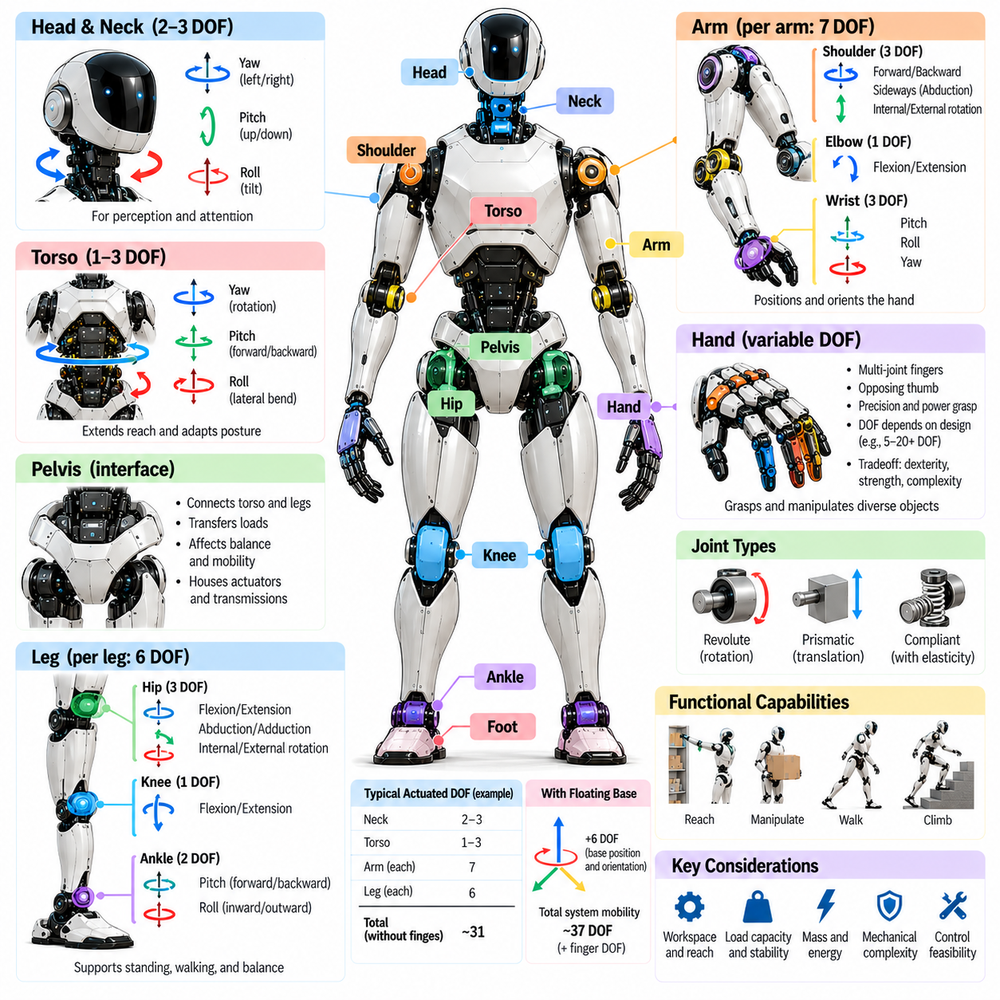{width="7.268055555555556in" height="7.268055555555556in"}

자유도(Degrees of Freedom)는 휴머노이드 로봇(Humanoid Robot)이 관절(Joint)과 기계적 구조(Mechanical Structure)를 통해 수행할 수 있는 독립적인 운동(Independent Motion)을 정의한다. 자유도는 로봇이 사지(Limbs)의 위치를 결정하고 자세(Posture)를 조정하며 물체를 조작하고 균형(Balance)을 유지하는 방식을 결정한다. 휴머노이드 형태(Humanoid Morphology)는 일반적으로 목(Neck), 몸통(Torso), 팔(Arms), 손(Hands), 골반(Pelvis), 다리(Legs)에 회전 자유도(Rotational Degrees of Freedom)를 분산하여 다양한 물리적 행동(Physical Behaviors)을 수행할 수 있는 협응된 관절형 시스템(Coordinated Articulated System)을 형성한다.

자유도(Degree of Freedom)는 기계적 구성(Mechanical Configuration)을 설명하는 데 필요한 독립 변수(Independent Variable)를 나타낸다. 로봇 관절(Robotic Joint)에서 이러한 변수는 일반적으로 특정 축을 중심으로 하는 회전(Rotation)이나 특정 방향을 따른 병진 운동(Translation)에 대응한다. 대부분의 휴머노이드 관절은 회전 관절(Revolute Joint)이 소형 관절 운동(Compact Articulation)을 제공하기 때문에 회전형으로 구성된다. 전체 자유도 수(Total Number of Degrees of Freedom)는 관절 구조(Joint Architecture), 기계적 결합(Mechanical Coupling), 모델링 대상 구성(Model Configuration)에 따라 달라진다.

휴머노이드 자유도(Humanoid Degrees of Freedom)는 구동기 수(Actuator Count) 및 제어 차원(Control Dimensions)과 구별해야 한다. 로봇에는 수동 관절(Passive Joint), 기계적으로 결합된 관절(Mechanically Coupled Joint), 독립적으로 제어할 수 있는 운동의 수를 줄이는 저구동 메커니즘(Underactuated Mechanism)이 포함될 수 있다. 반대로 여러 구동기(Actuators)가 협력하여 하나의 관절 좌표(Joint Coordinate)를 구동할 수도 있다. 따라서 정확한 형태 설명(Morphological Description)을 위해서는 기계적 운동성(Mechanical Mobility), 구동 능력(Actuation Capability), 제어 가능한 운동(Controllable Motion)을 구분해야 한다.

목(Neck)은 일반적으로 두 개 또는 세 개의 회전 자유도(Rotational Degrees of Freedom)를 제공하여 머리(Head)가 요(Yaw), 피치(Pitch), 경우에 따라 롤(Roll) 운동을 수행하도록 한다. 이러한 운동은 시각적 주의(Visual Attention), 환경 탐색(Environmental Scanning), 센서 방향 조정(Sensor Orientation)을 지원한다. 추가적인 목 관절 운동(Neck Articulation)은 관측 범위(Observation Coverage)를 확장할 수 있지만 질량(Mass), 배선 복잡성(Wiring Complexity), 제어 요구사항(Control Requirements)을 증가시킨다. 선택된 구성은 단순한 해부학적 유사성(Anatomical Similarity)이 아니라 인지 요구사항(Perception Needs)을 반영해야 한다.

몸통 자유도(Torso Degrees of Freedom)는 상체(Upper Body)와 골반(Pelvis) 사이의 상대 운동(Relative Movement)을 가능하게 한다. 일반적인 설계에는 허리 요 회전(Waist Yaw), 몸통 피치(Torso Pitch), 측면 굽힘(Lateral Bending)이 포함되지만 더 단순한 휴머노이드는 적은 수의 관절을 사용할 수 있다. 이러한 움직임은 조작 도달 범위(Manipulation Reach)를 확장하고 자세 적응(Posture Adaptation)을 개선한다. 그러나 몸통 관절 운동(Torso Articulation)은 질량 분포(Mass Distribution)를 변화시키고 상체 작업(Upper-body Tasks)과 하체 균형(Lower-body Balance) 사이에 동적 결합(Dynamic Coupling)을 발생시킨다.

각 휴머노이드 팔(Humanoid Arm)은 일반적으로 어깨 회전(Shoulder Rotation), 팔꿈치 굴곡(Elbow Flexion), 손목 방향 조정(Wrist Orientation)을 위한 관절을 포함한다. 7자유도 팔(Seven-degree-of-freedom Arm)은 흔히 어깨의 세 회전 자유도, 팔꿈치의 한 굴곡 자유도, 손목의 세 회전 자유도로 구성된다. 이러한 배치는 말단 효과기(End Effector)의 유연한 위치 및 방향 제어(Positioning and Orientation)를 지원한다. 대안적인 설계는 회전축(Rotational Axes)을 다르게 분배하거나 전완 회전(Forearm Rotation)을 포함하여 유사한 조작 능력(Manipulation Capabilities)을 구현한다.

팔의 중복성(Arm Redundancy)은 사용 가능한 관절 자유도(Joint Degrees of Freedom)가 말단 효과기 자세(End-effector Pose)를 지정하는 데 필요한 자유도보다 많을 때 발생한다. 3차원 공간(Three-dimensional Space)에서 자유롭게 위치와 방향을 결정할 수 있는 강체 말단 효과기(Rigid End Effector)는 여섯 개의 자세 좌표(Pose Coordinates)를 가진다. 따라서 7자유도 팔은 정칙 조건(Regular Conditions)에서 하나의 국소 중복 차원(Local Redundant Dimension)을 가진다. 이러한 유연성은 장애물 회피(Obstacle Avoidance), 관절 한계 관리(Joint-limit Management), 조작 자세 최적화(Manipulation Posture Optimization)를 지원한다.

손 자유도(Hand Degrees of Freedom)는 손가락 구조(Finger Architecture)와 조작 목표(Manipulation Objectives)에 따라 상당히 달라진다. 인간형 손(Anthropomorphic Hand)은 손가락마다 여러 관절을 포함할 수 있으며, 특수한 엄지 관절 운동(Thumb Articulation)을 함께 제공할 수 있다. 완전 구동 설계(Fully Actuated Design)는 손가락 구성(Finger Configuration)을 세밀하게 제어할 수 있도록 하며, 저구동 손(Underactuated Hand)은 적은 수의 구동기로 여러 관절을 협응시킨다. 적절한 배치는 요구되는 조작성(Dexterity), 파지력(Grasp Strength), 신뢰성(Reliability), 기계적 복잡성(Mechanical Complexity)에 따라 결정된다.

손가락 운동성(Finger Mobility)은 단순히 관절 수(Joint Count)만으로 평가해서는 안 된다. 관절축 방향(Joint-axis Orientation), 손가락 비율(Finger Proportions), 엄지 대립 운동(Thumb Opposition), 기계적 결합(Mechanical Coupling)은 실제 파지 능력(Practical Grasping Capability)에 큰 영향을 미친다. 독립적으로 제어되는 자유도가 적은 손도 견고한 파워 파지(Power Grasp)를 수행할 수 있으며, 관절 운동성이 더 높은 손은 정밀한 손안 조작(In-hand Manipulation)을 지원할 수 있다. 기능적 성능(Functional Performance)은 형태(Morphology), 센싱(Sensing), 제어(Control)의 결합에 따라 결정된다.

골반(Pelvis)과 고관절(Hip Joint)은 몸통(Torso)과 하지(Lower Limbs) 사이의 주요 연결 구조를 형성한다. 각 고관절은 일반적으로 굴곡-신전(Flexion-extension), 외전-내전(Abduction-adduction), 축 회전(Axial Rotation)에 대응하는 세 개의 회전 자유도(Rotational Degrees of Freedom)를 제공한다. 이러한 움직임은 전방 발 내딛기(Forward Stepping), 측면 발 배치(Lateral Foot Placement), 방향 전환(Turning)을 가능하게 한다. 고관절 축 배치(Hip-axis Arrangement)는 다리 작업 공간(Leg Workspace), 기계적 간섭(Mechanical Interference), 안정적인 자세(Stable Posture)를 유지하는 능력에 영향을 미친다.

휴머노이드 무릎(Humanoid Knee)은 일반적으로 굴곡과 신전(Flexion and Extension)을 위한 하나의 주요 회전 자유도(Principal Rotational Degree of Freedom)를 제공한다. 이 관절은 다리 길이 단축(Leg Shortening), 신체 높이 조정(Body Height Adjustment), 발 내딛기 중 운동(Movement During Stepping)을 제어한다. 더 복잡한 메커니즘은 독립적인 구동 자유도(Independent Actuation)를 증가시키지 않으면서 추가적인 수동 운동(Passive Motion)이나 결합 운동(Coupled Motion)을 도입할 수 있다. 무릎 운동성(Knee Mobility)은 관절 토크 용량(Joint Torque Capacity), 동력 전달 형상(Transmission Geometry), 구조적 하중 요구사항(Structural Load Requirements)과 함께 평가해야 한다.

발목 관절(Ankle Joint)은 일반적으로 피치(Pitch)와 롤(Roll)을 위한 두 개의 회전 자유도(Rotational Degrees of Freedom)를 제공한다. 이러한 움직임은 보행(Walking)과 기립(Standing) 중 발 방향(Foot Orientation)과 지면 접촉(Ground Contact)을 조절하는 데 도움을 준다. 일부 설계는 추가적인 요 운동성(Yaw Mobility)이나 수동 유연성(Passive Compliance)을 포함한다. 필요한 발목 구성(Ankle Configuration)은 보편적인 휴머노이드 표준(Universal Humanoid Standard)이 아니라 지형 적응성(Terrain Adaptability), 균형 전략(Balance Strategy), 구동기 용량(Actuator Capacity), 발 형상(Foot Geometry)에 따라 결정된다.

대표적인 휴머노이드 하체(Representative Humanoid Lower Body)는 각 다리에 여섯 개의 구동 자유도(Actuated Degrees of Freedom)를 포함할 수 있으며, 이는 고관절의 세 자유도, 무릎의 한 자유도, 발목의 두 자유도로 구성된다. 이러한 다리 두 개는 총 열두 개의 자유도를 제공한다. 여기에 각 팔의 일곱 자유도, 몸통의 세 자유도, 목의 두 자유도를 추가하면 손가락이나 기타 메커니즘을 계산하기 전에 총 서른한 개의 구동 자유도를 갖게 된다.

휴머노이드의 전체 운동성(Total Humanoid Mobility)은 구동 관절(Actuated Joint)만으로 결정되지 않는다. 자유롭게 움직이는 로봇 베이스(Freely Moving Robot Base)는 전역 위치(Global Position)와 방향(Orientation)을 나타내는 여섯 개의 추가적인 부유 베이스 좌표(Floating-base Coordinates)로 표현할 수 있다. 이러한 좌표는 다리형 휴머노이드(Legged Humanoid)에서 직접 구동되지 않는다. 대신 좌표의 변화는 관절 운동(Joint Motion), 중력(Gravity), 접촉력(Contact Forces), 환경 제약(Environmental Constraints)에 따라 결정되므로 부유 베이스 모델링(Floating-base Modeling)은 동적 해석(Dynamic Analysis)에 필수적이다.

접촉 조건(Contact Conditions)은 작동 중 휴머노이드의 유효 운동성(Effective Mobility)을 변화시킨다. 양발이 지면에 단단히 접촉한 상태에서는 지면 제약(Ground Constraints)이 가능한 신체 움직임을 제한한다. 단일 지지 보행(Single-support Walking) 중에는 지지 발(Supporting Foot)이 운동을 구속하는 동안 유각 다리(Swing Leg)가 다음 발 디딤 위치(Foothold)로 이동한다. 접촉 전환(Contact Transition)은 물리적인 관절 수(Physical Joint Count)가 변하지 않더라도 시스템의 운동학적 및 동역학적 제약(Kinematic and Dynamic Constraints)을 변화시킨다.

자유도(Degrees of Freedom)와 작업 공간(Workspace) 사이의 관계는 비선형적(Nonlinear)이다. 관절을 추가한다고 해서 도달 가능한 위치(Reachable Positions)나 방향(Orientations)이 비례적으로 증가하는 것은 아니다. 관절 한계(Joint Limits), 링크 치수(Link Dimensions), 자기 충돌(Self-collision), 특이 구성(Singular Configurations), 구동기 성능(Actuator Capabilities)은 사용 가능한 운동을 제한한다. 따라서 형태 평가(Morphological Evaluation)는 단순한 수치적 자유도 계산(Numerical Counts)에 의존하지 않고 관절의 형상과 배치를 고려해야 한다.

운동학적 특이점(Kinematic Singularity)은 특정 운동 방향(Motion Direction)을 사용할 수 없게 되거나 불균형적으로 큰 관절 속도(Joint Velocity)가 필요해지는 상황에서 발생한다. 특이점의 위치는 관절축 배치(Joint-axis Arrangement)와 기계적 형상(Mechanical Geometry)에 따라 결정된다. 추가적인 자유도는 일부 특이점을 회피할 수 있는 대안적 관절 구성(Alternative Joint Configuration)을 제공하지만 모든 제약을 제거할 수는 없다. 효과적인 설계는 적절한 형태와 동작 계획(Motion Planning), 수치 제어 기법(Numerical Control Methods)을 결합한다.

더 많은 자유도(Higher Degrees of Freedom)는 행동 유연성(Behavioral Flexibility)을 높이지만 상당한 공학적 비용(Engineering Costs)도 발생시킨다. 추가되는 각 구동 관절(Actuated Joint)에는 모터(Motor), 동력 전달 장치(Transmission), 베어링(Bearing), 센서(Sensor), 배선(Wiring), 구조 보강(Structural Reinforcement)이 필요할 수 있다. 이러한 구성요소는 질량(Mass), 에너지 소비(Energy Consumption), 유지보수 요구량(Maintenance Demands), 잠재적인 고장 지점(Potential Failure Points)을 증가시킨다. 따라서 설계 목표는 관절 수를 최대화하는 것이 아니라 충분한 기능적 운동성(Functional Mobility)을 확보하는 것이다.

자유도(Degrees of Freedom)는 전신 협응(Whole-body Coordination)과 제어 복잡성(Control Complexity)에도 영향을 미친다. 조작(Manipulation), 이동(Locomotion), 균형(Balance)은 수많은 관절의 동시 조정(Simultaneous Adjustment)을 요구할 수 있다. 전신 제어기(Whole-body Controller)는 일반적으로 작업 우선순위(Task Priorities)와 물리적 제약(Physical Constraints)에 따라 이러한 움직임을 구성한다. 중복 관절(Redundant Joints)은 주요 작업 성능(Primary Task Performance)을 유지하면서 에너지 감소(Energy Reduction)나 충돌 회피(Collision Avoidance)와 같은 부차적 목표(Secondary Objectives)를 지원할 수 있다.

기계적 결합(Mechanical Coupling)과 저구동(Underactuation)은 사용 가능한 모든 운동을 독립적으로 구동하는 방식에 대한 대안을 제공한다. 힘줄 메커니즘(Tendon Mechanism), 차동 동력 전달 장치(Differential Transmission), 수동 탄성 요소(Passive Elastic Elements)는 더 적은 구동기로 여러 관절을 협응시킬 수 있다. 이러한 구조는 질량을 줄이고 기계적 적응성(Mechanical Adaptability)을 개선할 수 있다. 그러나 특히 접촉 조건(Contact Conditions)이 변화하는 상황에서는 독립적인 위치 제어(Independent Positioning)를 제한하고 힘 추정(Force Estimation)을 복잡하게 만들 수 있다.

형태 최적화(Morphological Optimization)는 예상 작업(Expected Tasks)과 환경(Environments)에 따라 자유도를 선택해야 한다. 창고용 휴머노이드(Warehouse Humanoid)는 신뢰할 수 있는 보행(Walking), 물체 들어 올리기(Lifting), 도달 동작(Reaching)을 우선할 수 있으며, 서비스 로봇(Service Robot)은 더 높은 손 조작성(Hand Dexterity)과 표현력 있는 머리 움직임(Expressive Head Motion)을 필요로 할 수 있다. 특정 신체 영역(Body Region)의 관절 운동성을 증가시키면 다른 영역에서 사용할 수 있는 질량 또는 전력 예산(Mass or Power Budgets)이 감소할 수 있다. 따라서 관절 자유도 배분(Joint Allocation)은 시스템 수준의 성능 요구사항(System-level Performance Requirements)을 따라야 한다.

안전성(Safety)과 신뢰성(Reliability)은 자유도 구조(Degrees-of-freedom Architecture)와 밀접하게 연결된다. 관절이 많아질수록 추가적인 운동 가능성(Movement Possibilities)과 잠재적인 충돌 구성(Potential Collision Configurations)이 발생한다. 관절 한계(Joint Limits), 토크 모니터링(Torque Monitoring), 유연한 메커니즘(Compliant Mechanisms), 고장 감지(Fault Detection)는 이러한 위험을 제어하는 데 도움을 준다. 더 적은 고장 형태(Failure Modes)와 더 예측 가능한 동작(Predictable Behavior)으로 운영 요구사항(Operational Requirements)을 충족할 수 있다면 기계적으로 단순한 구성(Mechanically Simpler Configuration)이 더 적합할 수 있다.

휴머노이드 자유도(Humanoid Degrees of Freedom)는 궁극적으로 체화 지능(Embodied Intelligence)과 물리적 상호작용(Physical Interaction)에 활용할 수 있는 기계적 가능성(Mechanical Possibilities)을 정의한다. 그 효과는 단순한 수치적 자유도(Numerical Quantity)가 아니라 관절 배치(Joint Placement), 구동(Actuation), 센싱(Sensing), 질량 분포(Mass Distribution), 협응 제어(Coordinated Control)에 따라 결정된다. 잘 설계된 휴머노이드는 실질적인 기능적 가치(Functional Value)를 제공하는 위치에 운동성을 배분하여 불필요한 기계적 복잡성(Mechanical Complexity) 없이 적응형 행동(Adaptable Behavior)을 구현한다.

## 06.07. Body Proportions and Mass Distribution

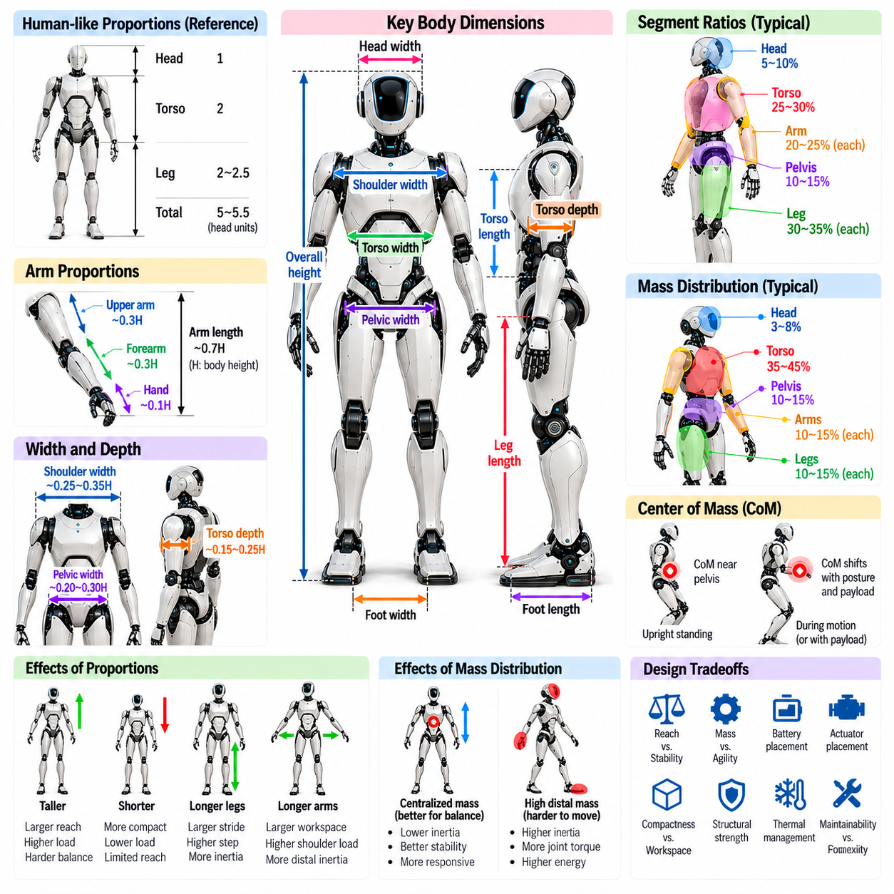{width="7.268055555555556in" height="7.268055555555556in"}

신체 비율(Body Proportions)과 질량 분포(Mass Distribution)는 휴머노이드 로봇(Humanoid Robot)의 기계적 거동(Mechanical Behavior), 안정성(Stability), 기능적 능력(Functional Capabilities)을 결정하는 기본적인 형태학적 매개변수(Morphological Parameters)이다. 신체 비율은 신체 분절(Body Segments)의 상대적 치수(Relative Dimensions)를 나타내며, 질량 분포는 구조 전체에 무게가 어떻게 배분되는지를 정의한다. 이러한 특성은 함께 이동(Locomotion), 조작(Manipulation), 균형(Balance), 에너지 소비(Energy Consumption), 인간 환경과의 상호작용(Interaction with Human Environments)에 영향을 미친다.

인간의 해부학적 비율(Human Anatomical Proportions)은 건물(Buildings), 가구(Furniture), 도구(Tools), 작업 공간(Workspaces)이 일반적으로 인간의 신체 치수(Human Dimensions)를 기준으로 구성되기 때문에 휴머노이드 설계에 유용한 참고 기준을 제공한다. 그러나 인간 해부학의 직접적인 복제(Direct Anatomical Replication)가 최적의 로봇 성능(Optimal Robotic Performance)을 보장하지는 않는다. 구동기 기술(Actuator Technology), 구조 재료(Structural Materials), 에너지 저장(Energy Storage), 제어 능력(Control Capabilities)의 차이로 인해 신체 비율은 공학적 제약(Engineering Constraints)과 운영 목표(Operational Objectives)에 맞게 조정되어야 한다.

전체 신체 높이(Overall Body Height)는 환경 접근성(Environmental Accessibility), 작업 공간 호환성(Workspace Compatibility), 기계적 하중(Mechanical Loading)에 영향을 미친다. 키가 큰 휴머노이드(Taller Humanoid)는 높은 선반에 도달하고 표준적인 인간용 장비(Standard Human Equipment)와 상호작용하기 쉬울 수 있지만, 높이가 증가하면 중력 모멘트(Gravitational Moments)와 안정성 문제(Stability Challenges)가 커질 수 있다. 키가 작은 로봇(Shorter Robot)은 소형화(Compactness)와 구조적 하중 감소(Reduced Structural Loads) 측면에서 유리할 수 있지만, 도달 범위(Reach)와 인간 규모의 기반 시설(Human-scale Infrastructure)을 활용하는 능력이 제한될 수 있다.

몸통 길이(Torso Length)와 다리 길이(Leg Length) 사이의 관계는 자세(Posture)와 이동(Locomotion)에 큰 영향을 미친다. 긴 다리(Longer Legs)는 보폭(Stride Length)을 증가시키고 높은 표면에 대한 접근성을 개선할 수 있지만, 회전 관성(Rotational Inertia)과 관절 토크 요구량(Joint Torque Demands)도 증가시킬 수 있다. 상대적으로 긴 몸통(Relatively Longer Torso)은 추가적인 내부 부품 배치 공간(Internal Packaging Space)을 제공할 수 있지만, 질량 중심(Center of Mass)의 위치와 직립 균형(Upright Balance)을 유지하기 위한 기계적 요구사항(Mechanical Requirements)을 변화시킨다.

몸통 치수(Torso Dimensions)에 대한 팔 길이(Arm Length)의 비율은 조작 도달 범위(Manipulation Reach)와 발의 위치를 변경하지 않고 물체에 접근하는 능력을 결정한다. 긴 팔(Longer Arms)은 도달 가능한 작업 공간(Reachable Workspace)을 확장하지만 어깨 하중(Shoulder Loading)과 원위부 관성(Distal Inertia)을 증가시킨다. 짧은 팔(Shorter Arms)은 소형화(Compactness)와 동적 응답성(Dynamic Responsiveness)을 개선할 수 있다. 적절한 비율은 목표 작업 공간(Target Workspaces), 예상 적재 하중(Expected Payloads), 협응 조작(Coordinated Manipulation)에 사용할 수 있는 몸통 운동성(Torso Mobility)의 정도에 따라 결정된다.

어깨 너비(Shoulder Width), 골반 너비(Pelvic Width), 신체 깊이(Body Depth)는 안정성(Stability)과 기동성(Maneuverability) 모두에 영향을 미친다. 넓은 어깨(Wider Shoulders)는 양팔 작업 공간 범위(Dual-arm Workspace Coverage)를 개선할 수 있으며, 넓은 골반(Wider Pelvis)은 고관절 메커니즘(Hip Mechanisms)을 위한 추가적인 운동 여유 공간(Clearance)을 제공할 수 있다. 그러나 신체 너비가 증가하면 좁은 공간을 통과하는 능력이 제한될 수 있다. 따라서 형태 설계(Morphological Design)는 기계적 부품 배치(Mechanical Packaging), 관절 운동성(Joint Mobility), 충돌 회피(Collision Avoidance), 인간 환경과의 호환성(Compatibility with Human Environments) 사이의 균형을 유지해야 한다.

질량 분포(Mass Distribution)는 로봇의 신체 좌표계(Body Coordinate System)에 대한 개별 구성요소 질량(Component Masses)의 위치를 나타낸다. 주요 질량 구성요소에는 구동기(Actuators), 배터리(Batteries), 컴퓨팅 하드웨어(Computing Hardware), 구조 링크(Structural Links), 동력 전달 장치(Transmissions), 적재 하중(Payloads)이 포함된다. 이러한 구성요소의 배치는 전체 질량 중심(Overall Center of Mass)과 관성 특성(Inertia Properties)을 결정한다. 외부 신체 비율이 유사한 두 휴머노이드라도 내부 구성요소 배치(Internal Component Arrangements)에 따라 상당히 다른 동적 거동(Dynamic Behavior)을 보일 수 있다.

질량 중심(Center of Mass)은 로봇에 분포된 질량의 가중 평균 위치(Weighted Average Position)를 나타낸다. 질량 중심의 위치는 관절(Joints)이 움직이거나 물체를 운반하거나 신체 분절(Body Segments)의 방향이 변할 때 달라진다. 기립(Standing)과 보행(Walking) 중에는 질량 중심 운동(Center-of-mass Motion)이 사용 가능한 지면 접촉(Ground Contacts)과 협응되어야 한다. 질량 중심의 기준 위치(Nominal Location)에 영향을 미치는 형태 설계 결정(Morphological Decisions)은 자세 제어(Posture Control), 균형 회복(Balance Recovery), 안정성을 유지하는 데 필요한 노력에 영향을 미친다.

낮은 질량 중심(Lower Center of Mass)은 특정 조건에서 정적 안정성(Static Stability)의 일부 측면을 개선하고 중력 모멘트(Gravitational Moments)를 감소시킬 수 있다. 그러나 발(Feet)이나 하퇴부(Lower Legs) 근처에 과도한 질량을 배치하면 유각 다리 관성(Swing-leg Inertia)과 보행 에너지 소비(Walking Energy Consumption)가 증가할 수 있다. 따라서 질량 중심을 낮추는 것이 항상 유리한 것은 아니다. 설계자는 질량 배치(Mass Placement)가 안정성(Stability), 관절 토크(Joint Torque), 동적 효율(Dynamic Efficiency)에 미치는 상충 효과(Competing Effects)를 고려해야 한다.

질량 분포(Mass Distribution)는 서로 다른 축에 대한 각가속도(Angular Acceleration)의 저항을 나타내는 관성 텐서(Inertia Tensor)도 결정한다. 신체의 회전축(Rotational Axes)에서 멀리 위치한 구성요소는 회전 관성(Rotational Inertia)에 불균형적으로 큰 영향을 미친다. 따라서 무거운 손(Hands), 발(Feet), 머리 조립체(Head Assemblies)는 빠른 움직임에 필요한 노력을 증가시킬 수 있다. 상당한 질량을 신체 중심 영역(Central Body Regions) 근처에 집중시키면 부품 배치 제약(Packaging Constraints)이 허용하는 범위에서 응답성(Responsiveness)을 개선할 수 있다.

원위부 질량(Distal Mass)은 팔(Arms)과 다리(Legs)에서 특히 중요한데, 이러한 신체 분절은 조작(Manipulation)과 이동(Locomotion) 중 반복적으로 가속과 감속(Acceleration and Deceleration)을 수행하기 때문이다. 가벼운 전완(Lightweight Forearms)과 손(Hands)은 어깨 및 팔꿈치 토크 요구량(Shoulder and Elbow Torque Demands)을 줄이며, 가벼운 하퇴부(Shanks)와 발(Feet)은 유각 다리 동역학(Swing-leg Dynamics)을 개선한다. 원격 구동(Remote Actuation)은 모터(Motors)를 근위 관절(Proximal Joints) 쪽으로 재배치할 수 있지만, 동력 전달 장치(Transmissions)는 추가적인 마찰(Friction), 탄성(Elasticity), 기계적 복잡성(Mechanical Complexity)을 발생시킨다.

배터리 배치(Battery Placement)는 에너지 저장 장치(Energy Storage)가 전체 로봇 질량(Total Robot Mass)의 상당한 부분을 차지할 수 있기 때문에 시스템 수준의 주요 절충 관계(System-level Tradeoff)를 형성한다. 골반(Pelvis)이나 몸통(Torso) 근처에 배치된 배터리는 질량 집중화(Centralized Mass Distribution)를 지원하고 전기적 통합(Electrical Integration)을 단순화할 수 있다. 그러나 사용 가능한 공간(Available Volume), 열 관리(Thermal Management), 구조적 보호(Structural Protection), 유지보수 접근성(Maintenance Access)이 배치에 제약을 준다. 배터리 구성(Battery Configuration)은 모듈(Module)을 교체할 때 발생하는 질량 분포의 변화도 고려해야 한다.

구동기 배치(Actuator Placement)는 관절 성능(Joint Performance)과 전신 관성(Whole-body Inertia) 모두에 영향을 미친다. 고관절(Hips)과 몸통(Torso) 주변에 집중된 고토크 모터(High-torque Motors)는 원위부 하중(Distal Loading)을 줄일 수 있지만 중심 구조 요구사항(Central Structural Requirements)과 열 밀도(Thermal Density)를 증가시킬 수 있다. 분산형 구동기(Distributed Actuators)는 일부 관절 동력 전달 구조(Joint Transmissions)를 단순화하지만 움직이는 링크(Moving Links)에 질량을 추가한다. 구조 선택(Architecture Selection)에는 구동기 효율(Actuator Efficiency), 동력 전달 손실(Transmission Losses), 기계적 강성(Mechanical Stiffness), 예상 운동 패턴(Expected Motion Patterns)에 대한 평가가 필요하다.

질량 분포(Mass Distribution)는 기립 중 질량 중심(Center of Mass)과 지지 영역(Support Region) 사이의 관계에 영향을 미친다. 정적 조건(Static Conditions)에서 평형(Equilibrium)을 유지하려면 합성 지면 반력(Resultant Ground Reaction Forces)과 모멘트(Moments)가 중력(Gravity) 및 기타 작용 하중(Applied Loads)과 균형을 이루어야 한다. 동적 운동(Dynamic Movement) 중에는 운동량(Momentum)과 접촉 제약(Contact Constraints)도 동일하게 중요해진다. 따라서 형태학적 안정성(Morphological Stability)은 질량 중심을 지면에 투영하는 것만으로 평가할 수 없다.

신체 비율(Body Proportions)은 손(Hands)과 발(Feet)의 도달 가능한 작업 공간(Reachable Workspace)의 위치와 크기에도 영향을 미친다. 팔과 다리 길이(Arm and Leg Lengths)는 관절 운동 범위(Joint Ranges)와 상호작용하여 실현 가능한 구성(Feasible Configurations)을 결정한다. 긴 신체 분절(Longer Segments)은 도달 범위를 확장할 수 있지만 작업 공간 경계(Workspace Boundaries) 근처에서 충돌 위험(Collision Risks)과 불리한 지렛대 조건(Unfavorable Leverage)을 증가시킬 수 있다. 효과적인 설계는 단순한 치수에 의존하지 않고 사용 가능한 작업 공간(Usable Workspace), 관절 한계(Joint Limits), 자기 충돌(Self-collision), 구조적 하중(Structural Loading)을 평가한다.

신체 비율(Body Proportions)과 구동기 토크(Actuator Torque) 사이의 관계는 쪼그리기(Crouching), 물체 들어 올리기(Lifting), 계단 오르기(Stair Climbing) 중 특히 중요해진다. 긴 링크(Longer Links)는 모멘트 암(Moment Arms)을 증가시켜 동일한 외부 하중(External Loads)에 대해 더 큰 관절 토크(Joint Torque)를 요구할 수 있다. 짧은 링크(Shorter Links)는 기계적 요구량(Mechanical Demand)을 줄일 수 있지만 장애물 통과 높이(Obstacle Clearance)와 운동 범위(Movement Range)를 제한한다. 따라서 관절축 배치(Joint-axis Placement)와 동력 전달비(Transmission Ratios)는 신체 분절 치수(Segment Dimensions)와 함께 최적화되어야 한다.

인체 측정학적 스케일링(Anthropometric Scaling)은 질량(Mass), 강도(Strength), 관성(Inertia)이 선형 치수(Linear Dimensions)에 비례하여 변화하지 않기 때문에 추가적인 과제를 발생시킨다. 기하학적 상사성(Geometric Similarity)과 일정한 재료 밀도(Constant Material Density)를 가정하면 질량은 특성 길이(Characteristic Length)의 세제곱에 대략 비례한다. 구조적 단면적(Structural Cross-sectional Area)은 길이의 제곱에 비례하므로 로봇 크기가 증가함에 따라 하중 관계(Load Relationships)가 변화한다. 따라서 각 크기 규모(Scale)에서 구동기 성능(Actuator Capability)과 구조적 강도(Structural Strength)를 다시 검토해야 한다.

적재 하중 취급(Payload Handling)은 질량 분포(Mass Distribution)를 변화시키고 휴머노이드 동역학(Humanoid Dynamics)에 상당한 영향을 미칠 수 있다. 물체를 신체 앞쪽으로 운반하면 결합 질량 중심(Combined Center of Mass)이 이동하고 지지 관절(Supporting Joints)에 작용하는 모멘트(Moments)가 증가한다. 하중을 몸통(Torso) 가까이에 유지하면 일반적으로 외부 모멘트 암(External Moment Arms)이 감소하지만, 작업 형상(Task Geometry)에 따라 이러한 구성이 불가능할 수 있다. 전신 제어(Whole-body Control)는 조작 중 변화하는 적재 하중의 질량(Payload Mass), 위치(Position), 관성(Inertia)을 수용해야 한다.

대칭성(Symmetry)은 좌우 대칭 구조(Bilateral Structures)가 특정 기계적 및 제어 가정(Mechanical and Control Assumptions)을 단순화하기 때문에 휴머노이드 형태(Humanoid Morphology)의 일반적인 출발 원칙이다. 그러나 실제 질량 분포(Actual Mass Distribution)는 구성요소 배치(Component Packaging), 도구(Tools), 운반 물체(Carried Objects)로 인해 비대칭적(Asymmetric)이 될 수 있다. 비대칭 하중(Asymmetric Loading)은 자세(Posture)와 관절 토크 요구량(Joint Torque Requirements)에 영향을 미친다. 따라서 정확한 동적 모델(Dynamic Models)은 완벽한 좌우 대칭(Perfect Left-right Symmetry)을 가정하기보다 측정된 구성요소 질량(Measured Component Masses)을 반영해야 한다.

에너지 효율(Energy Efficiency)은 신체 분절 비율(Segment Proportions), 질량 분포(Mass Distribution), 운동 패턴(Movement Patterns) 사이의 상호작용에 따라 결정된다. 높은 원위부 관성(High Distal Inertia)은 사지를 가속하는 데 필요한 일(Work)을 증가시키며, 불리한 질량 중심 궤적(Unfavorable Center-of-mass Trajectories)은 지지 요구량(Support Demands)을 증가시킬 수 있다. 기계 설계(Mechanical Design)는 경량 재료(Lightweight Materials), 적절한 링크 길이(Appropriate Link Lengths), 중심부에 집중된 무거운 구성요소(Centralized Heavy Components)를 통해 이러한 불이익을 줄일 수 있다. 그러나 에너지 성능(Energy Performance)은 대표적인 작업(Representative Tasks) 전반에 걸쳐 평가되어야 한다.

구조적 강도(Structural Strength)와 질량 감소(Mass Reduction)는 신중하게 균형을 유지해야 한다. 경량 링크(Lightweight Links)는 민첩성(Agility)을 개선할 수 있지만 반복 하중(Repeated Loading) 아래에서 변형(Deformation), 진동(Vibration), 피로 문제(Fatigue Problems)를 발생시킬 수 있다. 구조 보강(Reinforcement)은 강성(Stiffness)과 내구성(Durability)을 증가시키지만 관성 특성(Inertia Properties)도 변화시킨다. 재료 선택(Material Selection), 단면 형상(Cross-sectional Geometry), 하중 전달 경로(Load Paths)는 불필요한 구조적 무게(Structural Weight) 없이 신뢰할 수 있는 성능(Reliable Performance)을 달성하도록 함께 최적화되어야 한다.

신체 비율과 질량 분포(Body Proportions and Mass Distribution)는 궁극적으로 휴머노이드 지능(Humanoid Intelligence)과 제어 시스템(Control Systems)이 작동하는 물리적 조건(Physical Conditions)을 형성한다. 효과적인 형태 설계(Effective Morphology)는 인간 환경 호환성(Human-environment Compatibility), 도달 가능한 작업 공간(Reachable Workspace), 동적 안정성(Dynamic Stability), 구동기 성능(Actuator Capability), 에너지 효율(Energy Efficiency)을 통합한다. 성공적인 휴머노이드 설계(Successful Humanoid Design)는 인간 해부학(Human Anatomy)을 정확하게 복제하기보다 의도된 작업(Intended Tasks)의 기계적 요구사항(Mechanical Demands)에 따라 치수(Dimensions)와 질량(Mass)을 배분한다.

## 06.08. Bipedal Stability and Locomotion Morphology

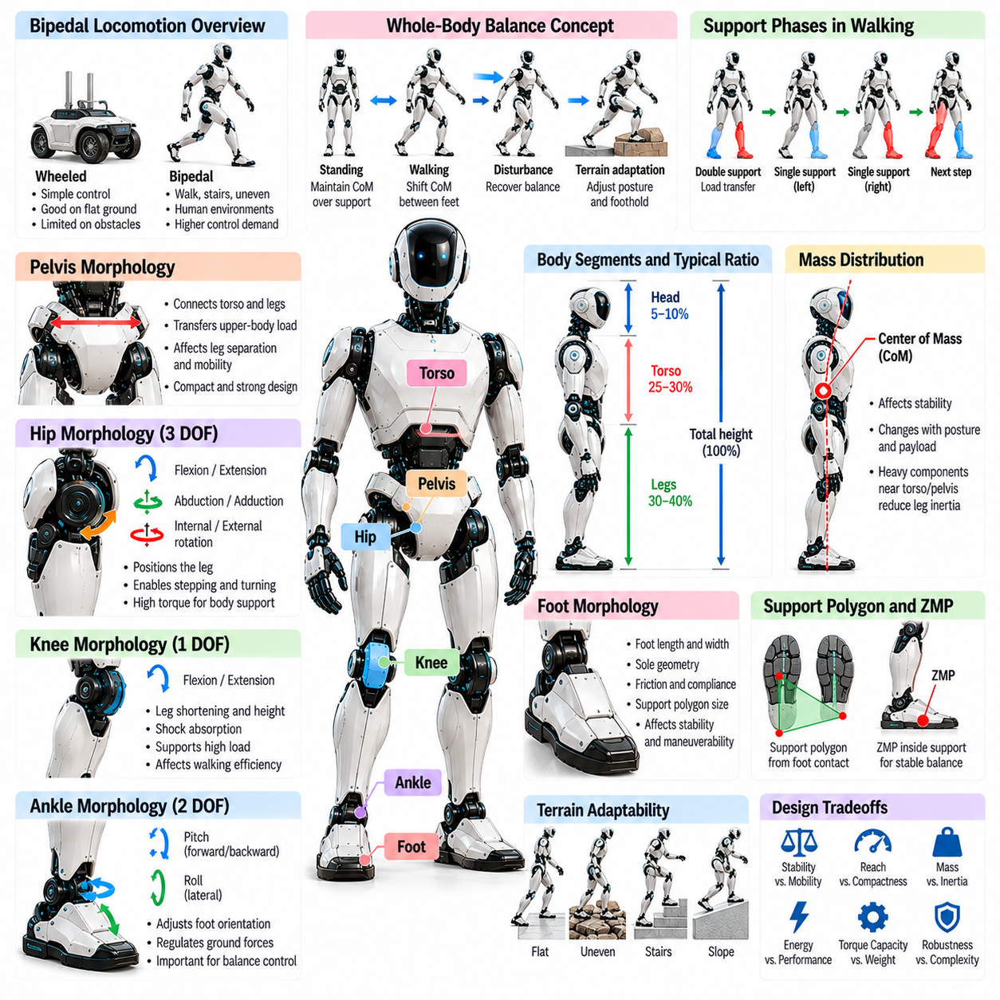{width="7.268055555555556in" height="7.268055555555556in"}

이족 보행 안정성(Bipedal Stability)과 이동 형태(Locomotion Morphology)는 휴머노이드 로봇(Humanoid Robot)이 두 개의 관절형 다리(Articulated Legs)를 통해 직립 자세(Upright Posture)를 유지하고 움직임을 생성하는 방식을 정의한다. 바퀴형 플랫폼(Wheeled Platform)과 달리 이족 보행 로봇(Biped)은 중력(Gravitational Forces), 운동량(Momentum), 변화하는 지면 접촉(Ground Contacts)을 지속적으로 관리해야 한다. 기계적 구조(Mechanical Architecture)는 실현 가능한 보행 패턴(Walking Patterns), 균형 회복 능력(Balance Recovery Capabilities), 지형 적응성(Terrain Adaptability), 인간 환경에서 이동하는 데 필요한 에너지 비용(Energetic Cost)을 결정한다.

이족 보행 안정성(Bipedal Stability)은 신체 형상(Body Geometry), 질량 분포(Mass Distribution), 관절 운동(Joint Articulation), 발과 지면의 접촉(Foot-ground Contact) 사이의 상호작용에서 형성된다. 기립(Standing) 중 로봇은 평형(Equilibrium)을 유지하기 위해 힘(Forces)과 모멘트(Moments)를 조절해야 한다. 보행(Walking) 중에는 안정성이 지지 발(Supporting Feet) 사이의 반복적인 전환을 포함하는 동적 과정(Dynamic Process)으로 변화한다. 따라서 형태 설계(Morphological Design)는 균형 제어기(Balance Controllers)와 이동 알고리즘(Locomotion Algorithms)이 작동하는 물리적 제약(Physical Constraints)을 설정한다.

골반(Pelvis)은 두 다리(Legs)의 움직임을 협응시키고 상체(Upper Body)를 지지하는 구조적 기반(Structural Foundation)을 제공한다. 골반 너비(Pelvic Width)는 측면 발 배치(Lateral Foot Placement), 고관절 운동 여유 공간(Hip Clearance), 실현 가능한 보행 자세(Feasible Walking Postures)의 범위에 영향을 미친다. 넓은 골반(Wider Pelvis)은 기계적 부품 배치(Mechanical Packaging)와 특정 측면 운동(Lateral Movements)을 개선할 수 있지만, 지나치게 넓으면 다리 사이의 간격(Leg Separation)과 에너지 요구량(Energetic Demands)이 증가할 수 있다. 골반 형상(Pelvic Geometry)은 운동성(Mobility), 구조적 강도(Structural Strength), 소형화(Compactness) 사이의 균형을 유지해야 한다.

고관절 운동(Hip Articulation)은 전방 발 내딛기(Forward Stepping), 측면 이동(Lateral Movement), 다리의 회전 조정(Rotational Adjustment)을 가능하게 한다. 일반적으로 세 개의 회전 자유도(Rotational Degrees of Freedom)가 굴곡-신전(Flexion-extension), 외전-내전(Abduction-adduction), 축 회전(Axial Rotation)을 제공한다. 이러한 움직임을 통해 로봇은 골반(Pelvis)에 대한 발의 위치를 결정하고 보행 자세(Stance)를 조정할 수 있다. 관절축 배치(Joint-axis Arrangement)와 운동 한계(Motion Limits)는 사용 가능한 발 디딤 작업 공간(Foothold Workspace)을 결정하며 외란(Disturbances)으로부터의 회복 능력에도 영향을 미친다.

다리 길이(Leg Length)와 신체 분절 비율(Segment Proportions)은 보행 역학(Walking Mechanics)에 큰 영향을 미친다. 긴 다리(Longer Legs)는 더 큰 보폭(Stride Lengths)과 향상된 장애물 통과 높이(Obstacle Clearance)를 제공할 수 있지만, 회전 관성(Rotational Inertia)과 관절 토크 요구량(Joint Torque Requirements)을 증가시킬 수 있다. 짧은 다리(Shorter Legs)는 소형화(Compactness)를 개선하고 일부 기계적 하중(Mechanical Loads)을 줄이는 반면, 도달 가능한 발 디딤 위치(Reachable Footholds)를 제한한다. 효과적인 비율은 보행 속도(Walking Speed), 목표 지형(Target Terrain), 적재 하중 요구사항(Payload Requirements), 구동기 성능(Actuator Capabilities)에 따라 결정된다.

무릎 형태(Knee Morphology)는 신체의 수직 운동(Vertical Body Motion), 다리 길이 단축(Leg Shortening), 충격 흡수(Impact Absorption)에 영향을 미친다. 보행 중 무릎 굴곡(Knee Flexion)은 발의 지면 이격(Foot Clearance)을 가능하게 하고 제어된 착지(Controlled Landing)를 지원하며, 신전(Extension)은 입각기(Stance) 동안 구조적 지지(Structural Support)를 제공한다. 과도한 무릎 굴곡은 구동기 부하(Actuator Effort)와 에너지 소비(Energy Consumption)를 증가시킬 수 있다. 따라서 관절 운동 범위(Joint Range), 기계적 지렛대 효과(Mechanical Leverage), 동력 전달 효율(Transmission Efficiency)은 목표 보행 전략(Walking Strategy)에 맞게 조정되어야 한다.

발목 관절 운동(Ankle Articulation)은 발 방향(Foot Orientation)을 조절하고 지면 반력(Ground Reaction Forces)을 분배하는 데 필수적이다. 피치 운동(Pitch Motion)은 전후 균형 조정(Forward-backward Balance Adjustments)을 지원하며, 롤 운동(Roll Motion)은 측면 안정화(Lateral Stabilization)에 기여한다. 충분한 발목 토크 용량(Ankle Torque Capacity)은 로봇이 기립과 보행 중 접촉 모멘트(Contact Moments)를 조정할 수 있도록 한다. 발목 운동성(Ankle Mobility)이 제한되면 고관절 운동(Hip Movement)이나 발 배치 조정(Foot Placement Adjustments)을 통한 더 큰 보상이 필요할 수 있다.

발 형상(Foot Geometry)은 균형 유지에 사용할 수 있는 지지 영역(Support Region)에 직접적인 영향을 미친다. 길고 넓은 발(Longer and Wider Feet)은 평지 접촉(Flat-ground Contact) 중 지지 다각형(Support Polygon)을 확대하여 정적 안정성(Static Stability)을 개선할 수 있다. 그러나 지나치게 큰 발(Oversized Feet)은 제한된 공간(Confined Environments)에서 발을 내딛거나 장애물을 통과하는 작업을 복잡하게 만들 수 있다. 발 치수(Foot Dimensions)는 예상 지형(Expected Terrain), 보행 특성(Gait Characteristics), 필요한 균형 전략(Balance Strategy)에 따라 선택되어야 한다.

지지 다각형(Support Polygon)은 적절한 접촉 가정(Contact Assumptions) 아래에서 활성 지면 접촉(Active Ground Contacts)으로 둘러싸인 영역을 나타낸다. 정적 평형(Static Equilibrium) 상태에서는 질량 중심(Center of Mass)의 투영 위치가 사용 가능한 지지 조건(Available Support) 및 외부 하중(External Loading)과 일치해야 한다. 동적 이동(Dynamic Locomotion)에서는 운동량(Momentum)과 접촉력 한계(Contact-force Limits)를 추가로 고려해야 한다. 따라서 발 치수(Foot Dimensions)만으로는 가속 운동(Accelerated Movement) 중 안정성을 보장할 수 없다.

영모멘트점(Zero Moment Point, ZMP)은 특정 접촉 조건(Contact Conditions)에서 균형을 분석하는 데 유용한 개념이다. 이는 지정된 모델(Specified Model)에서 관련 전도 모멘트(Tipping Moments)가 사라지는 지면 평면상의 위치(Ground-plane Location)를 나타낸다. 이 지점을 실현 가능한 지지 영역(Feasible Support Region) 내부에 유지하면 동적으로 균형 잡힌 운동(Dynamically Balanced Motion)을 지원할 수 있다. 그러나 그 해석은 접촉 형상(Contact Geometry)과 가정(Assumptions)에 따라 달라지며, 전체 운동량 기반 해석(Full Momentum-based Analysis)을 대체하지는 못한다.

질량 중심(Center of Mass)과 그 궤적(Trajectory)은 이족 보행 이동(Bipedal Locomotion)의 핵심 요소이다. 로봇이 보행할 때 질량은 교대로 바뀌는 지지 접촉(Alternating Support Contacts)에 대해 이동하며 중력 효과(Gravitational Effects)와 관성 효과(Inertial Effects)를 발생시킨다. 하체 비율(Lower-body Proportions)과 구성요소 배치(Component Placement)는 이러한 동역학(Dynamics)에 영향을 미친다. 무거운 구성요소(Heavy Components)를 골반(Pelvis) 근처에 집중시키면 유각 다리 관성(Swing-leg Inertia)을 줄일 수 있지만, 전체 안정성(Overall Stability)은 자세(Posture), 접촉력(Contact Forces), 제어 동작(Control Actions)에도 좌우된다.

보행(Walking)은 일반적으로 단일 지지 구간(Single-support Phase)과 이중 지지 구간(Double-support Phase)이 교대로 나타나는 형태로 진행된다. 단일 지지 구간에서는 한 발이 신체를 지탱하는 동안 반대쪽 다리가 새로운 발 디딤 위치(Foothold)를 향해 이동한다. 이중 지지 구간에서는 두 다리 사이의 하중 전달(Load Transfer)이 가능하다. 고관절 운동성(Hip Mobility), 무릎 운동 범위(Knee Range), 발목 관절 운동(Ankle Articulation), 발 치수(Foot Dimensions)는 이러한 전환의 부드러움과 제어된 지면 접촉(Controlled Ground Contact)을 유지하는 능력에 영향을 미친다.

유각 다리 형태(Swing-leg Morphology)는 로봇이 연속적인 지면 접촉(Successive Contacts) 사이에서 발을 얼마나 효율적으로 이동시키는지를 결정한다. 무거운 하퇴부(Heavy Shanks)와 발(Feet)은 회전 관성(Rotational Inertia)을 증가시키고 더 큰 가속 토크(Acceleration Torque)를 요구한다. 가벼운 원위부 구조(Lightweight Distal Structures)는 응답성(Responsiveness)을 개선하고 에너지 소비(Energy Consumption)를 줄일 수 있다. 그러나 다리는 착지(Touchdown)와 입각기(Stance) 동안 반복적인 하중을 견뎌야 하므로 충분한 구조적 강도(Structural Strength)와 충격 내성(Impact Tolerance)이 필요하다.

발과 지면의 접촉 역학(Foot-ground Contact Mechanics)은 이동 신뢰성(Locomotion Reliability)에 큰 영향을 미친다. 마찰(Friction)은 미끄러짐(Slipping)에 저항할 수 있는 능력을 결정하며, 발바닥 유연성(Sole Compliance)은 압력 분포(Pressure Distribution)와 충격 감쇠(Impact Attenuation)에 영향을 미친다. 지나치게 강성(Rigid)이 높은 접촉은 큰 충격(Shocks)을 전달할 수 있으며, 과도하게 부드러운 접촉은 위치 정확도(Positioning Accuracy)를 저하시킬 수 있다. 적절한 발바닥 재료(Sole Materials)와 기계적 감쇠(Mechanical Damping)는 능동 제어(Active Control)의 필요성을 없애지 않으면서 표면 불규칙성(Surface Irregularities)에 대한 적응성을 개선한다.

수동적 기계 특성(Passive Mechanical Properties)은 보행 효율(Walking Efficiency)과 안정성(Stability)에 기여할 수 있다. 탄성 요소(Elastic Elements)는 하중이 가해지는 동안 에너지를 저장하고 이후 움직임에서 일부를 반환할 수 있다. 유연 관절(Compliant Joints)과 유연 구조(Flexible Structures)는 최대 충격력(Peak Impact Forces)을 줄이고 불확실한 접촉(Uncertain Contacts)에 적응하도록 돕는다. 이러한 효과는 강성(Stiffness), 감쇠(Damping), 보행 타이밍(Gait Timing), 제어 전략(Control Strategy)에 따라 달라지며, 적절하게 조정되지 않은 유연성(Compliance)은 진동(Oscillations)이나 불안정성(Instability)을 유발할 수 있다.

균형 회복(Balance Recovery)을 위해서는 보정 관절 토크(Corrective Joint Torques)를 생성하거나 각운동량(Angular Momentum)을 조정하거나 발의 위치를 변경할 수 있어야 한다. 발목 전략(Ankle Strategies)은 접촉 모멘트(Contact Moments)를 조절하고, 고관절 전략(Hip Strategies)은 상체와 다리의 운동(Upper-body and Leg Motion)을 변화시킨다. 발 내딛기 전략(Stepping Strategies)은 기존 접촉만으로 충분하지 않을 때 새로운 지지 위치(Support Locations)를 형성한다. 형태(Morphology)는 이러한 대응에 사용할 수 있는 관절 운동 범위(Joint Ranges), 구동기 제어 능력(Actuator Authority), 도달 가능한 발 디딤 위치(Reachable Footholds)를 결정한다.

상체 형태(Upper-body Morphology)도 이족 보행 안정성(Bipedal Stability)에 기여한다. 팔 움직임(Arm Movements)과 몸통 회전(Torso Rotation)은 각운동량(Angular Momentum)을 재분배하고 전체 질량 중심(Overall Center of Mass)에 영향을 미칠 수 있다. 이러한 효과는 외란 회복(Disturbance Recovery)을 지원할 수 있지만, 조작 작업(Manipulation Tasks)이 추가적인 하중을 발생시키면 보행을 복잡하게 만들 수도 있다. 따라서 이동(Locomotion), 균형(Balance), 상지 활동(Upper-limb Activity) 사이의 상호작용을 관리하기 위해 전신 협응(Whole-body Coordination)이 필요하다.

지형 적응성(Terrain Adaptability)은 다리 관절 운동(Leg Articulation), 발 설계(Foot Design), 신체 비율(Body Proportions)의 결합된 능력에 따라 결정된다. 계단(Stairs)을 오르내리려면 충분한 발 이격 높이(Foot Clearance)와 관절 운동 범위(Joint Range)가 필요하며, 경사면(Slopes)에서는 적절한 발목 방향(Ankle Orientation)과 접촉 마찰(Contact Friction)이 요구된다. 불규칙한 지형(Uneven Terrain)은 접촉 위치(Contact Location)와 하중(Loading)에 불확실성을 발생시킨다. 형태학적 유연성(Morphological Flexibility)은 통과 가능한 표면(Negotiable Surfaces)의 범위를 확장하지만 기계적 복잡성(Mechanical Complexity)과 제어 복잡성(Control Complexity)을 증가시킨다.

이동 효율(Locomotion Efficiency)은 구동기 배치(Actuator Placement), 사지 관성(Limb Inertia), 관절 동력 전달 장치(Joint Transmission), 보행 동역학(Gait Dynamics) 사이의 상호작용에 따라 결정된다. 무거운 원위부 구성요소(Heavy Distal Components)는 반복적인 다리 가속(Repeated Leg Acceleration)에 필요한 노력을 증가시킨다. 효율적인 동력 전달 장치(Efficient Transmissions)는 기계적 손실(Mechanical Losses)을 줄이며, 적절한 링크 비율(Link Proportions)은 보행 역학(Stride Mechanics)을 개선할 수 있다. 에너지 성능(Energy Performance)은 실제적인 보행 속도(Walking Speeds), 지형 조건(Terrain Conditions), 적재 하중 구성(Payload Configurations) 전반에서 평가되어야 한다.

센서 통합(Sensor Integration)은 움직임 중 이족 보행 형태(Bipedal Morphology)의 제어를 지원한다. 관절 엔코더(Joint Encoders)는 관절 운동(Joint Articulation)을 측정하고, 관성 센서(Inertial Sensors)는 신체 방향(Body Orientation)과 운동(Motion)을 추정하며, 발 센서(Foot Sensors)는 지면 반력(Ground Reaction Forces)의 특성을 파악한다. 비전 센싱(Vision Sensing)과 깊이 센싱(Depth Sensing)은 전방 지형(Upcoming Terrain)에 대한 정보를 제공한다. 이러한 측정값을 결합하면 접촉 추정(Contact Estimation), 발 디딤 위치 계획(Foothold Planning), 외란 감지(Disturbance Detection), 적응형 보행 제어(Adaptive Gait Control)가 가능해진다.

기계적 신뢰성(Mechanical Reliability)은 하체 지지(Lower-body Support)의 상실이 로봇 전체의 낙상(Robot Fall)으로 이어질 수 있기 때문에 특히 중요하다. 고관절(Hip), 무릎(Knee), 발목(Ankle) 구조는 반복 하중(Cyclic Loading), 충격(Impacts), 예상하지 못한 접촉력(Unexpected Contact Forces)을 견딜 수 있어야 한다. 구동기 토크 한계(Actuator Torque Limits), 관절 기계적 스토퍼(Joint Stops), 보호 메커니즘(Protective Mechanisms)은 비정상적인 상황(Abnormal Events)에서 손상을 줄일 수 있다. 신뢰할 수 있는 이동(Reliable Locomotion)을 위해서는 내구성 있는 기계적 구조(Durable Mechanical Architecture)와 적절한 고장 대응 동작(Fault-responsive Behavior)이 모두 필요하다.

이족 보행 안정성과 이동 형태(Bipedal Stability and Locomotion Morphology)는 궁극적으로 휴머노이드 로봇(Humanoid Robot)의 직립 이동(Upright Movement)에 사용할 수 있는 물리적 능력(Physical Capabilities)을 결정한다. 성공적인 설계(Successful Design)는 신체 비율(Body Proportions), 질량 분포(Mass Distribution), 관절 운동성(Joint Mobility), 발 접촉 역학(Foot Contact Mechanics), 유연 구조(Compliant Structures)를 하나의 협응 시스템(Coordinated System)으로 통합한다. 목표는 단순히 인간의 보행(Human Walking)을 재현하는 것이 아니라 실제 환경 제약(Practical Environmental Constraints) 아래에서 효율적이고 적응 가능하며 신뢰할 수 있는 이동(Efficient, Adaptable, and Reliable Locomotion)을 구현하는 것이다.

## 06.09. Whole Body Manipulation Morphology

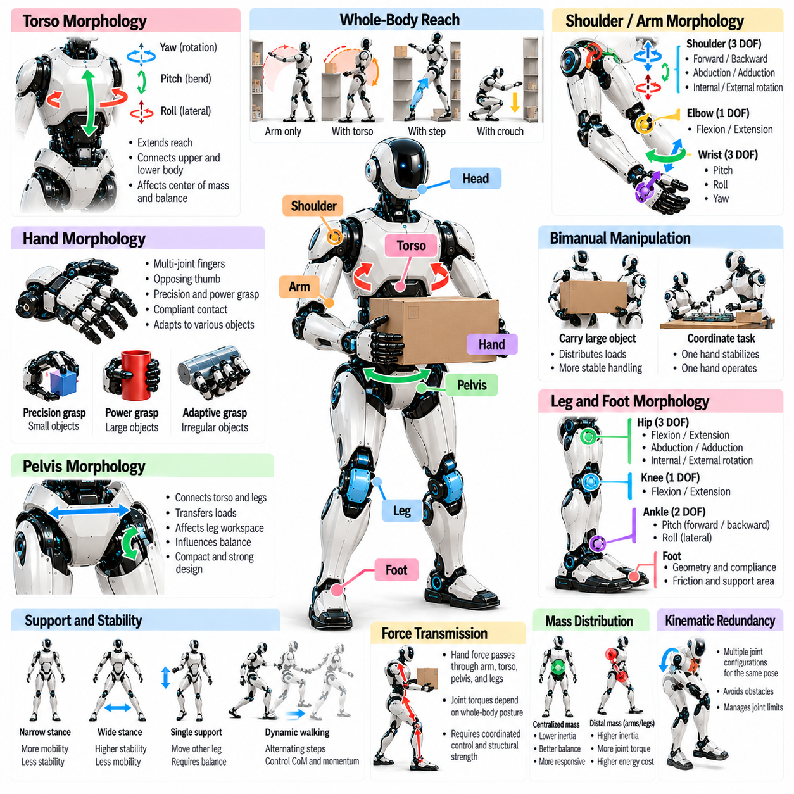{width="7.268055555555556in" height="7.268055555555556in"}

전신 조작 형태(Whole-body Manipulation Morphology)는 휴머노이드 로봇(Humanoid Robot)이 물리적 안정성(Physical Stability)을 유지하면서 물체와 상호작용하기 위해 팔(Arms), 손(Hands), 몸통(Torso), 골반(Pelvis), 다리(Legs)를 협응시키는 방식을 설명한다. 개별 팔 조작(Isolated Arm Manipulation)과 달리 전신 조작(Whole-body Manipulation)은 전체 관절형 구조(Articulated Structure)를 활용하여 움직임을 생성하고 힘을 분배한다. 그 효과는 관절 배치(Joint Arrangement), 신체 비율(Body Proportions), 질량 분포(Mass Distribution), 접촉 형상(Contact Geometry), 여러 사지의 기계적 통합(Mechanical Integration)에 따라 결정된다.

전신 조작(Whole-body Manipulation)의 기본 목표는 개별 팔의 도달 범위(Reach)를 넘어 로봇의 기능적 작업 공간(Functional Workspace)을 확장하는 것이다. 몸통 방향(Torso Orientation)을 조정하거나 무릎(Knees)을 굽히고 골반(Pelvis)을 이동시키거나 발(Feet)의 위치를 변경함으로써 휴머노이드는 기존에는 도달할 수 없었던 물체에 접근할 수 있다. 이러한 협응 운동(Coordinated Movements)은 신체를 독립적으로 작동하는 관절들의 집합이 아니라 통합된 조작 메커니즘(Unified Manipulation Mechanism)으로 전환한다.

몸통(Torso)은 상지 조작(Upper-limb Manipulation)과 하체 지지(Lower-body Support) 사이에서 중요한 기계적 연결(Mechanical Connection)을 제공한다. 허리 회전(Waist Rotation), 전방 굽힘(Forward Bending), 측면 굴곡(Lateral Flexion)은 손의 도달 가능한 작업 공간(Reachable Workspace)을 확장한다. 그러나 몸통 운동(Torso Movement)은 질량 중심(Center of Mass)을 변화시키고 중력 하중(Gravitational Loading)을 재분배한다. 따라서 몸통 형태(Torso Morphology)는 조작 유연성(Manipulation Flexibility), 구조적 강성(Structural Stiffness), 구동기 용량(Actuator Capacity), 자세 안정성(Postural Stability) 사이의 균형을 유지해야 한다.

어깨 배치(Shoulder Placement)는 팔(Arms), 몸통(Torso), 주변 작업 공간(Surrounding Workspace) 사이의 공간적 관계(Spatial Relationship)를 결정한다. 넓은 어깨 간격(Wider Shoulder Separation)은 큰 물체에 대한 접근성을 개선하고 양팔 작업(Dual-arm Operations)을 지원할 수 있으며, 좁은 어깨 구성(Narrower Configurations)은 신체 너비(Body Width)를 줄이고 기동성(Maneuverability)을 개선할 수 있다. 어깨 관절 방향(Shoulder Joint Orientation)과 사용 가능한 운동 범위(Motion Ranges)는 머리 위 도달 동작(Overhead Reaching), 신체를 가로지르는 조작(Cross-body Manipulation), 환경 장애물(Environmental Obstacles) 근처에서의 작업 능력에 영향을 미친다.

팔 형태(Arm Morphology)는 로봇이 변화하는 신체 자세(Body Posture)에 대응하면서 손의 위치를 얼마나 효과적으로 결정할 수 있는지를 좌우한다. 다관절 팔(Multi-joint Arms)은 동일한 목표에 도달하기 위한 대안적인 관절 구성(Alternative Joint Configurations)을 제공하여 로봇이 충돌(Collisions)과 불리한 관절 위치(Unfavorable Joint Positions)를 회피할 수 있도록 한다. 7자유도 팔(Seven-degree-of-freedom Arms)은 일반적으로 유용한 운동학적 중복성(Kinematic Redundancy)을 제공하지만, 실제 조작성(Practical Dexterity)은 관절 한계(Joint Limits), 구동기 토크(Actuator Torque), 기계적 간섭(Mechanical Interference)에 따라서도 달라진다.

팔꿈치 및 손목 구조(Elbow and Wrist Architecture)는 제한된 환경(Constrained Environments)에서의 조작에 큰 영향을 미친다. 팔꿈치 위치(Elbow Positioning)는 팔이 물체에 접근하는 방식을 결정하며, 손목 관절 운동(Wrist Articulation)은 도구(Tools)와 파지한 물체(Grasped Items)의 방향을 조정한다. 소형 손목 메커니즘(Compact Wrist Mechanisms)은 좁은 공간에 대한 접근성을 개선할 수 있지만, 제한된 토크 용량(Torque Capacity)은 적재 하중 취급(Payload Handling)을 제약할 수 있다. 관절 배치(Joint Placement)는 도달 가능성(Reachability), 방향 조정 유연성(Orientation Flexibility), 구조적 강도(Structural Strength), 구동기 배치(Actuator Packaging) 사이의 균형을 유지해야 한다.

손 형태(Hand Morphology)는 휴머노이드와 조작 대상 물체(Manipulated Objects) 사이의 최종 물리적 인터페이스(Physical Interface)를 형성한다. 손가락 배치(Finger Arrangement), 엄지 대립 운동(Thumb Opposition), 손바닥 형상(Palm Geometry), 관절 유연성(Joint Compliance)은 사용 가능한 파지 구성(Grasp Configurations)을 결정한다. 정교한 손(Dexterous Hands)은 정밀 조작(Precision Manipulation)과 물체 방향 재조정(Object Reorientation)을 지원하는 반면, 단순한 그리퍼(Simpler Grippers)는 더 강하고 신뢰성 높은 파지(Grasping)를 제공할 수 있다. 적절한 말단 효과기 구조(End-effector Structure)는 예상 물체 형상(Expected Object Geometry)과 조작 요구사항(Manipulation Requirements)에 따라 결정된다.

양손 조작(Bimanual Manipulation)은 한 손으로 안정적으로 다루기 어렵거나 크고 무거운 물체를 취급하기 위해 양팔을 사용한다. 협응된 양팔 운동(Coordinated Dual-arm Movement)은 하중(Loads)을 분산하고 물체 주변에 여러 접촉점(Multiple Contact Points)을 형성할 수 있다. 그러나 성공적인 양손 작업(Bimanual Operation)을 위해서는 충분한 어깨 작업 공간(Shoulder Workspace), 적절한 팔 길이(Compatible Arm Lengths), 제어된 상대적 손 운동(Controlled Relative Hand Motion)이 필요하다. 몸통 운동성(Torso Mobility)과 보행 자세 형상(Stance Geometry)도 사용 가능한 조작 구성(Manipulation Configurations)에 영향을 미친다.

골반(Pelvis)과 하지(Lower Limbs)는 전신 조작(Whole-body Manipulation)을 위한 기계적 기반(Mechanical Foundation)을 형성한다. 고관절(Hip), 무릎(Knee), 발목(Ankle)의 관절 운동(Articulation)은 로봇이 신체 높이(Body Height)를 조정하고 질량 중심(Center of Mass)을 이동시키며 안정적인 지지 구성(Stable Support Configurations)을 형성할 수 있도록 한다. 쪼그리기(Crouching)는 낮은 위치의 물체에 대한 접근성을 개선할 수 있으며, 발 내딛기(Stepping)는 조작 작업 공간(Manipulation Workspace)을 확장한다. 따라서 하체 형태(Lower-body Morphology)는 로봇이 균형을 잃지 않으면서 상체 위치(Upper-body Position)를 얼마나 효과적으로 변경할 수 있는지를 결정한다.

발 배치(Foot Placement)와 지지 형상(Support Geometry)은 조작에 중요한 제약(Constraints)을 부과한다. 정지 상태의 작업(Stationary Tasks) 중 로봇은 손을 통해 힘을 가하면서 적절한 지면 반력(Ground Reaction Forces)과 접촉 모멘트(Contact Moments)를 생성해야 한다. 넓은 보폭 자세(Wider Stances)는 특정 외란(Disturbances)에 대한 저항성을 개선할 수 있지만, 제한된 공간(Confined Spaces)에서는 이동성(Mobility)을 감소시킬 수 있다. 발 치수(Foot Dimensions), 마찰 특성(Friction Properties), 발목 토크 용량(Ankle Torque Capacity)은 실현 가능한 조작력(Manipulation Forces)의 범위에 영향을 미친다.

전신 조작(Whole-body Manipulation)은 로봇 전체에 걸친 결합된 힘 전달(Coupled Force Transmission)을 발생시킨다. 손에 가해지는 힘(Force)은 손목(Wrist), 팔꿈치(Elbow), 어깨(Shoulder), 몸통(Torso), 골반(Pelvis), 지지 다리(Supporting Legs)를 통해 반력(Reactions)을 생성한다. 관절 토크 요구량(Joint Torque Requirements)은 이러한 전체 운동학적 체인(Kinematic Chain)의 구성에 따라 결정된다. 따라서 조작 능력(Manipulation Capacity)은 팔의 힘(Arm Strength)이나 그리퍼 힘(Gripper Force)만으로 결정할 수 없으며, 전신 구조 및 구동 한계(Whole-body Structural and Actuation Limits)를 함께 고려해야 한다.

질량 분포(Mass Distribution)는 조작 운동(Manipulation Movements)의 안정성(Stability)과 응답성(Responsiveness)에 영향을 미친다. 팔을 전방으로 뻗으면 결합 질량 중심(Combined Center of Mass)이 이동하고 지지 관절(Supporting Joints)에 작용하는 중력 모멘트(Gravitational Moments)가 증가한다. 무거운 물체를 운반하면 이러한 효과가 더욱 커진다. 구동기의 중심 집중 배치(Centralized Actuator Placement)와 경량 원위부 사지(Lightweight Distal Limbs)는 불필요한 관성(Inertia)을 줄일 수 있으며, 협응된 자세 조정(Coordinated Posture Adjustments)은 까다로운 작업 중 실현 가능한 하중 조건(Feasible Loading Conditions)을 유지하는 데 도움을 준다.

운동학적 중복성(Kinematic Redundancy)은 휴머노이드가 조작 목표(Manipulation Objectives)를 충족하면서 나머지 관절을 부차적인 목적(Secondary Purposes)에 맞게 조정할 수 있도록 한다. 로봇은 원하는 손 자세(Desired Hand Pose)를 유지하면서 팔꿈치 방향(Elbow Orientation), 몸통 자세(Torso Posture), 다리 구성(Leg Configuration)을 변경할 수 있다. 이러한 유연성(Flexibility)은 충돌 회피(Collision Avoidance), 관절 한계 관리(Joint-limit Management), 균형 유지(Balance Preservation)를 지원한다. 사용 가능한 중복성(Available Redundancy)은 접촉 제약(Contact Constraints)과 독립적으로 제어되는 관절(Independently Controlled Joints)의 수에 따라 결정된다.

전신 조작(Whole-body Manipulation)은 여러 접촉점(Multiple Contact Points)을 동시에 고려해야 하는 경우가 많다. 발(Feet)은 지지 접촉(Support Contacts)을 형성하고, 한 손 또는 양손은 물체나 환경 표면(Environmental Surfaces)과 상호작용한다. 추가적인 접촉(Additional Contacts)은 안정성을 높이고 힘 생성 능력(Force-generation Capabilities)을 확장할 수 있지만, 새로운 기계적 제약(Mechanical Constraints)도 도입한다. 접촉 형상(Contact Geometry), 마찰(Friction), 구조적 유연성(Structural Compliance)은 물리적으로 실현 가능한 힘 분포(Force Distributions)를 결정한다.

폐쇄 체인 조작(Closed-chain Manipulation)은 로봇과 환경이 구속된 기계적 루프(Constrained Mechanical Loop)를 형성할 때 발생한다. 대표적인 사례로는 양손으로 물체를 잡거나 서 있는 상태에서 고정된 표면(Fixed Surface)을 미는 작업이 있다. 이러한 구성은 독립적인 관절 운동(Independent Joint Motion)을 제한하고 조절해야 하는 내부 힘(Internal Forces)을 발생시킨다. 과도한 기계적 응력(Mechanical Stress)을 방지하려면 팔의 도달 범위(Arm Reach), 관절 정렬(Joint Alignment), 접촉 위치(Contact Locations) 사이의 형태학적 적합성(Morphological Compatibility)이 필수적이다.

기계적 유연성(Mechanical Compliance)은 안전하고 신뢰할 수 있는 전신 상호작용(Whole-body Interaction)에서 중요한 역할을 한다. 탄성 관절(Elastic Joints), 유연한 동력 전달 장치(Compliant Transmissions), 적응형 접촉 표면(Adaptable Contact Surfaces)은 작은 위치 오차(Positioning Errors)를 흡수하고 최대 상호작용력(Peak Interaction Forces)을 감소시킬 수 있다. 그러나 과도한 유연성(Excessive Compliance)은 위치 정확도(Positioning Accuracy)를 낮추고 진동(Oscillations)을 발생시킬 수 있다. 적절한 강성(Stiffness)과 감쇠(Damping)는 정밀도(Precision), 충격 내성(Impact Tolerance), 힘 조절(Force Regulation) 사이에서 요구되는 균형에 따라 선택해야 한다.

무거운 물체를 다루는 조작(Manipulation Involving Heavy Objects)에는 파지 형상(Grasp Geometry)과 전신 자세(Whole-body Posture) 사이의 신중한 협응이 필요하다. 하중(Load)을 몸통(Torso) 가까이에 유지하면 일반적으로 모멘트 암(Moment Arms)과 관절 토크 요구량(Joint Torque Demands)이 감소한다. 바닥에서 물체를 들어 올릴 때는 주로 팔에 의존하기보다 무릎과 고관절의 협응된 신전(Coordinated Knee and Hip Extension)이 필요할 수 있다. 형태 설계(Morphological Design)는 들어 올리기 궤적(Lifting Trajectory)의 시작점과 끝점뿐 아니라 전체 구간에서 기계적으로 유리한 자세(Mechanically Favorable Postures)를 지원해야 한다.

전신 도달 가능성(Whole-body Reachability)은 팔(Arms), 몸통(Torso), 다리(Legs)의 결합된 작업 공간(Combined Workspaces)에 따라 결정된다. 특정 목표(Target)는 개별 팔로 도달할 수 있더라도 균형(Balance), 충돌 회피(Collision Avoidance), 접촉 제약(Contact Constraints)을 고려하면 접근할 수 없을 수 있다. 반대로 정지 상태의 팔 작업 공간(Stationary Arm Workspace) 밖에 있는 목표도 발 내딛기(Stepping)나 신체 위치 재조정(Body Repositioning)을 통해 접근할 수 있다. 따라서 기능적 작업 공간 평가(Functional Workspace Evaluation)는 전신 구성(Whole-body Configurations)과 환경적 제한(Environmental Restrictions)을 포함해야 한다.

센서 배치(Sensor Placement)와 기계적 통합(Mechanical Integration)은 협응 조작(Coordinated Manipulation)을 지원한다. 관절 엔코더(Joint Encoders)는 관절 구성 측정값(Configuration Measurements)을 제공하고, 힘 및 토크 센서(Force and Torque Sensors)는 상호작용 하중(Interaction Loads)을 추정하며, 촉각 센서(Tactile Sensors)는 파지 접촉(Grasp Contacts)의 특성을 파악한다. 관성 센싱(Inertial Sensing)은 신체 상태 추정(Body-state Estimation)을 지원하고, 시각 센서(Visual Sensors)는 물체와 주변 장애물(Surrounding Obstacles)을 식별한다. 이러한 측정값을 통해 제어기는 물리적 상호작용(Physical Interaction)을 균형 및 접촉 관리(Balance and Contact Management)와 협응시킬 수 있다.

전신 제어(Whole-body Control)는 형태학적 구조(Morphological Structure)를 활용하여 사용 가능한 관절(Available Joints) 사이에 운동(Motion)과 힘(Forces)을 분배한다. 작업 공간 제어기(Task-space Controllers)는 균형(Balance), 접촉(Contact), 구동기 제약(Actuator Constraints)을 준수하면서 손 궤적(Hand Trajectories)에 우선순위를 부여할 수 있다. 최적화 기반 기법(Optimization-based Methods)은 서로 경쟁하는 목표(Competing Objectives)에 따라 관절 속도(Joint Velocities)나 토크(Torques)를 할당할 수 있다. 이러한 기법의 효과는 정확한 운동학적 모델(Kinematic Models), 관성 매개변수(Inertial Parameters), 관절 한계(Joint Limits), 접촉 모델(Contact Descriptions)에 따라 결정된다.

안전성(Safety)과 신뢰성(Reliability)은 사람이나 깨지기 쉬운 물체(Fragile Objects) 근처에서 조작이 수행될 때 특히 중요해진다. 예상하지 못한 접촉력(Unexpected Contact Forces)은 신체 전체로 전달되어 균형(Balance)을 교란할 수 있다. 기계적 관절 한계(Mechanical Joint Limits), 토크 모니터링(Torque Monitoring), 유연한 인터페이스(Compliant Interfaces), 보호 제어 전략(Protective Control Strategies)은 이러한 위험을 줄인다. 견고한 휴머노이드(Robust Humanoid)는 파지 조건(Grasp Conditions), 적재 하중 특성(Payload Properties), 환경 접촉(Environmental Contacts)이 변화하더라도 예측 가능한 동작(Predictable Behavior)을 유지해야 한다.

전신 조작 형태(Whole-body Manipulation Morphology)는 궁극적으로 휴머노이드가 전체 기계적 구조(Complete Mechanical Structure)를 협응된 물리적 행동(Coordinated Physical Action)으로 얼마나 효과적으로 전환할 수 있는지를 결정한다. 성공적인 설계(Successful Designs)는 정교한 팔(Dexterous Arms), 적응형 손(Adaptable Hands), 움직일 수 있는 몸통 관절(Mobile Torso Joints), 안정적인 하지(Stable Lower Limbs), 적절한 질량 분포(Suitable Mass Distribution)를 통합한다. 그 목표는 균형(Balance), 기계적 효율(Mechanical Efficiency), 구조적 신뢰성(Structural Reliability), 인간 환경과의 호환성(Compatibility with Human Environments)을 유지하면서 다목적 조작(Versatile Manipulation)을 구현하는 것이다.

## 06.10. Human Environment Compatibility

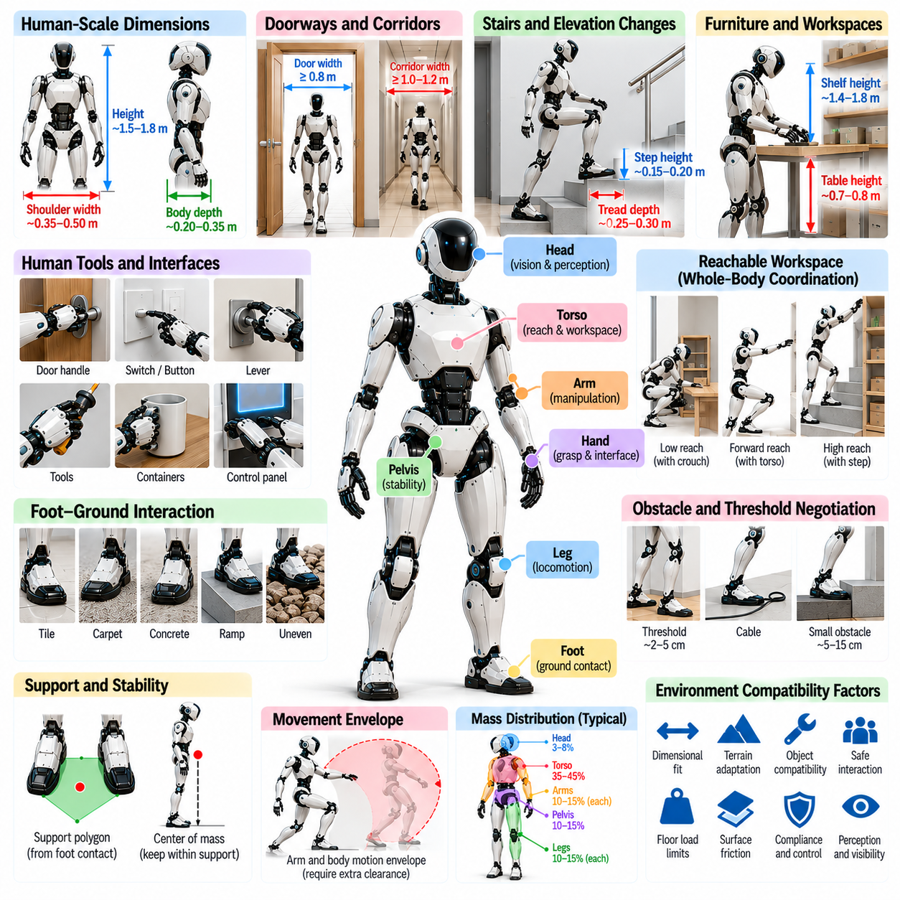{width="7.268055555555556in" height="7.268055555555556in"}

인간 환경 호환성(Human-environment Compatibility)은 휴머노이드 로봇(Humanoid Robot)이 원래 인간을 위해 설계된 공간(Spaces), 기반 시설(Infrastructure), 작업 흐름(Workflows)에서 얼마나 효과적으로 작동할 수 있는지를 설명한다. 특수 목적 산업용 로봇(Specialized Industrial Robots)과 달리 휴머노이드는 광범위한 환경 개조(Environmental Modification) 없이 출입문(Doorways), 복도(Corridors), 계단(Stairs), 가구(Furniture), 작업대(Workstations)를 이용해야 한다. 따라서 휴머노이드 형태(Humanoid Morphology)는 인간 규모의 접근성(Human-scale Accessibility), 기계적 효율(Mechanical Efficiency), 안전성(Safety), 신뢰할 수 있는 물리적 상호작용(Reliable Physical Interaction) 사이의 균형을 유지해야 한다.

인간 환경(Human Environments)은 휴머노이드 신체 비율(Humanoid Body Proportions)에 직접적인 영향을 미치는 치수 제약(Dimensional Constraints)을 부과한다. 전체 높이(Overall Height), 어깨 너비(Shoulder Width), 몸통 깊이(Torso Depth), 사지 길이(Limb Length)는 로봇이 출입문을 통과하고 선반에 도달하며 가구 근처에서 작업할 수 있는지를 결정한다. 인체 측정학적 기준(Anthropometric References)은 유용한 설계 출발점을 제공하지만, 로봇의 치수(Robotic Dimensions)는 운동성(Mobility)을 저해하지 않으면서 구동기(Actuators), 배터리(Batteries), 센서(Sensors), 보호 구조물(Protective Structures)을 수용할 수 있어야 한다.

출입문(Doorways)과 복도(Corridors)는 신체 너비(Body Width)와 기동성(Maneuverability)에 중요한 요구사항을 설정한다. 휴머노이드는 제한된 공간(Restricted Spaces)을 통과할 때 어깨의 외형 범위(Shoulder Envelope), 팔 자세(Arm Posture), 운반 물체(Carried Objects)를 고려해야 한다. 좁은 신체 구성(Narrow Body Configurations)은 통과 여유 공간(Clearance)을 개선하며, 관절형 어깨(Articulated Shoulders)와 몸통 회전(Torso Rotation)은 이동 중 유효 너비(Effective Width)를 줄일 수 있다. 충돌 회피(Collision Avoidance)는 고정된 기하학적 점유 영역(Fixed Geometric Footprint)이 아니라 움직이는 신체 전체(Entire Moving Body)를 고려해야 한다.

계단(Stairs)과 높이 변화(Elevation Changes)는 다리 길이(Leg Length), 관절 운동성(Joint Mobility), 발 형상(Foot Geometry)에 따라 달라지는 과제를 제시한다. 인간용 계단(Human Staircases)은 일반적으로 특정 범위의 계단 높이(Step Height)와 디딤판 깊이(Tread Depth)를 전제로 하지만, 실제 치수는 건물마다 다르다. 휴머노이드의 무릎(Knees)과 고관절(Hips)은 충분한 장애물 통과 여유 공간(Clearance)을 제공해야 하며, 발목 관절 운동(Ankle Articulation)은 안정적인 접촉(Stable Contact)을 지원한다. 신뢰할 수 있는 계단 이동(Stair Negotiation)에는 인지(Perception), 균형 제어(Balance Control), 충분한 구동기 토크(Actuator Torque)도 필요하다.

가구 호환성(Furniture Compatibility)은 로봇이 일상적인 조작 작업(Everyday Manipulation Tasks)을 수행하는 능력에 영향을 미친다. 테이블(Tables), 책상(Desks), 캐비닛(Cabinets), 조리대(Countertops)는 작업 높이(Working Heights)와 접근 제한(Access Restrictions)을 결정한다. 팔 도달 범위(Arm Reach), 몸통 운동성(Torso Mobility), 신체 깊이(Body Depth)는 휴머노이드가 과도하게 몸을 굽히거나 위치를 변경하지 않고 이러한 표면과 상호작용할 수 있는지를 결정한다. 기능적 작업 공간 분석(Functional Workspace Analysis)은 이상화된 도달 범위(Idealized Reach)만이 아니라 실제적인 장애물(Realistic Obstacles)과 접촉 제약(Contact Constraints)을 포함해야 한다.

인간용 도구(Human Tools)와 인터페이스(Interfaces)는 추가적인 형태학적 요구사항(Morphological Requirements)을 발생시킨다. 문손잡이(Door Handles), 스위치(Switches), 버튼(Buttons), 레버(Levers), 휴대용 장비(Handheld Equipment)는 특정 파지 형상(Grasp Shapes)과 작동력(Operating Forces)을 전제로 설계된다. 휴머노이드 손(Humanoid Hands)은 이러한 인터페이스를 조작할 수 있도록 적절한 손가락 형상(Finger Geometry), 접촉 표면(Contact Surfaces), 힘 생성 능력(Force Capability)을 제공해야 한다. 그러나 단순한 말단 효과기(Simpler End Effectors)로 의도된 작업을 수행할 수 있다면 기능적 호환성(Functional Compatibility)을 위해 반드시 완전한 인간형 손(Fully Anthropomorphic Hands)이 필요한 것은 아니다.

손 크기(Hand Size)와 손가락 관절 운동(Finger Articulation)은 인간의 파지(Human Grasping)를 위해 설계된 물체와의 호환성(Compatibility)에 영향을 미친다. 도구 손잡이(Tool Handles), 용기(Containers), 제어 장치(Control Devices)는 정밀 집기(Precision Pinching), 원통형 파지(Cylindrical Grasping), 제어된 힘 적용(Controlled Force Application)을 요구할 수 있다. 엄지 대립 운동(Thumb Opposition)과 손목 운동성(Wrist Mobility)은 접근 가능한 상호작용(Accessible Interactions)의 범위를 확장한다. 설계자는 조작성(Dexterity), 내구성(Durability), 구동기 배치(Actuator Packaging), 촉각 센싱(Tactile Sensing), 유지보수 요구사항(Maintenance Requirements) 사이의 균형을 유지해야 한다.

작업 공간 접근성(Workspace Accessibility)은 팔(Arms), 몸통(Torso), 하체(Lower Body)의 결합된 움직임에 따라 결정된다. 휴머노이드는 물체를 집기 위해 쪼그리거나(Crouching), 높은 선반을 향해 팔을 뻗거나, 작업대(Workstation)에 접근하기 위해 측면으로 발을 내디뎌야 할 수 있다. 이러한 작업에는 협응된 관절 운동성(Coordinated Joint Mobility)과 안정적인 지지(Stable Support)가 필요하다. 따라서 인간 환경 호환성(Human-environment Compatibility)은 개별 사지(Individual Limbs)의 특성이 아니라 전신 특성(Whole-body Property)이다.

인간 환경(Human Environments)의 지면 표면(Ground Surfaces)은 타일(Tiles), 카펫(Carpets), 콘크리트(Concrete), 경사로(Ramps), 불규칙한 실외 보행로(Irregular Outdoor Paths) 등 매우 다양하다. 발 형태(Foot Morphology)는 마찰(Friction), 유연성(Compliance), 표면 형상(Surface Geometry)의 차이에 대응할 수 있어야 한다. 발바닥 재료(Sole Materials)는 접지력(Traction)과 접촉 안정성(Contact Stability)에 영향을 미치며, 발목 운동성(Ankle Mobility)은 방향 조정(Orientation Adjustments)을 지원한다. 지나치게 특수화된 발(Excessively Specialized Feet)은 특정 표면에서는 우수한 성능을 보일 수 있지만, 조건이 변화하면 신뢰성이 떨어질 수 있다.

문턱(Thresholds), 케이블(Cables), 바닥 연결부(Floor Transitions), 작은 장애물(Small Obstacles)은 추가적인 이동 제약(Mobility Constraints)을 발생시킨다. 발 이격 높이(Foot Clearance)는 무릎 굴곡(Knee Flexion), 고관절 운동(Hip Articulation), 다리 비율(Leg Proportions)에 따라 결정된다. 큰 발(Larger Feet)은 지지(Support)의 일부 측면을 개선할 수 있지만 환경 장애물(Environmental Obstacles)에 걸릴 위험을 증가시킬 수 있다. 따라서 형태 설계(Morphological Design)는 접촉 안정성(Contact Stability), 장애물 통과 여유 공간(Obstacle Clearance), 복잡한 인간 공간(Cluttered Human Spaces)에서의 소형화된 움직임(Compact Movement) 사이의 균형을 유지해야 한다.

인간 환경(Human Environments)에는 큰 상호작용력(Interaction Forces)을 견딜 수 없는 물체와 구조물도 존재한다. 문(Doors), 가구(Furniture), 전자 장비(Electronic Equipment), 깨지기 쉬운 물체(Fragile Items)는 제어된 접촉(Controlled Contact)과 예측 가능한 움직임(Predictable Motion)을 요구한다. 기계적 유연성(Mechanical Compliance)은 예상하지 못한 접촉(Unexpected Contact) 중 최대 힘(Peak Forces)을 줄일 수 있으며, 토크 센싱(Torque Sensing)은 힘 조절(Force Regulation)을 지원한다. 안전한 상호작용(Safe Interaction)은 적절한 물리적 설계(Physical Design), 반응성 높은 제어(Responsive Control), 정확한 환경 인지(Accurate Environmental Perception)의 결합에 따라 결정된다.

로봇의 질량 분포(Mass Distribution)는 바닥(Floors), 플랫폼(Platforms), 지지 구조물(Supporting Structures)과의 호환성에 영향을 미친다. 무거운 휴머노이드(Heavy Humanoids)는 특히 동적 발 내딛기(Dynamic Stepping)나 충격(Impact) 중 상당한 접촉 하중(Contact Loads)을 발생시킨다. 발 접촉 면적(Foot Area)과 접촉 유연성(Contact Compliance)은 압력 분포(Pressure Distribution)에 영향을 미치며, 보행 거동(Gait Behavior)은 순간적인 하중(Transient Loading)을 결정한다. 설계자는 인간이 접근할 수 있는 구조물이 로봇 하중도 자동으로 지지할 수 있다고 가정하지 않고 표면 하중 한계(Surface Load Limits)와 운영 조건(Operational Conditions)을 평가해야 한다.

공간적 호환성(Spatial Compatibility)에는 로봇의 동적 운동 범위(Dynamic Movement Envelope)도 포함된다. 팔(Arms)은 회전(Turning), 조작(Manipulation), 균형 회복(Balance Recovery) 중 몸통(Torso) 바깥으로 뻗어 나갈 수 있다. 정지 상태에서 통로를 통과할 수 있는 구성(Configuration)이라도 움직이는 동안에는 추가적인 여유 공간(Additional Clearance)이 필요할 수 있다. 동작 계획(Motion Planning)은 특히 사람들과 공유하는 제한된 환경(Confined Environments)에서 관절 궤적(Joint Trajectories), 운반 물체(Carried Objects), 가능한 보정 운동(Corrective Movements)을 고려해야 한다.

시각 센서 배치(Visual and Sensor Placement)는 휴머노이드가 인간 환경(Human Environments)을 얼마나 효과적으로 해석할 수 있는지에 영향을 미친다. 머리 장착 카메라(Head-mounted Cameras)는 내비게이션(Navigation)과 조작(Manipulation)에 유용한 관측 시점(Perspectives)을 제공하며, 몸통 및 손목 센서(Torso and Wrist Sensors)는 작업 표면(Working Surfaces) 근처의 가림 현상(Occlusion)을 줄일 수 있다. 센서 높이(Sensor Height)와 방향(Orientation)은 계단(Stairs), 손잡이(Handles), 장애물(Obstacles)의 가시성(Visibility)에 영향을 미친다. 형태학적 통합(Morphological Integration)은 변화하는 자세(Postures)와 조작 구성(Manipulation Configurations) 전반에서 유용한 센싱 범위(Sensing Coverage)를 유지해야 한다.

인간 중심 기반 시설(Human-centered Infrastructure)은 여러 수직 높이(Vertical Levels)에서의 상호작용을 요구하는 경우가 많다. 물체는 바닥 근처(Near the Floor), 허리 높이(Waist Height), 어깨 위(Above the Shoulders), 밀폐된 보관 공간(Enclosed Storage Spaces) 내부에 위치할 수 있다. 다리 관절 운동(Leg Articulation), 몸통 굽힘(Torso Bending), 팔 도달 범위(Arm Reach)는 접근성(Accessibility)을 함께 결정한다. 편안한 기립 높이(Comfortable Standing Height)에서의 조작만을 고려한 설계는 환경의 상당 부분을 기능적으로 접근할 수 없는 상태(Functionally Inaccessible)로 남길 수 있다.

사회적 호환성(Social Compatibility)은 단순한 기하학적 접근성(Geometric Access)을 넘어서는 요구사항을 도입한다. 사람 근처에서 작동하는 휴머노이드는 예측 가능한 움직임(Predictable Movement)을 유지하고 개인 공간(Personal Space)에 대한 불필요한 침범을 피하며, 이해하기 쉬운 행동(Understandable Behavior)을 통해 물리적 의도(Physical Intentions)를 전달해야 한다. 신체 비율(Body Proportions)과 관절 배치(Joint Arrangements)는 움직임에 대한 인식(Perceived Movement)과 충돌 위험(Collision Risk)에 영향을 미친다. 그러나 인간과 유사한 외형(Humanlike Appearance)만으로 안전하거나 사회적으로 적절한 상호작용(Socially Appropriate Interaction)이 보장되는 것은 아니다.

유지보수 및 배치 제약(Maintenance and Deployment Constraints)도 환경 호환성(Environmental Compatibility)에 영향을 미친다. 로봇은 엘리베이터(Elevators)에 탑승하고 서비스 복도(Service Corridors)를 통과하며 충전 스테이션(Charging Stations)을 이용하고 보관 공간(Storage Areas)에 접근해야 할 수 있다. 구성요소 접근성(Component Accessibility), 모듈형 구조(Modular Construction), 소형 대기 자세(Compact Resting Postures)는 운영을 단순화할 수 있다. 형태(Morphology)는 작업 수행(Task Execution)뿐 아니라 운송(Transportation), 점검(Inspection), 복구(Recovery), 기존 시설(Existing Facilities) 내 일상적인 유지보수(Routine Maintenance)도 지원해야 한다.

환경 호환성(Environmental Compatibility)은 실제적인 적재 하중 조건(Realistic Payload Conditions)에서 평가되어야 한다. 상자(Boxes), 도구(Tools), 장비(Equipment)를 운반하면 로봇의 유효 치수(Effective Dimensions), 질량 중심(Center of Mass), 충돌 외형 범위(Collision Envelope)가 변화한다. 큰 물체(Large Objects)는 센서(Sensors)를 가리거나 팔 움직임(Arm Movement)을 제한할 수 있으며, 무거운 하중(Heavy Loads)은 사용 가능한 균형 여유도(Balance Margins)를 감소시킨다. 실제적인 평가(Practical Evaluation)에는 무부하 이동(Unloaded Movement)만이 아니라 대표적인 물체(Representative Objects), 보행 경로(Walking Routes), 조작 순서(Manipulation Sequences)가 포함되어야 한다.

접근성 요구사항(Accessibility Requirements)은 가정(Homes), 병원(Hospitals), 사무실(Offices), 공장(Factories), 공공 기반 시설(Public Infrastructure)에 따라 달라진다. 넓은 산업용 통로(Wide Industrial Aisles)에 최적화된 형태(Morphology)는 좁은 주거 공간(Compact Residential Spaces)에서 어려움을 겪을 수 있으며, 소형 서비스 휴머노이드(Small Service Humanoid)는 창고 작업(Warehouse Operations)에 필요한 도달 범위(Reach)나 힘(Strength)이 부족할 수 있다. 설계자는 신체 치수(Body Dimensions), 관절 운동 범위(Joint Ranges), 조작 능력(Manipulation Capabilities)을 선택하기 전에 목표 환경(Target Environments)과 운영 제약(Operational Constraints)을 식별해야 한다.

표준화(Standardization)는 물리적 인터페이스(Physical Interfaces), 안전성(Safety), 성능(Performance)에 대한 측정 가능한 요구사항(Measurable Requirements)을 정의함으로써 호환성을 지원할 수 있다. 관련 치수와 지표에는 로봇 통과 여유 공간(Robot Clearance), 도달 가능한 작업 공간(Reachable Workspace), 접촉력(Contact Forces), 작동 범위(Operating Envelopes)가 포함된다. 기존 건축 및 장비 표준(Existing Building and Equipment Standards)은 환경적 제약(Contextual Constraints)을 제공하지만, 완전한 휴머노이드 설계 요구사항(Complete Humanoid Design Requirements)을 자동으로 확립하지는 않는다. 검증(Validation)은 형태학적 사양(Morphological Specifications)을 실제 배치 조건(Actual Deployment Conditions)과 연결해야 한다.

인간 환경 호환성(Human-environment Compatibility)은 궁극적으로 신체 형상(Body Geometry), 관절 운동(Articulation), 센싱(Sensing), 접촉 역학(Contact Mechanics), 안전한 제어(Safe Control)의 통합에 따라 결정된다. 성공적인 휴머노이드(Successful Humanoid)는 광범위한 재구축(Extensive Reconstruction) 없이 기존 기반 시설(Existing Infrastructure)을 이동하고 일반적인 물체(Common Objects)를 조작하며 환경 변화(Environmental Variation)에 적응할 수 있어야 한다. 핵심 목표는 단순한 해부학적 모방(Anatomical Imitation)이 아니라 작업 지향적 형태(Task-oriented Morphology)를 통해 인간 공간(Human Spaces)과의 기능적 상호운용성(Functional Interoperability)을 달성하는 것이다.

## 06.11. General Purpose Humanoid Morphology

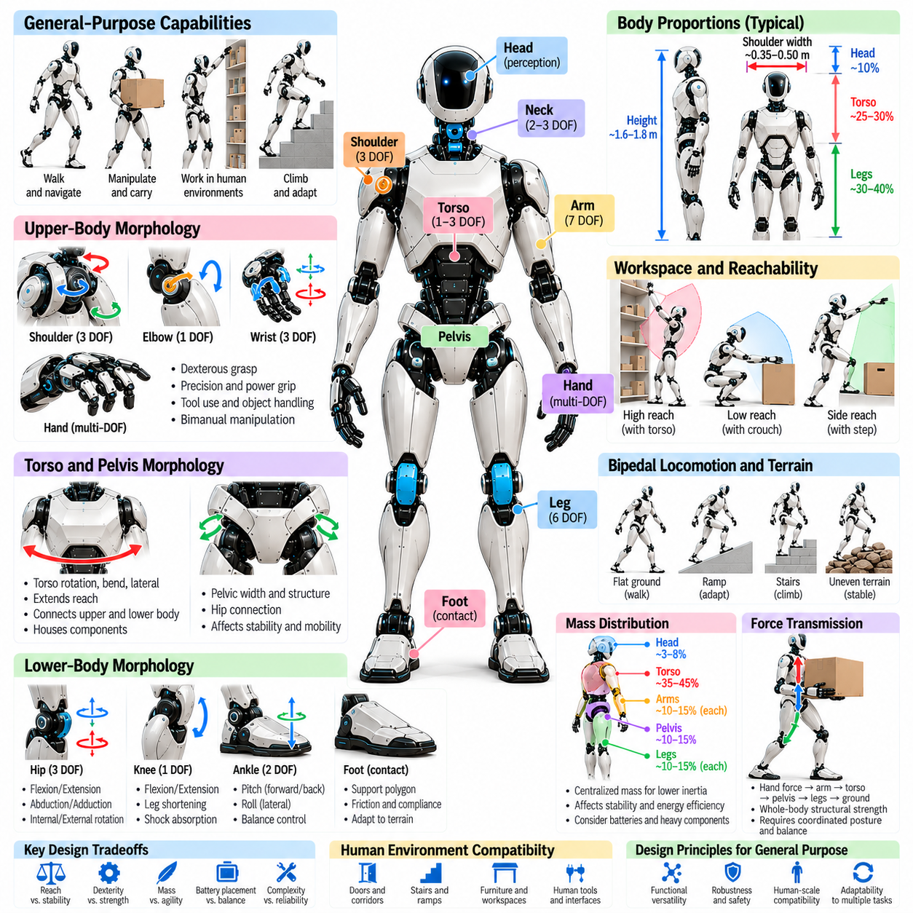{width="7.268055555555556in" height="7.268055555555556in"}

범용 휴머노이드 형태(General-purpose Humanoid Morphology)는 광범위한 기계적 재설계(Mechanical Redesign) 없이 다양한 환경에서 여러 물리적 작업(Physical Tasks)을 수행하도록 설계된 로봇 신체 구조(Robotic Body Architecture)를 설명한다. 제한된 작업에 최적화된 특수 목적 로봇(Specialized Robots)과 달리 범용 휴머노이드(General-purpose Humanoids)는 이동(Locomotion), 조작(Manipulation), 인지(Perception), 물리적 상호작용(Physical Interaction) 사이의 균형을 유지해야 한다. 이러한 형태는 단일 작업에서의 최대 성능보다 기능적 범용성(Functional Versatility), 적응성(Adaptability), 신뢰할 수 있는 작동(Reliable Operation)을 강조한다.

핵심 과제(Central Challenge)는 불필요한 기계적 복잡성(Mechanical Complexity)을 피하면서 다양한 활동을 지원하는 신체 구성(Body Configuration)을 선택하는 것이다. 휴머노이드는 물체에 도달하고 인간 공간(Human Spaces)을 이동하며 하중(Loads)을 운반하고 변화하는 조건에서 균형(Balance)을 유지해야 한다. 각각의 능력은 관절 운동성(Joint Mobility), 구동기 출력(Actuator Strength), 신체 비율(Body Proportions), 구조 설계(Structural Design)에 서로 다른 요구사항을 부과한다. 따라서 범용 형태(General-purpose Morphology)는 신중하게 관리된 공학적 절충(Engineering Tradeoffs)을 통해 형성된다.

인간형 신체 구조(Anthropomorphic Body Architecture)는 많은 환경과 도구가 인간의 신체 치수(Human Dimensions)를 기준으로 설계되어 있으므로 실용적인 기반을 제공한다. 두 다리(Two Legs)는 계단과 좁은 통로를 통한 이동을 가능하게 하며, 두 팔(Two Arms)은 물체 조작(Manipulation)과 운반(Object Transportation)을 지원한다. 그러나 해부학적 유사성(Anatomical Similarity)만으로 범용 성능(General-purpose Performance)이 보장되는 것은 아니다. 로봇의 신체 비율(Robotic Proportions)과 메커니즘(Mechanisms)은 단순한 생물학적 모방(Biological Imitation)이 아니라 기능적 요구사항(Functional Requirements)에 따라 선택되어야 한다.

신체 비율(Body Proportions)은 작업 공간(Workspaces), 가구(Furniture), 도구(Tools), 기반 시설(Infrastructure)과의 호환성을 결정한다. 전체 높이(Overall Height)는 도달 범위(Reach)와 환경 접근성(Environmental Access)에 영향을 미치며, 어깨 너비(Shoulder Width)는 통로 통과 여유 공간(Passage Clearance)과 양팔 조작(Dual-arm Manipulation)에 영향을 미친다. 다리 길이(Leg Length)는 발 내딛기 능력(Stepping Capabilities)을 결정하고, 몸통 치수(Torso Dimensions)는 구성요소 배치(Component Packaging)를 제약한다. 효과적인 신체 비율은 과도한 질량(Excessive Mass), 불리한 지레 작용(Unfavorable Leverage), 불필요한 충돌 위험(Collision Risks)을 발생시키지 않으면서 대표적인 작업(Representative Tasks)을 수용해야 한다.

자유도(Degrees of Freedom)는 휴머노이드가 수행할 수 있는 운동 범위(Range of Movements)를 결정한다. 여러 어깨 관절(Shoulder Joints), 고관절(Hip Joints), 손목 관절(Wrist Joints)은 유연한 조작(Flexible Manipulation)과 이동(Locomotion)을 지원하며, 몸통 관절 운동(Torso Articulation)은 전신 도달 가능성(Whole-body Reachability)을 확장한다. 추가적인 관절(Additional Joints)은 적응성(Adaptability)을 높이지만 무게(Weight), 비용(Cost), 제어 복잡성(Control Complexity)도 증가시킨다. 범용 설계(General-purpose Design)는 관절 운동을 무조건 극대화하기보다 다양한 작업을 수행하는 데 충분한 운동성(Mobility)을 확보해야 한다.

팔과 손의 형태(Arm and Hand Morphology)는 유용한 조작 행동(Manipulation Behaviors)의 범위에 큰 영향을 미친다. 다관절 팔(Multi-joint Arms)은 도달 가능성(Reachability)과 자세 유연성(Posture Flexibility)을 제공하며, 손(Hands)은 물체 및 도구와의 물리적 접촉(Physical Contact)을 형성한다. 정교한 손가락(Dexterous Fingers)은 복잡한 파지(Complex Grasping)를 지원하지만, 단순한 그리퍼(Simpler Grippers)는 더 높은 힘(Strength)과 신뢰성(Reliability)을 제공할 수 있다. 범용 휴머노이드는 조작 범용성(Manipulation Versatility), 내구성(Durability), 적재 하중 능력(Payload Capability), 유지보수성(Maintainability) 사이의 균형을 유지해야 한다.

양손 조작(Bimanual Manipulation)은 크거나 불규칙하거나 무거운 물체를 취급할 때 특히 중요하다. 협응된 두 팔(Coordinated Arms)은 하중(Loads)을 분산하고 물체를 안정화하며 상호 보완적인 동작(Complementary Actions)을 수행할 수 있다. 어깨 배치(Shoulder Placement), 팔 길이(Arm Length), 손목 운동성(Wrist Mobility), 몸통 관절 운동(Torso Articulation)은 사용 가능한 양팔 작업 공간(Dual-arm Workspace)을 결정한다. 형태 설계(Morphological Design)는 팔 사이의 과도한 간섭(Interference)을 발생시키거나 균형(Balance)을 저해하지 않으면서 협응 조작(Coordinated Manipulation)을 지원해야 한다.

하체 형태(Lower-body Morphology)는 휴머노이드가 물리적 작업(Physical Tasks) 중 자신의 위치를 변경하고 안정적인 지지(Stable Support)를 유지할 수 있는지를 결정한다. 고관절(Hip), 무릎(Knee), 발목 관절(Ankle Joints)은 발 내딛기(Stepping), 쪼그리기(Crouching), 방향 전환(Turning), 자세 조정(Posture Adjustment)을 가능하게 한다. 발 형상(Foot Geometry)은 지면 접촉(Ground Contact)과 균형 회복(Balance Recovery)에 영향을 미친다. 범용 설계는 평탄한 바닥(Flat Floors), 경사로(Ramps), 계단(Stairs), 중간 수준의 표면 불규칙성(Moderate Surface Irregularities)에 대응하면서 신뢰할 수 있는 이동(Reliable Locomotion)과 관리 가능한 에너지 소비(Manageable Energy Consumption)를 유지해야 한다.

골반(Pelvis)과 몸통(Torso)은 공유된 기계적 구조(Shared Mechanical Structure)를 통해 이동(Locomotion)과 조작(Manipulation)을 연결한다. 몸통 회전(Torso Rotation)과 굽힘(Bending)은 도달 가능한 작업 공간(Reachable Workspace)을 확장하며, 골반 운동(Pelvic Motion)은 신체 위치(Body Position)와 하중 분포(Load Distribution)를 변화시킨다. 이러한 움직임은 질량 중심(Center of Mass)과 관절 하중(Joint Loading)에도 영향을 미친다. 효과적인 전신 형태(Whole-body Morphology)는 모든 조작 작업에서 광범위한 발 이동(Foot Movement)에 의존하지 않고도 협응된 위치 재조정(Coordinated Repositioning)을 가능하게 한다.

질량 분포(Mass Distribution)는 동적 성능(Dynamic Performance)을 결정하는 주요 요소이다. 무거운 구성요소(Heavy Components)를 몸통(Torso)이나 골반(Pelvis) 근처에 배치하면 사지 말단의 관성(Distal Limb Inertia)을 줄여 운동 효율(Movement Efficiency)과 응답성(Responsiveness)을 개선할 수 있다. 그러나 중앙 집중형 구성요소 배치(Centralized Packaging)는 열적 제약(Thermal Constraints), 구조적 제약(Structural Constraints), 유지보수 제약(Maintenance Constraints)을 발생시킨다. 배터리 배치(Battery Placement), 구동기 구조(Actuator Architecture), 컴퓨팅 하드웨어(Computing Hardware)는 적절한 균형(Balance), 관성(Inertia), 정비 접근성(Service Accessibility)을 달성하도록 통합되어야 한다.

구동 구조(Actuation Architecture)는 보행(Walking), 들어 올리기(Lifting), 도달 동작(Reaching), 유연한 상호작용(Compliant Interaction)을 포함한 다양한 작동 모드(Operating Modes)를 지원해야 한다. 하중을 지탱하는 움직임(Load-bearing Movements)에는 높은 토크(High Torque)를 발생시키는 관절이 필요하며, 섬세한 조작(Delicate Manipulation)에는 정밀한 저하중 제어(Precise Low-force Control)가 중요하다. 전기 구동기(Electric Actuators), 동력 전달 장치(Transmissions), 탄성 요소(Elastic Elements)는 토크 밀도(Torque Density), 효율(Efficiency), 강성(Stiffness), 역구동성(Backdrivability) 측면에서 서로 다른 특성을 제공한다. 단일 구성(Single Configuration)으로 모든 요구사항을 최적화할 수는 없다.

기계적 유연성(Mechanical Compliance)은 휴머노이드가 불확실한 표면(Uncertain Surfaces), 물체(Objects), 외력(External Forces)에 직면했을 때 적응성(Adaptability)을 향상시킨다. 유연한 관절(Compliant Joints)과 접촉 인터페이스(Contact Interfaces)는 충격 하중(Impact Loads)을 줄이고 작은 위치 오차(Positioning Errors)를 허용할 수 있다. 그러나 과도한 유연성(Excessive Flexibility)은 정밀도(Precision)를 낮추고 동적 제어(Dynamic Control)를 복잡하게 만들 수 있다. 범용 형태(General-purpose Morphology)는 견고한 움직임(Robust Movement)과 제어된 상호작용(Controlled Interaction)에 모두 적합하도록 강성(Stiffness)과 감쇠 특성(Damping Characteristics)을 신중하게 선택해야 한다.

전신 협응(Whole-body Coordination)은 팔(Arms), 몸통(Torso), 골반(Pelvis), 다리(Legs) 사이의 기계적 호환성(Mechanical Compatibility)에 따라 결정된다. 물체를 들어 올리는 휴머노이드는 실현 가능한 지면 접촉(Feasible Ground Contacts)을 유지하면서 전체 구조에 힘(Forces)을 분배해야 한다. 중복 관절(Redundant Joints)은 충돌 회피(Collision Avoidance)와 하중 관리(Load Management)를 위한 대안적인 자세(Alternative Postures)를 제공한다. 따라서 형태 설계(Morphological Design)는 이동(Locomotion)과 조작(Manipulation)을 독립적인 기능으로 취급하기보다 결합된 운동 능력(Combined Movement Capabilities)을 평가해야 한다.

인지 하드웨어(Perception Hardware)는 이동성(Mobility)이나 조작(Manipulation)을 방해하지 않도록 통합되어야 한다. 머리 장착 카메라(Head-mounted Cameras)는 내비게이션(Navigation)과 물체 인식(Object Recognition)을 지원할 수 있으며, 손목 및 몸통 센서(Wrist and Torso Sensors)는 상호 보완적인 관측 시점(Complementary Viewpoints)을 제공한다. 관성 센서(Inertial Sensors)와 관절 엔코더(Joint Encoders)는 신체 상태 추정(Body-state Estimation)을 지원하고, 촉각 센서(Tactile Sensors)는 접촉 인식(Contact Awareness)을 개선한다. 센서 배치(Sensor Placement)는 다양한 자세(Postures)와 환경 조건(Environmental Conditions)에서 유용한 관측 범위(Observation Coverage)를 유지해야 한다.

모듈성(Modularity)은 로봇 전체를 재설계하지 않고 구성요소(Components)를 유지보수하거나 교체하거나 조정할 수 있도록 하여 범용 배치(General-purpose Deployment)를 지원한다. 교체 가능한 손(Interchangeable Hands), 정비 가능한 관절 모듈(Serviceable Joint Modules), 접근하기 쉬운 배터리 시스템(Accessible Battery Systems)은 운영 유연성(Operational Flexibility)을 향상시킬 수 있다. 그러나 모듈형 인터페이스(Modular Interfaces)는 추가적인 질량(Mass), 부피(Volume), 기계적 제약(Mechanical Constraints)을 발생시킨다. 이러한 이점은 구조적 무결성(Structural Integrity)과 전체 시스템 복잡성(Overall System Complexity)을 고려하여 평가해야 한다.

에너지 용량(Energy Capacity)과 열 관리(Thermal Management)는 형태(Morphology)에 중요한 제약을 부과한다. 배터리(Batteries)는 귀중한 내부 공간(Internal Volume)을 차지하고 상당한 질량(Mass)을 추가하며, 구동기(Actuators)와 컴퓨팅 시스템(Computing Systems)은 열(Heat)을 발생시킨다. 소형 구조(Compact Structures)는 냉각 경로(Cooling Pathways)와 유지보수 접근성(Maintenance Access)을 제한할 수 있다. 실용적인 휴머노이드(Practical Humanoid)는 균형(Balance), 기계적 강도(Mechanical Strength), 환경 호환성(Environmental Compatibility)을 저해하지 않으면서 지속적인 작동(Sustained Operation)을 지원하도록 이러한 구성요소를 배치해야 한다.

안전성(Safety)은 범용 휴머노이드가 사람(People), 장비(Equipment), 예측하기 어려운 장애물(Unpredictable Obstacles) 근처에서 작동하기 때문에 기본적인 형태학적 요구사항(Fundamental Morphological Requirement)이 된다. 둥근 구조(Rounded Structures), 보호된 관절(Protected Joints), 유연한 접촉 표면(Compliant Contact Surfaces), 제어된 구동기 동작(Controlled Actuator Behavior)은 상호작용 위험(Interaction Hazards)을 줄일 수 있다. 기계적 스토퍼(Mechanical Stops)와 보호 덮개(Protective Coverings)는 비정상 상황(Abnormal Events)에서 손상을 제한하는 데 도움을 준다. 안전성은 소프트웨어 기능(Software Function)만으로 취급하지 않고 신체 구조(Body Architecture)에 통합되어야 한다.

기계적 범용성(Mechanical Versatility)이 증가할수록 신뢰성(Reliability)을 확보하기는 더욱 어려워진다. 수많은 관절(Joints), 동력 전달 장치(Transmissions), 센서(Sensors), 전기 연결부(Electrical Connections)는 추가적인 고장 가능성(Failure Opportunities)을 발생시킨다. 내구성 있는 구조(Durable Structures), 접근하기 쉬운 구성요소(Accessible Components), 고장 허용 운영 전략(Fault-tolerant Operating Strategies)은 유지보수성(Maintainability)을 개선한다. 범용 형태(General-purpose Morphology)는 특히 지속적인 기술 감독(Continuous Technical Supervision) 없이 장시간 작동해야 하는 경우 예측 가능한 동작(Predictable Behavior)과 복구 가능성(Recoverability)을 우선해야 한다.

작업 다양성(Task Diversity)을 확보하려면 대표적인 운영 시나리오(Representative Operational Scenarios) 전반에서 형태(Morphology)를 평가해야 한다. 출입문 통과(Walking Through a Doorway), 계단 오르기(Climbing Stairs), 용기 들어 올리기(Lifting a Container), 캐비닛 열기(Opening a Cabinet), 소형 도구 조작(Manipulating a Small Tool)은 서로 다른 물리적 요구사항(Physical Demands)을 부과한다. 특정 시나리오에서 우수한 성능을 보이는 설계가 다른 시나리오에서는 어려움을 겪을 수 있다. 따라서 평가(Evaluation)는 여러 작업에 걸쳐 작업 공간 범위(Workspace Coverage), 관절 하중(Joint Loading), 안정성(Stability), 에너지 소비(Energy Consumption), 상호작용 신뢰성(Interaction Reliability)을 고려해야 한다.

형태학적 최적화(Morphological Optimization)는 도달 가능성(Reachability), 적재 하중 용량(Payload Capacity), 안정성(Stability), 효율(Efficiency), 비용(Cost), 유지보수성(Maintainability)을 포함하는 다목적 설계 문제(Multi-objective Design Problem)로 정식화할 수 있다. 시뮬레이션(Simulation)과 물리적 시험(Physical Testing)은 신체 치수(Body Dimensions), 관절 배치(Joint Arrangements), 구동기 배치(Actuator Placement) 사이의 절충 관계(Tradeoffs)를 파악하는 데 도움을 준다. 목표는 보편적으로 최적인 휴머노이드 형태(Universally Optimal Humanoid Shape)가 아니라 정의된 운영 영역(Defined Operational Domain) 전반에서 균형 잡힌 성능(Balanced Performance)을 달성하는 구성을 찾는 것이다.

범용 능력(General-purpose Capability)은 형태(Morphology)와 제어 지능(Control Intelligence) 사이의 관계에 따라서도 결정된다. 학습 기반 제어기(Learning-based Controllers)는 중복성(Redundancy)과 적응형 접촉 동작(Adaptable Contact Behavior)을 활용할 수 있지만, 물리적 관절 한계(Physical Joint Limits), 구동기 용량(Actuator Capacity), 구조적 형상(Structural Geometry)에 의해 여전히 제약을 받는다. 기계적 설계(Mechanical Design)는 지능형 제어(Intelligent Control)가 작동할 수 있는 실현 가능한 행동 공간(Feasible Action Space)을 설정한다. 따라서 효과적인 개발(Effective Development)을 위해서는 신체 구현(Embodiment)과 제어(Control)의 협응된 최적화(Coordinated Optimization)가 필요하다.

범용 휴머노이드 형태(General-purpose Humanoid Morphology)는 궁극적으로 특수화(Specialization)와 적응성(Adaptability) 사이의 절충을 나타낸다. 성공적인 구조(Successful Architectures)는 인간 환경과 호환되는 신체 비율(Human-compatible Proportions), 관절형 사지(Articulated Limbs), 안정적인 이동(Stable Locomotion), 정교한 조작(Dexterous Manipulation), 적절한 질량 분포(Appropriate Mass Distribution), 유지보수가 가능한 기계 시스템(Maintainable Mechanical Systems)을 통합한다. 이러한 구조의 핵심 성과는 해부학적 사실성(Anatomical Realism)이 아니라 실제 인간 환경(Practical Human Environments)에서 다양한 물리적 작업(Physical Tasks)을 안전하고 효율적이며 신뢰성 있게 수행하는 능력이다.
