**Volume 03. Embodiment and Morphology**


# Chapter 07. Quadruped Morphology

##  

## 07.01. Quadruped Morphology Overview

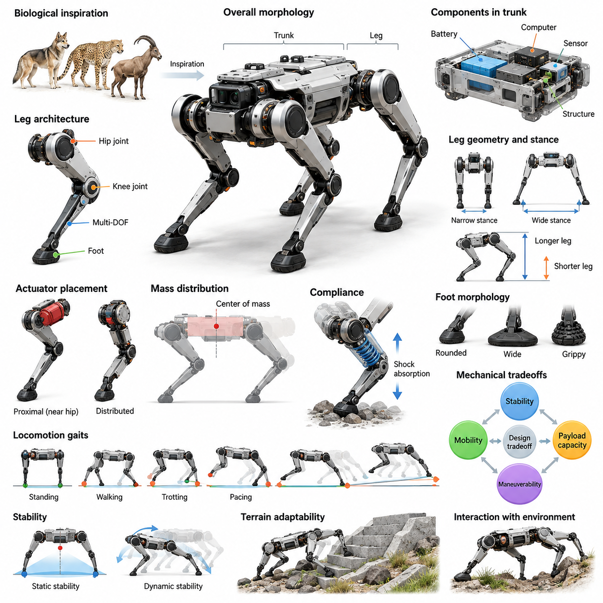{width="7.268055555555556in" height="7.268055555555556in"}

Quadruped morphology refers to the physical configuration of robots that use four articulated legs for locomotion, balance, and interaction with their surroundings. It encompasses the arrangement of the trunk, limbs, joints, actuators, and contact surfaces, together with their geometric and mechanical relationships. These structural characteristics determine how a quadruped supports its weight, generates motion, and responds to external forces.

Quadruped robots occupy an important position within embodied intelligence because their physical structure enables mobility across environments that challenge conventional wheeled platforms. Four independently controlled legs allow a robot to select footholds, adjust body posture, and negotiate uneven surfaces. Their capabilities emerge from continuous interactions among mechanical design, sensing, control algorithms, and environmental conditions.

Biological quadrupeds provide valuable inspiration for robotic morphology. Mammals demonstrate diverse limb proportions, joint arrangements, spinal structures, and locomotion strategies adapted to different ecological conditions. Robotic systems borrow selected principles from these biological examples while accommodating engineering constraints such as electric actuation, structural rigidity, manufacturing complexity, and computational control requirements.

The fundamental architecture of a quadruped consists of a central trunk connected to four articulated limbs. The trunk accommodates batteries, computing hardware, sensors, and supporting structures, while the legs generate forces required for standing and movement. The relative dimensions and mechanical properties of these components influence stability, maneuverability, payload capacity, and the ability to maintain reliable ground contact.

Leg architecture is a defining element of quadruped morphology. Each leg typically contains multiple joints that provide controlled movement in different directions, commonly including hip and knee articulation. Three actuated degrees of freedom per leg are frequently employed, although alternative configurations exist. Joint placement, rotational axes, link lengths, and mechanical limits collectively determine the reachable workspace of each foot.

The relationship between leg geometry and stance configuration strongly influences locomotion performance. A wider stance can increase the available support region, while a narrower configuration may improve passage through confined spaces. Longer legs can increase obstacle clearance and reachable foothold distance, but may introduce greater structural loading and control challenges. Morphological design must balance these competing requirements.

Mass distribution is another fundamental consideration in quadruped design. The position of the center of mass relative to the feet affects static stability, dynamic balance, and the distribution of ground reaction forces. Concentrating heavy components near the trunk can reduce limb inertia and improve responsiveness. However, packaging constraints, thermal requirements, and payload placement may complicate ideal mass distribution.

Actuator placement directly influences the mechanical behavior of the legs. Motors positioned near the hip can reduce distal limb mass, enabling faster leg movements and potentially lowering energy expenditure during swing phases. Alternatively, distributed actuation may simplify mechanical transmission or improve packaging flexibility. Each arrangement introduces tradeoffs involving torque delivery, efficiency, structural complexity, and maintenance accessibility.

Compliance plays an essential role in managing interactions between quadruped feet and the environment. Elastic components, compliant joints, and controlled actuator impedance can absorb impacts and reduce peak contact forces. Appropriate compliance may improve traction and tolerance to terrain irregularities, but excessive flexibility can reduce positioning accuracy. Effective designs coordinate mechanical compliance with feedback control.

Foot morphology determines how forces are transmitted between the robot and the ground. Small rounded feet may support agile movement over relatively firm surfaces, whereas broader contact areas can improve pressure distribution on softer terrain. Friction properties, contact geometry, and surface materials influence slipping, impact behavior, and foothold reliability. Foot design must therefore reflect anticipated operating environments.

Quadruped locomotion includes standing, walking, trotting, pacing, bounding, and other movement patterns. Different gaits produce distinct combinations of support phases, swing trajectories, and body dynamics. Morphology affects which gaits are mechanically feasible and energetically practical. Limb inertia, joint range, trunk proportions, and actuator capabilities jointly determine the achievable operating envelope.

Static and dynamic stability represent complementary aspects of quadruped performance. During slow walking, stability can often be evaluated using the relationship between the projected center of mass and the support polygon. During faster movement, momentum, contact timing, and force regulation become increasingly important. Consequently, quadruped morphology must support both geometrically stable postures and dynamically controlled motion.

Terrain adaptability is a major motivation for selecting quadruped architectures. Independently articulated legs can accommodate differences in ground elevation and reposition contact points around obstacles. This capability supports movement across stairs, rubble, slopes, and irregular outdoor surfaces. Nevertheless, successful traversal depends on sufficient joint workspace, available traction, accurate perception, and appropriate locomotion control.

Trunk geometry contributes to both mobility and functional integration. A compact body can improve maneuverability and reduce interference with nearby obstacles, while a longer trunk may provide additional space for payloads and equipment. Trunk width affects leg mounting positions and lateral stability. Structural stiffness must also be sufficient to withstand repeated loading without introducing excessive mass or undesirable deformation.

Payload carrying introduces additional morphological requirements. Increased payload mass changes the center of mass, joint loading, ground reaction forces, and energy consumption. Quadrupeds intended for logistics or inspection equipment may require reinforced trunks, higher-capacity actuators, and adjustable mounting interfaces. Payload integration must preserve sufficient stability and mobility throughout the intended operating conditions.

Quadrupeds can also incorporate robotic manipulators to perform tasks beyond locomotion. A mounted arm enables object handling, inspection, and interaction with infrastructure, but introduces additional mass and changing reaction forces. Manipulation may require coordinated body positioning, stance adjustment, and whole-body control. The resulting system combines locomotion and manipulation within a shared mechanical and dynamic architecture.

Energy efficiency remains a critical limitation of legged mobility. Repeated acceleration of limbs, support of body weight, and compensation for mechanical losses consume electrical energy. Morphological choices such as lightweight links, efficient transmissions, elastic energy storage, and favorable joint geometry can reduce these demands. However, improvements in efficiency must be evaluated against strength, controllability, and durability.

The distinction between rigid and compliant morphology also affects control complexity. Highly rigid structures support predictable kinematic relationships and precise force transmission, whereas compliant elements can passively accommodate impacts and disturbances. These passive mechanical responses represent forms of morphological computation. Appropriate physical design can therefore reduce some control demands without eliminating the need for active stabilization.

Quadruped morphology is closely connected to perception and state estimation. Joint encoders, inertial sensors, and contact measurements provide information about body posture, limb configuration, and environmental interaction. The placement of these sensors influences observability and measurement reliability. Mechanical vibration, structural deformation, and contact uncertainty must be considered when integrating sensing with the physical platform.

Morphological differences also influence learning-based locomotion. Policies trained for one quadruped may not transfer directly to another because of variations in joint limits, actuator dynamics, body proportions, and mass distribution. Morphology-aware learning can incorporate physical parameters into policy observations or training environments. Such approaches support adaptation while recognizing that mechanical capabilities impose fundamental constraints.

Simulation provides an important environment for evaluating quadruped designs before physical construction. Engineers can investigate link dimensions, actuator specifications, foot contact properties, and mass distribution under varied terrain conditions. Physics-based simulation enables comparison of stability, mobility, and energy requirements. However, simulation results must be validated against real hardware because contact and actuator models remain imperfect.

Safety and reliability are integral considerations in quadruped morphology. Mechanical joint limits, structural safety factors, protective enclosures, and controlled compliance help reduce damage during unexpected contact or falls. The robot must tolerate repeated impacts, vibration, and environmental exposure. Morphological robustness is particularly important when systems operate near people or in locations where recovery and maintenance are difficult.

Quadruped platforms are increasingly relevant to industrial inspection, infrastructure monitoring, research, emergency response, and mobile sensing. Each application imposes different physical requirements involving size, payload, terrain access, endurance, and environmental protection. A compact inspection robot and a heavy-duty transport quadruped may therefore share a four-legged architecture while requiring substantially different morphological configurations.

No single quadruped morphology optimizes every performance objective. Designs emphasizing high-speed locomotion may favor lightweight limbs and powerful actuators, while payload-oriented systems prioritize structural strength and sustained force production. Rough-terrain platforms may require larger joint workspaces and greater ground clearance. These competing objectives make morphology selection a multi-objective engineering problem.

The broader significance of quadruped morphology lies in its contribution to physical intelligence. Mechanical structure does not merely execute commands generated by software; it shapes the available actions, environmental interactions, and learning opportunities of the robot. Understanding quadruped morphology therefore provides a foundation for integrating mechanical design, locomotion control, perception, and adaptive behavior into capable Physical AI systems.

사족보행 로봇 형태(Quadruped Morphology)는 이동(Locomotion), 균형(Balance), 주변 환경과의 상호작용(Interaction)을 위해 네 개의 관절형 다리(Articulated Legs)를 사용하는 로봇의 물리적 구성(Physical Configuration)을 의미한다. 여기에는 몸통(Trunk), 사지(Limbs), 관절(Joints), 구동기(Actuators), 접촉면(Contact Surfaces)의 배치와 기하학적 및 기계적 관계가 포함된다. 이러한 구조적 특성은 사족보행 로봇이 자체 무게를 지지하고 움직임을 생성하며 외부 힘에 대응하는 방식을 결정한다.

사족보행 로봇(Quadruped Robots)은 기존 바퀴형 플랫폼(Wheeled Platforms)이 이동하기 어려운 환경에서도 이동할 수 있는 물리적 구조를 갖추고 있어 체화 지능(Embodied Intelligence)에서 중요한 위치를 차지한다. 독립적으로 제어되는 네 개의 다리는 발 디딤 위치(Footholds)를 선택하고 몸체 자세(Body Posture)를 조정하며 불규칙한 지형을 통과할 수 있도록 한다. 이러한 능력은 기계적 설계(Mechanical Design), 감지(Sensing), 제어 알고리즘(Control Algorithms), 환경 조건(Environmental Conditions) 사이의 지속적인 상호작용에서 나타난다.

생물학적 사족동물(Biological Quadrupeds)은 로봇 형태 설계에 중요한 영감을 제공한다. 포유류(Mammals)는 서로 다른 생태적 조건에 적응한 다양한 사지 비율(Limb Proportions), 관절 배열(Joint Arrangements), 척추 구조(Spinal Structures), 이동 전략(Locomotion Strategies)을 보여준다. 로봇 시스템은 이러한 생물학적 사례에서 선택적인 원리를 도입하면서 전기 구동(Electric Actuation), 구조적 강성(Structural Rigidity), 제조 복잡성(Manufacturing Complexity), 계산 기반 제어(Computational Control) 등의 공학적 제약을 고려한다.

사족보행 로봇의 기본 구조(Fundamental Architecture)는 중앙 몸통(Central Trunk)과 여기에 연결된 네 개의 관절형 다리(Articulated Limbs)로 구성된다. 몸통에는 배터리(Batteries), 컴퓨팅 하드웨어(Computing Hardware), 센서(Sensors), 지지 구조물(Supporting Structures)이 배치되며, 다리는 기립(Standing)과 이동(Movement)에 필요한 힘을 생성한다. 이러한 구성요소의 상대적 크기와 기계적 특성은 안정성(Stability), 기동성(Maneuverability), 탑재하중 용량(Payload Capacity), 안정적인 지면 접촉(Ground Contact) 유지 능력에 영향을 미친다.

다리 구조(Leg Architecture)는 사족보행 로봇 형태를 정의하는 핵심 요소이다. 각 다리에는 일반적으로 여러 관절(Joints)이 포함되어 다양한 방향으로 제어된 움직임을 제공하며, 대표적으로 엉덩이 관절(Hip Joint)과 무릎 관절(Knee Joint)의 움직임이 포함된다. 다리당 세 개의 구동 자유도(Actuated Degrees of Freedom)가 자주 사용되지만 다른 구성도 존재한다. 관절 위치(Joint Placement), 회전축(Rotational Axes), 링크 길이(Link Lengths), 기계적 한계(Mechanical Limits)는 각 발의 도달 가능 작업공간(Reachable Workspace)을 결정한다.

다리 기하학(Leg Geometry)과 지지 자세 구성(Stance Configuration)의 관계는 이동 성능(Locomotion Performance)에 큰 영향을 미친다. 넓은 지지 자세(Wide Stance)는 지지 영역(Support Region)을 확대할 수 있지만, 좁은 지지 자세(Narrow Stance)는 제한된 공간을 통과하는 능력을 향상시킬 수 있다. 긴 다리(Longer Legs)는 장애물 통과 높이(Obstacle Clearance)와 발 디딤 도달 거리(Foothold Reach)를 증가시키지만 구조적 하중(Structural Loading)과 제어상의 어려움을 증가시킬 수 있다. 따라서 형태 설계(Morphological Design)는 이러한 상충 요구사항 사이에서 균형을 유지해야 한다.

질량 분포(Mass Distribution)는 사족보행 로봇 설계에서 또 다른 핵심 고려사항이다. 발의 위치에 대한 질량중심(Center of Mass)의 상대적 위치는 정적 안정성(Static Stability), 동적 균형(Dynamic Balance), 지면 반력(Ground Reaction Forces)의 분포에 영향을 미친다. 무거운 구성요소를 몸통(Trunk) 가까이에 집중시키면 다리 관성(Limb Inertia)을 줄이고 응답성(Responsiveness)을 향상시킬 수 있다. 그러나 부품 배치 제약(Packaging Constraints), 열 관리 요구사항(Thermal Requirements), 탑재하중 배치(Payload Placement) 때문에 이상적인 질량 분포를 구현하기 어려울 수 있다.

구동기 배치(Actuator Placement)는 다리의 기계적 거동(Mechanical Behavior)에 직접적인 영향을 미친다. 모터(Motors)를 엉덩이 관절(Hip Joint) 가까이에 배치하면 다리 말단 질량(Distal Limb Mass)을 줄여 빠른 다리 움직임을 가능하게 하고 유각기(Swing Phase)의 에너지 소비를 잠재적으로 감소시킬 수 있다. 반면 분산 구동(Distributed Actuation)은 기계적 동력 전달(Mechanical Transmission)을 단순화하거나 부품 배치 유연성(Packaging Flexibility)을 향상시킬 수 있다. 각 배치 방식에는 토크 전달(Torque Delivery), 효율(Efficiency), 구조적 복잡성(Structural Complexity), 유지보수 접근성(Maintenance Accessibility) 사이의 절충관계가 존재한다.

순응성(Compliance)은 사족보행 로봇의 발과 환경 사이에서 발생하는 상호작용을 관리하는 데 필수적인 역할을 한다. 탄성 구성요소(Elastic Components), 순응 관절(Compliant Joints), 제어된 구동기 임피던스(Controlled Actuator Impedance)는 충격을 흡수하고 최대 접촉력(Peak Contact Forces)을 줄일 수 있다. 적절한 순응성은 접지력(Traction)과 지형 불규칙성에 대한 허용 능력을 향상시킬 수 있지만, 지나친 유연성(Flexibility)은 위치 정확도(Positioning Accuracy)를 감소시킬 수 있다. 효과적인 설계는 기계적 순응성과 피드백 제어(Feedback Control)를 조화롭게 결합한다.

발 형태(Foot Morphology)는 로봇과 지면 사이에서 힘이 전달되는 방식을 결정한다. 작고 둥근 발(Small Rounded Feet)은 비교적 단단한 표면에서 민첩한 움직임을 지원할 수 있으며, 넓은 접촉면(Broader Contact Areas)은 부드러운 지형에서 압력 분포(Pressure Distribution)를 개선할 수 있다. 마찰 특성(Friction Properties), 접촉 기하학(Contact Geometry), 표면 재료(Surface Materials)는 미끄러짐(Slipping), 충격 거동(Impact Behavior), 발 디딤 신뢰성(Foothold Reliability)에 영향을 미친다. 따라서 발 설계는 예상 운용 환경(Operating Environments)을 반영해야 한다.

사족보행 이동(Quadruped Locomotion)에는 기립(Standing), 걷기(Walking), 트로트 보행(Trotting), 페이스 보행(Pacing), 바운딩 보행(Bounding) 및 기타 이동 패턴(Movement Patterns)이 포함된다. 서로 다른 보행 방식(Gaits)은 지지 단계(Support Phases), 유각 궤적(Swing Trajectories), 몸체 동역학(Body Dynamics)의 조합을 다르게 형성한다. 로봇 형태(Morphology)는 어떤 보행 방식이 기계적으로 실현 가능하고 에너지 측면에서 실용적인지를 결정한다. 다리 관성(Limb Inertia), 관절 운동 범위(Joint Range), 몸통 비율(Trunk Proportions), 구동기 성능(Actuator Capabilities)은 달성 가능한 운용 범위(Operating Envelope)를 공동으로 결정한다.

정적 안정성(Static Stability)과 동적 안정성(Dynamic Stability)은 사족보행 로봇 성능의 상호보완적인 측면이다. 느린 보행에서는 질량중심의 투영점(Projected Center of Mass)과 지지 다각형(Support Polygon)의 관계를 이용하여 안정성을 평가할 수 있다. 빠른 움직임에서는 운동량(Momentum), 접촉 시점(Contact Timing), 힘 조절(Force Regulation)의 중요성이 증가한다. 따라서 사족보행 로봇 형태는 기하학적으로 안정적인 자세(Geometrically Stable Postures)와 동적으로 제어되는 움직임(Dynamically Controlled Motion)을 모두 지원해야 한다.

지형 적응성(Terrain Adaptability)은 사족보행 구조를 선택하는 주요 이유 중 하나이다. 독립적으로 관절이 움직이는 다리는 지면 높이 차이(Ground Elevation Differences)에 대응하고 장애물을 피해 접촉 위치(Contact Points)를 재배치할 수 있다. 이러한 능력은 계단(Stairs), 잔해 지형(Rubble), 경사면(Slopes), 불규칙한 야외 표면(Irregular Outdoor Surfaces)에서의 이동을 지원한다. 그러나 성공적인 지형 통과는 충분한 관절 작업공간(Joint Workspace), 확보 가능한 접지력(Available Traction), 정확한 인지(Accurate Perception), 적절한 이동 제어(Locomotion Control)에 달려 있다.

몸통 기하학(Trunk Geometry)은 이동성(Mobility)과 기능적 통합(Functional Integration)에 모두 기여한다. 소형 몸체(Compact Body)는 기동성을 향상시키고 주변 장애물과의 간섭을 줄일 수 있으며, 긴 몸통(Longer Trunk)은 탑재 장비(Payloads and Equipment)를 위한 추가 공간을 제공할 수 있다. 몸통 폭(Trunk Width)은 다리 장착 위치(Leg Mounting Positions)와 측면 안정성(Lateral Stability)에 영향을 미친다. 또한 구조적 강성(Structural Stiffness)은 과도한 질량이나 바람직하지 않은 변형(Deformation)을 유발하지 않으면서 반복적인 하중을 견딜 수 있어야 한다.

탑재하중 운반(Payload Carrying)은 추가적인 형태 설계 요구사항을 발생시킨다. 탑재하중 질량(Payload Mass)이 증가하면 질량중심(Center of Mass), 관절 하중(Joint Loading), 지면 반력(Ground Reaction Forces), 에너지 소비(Energy Consumption)가 변화한다. 물류(Logistics) 또는 검사 장비(Inspection Equipment)를 위한 사족보행 로봇에는 강화된 몸통(Reinforced Trunk), 고용량 구동기(Higher-Capacity Actuators), 조정 가능한 장착 인터페이스(Adjustable Mounting Interfaces)가 필요할 수 있다. 탑재하중 통합(Payload Integration)은 의도된 운용 조건 전반에서 충분한 안정성과 이동성을 유지해야 한다.

사족보행 로봇은 이동 이외의 작업을 수행하기 위해 로봇 매니퓰레이터(Robotic Manipulators)를 통합할 수도 있다. 장착된 로봇 팔(Mounted Arm)은 물체 취급(Object Handling), 검사(Inspection), 기반시설과의 상호작용(Infrastructure Interaction)을 가능하게 하지만 추가 질량과 변화하는 반작용력(Reaction Forces)을 발생시킨다. 조작 작업(Manipulation)에는 몸체 위치 조정(Body Positioning), 지지 자세 조정(Stance Adjustment), 전신 제어(Whole-Body Control)의 협조가 필요할 수 있다. 이러한 시스템은 이동과 조작을 하나의 기계적 및 동역학적 구조 안에 결합한다.

에너지 효율(Energy Efficiency)은 다리 기반 이동(Legged Mobility)의 중요한 제약 요소로 남아 있다. 다리의 반복적인 가속(Repeated Acceleration), 체중 지지(Body Weight Support), 기계적 손실(Mechanical Losses)의 보상에는 전기 에너지(Electrical Energy)가 소비된다. 경량 링크(Lightweight Links), 고효율 동력 전달장치(Efficient Transmissions), 탄성 에너지 저장(Elastic Energy Storage), 유리한 관절 기하학(Favorable Joint Geometry)과 같은 형태 설계 선택은 이러한 에너지 요구량을 줄일 수 있다. 그러나 효율 향상은 강도(Strength), 제어 가능성(Controllability), 내구성(Durability)과 함께 평가해야 한다.

강체 형태(Rigid Morphology)와 순응 형태(Compliant Morphology)의 차이는 제어 복잡성(Control Complexity)에도 영향을 미친다. 높은 강성을 가진 구조(Highly Rigid Structures)는 예측 가능한 운동학적 관계(Kinematic Relationships)와 정확한 힘 전달(Force Transmission)을 지원하는 반면, 순응 요소(Compliant Elements)는 충격과 외란(Disturbances)에 수동적으로 대응할 수 있다. 이러한 수동적 기계 반응(Passive Mechanical Responses)은 형태적 계산(Morphological Computation)의 한 형태에 해당한다. 따라서 적절한 물리적 설계는 능동 안정화(Active Stabilization)의 필요성을 제거하지 않으면서 일부 제어 부담을 줄일 수 있다.

사족보행 로봇 형태는 인지(Perception) 및 상태 추정(State Estimation)과 밀접하게 연결되어 있다. 관절 엔코더(Joint Encoders), 관성 센서(Inertial Sensors), 접촉 측정(Contact Measurements)은 몸체 자세(Body Posture), 다리 구성(Limb Configuration), 환경과의 상호작용(Environmental Interaction)에 관한 정보를 제공한다. 센서 배치(Sensor Placement)는 관측 가능성(Observability)과 측정 신뢰성(Measurement Reliability)에 영향을 미친다. 감지 기능을 물리적 플랫폼에 통합할 때는 기계적 진동(Mechanical Vibration), 구조적 변형(Structural Deformation), 접촉 불확실성(Contact Uncertainty)을 고려해야 한다.

형태적 차이(Morphological Differences)는 학습 기반 이동(Learning-Based Locomotion)에도 영향을 미친다. 특정 사족보행 로봇에서 학습된 정책(Policies)은 관절 한계(Joint Limits), 구동기 동역학(Actuator Dynamics), 몸체 비율(Body Proportions), 질량 분포(Mass Distribution)의 차이 때문에 다른 로봇으로 직접 전이되지 않을 수 있다. 형태 인식 학습(Morphology-Aware Learning)은 물리적 매개변수(Physical Parameters)를 정책 관측값(Policy Observations)이나 학습 환경(Training Environments)에 포함할 수 있다. 이러한 접근법은 기계적 능력이 근본적인 제약을 부과한다는 점을 인정하면서 적응(Adaptation)을 지원한다.

시뮬레이션(Simulation)은 실제 제작 전에 사족보행 로봇 설계를 평가하는 중요한 환경을 제공한다. 엔지니어는 다양한 지형 조건(Terrain Conditions)에서 링크 치수(Link Dimensions), 구동기 사양(Actuator Specifications), 발 접촉 특성(Foot Contact Properties), 질량 분포(Mass Distribution)를 조사할 수 있다. 물리 기반 시뮬레이션(Physics-Based Simulation)은 안정성(Stability), 이동성(Mobility), 에너지 요구사항(Energy Requirements)을 비교할 수 있도록 한다. 그러나 접촉 모델(Contact Models)과 구동기 모델(Actuator Models)은 완전하지 않으므로 시뮬레이션 결과를 실제 하드웨어(Real Hardware)에서 검증해야 한다.

안전성(Safety)과 신뢰성(Reliability)은 사족보행 로봇 형태 설계의 필수 고려사항이다. 기계적 관절 한계(Mechanical Joint Limits), 구조적 안전계수(Structural Safety Factors), 보호 외장(Protective Enclosures), 제어된 순응성(Controlled Compliance)은 예상하지 못한 접촉이나 넘어짐(Falls)으로 인한 손상을 줄이는 데 도움이 된다. 로봇은 반복적인 충격(Repeated Impacts), 진동(Vibration), 환경 노출(Environmental Exposure)을 견딜 수 있어야 한다. 형태적 견고성(Morphological Robustness)은 특히 사람 가까이에서 작동하거나 복구와 유지보수가 어려운 장소에서 운용되는 시스템에 중요하다.

사족보행 플랫폼(Quadruped Platforms)은 산업 검사(Industrial Inspection), 기반시설 모니터링(Infrastructure Monitoring), 연구(Research), 긴급 대응(Emergency Response), 이동형 감지(Mobile Sensing) 분야에서 중요성이 커지고 있다. 각 응용 분야는 크기(Size), 탑재하중(Payload), 지형 접근성(Terrain Access), 운용 지속시간(Endurance), 환경 보호(Environmental Protection)에 대해 서로 다른 물리적 요구사항을 부과한다. 따라서 소형 검사 로봇(Compact Inspection Robot)과 중하중 운반용 사족보행 로봇(Heavy-Duty Transport Quadruped)은 동일한 네 다리 구조를 공유하더라도 상당히 다른 형태 구성을 필요로 할 수 있다.

모든 성능 목표를 동시에 최적화하는 단일 사족보행 형태(Quadruped Morphology)는 존재하지 않는다. 고속 이동(High-Speed Locomotion)을 강조하는 설계는 경량 다리(Lightweight Limbs)와 강력한 구동기(Powerful Actuators)를 선호할 수 있지만, 탑재하중 중심 시스템(Payload-Oriented Systems)은 구조적 강도(Structural Strength)와 지속적인 힘 생성(Sustained Force Production)을 우선한다. 험지 이동 플랫폼(Rough-Terrain Platforms)은 더 넓은 관절 작업공간(Joint Workspaces)과 높은 지상고(Ground Clearance)를 요구할 수 있다. 이러한 경쟁적 목표는 형태 선택(Morphology Selection)을 다목적 공학 최적화 문제(Multi-Objective Engineering Problem)로 만든다.

사족보행 로봇 형태의 보다 넓은 의미는 물리적 지능(Physical Intelligence)에 대한 기여에 있다. 기계적 구조(Mechanical Structure)는 소프트웨어가 생성한 명령을 단순히 실행하는 것이 아니라 로봇이 수행할 수 있는 행동(Available Actions), 환경과의 상호작용(Environmental Interactions), 학습 기회(Learning Opportunities)를 형성한다. 따라서 사족보행 로봇 형태를 이해하는 것은 기계적 설계(Mechanical Design), 이동 제어(Locomotion Control), 인지(Perception), 적응적 행동(Adaptive Behavior)을 통합하여 유능한 피지컬 AI(Physical AI) 시스템을 구현하기 위한 기초가 된다.

##  

## 07.02. Trunk Leg and Joint Architecture (source skips 07.02)

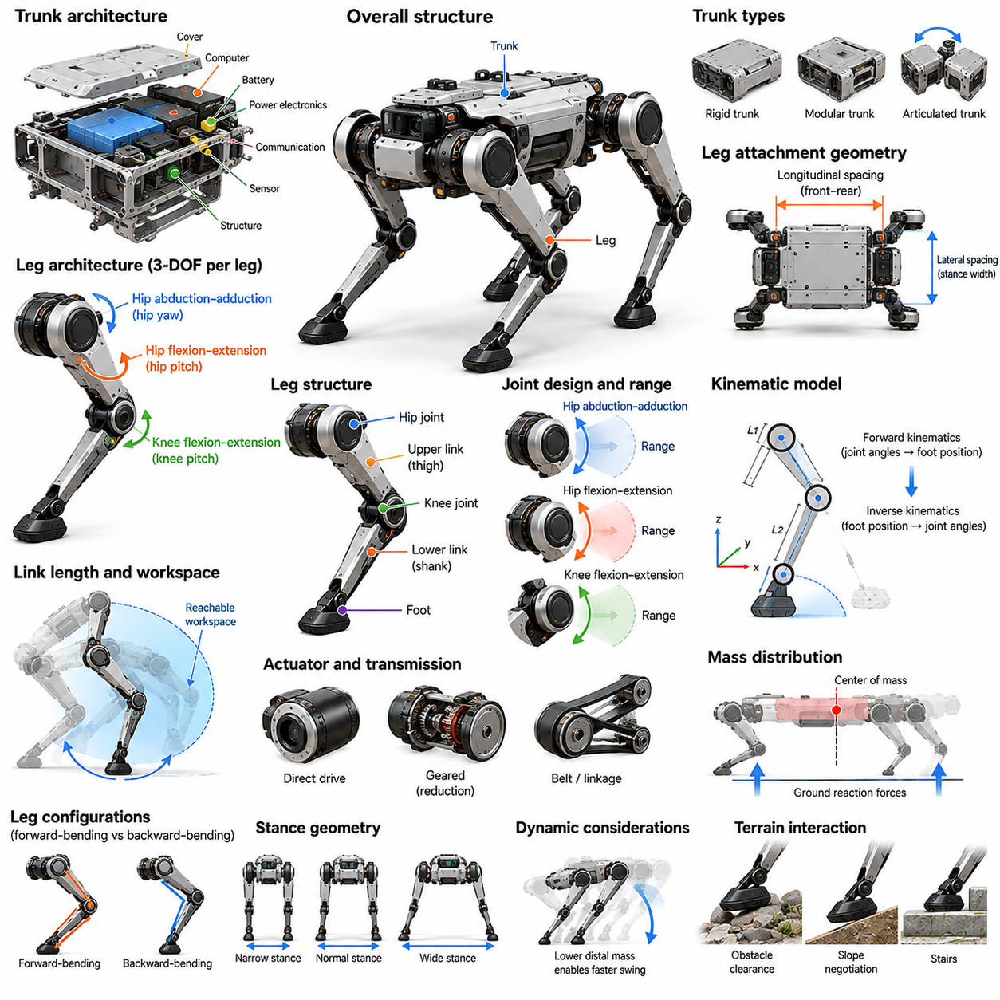{width="7.268055555555556in" height="7.268055555555556in"}

The trunk, leg, and joint architecture of a quadruped robot defines the mechanical foundation of its locomotion and physical interaction capabilities. These components form an interconnected kinematic and dynamic system that supports body weight, generates ground reaction forces, and enables controlled movement. Their geometric arrangement, structural properties, and mechanical interfaces determine stability, maneuverability, efficiency, and adaptability.

The trunk serves as the central structural platform connecting the four legs and supporting essential onboard components. It typically accommodates batteries, computing units, power electronics, communication hardware, and sensing systems. Its geometry influences the robot\'s overall proportions, center of mass, and available mounting space. Effective trunk design balances structural rigidity, compact packaging, accessibility, and resistance to mechanical loading.

Trunk architecture may employ rigid monolithic structures, modular assemblies, or articulated body segments. A rigid trunk simplifies mechanical modeling and provides predictable relationships between leg attachment points. Modular designs facilitate maintenance, component replacement, and platform customization. Articulated trunks can introduce additional mobility and posture adaptation, although they increase mechanical complexity and control requirements.

The spatial arrangement of leg attachment points establishes the quadruped\'s basic stance geometry. Front and rear hip locations determine longitudinal support dimensions, while lateral spacing influences the width of the support region. These dimensions affect turning capability, obstacle negotiation, and body stability. Designers must coordinate attachment geometry with leg reachability, actuator packaging, and expected terrain conditions.

Each leg forms a serial kinematic chain connecting the trunk to the foot. A typical electrically actuated quadruped uses three active degrees of freedom per leg, producing twelve actuated leg degrees of freedom across the platform. This configuration commonly includes hip abduction-adduction, hip flexion-extension, and knee flexion-extension. Alternative architectures may incorporate additional joints, passive elements, or mechanically coupled motions.

The hip abduction-adduction joint enables lateral positioning of the leg relative to the trunk. This motion supports stance-width adjustment, lateral balance regulation, and foothold selection on uneven terrain. Its rotational axis and mechanical range determine the available sideways workspace. Proper hip design must accommodate lateral ground reaction forces while maintaining sufficient structural stiffness and avoiding interference with adjacent components.

The hip flexion-extension joint primarily controls forward and backward leg movement. Together with the knee joint, it determines foot placement along the longitudinal direction and contributes to body height adjustment. Hip actuator torque requirements depend on limb geometry, contact loading, and locomotion dynamics. The placement of the hip rotation axis also influences achievable stride length, joint loading, and mechanical efficiency.

The knee joint provides additional articulation that allows the leg to extend, retract, and adjust its effective length. Knee geometry strongly influences foot clearance, obstacle traversal, and the ability to maintain ground contact during body motion. Mechanical configurations may use forward-bending or backward-bending arrangements. Each configuration produces different workspace boundaries, structural packaging requirements, and collision characteristics.

Leg links are commonly organized into upper and lower segments connected by rotational joints. Their lengths determine the reachable foot workspace and influence the relationship between joint motion and Cartesian foot displacement. Longer links may increase stride capability and ground clearance but can also increase bending loads and rotational inertia. Shorter links favor compact construction while potentially restricting obstacle negotiation.

The kinematic architecture establishes a mathematical relationship between joint angles and foot positions. Forward kinematics calculates the foot location from measured joint configurations, while inverse kinematics determines joint commands for desired foot positions. These relationships depend on link dimensions, joint axes, and coordinate-frame definitions. Accurate kinematic models are essential for coordinated stepping, stance regulation, and trajectory generation.

Joint range of motion determines the practical boundaries of leg movement. Mechanical stops, actuator limits, structural interference, and cable routing restrict the allowable joint configurations. A large theoretical workspace does not necessarily correspond to a fully usable locomotion workspace. Designers must account for singularities, torque limitations, self-collision, and contact constraints when defining operational joint ranges.

The mechanical arrangement of the legs also determines the robot\'s dynamic behavior. Link masses, rotational inertias, and joint positions influence the forces required for acceleration and deceleration. Heavy distal segments increase swing-leg inertia and may reduce achievable stepping frequency. Concentrating mass near proximal joints can improve dynamic responsiveness, although transmission mechanisms may introduce additional friction, compliance, or maintenance requirements.

Actuators may be mounted directly at joints or connected through gears, belts, linkages, and other transmission mechanisms. Direct-drive arrangements can provide favorable force transparency and reduced transmission complexity but may require larger motors. Geared systems increase available joint torque within compact packages while introducing friction and reflected inertia. Transmission selection must consider torque density, efficiency, backdrivability, and durability.

Structural stiffness is essential for maintaining predictable relationships between the trunk, joints, and feet. Excessive deformation can degrade positioning accuracy, alter load distribution, and complicate state estimation. However, completely rigid structures may transmit large impact forces during landing or unexpected contact. Effective mechanical architecture combines sufficient load-bearing stiffness with carefully selected compliance at appropriate locations.

Joint bearings, shafts, housings, and mechanical interfaces must withstand repeated multidirectional loading. During locomotion, each supporting leg experiences changing combinations of axial forces, bending moments, and torsional loads. These loads propagate through the joints into the trunk structure. Mechanical design must therefore address fatigue resistance, alignment accuracy, fastening reliability, and protection against contamination.

The relationship between trunk dimensions and leg proportions influences overall locomotion performance. A long trunk can provide greater longitudinal spacing between support contacts, while a compact trunk may improve turning agility and reduce structural mass. Wider hip placement can improve lateral support geometry but increase the robot\'s physical footprint. Appropriate proportions depend on intended gait patterns, environmental constraints, and payload requirements.

Symmetrical leg architectures simplify manufacturing, modeling, and control by using similar mechanical structures across multiple limbs. Mirrored left-right assemblies are particularly common, although joint orientation and actuator packaging may differ. Standardized components can reduce manufacturing cost and maintenance complexity. Nevertheless, task-specific quadrupeds may benefit from asymmetric arrangements when their operational requirements justify additional complexity.

The trunk-leg interface must transfer substantial mechanical loads while maintaining precise alignment between coordinate frames. Attachment brackets and structural joints experience repeated forces generated by locomotion, impacts, and payload changes. Their stiffness affects both structural integrity and control accuracy. Modular interfaces can support rapid replacement of damaged limbs, but must preserve reliable mechanical fastening and electrical connectivity.

Cable routing and electrical integration are important architectural considerations. Power cables, communication lines, and sensor connections must pass through moving joints without excessive bending, abrasion, or interference. Internal routing can improve protection and reduce external entanglement risks. However, it may complicate assembly and maintenance. Joint design must accommodate wiring motion throughout the complete operating range.

Joint sensing provides the information necessary to estimate limb configuration and support closed-loop control. Rotary encoders measure joint positions, while motor current measurements or dedicated torque sensors can support force estimation. Additional sensing may detect temperature, vibration, or mechanical abnormalities. Sensor placement and calibration must account for transmission compliance, backlash, and differences between motor-side and joint-side motion.

Trunk-mounted inertial sensors complement joint measurements by estimating body orientation and angular motion. Combining inertial information with leg kinematics and contact observations supports estimation of body movement relative to the environment. The physical rigidity between sensors and reference frames influences estimation accuracy. Consequently, mechanical architecture and sensing architecture must be developed as interconnected parts of the same system.

Quadruped joint architecture must also support safe operation under abnormal conditions. Mechanical limits prevent excessive articulation, while protective housings reduce exposure to moving components. Actuator torque limits and controlled impedance can reduce damage during unexpected collisions. Emergency shutdown behavior must consider whether joints remain mechanically supported, become backdrivable, or lose the ability to sustain body weight.

Manufacturing and maintenance requirements influence architectural decisions throughout development. Accessible fasteners, replaceable joint modules, standardized bearings, and serviceable transmission assemblies can reduce operational downtime. Structural components should provide repeatable alignment after disassembly. Designs intended for outdoor deployment additionally require appropriate sealing, corrosion resistance, thermal management, and protection against dust and moisture.

The architecture of a quadruped must ultimately be evaluated as an integrated system rather than a collection of independent components. Trunk stiffness, leg geometry, actuator placement, joint limits, and mass distribution interact to determine achievable locomotion performance. Improvements in one subsystem may introduce disadvantages elsewhere. System-level evaluation is therefore essential for balancing mobility, structural integrity, energy consumption, and controllability.

Within Physical AI, trunk, leg, and joint architecture establishes the physical action space available to intelligent control systems. Learning algorithms and motion planners can optimize behavior only within the mechanical capabilities provided by the body. A well-designed architecture supports reliable sensing, predictable dynamics, adaptable locomotion, and effective environmental interaction. It forms the foundation for morphology-aware control and increasingly autonomous quadruped operation.

사족보행 로봇(Quadruped Robot)의 몸통(Trunk), 다리(Leg), 관절 구조(Joint Architecture)는 이동(Locomotion) 및 물리적 상호작용(Physical Interaction) 능력의 기계적 기반을 정의한다. 이러한 구성요소는 체중을 지지하고 지면 반력(Ground Reaction Forces)을 생성하며 제어된 움직임을 가능하게 하는 상호 연결된 운동학 및 동역학 시스템(Kinematic and Dynamic System)을 형성한다. 구성요소의 기하학적 배치(Geometric Arrangement), 구조적 특성(Structural Properties), 기계적 인터페이스(Mechanical Interfaces)는 안정성(Stability), 기동성(Maneuverability), 효율(Efficiency), 적응성(Adaptability)을 결정한다.

몸통(Trunk)은 네 개의 다리를 연결하고 필수 탑재 구성요소(Onboard Components)를 지지하는 중앙 구조 플랫폼(Central Structural Platform)의 역할을 한다. 일반적으로 배터리(Batteries), 컴퓨팅 장치(Computing Units), 전력 전자장치(Power Electronics), 통신 하드웨어(Communication Hardware), 감지 시스템(Sensing Systems)을 수용한다. 몸통의 기하학적 구조(Geometry)는 로봇의 전체 비율(Overall Proportions), 질량중심(Center of Mass), 장착 가능 공간(Mounting Space)에 영향을 미친다. 효과적인 몸통 설계는 구조적 강성(Structural Rigidity), 소형 부품 배치(Compact Packaging), 접근성(Accessibility), 기계적 하중 저항성(Resistance to Mechanical Loading) 사이의 균형을 유지한다.

몸통 구조(Trunk Architecture)는 강체 일체형 구조(Rigid Monolithic Structures), 모듈형 조립체(Modular Assemblies), 관절형 몸체 분절(Articulated Body Segments)로 구성될 수 있다. 강체 몸통(Rigid Trunk)은 기계적 모델링(Mechanical Modeling)을 단순화하고 다리 부착 지점(Leg Attachment Points) 사이의 예측 가능한 관계를 제공한다. 모듈형 설계(Modular Designs)는 유지보수(Maintenance), 구성요소 교체(Component Replacement), 플랫폼 맞춤화(Platform Customization)를 용이하게 한다. 관절형 몸통(Articulated Trunks)은 추가적인 이동성과 자세 적응(Posture Adaptation)을 제공할 수 있지만 기계적 복잡성(Mechanical Complexity)과 제어 요구사항(Control Requirements)을 증가시킨다.

다리 부착 지점(Leg Attachment Points)의 공간적 배치(Spatial Arrangement)는 사족보행 로봇의 기본 지지 자세 기하학(Basic Stance Geometry)을 형성한다. 전방 및 후방 엉덩이 관절 위치(Front and Rear Hip Locations)는 종방향 지지 치수(Longitudinal Support Dimensions)를 결정하며, 측면 간격(Lateral Spacing)은 지지 영역(Support Region)의 폭에 영향을 미친다. 이러한 치수는 회전 능력(Turning Capability), 장애물 통과(Obstacle Negotiation), 몸체 안정성(Body Stability)에 영향을 준다. 설계자는 부착 지점의 기하학적 구조를 다리 도달 가능성(Leg Reachability), 구동기 배치(Actuator Packaging), 예상 지형 조건(Expected Terrain Conditions)과 조화시켜야 한다.

각 다리(leg)는 몸통과 발을 연결하는 직렬 운동학 체인(Serial Kinematic Chain)을 형성한다. 일반적인 전기 구동 사족보행 로봇(Electrically Actuated Quadruped)은 다리당 세 개의 능동 자유도(Active Degrees of Freedom)를 사용하며, 플랫폼 전체에 총 12개의 구동 다리 자유도(Actuated Leg Degrees of Freedom)를 제공한다. 이러한 구성에는 일반적으로 엉덩이 외전·내전(Hip Abduction-Adduction), 엉덩이 굴곡·신전(Hip Flexion-Extension), 무릎 굴곡·신전(Knee Flexion-Extension)이 포함된다. 대안적 구조(Alternative Architectures)에는 추가 관절(Additional Joints), 수동 요소(Passive Elements), 기계적으로 결합된 움직임(Mechanically Coupled Motions)이 포함될 수 있다.

엉덩이 외전·내전 관절(Hip Abduction-Adduction Joint)은 몸통에 대한 다리의 측면 위치 조정(Lateral Positioning)을 가능하게 한다. 이러한 움직임은 지지 자세 폭 조정(Stance-Width Adjustment), 측면 균형 조절(Lateral Balance Regulation), 불규칙한 지형에서의 발 디딤 위치 선택(Foothold Selection)을 지원한다. 회전축(Rotational Axis)과 기계적 운동 범위(Mechanical Range)는 사용 가능한 측면 작업공간(Sideways Workspace)을 결정한다. 적절한 엉덩이 관절 설계는 충분한 구조적 강성(Structural Stiffness)을 유지하고 인접 구성요소와의 간섭(Interference)을 방지하면서 측면 지면 반력(Lateral Ground Reaction Forces)을 수용해야 한다.

엉덩이 굴곡·신전 관절(Hip Flexion-Extension Joint)은 주로 다리의 전후 움직임(Forward and Backward Leg Movement)을 제어한다. 이 관절은 무릎 관절(Knee Joint)과 함께 종방향 발 위치(Foot Placement)를 결정하고 몸체 높이 조정(Body Height Adjustment)에 기여한다. 엉덩이 구동기 토크 요구사항(Hip Actuator Torque Requirements)은 다리 기하학(Limb Geometry), 접촉 하중(Contact Loading), 이동 동역학(Locomotion Dynamics)에 따라 달라진다. 엉덩이 회전축(Hip Rotation Axis)의 위치는 달성 가능한 보폭(Stride Length), 관절 하중(Joint Loading), 기계적 효율(Mechanical Efficiency)에도 영향을 미친다.

무릎 관절(Knee Joint)은 다리가 신장(Extension), 수축(Retraction)하고 유효 길이(Effective Length)를 조정할 수 있도록 추가적인 관절 운동(Articulation)을 제공한다. 무릎 기하학(Knee Geometry)은 발의 지면 이격 높이(Foot Clearance), 장애물 통과(Obstacle Traversal), 몸체 움직임 중 지면 접촉(Ground Contact)을 유지하는 능력에 큰 영향을 미친다. 기계적 구성(Mechanical Configurations)은 전방 굴곡(Forward-Bending) 또는 후방 굴곡(Backward-Bending) 구조를 사용할 수 있다. 각 구성은 서로 다른 작업공간 경계(Workspace Boundaries), 구조적 부품 배치 요구사항(Structural Packaging Requirements), 충돌 특성(Collision Characteristics)을 나타낸다.

다리 링크(Leg Links)는 일반적으로 회전 관절(Rotational Joints)로 연결된 상부 및 하부 분절(Upper and Lower Segments)로 구성된다. 링크 길이(Link Lengths)는 발의 도달 가능 작업공간(Reachable Foot Workspace)을 결정하고 관절 움직임과 직교좌표계 발 변위(Cartesian Foot Displacement) 사이의 관계에 영향을 미친다. 긴 링크(Longer Links)는 보폭 능력(Stride Capability)과 지상고(Ground Clearance)를 증가시킬 수 있지만 굽힘 하중(Bending Loads)과 회전 관성(Rotational Inertia)도 증가시킬 수 있다. 짧은 링크(Shorter Links)는 소형 구조(Compact Construction)에 유리하지만 장애물 통과 능력(Obstacle Negotiation)을 제한할 수 있다.

운동학적 구조(Kinematic Architecture)는 관절 각도(Joint Angles)와 발 위치(Foot Positions) 사이의 수학적 관계(Mathematical Relationship)를 정의한다. 순기구학(Forward Kinematics)은 측정된 관절 구성(Joint Configurations)으로부터 발 위치를 계산하며, 역기구학(Inverse Kinematics)은 원하는 발 위치에 필요한 관절 명령(Joint Commands)을 결정한다. 이러한 관계는 링크 치수(Link Dimensions), 관절 축(Joint Axes), 좌표계 정의(Coordinate-Frame Definitions)에 따라 달라진다. 정확한 운동학 모델(Kinematic Models)은 협조된 발 디딤(Coordinated Stepping), 지지 자세 조절(Stance Regulation), 궤적 생성(Trajectory Generation)에 필수적이다.

관절 운동 범위(Joint Range of Motion)는 다리 움직임의 실질적인 경계(Practical Boundaries)를 결정한다. 기계적 스토퍼(Mechanical Stops), 구동기 한계(Actuator Limits), 구조적 간섭(Structural Interference), 케이블 배선(Cable Routing)은 허용 가능한 관절 구성(Allowable Joint Configurations)을 제한한다. 이론적으로 넓은 작업공간(Theoretical Workspace)이 반드시 완전히 사용 가능한 이동 작업공간(Usable Locomotion Workspace)을 의미하지는 않는다. 설계자는 운용 관절 범위(Operational Joint Ranges)를 정의할 때 특이점(Singularities), 토크 한계(Torque Limitations), 자체 충돌(Self-Collision), 접촉 제약(Contact Constraints)을 고려해야 한다.

다리의 기계적 배치(Mechanical Arrangement)는 로봇의 동적 거동(Dynamic Behavior)도 결정한다. 링크 질량(Link Masses), 회전 관성(Rotational Inertias), 관절 위치(Joint Positions)는 가속과 감속에 필요한 힘에 영향을 미친다. 무거운 말단 분절(Heavy Distal Segments)은 유각 다리 관성(Swing-Leg Inertia)을 증가시키고 달성 가능한 발 디딤 주파수(Stepping Frequency)를 감소시킬 수 있다. 질량을 근위 관절(Proximal Joints) 가까이에 집중시키면 동적 응답성(Dynamic Responsiveness)을 향상시킬 수 있지만, 동력 전달 기구(Transmission Mechanisms)는 추가적인 마찰(Friction), 순응성(Compliance), 유지보수 요구사항(Maintenance Requirements)을 발생시킬 수 있다.

구동기(Actuators)는 관절에 직접 장착하거나 기어(Gears), 벨트(Belts), 링크 기구(Linkages), 기타 동력 전달 기구(Transmission Mechanisms)를 통해 연결할 수 있다. 직접 구동 방식(Direct-Drive Arrangements)은 양호한 힘 전달 투명성(Force Transparency)과 낮은 동력 전달 복잡성(Reduced Transmission Complexity)을 제공할 수 있지만 더 큰 모터(Larger Motors)가 필요할 수 있다. 기어 구동 시스템(Geared Systems)은 소형 구조에서 사용 가능한 관절 토크(Joint Torque)를 증가시키지만 마찰(Friction)과 반사 관성(Reflected Inertia)을 발생시킨다. 동력 전달 방식의 선택은 토크 밀도(Torque Density), 효율(Efficiency), 역구동성(Backdrivability), 내구성(Durability)을 고려해야 한다.

구조적 강성(Structural Stiffness)은 몸통, 관절, 발 사이의 예측 가능한 관계를 유지하는 데 필수적이다. 과도한 변형(Excessive Deformation)은 위치 정확도(Positioning Accuracy)를 저하시키고 하중 분포(Load Distribution)를 변화시키며 상태 추정(State Estimation)을 복잡하게 만들 수 있다. 그러나 완전히 강체인 구조(Completely Rigid Structures)는 착지(Landing) 또는 예상하지 못한 접촉(Unexpected Contact) 과정에서 큰 충격력을 전달할 수 있다. 효과적인 기계적 구조(Mechanical Architecture)는 충분한 하중 지지 강성(Load-Bearing Stiffness)과 적절한 위치에 선택적으로 적용된 순응성(Compliance)을 결합한다.

관절 베어링(Joint Bearings), 축(Shafts), 하우징(Housings), 기계적 인터페이스(Mechanical Interfaces)는 반복적인 다방향 하중(Multidirectional Loading)을 견딜 수 있어야 한다. 이동 중 각 지지 다리(Supporting Leg)는 축방향 힘(Axial Forces), 굽힘 모멘트(Bending Moments), 비틀림 하중(Torsional Loads)의 변화하는 조합을 경험한다. 이러한 하중은 관절을 통해 몸통 구조(Trunk Structure)로 전달된다. 따라서 기계적 설계는 피로 저항성(Fatigue Resistance), 정렬 정확도(Alignment Accuracy), 체결 신뢰성(Fastening Reliability), 오염 방지(Protection Against Contamination)를 고려해야 한다.

몸통 치수(Trunk Dimensions)와 다리 비율(Leg Proportions)의 관계는 전체 이동 성능(Locomotion Performance)에 영향을 미친다. 긴 몸통(Long Trunk)은 지지 접촉점(Support Contacts) 사이의 종방향 간격(Longitudinal Spacing)을 확대할 수 있으며, 소형 몸통(Compact Trunk)은 회전 민첩성(Turning Agility)을 향상시키고 구조적 질량(Structural Mass)을 줄일 수 있다. 넓은 엉덩이 관절 배치(Wider Hip Placement)는 측면 지지 기하학(Lateral Support Geometry)을 개선할 수 있지만 로봇의 물리적 점유 공간(Physical Footprint)을 증가시킨다. 적절한 비율은 의도된 보행 패턴(Gait Patterns), 환경적 제약(Environmental Constraints), 탑재하중 요구사항(Payload Requirements)에 따라 달라진다.

대칭형 다리 구조(Symmetrical Leg Architectures)는 여러 다리에 유사한 기계적 구조(Mechanical Structures)를 사용하여 제조(Manufacturing), 모델링(Modeling), 제어(Control)를 단순화한다. 좌우 대칭 조립체(Mirrored Left-Right Assemblies)는 특히 일반적이지만 관절 방향(Joint Orientation)과 구동기 배치(Actuator Packaging)는 서로 다를 수 있다. 표준화된 구성요소(Standardized Components)는 제조 비용(Manufacturing Cost)과 유지보수 복잡성(Maintenance Complexity)을 줄일 수 있다. 그러나 작업 특화 사족보행 로봇(Task-Specific Quadrupeds)은 운용 요구사항이 추가적인 복잡성을 정당화하는 경우 비대칭 배치(Asymmetric Arrangements)를 통해 이점을 얻을 수 있다.

몸통과 다리의 인터페이스(Trunk-Leg Interface)는 좌표계(Coordinate Frames) 사이의 정확한 정렬을 유지하면서 상당한 기계적 하중(Mechanical Loads)을 전달해야 한다. 부착 브래킷(Attachment Brackets)과 구조적 접합부(Structural Joints)는 이동, 충격, 탑재하중 변화로 발생하는 반복적인 힘을 받는다. 이러한 구성요소의 강성(Stiffness)은 구조적 무결성(Structural Integrity)과 제어 정확도(Control Accuracy)에 모두 영향을 미친다. 모듈형 인터페이스(Modular Interfaces)는 손상된 다리의 신속한 교체를 지원할 수 있지만 신뢰할 수 있는 기계적 체결(Mechanical Fastening)과 전기적 연결(Electrical Connectivity)을 유지해야 한다.

케이블 배선(Cable Routing)과 전기적 통합(Electrical Integration)은 중요한 구조 설계 고려사항이다. 전력 케이블(Power Cables), 통신선(Communication Lines), 센서 연결부(Sensor Connections)는 과도한 굽힘(Bending), 마모(Abrasion), 간섭(Interference) 없이 움직이는 관절을 통과해야 한다. 내부 배선(Internal Routing)은 보호 성능을 향상시키고 외부 얽힘 위험(External Entanglement Risks)을 줄일 수 있다. 그러나 조립(Assembly)과 유지보수(Maintenance)를 복잡하게 만들 수 있다. 관절 설계는 전체 운용 범위(Operating Range)에서 배선의 움직임을 수용해야 한다.

관절 감지(Joint Sensing)는 다리 구성(Limb Configuration)을 추정하고 폐루프 제어(Closed-Loop Control)를 지원하는 데 필요한 정보를 제공한다. 회전 엔코더(Rotary Encoders)는 관절 위치(Joint Positions)를 측정하며, 모터 전류 측정(Motor Current Measurements) 또는 전용 토크 센서(Dedicated Torque Sensors)는 힘 추정(Force Estimation)을 지원할 수 있다. 추가적인 감지 기능은 온도(Temperature), 진동(Vibration), 기계적 이상(Mechanical Abnormalities)을 감지할 수 있다. 센서 배치(Sensor Placement)와 보정(Calibration)은 동력 전달 순응성(Transmission Compliance), 백래시(Backlash), 모터 측과 관절 측 움직임의 차이(Differences Between Motor-Side and Joint-Side Motion)를 고려해야 한다.

몸통에 장착된 관성 센서(Trunk-Mounted Inertial Sensors)는 몸체 방향(Body Orientation)과 각운동(Angular Motion)을 추정하여 관절 측정(Joint Measurements)을 보완한다. 관성 정보(Inertial Information)를 다리 운동학(Leg Kinematics) 및 접촉 관측(Contact Observations)과 결합하면 환경에 대한 몸체 움직임(Body Movement)을 추정할 수 있다. 센서와 기준 좌표계(Reference Frames) 사이의 물리적 강성(Physical Rigidity)은 추정 정확도(Estimation Accuracy)에 영향을 미친다. 따라서 기계적 구조(Mechanical Architecture)와 감지 구조(Sensing Architecture)는 동일한 시스템의 상호 연결된 부분으로 개발해야 한다.

사족보행 로봇의 관절 구조(Joint Architecture)는 비정상 조건(Abnormal Conditions)에서도 안전한 운용(Safe Operation)을 지원해야 한다. 기계적 한계(Mechanical Limits)는 과도한 관절 운동(Excessive Articulation)을 방지하며, 보호 하우징(Protective Housings)은 움직이는 구성요소(Moving Components)에 대한 노출을 줄인다. 구동기 토크 제한(Actuator Torque Limits)과 제어된 임피던스(Controlled Impedance)는 예상하지 못한 충돌(Unexpected Collisions)에서 손상을 줄일 수 있다. 비상 정지 동작(Emergency Shutdown Behavior)은 관절이 기계적으로 지지되는지, 역구동 가능 상태(Backdrivable)가 되는지, 또는 체중을 지탱할 능력을 상실하는지를 고려해야 한다.

제조(Manufacturing)와 유지보수(Maintenance) 요구사항은 개발 전 과정에서 구조적 설계 결정(Architectural Decisions)에 영향을 미친다. 접근 가능한 체결부(Accessible Fasteners), 교체 가능한 관절 모듈(Replaceable Joint Modules), 표준화된 베어링(Standardized Bearings), 정비 가능한 동력 전달 조립체(Serviceable Transmission Assemblies)는 운용 중단시간(Operational Downtime)을 줄일 수 있다. 구조적 구성요소(Structural Components)는 분해 후에도 반복 가능한 정렬(Repeatable Alignment)을 제공해야 한다. 야외 운용(Outdoor Deployment)을 목적으로 하는 설계에는 적절한 밀봉(Sealing), 내식성(Corrosion Resistance), 열 관리(Thermal Management), 먼지 및 습기 보호(Protection Against Dust and Moisture)가 추가로 필요하다.

사족보행 로봇의 구조(Quadruped Architecture)는 궁극적으로 독립적인 구성요소의 집합이 아니라 통합 시스템(Integrated System)으로 평가해야 한다. 몸통 강성(Trunk Stiffness), 다리 기하학(Leg Geometry), 구동기 배치(Actuator Placement), 관절 한계(Joint Limits), 질량 분포(Mass Distribution)는 서로 상호작용하여 달성 가능한 이동 성능(Locomotion Performance)을 결정한다. 한 하위 시스템(Subsystem)의 개선은 다른 부분에 불리한 영향을 초래할 수 있다. 따라서 이동성(Mobility), 구조적 무결성(Structural Integrity), 에너지 소비(Energy Consumption), 제어 가능성(Controllability)의 균형을 유지하기 위해 시스템 수준 평가(System-Level Evaluation)가 필수적이다.

피지컬 AI(Physical AI)에서 몸통, 다리, 관절 구조(Trunk, Leg, and Joint Architecture)는 지능형 제어 시스템(Intelligent Control Systems)이 활용할 수 있는 물리적 행동 공간(Physical Action Space)을 형성한다. 학습 알고리즘(Learning Algorithms)과 동작 계획기(Motion Planners)는 로봇 몸체가 제공하는 기계적 능력(Mechanical Capabilities)의 범위 안에서만 행동을 최적화할 수 있다. 잘 설계된 구조는 신뢰할 수 있는 감지(Reliable Sensing), 예측 가능한 동역학(Predictable Dynamics), 적응형 이동(Adaptable Locomotion), 효과적인 환경 상호작용(Effective Environmental Interaction)을 지원한다. 이는 형태 인식 제어(Morphology-Aware Control)와 점점 더 자율화되는 사족보행 로봇 운용(Autonomous Quadruped Operation)의 기반을 형성한다.

##  

## 07.03. Leg Workspace and Stance Geometry

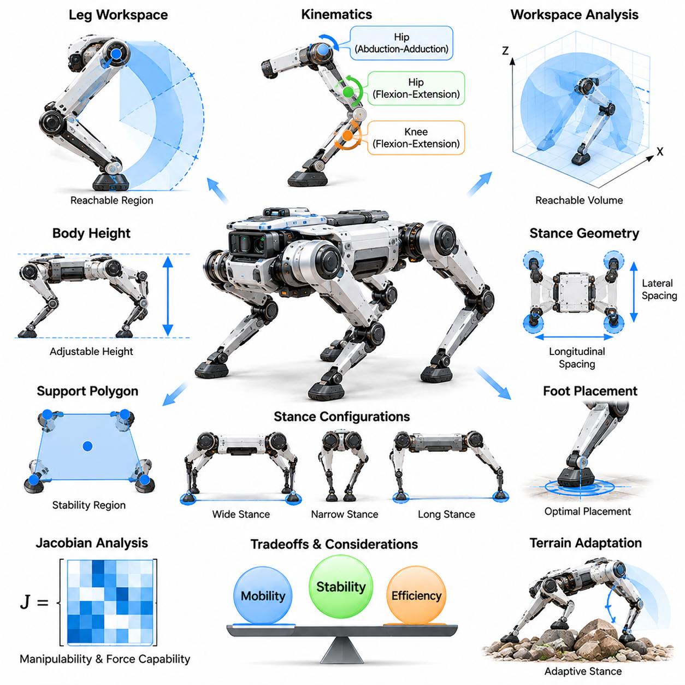{width="7.268055555555556in" height="7.268055555555556in"}

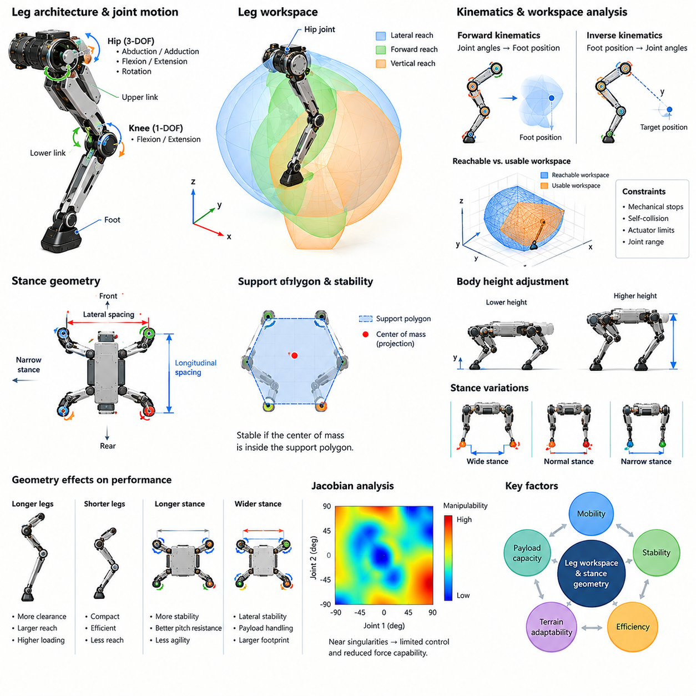{width="7.268055555555556in" height="7.268055555555556in"}

Leg workspace and stance geometry are fundamental characteristics of quadruped morphology that determine how a robot positions its feet, supports its body, and moves through different environments. Leg workspace describes the region each foot can reach through joint motion, while stance geometry defines the spatial arrangement of supporting feet. Together, these properties influence stability, mobility, obstacle clearance, and locomotion efficiency.

The reachable workspace of a quadruped leg depends on its kinematic architecture, link lengths, joint axes, and allowable joint ranges. A typical three-degree-of-freedom leg can position its foot within a three-dimensional region relative to the hip. However, this region is constrained by mechanical stops, self-collision, and actuator limitations. Workspace analysis therefore distinguishes theoretical reachability from practically usable configurations.

Leg workspace is commonly evaluated using forward kinematics and inverse kinematics. Forward kinematics maps joint angles into foot positions, allowing the reachable region to be explored across valid joint configurations. Inverse kinematics determines whether a desired foot position can be achieved and identifies suitable joint angles. These calculations provide the geometric foundation for foothold planning, trajectory generation, and posture control.

The shape of the reachable workspace is generally irregular because rotational joints produce nonlinear relationships between joint angles and foot coordinates. Hip abduction and adduction influence lateral reach, while hip and knee flexion determine much of the longitudinal and vertical workspace. Link proportions and joint orientation modify these boundaries. Designers must consider not only workspace volume but also the distribution of useful configurations.

A large reachable workspace does not automatically guarantee effective locomotion. Some foot positions may require extreme joint angles, produce unfavorable mechanical leverage, or approach kinematic singularities. These configurations can demand excessive actuator torque or reduce controllability. The operational workspace should therefore be defined as a subset of the reachable region that satisfies practical constraints on force, motion, and safety.

The relationship between leg workspace and body height is particularly important. Lowering the trunk changes the relative position of the feet within their reachable regions and may improve certain stability margins. Raising the trunk increases ground clearance but can reduce available leg extension margins or alter joint loading. The optimal body height depends on terrain geometry, desired movement speed, payload conditions, and actuator capabilities.

Stance geometry describes the relative positions of the feet when they support the robot. Its primary dimensions include longitudinal spacing between front and rear contacts and lateral spacing between left and right contacts. These dimensions establish the support polygon for static stability analysis. The shape and size of this polygon influence the robot\'s ability to resist gravitational moments and external disturbances.

During a four-leg support phase, the support polygon is formed by the convex hull of the ground contact points. Static equilibrium requires the projected center of mass to lie within this region under appropriate contact assumptions. A larger polygon can provide greater geometric stability margins, although contact forces and friction remain important. Stability evaluation must therefore consider both geometry and feasible force distribution.

A wide stance increases lateral separation between supporting feet and can improve resistance to sideways disturbances. This configuration may be useful during payload handling, manipulation, or operation on irregular surfaces. However, excessive stance width can increase joint torque requirements and reduce the available lateral workspace for stepping. Wide configurations may also restrict movement through narrow passages.

A narrow stance reduces the robot\'s lateral footprint and can improve access to confined environments. It may also support compact body configurations and certain dynamic locomotion patterns. However, reduced lateral support width decreases geometric stability margins during slow movement. Maintaining balance may then require more precise contact placement, faster corrective stepping, or greater reliance on dynamic stabilization.

Longitudinal stance length influences pitch stability, turning behavior, and the distribution of loads between front and rear legs. Increasing the distance between supporting contacts can improve resistance to forward and backward tipping. However, an excessively long stance may restrict stepping flexibility or increase the mechanical effort required for posture adjustments. Appropriate stance length must reflect trunk dimensions and available leg reach.

Foot placement relative to the hip affects joint loading and mechanical efficiency. When a supporting foot is positioned far from its associated hip, ground reaction forces may generate larger joint moments. Positions closer to favorable mechanical configurations can reduce torque requirements and improve force transmission. Efficient stance design therefore considers both contact geometry and the relationship between joint torques and endpoint forces.

The Jacobian matrix provides a mathematical connection between joint velocities and foot velocities, as well as between endpoint forces and joint torques. Its properties vary throughout the workspace and influence manipulability, force capability, and sensitivity to joint motion. Near singular configurations, certain movement or force directions become difficult to control. Workspace evaluation should therefore include Jacobian-based performance measures.

Stance geometry changes continuously during locomotion as individual feet alternate between support and swing phases. During walking, the robot may maintain three or more contacts for substantial portions of the gait. During trotting, diagonal leg pairs often support the body while the other pair swings. These changing contact patterns produce different support geometries and require coordinated adjustments in body motion and foot placement.

Static walking emphasizes maintaining suitable support relationships as legs are repositioned sequentially. The robot can shift its center of mass toward the remaining supporting feet before lifting a leg. This strategy reduces the likelihood of tipping during slow movement. However, the available stability margin depends on the geometry of the supporting contacts, terrain inclination, and the location of the center of mass.

Dynamic locomotion requires a broader interpretation of stance stability. During running or trotting, the center of mass projection may temporarily move outside the instantaneous support region without causing a fall. Momentum, contact impulses, and controlled body acceleration contribute to balance. Consequently, dynamic stability analysis must incorporate contact timing, inertial effects, and feasible ground reaction forces.

Terrain geometry imposes additional constraints on reachable footholds. On uneven ground, supporting feet may contact surfaces at different heights, changing the effective stance configuration. Obstacles can eliminate otherwise reachable positions, while slopes modify the relationship between gravity and the support region. Terrain-aware foothold planning must therefore combine leg workspace constraints with local surface geometry and contact feasibility.

Foot clearance during the swing phase depends on the available vertical workspace and the selected trajectory. Sufficient clearance reduces the risk of striking obstacles, but excessive foot lifting increases motion requirements and may consume additional energy. The robot must also preserve enough joint range for landing and subsequent stance motion. Swing trajectories should therefore balance obstacle avoidance, efficiency, and mechanical feasibility.

Stance geometry also influences turning and directional changes. Asymmetric foot placements can generate favorable contact arrangements for yaw rotation or lateral movement. However, the available turning motion depends on joint workspace, foot friction, and potential interference between the legs and trunk. Coordinated stance adjustment allows quadrupeds to adapt their support configuration to different maneuvering requirements.

Payload variations alter the relationship between stance geometry and stability. A shifted center of mass may require repositioning the feet to maintain adequate support margins and distribute contact forces. Heavy payloads can also reduce the usable workspace by increasing joint torque demands. Morphology-aware control must account for these changes when selecting body height, stance width, and foothold positions.

Leg workspace and stance geometry are closely related to energy consumption. Extreme leg configurations can increase actuator loading, while unnecessarily large stepping motions require additional acceleration and deceleration. Efficient locomotion often favors foot trajectories and support postures that avoid unfavorable joint configurations. Nevertheless, energy-optimal behavior must remain compatible with terrain clearance, stability, and task requirements.

Simulation-based evaluation enables systematic exploration of workspace and stance design. Engineers can sample joint configurations, calculate reachable foot positions, and evaluate support geometry under different body postures. Dynamic simulation further reveals how contact forces, actuator limits, and terrain conditions affect practical performance. These analyses help identify useful operating regions before physical prototypes are tested.

Physical experiments remain necessary because real-world performance depends on factors that geometric models cannot fully represent. Structural compliance, joint friction, actuator saturation, foot deformation, and uncertain terrain contact can reduce the usable workspace. Experimental measurements can validate kinematic models and identify configurations associated with excessive loading or unreliable contact. This feedback supports refinement of both morphology and control.

Leg workspace and stance geometry should ultimately be optimized together rather than treated as independent design variables. Larger reachability may improve obstacle negotiation but introduce unfavorable force characteristics, while wider support configurations may improve stability at the expense of agility. Effective quadruped morphology balances reachable motion, support geometry, actuator capability, and environmental requirements.

Within Physical AI, these geometric properties define the feasible foundation for intelligent locomotion. Perception systems identify potential footholds, planning algorithms select contact locations, and controllers execute movements within the robot\'s physical limits. A well-designed relationship between leg workspace and stance geometry enables stable movement, efficient adaptation, and reliable interaction with complex environments.

다리 작업공간(Leg Workspace)과 지지 자세 기하학(Stance Geometry)은 사족보행 로봇 형태(Quadruped Morphology)의 기본적인 특성으로, 로봇이 발의 위치를 결정하고 몸체를 지지하며 다양한 환경에서 이동하는 방식을 정의한다. 다리 작업공간은 관절 운동(Joint Motion)을 통해 각 발이 도달할 수 있는 영역을 의미하며, 지지 자세 기하학은 지지하는 발들의 공간적 배치(Spatial Arrangement)를 정의한다. 이러한 특성은 안정성(Stability), 이동성(Mobility), 장애물 통과 높이(Obstacle Clearance), 이동 효율(Locomotion Efficiency)에 영향을 미친다.

사족보행 로봇 다리의 도달 가능 작업공간(Reachable Workspace)은 운동학적 구조(Kinematic Architecture), 링크 길이(Link Lengths), 관절 축(Joint Axes), 허용 가능한 관절 운동 범위(Allowable Joint Ranges)에 따라 결정된다. 일반적인 3자유도(Three-Degree-of-Freedom) 다리는 엉덩이 관절(Hip)을 기준으로 3차원 영역(Three-Dimensional Region) 내에서 발의 위치를 조정할 수 있다. 그러나 이 영역은 기계적 스토퍼(Mechanical Stops), 자체 충돌(Self-Collision), 구동기 한계(Actuator Limitations)에 의해 제한된다. 따라서 작업공간 분석(Workspace Analysis)은 이론적 도달 가능성(Theoretical Reachability)과 실제 사용 가능한 구성(Practically Usable Configurations)을 구분한다.

다리 작업공간(Leg Workspace)은 일반적으로 순기구학(Forward Kinematics)과 역기구학(Inverse Kinematics)을 이용하여 평가한다. 순기구학은 관절 각도(Joint Angles)를 발 위치(Foot Positions)로 변환하여 유효한 관절 구성(Valid Joint Configurations) 전반에서 도달 가능 영역을 탐색할 수 있도록 한다. 역기구학은 원하는 발 위치(Desired Foot Position)의 실현 가능성을 판단하고 적절한 관절 각도를 계산한다. 이러한 계산은 발 디딤 위치 계획(Foothold Planning), 궤적 생성(Trajectory Generation), 자세 제어(Posture Control)의 기하학적 기반을 제공한다.

도달 가능 작업공간(Reachable Workspace)의 형태는 일반적으로 불규칙한데, 이는 회전 관절(Rotational Joints)이 관절 각도와 발 좌표(Foot Coordinates) 사이에 비선형 관계(Nonlinear Relationships)를 형성하기 때문이다. 엉덩이 외전 및 내전(Hip Abduction and Adduction)은 측면 도달 범위(Lateral Reach)에 영향을 미치며, 엉덩이 및 무릎 굴곡(Hip and Knee Flexion)은 종방향 및 수직 작업공간(Longitudinal and Vertical Workspace)의 상당 부분을 결정한다. 링크 비율(Link Proportions)과 관절 방향(Joint Orientation)은 이러한 경계를 변화시킨다. 설계자는 작업공간의 부피(Workspace Volume)뿐 아니라 유용한 관절 구성의 분포(Distribution of Useful Configurations)도 고려해야 한다.

넓은 도달 가능 작업공간(Large Reachable Workspace)이 반드시 효과적인 이동(Effective Locomotion)을 보장하는 것은 아니다. 일부 발 위치(Foot Positions)는 극단적인 관절 각도(Extreme Joint Angles)를 요구하거나 불리한 기계적 지레 효과(Mechanical Leverage)를 발생시키거나 운동학적 특이점(Kinematic Singularities)에 접근할 수 있다. 이러한 구성은 과도한 구동기 토크(Actuator Torque)를 요구하거나 제어 가능성(Controllability)을 감소시킬 수 있다. 따라서 운용 작업공간(Operational Workspace)은 힘(Force), 움직임(Motion), 안전성(Safety)에 관한 실제 제약을 충족하는 도달 가능 영역의 부분집합(Subset)으로 정의해야 한다.

다리 작업공간(Leg Workspace)과 몸체 높이(Body Height)의 관계는 특히 중요하다. 몸통(Trunk)을 낮추면 도달 가능 영역 내에서 발의 상대적 위치가 변화하며 일부 안정성 여유도(Stability Margins)가 개선될 수 있다. 몸통을 높이면 지상고(Ground Clearance)가 증가하지만 사용 가능한 다리 신장 여유(Leg Extension Margins)가 감소하거나 관절 하중(Joint Loading)이 달라질 수 있다. 최적 몸체 높이(Optimal Body Height)는 지형 기하학(Terrain Geometry), 목표 이동 속도(Desired Movement Speed), 탑재하중 조건(Payload Conditions), 구동기 성능(Actuator Capabilities)에 따라 달라진다.

지지 자세 기하학(Stance Geometry)은 로봇을 지지하는 동안 발들의 상대적 위치(Relative Positions)를 설명한다. 주요 치수에는 전방 및 후방 접촉점(Front and Rear Contacts) 사이의 종방향 간격(Longitudinal Spacing)과 좌우 접촉점(Left and Right Contacts) 사이의 측면 간격(Lateral Spacing)이 포함된다. 이러한 치수는 정적 안정성 분석(Static Stability Analysis)을 위한 지지 다각형(Support Polygon)을 형성한다. 지지 다각형의 형태와 크기는 중력 모멘트(Gravitational Moments)와 외부 외란(External Disturbances)에 저항하는 로봇의 능력에 영향을 미친다.

네 다리 지지 단계(Four-Leg Support Phase)에서 지지 다각형(Support Polygon)은 지면 접촉점(Ground Contact Points)의 볼록 껍질(Convex Hull)로 형성된다. 적절한 접촉 가정(Contact Assumptions)하에서 정적 평형(Static Equilibrium)을 유지하려면 질량중심의 투영점(Projected Center of Mass)이 이 영역 내부에 위치해야 한다. 더 큰 지지 다각형은 기하학적 안정성 여유도(Geometric Stability Margins)를 증가시킬 수 있지만 접촉력(Contact Forces)과 마찰(Friction)도 중요하다. 따라서 안정성 평가(Stability Evaluation)는 기하학적 조건과 실현 가능한 힘 분포(Feasible Force Distribution)를 모두 고려해야 한다.

넓은 지지 자세(Wide Stance)는 지지하는 발 사이의 측면 간격(Lateral Separation)을 증가시켜 측면 외란(Sideways Disturbances)에 대한 저항성을 향상시킬 수 있다. 이러한 구성은 탑재하중 취급(Payload Handling), 조작 작업(Manipulation), 불규칙한 표면(Irregular Surfaces)에서의 운용에 유용할 수 있다. 그러나 지나치게 넓은 지지 자세는 관절 토크 요구사항(Joint Torque Requirements)을 증가시키고 발 디딤을 위한 측면 작업공간(Lateral Workspace)을 감소시킬 수 있다. 또한 넓은 구성은 좁은 통로(Narrow Passages)를 통과하는 능력을 제한할 수 있다.

좁은 지지 자세(Narrow Stance)는 로봇의 측면 점유 공간(Lateral Footprint)을 줄이고 제한된 환경(Confined Environments)에 대한 접근성을 향상시킬 수 있다. 또한 소형 몸체 구성(Compact Body Configurations)과 특정 동적 이동 패턴(Dynamic Locomotion Patterns)을 지원할 수 있다. 그러나 측면 지지 폭(Lateral Support Width)이 감소하면 느린 이동 중 기하학적 안정성 여유도(Geometric Stability Margins)가 줄어든다. 이 경우 균형 유지(Balance Maintenance)를 위해 더욱 정밀한 접촉 위치 선정(Contact Placement), 빠른 보정 발 디딤(Corrective Stepping), 동적 안정화(Dynamic Stabilization)에 대한 높은 의존성이 필요할 수 있다.

종방향 지지 자세 길이(Longitudinal Stance Length)는 피치 안정성(Pitch Stability), 회전 거동(Turning Behavior), 전방 및 후방 다리 사이의 하중 분포(Load Distribution)에 영향을 미친다. 지지 접촉점(Supporting Contacts) 사이의 거리를 증가시키면 전후방 전복(Forward and Backward Tipping)에 대한 저항성을 개선할 수 있다. 그러나 지나치게 긴 지지 자세는 발 디딤 유연성(Stepping Flexibility)을 제한하거나 자세 조정(Posture Adjustments)에 필요한 기계적 노력을 증가시킬 수 있다. 적절한 지지 자세 길이는 몸통 치수(Trunk Dimensions)와 사용 가능한 다리 도달 범위(Available Leg Reach)를 반영해야 한다.

엉덩이 관절(Hip)에 대한 발 위치(Foot Placement)는 관절 하중(Joint Loading)과 기계적 효율(Mechanical Efficiency)에 영향을 미친다. 지지하는 발이 해당 엉덩이 관절에서 멀리 위치하면 지면 반력(Ground Reaction Forces)이 더 큰 관절 모멘트(Joint Moments)를 발생시킬 수 있다. 기계적으로 유리한 구성(Favorable Mechanical Configurations)에 가까운 위치는 토크 요구사항(Torque Requirements)을 줄이고 힘 전달(Force Transmission)을 개선할 수 있다. 따라서 효율적인 지지 자세 설계(Efficient Stance Design)는 접촉 기하학(Contact Geometry)과 관절 토크 및 말단 힘(Joint Torques and Endpoint Forces) 사이의 관계를 모두 고려한다.

자코비안 행렬(Jacobian Matrix)은 관절 속도(Joint Velocities)와 발 속도(Foot Velocities), 말단 힘(Endpoint Forces)과 관절 토크(Joint Torques) 사이의 수학적 관계를 제공한다. 자코비안의 특성은 작업공간(Workspace) 전체에서 변화하며 조작성(Manipulability), 힘 생성 능력(Force Capability), 관절 움직임에 대한 민감도(Sensitivity to Joint Motion)에 영향을 미친다. 특이 구성(Singular Configurations)에 가까워지면 특정 방향의 움직임이나 힘을 제어하기 어려워진다. 따라서 작업공간 평가(Workspace Evaluation)에는 자코비안 기반 성능 지표(Jacobian-Based Performance Measures)가 포함되어야 한다.

지지 자세 기하학(Stance Geometry)은 개별 발이 지지 단계(Support Phase)와 유각 단계(Swing Phase)를 번갈아 수행하면서 이동 중 지속적으로 변화한다. 걷기(Walking)에서는 보행 주기(Gait Cycle)의 상당 부분 동안 세 개 이상의 접촉점(Contacts)을 유지할 수 있다. 트로트 보행(Trotting)에서는 대각선 방향의 다리 쌍(Diagonal Leg Pairs)이 몸체를 지지하는 동안 다른 다리 쌍이 유각 운동(Swing Motion)을 수행하는 경우가 많다. 이러한 접촉 패턴(Contact Patterns)의 변화는 서로 다른 지지 기하학(Support Geometries)을 형성하며 몸체 움직임(Body Motion)과 발 위치(Foot Placement)의 협조된 조정을 요구한다.

정적 보행(Static Walking)은 다리를 순차적으로 재배치하는 동안 적절한 지지 관계(Support Relationships)를 유지하는 데 중점을 둔다. 로봇은 다리를 들어 올리기 전에 질량중심(Center of Mass)을 나머지 지지 발(Supporting Feet) 쪽으로 이동시킬 수 있다. 이러한 전략은 느린 이동 중 전복(Tipping) 가능성을 줄인다. 그러나 사용 가능한 안정성 여유도(Stability Margin)는 지지 접촉점(Supporting Contacts)의 기하학적 배치, 지형 경사(Terrain Inclination), 질량중심 위치(Center of Mass Location)에 따라 달라진다.

동적 이동(Dynamic Locomotion)은 지지 안정성(Stance Stability)에 대한 보다 폭넓은 해석을 요구한다. 달리기(Running)나 트로트 보행(Trotting) 중에는 질량중심의 투영점(Center of Mass Projection)이 순간적인 지지 영역(Instantaneous Support Region) 밖으로 일시적으로 이동하더라도 넘어지지 않을 수 있다. 운동량(Momentum), 접촉 충격량(Contact Impulses), 제어된 몸체 가속도(Controlled Body Acceleration)가 균형 유지에 기여한다. 따라서 동적 안정성 분석(Dynamic Stability Analysis)은 접촉 시점(Contact Timing), 관성 효과(Inertial Effects), 실현 가능한 지면 반력(Feasible Ground Reaction Forces)을 포함해야 한다.

지형 기하학(Terrain Geometry)은 도달 가능한 발 디딤 위치(Reachable Footholds)에 추가적인 제약을 부과한다. 불규칙한 지면(Uneven Ground)에서는 지지 발(Supporting Feet)이 서로 다른 높이의 표면에 접촉하여 유효 지지 자세 구성(Effective Stance Configuration)을 변화시킬 수 있다. 장애물(Obstacles)은 기하학적으로 도달 가능한 위치를 사용할 수 없게 만들 수 있으며, 경사면(Slopes)은 중력(Gravity)과 지지 영역(Support Region) 사이의 관계를 변화시킨다. 따라서 지형 인식 발 디딤 계획(Terrain-Aware Foothold Planning)은 다리 작업공간 제약(Leg Workspace Constraints)을 국소 표면 기하학(Local Surface Geometry) 및 접촉 실현 가능성(Contact Feasibility)과 결합해야 한다.

유각 단계(Swing Phase)에서 발의 장애물 이격 높이(Foot Clearance)는 사용 가능한 수직 작업공간(Vertical Workspace)과 선택된 궤적(Trajectory)에 따라 달라진다. 충분한 이격 높이는 장애물과 충돌할 위험을 줄이지만 과도한 발 들어 올리기(Foot Lifting)는 움직임 요구량을 증가시키고 추가 에너지를 소비할 수 있다. 또한 로봇은 착지(Landing)와 이후 지지 단계 움직임(Stance Motion)을 위해 충분한 관절 운동 범위(Joint Range)를 유지해야 한다. 따라서 유각 궤적(Swing Trajectories)은 장애물 회피(Obstacle Avoidance), 효율(Efficiency), 기계적 실현 가능성(Mechanical Feasibility) 사이에서 균형을 유지해야 한다.

지지 자세 기하학(Stance Geometry)은 회전(Turning)과 방향 전환(Directional Changes)에도 영향을 미친다. 비대칭 발 배치(Asymmetric Foot Placements)는 요 회전(Yaw Rotation)이나 측면 이동(Lateral Movement)에 유리한 접촉 구성(Contact Arrangements)을 형성할 수 있다. 그러나 사용 가능한 회전 운동(Turning Motion)은 관절 작업공간(Joint Workspace), 발 마찰(Foot Friction), 다리와 몸통 사이의 잠재적 간섭(Potential Interference)에 따라 달라진다. 협조된 지지 자세 조정(Coordinated Stance Adjustment)은 사족보행 로봇이 다양한 기동 요구사항(Maneuvering Requirements)에 맞춰 지지 구성을 조정할 수 있도록 한다.

탑재하중 변화(Payload Variations)는 지지 자세 기하학(Stance Geometry)과 안정성(Stability) 사이의 관계를 변화시킨다. 질량중심(Center of Mass)이 이동하면 충분한 지지 여유도(Support Margins)를 유지하고 접촉력(Contact Forces)을 분산하기 위해 발 위치를 재조정해야 할 수 있다. 무거운 탑재하중(Heavy Payloads)은 관절 토크 요구사항(Joint Torque Demands)을 증가시켜 사용 가능한 작업공간(Usable Workspace)을 감소시킬 수도 있다. 형태 인식 제어(Morphology-Aware Control)는 몸체 높이(Body Height), 지지 자세 폭(Stance Width), 발 디딤 위치(Foothold Positions)를 선택할 때 이러한 변화를 고려해야 한다.

다리 작업공간(Leg Workspace)과 지지 자세 기하학(Stance Geometry)은 에너지 소비(Energy Consumption)와도 밀접하게 관련된다. 극단적인 다리 구성(Extreme Leg Configurations)은 구동기 하중(Actuator Loading)을 증가시킬 수 있으며, 불필요하게 큰 발 디딤 움직임(Stepping Motions)은 추가적인 가속과 감속(Acceleration and Deceleration)을 요구한다. 효율적인 이동(Efficient Locomotion)은 불리한 관절 구성(Unfavorable Joint Configurations)을 피하는 발 궤적(Foot Trajectories)과 지지 자세(Support Postures)를 선호하는 경우가 많다. 그러나 에너지 최적 행동(Energy-Optimal Behavior)은 지형 통과 높이(Terrain Clearance), 안정성(Stability), 작업 요구사항(Task Requirements)과 양립할 수 있어야 한다.

시뮬레이션 기반 평가(Simulation-Based Evaluation)는 작업공간(Workspace)과 지지 자세 설계(Stance Design)를 체계적으로 탐색할 수 있도록 한다. 엔지니어는 관절 구성(Joint Configurations)을 표본 추출(Sampling)하고 도달 가능한 발 위치(Reachable Foot Positions)를 계산하며 다양한 몸체 자세(Body Postures)에서 지지 기하학(Support Geometry)을 평가할 수 있다. 동적 시뮬레이션(Dynamic Simulation)은 접촉력(Contact Forces), 구동기 한계(Actuator Limits), 지형 조건(Terrain Conditions)이 실제 성능에 미치는 영향을 추가로 보여준다. 이러한 분석은 물리적 시제품(Physical Prototypes)을 시험하기 전에 유용한 운용 영역(Operating Regions)을 식별하는 데 도움이 된다.

실제 환경 성능(Real-World Performance)은 기하학적 모델(Geometric Models)이 완전히 표현할 수 없는 요소에 영향을 받으므로 물리적 실험(Physical Experiments)이 여전히 필요하다. 구조적 순응성(Structural Compliance), 관절 마찰(Joint Friction), 구동기 포화(Actuator Saturation), 발 변형(Foot Deformation), 불확실한 지형 접촉(Uncertain Terrain Contact)은 사용 가능한 작업공간(Usable Workspace)을 감소시킬 수 있다. 실험적 측정(Experimental Measurements)은 운동학 모델(Kinematic Models)을 검증하고 과도한 하중(Excessive Loading)이나 불안정한 접촉(Unreliable Contact)과 관련된 구성을 식별할 수 있다. 이러한 피드백(Feedback)은 형태(Morphology)와 제어(Control)를 모두 개선하는 데 기여한다.

다리 작업공간(Leg Workspace)과 지지 자세 기하학(Stance Geometry)은 독립적인 설계 변수(Independent Design Variables)로 취급하기보다 함께 최적화해야 한다. 더 넓은 도달 가능 범위(Reachability)는 장애물 통과(Obstacle Negotiation)를 개선할 수 있지만 불리한 힘 특성(Force Characteristics)을 발생시킬 수 있으며, 넓은 지지 구성(Wider Support Configurations)은 민첩성(Agility)을 희생하면서 안정성(Stability)을 향상시킬 수 있다. 효과적인 사족보행 로봇 형태(Quadruped Morphology)는 도달 가능한 움직임(Reachable Motion), 지지 기하학(Support Geometry), 구동기 성능(Actuator Capability), 환경 요구사항(Environmental Requirements) 사이의 균형을 유지한다.

피지컬 AI(Physical AI)에서 이러한 기하학적 특성(Geometric Properties)은 지능형 이동(Intelligent Locomotion)을 위한 실현 가능한 물리적 기반(Feasible Physical Foundation)을 정의한다. 인지 시스템(Perception Systems)은 잠재적인 발 디딤 위치(Potential Footholds)를 식별하고, 계획 알고리즘(Planning Algorithms)은 접촉 위치(Contact Locations)를 선택하며, 제어기(Controllers)는 로봇의 물리적 한계(Physical Limits) 내에서 움직임을 실행한다. 다리 작업공간과 지지 자세 기하학 사이의 관계가 적절하게 설계되면 안정적인 이동(Stable Movement), 효율적인 적응(Efficient Adaptation), 복잡한 환경과의 신뢰할 수 있는 상호작용(Reliable Interaction)이 가능해진다.

##  

## 07.04. Mass Distribution and Center of Mass

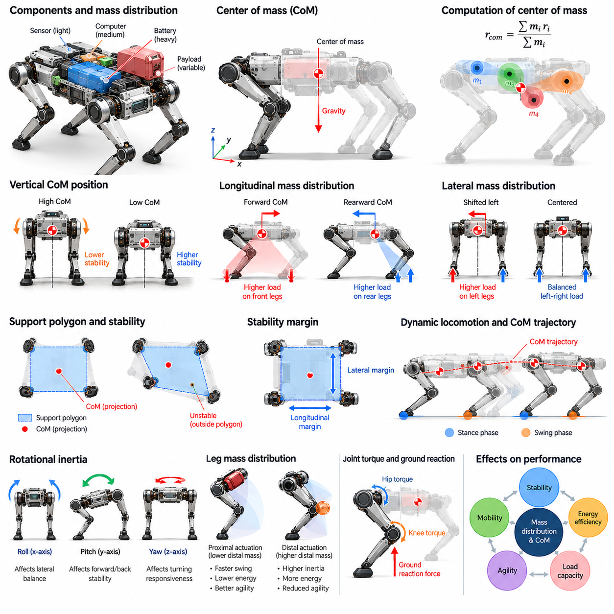{width="7.268055555555556in" height="7.268055555555556in"}

Mass distribution and center of mass are fundamental properties of quadruped morphology that influence stability, locomotion dynamics, actuator loading, and energy efficiency. Mass distribution describes how the robot\'s weight is allocated among the trunk, legs, actuators, batteries, and payloads. The center of mass represents the weighted average position of these components and provides a reference for analyzing gravitational forces and whole-body motion.

The center of mass is determined by the masses and spatial positions of all robot components. Its location changes as the legs move, the trunk changes orientation, or payloads are repositioned. Although the trunk often contains most of the robot\'s mass, limb configurations can still influence the overall center of mass. Accurate estimation therefore requires considering both fixed structural components and moving mechanical assemblies.

Trunk mass distribution is strongly influenced by the placement of batteries, computing hardware, actuators, and structural reinforcements. Concentrating heavy components near the geometric center of the body can simplify balance control and reduce undesirable loading asymmetries. However, the optimal arrangement depends on leg attachment positions, payload requirements, cooling systems, and maintenance accessibility rather than geometric symmetry alone.

The vertical position of the center of mass affects the robot\'s response to gravitational disturbances and tipping moments. A lower center of mass generally improves geometric resistance to overturning for a given support configuration. However, lowering heavy components may reduce ground clearance or complicate mechanical packaging. Designers must balance vertical mass placement against terrain accessibility, structural constraints, and required body height.

Longitudinal mass distribution determines how body weight is shared between the front and rear legs. A forward-shifted center of mass can increase loading on the front limbs, while a rearward shift places greater demands on the hind limbs. Uneven loading influences actuator torque, contact forces, and available stability margins. Appropriate component placement helps distribute mechanical demands according to the robot\'s intended tasks.

Lateral mass distribution is equally important because quadrupeds must maintain balance during turning, sideways motion, and asymmetric ground contact. Heavy components positioned away from the central longitudinal plane can create persistent loading differences between the left and right legs. These asymmetries may increase corrective control effort. Balanced lateral packaging supports predictable force distribution and reduces unnecessary compensation.

The center of mass must be evaluated relative to the support polygon formed by the feet in contact with the ground. During quasi-static locomotion, the projection of the center of mass should remain within the support region with an appropriate stability margin. As individual legs enter swing phases, the support polygon changes. Body positioning and foot placement must therefore be coordinated to maintain stable transitions between support configurations.

Static stability margins provide a useful geometric measure of how close the projected center of mass lies to the boundaries of the support polygon. Larger margins generally indicate greater tolerance to small disturbances under suitable contact conditions. However, geometric stability alone does not guarantee equilibrium. Friction limits, terrain inclination, external forces, and feasible contact-force distributions must also be considered.

During dynamic locomotion, the center of mass follows trajectories governed by acceleration, momentum, and ground reaction forces. Trotting, bounding, and running may involve temporary departures from conventional static stability conditions. The robot maintains balance through coordinated contact timing and force generation. Consequently, dynamic stability depends on both center-of-mass motion and the ability of the legs to generate appropriate forces.

Mass distribution also determines the robot\'s rotational inertia about its principal body axes. Concentrating mass near the center generally reduces moments of inertia, enabling faster angular acceleration for a given torque. Distributing heavy components farther from the center increases resistance to rotational motion. These characteristics influence pitch, roll, and yaw responses during locomotion, turning, and disturbance recovery.

Pitch inertia affects the robot\'s ability to regulate forward and backward body rotation. Roll inertia influences lateral balance correction, while yaw inertia affects turning responsiveness. Low rotational inertia can improve agility but may also allow external disturbances to produce faster angular motion. Morphological design must therefore coordinate inertia properties with actuator capabilities, control bandwidth, and expected environmental forces.

Leg mass distribution introduces additional dynamic considerations beyond trunk inertia. Heavy distal links increase the effort required to accelerate and decelerate swinging legs. This can restrict stepping frequency, increase energy consumption, and reduce rapid foothold adjustment capability. Locating heavier actuators near proximal joints can reduce limb inertia, although mechanical transmissions may introduce friction, compliance, and packaging complexity.

The relationship between mass distribution and joint torque is especially important during stance. Ground reaction forces generate moments about the hip and knee joints according to the geometry of each supporting leg. A shifted center of mass changes the force demands placed on individual limbs. Joint loading must therefore be evaluated together with stance geometry, actuator limits, and the expected distribution of support forces.

Payload integration can significantly alter the center of mass and inertia characteristics of a quadruped. Equipment mounted above the trunk raises the overall center of mass, while payloads positioned toward one end introduce longitudinal imbalance. Movable payloads create time-varying mass properties. Reliable operation requires appropriate mounting locations, structural support, and control strategies that accommodate these changes.

Quadrupeds equipped with manipulators face additional challenges because arm motion continuously changes the distribution of mass. Extending an arm can shift the combined center of mass and introduce reaction moments into the trunk. Object grasping further modifies the mechanical loading conditions. Whole-body coordination must account for these effects by adjusting stance, body posture, and contact-force allocation.

Battery placement presents a particularly important design opportunity because energy storage often contributes substantial mass. Positioning battery modules near the trunk center can support balanced loading and reduce rotational inertia. However, battery accessibility, thermal management, electrical safety, and structural protection impose additional constraints. Modular battery systems must also preserve acceptable mass properties across different configurations.

Mass distribution affects energy efficiency through its influence on mechanical work and actuator demand. Unfavorable weight allocation can increase joint torques and require additional corrective movements. High limb inertia raises the energy required for repeated swing motions, although some mechanical energy may be recovered. Efficient morphology seeks to minimize unnecessary motion and loading without compromising stability or payload functionality.

Terrain conditions modify the relationship between center-of-mass position and stability. On slopes, the direction of gravity relative to the robot changes, altering the projected center of mass within the support region. Uneven foothold heights introduce additional geometric complexity. Terrain-adaptive control may adjust body orientation, stance width, and foot placement to preserve feasible contact forces and adequate stability margins.

Mass properties must also be considered during acceleration, braking, and rapid directional changes. Inertial forces can produce substantial load transfers between supporting legs even when the geometric center of mass remains unchanged. These effects influence traction requirements, joint torques, and body rotation. Dynamic models must therefore distinguish gravitational loading from acceleration-induced force redistribution.

Accurate center-of-mass estimation supports model-based control and locomotion planning. Computer-aided design models can provide initial estimates using component masses and geometric locations. Joint encoder measurements allow the contribution of moving limbs to be updated during operation. Experimental identification may refine these estimates by accounting for manufacturing tolerances, wiring, and differences between nominal and actual components.

Inertial parameter identification extends beyond center-of-mass location to include total mass and the inertia tensor. These quantities determine how the robot responds to applied forces and moments. Errors in inertial parameters can degrade predictive control and contact-force allocation. Calibration procedures and experimental system identification help improve model accuracy, particularly after hardware modifications or payload changes.

Simulation provides a practical environment for evaluating alternative mass distributions before physical construction. Engineers can reposition batteries, actuators, and payloads within virtual models and compare stability, joint loading, and energy consumption. Dynamic simulations can examine turning, slope traversal, and disturbance recovery. Such evaluations help identify design tradeoffs that may not be apparent from static geometry alone.

Physical testing remains essential because real mass properties may differ from design estimates. Manufacturing variations, cable routing, accessories, and payload installation can introduce unexpected asymmetries. Controlled standing tests, force measurements, and dynamic identification experiments can reveal these differences. Experimental feedback allows mechanical layouts and control models to be refined for reliable operation.

Mass distribution and center-of-mass placement should ultimately be optimized together with leg geometry, actuator architecture, and intended operating conditions. A configuration that improves static stability may increase rotational inertia or restrict ground clearance. Reducing distal limb mass may require more complex transmissions. Effective quadruped design therefore balances stability, agility, energy efficiency, structural integrity, and payload capability.

Within Physical AI, mass distribution and center-of-mass awareness connect mechanical embodiment with intelligent control. Perception, planning, and learning systems must account for the robot\'s evolving mass properties when predicting motion and selecting actions. Morphology-aware controllers can adjust posture, contact forces, and locomotion strategies accordingly. This integration supports robust movement and adaptive physical interaction across diverse environments.

질량 분포(Mass Distribution)와 질량중심(Center of Mass)은 사족보행 로봇 형태(Quadruped Morphology)의 기본적인 특성으로, 안정성(Stability), 이동 동역학(Locomotion Dynamics), 구동기 하중(Actuator Loading), 에너지 효율(Energy Efficiency)에 영향을 미친다. 질량 분포는 로봇의 무게가 몸통(Trunk), 다리(Legs), 구동기(Actuators), 배터리(Batteries), 탑재하중(Payloads)에 어떻게 분배되어 있는지를 나타낸다. 질량중심은 이러한 구성요소의 질량 가중 평균 위치(Mass-Weighted Average Position)를 의미하며, 중력(Gravitational Forces)과 전신 운동(Whole-Body Motion)을 분석하는 기준을 제공한다.

질량중심(Center of Mass)은 모든 로봇 구성요소의 질량(Masses)과 공간적 위치(Spatial Positions)에 의해 결정된다. 다리가 움직이거나 몸통의 방향(Trunk Orientation)이 변하거나 탑재하중(Payloads)이 재배치되면 질량중심의 위치도 변화한다. 몸통(Trunk)이 로봇 질량의 대부분을 차지하는 경우가 많지만, 다리 구성(Limb Configurations)도 전체 질량중심에 영향을 미칠 수 있다. 따라서 정확한 추정(Accurate Estimation)을 위해서는 고정된 구조적 구성요소(Fixed Structural Components)와 움직이는 기계적 조립체(Moving Mechanical Assemblies)를 모두 고려해야 한다.

몸통 질량 분포(Trunk Mass Distribution)는 배터리(Batteries), 컴퓨팅 하드웨어(Computing Hardware), 구동기(Actuators), 구조적 보강재(Structural Reinforcements)의 배치에 크게 영향을 받는다. 무거운 구성요소를 몸체의 기하학적 중심(Geometric Center) 가까이에 집중시키면 균형 제어(Balance Control)를 단순화하고 바람직하지 않은 하중 비대칭(Loading Asymmetries)을 줄일 수 있다. 그러나 최적의 배치는 단순한 기하학적 대칭(Geometric Symmetry)만이 아니라 다리 부착 위치(Leg Attachment Positions), 탑재하중 요구사항(Payload Requirements), 냉각 시스템(Cooling Systems), 유지보수 접근성(Maintenance Accessibility)에 따라 결정된다.

질량중심(Center of Mass)의 수직 위치(Vertical Position)는 중력 외란(Gravitational Disturbances)과 전복 모멘트(Tipping Moments)에 대한 로봇의 반응에 영향을 미친다. 낮은 질량중심(Lower Center of Mass)은 일반적으로 동일한 지지 구성(Support Configuration)에서 전복에 대한 기하학적 저항성(Geometric Resistance to Overturning)을 향상시킨다. 그러나 무거운 구성요소를 낮게 배치하면 지상고(Ground Clearance)가 감소하거나 기계적 부품 배치(Mechanical Packaging)가 복잡해질 수 있다. 설계자는 수직 질량 배치(Vertical Mass Placement)와 지형 접근성(Terrain Accessibility), 구조적 제약(Structural Constraints), 필요한 몸체 높이(Required Body Height) 사이의 균형을 유지해야 한다.

종방향 질량 분포(Longitudinal Mass Distribution)는 몸체 무게가 전방 및 후방 다리(Front and Rear Legs)에 어떻게 분배되는지를 결정한다. 질량중심(Center of Mass)이 전방으로 이동하면 앞다리(Front Limbs)의 하중이 증가할 수 있으며, 후방으로 이동하면 뒷다리(Hind Limbs)에 더 큰 부담이 가해진다. 불균등한 하중(Uneven Loading)은 구동기 토크(Actuator Torque), 접촉력(Contact Forces), 사용 가능한 안정성 여유도(Available Stability Margins)에 영향을 미친다. 적절한 구성요소 배치(Component Placement)는 로봇의 의도된 작업(Intended Tasks)에 따라 기계적 요구사항(Mechanical Demands)을 분산하는 데 도움이 된다.

측면 질량 분포(Lateral Mass Distribution)도 중요하다. 사족보행 로봇은 회전(Turning), 측면 이동(Sideways Motion), 비대칭 지면 접촉(Asymmetric Ground Contact) 중에도 균형을 유지해야 하기 때문이다. 중앙 종방향 평면(Central Longitudinal Plane)에서 벗어난 위치에 무거운 구성요소를 배치하면 좌우 다리(Left and Right Legs) 사이에 지속적인 하중 차이(Loading Differences)가 발생할 수 있다. 이러한 비대칭(Asymmetries)은 보정 제어 노력(Corrective Control Effort)을 증가시킬 수 있다. 균형 잡힌 측면 부품 배치(Balanced Lateral Packaging)는 예측 가능한 힘 분포(Force Distribution)를 지원하고 불필요한 보상 동작(Unnecessary Compensation)을 줄인다.

질량중심(Center of Mass)은 지면과 접촉하는 발들이 형성하는 지지 다각형(Support Polygon)을 기준으로 평가해야 한다. 준정적 이동(Quasi-Static Locomotion) 중에는 질량중심의 투영점(Projected Center of Mass)이 적절한 안정성 여유도(Stability Margin)를 확보하면서 지지 영역(Support Region) 내부에 유지되어야 한다. 개별 다리가 유각 단계(Swing Phase)에 진입하면 지지 다각형이 변화한다. 따라서 지지 구성(Support Configurations) 사이의 안정적인 전환을 유지하려면 몸체 위치 조정(Body Positioning)과 발 위치 선정(Foot Placement)을 협조적으로 수행해야 한다.

정적 안정성 여유도(Static Stability Margins)는 질량중심의 투영점(Projected Center of Mass)이 지지 다각형(Support Polygon)의 경계에 얼마나 가까운지를 나타내는 유용한 기하학적 지표(Geometric Measure)를 제공한다. 적절한 접촉 조건(Contact Conditions)에서 여유도가 클수록 일반적으로 작은 외란(Small Disturbances)에 대한 허용 능력이 높아진다. 그러나 기하학적 안정성(Geometric Stability)만으로 평형(Equilibrium)이 보장되지는 않는다. 마찰 한계(Friction Limits), 지형 경사(Terrain Inclination), 외력(External Forces), 실현 가능한 접촉력 분포(Feasible Contact-Force Distributions)도 고려해야 한다.

동적 이동(Dynamic Locomotion) 중 질량중심(Center of Mass)은 가속도(Acceleration), 운동량(Momentum), 지면 반력(Ground Reaction Forces)에 의해 결정되는 궤적(Trajectories)을 따른다. 트로트 보행(Trotting), 바운딩 보행(Bounding), 달리기(Running)에서는 기존의 정적 안정성 조건(Static Stability Conditions)을 일시적으로 벗어날 수 있다. 로봇은 협조된 접촉 시점(Contact Timing)과 힘 생성(Force Generation)을 통해 균형을 유지한다. 따라서 동적 안정성(Dynamic Stability)은 질량중심 운동(Center-of-Mass Motion)과 다리가 적절한 힘을 생성하는 능력에 모두 의존한다.

질량 분포(Mass Distribution)는 로봇의 주요 몸체 축(Principal Body Axes)에 대한 회전 관성(Rotational Inertia)도 결정한다. 질량을 중심 가까이에 집중시키면 일반적으로 관성모멘트(Moments of Inertia)가 감소하여 동일한 토크(Torque)에서 더 빠른 각가속도(Angular Acceleration)를 얻을 수 있다. 무거운 구성요소를 중심에서 멀리 배치하면 회전 운동(Rotational Motion)에 대한 저항이 증가한다. 이러한 특성은 이동(Locomotion), 회전(Turning), 외란 복구(Disturbance Recovery) 중 피치(Pitch), 롤(Roll), 요(Yaw) 응답에 영향을 미친다.

피치 관성(Pitch Inertia)은 로봇이 전후방 몸체 회전(Forward and Backward Body Rotation)을 조절하는 능력에 영향을 미친다. 롤 관성(Roll Inertia)은 측면 균형 보정(Lateral Balance Correction)에 영향을 주며, 요 관성(Yaw Inertia)은 회전 응답성(Turning Responsiveness)에 영향을 미친다. 낮은 회전 관성(Low Rotational Inertia)은 민첩성(Agility)을 향상시킬 수 있지만 외부 외란(External Disturbances)에 의해 더 빠른 각운동(Angular Motion)이 발생하도록 만들 수도 있다. 따라서 형태 설계(Morphological Design)는 관성 특성(Inertia Properties)을 구동기 성능(Actuator Capabilities), 제어 대역폭(Control Bandwidth), 예상 환경 힘(Expected Environmental Forces)과 조화시켜야 한다.

다리 질량 분포(Leg Mass Distribution)는 몸통 관성(Trunk Inertia) 이외에도 추가적인 동역학적 고려사항(Dynamic Considerations)을 발생시킨다. 무거운 말단 링크(Heavy Distal Links)는 유각 다리(Swinging Legs)를 가속하고 감속하는 데 필요한 노력을 증가시킨다. 이는 발 디딤 주파수(Stepping Frequency)를 제한하고 에너지 소비(Energy Consumption)를 증가시키며 빠른 발 디딤 위치 조정(Rapid Foothold Adjustment) 능력을 감소시킬 수 있다. 무거운 구동기(Heavier Actuators)를 근위 관절(Proximal Joints) 가까이에 배치하면 다리 관성(Limb Inertia)을 줄일 수 있지만 기계적 동력 전달장치(Mechanical Transmissions)가 마찰(Friction), 순응성(Compliance), 부품 배치 복잡성(Packaging Complexity)을 증가시킬 수 있다.

질량 분포(Mass Distribution)와 관절 토크(Joint Torque)의 관계는 지지 단계(Stance Phase)에서 특히 중요하다. 지면 반력(Ground Reaction Forces)은 각 지지 다리(Supporting Leg)의 기하학적 구조(Geometry)에 따라 엉덩이 관절(Hip Joints)과 무릎 관절(Knee Joints)에 모멘트(Moments)를 발생시킨다. 질량중심(Center of Mass)이 이동하면 개별 다리에 요구되는 힘(Force Demands)이 변화한다. 따라서 관절 하중(Joint Loading)은 지지 자세 기하학(Stance Geometry), 구동기 한계(Actuator Limits), 예상 지지력 분포(Expected Distribution of Support Forces)와 함께 평가해야 한다.

탑재하중 통합(Payload Integration)은 사족보행 로봇의 질량중심(Center of Mass)과 관성 특성(Inertia Characteristics)을 크게 변화시킬 수 있다. 몸통 위에 장착된 장비(Equipment)는 전체 질량중심을 높이며, 한쪽 끝에 배치된 탑재하중(Payloads)은 종방향 불균형(Longitudinal Imbalance)을 발생시킨다. 이동 가능한 탑재하중(Movable Payloads)은 시간에 따라 변화하는 질량 특성(Time-Varying Mass Properties)을 형성한다. 신뢰할 수 있는 운용(Reliable Operation)을 위해서는 적절한 장착 위치(Mounting Locations), 구조적 지지(Structural Support), 이러한 변화에 대응하는 제어 전략(Control Strategies)이 필요하다.

매니퓰레이터(Manipulators)를 장착한 사족보행 로봇은 로봇 팔(Arm)의 움직임에 따라 질량 분포(Mass Distribution)가 지속적으로 변화하므로 추가적인 어려움에 직면한다. 팔을 뻗으면 결합된 질량중심(Combined Center of Mass)이 이동하고 몸통(Trunk)에 반작용 모멘트(Reaction Moments)가 발생할 수 있다. 물체 파지(Object Grasping)는 기계적 하중 조건(Mechanical Loading Conditions)을 더욱 변화시킨다. 전신 협조 제어(Whole-Body Coordination)는 지지 자세(Stance), 몸체 자세(Body Posture), 접촉력 배분(Contact-Force Allocation)을 조정하여 이러한 영향을 고려해야 한다.

배터리 배치(Battery Placement)는 에너지 저장장치(Energy Storage)가 상당한 질량을 차지하는 경우가 많기 때문에 특히 중요한 설계 기회를 제공한다. 배터리 모듈(Battery Modules)을 몸통 중심(Trunk Center) 가까이에 배치하면 균형 잡힌 하중 분포(Balanced Loading)를 지원하고 회전 관성(Rotational Inertia)을 줄일 수 있다. 그러나 배터리 접근성(Battery Accessibility), 열 관리(Thermal Management), 전기적 안전성(Electrical Safety), 구조적 보호(Structural Protection)는 추가적인 제약을 부과한다. 모듈형 배터리 시스템(Modular Battery Systems)도 서로 다른 구성에서 허용 가능한 질량 특성(Mass Properties)을 유지해야 한다.

질량 분포(Mass Distribution)는 기계적 일(Mechanical Work)과 구동기 요구량(Actuator Demand)에 영향을 미쳐 에너지 효율(Energy Efficiency)을 결정한다. 불리한 무게 배분(Unfavorable Weight Allocation)은 관절 토크(Joint Torques)를 증가시키고 추가적인 보정 움직임(Corrective Movements)을 요구할 수 있다. 높은 다리 관성(High Limb Inertia)은 반복적인 유각 운동(Swing Motions)에 필요한 에너지를 증가시키지만 일부 기계적 에너지(Mechanical Energy)는 회수될 수 있다. 효율적인 형태(Efficient Morphology)는 안정성(Stability)이나 탑재하중 기능(Payload Functionality)을 손상시키지 않으면서 불필요한 움직임과 하중을 최소화하는 것을 목표로 한다.

지형 조건(Terrain Conditions)은 질량중심 위치(Center-of-Mass Position)와 안정성(Stability) 사이의 관계를 변화시킨다. 경사면(Slopes)에서는 로봇에 대한 중력 방향(Direction of Gravity)이 달라지면서 지지 영역(Support Region) 내부의 질량중심 투영점(Projected Center of Mass)이 변화한다. 불규칙한 발 디딤 높이(Uneven Foothold Heights)는 추가적인 기하학적 복잡성(Geometric Complexity)을 발생시킨다. 지형 적응 제어(Terrain-Adaptive Control)는 실현 가능한 접촉력(Feasible Contact Forces)과 충분한 안정성 여유도(Adequate Stability Margins)를 유지하기 위해 몸체 방향(Body Orientation), 지지 자세 폭(Stance Width), 발 위치(Foot Placement)를 조정할 수 있다.

질량 특성(Mass Properties)은 가속(Acceleration), 제동(Braking), 급격한 방향 전환(Rapid Directional Changes) 중에도 고려해야 한다. 관성력(Inertial Forces)은 기하학적 질량중심(Geometric Center of Mass)이 변하지 않더라도 지지 다리(Supporting Legs) 사이에 상당한 하중 이동(Load Transfers)을 발생시킬 수 있다. 이러한 효과는 접지력 요구사항(Traction Requirements), 관절 토크(Joint Torques), 몸체 회전(Body Rotation)에 영향을 미친다. 따라서 동역학 모델(Dynamic Models)은 중력 하중(Gravitational Loading)과 가속도에 의해 유발되는 힘 재분배(Acceleration-Induced Force Redistribution)를 구분해야 한다.

정확한 질량중심 추정(Center-of-Mass Estimation)은 모델 기반 제어(Model-Based Control)와 이동 계획(Locomotion Planning)을 지원한다. 컴퓨터 지원 설계 모델(Computer-Aided Design Models)은 구성요소 질량(Component Masses)과 기하학적 위치(Geometric Locations)를 이용하여 초기 추정값(Initial Estimates)을 제공할 수 있다. 관절 엔코더 측정(Joint Encoder Measurements)을 사용하면 운용 중 움직이는 다리(Moving Limbs)의 기여도를 갱신할 수 있다. 실험적 식별(Experimental Identification)은 제조 공차(Manufacturing Tolerances), 배선(Wiring), 공칭 구성요소와 실제 구성요소의 차이(Differences Between Nominal and Actual Components)를 반영하여 이러한 추정값을 개선할 수 있다.

관성 매개변수 식별(Inertial Parameter Identification)은 질량중심 위치(Center-of-Mass Location)를 넘어 전체 질량(Total Mass)과 관성 텐서(Inertia Tensor)를 포함한다. 이러한 물리량은 로봇이 가해진 힘(Forces)과 모멘트(Moments)에 어떻게 반응하는지를 결정한다. 관성 매개변수(Inertial Parameters)의 오차는 예측 제어(Predictive Control)와 접촉력 배분(Contact-Force Allocation)의 성능을 저하시킬 수 있다. 보정 절차(Calibration Procedures)와 실험적 시스템 식별(Experimental System Identification)은 특히 하드웨어 변경(Hardware Modifications)이나 탑재하중 변화(Payload Changes) 이후 모델 정확도(Model Accuracy)를 향상시키는 데 도움이 된다.

시뮬레이션(Simulation)은 실제 제작(Physical Construction) 전에 대안적인 질량 분포(Alternative Mass Distributions)를 평가할 수 있는 실용적인 환경을 제공한다. 엔지니어는 가상 모델(Virtual Models) 내에서 배터리(Batteries), 구동기(Actuators), 탑재하중(Payloads)을 재배치하고 안정성(Stability), 관절 하중(Joint Loading), 에너지 소비(Energy Consumption)를 비교할 수 있다. 동적 시뮬레이션(Dynamic Simulations)은 회전(Turning), 경사면 통과(Slope Traversal), 외란 복구(Disturbance Recovery)를 분석할 수 있다. 이러한 평가는 정적 기하학(Static Geometry)만으로는 명확하게 드러나지 않는 설계 절충관계(Design Tradeoffs)를 식별하는 데 도움이 된다.

실제 질량 특성(Real Mass Properties)은 설계 추정값(Design Estimates)과 다를 수 있으므로 물리적 시험(Physical Testing)이 필수적이다. 제조 편차(Manufacturing Variations), 케이블 배선(Cable Routing), 부속 장치(Accessories), 탑재하중 설치(Payload Installation)는 예상하지 못한 비대칭(Unexpected Asymmetries)을 발생시킬 수 있다. 제어된 기립 시험(Controlled Standing Tests), 힘 측정(Force Measurements), 동적 식별 실험(Dynamic Identification Experiments)은 이러한 차이를 밝혀낼 수 있다. 실험적 피드백(Experimental Feedback)을 통해 기계적 배치(Mechanical Layouts)와 제어 모델(Control Models)을 개선하여 신뢰할 수 있는 운용을 달성할 수 있다.

질량 분포(Mass Distribution)와 질량중심 배치(Center-of-Mass Placement)는 궁극적으로 다리 기하학(Leg Geometry), 구동기 구조(Actuator Architecture), 의도된 운용 조건(Intended Operating Conditions)과 함께 최적화해야 한다. 정적 안정성(Static Stability)을 향상시키는 구성이 회전 관성(Rotational Inertia)을 증가시키거나 지상고(Ground Clearance)를 제한할 수 있다. 말단 다리 질량(Distal Limb Mass)을 줄이기 위해 더 복잡한 동력 전달장치(Transmissions)가 필요할 수도 있다. 따라서 효과적인 사족보행 로봇 설계(Quadruped Design)는 안정성(Stability), 민첩성(Agility), 에너지 효율(Energy Efficiency), 구조적 무결성(Structural Integrity), 탑재하중 능력(Payload Capability) 사이의 균형을 유지한다.

피지컬 AI(Physical AI)에서 질량 분포(Mass Distribution)와 질량중심 인식(Center-of-Mass Awareness)은 기계적 체화(Mechanical Embodiment)와 지능형 제어(Intelligent Control)를 연결한다. 인지 시스템(Perception Systems), 계획 시스템(Planning Systems), 학습 시스템(Learning Systems)은 움직임을 예측하고 행동을 선택할 때 변화하는 로봇의 질량 특성(Evolving Mass Properties)을 고려해야 한다. 형태 인식 제어기(Morphology-Aware Controllers)는 이에 따라 자세(Posture), 접촉력(Contact Forces), 이동 전략(Locomotion Strategies)을 조정할 수 있다. 이러한 통합은 다양한 환경에서 견고한 이동(Robust Movement)과 적응적 물리 상호작용(Adaptive Physical Interaction)을 지원한다.

##  

## 07.05. Actuator Placement and Distal Mass

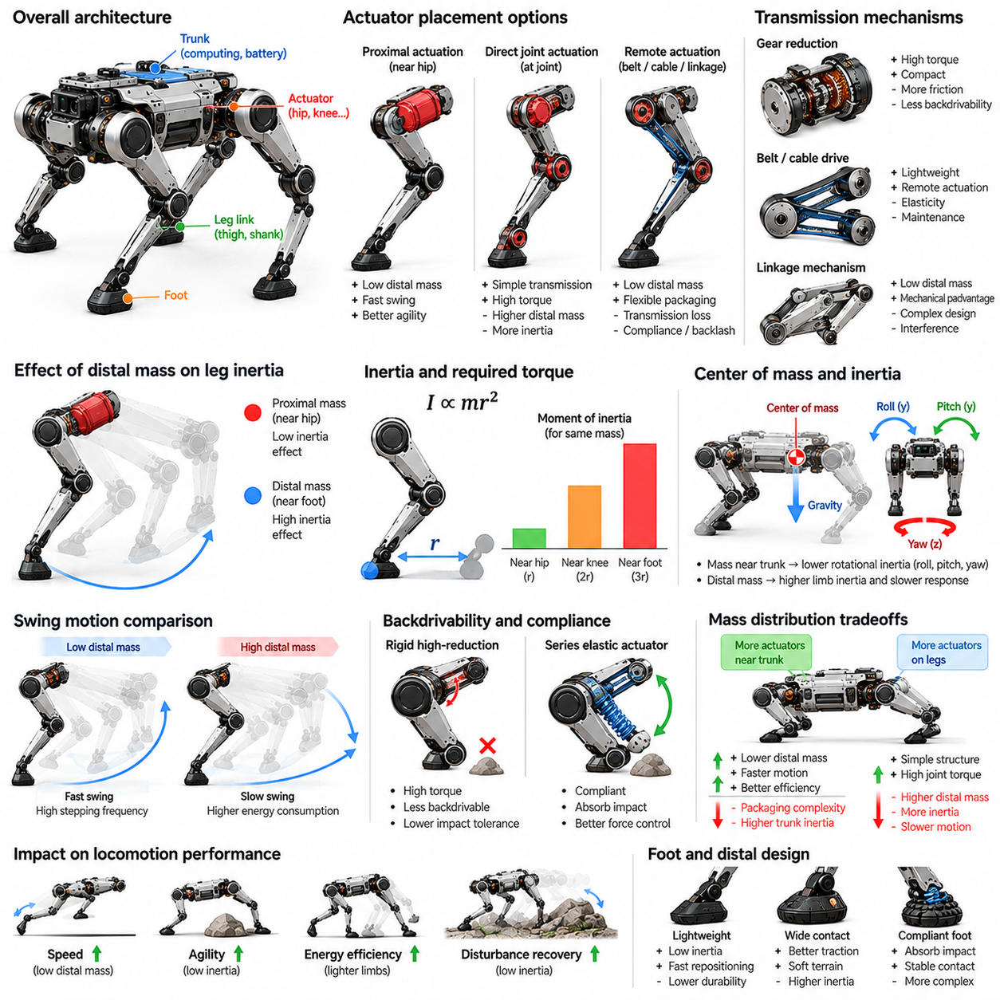{width="7.268055555555556in" height="7.268055555555556in"}

Actuator placement and distal mass are critical aspects of quadruped morphology that influence locomotion speed, energy efficiency, force generation, and mechanical responsiveness. Actuator placement determines where motors and transmissions are positioned relative to the trunk and leg joints. Distal mass refers to the mass located farther from the body, particularly within the lower leg and foot. Their interaction shapes limb inertia and dynamic performance.

The distribution of actuator mass along a leg directly affects the mechanical effort required for movement. Motors positioned near the hip contribute relatively little to the rotational inertia of the entire leg about the hip. Motors located near the knee or foot increase inertia because their mass acts at a greater distance from proximal joints. This relationship becomes especially important during rapid stepping and repeated swing motions.

Distal mass increases the moment of inertia of a swinging limb and therefore raises the torque required to achieve a given angular acceleration. Its contribution grows approximately with the square of its distance from the rotation axis. Consequently, relatively small masses near the foot can significantly affect dynamic performance. Minimizing distal mass is often a primary objective in quadrupeds designed for agile locomotion.

High swing-leg inertia can restrict achievable stepping frequency and increase the energy required for acceleration and deceleration. During rapid gait transitions, heavy distal segments may delay foot repositioning and reduce disturbance recovery capability. Lower limb inertia allows faster adjustments to unexpected terrain conditions. However, lightweight construction must still provide sufficient stiffness, impact resistance, and structural durability.

Proximal actuator placement concentrates heavy components near the trunk and upper leg. This arrangement reduces the inertia of moving distal segments and can improve the responsiveness of the leg. It may also simplify cooling and electrical integration because motors remain closer to the central body. Nevertheless, transmitting power to distant joints requires mechanical mechanisms that introduce additional design constraints.

Direct joint actuation places motors at or near the joints they control. This architecture can simplify power transmission and provide relatively direct relationships between motor motion and joint motion. However, knee-mounted motors add mass to the moving leg, increasing hip loading and swing inertia. The resulting tradeoff involves mechanical simplicity, torque capacity, packaging volume, and dynamic efficiency.

Remote actuation relocates motors away from the joints they drive, often toward the hip or trunk. Mechanical power is transferred through belts, cables, shafts, gears, or linkage mechanisms. This configuration can reduce distal mass while preserving joint functionality. However, transmission losses, elastic deformation, backlash, and maintenance requirements may offset some of the dynamic advantages.

Linkage-based transmission systems can transfer knee actuation from a proximal motor through mechanical connecting members. Properly designed linkages may reduce the mass carried by the lower leg while maintaining useful joint torque. Their geometry determines transmission ratios and force characteristics across the workspace. Designers must consider mechanical interference, joint limits, bearing loads, and structural complexity.

Belt and cable transmissions provide alternative approaches to remote actuation. Lightweight flexible elements can transfer motion across joints without requiring heavy distal motors. However, belt tension, cable stretch, pulley alignment, and fatigue influence accuracy and durability. These systems may require periodic adjustment and protection against contamination. Their suitability depends on loading conditions and environmental requirements.

Actuator placement also influences the robot\'s total center of mass and rotational inertia. Concentrating motors near the trunk can reduce body moments of inertia when their locations are close to the central mass. However, packaging several actuators around the hip may increase body width or create structural interference. Effective integration requires balancing compactness, thermal performance, maintenance accessibility, and mass distribution.

The relationship between actuator torque density and placement is central to mechanical design. High-torque-density actuators can deliver substantial output within relatively small packages, enabling compact joint integration. Nevertheless, motor selection must account for continuous torque, peak torque, thermal limits, and transmission efficiency. A lightweight actuator that overheats or saturates during operation may provide little practical benefit.

Gear reduction allows compact motors to generate higher joint torque but introduces reflected inertia, friction, and mechanical losses. High reduction ratios may reduce backdrivability and limit force transparency during ground contact. Lower reduction ratios can improve responsiveness and interaction control but require motors capable of producing greater torque. The appropriate ratio depends on locomotion dynamics and contact requirements.

Backdrivability is particularly important for quadrupeds operating on irregular terrain. A backdrivable joint can respond mechanically to external forces rather than behaving as a rigid, highly constrained mechanism. This characteristic can support impact tolerance and compliant interaction. However, high backdrivability may require continuous actuator effort to maintain posture, depending on the transmission and mechanical configuration.

Series elastic actuation introduces a compliant element between the motor and the driven joint. This elasticity can absorb impacts, improve force estimation, and support controlled interaction with the ground. However, additional compliance changes system dynamics and may limit high-frequency position tracking. The placement of elastic elements must therefore be coordinated with actuator bandwidth, control strategy, and expected contact forces.

Distal mass also influences impact behavior when the foot contacts the ground. A heavier moving lower leg can carry greater kinetic energy at a given velocity, potentially increasing collision forces during unexpected contact. Reducing distal inertia can improve the ability to stop or redirect a swinging foot. Nevertheless, impact severity also depends on joint compliance, control response, contact geometry, and effective mass.

The foot and lower-leg structure should be designed to minimize unnecessary mass while preserving contact reliability. Lightweight materials, hollow structural sections, and compact sensor integration can reduce inertia. However, excessive weight reduction may compromise fatigue resistance or protection against repeated impacts. The design objective is not minimum mass alone but an appropriate balance between mechanical robustness and dynamic capability.

Actuator placement affects cable routing, sensor integration, and environmental protection. Distally mounted motors require electrical connections that accommodate repeated joint movement and exposure to impacts. Proximally mounted motors may simplify electrical packaging but require more complex mechanical transmissions. Both approaches must address sealing, thermal management, connector reliability, and serviceability throughout the operating life.

Thermal management becomes particularly important when several high-power actuators are concentrated near the hip or trunk. Localized heat generation can affect motor efficiency, electronics reliability, and nearby structural components. Distributed actuator placement may improve heat separation but complicate wiring and protection. Mechanical architecture must provide adequate heat dissipation without introducing excessive weight or restricting movement.

The optimal actuator arrangement depends on the intended gait and operational environment. Fast-running quadrupeds benefit from low swing-leg inertia and rapid foot repositioning, while heavy-duty platforms may prioritize sustained torque and structural durability. Robots designed for rough terrain require impact tolerance and reliable joint force control. These different requirements can justify distinct actuator placement strategies.

Payload-carrying quadrupeds introduce additional constraints because higher body loads increase the torque required during stance. Larger actuators or stronger transmissions may be necessary, potentially increasing overall mass. Concentrating these components proximally can limit the resulting increase in swing inertia. However, actuator sizing must consider continuous support loads, dynamic peaks, and thermal operating limits.

Simulation can quantify the effects of actuator placement on joint torques, swing energy, and locomotion performance. Engineers can compare alternative motor locations and transmission architectures using multibody dynamic models. Parameter studies can reveal sensitivity to distal mass, gear ratio, and link inertia. Such analysis supports informed tradeoffs before expensive mechanical prototypes are manufactured.

Experimental validation is necessary because transmission friction, structural flexibility, thermal behavior, and manufacturing tolerances may differ from simulation assumptions. Swing-leg acceleration tests can reveal inertia-related limitations, while repeated gait trials provide evidence of energy consumption and actuator heating. Force measurements and disturbance tests help evaluate contact responsiveness. These results guide iterative refinement of actuator architecture.

Actuator placement and distal mass must ultimately be optimized as part of the complete quadruped system. Reducing distal inertia can improve agility, but remote transmissions may increase complexity and maintenance demands. Direct actuation can simplify mechanical integration while increasing moving mass. Successful morphology balances dynamic responsiveness, torque capability, energy efficiency, durability, and manufacturability.

Within Physical AI, actuator placement determines the mechanical limits within which intelligent locomotion policies operate. Learning-based controllers can adapt foot trajectories and contact forces, but they cannot eliminate the effects of excessive inertia or insufficient torque. Morphology-aware design aligns actuator architecture with perception, planning, and control. This integration enables efficient, responsive, and robust quadruped behavior in complex physical environments.

구동기 배치(Actuator Placement)와 말단 질량(Distal Mass)은 사족보행 로봇 형태(Quadruped Morphology)의 핵심 요소로, 이동 속도(Locomotion Speed), 에너지 효율(Energy Efficiency), 힘 생성(Force Generation), 기계적 응답성(Mechanical Responsiveness)에 영향을 미친다. 구동기 배치는 모터(Motors)와 동력 전달장치(Transmissions)가 몸통(Trunk) 및 다리 관절(Leg Joints)에 대해 어디에 위치하는지를 결정한다. 말단 질량은 몸체에서 멀리 떨어진 위치, 특히 하부 다리(Lower Leg)와 발(Foot)에 분포하는 질량을 의미한다. 이 두 요소의 상호작용은 다리 관성(Limb Inertia)과 동적 성능(Dynamic Performance)을 결정한다.

다리를 따라 분포하는 구동기 질량(Actuator Mass)은 움직임에 필요한 기계적 노력(Mechanical Effort)에 직접적인 영향을 미친다. 엉덩이 관절(Hip) 가까이에 배치된 모터는 엉덩이 관절을 기준으로 한 전체 다리의 회전 관성(Rotational Inertia)에 상대적으로 적게 기여한다. 반면 무릎(Knee)이나 발(Foot) 가까이에 위치한 모터는 근위 관절(Proximal Joints)에서 더 먼 거리에서 질량이 작용하므로 관성을 증가시킨다. 이러한 관계는 빠른 발 디딤(Rapid Stepping)과 반복적인 유각 운동(Repeated Swing Motions)에서 특히 중요해진다.

말단 질량(Distal Mass)은 유각 다리(Swinging Limb)의 관성모멘트(Moment of Inertia)를 증가시키므로 주어진 각가속도(Angular Acceleration)를 달성하는 데 필요한 토크(Torque)를 높인다. 관성모멘트에 대한 질량의 기여도는 회전축(Rotation Axis)으로부터의 거리 제곱에 대략 비례하여 증가한다. 따라서 발(Foot) 가까이에 위치한 비교적 작은 질량도 동적 성능(Dynamic Performance)에 상당한 영향을 미칠 수 있다. 말단 질량 최소화(Minimizing Distal Mass)는 민첩한 이동(Agile Locomotion)을 목적으로 설계된 사족보행 로봇의 주요 목표 중 하나이다.

높은 유각 다리 관성(Swing-Leg Inertia)은 달성 가능한 발 디딤 주파수(Stepping Frequency)를 제한하고 가속 및 감속(Acceleration and Deceleration)에 필요한 에너지를 증가시킬 수 있다. 빠른 보행 전환(Rapid Gait Transitions) 중 무거운 말단 분절(Heavy Distal Segments)은 발 위치 재조정(Foot Repositioning)을 지연시키고 외란 복구 능력(Disturbance Recovery Capability)을 감소시킬 수 있다. 낮은 다리 관성(Low Limb Inertia)은 예상하지 못한 지형 조건(Unexpected Terrain Conditions)에 더 빠르게 대응할 수 있도록 한다. 그러나 경량 구조(Lightweight Construction)는 충분한 강성(Stiffness), 충격 저항성(Impact Resistance), 구조적 내구성(Structural Durability)을 유지해야 한다.

근위 구동기 배치(Proximal Actuator Placement)는 무거운 구성요소를 몸통(Trunk)과 상부 다리(Upper Leg) 가까이에 집중시킨다. 이러한 배치는 움직이는 말단 분절(Moving Distal Segments)의 관성을 줄이고 다리의 응답성(Responsiveness)을 향상시킬 수 있다. 또한 모터가 중앙 몸체(Central Body)에 더 가까이 위치하므로 냉각(Cooling)과 전기적 통합(Electrical Integration)을 단순화할 수 있다. 그러나 멀리 떨어진 관절(Distant Joints)에 동력을 전달하려면 추가적인 설계 제약(Design Constraints)을 발생시키는 기계적 전달 기구(Mechanical Mechanisms)가 필요하다.

직접 관절 구동(Direct Joint Actuation)은 제어 대상 관절의 위치 또는 그 가까이에 모터를 배치한다. 이러한 구조(Architecture)는 동력 전달(Power Transmission)을 단순화하고 모터 움직임(Motor Motion)과 관절 움직임(Joint Motion) 사이에 비교적 직접적인 관계를 제공할 수 있다. 그러나 무릎에 장착된 모터(Knee-Mounted Motors)는 움직이는 다리의 질량을 증가시켜 엉덩이 관절 하중(Hip Loading)과 유각 관성(Swing Inertia)을 높인다. 이에 따른 절충관계(Tradeoff)는 기계적 단순성(Mechanical Simplicity), 토크 용량(Torque Capacity), 부품 배치 공간(Packaging Volume), 동적 효율(Dynamic Efficiency)을 포함한다.

원격 구동(Remote Actuation)은 모터를 구동 대상 관절에서 떨어진 위치, 주로 엉덩이 관절(Hip)이나 몸통(Trunk) 쪽으로 이동시킨다. 기계적 동력(Mechanical Power)은 벨트(Belts), 케이블(Cables), 축(Shafts), 기어(Gears), 링크 기구(Linkage Mechanisms)를 통해 전달된다. 이러한 구성은 관절 기능(Joint Functionality)을 유지하면서 말단 질량(Distal Mass)을 줄일 수 있다. 그러나 동력 전달 손실(Transmission Losses), 탄성 변형(Elastic Deformation), 백래시(Backlash), 유지보수 요구사항(Maintenance Requirements)이 일부 동적 이점(Dynamic Advantages)을 상쇄할 수 있다.

링크 기반 동력 전달 시스템(Linkage-Based Transmission Systems)은 근위 모터(Proximal Motor)의 구동력을 기계적 연결 부재(Mechanical Connecting Members)를 통해 무릎 관절(Knee Joint)로 전달할 수 있다. 적절하게 설계된 링크 기구(Linkages)는 유용한 관절 토크(Joint Torque)를 유지하면서 하부 다리(Lower Leg)에 실리는 질량을 줄일 수 있다. 링크 기구의 기하학적 구조(Geometry)는 작업공간(Workspace) 전반에서 전달비(Transmission Ratios)와 힘 특성(Force Characteristics)을 결정한다. 설계자는 기계적 간섭(Mechanical Interference), 관절 한계(Joint Limits), 베어링 하중(Bearing Loads), 구조적 복잡성(Structural Complexity)을 고려해야 한다.

벨트 및 케이블 동력 전달장치(Belt and Cable Transmissions)는 원격 구동(Remote Actuation)을 구현하는 대안적인 접근방식을 제공한다. 가볍고 유연한 요소(Lightweight Flexible Elements)는 무거운 말단 모터(Heavy Distal Motors) 없이 관절 사이에 움직임을 전달할 수 있다. 그러나 벨트 장력(Belt Tension), 케이블 신장(Cable Stretch), 풀리 정렬(Pulley Alignment), 피로(Fatigue)는 정확도(Accuracy)와 내구성(Durability)에 영향을 미친다. 이러한 시스템은 주기적인 조정(Periodic Adjustment)과 오염 방지(Protection Against Contamination)가 필요할 수 있다. 적용 적합성(Suitability)은 하중 조건(Loading Conditions)과 환경 요구사항(Environmental Requirements)에 따라 달라진다.

구동기 배치(Actuator Placement)는 로봇의 전체 질량중심(Center of Mass)과 회전 관성(Rotational Inertia)에도 영향을 미친다. 모터를 몸통(Trunk) 가까이에 집중시키면 중앙 질량(Central Mass)에 가까운 위치에 배치되는 경우 몸체 관성모멘트(Body Moments of Inertia)를 줄일 수 있다. 그러나 여러 구동기(Actuators)를 엉덩이 관절(Hip) 주변에 배치하면 몸체 폭(Body Width)이 증가하거나 구조적 간섭(Structural Interference)이 발생할 수 있다. 효과적인 통합(Effective Integration)을 위해서는 소형화(Compactness), 열 성능(Thermal Performance), 유지보수 접근성(Maintenance Accessibility), 질량 분포(Mass Distribution) 사이의 균형이 필요하다.

구동기 토크 밀도(Actuator Torque Density)와 배치(Placement)의 관계는 기계 설계(Mechanical Design)의 핵심 요소이다. 높은 토크 밀도(High Torque Density)를 가진 구동기는 비교적 작은 크기에서 상당한 출력을 제공할 수 있으므로 소형 관절 통합(Compact Joint Integration)을 가능하게 한다. 그러나 모터 선정(Motor Selection)에서는 연속 토크(Continuous Torque), 최대 토크(Peak Torque), 열적 한계(Thermal Limits), 동력 전달 효율(Transmission Efficiency)을 고려해야 한다. 운용 중 과열(Overheating)되거나 포화(Saturation)되는 경량 구동기(Lightweight Actuator)는 실제적인 이점을 거의 제공하지 못할 수 있다.

기어 감속(Gear Reduction)은 소형 모터(Compact Motors)가 더 높은 관절 토크(Joint Torque)를 생성할 수 있도록 하지만 반사 관성(Reflected Inertia), 마찰(Friction), 기계적 손실(Mechanical Losses)을 발생시킨다. 높은 감속비(High Reduction Ratios)는 역구동성(Backdrivability)을 감소시키고 지면 접촉(Ground Contact) 중 힘 전달 투명성(Force Transparency)을 제한할 수 있다. 낮은 감속비(Lower Reduction Ratios)는 응답성(Responsiveness)과 상호작용 제어(Interaction Control)를 개선할 수 있지만 더 큰 토크를 생성할 수 있는 모터가 필요하다. 적절한 감속비는 이동 동역학(Locomotion Dynamics)과 접촉 요구사항(Contact Requirements)에 따라 결정된다.

역구동성(Backdrivability)은 불규칙한 지형(Irregular Terrain)에서 운용하는 사족보행 로봇에 특히 중요하다. 역구동 가능한 관절(Backdrivable Joint)은 강체처럼 강하게 구속된 기구(Rigid, Highly Constrained Mechanism)로 작동하기보다 외력(External Forces)에 기계적으로 반응할 수 있다. 이러한 특성은 충격 허용 능력(Impact Tolerance)과 순응적 상호작용(Compliant Interaction)을 지원할 수 있다. 그러나 높은 역구동성(High Backdrivability)은 동력 전달장치(Transmission)와 기계적 구성(Mechanical Configuration)에 따라 자세 유지(Posture Maintenance)를 위해 지속적인 구동기 출력(Actuator Effort)을 요구할 수 있다.

직렬 탄성 구동(Series Elastic Actuation)은 모터(Motor)와 구동 대상 관절(Driven Joint) 사이에 순응 요소(Compliant Element)를 도입한다. 이러한 탄성(Elasticity)은 충격을 흡수하고 힘 추정(Force Estimation)을 개선하며 지면과의 제어된 상호작용(Controlled Interaction)을 지원할 수 있다. 그러나 추가적인 순응성(Compliance)은 시스템 동역학(System Dynamics)을 변화시키고 고주파 위치 추종(High-Frequency Position Tracking)을 제한할 수 있다. 따라서 탄성 요소(Elastic Elements)의 배치는 구동기 대역폭(Actuator Bandwidth), 제어 전략(Control Strategy), 예상 접촉력(Expected Contact Forces)과 조화되어야 한다.

말단 질량(Distal Mass)은 발(Foot)이 지면에 접촉할 때의 충격 거동(Impact Behavior)에도 영향을 미친다. 무거운 하부 다리(Heavier Lower Leg)는 동일한 속도(Velocity)에서 더 큰 운동에너지(Kinetic Energy)를 가질 수 있으며, 예상하지 못한 접촉(Unexpected Contact) 중 충돌력(Collision Forces)을 증가시킬 수 있다. 말단 관성(Distal Inertia)을 줄이면 유각 발(Swinging Foot)을 정지시키거나 방향을 전환하는 능력을 향상시킬 수 있다. 그러나 충격의 심각도(Impact Severity)는 관절 순응성(Joint Compliance), 제어 응답(Control Response), 접촉 기하학(Contact Geometry), 유효 질량(Effective Mass)에도 영향을 받는다.

발 및 하부 다리 구조(Foot and Lower-Leg Structure)는 접촉 신뢰성(Contact Reliability)을 유지하면서 불필요한 질량을 최소화하도록 설계해야 한다. 경량 소재(Lightweight Materials), 중공 구조 단면(Hollow Structural Sections), 소형 센서 통합(Compact Sensor Integration)은 관성(Inertia)을 줄일 수 있다. 그러나 과도한 경량화(Excessive Weight Reduction)는 피로 저항성(Fatigue Resistance)이나 반복적인 충격(Repeated Impacts)에 대한 보호 성능을 저하시킬 수 있다. 설계 목표는 단순한 최소 질량(Minimum Mass)이 아니라 기계적 견고성(Mechanical Robustness)과 동적 성능(Dynamic Capability) 사이의 적절한 균형이다.

구동기 배치(Actuator Placement)는 케이블 배선(Cable Routing), 센서 통합(Sensor Integration), 환경 보호(Environmental Protection)에 영향을 미친다. 말단 장착 모터(Distally Mounted Motors)는 반복적인 관절 움직임(Joint Movement)과 충격 노출(Exposure to Impacts)을 수용할 수 있는 전기적 연결(Electrical Connections)이 필요하다. 근위 장착 모터(Proximally Mounted Motors)는 전기적 부품 배치(Electrical Packaging)를 단순화할 수 있지만 더 복잡한 기계적 동력 전달장치(Mechanical Transmissions)를 요구한다. 두 방식 모두 전체 운용 수명(Operating Life) 동안 밀봉(Sealing), 열 관리(Thermal Management), 커넥터 신뢰성(Connector Reliability), 정비성(Serviceability)을 고려해야 한다.

열 관리(Thermal Management)는 여러 고출력 구동기(High-Power Actuators)가 엉덩이 관절(Hip)이나 몸통(Trunk) 가까이에 집중될 때 특히 중요해진다. 국부적인 열 발생(Localized Heat Generation)은 모터 효율(Motor Efficiency), 전자장치 신뢰성(Electronics Reliability), 인접 구조적 구성요소(Nearby Structural Components)에 영향을 미칠 수 있다. 분산형 구동기 배치(Distributed Actuator Placement)는 열적 분리(Heat Separation)를 개선할 수 있지만 배선(Wiring)과 보호 구조(Protection)를 복잡하게 만든다. 기계적 구조(Mechanical Architecture)는 과도한 무게를 추가하거나 움직임을 제한하지 않으면서 충분한 방열(Heat Dissipation)을 제공해야 한다.

최적의 구동기 배치(Optimal Actuator Arrangement)는 의도된 보행 방식(Intended Gait)과 운용 환경(Operational Environment)에 따라 달라진다. 빠르게 달리는 사족보행 로봇(Fast-Running Quadrupeds)은 낮은 유각 다리 관성(Low Swing-Leg Inertia)과 신속한 발 위치 재조정(Rapid Foot Repositioning)의 이점을 얻으며, 중하중 플랫폼(Heavy-Duty Platforms)은 지속 토크(Sustained Torque)와 구조적 내구성(Structural Durability)을 우선시할 수 있다. 험지 운용 로봇(Rough-Terrain Robots)은 충격 허용 능력(Impact Tolerance)과 신뢰할 수 있는 관절 힘 제어(Joint Force Control)가 필요하다. 이러한 서로 다른 요구사항은 각기 다른 구동기 배치 전략(Actuator Placement Strategies)을 정당화할 수 있다.

탑재하중 운반 사족보행 로봇(Payload-Carrying Quadrupeds)은 더 높은 몸체 하중(Body Loads)이 지지 단계(Stance Phase)에서 필요한 토크(Torque)를 증가시키므로 추가적인 제약을 갖는다. 더 큰 구동기(Larger Actuators)나 더 강한 동력 전달장치(Stronger Transmissions)가 필요할 수 있으며, 이는 전체 질량(Overall Mass)을 증가시킬 수 있다. 이러한 구성요소를 근위부(Proximally)에 집중시키면 유각 관성(Swing Inertia)의 증가를 제한할 수 있다. 그러나 구동기 용량 선정(Actuator Sizing)은 연속 지지 하중(Continuous Support Loads), 동적 최대 하중(Dynamic Peaks), 열적 운용 한계(Thermal Operating Limits)를 고려해야 한다.

시뮬레이션(Simulation)은 구동기 배치(Actuator Placement)가 관절 토크(Joint Torques), 유각 에너지(Swing Energy), 이동 성능(Locomotion Performance)에 미치는 영향을 정량화할 수 있다. 엔지니어는 다물체 동역학 모델(Multibody Dynamic Models)을 이용하여 대안적인 모터 위치(Motor Locations)와 동력 전달 구조(Transmission Architectures)를 비교할 수 있다. 매개변수 연구(Parameter Studies)는 말단 질량(Distal Mass), 기어비(Gear Ratio), 링크 관성(Link Inertia)에 대한 민감도(Sensitivity)를 밝혀낼 수 있다. 이러한 분석은 비용이 많이 드는 기계적 시제품(Mechanical Prototypes)을 제작하기 전에 합리적인 설계 절충관계(Design Tradeoffs)를 결정하는 데 도움이 된다.

동력 전달 마찰(Transmission Friction), 구조적 유연성(Structural Flexibility), 열적 거동(Thermal Behavior), 제조 공차(Manufacturing Tolerances)는 시뮬레이션 가정(Simulation Assumptions)과 다를 수 있으므로 실험적 검증(Experimental Validation)이 필요하다. 유각 다리 가속 시험(Swing-Leg Acceleration Tests)은 관성과 관련된 한계(Inertia-Related Limitations)를 밝혀낼 수 있으며, 반복적인 보행 시험(Repeated Gait Trials)은 에너지 소비(Energy Consumption)와 구동기 발열(Actuator Heating)에 관한 근거를 제공한다. 힘 측정(Force Measurements)과 외란 시험(Disturbance Tests)은 접촉 응답성(Contact Responsiveness)을 평가하는 데 도움이 된다. 이러한 결과는 구동기 구조(Actuator Architecture)의 반복적인 개선(Iterative Refinement)을 이끈다.

구동기 배치(Actuator Placement)와 말단 질량(Distal Mass)은 궁극적으로 전체 사족보행 로봇 시스템(Complete Quadruped System)의 일부로 최적화해야 한다. 말단 관성(Distal Inertia)을 줄이면 민첩성(Agility)을 향상시킬 수 있지만 원격 동력 전달장치(Remote Transmissions)는 복잡성(Complexity)과 유지보수 요구사항(Maintenance Demands)을 증가시킬 수 있다. 직접 구동(Direct Actuation)은 기계적 통합(Mechanical Integration)을 단순화하면서 움직이는 질량(Moving Mass)을 증가시킬 수 있다. 성공적인 형태 설계(Morphology Design)는 동적 응답성(Dynamic Responsiveness), 토크 성능(Torque Capability), 에너지 효율(Energy Efficiency), 내구성(Durability), 제조 가능성(Manufacturability) 사이의 균형을 유지한다.

피지컬 AI(Physical AI)에서 구동기 배치(Actuator Placement)는 지능형 이동 정책(Intelligent Locomotion Policies)이 작동할 수 있는 기계적 한계(Mechanical Limits)를 결정한다. 학습 기반 제어기(Learning-Based Controllers)는 발 궤적(Foot Trajectories)과 접촉력(Contact Forces)을 조정할 수 있지만 과도한 관성(Excessive Inertia)이나 부족한 토크(Insufficient Torque)의 영향을 제거할 수는 없다. 형태 인식 설계(Morphology-Aware Design)는 구동기 구조(Actuator Architecture)를 인지(Perception), 계획(Planning), 제어(Control)와 연계한다. 이러한 통합은 복잡한 물리적 환경(Complex Physical Environments)에서 효율적이고 반응성이 높으며 견고한 사족보행 로봇 동작(Efficient, Responsive, and Robust Quadruped Behavior)을 가능하게 한다.

##  

## 07.06. Compliance Shock and Foot Ground Interaction

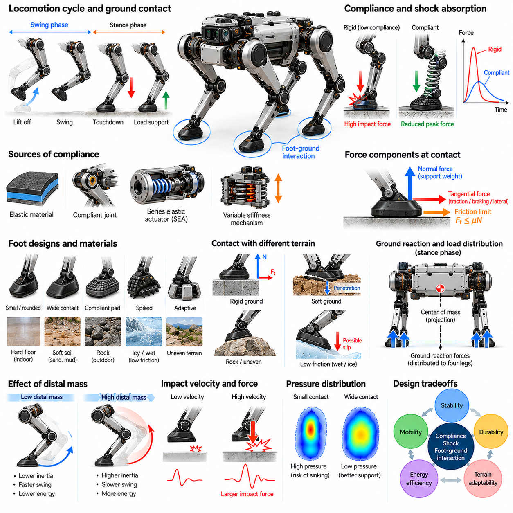{width="7.268055555555556in" height="7.268055555555556in"}

Compliance, shock absorption, and foot-ground interaction are essential elements of quadruped morphology that determine how a robot responds to contact with its environment. Compliance allows mechanical structures to deform under applied forces, while shock absorption reduces the transmission of impact energy. Foot-ground interaction governs traction, load transfer, and contact stability. Together, these properties influence locomotion efficiency, durability, and adaptability.

During quadruped locomotion, each foot repeatedly transitions between swing and stance phases. At touchdown, the foot establishes contact with the terrain and experiences a rapid change in velocity and loading. Without appropriate mechanical compliance or active control, this transition can generate large impact forces. These forces propagate through the leg joints and trunk, potentially affecting structural integrity, sensing accuracy, and motion stability.

Mechanical compliance describes the relationship between applied force and resulting deformation. It can originate from elastic materials, flexible structural elements, joint mechanisms, or dedicated suspension components. Controlled compliance allows a leg to accommodate small terrain irregularities without requiring immediate actuator corrections. However, excessive deformation can reduce positioning accuracy and introduce oscillations that complicate locomotion control.

Shock absorption involves dissipating or temporarily storing energy generated during impact. Elastic components store mechanical energy and may release it during subsequent motion, while damping mechanisms dissipate energy through friction or viscous resistance. Effective shock management combines appropriate stiffness and damping characteristics. The objective is to limit damaging impact loads while preserving responsive and efficient movement.

Joint compliance can be implemented through series elastic actuators, flexible couplings, or mechanically compliant transmissions. A series elastic actuator introduces an elastic element between the motor and the joint output, allowing controlled deflection under load. This arrangement can improve force estimation and impact tolerance. However, the added elasticity changes joint dynamics and requires suitable control strategies to maintain accurate movement.

Variable stiffness mechanisms provide an alternative approach by allowing mechanical compliance to change according to operating conditions. High stiffness may support precise positioning and heavy-load handling, while lower stiffness can improve impact tolerance during uncertain contact. Such systems may use adjustable springs, antagonistic actuators, or specialized transmissions. Their benefits must be weighed against additional mass, complexity, and energy requirements.

The foot is the primary interface between the quadruped and the terrain. Its geometry, material properties, and contact surface determine how forces are transmitted into the ground. Compact feet can simplify placement on narrow footholds, while larger contact areas may improve pressure distribution on deformable surfaces. Foot design must balance traction, durability, contact predictability, and compatibility with different terrain conditions.

Foot pads commonly use elastomeric materials to introduce localized compliance and increase friction under suitable surface conditions. Their deformation can distribute contact pressure and reduce concentrated impact loading. However, material hardness, temperature sensitivity, wear resistance, and contamination affect performance. A foot pad optimized for smooth indoor flooring may behave differently on wet rock, loose gravel, or uneven outdoor terrain.

Ground contact forces can be decomposed into normal and tangential components. Normal forces support body weight and contribute to vertical acceleration, while tangential forces generate propulsion, braking, and lateral stabilization. The maximum sustainable tangential force depends on contact conditions and available friction. Locomotion controllers must allocate forces within feasible contact limits to prevent unintended slipping.

The friction coefficient between the foot and ground is not a fixed property of the robot alone. It depends on the interacting materials, surface roughness, moisture, contamination, and contact dynamics. Low-friction terrain restricts the forces available for acceleration and turning. High-friction contact can improve traction but may increase structural loading during abrupt motion. Reliable locomotion therefore requires adaptation to uncertain surface properties.

Foot-ground interaction becomes more complex on deformable terrain such as sand, soil, snow, or soft vegetation. The foot may sink, compact the surface, or generate resistance through material displacement. Contact forces then depend on penetration depth, loading history, and local terrain mechanics. Rigid-ground assumptions may become inaccurate. Terrain-aware control must account for these effects when selecting footholds and regulating support forces.

Contact geometry also influences the distribution of pressure beneath the foot. A small contact region can generate high local pressure, potentially improving penetration into some surfaces while increasing sinking on soft terrain. Larger contact regions spread the load but may complicate placement on irregular obstacles. Appropriate foot morphology depends on whether the robot prioritizes precise foothold selection, low ground pressure, or secure traction.

Impact loading is strongly influenced by touchdown velocity and the effective mass participating in contact. Higher impact velocity generally increases the mechanical demands placed on the foot and leg. Lightweight distal structures can reduce collision energy, while compliant components can extend the duration of force transfer. Controlled landing trajectories further reduce impact severity by regulating foot velocity before contact.

Damping is necessary to prevent compliant structures from producing excessive oscillations after touchdown. Insufficient damping can cause repeated bouncing, unstable force measurements, and delayed settling. Excessive damping may waste energy and restrict rapid leg motion. The appropriate damping level depends on leg stiffness, body mass, gait frequency, and terrain characteristics. Mechanical and control-based damping can be combined to achieve suitable behavior.

Active compliance uses actuator control to regulate the apparent mechanical response of a joint or leg. Impedance control adjusts the relationship between motion errors and interaction forces, while admittance control generates motion responses from measured forces. These methods can complement passive elastic elements. Their effectiveness depends on sensing accuracy, actuator bandwidth, communication delays, and the stability of the control system.

Foot contact sensing provides information about touchdown timing, support loading, and potential slipping. Force sensors, torque estimation, tactile elements, and joint measurements can contribute to contact-state estimation. Accurate detection allows the controller to coordinate transitions between swing and stance. However, compliant structures and noisy measurements can introduce delays or uncertainty, requiring robust filtering and estimation methods.

Slip detection is important because loss of traction can destabilize the entire robot. Unexpected foot motion during stance may indicate insufficient friction, excessive tangential loading, or terrain deformation. Detection methods can compare predicted and observed foot motion using joint encoders, inertial sensors, and contact estimates. Once slipping is identified, the controller may redistribute forces, adjust posture, or select alternative footholds.

Compliance and contact behavior influence the efficiency of different gaits. During walking, controlled compliance can smooth load transfer between supporting legs. During trotting and running, elastic elements may temporarily store energy and return part of it during push-off. However, energy recovery depends on timing, stiffness, and mechanical losses. Poorly matched compliance can increase energy consumption or destabilize periodic locomotion.

The distribution of compliance across the leg affects how contact forces propagate through the mechanical structure. Compliance concentrated at the foot can absorb localized impacts without substantially altering joint behavior. Joint-level compliance can accommodate larger deflections and improve force regulation. Structural flexibility distributed through the links may reduce weight but complicate modeling. Each approach produces different tradeoffs between control accuracy and impact tolerance.

Repeated foot-ground impacts create fatigue and wear concerns for the entire locomotion system. Foot pads, bearings, joints, fasteners, and structural links experience cyclic loading during operation. Abrasive terrain can accelerate surface degradation, while contamination may damage moving components. Durable quadruped morphology requires replaceable contact elements, suitable material selection, protective sealing, and inspection procedures.

Simulation of compliant locomotion requires models of contact stiffness, damping, friction, and possible terrain deformation. These parameters are difficult to identify precisely because contact conditions vary between surfaces and over time. Simplified contact models support efficient development but may produce unrealistic impact or slip behavior. Experimental calibration is therefore necessary to improve simulation fidelity and reduce transfer errors.

Physical validation should include controlled drop tests, repeated touchdown experiments, traction measurements, and locomotion trials across representative surfaces. Engineers can evaluate peak impact forces, contact duration, settling behavior, slipping frequency, and component wear. These measurements reveal whether compliance improves performance without introducing unacceptable instability. Results can guide iterative refinement of foot materials, joint stiffness, and control parameters.

Compliance, shock absorption, and foot-ground interaction must be designed as an integrated mechanical and control system. Softer structures can improve impact tolerance but reduce positioning precision, while rigid configurations may improve response accuracy at the expense of contact robustness. Effective morphology balances stiffness, damping, traction, energy efficiency, and structural durability according to the robot\'s intended environment.

Within Physical AI, contact mechanics connects the robot\'s physical embodiment with perception, learning, and adaptive control. Intelligent locomotion systems must predict contact outcomes, detect changes in terrain properties, and adjust forces and trajectories accordingly. Mechanical compliance provides passive adaptation, while feedback control supplies active correction. Their integration enables safer, more efficient, and more robust quadruped locomotion in complex environments.

순응성(Compliance), 충격 흡수(Shock Absorption), 발-지면 상호작용(Foot-Ground Interaction)은 로봇이 환경과 접촉할 때 어떻게 반응하는지를 결정하는 사족보행 로봇 형태(Quadruped Morphology)의 핵심 요소이다. 순응성은 외력이 가해질 때 기계적 구조(Mechanical Structures)가 변형될 수 있도록 하며, 충격 흡수는 충격 에너지(Impact Energy)의 전달을 감소시킨다. 발-지면 상호작용은 접지력(Traction), 하중 전달(Load Transfer), 접촉 안정성(Contact Stability)을 결정한다. 이러한 특성은 이동 효율(Locomotion Efficiency), 내구성(Durability), 적응성(Adaptability)에 영향을 미친다.

사족보행 이동(Quadruped Locomotion) 중 각 발은 유각 단계(Swing Phase)와 지지 단계(Stance Phase)를 반복적으로 전환한다. 착지(Touchdown) 순간 발은 지형(Terrain)과 접촉하며 속도(Velocity)와 하중(Loading)이 급격하게 변화한다. 적절한 기계적 순응성(Mechanical Compliance)이나 능동 제어(Active Control)가 없으면 이러한 전환 과정에서 큰 충격력(Impact Forces)이 발생할 수 있다. 충격력은 다리 관절(Leg Joints)과 몸통(Trunk)을 통해 전달되어 구조적 무결성(Structural Integrity), 감지 정확도(Sensing Accuracy), 운동 안정성(Motion Stability)에 영향을 미칠 수 있다.

기계적 순응성(Mechanical Compliance)은 가해진 힘(Applied Force)과 그 결과 발생하는 변형(Resulting Deformation) 사이의 관계를 나타낸다. 순응성은 탄성 소재(Elastic Materials), 유연한 구조 요소(Flexible Structural Elements), 관절 기구(Joint Mechanisms), 전용 현가장치(Dedicated Suspension Components)에서 발생할 수 있다. 제어된 순응성(Controlled Compliance)은 구동기(Actuators)의 즉각적인 보정 없이도 다리가 작은 지형 불규칙성(Terrain Irregularities)에 적응하도록 한다. 그러나 과도한 변형(Excessive Deformation)은 위치 정확도(Positioning Accuracy)를 감소시키고 진동(Oscillations)을 발생시켜 이동 제어(Locomotion Control)를 복잡하게 만들 수 있다.

충격 흡수(Shock Absorption)는 충격 과정에서 발생하는 에너지를 소산(Dissipation)하거나 일시적으로 저장(Temporary Storage)하는 것을 포함한다. 탄성 구성요소(Elastic Components)는 기계적 에너지(Mechanical Energy)를 저장하고 이후 움직임에서 방출할 수 있으며, 감쇠 기구(Damping Mechanisms)는 마찰(Friction)이나 점성 저항(Viscous Resistance)을 통해 에너지를 소산한다. 효과적인 충격 관리(Shock Management)는 적절한 강성(Stiffness)과 감쇠 특성(Damping Characteristics)을 결합한다. 그 목적은 반응성이 높고 효율적인 움직임을 유지하면서 손상을 유발하는 충격 하중(Impact Loads)을 제한하는 것이다.

관절 순응성(Joint Compliance)은 직렬 탄성 구동기(Series Elastic Actuators), 유연 커플링(Flexible Couplings), 기계적으로 순응적인 동력 전달장치(Mechanically Compliant Transmissions)를 통해 구현할 수 있다. 직렬 탄성 구동기(Series Elastic Actuator)는 모터(Motor)와 관절 출력부(Joint Output) 사이에 탄성 요소(Elastic Element)를 도입하여 하중을 받을 때 제어된 변형(Controlled Deflection)이 발생하도록 한다. 이러한 구조는 힘 추정(Force Estimation)과 충격 허용 능력(Impact Tolerance)을 향상시킬 수 있다. 그러나 추가된 탄성(Elasticity)은 관절 동역학(Joint Dynamics)을 변화시키므로 정확한 움직임을 유지하기 위한 적절한 제어 전략(Control Strategies)이 필요하다.

가변 강성 기구(Variable Stiffness Mechanisms)는 운용 조건(Operating Conditions)에 따라 기계적 순응성(Mechanical Compliance)을 변경할 수 있는 대안적인 접근방식을 제공한다. 높은 강성(High Stiffness)은 정밀한 위치 제어(Precise Positioning)와 고하중 취급(Heavy-Load Handling)을 지원하며, 낮은 강성(Lower Stiffness)은 불확실한 접촉(Uncertain Contact) 중 충격 허용 능력(Impact Tolerance)을 향상시킬 수 있다. 이러한 시스템은 조절 가능한 스프링(Adjustable Springs), 길항 구동기(Antagonistic Actuators), 특수 동력 전달장치(Specialized Transmissions)를 사용할 수 있다. 그러나 추가적인 질량(Mass), 복잡성(Complexity), 에너지 요구사항(Energy Requirements)과 비교하여 이점을 평가해야 한다.

발(Foot)은 사족보행 로봇과 지형(Terrain) 사이의 주요 인터페이스(Primary Interface)이다. 발의 기하학적 구조(Geometry), 재료 특성(Material Properties), 접촉 표면(Contact Surface)은 힘이 지면으로 전달되는 방식을 결정한다. 소형 발(Compact Feet)은 좁은 발 디딤 위치(Narrow Footholds)에 발을 배치하기 쉽게 만들 수 있으며, 넓은 접촉 면적(Larger Contact Areas)은 변형 가능한 표면(Deformable Surfaces)에서 압력 분포(Pressure Distribution)를 개선할 수 있다. 발 설계(Foot Design)는 접지력(Traction), 내구성(Durability), 접촉 예측 가능성(Contact Predictability), 다양한 지형 조건(Terrain Conditions)과의 적합성(Compatibility) 사이에서 균형을 유지해야 한다.

발 패드(Foot Pads)는 일반적으로 탄성중합체 소재(Elastomeric Materials)를 사용하여 국부적인 순응성(Localized Compliance)을 제공하고 적절한 표면 조건에서 마찰(Friction)을 증가시킨다. 발 패드의 변형(Deformation)은 접촉 압력(Contact Pressure)을 분산하고 집중된 충격 하중(Concentrated Impact Loading)을 감소시킬 수 있다. 그러나 재료 경도(Material Hardness), 온도 민감도(Temperature Sensitivity), 내마모성(Wear Resistance), 오염(Contamination)은 성능에 영향을 미친다. 매끄러운 실내 바닥(Smooth Indoor Flooring)에 최적화된 발 패드는 젖은 암석(Wet Rock), 느슨한 자갈(Loose Gravel), 불규칙한 야외 지형(Uneven Outdoor Terrain)에서 서로 다른 거동을 보일 수 있다.

지면 접촉력(Ground Contact Forces)은 법선 성분(Normal Components)과 접선 성분(Tangential Components)으로 분해할 수 있다. 법선력(Normal Forces)은 몸체 무게(Body Weight)를 지지하고 수직 가속도(Vertical Acceleration)에 기여하며, 접선력(Tangential Forces)은 추진(Propulsion), 제동(Braking), 측면 안정화(Lateral Stabilization)를 생성한다. 유지 가능한 최대 접선력(Maximum Sustainable Tangential Force)은 접촉 조건(Contact Conditions)과 사용 가능한 마찰(Available Friction)에 따라 결정된다. 이동 제어기(Locomotion Controllers)는 의도하지 않은 미끄러짐(Unintended Slipping)을 방지하기 위해 실현 가능한 접촉 한계(Feasible Contact Limits) 내에서 힘을 배분해야 한다.

발과 지면 사이의 마찰계수(Friction Coefficient)는 로봇 자체에만 고정된 특성이 아니다. 마찰계수는 상호작용하는 재료(Interacting Materials), 표면 거칠기(Surface Roughness), 습기(Moisture), 오염(Contamination), 접촉 동역학(Contact Dynamics)에 따라 달라진다. 저마찰 지형(Low-Friction Terrain)은 가속(Acceleration)과 회전(Turning)에 사용할 수 있는 힘을 제한한다. 고마찰 접촉(High-Friction Contact)은 접지력(Traction)을 개선할 수 있지만 급격한 움직임(Ab­rupt Motion) 중 구조적 하중(Structural Loading)을 증가시킬 수 있다. 따라서 신뢰할 수 있는 이동(Reliable Locomotion)을 위해서는 불확실한 표면 특성(Uncertain Surface Properties)에 대한 적응이 필요하다.

발-지면 상호작용(Foot-Ground Interaction)은 모래(Sand), 토양(Soil), 눈(Snow), 부드러운 식생(Soft Vegetation)과 같은 변형 가능한 지형(Deformable Terrain)에서 더욱 복잡해진다. 발은 지면에 가라앉거나(Sinking), 표면을 압축(Compaction)하거나, 재료 변위(Material Displacement)를 통해 저항(Resistance)을 발생시킬 수 있다. 이때 접촉력(Contact Forces)은 침투 깊이(Penetration Depth), 하중 이력(Loading History), 국부 지형 역학(Local Terrain Mechanics)에 따라 달라진다. 강체 지면 가정(Rigid-Ground Assumptions)은 부정확해질 수 있다. 따라서 지형 인식 제어(Terrain-Aware Control)는 발 디딤 위치(Footholds)를 선택하고 지지력(Support Forces)을 조절할 때 이러한 영향을 고려해야 한다.

접촉 기하학(Contact Geometry)은 발 아래의 압력 분포(Pressure Distribution)에도 영향을 미친다. 작은 접촉 영역(Small Contact Region)은 높은 국부 압력(Local Pressure)을 발생시켜 일부 표면에서는 침투력(Penetration)을 높일 수 있지만 부드러운 지형(Soft Terrain)에서는 침하(Sinking)를 증가시킬 수 있다. 넓은 접촉 영역(Larger Contact Regions)은 하중(Load)을 분산하지만 불규칙한 장애물(Irregular Obstacles)에 발을 배치하기 어렵게 만들 수 있다. 적절한 발 형태(Foot Morphology)는 로봇이 정밀한 발 디딤 위치 선택(Precise Foothold Selection), 낮은 지면 압력(Low Ground Pressure), 안정적인 접지력(Secure Traction) 중 무엇을 우선시하는지에 따라 달라진다.

충격 하중(Impact Loading)은 착지 속도(Touchdown Velocity)와 접촉에 참여하는 유효 질량(Effective Mass)에 크게 영향을 받는다. 일반적으로 충격 속도(Impact Velocity)가 높을수록 발과 다리에 가해지는 기계적 요구사항(Mechanical Demands)이 증가한다. 가벼운 말단 구조(Lightweight Distal Structures)는 충돌 에너지(Collision Energy)를 줄일 수 있으며, 순응성 구성요소(Compliant Components)는 힘 전달 시간(Duration of Force Transfer)을 늘릴 수 있다. 제어된 착지 궤적(Controlled Landing Trajectories)은 접촉 전에 발 속도(Foot Velocity)를 조절하여 충격의 심각도(Impact Severity)를 추가로 감소시킨다.

감쇠(Damping)는 착지 후 순응성 구조(Compliant Structures)에서 과도한 진동(Oscillations)이 발생하는 것을 방지하는 데 필요하다. 감쇠가 부족하면 반복적인 튀어 오름(Bouncing), 불안정한 힘 측정(Unstable Force Measurements), 정착 지연(Delayed Settling)이 발생할 수 있다. 과도한 감쇠(Excessive Damping)는 에너지를 낭비하고 빠른 다리 움직임(Rapid Leg Motion)을 제한할 수 있다. 적절한 감쇠 수준(Damping Level)은 다리 강성(Leg Stiffness), 몸체 질량(Body Mass), 보행 주파수(Gait Frequency), 지형 특성(Terrain Characteristics)에 따라 달라진다. 기계적 감쇠(Mechanical Damping)와 제어 기반 감쇠(Control-Based Damping)를 결합하여 적절한 거동을 구현할 수 있다.

능동 순응성(Active Compliance)은 구동기 제어(Actuator Control)를 이용하여 관절이나 다리의 겉보기 기계적 응답(Apparent Mechanical Response)을 조절한다. 임피던스 제어(Impedance Control)는 운동 오차(Motion Errors)와 상호작용 힘(Interaction Forces) 사이의 관계를 조정하며, 어드미턴스 제어(Admittance Control)는 측정된 힘(Measured Forces)에 따라 움직임 응답(Motion Responses)을 생성한다. 이러한 방법은 수동 탄성 요소(Passive Elastic Elements)를 보완할 수 있다. 효과는 감지 정확도(Sensing Accuracy), 구동기 대역폭(Actuator Bandwidth), 통신 지연(Communication Delays), 제어 시스템 안정성(Control System Stability)에 따라 달라진다.

발 접촉 감지(Foot Contact Sensing)는 착지 시점(Touchdown Timing), 지지 하중(Support Loading), 잠재적인 미끄러짐(Potential Slipping)에 관한 정보를 제공한다. 힘 센서(Force Sensors), 토크 추정(Torque Estimation), 촉각 요소(Tactile Elements), 관절 측정(Joint Measurements)은 접촉 상태 추정(Contact-State Estimation)에 기여할 수 있다. 정확한 접촉 감지(Accurate Contact Detection)는 제어기가 유각 단계(Swing Phase)와 지지 단계(Stance Phase) 사이의 전환을 협조적으로 수행하도록 한다. 그러나 순응성 구조(Compliant Structures)와 잡음이 포함된 측정값(Noisy Measurements)은 지연(Delays)이나 불확실성(Uncertainty)을 발생시킬 수 있으므로 견고한 필터링(Robust Filtering)과 추정 방법(Estimation Methods)이 필요하다.

미끄러짐 감지(Slip Detection)는 접지력 손실(Loss of Traction)이 로봇 전체의 안정성을 저하시킬 수 있기 때문에 중요하다. 지지 단계(Stance Phase)에서 예상하지 못한 발 움직임(Unexpected Foot Motion)은 부족한 마찰(Insufficient Friction), 과도한 접선 하중(Excessive Tangential Loading), 지형 변형(Terrain Deformation)을 나타낼 수 있다. 감지 방법(Detection Methods)은 관절 엔코더(Joint Encoders), 관성 센서(Inertial Sensors), 접촉 추정(Contact Estimates)을 이용하여 예측된 발 움직임(Predicted Foot Motion)과 관측된 발 움직임(Observed Foot Motion)을 비교할 수 있다. 미끄러짐이 식별되면 제어기(Controller)는 힘을 재분배(Redistribute Forces)하거나 자세(Posture)를 조정하거나 대체 발 디딤 위치(Alternative Footholds)를 선택할 수 있다.

순응성(Compliance)과 접촉 거동(Contact Behavior)은 다양한 보행 방식(Gaits)의 효율(Efficiency)에 영향을 미친다. 걷기(Walking)에서는 제어된 순응성(Controlled Compliance)이 지지 다리(Supporting Legs) 사이의 하중 전달(Load Transfer)을 부드럽게 만들 수 있다. 트로트 보행(Trotting)과 달리기(Running)에서는 탄성 요소(Elastic Elements)가 에너지를 일시적으로 저장하고 추진 단계(Push-Off)에서 일부를 반환할 수 있다. 그러나 에너지 회수(Energy Recovery)는 시점(Timing), 강성(Stiffness), 기계적 손실(Mechanical Losses)에 따라 달라진다. 적절하게 조정되지 않은 순응성(Poorly Matched Compliance)은 에너지 소비(Energy Consumption)를 증가시키거나 주기적 이동(Periodic Locomotion)을 불안정하게 만들 수 있다.

다리 전체의 순응성 분포(Distribution of Compliance)는 접촉력(Contact Forces)이 기계적 구조(Mechanical Structure)를 통해 전달되는 방식에 영향을 미친다. 발에 집중된 순응성(Foot-Level Compliance)은 관절 거동(Joint Behavior)을 크게 변화시키지 않으면서 국부적인 충격(Localized Impacts)을 흡수할 수 있다. 관절 수준 순응성(Joint-Level Compliance)은 더 큰 변형(Larger Deflections)을 수용하고 힘 조절(Force Regulation)을 개선할 수 있다. 링크 전체에 분포된 구조적 유연성(Distributed Structural Flexibility)은 무게를 줄일 수 있지만 모델링(Modeling)을 복잡하게 만든다. 각 접근방식은 제어 정확도(Control Accuracy)와 충격 허용 능력(Impact Tolerance) 사이에 서로 다른 절충관계(Tradeoffs)를 형성한다.

반복적인 발-지면 충격(Foot-Ground Impacts)은 전체 이동 시스템(Locomotion System)에 피로(Fatigue)와 마모(Wear) 문제를 발생시킨다. 발 패드(Foot Pads), 베어링(Bearings), 관절(Joints), 체결부(Fasteners), 구조 링크(Structural Links)는 운용 중 반복 하중(Cyclic Loading)을 받는다. 마모성이 높은 지형(Abrasive Terrain)은 표면 열화(Surface Degradation)를 가속할 수 있으며, 오염(Contamination)은 움직이는 구성요소(Moving Components)를 손상시킬 수 있다. 내구성이 높은 사족보행 로봇 형태(Durable Quadruped Morphology)를 위해서는 교체 가능한 접촉 요소(Replaceable Contact Elements), 적절한 재료 선정(Material Selection), 보호 밀봉(Protective Sealing), 검사 절차(Inspection Procedures)가 필요하다.

순응적 이동(Compliant Locomotion)의 시뮬레이션(Simulation)에는 접촉 강성(Contact Stiffness), 감쇠(Damping), 마찰(Friction), 가능한 지형 변형(Terrain Deformation)에 대한 모델이 필요하다. 이러한 매개변수(Parameters)는 접촉 조건(Contact Conditions)이 표면과 시간에 따라 달라지기 때문에 정확하게 식별하기 어렵다. 단순화된 접촉 모델(Simplified Contact Models)은 효율적인 개발을 지원하지만 비현실적인 충격(Impact)이나 미끄러짐 거동(Slip Behavior)을 생성할 수 있다. 따라서 시뮬레이션 충실도(Simulation Fidelity)를 개선하고 전이 오차(Transfer Errors)를 줄이기 위해 실험적 보정(Experimental Calibration)이 필요하다.

물리적 검증(Physical Validation)에는 제어된 낙하 시험(Controlled Drop Tests), 반복 착지 실험(Repeated Touchdown Experiments), 접지력 측정(Traction Measurements), 대표적인 표면(Representative Surfaces)에서의 이동 시험(Locomotion Trials)이 포함되어야 한다. 엔지니어는 최대 충격력(Peak Impact Forces), 접촉 지속시간(Contact Duration), 정착 거동(Settling Behavior), 미끄러짐 빈도(Slipping Frequency), 구성요소 마모(Component Wear)를 평가할 수 있다. 이러한 측정은 순응성(Compliance)이 허용할 수 없는 불안정성(Unacceptable Instability)을 유발하지 않으면서 성능을 개선하는지 확인하는 데 도움이 된다. 결과는 발 소재(Foot Materials), 관절 강성(Joint Stiffness), 제어 매개변수(Control Parameters)의 반복적인 개선(Iterative Refinement)을 이끌 수 있다.

순응성(Compliance), 충격 흡수(Shock Absorption), 발-지면 상호작용(Foot-Ground Interaction)은 통합된 기계 및 제어 시스템(Integrated Mechanical and Control System)으로 설계해야 한다. 더 부드러운 구조(Softer Structures)는 충격 허용 능력(Impact Tolerance)을 개선할 수 있지만 위치 정밀도(Positioning Precision)를 감소시킬 수 있으며, 강체 구성(Rigid Configurations)은 접촉 견고성(Contact Robustness)을 희생하면서 응답 정확도(Response Accuracy)를 높일 수 있다. 효과적인 형태 설계(Effective Morphology)는 로봇의 의도된 환경(Intended Environment)에 따라 강성(Stiffness), 감쇠(Damping), 접지력(Traction), 에너지 효율(Energy Efficiency), 구조적 내구성(Structural Durability) 사이의 균형을 유지한다.

피지컬 AI(Physical AI)에서 접촉 역학(Contact Mechanics)은 로봇의 물리적 체화(Physical Embodiment)를 인지(Perception), 학습(Learning), 적응형 제어(Adaptive Control)와 연결한다. 지능형 이동 시스템(Intelligent Locomotion Systems)은 접촉 결과(Contact Outcomes)를 예측하고 지형 특성(Terrain Properties)의 변화를 감지하며 이에 따라 힘(Forces)과 궤적(Trajectories)을 조정해야 한다. 기계적 순응성(Mechanical Compliance)은 수동적 적응(Passive Adaptation)을 제공하고 피드백 제어(Feedback Control)는 능동적 보정(Active Correction)을 제공한다. 이러한 통합은 복잡한 환경(Complex Environments)에서 더욱 안전하고 효율적이며 견고한 사족보행 이동(Quadruped Locomotion)을 가능하게 한다.

##  

## 07.07. Terrain Adaptive Morphology

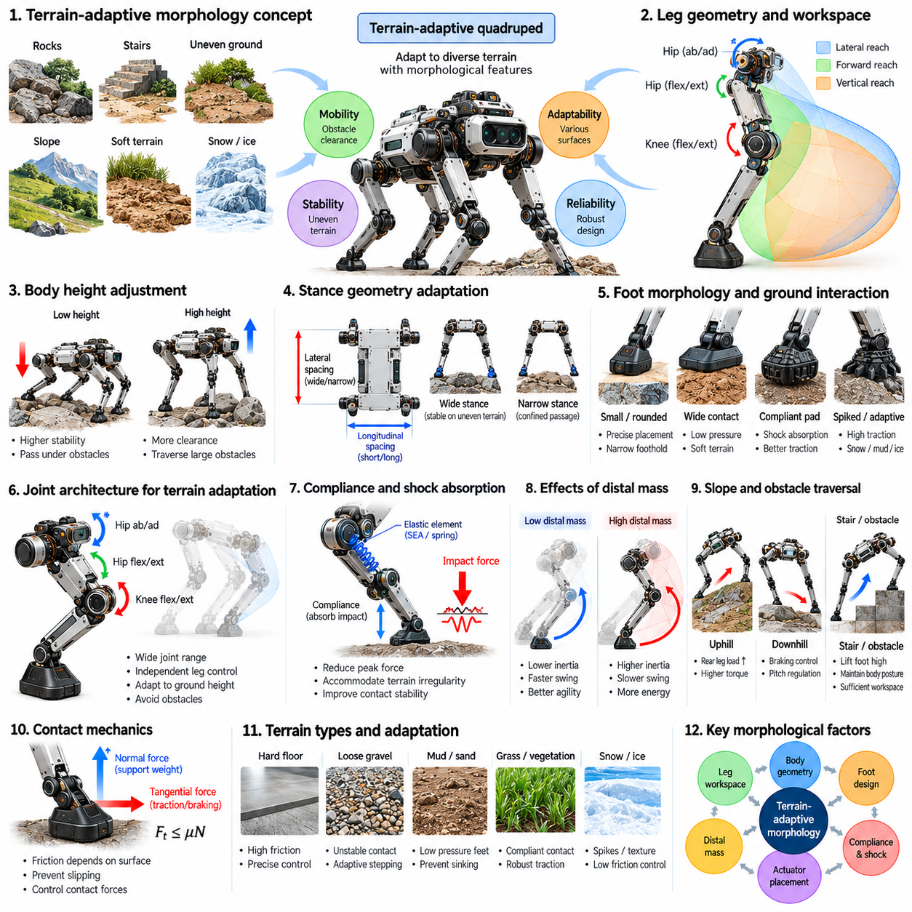{width="7.268055555555556in" height="7.268055555555556in"}

Terrain-adaptive morphology refers to the structural and mechanical characteristics that enable a quadruped robot to operate across diverse and unpredictable ground conditions. Unlike robots designed for uniform surfaces, terrain-adaptive quadrupeds must accommodate changes in elevation, slope, friction, compliance, and obstacle geometry. Their morphology determines the range of physical adaptations available to locomotion controllers and influences mobility, stability, and operational reliability.

The ability to traverse uneven terrain begins with leg geometry and reachable workspace. Sufficient joint articulation allows the robot to place its feet at different heights while maintaining a suitable body posture. Longer legs can increase obstacle clearance and stepping reach, but may introduce greater structural loads and rotational inertia. Effective terrain adaptation therefore requires balancing leg proportions, joint ranges, actuator capabilities, and mechanical robustness.

Body height adjustment is an important morphological capability for navigating irregular environments. Increasing trunk clearance can help the robot pass over rocks, vegetation, and raised obstacles, while lowering the body may improve stability on uncertain surfaces. However, changing body height alters joint configurations, torque requirements, and available workspace. Terrain-adaptive control must coordinate these effects to preserve feasible movement.

Stance geometry provides another mechanism for adapting to terrain conditions. A wider stance can improve lateral stability on uneven ground, while a narrower configuration may be necessary for confined passages. Longitudinal foot spacing can be adjusted to accommodate slopes and discontinuous support surfaces. These adaptations depend on sufficient lateral and longitudinal leg reach, as well as reliable coordination between body posture and foothold placement.

Foot morphology strongly influences the robot\'s ability to interact with different ground materials. Compact feet support precise placement on narrow rocks or structural edges, while larger contact surfaces distribute pressure across soft terrain. Elastomeric pads can improve contact compliance, whereas specialized tread patterns may enhance traction under suitable conditions. No single foot geometry performs optimally across every terrain category.

Terrain-dependent friction introduces significant challenges for quadruped locomotion. Smooth floors, wet stones, loose gravel, and compacted soil provide different traction characteristics. Foot materials and contact geometry determine how tangential forces are transmitted without slipping. Mechanical designs should provide sufficient grip while avoiding excessive wear or unwanted adhesion. Adaptive control must compensate when available friction changes unexpectedly.

Soft and deformable terrain requires particular attention to ground pressure and penetration. On sand, mud, snow, or loose soil, a concentrated foot load may cause sinking and unstable support. Increasing contact area can reduce pressure, although larger feet may interfere with obstacle negotiation. Terrain-adaptive morphology must balance surface penetration, traction generation, contact stability, and the energy required to withdraw the foot.

Mechanical compliance supports adaptation to terrain irregularities that cannot be predicted precisely. Elastic foot pads, compliant joints, and flexible structural elements allow local deformation during contact. This passive response can reduce impact loading and accommodate small height differences between footholds. However, excessive compliance may reduce positioning accuracy and introduce oscillations. Appropriate stiffness and damping depend on terrain characteristics and gait dynamics.

Joint architecture determines how effectively a quadruped can adjust individual legs to complex ground geometry. Hip abduction and adduction provide lateral foothold flexibility, while hip and knee flexion enable vertical and longitudinal positioning. Wide joint ranges increase potential adaptability but may create unfavorable leverage or collision risks. Usable workspace must therefore be evaluated under realistic loading and contact constraints.

Terrain-adaptive quadrupeds also benefit from low distal leg mass. Lightweight lower legs and feet can be repositioned rapidly when an intended foothold becomes unavailable. Reduced swing inertia supports obstacle avoidance and corrective stepping after unexpected contact. However, lightweight structures must remain resistant to impact, abrasion, and repeated loading. Actuator placement and transmission architecture are therefore important elements of terrain adaptation.

The trunk contributes to terrain adaptability through its geometry, rigidity, and mass distribution. A compact trunk can improve maneuverability around obstacles, while suitable ground clearance reduces the likelihood of body collisions. A relatively low center of mass may improve resistance to tipping, provided clearance remains adequate. Structural design must coordinate these competing requirements with payload capacity, sensing equipment, and thermal management.

Sloped terrain changes the relationship between gravity, body posture, and ground contact forces. During uphill movement, rear-leg loading and propulsion demands may increase, while downhill movement can require greater braking capability and careful pitch regulation. Side slopes introduce lateral load asymmetry and increased rollover risk. Terrain-adaptive morphology must provide sufficient joint torque, contact reach, and stability margins across these conditions.

Stair climbing and obstacle traversal impose additional workspace requirements. The robot must lift its feet above obstacle boundaries while preserving enough joint range for landing and support. Large vertical steps can require substantial knee articulation and hip torque. Body dimensions also determine whether the trunk can clear an obstacle without collision. Successful traversal depends on coordinated mechanical reach, force capability, and contact sequencing.

Irregular footholds may create situations in which the four feet contact surfaces at substantially different elevations. The resulting support configuration can produce asymmetric joint angles and uneven force distribution. Sufficient articulation allows the robot to accommodate these differences without excessive trunk rotation. However, extreme postures may reduce available torque or approach kinematic singularities. Mechanical feasibility must remain central to foothold selection.

Terrain-adaptive morphology can incorporate specialized feet for particular operating environments. Clawed structures may improve engagement with certain rough surfaces, while compliant pads support contact on hard irregular terrain. Broad feet may reduce sinking on snow or loose ground. Such adaptations introduce tradeoffs involving weight, complexity, surface compatibility, and maintenance. Application requirements determine whether specialized or general-purpose feet are preferable.

Some quadrupeds employ adjustable mechanical configurations to extend their terrain capabilities. Variable-stiffness joints, reconfigurable foot mechanisms, or adjustable leg elements can modify contact behavior and reachable geometry. These mechanisms provide additional adaptation beyond fixed morphology. However, they introduce actuators, sensors, control requirements, and potential failure points. Their benefits must justify the resulting mechanical and operational complexity.

Terrain perception and morphology are closely connected because physical reachability determines which perceived footholds can actually be used. Cameras, depth sensors, and proprioceptive measurements can identify obstacles, slopes, and potential contact regions. Planning systems must then evaluate these observations against leg workspace, joint limits, and stability constraints. A geometrically reachable foothold may still be unsuitable because of insufficient traction or excessive loading.

Contact sensing provides additional information when visual terrain estimates are uncertain. Joint torque measurements, foot force sensors, and body motion estimates can reveal unexpected compliance, slipping, or loss of support. These observations allow controllers to adjust contact forces and reposition feet. Mechanical compliance can provide immediate passive accommodation, while active control performs larger corrective movements. Their combination improves resilience to terrain uncertainty.

Adaptive gait selection enables a quadruped to exploit its morphology under changing conditions. Slow walking can maintain conservative support relationships on uncertain terrain, while trotting may provide efficient movement across sufficiently predictable surfaces. More demanding obstacles may require deliberate foot placement and extended support phases. The available gait repertoire depends on leg geometry, actuator bandwidth, contact capability, and body dynamics.

Energy efficiency remains an important consideration during terrain adaptation. Raising the body, increasing foot clearance, and using wide stances can improve obstacle negotiation but may increase joint torque and mechanical work. Frequent corrective stepping also consumes energy. Efficient terrain-adaptive behavior seeks configurations that provide sufficient safety margins without unnecessary motion. The preferred strategy depends on terrain difficulty and operational priorities.

Simulation enables systematic evaluation of quadruped morphology across representative terrain conditions. Virtual environments can include slopes, steps, scattered obstacles, uneven surfaces, and simplified deformable ground. Engineers can compare leg dimensions, foot designs, actuator placement, and compliance characteristics. However, simulated contact properties may not accurately reproduce real friction, soil deformation, or impact behavior, making experimental validation essential.

Physical testing should evaluate mobility across terrain categories that reflect the intended deployment environment. Relevant measurements include obstacle traversal success, slipping frequency, contact stability, energy consumption, actuator temperature, and structural wear. Repeated trials can reveal limitations that remain hidden during isolated demonstrations. These results support iterative refinement of mechanical design, locomotion planning, and contact control.

Terrain-adaptive morphology must ultimately be optimized as a complete system rather than through isolated mechanical improvements. Greater leg reach may increase obstacle capability while reducing stiffness, and larger feet may improve soft-ground support while restricting precise placement. Effective design balances workspace, stability, traction, compliance, structural durability, and energy requirements. The optimal configuration depends on the diversity and severity of expected terrain conditions.

Within Physical AI, terrain-adaptive morphology establishes the physical foundation for intelligent environmental interaction. Perception systems estimate terrain properties, planning algorithms select feasible footholds, and controllers coordinate forces and movements within mechanical limits. Passive structural adaptation complements learned and model-based control strategies. Together, these capabilities enable quadruped robots to navigate increasingly complex environments with greater robustness and autonomy.

지형 적응형 형태(Terrain-Adaptive Morphology)는 사족보행 로봇(Quadruped Robot)이 다양하고 예측하기 어려운 지면 조건(Ground Conditions)에서 작동할 수 있도록 하는 구조적 및 기계적 특성(Structural and Mechanical Characteristics)을 의미한다. 균일한 표면(Uniform Surfaces)을 위해 설계된 로봇과 달리, 지형 적응형 사족보행 로봇(Terrain-Adaptive Quadrupeds)은 고도(Elevation), 경사(Slope), 마찰(Friction), 순응성(Compliance), 장애물 형상(Obstacle Geometry)의 변화에 대응해야 한다. 로봇의 형태(Morphology)는 이동 제어기(Locomotion Controllers)가 활용할 수 있는 물리적 적응(Physical Adaptations)의 범위를 결정하며, 이동성(Mobility), 안정성(Stability), 운용 신뢰성(Operational Reliability)에 영향을 미친다.

불규칙한 지형(Uneven Terrain)을 통과하는 능력은 다리 기하학(Leg Geometry)과 도달 가능한 작업공간(Reachable Workspace)에서 시작된다. 충분한 관절 가동성(Joint Articulation)은 로봇이 적절한 몸체 자세(Body Posture)를 유지하면서 서로 다른 높이에 발을 배치할 수 있도록 한다. 긴 다리(Longer Legs)는 장애물 통과 높이(Obstacle Clearance)와 보폭 도달 범위(Stepping Reach)를 증가시킬 수 있지만, 더 큰 구조적 하중(Structural Loads)과 회전 관성(Rotational Inertia)을 발생시킬 수 있다. 따라서 효과적인 지형 적응(Terrain Adaptation)을 위해서는 다리 비율(Leg Proportions), 관절 가동 범위(Joint Ranges), 구동기 성능(Actuator Capabilities), 기계적 견고성(Mechanical Robustness) 사이의 균형이 필요하다.

몸체 높이 조절(Body Height Adjustment)은 불규칙한 환경(Irregular Environments)을 탐색하기 위한 중요한 형태적 능력(Morphological Capability)이다. 몸통 지상고(Trunk Clearance)를 높이면 암석(Rocks), 식생(Vegetation), 돌출 장애물(Raised Obstacles)을 통과하는 데 도움이 되며, 몸체를 낮추면 불확실한 표면(Uncertain Surfaces)에서 안정성(Stability)을 향상시킬 수 있다. 그러나 몸체 높이를 변경하면 관절 구성(Joint Configurations), 토크 요구사항(Torque Requirements), 사용 가능한 작업공간(Available Workspace)이 달라진다. 지형 적응형 제어(Terrain-Adaptive Control)는 실현 가능한 움직임(Feasible Movement)을 유지하기 위해 이러한 영향을 조정해야 한다.

지지 자세 기하학(Stance Geometry)은 지형 조건(Terrain Conditions)에 적응하기 위한 또 다른 메커니즘을 제공한다. 넓은 지지 자세(Wider Stance)는 불규칙한 지면에서 측면 안정성(Lateral Stability)을 향상시킬 수 있으며, 좁은 구성(Narrower Configuration)은 제한된 통로(Confined Passages)에서 필요할 수 있다. 전후 방향 발 간격(Longitudinal Foot Spacing)은 경사면(Slopes)과 불연속적인 지지 표면(Discontinuous Support Surfaces)에 맞게 조절할 수 있다. 이러한 적응은 충분한 측면 및 전후 방향 다리 도달 범위(Lateral and Longitudinal Leg Reach)와 몸체 자세(Body Posture) 및 발 디딤 위치(Foothold Placement) 사이의 신뢰할 수 있는 협조에 달려 있다.

발 형태(Foot Morphology)는 로봇이 다양한 지면 재료(Ground Materials)와 상호작용하는 능력에 큰 영향을 미친다. 소형 발(Compact Feet)은 좁은 암석이나 구조물 모서리(Structural Edges)에 정밀하게 발을 배치할 수 있도록 하며, 넓은 접촉 표면(Larger Contact Surfaces)은 연약 지형(Soft Terrain)에서 압력을 분산한다. 탄성중합체 패드(Elastomeric Pads)는 접촉 순응성(Contact Compliance)을 향상시킬 수 있으며, 특수 트레드 패턴(Specialized Tread Patterns)은 적절한 조건에서 접지력(Traction)을 높일 수 있다. 어떤 단일 발 형상(Single Foot Geometry)도 모든 지형 유형(Terrain Categories)에서 최적의 성능을 제공하지는 않는다.

지형에 따른 마찰(Terrain-Dependent Friction)은 사족보행 이동(Quadruped Locomotion)에 상당한 어려움을 발생시킨다. 매끄러운 바닥(Smooth Floors), 젖은 돌(Wet Stones), 느슨한 자갈(Loose Gravel), 다져진 토양(Compacted Soil)은 서로 다른 접지 특성(Traction Characteristics)을 제공한다. 발 소재(Foot Materials)와 접촉 기하학(Contact Geometry)은 미끄러짐 없이 접선력(Tangential Forces)이 전달되는 방식을 결정한다. 기계적 설계(Mechanical Design)는 과도한 마모(Excessive Wear)나 원하지 않는 부착(Unwanted Adhesion)을 방지하면서 충분한 접지력(Grip)을 제공해야 한다. 적응형 제어(Adaptive Control)는 사용 가능한 마찰(Available Friction)이 예상하지 못하게 변화할 때 이를 보상해야 한다.

연약하고 변형 가능한 지형(Soft and Deformable Terrain)에서는 지면 압력(Ground Pressure)과 침투(Penetration)에 특별한 주의가 필요하다. 모래(Sand), 진흙(Mud), 눈(Snow), 느슨한 토양(Loose Soil)에서는 집중된 발 하중(Concentrated Foot Load)이 침하(Sinking)와 불안정한 지지(Unstable Support)를 유발할 수 있다. 접촉 면적(Contact Area)을 증가시키면 압력을 줄일 수 있지만, 큰 발(Larger Feet)은 장애물 통과(Obstacle Negotiation)를 방해할 수 있다. 지형 적응형 형태(Terrain-Adaptive Morphology)는 표면 침투(Surface Penetration), 접지력 생성(Traction Generation), 접촉 안정성(Contact Stability), 발을 지면에서 빼내는 데 필요한 에너지(Energy Required to Withdraw the Foot) 사이의 균형을 유지해야 한다.

기계적 순응성(Mechanical Compliance)은 정확하게 예측할 수 없는 지형 불규칙성(Terrain Irregularities)에 대한 적응을 지원한다. 탄성 발 패드(Elastic Foot Pads), 순응성 관절(Compliant Joints), 유연한 구조 요소(Flexible Structural Elements)는 접촉 중 국부적인 변형(Local Deformation)을 허용한다. 이러한 수동적 반응(Passive Response)은 충격 하중(Impact Loading)을 줄이고 발 디딤 위치(Footholds) 사이의 작은 높이 차이(Height Differences)를 수용할 수 있다. 그러나 과도한 순응성(Excessive Compliance)은 위치 정확도(Positioning Accuracy)를 감소시키고 진동(Oscillations)을 발생시킬 수 있다. 적절한 강성(Stiffness)과 감쇠(Damping)는 지형 특성(Terrain Characteristics)과 보행 동역학(Gait Dynamics)에 따라 달라진다.

관절 구조(Joint Architecture)는 사족보행 로봇이 개별 다리를 복잡한 지면 형상(Complex Ground Geometry)에 얼마나 효과적으로 맞출 수 있는지를 결정한다. 엉덩이 관절의 외전 및 내전(Hip Abduction and Adduction)은 측면 발 디딤 위치의 유연성(Lateral Foothold Flexibility)을 제공하며, 엉덩이 및 무릎 관절의 굴곡(Hip and Knee Flexion)은 수직 및 전후 방향 위치 조정(Vertical and Longitudinal Positioning)을 가능하게 한다. 넓은 관절 가동 범위(Wide Joint Ranges)는 잠재적인 적응성(Adaptability)을 높이지만 불리한 지레 작용(Unfavorable Leverage)이나 충돌 위험(Collision Risks)을 발생시킬 수 있다. 따라서 실제 사용 가능한 작업공간(Usable Workspace)은 현실적인 하중 및 접촉 제약(Loading and Contact Constraints) 아래에서 평가해야 한다.

지형 적응형 사족보행 로봇(Terrain-Adaptive Quadrupeds)은 낮은 말단 다리 질량(Low Distal Leg Mass)의 이점도 얻는다. 가벼운 하부 다리(Lightweight Lower Legs)와 발(Feet)은 의도한 발 디딤 위치(Intended Foothold)를 사용할 수 없게 되었을 때 신속하게 위치를 변경할 수 있다. 감소된 유각 관성(Reduced Swing Inertia)은 장애물 회피(Obstacle Avoidance)와 예상하지 못한 접촉(Unexpected Contact) 이후의 보정 발 디딤(Corrective Stepping)을 지원한다. 그러나 경량 구조(Lightweight Structures)는 충격(Impact), 마모(Abrasion), 반복 하중(Repeated Loading)에 대한 저항성을 유지해야 한다. 따라서 구동기 배치(Actuator Placement)와 동력 전달 구조(Transmission Architecture)는 지형 적응(Terrain Adaptation)의 중요한 요소이다.

몸통(Trunk)은 기하학적 구조(Geometry), 강성(Rigidity), 질량 분포(Mass Distribution)를 통해 지형 적응성(Terrain Adaptability)에 기여한다. 소형 몸통(Compact Trunk)은 장애물 주변에서의 기동성(Maneuverability)을 향상시킬 수 있으며, 적절한 지상고(Ground Clearance)는 몸체 충돌(Body Collisions)의 가능성을 줄인다. 상대적으로 낮은 질량중심(Low Center of Mass)은 충분한 지상고가 유지되는 조건에서 전복 저항성(Resistance to Tipping)을 향상시킬 수 있다. 구조 설계(Structural Design)는 이러한 상충 요구사항(Competing Requirements)을 탑재하중 용량(Payload Capacity), 감지 장비(Sensing Equipment), 열 관리(Thermal Management)와 함께 조정해야 한다.

경사 지형(Sloped Terrain)은 중력(Gravity), 몸체 자세(Body Posture), 지면 접촉력(Ground Contact Forces) 사이의 관계를 변화시킨다. 오르막 이동(Uphill Movement) 중에는 뒷다리 하중(Rear-Leg Loading)과 추진 요구사항(Propulsion Demands)이 증가할 수 있으며, 내리막 이동(Downhill Movement)에서는 더 큰 제동 능력(Braking Capability)과 세심한 피치 제어(Pitch Regulation)가 필요할 수 있다. 측면 경사(Side Slopes)는 측면 하중 비대칭(Lateral Load Asymmetry)과 전복 위험(Rollover Risk)을 증가시킨다. 지형 적응형 형태(Terrain-Adaptive Morphology)는 이러한 조건에서 충분한 관절 토크(Joint Torque), 접촉 도달 범위(Contact Reach), 안정성 여유(Stability Margins)를 제공해야 한다.

계단 오르기(Stair Climbing)와 장애물 통과(Obstacle Traversal)는 추가적인 작업공간 요구사항(Workspace Requirements)을 부과한다. 로봇은 착지(Landing)와 지지(Support)에 필요한 관절 가동 범위(Joint Range)를 유지하면서 장애물 경계(Obstacle Boundaries)보다 높이 발을 들어 올려야 한다. 큰 수직 단차(Large Vertical Steps)는 상당한 무릎 관절 가동성(Knee Articulation)과 엉덩이 관절 토크(Hip Torque)를 요구할 수 있다. 몸체 치수(Body Dimensions) 역시 몸통이 충돌 없이 장애물을 통과할 수 있는지를 결정한다. 성공적인 통과는 기계적 도달 범위(Mechanical Reach), 힘 생성 능력(Force Capability), 접촉 순서(Contact Sequencing)의 협조에 달려 있다.

불규칙한 발 디딤 위치(Irregular Footholds)는 네 발이 상당히 다른 높이의 표면에 접촉하는 상황을 만들 수 있다. 이러한 지지 구성(Support Configuration)은 비대칭적인 관절 각도(Asymmetric Joint Angles)와 불균일한 힘 분포(Uneven Force Distribution)를 발생시킬 수 있다. 충분한 관절 가동성(Articulation)은 과도한 몸통 회전(Trunk Rotation) 없이 이러한 차이를 수용하도록 한다. 그러나 극단적인 자세(Extreme Postures)는 사용 가능한 토크(Available Torque)를 감소시키거나 운동학적 특이점(Kinematic Singularities)에 접근할 수 있다. 따라서 기계적 실현 가능성(Mechanical Feasibility)은 발 디딤 위치 선택(Foothold Selection)의 핵심 기준으로 유지되어야 한다.

지형 적응형 형태(Terrain-Adaptive Morphology)는 특정 운용 환경(Operating Environments)에 맞춘 특수 발(Specialized Feet)을 포함할 수 있다. 발톱형 구조(Clawed Structures)는 일부 거친 표면(Rough Surfaces)과의 맞물림(Engagement)을 개선할 수 있으며, 순응성 패드(Compliant Pads)는 단단하고 불규칙한 지형(Hard Irregular Terrain)에서 접촉을 지원한다. 넓은 발(Broad Feet)은 눈이나 느슨한 지면(Loose Ground)에서 침하(Sinking)를 줄일 수 있다. 이러한 적응은 무게(Weight), 복잡성(Complexity), 표면 적합성(Surface Compatibility), 유지보수(Maintenance) 측면의 절충관계(Tradeoffs)를 발생시킨다. 적용 요구사항(Application Requirements)에 따라 특수 발(Specialized Feet)과 범용 발(General-Purpose Feet) 중 적절한 구성을 선택해야 한다.

일부 사족보행 로봇은 지형 대응 능력(Terrain Capabilities)을 확장하기 위해 조절 가능한 기계적 구성(Adjustable Mechanical Configurations)을 사용한다. 가변 강성 관절(Variable-Stiffness Joints), 재구성 가능한 발 기구(Reconfigurable Foot Mechanisms), 조절 가능한 다리 요소(Adjustable Leg Elements)는 접촉 거동(Contact Behavior)과 도달 가능한 기하학적 구조(Reachable Geometry)를 변경할 수 있다. 이러한 기구는 고정 형태(Fixed Morphology)를 넘어서는 추가적인 적응 능력(Adaptation)을 제공한다. 그러나 구동기(Actuators), 센서(Sensors), 제어 요구사항(Control Requirements), 잠재적인 고장 지점(Potential Failure Points)이 추가된다. 따라서 이러한 이점은 기계적 및 운용상 복잡성(Mechanical and Operational Complexity)의 증가를 정당화할 수 있어야 한다.

지형 인지(Terrain Perception)와 형태(Morphology)는 물리적 도달 가능성(Physical Reachability)이 인지된 발 디딤 위치(Perceived Footholds) 중 실제로 사용할 수 있는 위치를 결정하기 때문에 밀접하게 연결되어 있다. 카메라(Cameras), 깊이 센서(Depth Sensors), 고유수용성 측정(Proprioceptive Measurements)은 장애물(Obstacles), 경사(Slopes), 잠재적인 접촉 영역(Potential Contact Regions)을 식별할 수 있다. 계획 시스템(Planning Systems)은 이러한 관측 결과를 다리 작업공간(Leg Workspace), 관절 한계(Joint Limits), 안정성 제약(Stability Constraints)에 비추어 평가해야 한다. 기하학적으로 도달 가능한 발 디딤 위치(Geometrically Reachable Foothold)라도 접지력 부족(Insufficient Traction)이나 과도한 하중(Excessive Loading) 때문에 적합하지 않을 수 있다.

접촉 감지(Contact Sensing)는 시각적 지형 추정(Visual Terrain Estimates)이 불확실할 때 추가적인 정보를 제공한다. 관절 토크 측정(Joint Torque Measurements), 발 힘 센서(Foot Force Sensors), 몸체 운동 추정(Body Motion Estimates)은 예상하지 못한 순응성(Unexpected Compliance), 미끄러짐(Slipping), 지지력 상실(Loss of Support)을 밝혀낼 수 있다. 이러한 관측을 통해 제어기(Controllers)는 접촉력(Contact Forces)을 조정하고 발 위치를 재설정(Reposition Feet)할 수 있다. 기계적 순응성(Mechanical Compliance)은 즉각적인 수동 적응(Passive Accommodation)을 제공하고, 능동 제어(Active Control)는 더 큰 보정 움직임(Corrective Movements)을 수행한다. 두 방식의 결합은 지형 불확실성(Terrain Uncertainty)에 대한 회복탄력성(Resilience)을 향상시킨다.

적응형 보행 선택(Adaptive Gait Selection)은 사족보행 로봇이 변화하는 조건에서 자신의 형태(Morphology)를 효과적으로 활용하도록 한다. 느린 걷기(Slow Walking)는 불확실한 지형에서 보수적인 지지 관계(Conservative Support Relationships)를 유지할 수 있으며, 트로트 보행(Trotting)은 충분히 예측 가능한 표면에서 효율적인 이동을 제공할 수 있다. 더 어려운 장애물(More Demanding Obstacles)에서는 신중한 발 배치(Deliberate Foot Placement)와 연장된 지지 단계(Extended Support Phases)가 필요할 수 있다. 사용 가능한 보행 유형(Gait Repertoire)은 다리 기하학(Leg Geometry), 구동기 대역폭(Actuator Bandwidth), 접촉 능력(Contact Capability), 몸체 동역학(Body Dynamics)에 따라 달라진다.

에너지 효율(Energy Efficiency)은 지형 적응(Terrain Adaptation) 과정에서도 중요한 고려사항이다. 몸체를 높이고 발 들어 올림 높이(Foot Clearance)를 증가시키며 넓은 지지 자세(Wide Stances)를 사용하면 장애물 통과(Obstacle Negotiation)를 개선할 수 있지만 관절 토크(Joint Torque)와 기계적 일(Mechanical Work)이 증가할 수 있다. 빈번한 보정 발 디딤(Corrective Stepping)도 에너지를 소비한다. 효율적인 지형 적응형 거동(Efficient Terrain-Adaptive Behavior)은 불필요한 움직임 없이 충분한 안전 여유(Safety Margins)를 제공하는 구성을 추구한다. 선호되는 전략(Preferred Strategy)은 지형 난이도(Terrain Difficulty)와 운용 우선순위(Operational Priorities)에 따라 달라진다.

시뮬레이션(Simulation)은 대표적인 지형 조건(Representative Terrain Conditions)에서 사족보행 로봇 형태(Quadruped Morphology)를 체계적으로 평가할 수 있도록 한다. 가상 환경(Virtual Environments)에는 경사면(Slopes), 계단(Steps), 흩어진 장애물(Scattered Obstacles), 불규칙한 표면(Uneven Surfaces), 단순화된 변형 지면(Simplified Deformable Ground)을 포함할 수 있다. 엔지니어는 다리 치수(Leg Dimensions), 발 설계(Foot Designs), 구동기 배치(Actuator Placement), 순응성 특성(Compliance Characteristics)을 비교할 수 있다. 그러나 시뮬레이션된 접촉 특성(Simulated Contact Properties)은 실제 마찰(Real Friction), 토양 변형(Soil Deformation), 충격 거동(Impact Behavior)을 정확하게 재현하지 못할 수 있으므로 실험적 검증(Experimental Validation)이 필수적이다.

물리적 시험(Physical Testing)은 의도된 배치 환경(Intended Deployment Environment)을 반영하는 다양한 지형 유형(Terrain Categories)에서 이동성(Mobility)을 평가해야 한다. 관련 측정 지표(Relevant Measurements)에는 장애물 통과 성공률(Obstacle Traversal Success), 미끄러짐 빈도(Slipping Frequency), 접촉 안정성(Contact Stability), 에너지 소비(Energy Consumption), 구동기 온도(Actuator Temperature), 구조적 마모(Structural Wear)가 포함된다. 반복 시험(Repeated Trials)은 개별 시연(Isolated Demonstrations)에서는 드러나지 않는 한계를 밝혀낼 수 있다. 이러한 결과는 기계적 설계(Mechanical Design), 이동 계획(Locomotion Planning), 접촉 제어(Contact Control)의 반복적인 개선(Iterative Refinement)을 지원한다.

지형 적응형 형태(Terrain-Adaptive Morphology)는 개별적인 기계적 개선(Isolated Mechanical Improvements)이 아니라 완전한 시스템(Complete System)으로 최적화해야 한다. 더 넓은 다리 도달 범위(Greater Leg Reach)는 장애물 대응 능력(Obstacle Capability)을 높이는 동시에 강성(Stiffness)을 감소시킬 수 있으며, 더 큰 발(Larger Feet)은 연약 지면 지지(Soft-Ground Support)를 개선하면서 정밀한 발 배치(Precise Placement)를 제한할 수 있다. 효과적인 설계(Effective Design)는 작업공간(Workspace), 안정성(Stability), 접지력(Traction), 순응성(Compliance), 구조적 내구성(Structural Durability), 에너지 요구사항(Energy Requirements) 사이의 균형을 유지한다. 최적 구성(Optimal Configuration)은 예상되는 지형 조건(Expected Terrain Conditions)의 다양성(Diversity)과 난이도(Severity)에 따라 달라진다.

피지컬 AI(Physical AI)에서 지형 적응형 형태(Terrain-Adaptive Morphology)는 지능형 환경 상호작용(Intelligent Environmental Interaction)을 위한 물리적 기반(Physical Foundation)을 형성한다. 인지 시스템(Perception Systems)은 지형 특성(Terrain Properties)을 추정하고, 계획 알고리즘(Planning Algorithms)은 실현 가능한 발 디딤 위치(Feasible Footholds)를 선택하며, 제어기(Controllers)는 기계적 한계(Mechanical Limits) 내에서 힘(Forces)과 움직임(Movements)을 조정한다. 수동적 구조 적응(Passive Structural Adaptation)은 학습 기반 및 모델 기반 제어 전략(Learned and Model-Based Control Strategies)을 보완한다. 이러한 능력의 결합은 사족보행 로봇이 점점 더 복잡한 환경(Complex Environments)을 높은 견고성(Robustness)과 자율성(Autonomy)을 바탕으로 탐색할 수 있도록 한다.

##  

## 07.08. Payload Carrying Quadrupeds

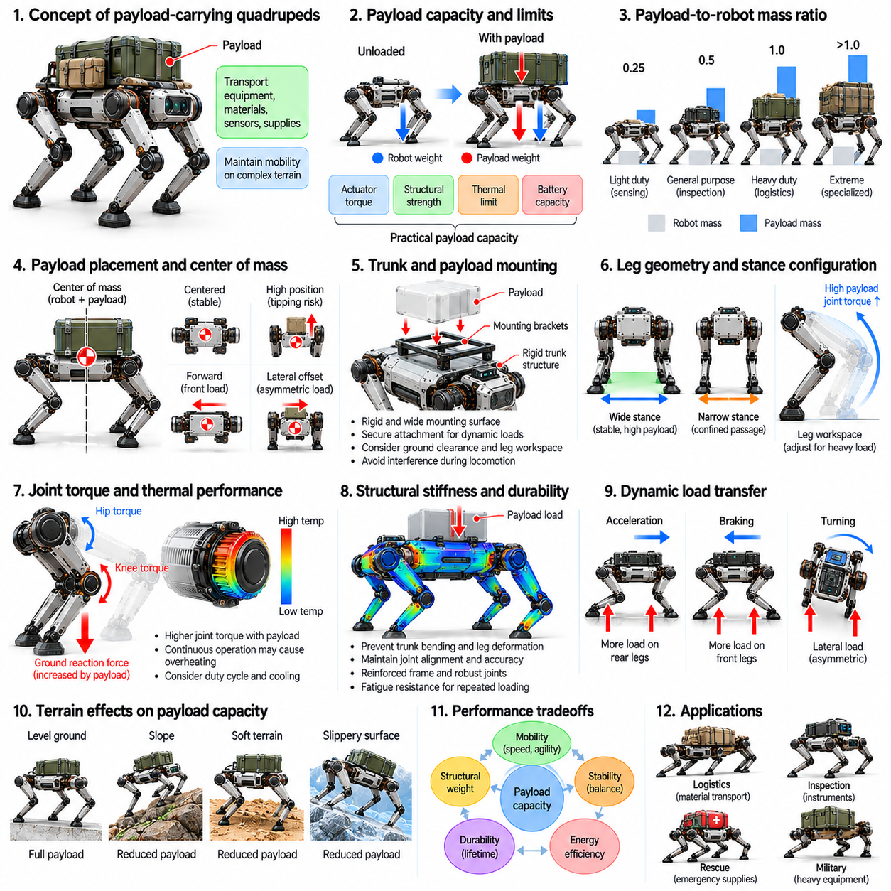{width="7.268055555555556in" height="7.268055555555556in"}

Payload-carrying quadrupeds are legged robots designed to transport equipment, materials, sensors, or supplies while maintaining mobility across complex terrain. Unlike unloaded quadrupeds, these systems must accommodate additional gravitational forces, altered mass distribution, and increased structural loading. Their morphology must balance payload capacity, locomotion stability, energy efficiency, and mechanical durability under changing operational conditions.

Payload capacity is determined by more than the maximum force available from the leg actuators. Structural strength, joint torque limits, thermal performance, battery capacity, and contact stability all constrain the usable load. A robot may support a heavy payload while stationary but fail to transport it safely during dynamic locomotion. Practical payload ratings must therefore reflect continuous operation, terrain difficulty, speed, and required safety margins.

The payload-to-robot mass ratio provides a useful measure of carrying efficiency. A high ratio indicates that a relatively lightweight platform can transport substantial additional mass. However, increasing this ratio may reduce structural reserves and available control authority. Heavy-duty quadrupeds often require reinforced frames, larger actuators, and stronger transmissions, which increase their own mass and influence the overall efficiency of the system.

Payload placement strongly affects the combined center of mass of the robot and its load. A payload positioned near the trunk center generally minimizes unwanted changes in balance and rotational inertia. Loads mounted high above the body can increase tipping susceptibility, particularly during turning or side-slope traversal. Longitudinally displaced loads alter front-to-rear support forces, while lateral offsets introduce asymmetric loading.

The geometry of the trunk determines how effectively payloads can be accommodated. A broad, rigid mounting surface provides attachment flexibility and distributes forces into the main structure. However, excessive trunk width can restrict movement through narrow passages and increase body inertia. Designers must coordinate payload dimensions, mounting locations, ground clearance, and leg workspace to avoid interference during locomotion.

Payload mounting systems must withstand both static weight and dynamic acceleration. Walking, trotting, braking, and obstacle traversal generate inertial forces that may exceed the payload\'s gravitational loading. Mounting brackets, fasteners, and structural interfaces require appropriate strength and fatigue resistance. Secure attachment also prevents relative movement that could produce unpredictable shifts in the combined center of mass.

Leg geometry and stance configuration influence the ability to support additional weight. A wider stance may increase resistance to lateral tipping, while suitable longitudinal spacing helps distribute loads between the front and rear legs. However, wider configurations can increase joint torque demands and restrict maneuverability. Payload-oriented morphology must preserve sufficient support stability without creating excessive mechanical effort.

Joint torque requirements increase when payload mass raises the ground reaction forces needed for support. Hip and knee actuators must generate sufficient torque across the expected range of leg configurations. Certain postures may create unfavorable moment arms and increase actuator loading. Consequently, payload capability should be evaluated throughout the usable workspace rather than at a single nominal standing position.

Continuous torque capability is particularly important because carrying a payload may require sustained joint effort over extended periods. Motors and transmissions that tolerate brief peak loads may overheat during prolonged support or slow climbing. Thermal limits can therefore restrict practical payload capacity before mechanical strength limits are reached. Actuator selection must consider duty cycles, cooling conditions, and expected operating duration.

Structural stiffness becomes increasingly important as payload mass rises. Excessive trunk bending or leg deformation can alter joint alignment, reduce positioning accuracy, and introduce undesirable oscillations. Reinforcement improves rigidity but adds mass that must also be supported and accelerated. Efficient structural design distributes loads through appropriate frame geometry, material selection, and mechanically robust connection points.

Payloads influence the robot\'s rotational inertia as well as its total mass. Heavy equipment mounted far from the body center increases resistance to pitch, roll, and yaw acceleration. This can slow posture correction and require greater actuator effort during rapid maneuvers. Compact and centrally located payload arrangements generally improve dynamic responsiveness, although application-specific equipment may impose unavoidable geometric constraints.

Dynamic load transfer must be considered during acceleration, braking, and turning. Forward acceleration can shift the effective support demand toward the rear legs, while braking can increase loading toward the front. Lateral acceleration introduces asymmetric contact forces and potential rollover risks. Payload-carrying quadrupeds require sufficient traction and control authority to manage these changing force distributions.

Terrain conditions significantly influence usable payload capacity. On steep slopes, gravitational forces create additional demands on propulsion, braking, and posture regulation. Soft ground may deform beneath heavily loaded feet, while slippery surfaces restrict available tangential forces. A payload that is manageable on level flooring may become unsafe on irregular terrain. Operational load limits should therefore account for environmental conditions.

Foot morphology affects the distribution of increased contact forces into the terrain. Larger contact areas can reduce ground pressure and improve support on deformable surfaces, while compact feet may provide more precise placement on narrow obstacles. Suitable materials and tread geometry help maintain traction. The optimal foot design depends on the relationship between payload mass, terrain mechanics, and required mobility.

Energy consumption generally increases when additional payload mass must be supported, accelerated, or lifted against gravity. The magnitude of this increase depends on gait, terrain, actuator efficiency, and mechanical configuration. Heavy loads can reduce operating range and increase battery discharge rates. Payload-oriented quadrupeds must therefore balance carrying capacity with mission duration, locomotion speed, and available energy reserves.

Battery placement presents a tradeoff between energy capacity and useful payload. Larger batteries extend operating time but increase the mass that the robot must carry. Positioning batteries near the trunk center can help preserve favorable mass distribution. Designers must evaluate whether additional battery capacity produces enough operational benefit to justify its weight, particularly during missions involving sustained payload transportation.

Gait selection can improve stability and efficiency under varying payload conditions. Slow walking provides opportunities for deliberate foot placement and controlled load transfer, while trotting may be suitable when terrain and actuator capabilities permit. Heavy payloads can reduce the margin available for rapid acceleration and disturbance recovery. Controllers should adjust gait timing, body posture, and contact forces according to estimated load conditions.

Payload uncertainty introduces additional challenges when transported objects differ in mass, shape, or mounting position. An inaccurate payload estimate can lead to incorrect torque predictions and uneven support loading. Joint measurements, inertial sensing, and force estimation can help identify changes in total mass and center of mass. Adaptive control can then update force allocation and posture regulation within the robot\'s mechanical limits.

Modular payload interfaces improve the flexibility of quadruped platforms across different applications. Standardized mounting structures can accommodate inspection sensors, communication equipment, logistics containers, or specialized tools. Electrical and data connections may support powered payloads, but their energy consumption must be included in mission planning. Modular integration must also preserve structural integrity and environmental protection.

Payload-carrying quadrupeds may operate in logistics, industrial inspection, emergency response, and remote field support. Each application imposes different requirements for payload dimensions, operating duration, terrain accessibility, and reliability. Industrial environments may prioritize repeatable transport and maintenance efficiency, while remote deployments may emphasize endurance and obstacle negotiation. Morphological optimization must reflect these mission-specific priorities.

Simulation provides a systematic method for evaluating payload effects before physical deployment. Engineers can vary payload mass, mounting position, terrain inclination, and gait parameters to estimate joint torques, contact forces, and stability margins. Multibody dynamic models reveal how load distribution affects movement. However, simulation assumptions must be validated against actual actuator behavior, structural deformation, and ground contact conditions.

Experimental payload testing should examine both stationary support and dynamic locomotion. Relevant measurements include actuator temperature, joint torque, energy consumption, structural deflection, slipping frequency, and recovery from disturbances. Tests should progressively explore realistic combinations of load, speed, slope, and terrain difficulty. Repeated operation is necessary to identify thermal limitations, fatigue risks, and long-term reliability concerns.

Payload capacity should ultimately be treated as a system-level performance characteristic rather than an isolated mechanical specification. Increasing actuator strength alone does not guarantee safe transportation if structural stiffness, traction, stability, or energy capacity remain insufficient. Successful payload-oriented morphology integrates trunk architecture, leg geometry, actuator sizing, foot design, and thermal management into a balanced configuration.

Within Physical AI, payload-carrying quadrupeds demonstrate how mechanical embodiment and intelligent control must operate together. Perception identifies terrain constraints, estimation systems track load-dependent dynamics, and locomotion controllers regulate posture and contact forces. Learning-based adaptation may improve performance across varying payload conditions, but physical limits remain fundamental. Integrated design enables reliable, efficient, and adaptable robotic transportation.

탑재하중 운반 사족보행 로봇(Payload-Carrying Quadrupeds)은 복잡한 지형(Complex Terrain)에서 이동성(Mobility)을 유지하면서 장비(Equipment), 자재(Materials), 센서(Sensors), 보급품(Supplies)을 운송하도록 설계된 다족보행 로봇(Legged Robots)이다. 무부하 사족보행 로봇(Unloaded Quadrupeds)과 달리 이러한 시스템은 추가적인 중력(Gravitational Forces), 변화된 질량 분포(Mass Distribution), 증가된 구조적 하중(Structural Loading)을 수용해야 한다. 로봇의 형태(Morphology)는 변화하는 운용 조건(Operational Conditions)에서 탑재하중 용량(Payload Capacity), 이동 안정성(Locomotion Stability), 에너지 효율(Energy Efficiency), 기계적 내구성(Mechanical Durability) 사이의 균형을 유지해야 한다.

탑재하중 용량(Payload Capacity)은 다리 구동기(Leg Actuators)가 제공할 수 있는 최대 힘(Maximum Force)만으로 결정되지 않는다. 구조적 강도(Structural Strength), 관절 토크 한계(Joint Torque Limits), 열 성능(Thermal Performance), 배터리 용량(Battery Capacity), 접촉 안정성(Contact Stability)은 모두 실제 사용 가능한 하중(Usable Load)을 제한한다. 로봇은 정지 상태(Stationary State)에서 무거운 탑재하중(Heavy Payload)을 지지할 수 있지만 동적 이동(Dynamic Locomotion) 중에는 이를 안전하게 운송하지 못할 수 있다. 따라서 실제 탑재하중 등급(Practical Payload Ratings)은 연속 운용(Continuous Operation), 지형 난이도(Terrain Difficulty), 속도(Speed), 필요한 안전 여유(Safety Margins)를 반영해야 한다.

탑재하중 대 로봇 질량비(Payload-to-Robot Mass Ratio)는 운반 효율(Carrying Efficiency)을 평가하는 유용한 지표이다. 높은 비율(High Ratio)은 상대적으로 가벼운 플랫폼(Lightweight Platform)이 상당한 추가 질량(Additional Mass)을 운송할 수 있음을 나타낸다. 그러나 이 비율이 증가하면 구조적 여유(Structural Reserves)와 사용 가능한 제어 여력(Control Authority)이 감소할 수 있다. 중하중 사족보행 로봇(Heavy-Duty Quadrupeds)은 보강된 프레임(Reinforced Frames), 더 큰 구동기(Larger Actuators), 더 강한 동력 전달장치(Stronger Transmissions)를 필요로 하는 경우가 많으며, 이는 자체 질량(Own Mass)을 증가시키고 전체 시스템 효율(Overall System Efficiency)에 영향을 미친다.

탑재하중 배치(Payload Placement)는 로봇과 탑재물의 결합 질량중심(Combined Center of Mass)에 큰 영향을 미친다. 몸통 중심(Trunk Center) 가까이에 배치된 탑재하중은 일반적으로 균형(Balance)과 회전 관성(Rotational Inertia)의 불필요한 변화를 최소화한다. 몸체 위쪽 높은 위치에 장착된 하중(High-Mounted Loads)은 특히 회전(Turning)이나 측면 경사 통과(Side-Slope Traversal) 중 전복 가능성(Tipping Susceptibility)을 증가시킬 수 있다. 전후 방향으로 치우친 하중(Longitudinally Displaced Loads)은 앞다리와 뒷다리 사이의 지지력(Front-to-Rear Support Forces)을 변화시키며, 측면 편심(Lateral Offsets)은 비대칭 하중(Asymmetric Loading)을 발생시킨다.

몸통의 기하학적 구조(Trunk Geometry)는 탑재하중을 얼마나 효과적으로 수용할 수 있는지를 결정한다. 넓고 강성이 높은 장착 표면(Broad, Rigid Mounting Surface)은 부착 유연성(Attachment Flexibility)을 제공하고 하중을 주요 구조(Main Structure)로 분산한다. 그러나 과도한 몸통 폭(Excessive Trunk Width)은 좁은 통로(Narrow Passages)를 통과하는 움직임을 제한하고 몸체 관성(Body Inertia)을 증가시킬 수 있다. 설계자는 이동 중 간섭(Interference)을 방지하기 위해 탑재물 치수(Payload Dimensions), 장착 위치(Mounting Locations), 지상고(Ground Clearance), 다리 작업공간(Leg Workspace)을 조정해야 한다.

탑재하중 장착 시스템(Payload Mounting Systems)은 정적 무게(Static Weight)와 동적 가속도(Dynamic Acceleration)를 모두 견딜 수 있어야 한다. 걷기(Walking), 트로트 보행(Trotting), 제동(Braking), 장애물 통과(Obstacle Traversal)는 탑재하중의 중력 하중(Gravitational Loading)을 초과하는 관성력(Inertial Forces)을 발생시킬 수 있다. 장착 브래킷(Mounting Brackets), 체결부(Fasteners), 구조적 인터페이스(Structural Interfaces)는 적절한 강도(Strength)와 피로 저항성(Fatigue Resistance)을 갖추어야 한다. 견고한 고정(Secure Attachment)은 결합 질량중심(Combined Center of Mass)의 예측하기 어려운 이동을 유발할 수 있는 상대 운동(Relative Movement)도 방지한다.

다리 기하학(Leg Geometry)과 지지 자세 구성(Stance Configuration)은 추가적인 무게(Additional Weight)를 지지하는 능력에 영향을 미친다. 넓은 지지 자세(Wider Stance)는 측면 전복(Lateral Tipping)에 대한 저항성을 높일 수 있으며, 적절한 전후 방향 간격(Longitudinal Spacing)은 앞다리와 뒷다리 사이의 하중 분산(Load Distribution)에 도움이 된다. 그러나 넓은 구성(Wider Configurations)은 관절 토크 요구사항(Joint Torque Demands)을 증가시키고 기동성(Maneuverability)을 제한할 수 있다. 탑재하중 중심 형태(Payload-Oriented Morphology)는 과도한 기계적 노력(Mechanical Effort)을 발생시키지 않으면서 충분한 지지 안정성(Support Stability)을 유지해야 한다.

탑재하중 질량(Payload Mass)이 지지에 필요한 지면 반력(Ground Reaction Forces)을 증가시키면 관절 토크 요구사항(Joint Torque Requirements)도 증가한다. 엉덩이 및 무릎 구동기(Hip and Knee Actuators)는 예상되는 다리 구성(Leg Configurations)의 전체 범위에서 충분한 토크(Torque)를 생성해야 한다. 특정 자세(Postures)는 불리한 모멘트 암(Unfavorable Moment Arms)을 형성하여 구동기 하중(Actuator Loading)을 증가시킬 수 있다. 따라서 탑재하중 성능(Payload Capability)은 단일한 기준 기립 자세(Nominal Standing Position)가 아니라 사용 가능한 전체 작업공간(Usable Workspace)에서 평가해야 한다.

연속 토크 성능(Continuous Torque Capability)은 탑재하중 운반에 장시간 지속되는 관절 구동력(Joint Effort)이 필요할 수 있으므로 특히 중요하다. 짧은 최대 하중(Peak Loads)은 견딜 수 있는 모터(Motors)와 동력 전달장치(Transmissions)라도 장시간 지지(Prolonged Support)나 느린 경사면 등반(Slow Climbing) 중에는 과열(Overheating)될 수 있다. 따라서 기계적 강도 한계(Mechanical Strength Limits)에 도달하기 전에 열적 한계(Thermal Limits)가 실제 탑재하중 용량(Practical Payload Capacity)을 제한할 수 있다. 구동기 선정(Actuator Selection)에서는 듀티 사이클(Duty Cycles), 냉각 조건(Cooling Conditions), 예상 운용 시간(Expected Operating Duration)을 고려해야 한다.

탑재하중 질량(Payload Mass)이 증가할수록 구조적 강성(Structural Stiffness)은 더욱 중요해진다. 과도한 몸통 굽힘(Trunk Bending)이나 다리 변형(Leg Deformation)은 관절 정렬(Joint Alignment)을 변화시키고 위치 정확도(Positioning Accuracy)를 감소시키며 바람직하지 않은 진동(Undesirable Oscillations)을 발생시킬 수 있다. 구조 보강(Reinforcement)은 강성(Rigidity)을 개선하지만 추가되는 질량(Additional Mass) 역시 지지하고 가속해야 한다. 효율적인 구조 설계(Efficient Structural Design)는 적절한 프레임 기하학(Frame Geometry), 재료 선정(Material Selection), 기계적으로 견고한 연결 지점(Mechanically Robust Connection Points)을 통해 하중을 분산한다.

탑재하중(Payloads)은 전체 질량(Total Mass)뿐 아니라 로봇의 회전 관성(Rotational Inertia)에도 영향을 미친다. 몸체 중심(Body Center)에서 멀리 장착된 무거운 장비(Heavy Equipment)는 피치(Pitch), 롤(Roll), 요(Yaw) 방향의 각가속도(Angular Acceleration)에 대한 저항을 증가시킨다. 이는 자세 보정(Posture Correction)을 느리게 만들고 빠른 기동(Rapid Maneuvers) 중 더 큰 구동기 출력(Actuator Effort)을 요구할 수 있다. 소형이며 중앙에 집중된 탑재하중 배치(Compact and Centrally Located Payload Arrangements)는 일반적으로 동적 응답성(Dynamic Responsiveness)을 향상시키지만, 응용 분야별 장비(Application-Specific Equipment)는 피할 수 없는 기하학적 제약(Geometric Constraints)을 부과할 수 있다.

가속(Acceleration), 제동(Braking), 회전(Turning) 중에는 동적 하중 전달(Dynamic Load Transfer)을 고려해야 한다. 전방 가속(Forward Acceleration)은 유효 지지 요구량(Effective Support Demand)을 뒷다리(Rear Legs) 쪽으로 이동시킬 수 있으며, 제동은 앞다리(Front Legs)의 하중을 증가시킬 수 있다. 측면 가속(Lateral Acceleration)은 비대칭 접촉력(Asymmetric Contact Forces)과 잠재적인 전복 위험(Rollover Risks)을 발생시킨다. 탑재하중 운반 사족보행 로봇(Payload-Carrying Quadrupeds)은 변화하는 힘 분포(Force Distributions)를 관리하기 위해 충분한 접지력(Traction)과 제어 여력(Control Authority)을 확보해야 한다.

지형 조건(Terrain Conditions)은 사용 가능한 탑재하중 용량(Usable Payload Capacity)에 상당한 영향을 미친다. 급경사(Steep Slopes)에서는 중력(Gravitational Forces)이 추진(Propulsion), 제동(Braking), 자세 조절(Posture Regulation)에 추가적인 요구사항을 발생시킨다. 연약 지면(Soft Ground)은 무거운 하중이 실린 발(Heavily Loaded Feet) 아래에서 변형될 수 있으며, 미끄러운 표면(Slippery Surfaces)은 사용 가능한 접선력(Available Tangential Forces)을 제한한다. 평평한 바닥(Level Flooring)에서 관리 가능한 탑재하중이라도 불규칙한 지형(Irregular Terrain)에서는 안전하지 않을 수 있다. 따라서 운용 하중 한계(Operational Load Limits)는 환경 조건(Environmental Conditions)을 고려해야 한다.

발 형태(Foot Morphology)는 증가된 접촉력(Contact Forces)이 지형(Terrain)에 분산되는 방식에 영향을 미친다. 넓은 접촉 면적(Larger Contact Areas)은 지면 압력(Ground Pressure)을 줄이고 변형 가능한 표면(Deformable Surfaces)에서 지지 능력을 개선할 수 있으며, 소형 발(Compact Feet)은 좁은 장애물(Narrow Obstacles) 위에 더 정밀하게 발을 배치할 수 있다. 적절한 재료(Materials)와 트레드 형상(Tread Geometry)은 접지력(Traction)을 유지하는 데 도움이 된다. 최적의 발 설계(Optimal Foot Design)는 탑재하중 질량(Payload Mass), 지형 역학(Terrain Mechanics), 요구되는 이동성(Required Mobility) 사이의 관계에 따라 달라진다.

추가적인 탑재하중 질량(Additional Payload Mass)을 지지하거나 가속하거나 중력에 반하여 들어 올려야 할 때 에너지 소비(Energy Consumption)는 일반적으로 증가한다. 증가 정도는 보행 방식(Gait), 지형(Terrain), 구동기 효율(Actuator Efficiency), 기계적 구성(Mechanical Configuration)에 따라 달라진다. 무거운 하중(Heavy Loads)은 운용 거리(Operating Range)를 감소시키고 배터리 방전율(Battery Discharge Rates)을 높일 수 있다. 따라서 탑재하중 중심 사족보행 로봇(Payload-Oriented Quadrupeds)은 운반 용량(Carrying Capacity), 임무 지속시간(Mission Duration), 이동 속도(Locomotion Speed), 사용 가능한 에너지 예비량(Available Energy Reserves) 사이의 균형을 유지해야 한다.

배터리 배치(Battery Placement)는 에너지 용량(Energy Capacity)과 유효 탑재하중(Useful Payload) 사이의 절충관계(Tradeoff)를 발생시킨다. 더 큰 배터리(Larger Batteries)는 운용 시간(Operating Time)을 연장하지만 로봇이 운반해야 하는 질량(Mass)을 증가시킨다. 배터리를 몸통 중심(Trunk Center) 가까이에 배치하면 유리한 질량 분포(Favorable Mass Distribution)를 유지하는 데 도움이 된다. 설계자는 특히 지속적인 탑재하중 운송(Sustained Payload Transportation)이 포함된 임무에서 추가 배터리 용량(Additional Battery Capacity)이 무게 증가(Weight Increase)를 정당화할 만큼 충분한 운용상 이점(Operational Benefit)을 제공하는지 평가해야 한다.

보행 방식 선택(Gait Selection)은 다양한 탑재하중 조건(Payload Conditions)에서 안정성(Stability)과 효율(Efficiency)을 향상시킬 수 있다. 느린 걷기(Slow Walking)는 신중한 발 배치(Deliberate Foot Placement)와 제어된 하중 전달(Controlled Load Transfer)을 가능하게 하며, 트로트 보행(Trotting)은 지형과 구동기 성능(Actuator Capabilities)이 허용하는 경우 적합할 수 있다. 무거운 탑재하중(Heavy Payloads)은 빠른 가속(Rapid Acceleration)과 외란 복구(Disturbance Recovery)에 사용할 수 있는 여유(Margin)를 감소시킬 수 있다. 제어기(Controllers)는 추정된 하중 조건(Estimated Load Conditions)에 따라 보행 타이밍(Gait Timing), 몸체 자세(Body Posture), 접촉력(Contact Forces)을 조정해야 한다.

탑재하중 불확실성(Payload Uncertainty)은 운송 대상 물체(Transported Objects)의 질량(Mass), 형상(Shape), 장착 위치(Mounting Position)가 서로 다를 때 추가적인 어려움을 발생시킨다. 부정확한 탑재하중 추정(Inaccurate Payload Estimate)은 잘못된 토크 예측(Incorrect Torque Predictions)과 불균일한 지지 하중(Uneven Support Loading)을 초래할 수 있다. 관절 측정(Joint Measurements), 관성 감지(Inertial Sensing), 힘 추정(Force Estimation)은 전체 질량(Total Mass)과 질량중심(Center of Mass)의 변화를 식별하는 데 도움이 된다. 이후 적응형 제어(Adaptive Control)는 로봇의 기계적 한계(Mechanical Limits) 내에서 힘 배분(Force Allocation)과 자세 조절(Posture Regulation)을 갱신할 수 있다.

모듈형 탑재하중 인터페이스(Modular Payload Interfaces)는 다양한 응용 분야(Applications)에서 사족보행 플랫폼(Quadruped Platforms)의 유연성(Flexibility)을 향상시킨다. 표준화된 장착 구조(Standardized Mounting Structures)는 검사 센서(Inspection Sensors), 통신 장비(Communication Equipment), 물류 컨테이너(Logistics Containers), 특수 도구(Specialized Tools)를 수용할 수 있다. 전기 및 데이터 연결(Electrical and Data Connections)은 전원이 필요한 탑재장비(Powered Payloads)를 지원할 수 있지만, 해당 장비의 에너지 소비(Energy Consumption)는 임무 계획(Mission Planning)에 포함되어야 한다. 모듈형 통합(Modular Integration)은 구조적 무결성(Structural Integrity)과 환경 보호(Environmental Protection)도 유지해야 한다.

탑재하중 운반 사족보행 로봇(Payload-Carrying Quadrupeds)은 물류(Logistics), 산업 검사(Industrial Inspection), 비상 대응(Emergency Response), 원격 현장 지원(Remote Field Support)에 활용될 수 있다. 각 응용 분야는 탑재물 치수(Payload Dimensions), 운용 시간(Operating Duration), 지형 접근성(Terrain Accessibility), 신뢰성(Reliability)에 대해 서로 다른 요구사항을 부과한다. 산업 환경(Industrial Environments)은 반복 가능한 운송(Repeatable Transport)과 유지보수 효율(Maintenance Efficiency)을 우선시할 수 있으며, 원격 배치(Remote Deployments)는 지속 운용 능력(Endurance)과 장애물 통과 능력(Obstacle Negotiation)을 강조할 수 있다. 형태 최적화(Morphological Optimization)는 이러한 임무별 우선순위(Mission-Specific Priorities)를 반영해야 한다.

시뮬레이션(Simulation)은 실제 배치(Physical Deployment) 전에 탑재하중의 영향(Payload Effects)을 체계적으로 평가하는 방법을 제공한다. 엔지니어는 탑재하중 질량(Payload Mass), 장착 위치(Mounting Position), 지형 경사(Terrain Inclination), 보행 매개변수(Gait Parameters)를 변화시키면서 관절 토크(Joint Torques), 접촉력(Contact Forces), 안정성 여유(Stability Margins)를 추정할 수 있다. 다물체 동역학 모델(Multibody Dynamic Models)은 하중 분포(Load Distribution)가 움직임에 미치는 영향을 보여준다. 그러나 시뮬레이션 가정(Simulation Assumptions)은 실제 구동기 거동(Actual Actuator Behavior), 구조적 변형(Structural Deformation), 지면 접촉 조건(Ground Contact Conditions)을 바탕으로 검증해야 한다.

실험적 탑재하중 시험(Experimental Payload Testing)은 정지 상태 지지(Stationary Support)와 동적 이동(Dynamic Locomotion)을 모두 평가해야 한다. 관련 측정 항목(Relevant Measurements)에는 구동기 온도(Actuator Temperature), 관절 토크(Joint Torque), 에너지 소비(Energy Consumption), 구조적 처짐(Structural Deflection), 미끄러짐 빈도(Slipping Frequency), 외란 복구(Disturbance Recovery)가 포함된다. 시험은 하중(Load), 속도(Speed), 경사(Slope), 지형 난이도(Terrain Difficulty)의 현실적인 조합을 점진적으로 탐색해야 한다. 열적 한계(Thermal Limitations), 피로 위험(Fatigue Risks), 장기 신뢰성 문제(Long-Term Reliability Concerns)를 식별하기 위해서는 반복 운용(Repeated Operation)이 필요하다.

탑재하중 용량(Payload Capacity)은 궁극적으로 개별적인 기계적 사양(Isolated Mechanical Specification)이 아니라 시스템 수준의 성능 특성(System-Level Performance Characteristic)으로 다루어야 한다. 구조적 강성(Structural Stiffness), 접지력(Traction), 안정성(Stability), 에너지 용량(Energy Capacity)이 충분하지 않다면 구동기 강도(Actuator Strength)를 높이는 것만으로 안전한 운송(Safe Transportation)을 보장할 수 없다. 성공적인 탑재하중 중심 형태(Payload-Oriented Morphology)는 몸통 구조(Trunk Architecture), 다리 기하학(Leg Geometry), 구동기 용량 선정(Actuator Sizing), 발 설계(Foot Design), 열 관리(Thermal Management)를 균형 잡힌 구성(Balanced Configuration)으로 통합한다.

피지컬 AI(Physical AI)에서 탑재하중 운반 사족보행 로봇(Payload-Carrying Quadrupeds)은 기계적 체화(Mechanical Embodiment)와 지능형 제어(Intelligent Control)가 어떻게 협력해야 하는지를 보여준다. 인지(Perception)는 지형 제약(Terrain Constraints)을 식별하고, 추정 시스템(Estimation Systems)은 하중에 따른 동역학(Load-Dependent Dynamics)을 추적하며, 이동 제어기(Locomotion Controllers)는 자세(Posture)와 접촉력(Contact Forces)을 조절한다. 학습 기반 적응(Learning-Based Adaptation)은 다양한 탑재하중 조건(Payload Conditions)에서 성능을 향상시킬 수 있지만 물리적 한계(Physical Limits)는 여전히 근본적인 제약으로 작용한다. 통합 설계(Integrated Design)는 신뢰할 수 있고 효율적이며 적응 가능한 로봇 운송(Reliable, Efficient, and Adaptable Robotic Transportation)을 가능하게 한다.

##  

## 07.09. Quadruped with Manipulation

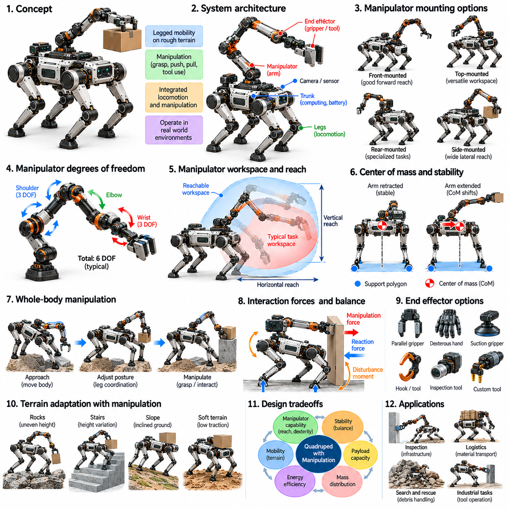{width="7.268055555555556in" height="7.268055555555556in"}

Quadrupeds with manipulation capabilities combine legged mobility with robotic arms or specialized end effectors to perform physical tasks beyond locomotion. These systems can navigate uneven terrain, approach objects, and interact with their surroundings through grasping, pushing, pulling, or tool operation. Their morphology must integrate locomotion and manipulation without compromising stability, structural integrity, or energy efficiency during coordinated physical interaction.

The integration of a manipulator changes the fundamental mechanical architecture of a quadruped. A conventional platform primarily distributes mass among the trunk, legs, and onboard equipment, whereas a mobile manipulator introduces additional links, joints, actuators, and payload forces. These components modify the robot\'s center of mass, rotational inertia, and structural loading. Effective design requires simultaneous consideration of locomotion and manipulation requirements.

Manipulator mounting position strongly influences workspace accessibility and balance. A centrally mounted arm may provide a broad operational region around the robot, while a front-mounted arm can improve access to objects directly ahead. However, forward mounting increases the potential for longitudinal mass imbalance and larger pitching moments. The selected configuration must balance reachable workspace, visibility, structural support, and whole-body stability.

Manipulator degrees of freedom determine the range of achievable end-effector positions and orientations. Additional joints can improve dexterity and obstacle avoidance but increase mass, actuator requirements, and control complexity. A six-degree-of-freedom arm can support general spatial positioning and orientation under suitable kinematic conditions. Nevertheless, practical manipulation capability also depends on joint limits, payload capacity, and collision-free workspace.

The manipulator\'s reach must be coordinated with the quadruped\'s stance geometry and body dimensions. Extended arm configurations increase the accessible workspace but can generate large moments around the support region. Retracted configurations generally reduce rotational inertia and improve balance during locomotion. Morphological design should therefore consider both manipulation postures and compact transportation configurations to maintain operational flexibility.

Center-of-mass variation becomes a major challenge when the arm moves or carries an object. Extending the manipulator forward shifts the combined center of mass and changes the distribution of ground reaction forces among the legs. Lateral arm motion can similarly introduce asymmetric loading. The robot must adjust body posture, foothold placement, and contact forces to maintain feasible support while completing manipulation tasks.

Whole-body manipulation treats the legs, trunk, and arm as components of a coordinated mechanical system. Rather than controlling the arm independently, the robot can reposition its body to extend reach, improve leverage, or avoid joint limits. The legs provide a mobile support structure while the manipulator performs the primary task. This coordination expands the effective workspace but requires accurate modeling of coupled dynamics and contact constraints.

Manipulation forces can significantly affect quadruped stability. Pushing against a wall, pulling an object, or operating a lever introduces reaction forces that propagate through the manipulator into the trunk and supporting legs. These forces may produce pitching, rolling, or yawing moments. Mechanical design must provide sufficient structural stiffness and actuator capacity, while control systems distribute support forces to resist unintended motion.

The support polygon provides a useful reference for evaluating quasi-static manipulation stability. When the combined center-of-mass projection remains within the support region, the robot may maintain balance under appropriate contact conditions. However, external manipulation forces can create tipping moments even when this geometric condition is satisfied. Reliable operation requires evaluating both gravitational loading and task-dependent interaction forces.

Manipulator actuator placement influences the overall mass distribution and energy requirements of the system. Heavy motors positioned near the arm base can reduce distal inertia and improve responsiveness. However, remote transmissions may increase mechanical complexity and introduce compliance or backlash. Compact actuators at individual joints simplify integration but increase moving mass. These tradeoffs become important when the quadruped must manipulate objects while maintaining balance.

End-effector morphology determines the range of objects and tools the robot can handle. Parallel grippers provide relatively simple grasping for compatible objects, while multi-fingered hands offer greater dexterity at the cost of complexity. Specialized tools may support inspection, sampling, or industrial operations. End-effector selection should reflect object geometry, required forces, environmental conditions, and the precision needed for reliable interaction.

Grasping introduces additional requirements for force control and contact sensing. Excessive gripping force can damage fragile objects, while insufficient force may allow slipping or loss of the payload. Tactile sensors, force-torque sensors, and actuator measurements can support grasp monitoring. The manipulator must coordinate local contact regulation with whole-body balance, particularly when object weight or interaction forces change unexpectedly.

The quadruped\'s trunk must provide a mechanically robust interface for manipulator attachment. Arm motion generates bending moments, torsional loads, and repeated dynamic stresses at the mounting structure. Reinforcement can improve rigidity but increases overall mass and energy demand. Designers must balance structural strength, compact packaging, serviceability, and protection of onboard electronics while preserving sufficient clearance for leg movement.

Leg geometry affects the ability to maintain stable support during manipulation. A wider stance can increase resistance to lateral tipping, while a longer stance may improve stability against forward or backward interaction forces. However, extreme stance configurations can increase joint torque demands and reduce available mobility. The optimal posture depends on manipulator reach, task direction, terrain conditions, and the location of external contacts.

Locomotion and manipulation can be performed sequentially or simultaneously. Sequential operation allows the quadruped to establish a stable stance before manipulating an object, reducing control complexity. Simultaneous operation enables tasks such as carrying objects while walking or interacting with moving targets. However, coordinated movement introduces dynamic coupling between arm motion, leg forces, and body acceleration, requiring more sophisticated planning and control.

Mobile manipulation on uneven terrain presents additional challenges because the support surface may be irregular or uncertain. Different foot heights create asymmetric joint configurations, while limited friction constrains the forces available to resist manipulation reactions. Compliant ground can deform under changing loads. Terrain-aware manipulation must therefore consider foothold quality, support geometry, joint torque limits, and the expected direction of task forces.

The manipulation workspace is not determined by arm reach alone. Body height adjustment, trunk orientation, and leg repositioning can substantially expand the set of reachable targets. A quadruped may lower its body to grasp objects near the ground or raise its trunk to access elevated equipment. Such adjustments must remain within feasible joint configurations and preserve stability. Coordinated morphology enables greater task flexibility without requiring an excessively long arm.

Energy consumption increases when manipulation is added to a quadruped platform. Additional actuators, sensors, and computing systems require electrical power, while arm movement introduces mechanical work and changing support loads. Sustained object holding may also consume energy depending on transmission characteristics. Efficient operation requires coordinated motion planning, appropriate actuator sizing, and task strategies that minimize unnecessary force and movement.

Perception is essential for identifying objects, estimating grasp poses, and understanding the surrounding terrain. Cameras, depth sensors, and proprioceptive measurements provide information for coordinated navigation and manipulation. However, sensor placement must account for occlusion by the arm, body motion, and changing viewpoints. Morphological integration should preserve useful visibility while protecting sensing equipment from impacts and environmental contamination.

Planning systems must jointly evaluate navigation paths, body configurations, arm trajectories, and contact feasibility. A target may be reachable by the manipulator but inaccessible because the quadruped cannot establish a stable stance nearby. Similarly, a favorable standing location may restrict arm movement through collisions or joint limits. Integrated planning selects configurations that satisfy both mobility and manipulation constraints before executing physical actions.

Simulation supports the evaluation of coupled quadruped-manipulator dynamics across different tasks. Engineers can investigate arm mounting positions, payload variations, stance configurations, and interaction forces using multibody models. Contact-rich scenarios reveal potential instability and actuator saturation. Nevertheless, real-world testing remains necessary because friction, compliance, object properties, and sensing uncertainty may differ substantially from simulated assumptions.

Experimental validation should include reaching, grasping, pushing, pulling, carrying, and tool-use tasks under representative environmental conditions. Relevant measurements include manipulation success, positioning accuracy, joint torque, stability margins, energy consumption, and recovery from disturbances. Tests should examine both stationary and moving configurations. Repeated trials help identify structural fatigue, thermal limitations, and failure modes associated with coordinated operation.

The design of quadrupeds with manipulation capabilities involves balancing mobility, dexterity, payload capacity, and system complexity. Larger manipulators increase reach and force capability but add mass and destabilizing moments. More capable legs can compensate through posture adjustment and force redistribution, although these improvements also introduce costs. Effective morphology integrates arm architecture, trunk structure, leg workspace, and contact mechanics into a coherent system.

Within Physical AI, quadruped manipulation represents an important step toward general-purpose physical interaction. Intelligent systems must combine terrain perception, object understanding, motion planning, force regulation, and whole-body coordination. Learning-based policies can improve adaptation to unfamiliar objects and environments, but their actions remain constrained by mechanical capabilities. Integrated embodiment enables quadrupeds to perform increasingly diverse tasks with greater autonomy and reliability.

조작 기능을 갖춘 사족보행 로봇(Quadrupeds with Manipulation Capabilities)은 다족보행 이동성(Legged Mobility)과 로봇 팔(Robotic Arms) 또는 특수 말단효과기(Specialized End Effectors)를 결합하여 단순한 이동을 넘어서는 물리적 작업(Physical Tasks)을 수행한다. 이러한 시스템은 불규칙한 지형(Uneven Terrain)을 이동하고 물체(Objects)에 접근하며 파지(Grasping), 밀기(Pushing), 당기기(Pulling), 도구 조작(Tool Operation)을 통해 주변 환경과 상호작용할 수 있다. 로봇의 형태(Morphology)는 협조적인 물리적 상호작용(Coordinated Physical Interaction) 중 안정성(Stability), 구조적 무결성(Structural Integrity), 에너지 효율(Energy Efficiency)을 저하시키지 않으면서 이동(Locomotion)과 조작(Manipulation)을 통합해야 한다.

매니퓰레이터 통합(Manipulator Integration)은 사족보행 로봇의 기본적인 기계적 구조(Mechanical Architecture)를 변화시킨다. 기존 플랫폼(Conventional Platform)은 주로 몸통(Trunk), 다리(Legs), 탑재 장비(Onboard Equipment) 사이에 질량을 분산하는 반면, 이동형 매니퓰레이터(Mobile Manipulator)는 추가적인 링크(Links), 관절(Joints), 구동기(Actuators), 탑재하중에 따른 힘(Payload Forces)을 도입한다. 이러한 구성요소는 로봇의 질량중심(Center of Mass), 회전 관성(Rotational Inertia), 구조적 하중(Structural Loading)을 변화시킨다. 효과적인 설계(Effective Design)를 위해서는 이동 요구사항(Locomotion Requirements)과 조작 요구사항(Manipulation Requirements)을 동시에 고려해야 한다.

매니퓰레이터 장착 위치(Manipulator Mounting Position)는 작업공간 접근성(Workspace Accessibility)과 균형(Balance)에 큰 영향을 미친다. 중앙에 장착된 로봇 팔(Centrally Mounted Arm)은 로봇 주변의 넓은 작업 영역(Operational Region)을 제공할 수 있으며, 전방에 장착된 로봇 팔(Front-Mounted Arm)은 바로 앞에 있는 물체에 대한 접근성을 향상시킬 수 있다. 그러나 전방 장착(Forward Mounting)은 전후 방향 질량 불균형(Longitudinal Mass Imbalance)과 더 큰 피칭 모멘트(Pitching Moments)를 발생시킬 가능성을 높인다. 선택된 구성(Configuration)은 도달 가능한 작업공간(Reachable Workspace), 가시성(Visibility), 구조적 지지(Structural Support), 전신 안정성(Whole-Body Stability) 사이의 균형을 유지해야 한다.

매니퓰레이터 자유도(Manipulator Degrees of Freedom)는 달성 가능한 말단효과기 위치(End-Effector Positions)와 방향(Orientations)의 범위를 결정한다. 추가적인 관절(Additional Joints)은 조작 능력(Dexterity)과 장애물 회피(Obstacle Avoidance)를 향상시킬 수 있지만 질량(Mass), 구동기 요구사항(Actuator Requirements), 제어 복잡성(Control Complexity)을 증가시킨다. 6자유도 로봇 팔(Six-Degree-of-Freedom Arm)은 적절한 운동학적 조건(Kinematic Conditions)에서 일반적인 공간 위치 및 방향 제어(Spatial Positioning and Orientation)를 지원할 수 있다. 그러나 실제 조작 성능(Practical Manipulation Capability)은 관절 한계(Joint Limits), 탑재하중 용량(Payload Capacity), 충돌 없는 작업공간(Collision-Free Workspace)에도 영향을 받는다.

매니퓰레이터 도달 범위(Manipulator Reach)는 사족보행 로봇의 지지 자세 기하학(Stance Geometry) 및 몸체 치수(Body Dimensions)와 조정되어야 한다. 로봇 팔을 확장한 구성(Extended Arm Configurations)은 접근 가능한 작업공간(Accessible Workspace)을 증가시키지만 지지 영역(Support Region)을 기준으로 큰 모멘트(Moments)를 발생시킬 수 있다. 접힌 구성(Retracted Configurations)은 일반적으로 회전 관성(Rotational Inertia)을 줄이고 이동 중 균형(Balance)을 향상시킨다. 따라서 형태 설계(Morphological Design)는 운용 유연성(Operational Flexibility)을 유지하기 위해 조작 자세(Manipulation Postures)와 소형 운송 구성(Compact Transportation Configurations)을 모두 고려해야 한다.

로봇 팔이 움직이거나 물체를 운반할 때 발생하는 질량중심 변화(Center-of-Mass Variation)는 주요한 과제가 된다. 매니퓰레이터(Manipulator)를 전방으로 확장하면 결합 질량중심(Combined Center of Mass)이 이동하고 다리 사이의 지면 반력 분포(Distribution of Ground Reaction Forces)가 변화한다. 측면 방향 로봇 팔 움직임(Lateral Arm Motion)도 비대칭 하중(Asymmetric Loading)을 발생시킬 수 있다. 로봇은 조작 작업(Manipulation Tasks)을 수행하는 동안 실현 가능한 지지 상태(Feasible Support)를 유지하기 위해 몸체 자세(Body Posture), 발 디딤 위치(Foothold Placement), 접촉력(Contact Forces)을 조정해야 한다.

전신 조작(Whole-Body Manipulation)은 다리(Legs), 몸통(Trunk), 로봇 팔(Arm)을 협조적인 기계 시스템(Coordinated Mechanical System)의 구성요소로 취급한다. 로봇 팔을 독립적으로 제어하는 대신, 로봇은 몸체 위치를 조정하여 도달 범위(Reach)를 확장하거나 지레 작용(Leverage)을 개선하거나 관절 한계(Joint Limits)를 회피할 수 있다. 다리는 이동 가능한 지지 구조(Mobile Support Structure)를 제공하고 매니퓰레이터는 주요 작업(Primary Task)을 수행한다. 이러한 협조는 유효 작업공간(Effective Workspace)을 확장하지만 결합 동역학(Coupled Dynamics)과 접촉 제약(Contact Constraints)에 대한 정확한 모델링(Modeling)을 요구한다.

조작력(Manipulation Forces)은 사족보행 로봇의 안정성(Stability)에 상당한 영향을 미칠 수 있다. 벽 밀기(Pushing Against a Wall), 물체 당기기(Pulling an Object), 레버 조작(Operating a Lever)은 매니퓰레이터를 통해 몸통과 지지 다리(Supporting Legs)로 전달되는 반력(Reaction Forces)을 발생시킨다. 이러한 힘은 피칭(Pitching), 롤링(Rolling), 요잉(Yawing) 모멘트를 생성할 수 있다. 기계적 설계(Mechanical Design)는 충분한 구조적 강성(Structural Stiffness)과 구동기 용량(Actuator Capacity)을 제공해야 하며, 제어 시스템(Control Systems)은 의도하지 않은 움직임(Unintended Motion)을 억제하도록 지지력(Support Forces)을 분배해야 한다.

지지 다각형(Support Polygon)은 준정적 조작 안정성(Quasi-Static Manipulation Stability)을 평가하는 유용한 기준을 제공한다. 결합 질량중심의 투영점(Combined Center-of-Mass Projection)이 지지 영역(Support Region) 내부에 유지되면 적절한 접촉 조건(Contact Conditions)에서 로봇이 균형(Balance)을 유지할 수 있다. 그러나 외부 조작력(External Manipulation Forces)은 이러한 기하학적 조건(Geometric Condition)이 충족되더라도 전복 모멘트(Tipping Moments)를 발생시킬 수 있다. 신뢰할 수 있는 운용(Reliable Operation)을 위해서는 중력 하중(Gravitational Loading)과 작업에 따른 상호작용 힘(Task-Dependent Interaction Forces)을 모두 평가해야 한다.

매니퓰레이터 구동기 배치(Manipulator Actuator Placement)는 전체 질량 분포(Overall Mass Distribution)와 에너지 요구사항(Energy Requirements)에 영향을 미친다. 로봇 팔 기저부(Arm Base) 가까이에 배치된 무거운 모터(Heavy Motors)는 말단 관성(Distal Inertia)을 줄이고 응답성(Responsiveness)을 향상시킬 수 있다. 그러나 원격 동력 전달장치(Remote Transmissions)는 기계적 복잡성(Mechanical Complexity)을 증가시키고 순응성(Compliance)이나 백래시(Backlash)를 발생시킬 수 있다. 개별 관절(Individual Joints)에 배치된 소형 구동기(Compact Actuators)는 통합(Integration)을 단순화하지만 움직이는 질량(Moving Mass)을 증가시킨다. 이러한 절충관계(Tradeoffs)는 사족보행 로봇이 균형을 유지하면서 물체를 조작해야 할 때 중요해진다.

말단효과기 형태(End-Effector Morphology)는 로봇이 다룰 수 있는 물체와 도구(Objects and Tools)의 범위를 결정한다. 평행 그리퍼(Parallel Grippers)는 적합한 물체에 대해 비교적 단순한 파지(Grasping)를 제공하며, 다지형 로봇 손(Multi-Fingered Hands)은 복잡성(Complexity)이 증가하는 대신 더 높은 조작 능력(Dexterity)을 제공한다. 특수 도구(Specialized Tools)는 검사(Inspection), 시료 채취(Sampling), 산업 작업(Industrial Operations)을 지원할 수 있다. 말단효과기 선택(End-Effector Selection)은 물체 형상(Object Geometry), 필요한 힘(Required Forces), 환경 조건(Environmental Conditions), 신뢰할 수 있는 상호작용(Reliable Interaction)에 필요한 정밀도(Precision)를 반영해야 한다.

파지(Grasping)는 힘 제어(Force Control)와 접촉 감지(Contact Sensing)에 대한 추가적인 요구사항을 발생시킨다. 과도한 파지력(Excessive Gripping Force)은 깨지기 쉬운 물체(Fragile Objects)를 손상시킬 수 있으며, 부족한 힘(Insufficient Force)은 미끄러짐(Slipping)이나 탑재물 손실(Loss of Payload)을 유발할 수 있다. 촉각 센서(Tactile Sensors), 힘-토크 센서(Force-Torque Sensors), 구동기 측정값(Actuator Measurements)은 파지 상태 감시(Grasp Monitoring)를 지원할 수 있다. 매니퓰레이터는 특히 물체 무게(Object Weight)나 상호작용 힘(Interaction Forces)이 예상하지 못하게 변화할 때 국부 접촉 조절(Local Contact Regulation)과 전신 균형(Whole-Body Balance)을 협조적으로 수행해야 한다.

사족보행 로봇의 몸통(Trunk)은 매니퓰레이터 부착(Manipulator Attachment)을 위한 기계적으로 견고한 인터페이스(Mechanically Robust Interface)를 제공해야 한다. 로봇 팔 움직임(Arm Motion)은 장착 구조(Mounting Structure)에 굽힘 모멘트(Bending Moments), 비틀림 하중(Torsional Loads), 반복적인 동적 응력(Repeated Dynamic Stresses)을 발생시킨다. 구조 보강(Reinforcement)은 강성(Rigidity)을 개선할 수 있지만 전체 질량(Overall Mass)과 에너지 요구량(Energy Demand)을 증가시킨다. 설계자는 다리 움직임(Leg Movement)을 위한 충분한 여유 공간(Clearance)을 유지하면서 구조적 강도(Structural Strength), 소형 부품 배치(Compact Packaging), 정비성(Serviceability), 탑재 전자장치 보호(Protection of Onboard Electronics) 사이의 균형을 유지해야 한다.

다리 기하학(Leg Geometry)은 조작 중 안정적인 지지(Stable Support)를 유지하는 능력에 영향을 미친다. 넓은 지지 자세(Wider Stance)는 측면 전복(Lateral Tipping)에 대한 저항성을 높일 수 있으며, 긴 지지 자세(Longer Stance)는 전후 방향 상호작용 힘(Forward or Backward Interaction Forces)에 대한 안정성을 개선할 수 있다. 그러나 극단적인 지지 자세 구성(Extreme Stance Configurations)은 관절 토크 요구사항(Joint Torque Demands)을 증가시키고 사용 가능한 이동성(Available Mobility)을 감소시킬 수 있다. 최적 자세(Optimal Posture)는 매니퓰레이터 도달 범위(Manipulator Reach), 작업 방향(Task Direction), 지형 조건(Terrain Conditions), 외부 접촉 위치(Location of External Contacts)에 따라 달라진다.

이동(Locomotion)과 조작(Manipulation)은 순차적으로(Sequentially) 또는 동시에(Simultaneously) 수행할 수 있다. 순차적 운용(Sequential Operation)은 사족보행 로봇이 물체를 조작하기 전에 안정적인 지지 자세(Stable Stance)를 확보할 수 있도록 하여 제어 복잡성(Control Complexity)을 줄인다. 동시 운용(Simultaneous Operation)은 걷는 동안 물체를 운반하거나 움직이는 대상(Moving Targets)과 상호작용하는 작업을 가능하게 한다. 그러나 협조적인 움직임(Coordinated Movement)은 로봇 팔 움직임(Arm Motion), 다리 힘(Leg Forces), 몸체 가속도(Body Acceleration) 사이의 동적 결합(Dynamic Coupling)을 발생시키므로 더욱 정교한 계획 및 제어(Planning and Control)가 필요하다.

불규칙한 지형(Uneven Terrain)에서의 이동 조작(Mobile Manipulation)은 지지 표면(Support Surface)이 불규칙하거나 불확실할 수 있으므로 추가적인 어려움을 발생시킨다. 서로 다른 발 높이(Different Foot Heights)는 비대칭적인 관절 구성(Asymmetric Joint Configurations)을 만들며, 제한된 마찰(Limited Friction)은 조작 반력(Manipulation Reactions)에 저항하는 데 사용할 수 있는 힘을 제약한다. 순응성 지면(Compliant Ground)은 하중 변화(Changing Loads)에 따라 변형될 수 있다. 따라서 지형 인식 조작(Terrain-Aware Manipulation)은 발 디딤 위치의 품질(Foothold Quality), 지지 기하학(Support Geometry), 관절 토크 한계(Joint Torque Limits), 예상 작업력의 방향(Expected Direction of Task Forces)을 고려해야 한다.

조작 작업공간(Manipulation Workspace)은 로봇 팔의 도달 범위(Arm Reach)만으로 결정되지 않는다. 몸체 높이 조절(Body Height Adjustment), 몸통 방향(Trunk Orientation), 다리 위치 재조정(Leg Repositioning)은 도달 가능한 목표 위치(Reachable Targets)의 집합을 상당히 확장할 수 있다. 사족보행 로봇은 지면 가까이에 있는 물체를 파지하기 위해 몸체를 낮추거나 높은 위치의 장비(Elevated Equipment)에 접근하기 위해 몸통을 들어 올릴 수 있다. 이러한 조정은 실현 가능한 관절 구성(Feasible Joint Configurations) 내에서 수행되어야 하며 안정성(Stability)을 유지해야 한다. 협조적인 형태 활용(Coordinated Morphology)은 지나치게 긴 로봇 팔(Excessively Long Arm) 없이도 더 높은 작업 유연성(Task Flexibility)을 제공한다.

사족보행 플랫폼(Quadruped Platform)에 조작 기능(Manipulation)을 추가하면 에너지 소비(Energy Consumption)가 증가한다. 추가적인 구동기(Actuators), 센서(Sensors), 컴퓨팅 시스템(Computing Systems)은 전력을 필요로 하며, 로봇 팔 움직임(Arm Movement)은 기계적 일(Mechanical Work)과 변화하는 지지 하중(Changing Support Loads)을 발생시킨다. 물체를 지속적으로 유지하는 동작(Sustained Object Holding)도 동력 전달 특성(Transmission Characteristics)에 따라 에너지를 소비할 수 있다. 효율적인 운용(Efficient Operation)을 위해서는 협조적인 운동 계획(Coordinated Motion Planning), 적절한 구동기 용량 선정(Actuator Sizing), 불필요한 힘과 움직임(Unnecessary Force and Movement)을 최소화하는 작업 전략(Task Strategies)이 필요하다.

인지(Perception)는 물체 식별(Object Identification), 파지 자세 추정(Grasp Pose Estimation), 주변 지형 이해(Understanding Surrounding Terrain)에 필수적이다. 카메라(Cameras), 깊이 센서(Depth Sensors), 고유수용성 측정(Proprioceptive Measurements)은 협조적인 이동 및 조작(Coordinated Navigation and Manipulation)을 위한 정보를 제공한다. 그러나 센서 배치(Sensor Placement)는 로봇 팔에 의한 가림(Occlusion), 몸체 움직임(Body Motion), 변화하는 관측 시점(Changing Viewpoints)을 고려해야 한다. 형태적 통합(Morphological Integration)은 감지 장비(Sensing Equipment)를 충격(Impacts)과 환경 오염(Environmental Contamination)으로부터 보호하면서 유용한 가시성(Useful Visibility)을 유지해야 한다.

계획 시스템(Planning Systems)은 이동 경로(Navigation Paths), 몸체 구성(Body Configurations), 로봇 팔 궤적(Arm Trajectories), 접촉 실현 가능성(Contact Feasibility)을 통합적으로 평가해야 한다. 목표물(Target)은 매니퓰레이터로 도달할 수 있더라도 사족보행 로봇이 주변에 안정적인 지지 자세(Stable Stance)를 확보할 수 없다면 접근이 불가능할 수 있다. 마찬가지로 유리한 기립 위치(Favorable Standing Location)라도 충돌(Collisions)이나 관절 한계(Joint Limits) 때문에 로봇 팔 움직임을 제한할 수 있다. 통합 계획(Integrated Planning)은 물리적 동작(Physical Actions)을 실행하기 전에 이동성과 조작 제약(Mobility and Manipulation Constraints)을 모두 충족하는 구성을 선택한다.

시뮬레이션(Simulation)은 다양한 작업에서 결합된 사족보행 로봇-매니퓰레이터 동역학(Coupled Quadruped-Manipulator Dynamics)을 평가하도록 지원한다. 엔지니어는 다물체 모델(Multibody Models)을 사용하여 로봇 팔 장착 위치(Arm Mounting Positions), 탑재하중 변화(Payload Variations), 지지 자세 구성(Stance Configurations), 상호작용 힘(Interaction Forces)을 조사할 수 있다. 접촉이 많은 시나리오(Contact-Rich Scenarios)는 잠재적인 불안정성(Instability)과 구동기 포화(Actuator Saturation)를 밝혀낸다. 그러나 마찰(Friction), 순응성(Compliance), 물체 특성(Object Properties), 감지 불확실성(Sensing Uncertainty)은 시뮬레이션 가정(Simulated Assumptions)과 상당히 다를 수 있으므로 실제 환경 시험(Real-World Testing)이 여전히 필요하다.

실험적 검증(Experimental Validation)에는 대표적인 환경 조건(Representative Environmental Conditions)에서 도달 동작(Reaching), 파지(Grasping), 밀기(Pushing), 당기기(Pulling), 운반(Carrying), 도구 사용(Tool Use) 작업이 포함되어야 한다. 관련 측정 지표(Relevant Measurements)에는 조작 성공률(Manipulation Success), 위치 정확도(Positioning Accuracy), 관절 토크(Joint Torque), 안정성 여유(Stability Margins), 에너지 소비(Energy Consumption), 외란 복구(Disturbance Recovery)가 포함된다. 시험은 정지 상태 구성(Stationary Configurations)과 이동 상태 구성(Moving Configurations)을 모두 평가해야 한다. 반복 시험(Repeated Trials)은 협조적인 운용(Coordinated Operation)과 관련된 구조적 피로(Structural Fatigue), 열적 한계(Thermal Limitations), 고장 유형(Failure Modes)을 식별하는 데 도움이 된다.

조작 기능을 갖춘 사족보행 로봇(Quadrupeds with Manipulation Capabilities)의 설계는 이동성(Mobility), 조작 능력(Dexterity), 탑재하중 용량(Payload Capacity), 시스템 복잡성(System Complexity) 사이의 균형을 요구한다. 더 큰 매니퓰레이터(Larger Manipulators)는 도달 범위(Reach)와 힘 생성 능력(Force Capability)을 증가시키지만 질량(Mass)과 불안정화 모멘트(Destabilizing Moments)를 추가한다. 더 높은 성능의 다리(More Capable Legs)는 자세 조절(Posture Adjustment)과 힘 재분배(Force Redistribution)를 통해 이를 보상할 수 있지만 이러한 개선에도 추가 비용(Costs)이 발생한다. 효과적인 형태 설계(Effective Morphology)는 로봇 팔 구조(Arm Architecture), 몸통 구조(Trunk Structure), 다리 작업공간(Leg Workspace), 접촉 역학(Contact Mechanics)을 일관된 시스템(Coherent System)으로 통합한다.

피지컬 AI(Physical AI)에서 사족보행 로봇의 조작 기능(Quadruped Manipulation)은 범용 물리적 상호작용(General-Purpose Physical Interaction)을 향한 중요한 발전 단계이다. 지능형 시스템(Intelligent Systems)은 지형 인지(Terrain Perception), 물체 이해(Object Understanding), 운동 계획(Motion Planning), 힘 조절(Force Regulation), 전신 협조(Whole-Body Coordination)를 결합해야 한다. 학습 기반 정책(Learning-Based Policies)은 익숙하지 않은 물체(Unfamiliar Objects)와 환경(Environments)에 대한 적응성을 향상시킬 수 있지만, 로봇의 동작(Actions)은 여전히 기계적 능력(Mechanical Capabilities)의 제약을 받는다. 통합된 체화(Integrated Embodiment)는 사족보행 로봇이 더 높은 자율성(Autonomy)과 신뢰성(Reliability)을 바탕으로 점점 더 다양한 작업을 수행할 수 있도록 한다.

##  

## 07.10. Mobility Payload Energy Tradeoffs

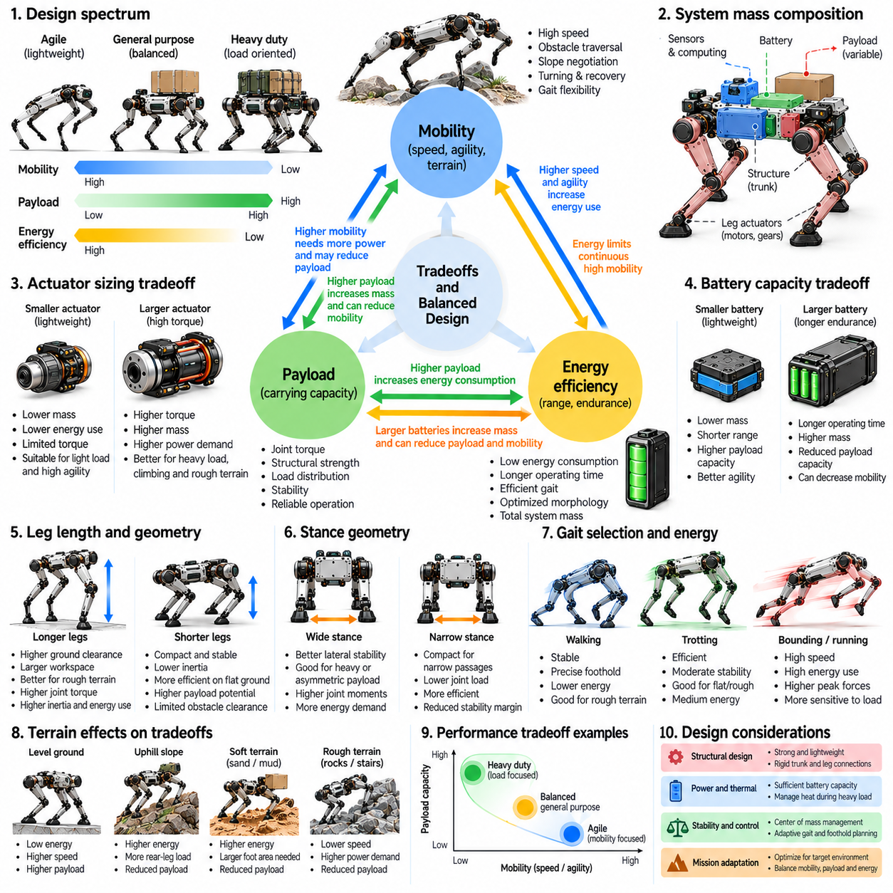{width="7.268055555555556in" height="7.268055555555556in"}

Mobility, payload capacity, and energy efficiency form a fundamental set of competing objectives in quadruped robot design. Improving one capability often imposes additional requirements on the others because structural mass, actuator power, battery capacity, and mechanical geometry are closely coupled. A quadruped optimized for rapid movement may not carry heavy equipment efficiently, while a load-oriented platform may sacrifice speed, agility, and operational endurance.

Mobility encompasses more than maximum locomotion speed. It includes obstacle traversal, slope negotiation, turning ability, gait flexibility, and recovery from disturbances. These capabilities depend on leg workspace, actuator bandwidth, structural proportions, and available traction. Increasing mobility often requires additional mechanical capability, but the associated mass and power consumption can reduce the payload and energy resources available for other tasks.

Payload capacity describes the additional mass a quadruped can transport while maintaining acceptable stability and performance. Increasing payload requires sufficient joint torque, structural strength, and ground contact capability. However, larger actuators and reinforced structures increase the robot\'s own weight. This creates a recursive design challenge in which components added to support greater payload also increase the load that the locomotion system must carry.

Energy efficiency determines how effectively stored electrical energy is converted into useful movement and task execution. A robot with low energy consumption can operate longer or travel farther with a given battery capacity. However, efficient locomotion depends on terrain, gait, speed, and loading conditions. An architecture optimized for level-ground walking may perform less efficiently during climbing, obstacle traversal, or repeated manipulation.

The relationship between robot mass and payload mass is central to these tradeoffs. Total system mass includes the trunk, legs, actuators, batteries, sensors, computing hardware, and transported equipment. Every additional component increases gravitational loading and potentially changes rotational inertia. Reducing structural mass can improve efficiency, but excessive weight reduction may compromise stiffness, fatigue resistance, and impact durability.

Actuator sizing creates a direct connection between mobility and payload capability. Larger motors can provide greater joint torque and improve acceleration, climbing, and load support. However, they also increase mass, cost, and electrical demand. Smaller actuators reduce weight but may operate closer to thermal or torque limits. Effective sizing requires evaluating peak demands, continuous operating conditions, and the expected distribution of locomotion tasks.

Transmission architecture further influences the balance between force capability and efficiency. High reduction ratios can increase output torque but may reduce backdrivability, introduce friction, and limit dynamic responsiveness. Lower reduction ratios can support compliant interaction and rapid joint movement but require motors capable of producing greater torque. The preferred configuration depends on whether the robot prioritizes dynamic agility, sustained support, or heavy-load transportation.

Leg length and geometry introduce additional mechanical tradeoffs. Longer legs can improve obstacle clearance and reachable workspace, supporting mobility across irregular terrain. However, longer segments may increase bending loads, rotational inertia, and joint torque requirements. Shorter legs can improve compactness and structural efficiency but restrict stepping reach. Morphological optimization must account for terrain demands alongside payload and energy constraints.

Stance geometry influences both stability and energetic cost. A wider stance may improve resistance to lateral tipping when carrying an elevated or asymmetric payload. However, extreme leg configurations can increase joint moments and require additional support effort. Narrower stances may reduce certain mechanical demands but provide smaller stability margins. Adaptive stance selection can balance these competing effects as terrain and payload conditions change.

Battery capacity presents one of the clearest system-level compromises. Adding battery cells increases available stored energy but also raises the mass that must be supported and accelerated. The resulting endurance improvement may diminish as additional weight increases locomotion consumption. Battery sizing should therefore be based on realistic mission energy requirements rather than assuming that larger batteries always produce proportionally longer operating time.

Locomotion speed affects energy consumption through changes in gait dynamics, actuator losses, and mechanical work. Higher speeds can increase inertial loading and require faster joint motion, while excessively slow movement may prolong electrical losses associated with sustained support. Consequently, the most energy-efficient speed is not necessarily the lowest speed. Its value depends on morphology, terrain, payload, and the selected gait.

Gait selection provides a mechanism for adapting the mobility-energy balance. Walking can offer conservative support and precise foothold placement on difficult terrain, while trotting may provide efficient progression on predictable surfaces. Dynamic gaits can reduce travel time but increase peak force demands and disturbance sensitivity. A payload-carrying quadruped should select gaits according to terrain difficulty, available actuator margins, and mission priorities.

Terrain conditions can shift the balance among mobility, payload, and energy requirements. Uphill locomotion increases the mechanical work required to raise the combined robot and payload mass. Soft terrain introduces additional losses through deformation and foot penetration, while slippery ground limits usable propulsion forces. A payload rating established on level flooring may therefore be unsuitable for steep or irregular environments.

Foot design contributes to these tradeoffs through contact pressure, traction, and distal mass. Larger feet can improve support on soft ground but increase swing inertia and complicate precise foothold placement. Lightweight feet reduce repositioning effort but must withstand repeated impacts and abrasion. Contact materials and compliance should be selected to provide sufficient traction without excessive deformation losses or maintenance requirements.

Dynamic stability imposes constraints that cannot be captured by payload mass alone. A high-mounted load raises the combined center of mass and can increase rollover risk during turning or side-slope traversal. An extended manipulator may introduce substantial moments even when the carried object is relatively light. Safe operation requires considering payload geometry, acceleration, support forces, and available corrective motion.

Thermal performance creates an additional boundary between theoretical and practical capability. A quadruped may briefly generate enough torque to climb with a heavy load but fail to sustain that effort because of motor or transmission heating. Higher temperatures can reduce allowable continuous torque and accelerate component degradation. Mission planning must therefore consider thermal accumulation alongside instantaneous force and energy limits.

Mechanical compliance can improve mobility and impact tolerance but also introduces efficiency tradeoffs. Elastic elements may store and return energy during suitable gait cycles, reducing some actuator demands. However, poorly matched stiffness or damping can increase oscillation, dissipate energy, or impair load control. The appropriate compliance depends on operating speed, terrain characteristics, payload variation, and desired stability.

Mission-level optimization requires evaluating the complete sequence of operations rather than a single locomotion condition. A robot may need to travel unloaded, collect equipment, climb a slope, and return while carrying additional mass. Each phase has different energy, torque, and stability requirements. A configuration optimized for one phase may perform poorly across the full mission, making representative duty-cycle analysis essential.

Performance metrics should distinguish mobility capability, transport productivity, and energy efficiency. Relevant measures include maximum traversable obstacle height, allowable payload, travel speed, operating duration, and energy consumed per distance. Cost of transport provides a normalized indicator of locomotion energy relative to system weight and distance. However, no single metric fully captures operational effectiveness across diverse missions.

Multi-objective optimization provides a structured method for exploring these competing design goals. Candidate morphologies can be evaluated using simulation and experimental data under common terrain and payload conditions. Pareto-optimal configurations represent designs in which improving one objective requires sacrificing another. This approach reveals practical design choices without assuming that a single morphology can maximize every performance characteristic.

Simulation supports early comparison of actuator sizes, leg dimensions, battery configurations, and payload distributions. Dynamic models can estimate joint torques, contact forces, energy consumption, and stability margins across representative tasks. However, predictions depend on accurate actuator efficiency, friction, terrain, and thermal models. Physical experiments are necessary to establish whether simulated advantages remain valid during sustained real-world operation.

Experimental evaluation should combine unloaded and loaded trials across multiple speeds, gaits, and terrain categories. Measurements of electrical energy, actuator temperature, joint torque, slipping, and task completion can reveal hidden performance limitations. Repeated trials are particularly important because thermal saturation and structural fatigue may not appear during short demonstrations. Results should inform iterative adjustments to both morphology and control.

Design priorities vary substantially across quadruped applications. Inspection robots may emphasize endurance and terrain accessibility while carrying relatively lightweight sensors. Logistics platforms may prioritize payload capacity and transport reliability, whereas emergency-response robots may require mobility reserves for unpredictable obstacles. Morphology should be selected according to measurable mission requirements rather than maximizing isolated specifications.

Within Physical AI, mobility-payload-energy tradeoffs demonstrate that intelligent behavior remains constrained by physical embodiment. Perception and planning can select routes, gaits, and body configurations that reduce energy demand while preserving stability and task performance. Adaptive control can exploit available mechanical capabilities but cannot eliminate structural, thermal, or energetic limits. Effective quadruped design therefore requires coordinated optimization of morphology, actuation, energy storage, and intelligent control.

이동성(Mobility), 탑재하중 용량(Payload Capacity), 에너지 효율(Energy Efficiency)은 사족보행 로봇(Quadruped Robot) 설계에서 서로 경쟁하는 핵심 목표(Competing Objectives)를 형성한다. 한 가지 성능을 향상시키면 구조적 질량(Structural Mass), 구동기 출력(Actuator Power), 배터리 용량(Battery Capacity), 기계적 기하학(Mechanical Geometry)이 밀접하게 결합되어 있기 때문에 다른 성능에 추가적인 요구사항이 발생하는 경우가 많다. 빠른 이동(Rapid Movement)에 최적화된 사족보행 로봇은 무거운 장비(Heavy Equipment)를 효율적으로 운반하지 못할 수 있으며, 하중 중심 플랫폼(Load-Oriented Platform)은 속도(Speed), 민첩성(Agility), 운용 지속시간(Operational Endurance)을 희생할 수 있다.

이동성(Mobility)은 최대 이동 속도(Maximum Locomotion Speed) 이상의 의미를 포함한다. 여기에는 장애물 통과(Obstacle Traversal), 경사면 이동(Slope Negotiation), 회전 능력(Turning Ability), 보행 유연성(Gait Flexibility), 외란 복구(Disturbance Recovery)가 포함된다. 이러한 능력은 다리 작업공간(Leg Workspace), 구동기 대역폭(Actuator Bandwidth), 구조적 비율(Structural Proportions), 사용 가능한 접지력(Available Traction)에 따라 달라진다. 이동성을 높이기 위해서는 추가적인 기계적 성능(Mechanical Capability)이 필요한 경우가 많지만, 이에 따른 질량(Mass)과 전력 소비(Power Consumption)의 증가는 다른 작업에 사용할 수 있는 탑재하중 및 에너지 자원(Payload and Energy Resources)을 감소시킬 수 있다.

탑재하중 용량(Payload Capacity)은 사족보행 로봇이 허용 가능한 안정성(Stability)과 성능(Performance)을 유지하면서 운송할 수 있는 추가 질량(Additional Mass)을 의미한다. 탑재하중을 증가시키려면 충분한 관절 토크(Joint Torque), 구조적 강도(Structural Strength), 지면 접촉 능력(Ground Contact Capability)이 필요하다. 그러나 더 큰 구동기(Larger Actuators)와 보강된 구조(Reinforced Structures)는 로봇 자체의 무게(Weight)를 증가시킨다. 이는 더 큰 탑재하중을 지지하기 위해 추가된 구성요소가 이동 시스템(Locomotion System)이 운반해야 하는 하중까지 증가시키는 순환적인 설계 문제(Recursive Design Challenge)를 발생시킨다.

에너지 효율(Energy Efficiency)은 저장된 전기 에너지(Stored Electrical Energy)가 유용한 움직임(Useful Movement)과 작업 수행(Task Execution)으로 얼마나 효과적으로 변환되는지를 결정한다. 에너지 소비(Energy Consumption)가 낮은 로봇은 주어진 배터리 용량(Battery Capacity)으로 더 오래 작동하거나 더 먼 거리를 이동할 수 있다. 그러나 효율적인 이동(Efficient Locomotion)은 지형(Terrain), 보행 방식(Gait), 속도(Speed), 하중 조건(Loading Conditions)에 따라 달라진다. 평지 보행(Level-Ground Walking)에 최적화된 구조(Architecture)는 경사면 등반(Climbing), 장애물 통과(Obstacle Traversal), 반복적인 조작(Repeated Manipulation) 중에는 효율이 낮아질 수 있다.

로봇 질량(Robot Mass)과 탑재하중 질량(Payload Mass) 사이의 관계는 이러한 절충관계(Tradeoffs)의 핵심이다. 전체 시스템 질량(Total System Mass)에는 몸통(Trunk), 다리(Legs), 구동기(Actuators), 배터리(Batteries), 센서(Sensors), 컴퓨팅 하드웨어(Computing Hardware), 운송 장비(Transported Equipment)가 포함된다. 모든 추가 구성요소(Additional Components)는 중력 하중(Gravitational Loading)을 증가시키고 회전 관성(Rotational Inertia)을 변화시킬 가능성이 있다. 구조적 질량(Structural Mass)을 줄이면 효율(Efficiency)을 향상시킬 수 있지만, 과도한 경량화(Excessive Weight Reduction)는 강성(Stiffness), 피로 저항성(Fatigue Resistance), 충격 내구성(Impact Durability)을 저하시킬 수 있다.

구동기 용량 선정(Actuator Sizing)은 이동성(Mobility)과 탑재하중 성능(Payload Capability) 사이에 직접적인 관계를 형성한다. 더 큰 모터(Larger Motors)는 더 높은 관절 토크(Joint Torque)를 제공하여 가속(Acceleration), 등반(Climbing), 하중 지지(Load Support) 능력을 향상시킬 수 있다. 그러나 질량(Mass), 비용(Cost), 전력 요구량(Electrical Demand)도 증가한다. 작은 구동기(Smaller Actuators)는 무게를 줄이지만 열적 한계(Thermal Limits)나 토크 한계(Torque Limits)에 더 가까운 상태에서 작동할 수 있다. 효과적인 용량 선정(Effective Sizing)을 위해서는 최대 요구량(Peak Demands), 연속 운용 조건(Continuous Operating Conditions), 예상 이동 작업 분포(Expected Distribution of Locomotion Tasks)를 평가해야 한다.

동력 전달 구조(Transmission Architecture)는 힘 생성 능력(Force Capability)과 효율(Efficiency) 사이의 균형에도 영향을 미친다. 높은 감속비(High Reduction Ratios)는 출력 토크(Output Torque)를 증가시킬 수 있지만 역구동성(Backdrivability)을 감소시키고 마찰(Friction)을 발생시키며 동적 응답성(Dynamic Responsiveness)을 제한할 수 있다. 낮은 감속비(Lower Reduction Ratios)는 순응성 상호작용(Compliant Interaction)과 빠른 관절 움직임(Rapid Joint Movement)을 지원할 수 있지만 더 큰 토크를 생성할 수 있는 모터가 필요하다. 적합한 구성(Preferred Configuration)은 로봇이 동적 민첩성(Dynamic Agility), 지속적인 지지(Sustained Support), 중하중 운송(Heavy-Load Transportation) 중 무엇을 우선시하는지에 따라 달라진다.

다리 길이(Leg Length)와 기하학적 구조(Geometry)는 추가적인 기계적 절충관계(Mechanical Tradeoffs)를 발생시킨다. 긴 다리(Longer Legs)는 장애물 통과 높이(Obstacle Clearance)와 도달 가능한 작업공간(Reachable Workspace)을 증가시켜 불규칙한 지형(Irregular Terrain)에서 이동성을 지원할 수 있다. 그러나 긴 다리 분절(Longer Segments)은 굽힘 하중(Bending Loads), 회전 관성(Rotational Inertia), 관절 토크 요구사항(Joint Torque Requirements)을 증가시킬 수 있다. 짧은 다리(Shorter Legs)는 소형화(Compactness)와 구조적 효율(Structural Efficiency)을 개선할 수 있지만 발 디딤 도달 범위(Stepping Reach)를 제한한다. 형태 최적화(Morphological Optimization)는 탑재하중 및 에너지 제약(Payload and Energy Constraints)과 함께 지형 요구사항(Terrain Demands)을 고려해야 한다.

지지 자세 기하학(Stance Geometry)은 안정성(Stability)과 에너지 비용(Energetic Cost)에 모두 영향을 미친다. 넓은 지지 자세(Wider Stance)는 높게 장착되거나 비대칭적인 탑재하중(Elevated or Asymmetric Payload)을 운반할 때 측면 전복(Lateral Tipping)에 대한 저항성을 향상시킬 수 있다. 그러나 극단적인 다리 구성(Extreme Leg Configurations)은 관절 모멘트(Joint Moments)를 증가시키고 추가적인 지지 노력(Support Effort)을 요구할 수 있다. 좁은 지지 자세(Narrower Stances)는 특정 기계적 요구량(Mechanical Demands)을 줄일 수 있지만 안정성 여유(Stability Margins)가 작아진다. 적응형 지지 자세 선택(Adaptive Stance Selection)은 지형과 탑재하중 조건이 변화함에 따라 이러한 상충 효과를 조정할 수 있다.

배터리 용량(Battery Capacity)은 시스템 수준에서 가장 명확한 절충관계(System-Level Compromises) 중 하나를 보여준다. 배터리 셀(Battery Cells)을 추가하면 사용 가능한 저장 에너지(Stored Energy)는 증가하지만 지지하고 가속해야 하는 질량(Mass)도 증가한다. 추가 무게(Additional Weight)가 이동 에너지 소비(Locomotion Energy Consumption)를 증가시키면서 운용 지속시간 개선(Endurance Improvement)의 효과가 점차 감소할 수 있다. 따라서 배터리 용량 선정(Battery Sizing)은 더 큰 배터리가 항상 비례적으로 긴 운용 시간(Operating Time)을 제공한다고 가정하기보다 현실적인 임무 에너지 요구사항(Realistic Mission Energy Requirements)을 기반으로 해야 한다.

이동 속도(Locomotion Speed)는 보행 동역학(Gait Dynamics), 구동기 손실(Actuator Losses), 기계적 일(Mechanical Work)의 변화를 통해 에너지 소비(Energy Consumption)에 영향을 미친다. 높은 속도(Higher Speeds)는 관성 하중(Inertial Loading)을 증가시키고 더 빠른 관절 움직임(Joint Motion)을 요구할 수 있으며, 지나치게 느린 이동(Excessively Slow Movement)은 지속적인 지지(Sustained Support)와 관련된 전기적 손실(Electrical Losses)을 장시간 발생시킬 수 있다. 따라서 에너지 효율이 가장 높은 속도(Most Energy-Efficient Speed)가 반드시 가장 낮은 속도는 아니다. 그 값은 형태(Morphology), 지형(Terrain), 탑재하중(Payload), 선택된 보행 방식(Selected Gait)에 따라 달라진다.

보행 방식 선택(Gait Selection)은 이동성과 에너지 사이의 균형(Mobility-Energy Balance)을 조정하는 메커니즘을 제공한다. 걷기(Walking)는 어려운 지형(Difficult Terrain)에서 보수적인 지지(Conservative Support)와 정밀한 발 디딤 위치 선정(Precise Foothold Placement)을 제공할 수 있으며, 트로트 보행(Trotting)은 예측 가능한 표면(Predictable Surfaces)에서 효율적인 전진 이동(Efficient Progression)을 가능하게 할 수 있다. 동적 보행(Dynamic Gaits)은 이동 시간(Travel Time)을 줄일 수 있지만 최대 힘 요구량(Peak Force Demands)과 외란 민감도(Disturbance Sensitivity)를 증가시킨다. 탑재하중 운반 사족보행 로봇(Payload-Carrying Quadruped)은 지형 난이도(Terrain Difficulty), 사용 가능한 구동기 여유(Available Actuator Margins), 임무 우선순위(Mission Priorities)에 따라 보행 방식을 선택해야 한다.

지형 조건(Terrain Conditions)은 이동성(Mobility), 탑재하중(Payload), 에너지 요구사항(Energy Requirements) 사이의 균형을 변화시킬 수 있다. 오르막 이동(Uphill Locomotion)은 로봇과 탑재하중의 결합 질량(Combined Robot and Payload Mass)을 들어 올리는 데 필요한 기계적 일(Mechanical Work)을 증가시킨다. 연약 지형(Soft Terrain)은 변형(Deformation)과 발 침투(Foot Penetration)를 통해 추가적인 에너지 손실(Energy Losses)을 발생시키며, 미끄러운 지면(Slippery Ground)은 사용 가능한 추진력(Usable Propulsion Forces)을 제한한다. 따라서 평평한 바닥(Level Flooring)에서 설정된 탑재하중 등급(Payload Rating)은 급경사 또는 불규칙한 환경(Steep or Irregular Environments)에 적합하지 않을 수 있다.

발 설계(Foot Design)는 접촉 압력(Contact Pressure), 접지력(Traction), 말단 질량(Distal Mass)을 통해 이러한 절충관계에 영향을 미친다. 큰 발(Larger Feet)은 연약 지면(Soft Ground)에서 지지 능력을 개선할 수 있지만 유각 관성(Swing Inertia)을 증가시키고 정밀한 발 디딤 위치 선정(Precise Foothold Placement)을 어렵게 만든다. 가벼운 발(Lightweight Feet)은 위치 재조정 노력(Repositioning Effort)을 줄이지만 반복적인 충격(Repeated Impacts)과 마모(Abrasion)를 견딜 수 있어야 한다. 접촉 재료(Contact Materials)와 순응성(Compliance)은 과도한 변형 손실(Deformation Losses)이나 유지보수 요구사항(Maintenance Requirements) 없이 충분한 접지력을 제공하도록 선정해야 한다.

동적 안정성(Dynamic Stability)은 탑재하중 질량(Payload Mass)만으로 설명할 수 없는 제약을 부과한다. 높게 장착된 하중(High-Mounted Load)은 결합 질량중심(Combined Center of Mass)을 높이고 회전(Turning)이나 측면 경사 통과(Side-Slope Traversal) 중 전복 위험(Rollover Risk)을 증가시킬 수 있다. 확장된 매니퓰레이터(Extended Manipulator)는 운반하는 물체가 비교적 가볍더라도 상당한 모멘트(Moments)를 발생시킬 수 있다. 안전한 운용(Safe Operation)을 위해서는 탑재하중 형상(Payload Geometry), 가속도(Acceleration), 지지력(Support Forces), 사용 가능한 보정 움직임(Available Corrective Motion)을 고려해야 한다.

열 성능(Thermal Performance)은 이론적 성능(Theoretical Capability)과 실제 성능(Practical Capability) 사이에 추가적인 한계를 형성한다. 사족보행 로봇은 무거운 하중(Heavy Load)을 운반하면서 경사면을 오를 수 있을 만큼 충분한 토크(Torque)를 일시적으로 생성할 수 있지만, 모터 또는 동력 전달장치의 발열(Motor or Transmission Heating) 때문에 이러한 출력을 지속하지 못할 수 있다. 높은 온도(Higher Temperatures)는 허용 가능한 연속 토크(Allowable Continuous Torque)를 감소시키고 구성요소 열화(Component Degradation)를 가속할 수 있다. 따라서 임무 계획(Mission Planning)은 순간적인 힘 및 에너지 한계(Instantaneous Force and Energy Limits)와 함께 열 축적(Thermal Accumulation)을 고려해야 한다.

기계적 순응성(Mechanical Compliance)은 이동성(Mobility)과 충격 허용성(Impact Tolerance)을 향상시킬 수 있지만 에너지 효율 측면의 절충관계(Efficiency Tradeoffs)도 발생시킨다. 탄성 요소(Elastic Elements)는 적절한 보행 주기(Gait Cycles)에서 에너지를 저장하고 반환하여 일부 구동기 요구량(Actuator Demands)을 줄일 수 있다. 그러나 부적절하게 설정된 강성(Stiffness)이나 감쇠(Damping)는 진동(Oscillation)을 증가시키거나 에너지를 소산(Dissipate Energy)시키거나 하중 제어(Load Control)를 저해할 수 있다. 적절한 순응성(Appropriate Compliance)은 운용 속도(Operating Speed), 지형 특성(Terrain Characteristics), 탑재하중 변화(Payload Variation), 요구되는 안정성(Desired Stability)에 따라 달라진다.

임무 수준 최적화(Mission-Level Optimization)는 단일 이동 조건(Single Locomotion Condition)이 아니라 전체 운용 순서(Complete Sequence of Operations)를 평가해야 한다. 로봇은 무부하 상태(Unloaded State)로 이동한 뒤 장비를 수거하고, 경사면을 오르며, 추가 질량(Additional Mass)을 운반하면서 복귀해야 할 수 있다. 각 단계(Phase)는 서로 다른 에너지(Energy), 토크(Torque), 안정성 요구사항(Stability Requirements)을 갖는다. 한 단계에 최적화된 구성(Configuration)은 전체 임무(Full Mission)에서는 성능이 낮을 수 있으므로 대표적인 듀티 사이클 분석(Representative Duty-Cycle Analysis)이 필수적이다.

성능 지표(Performance Metrics)는 이동 능력(Mobility Capability), 운송 생산성(Transport Productivity), 에너지 효율(Energy Efficiency)을 구분해야 한다. 관련 측정 항목(Relevant Measures)에는 통과 가능한 최대 장애물 높이(Maximum Traversable Obstacle Height), 허용 탑재하중(Allowable Payload), 이동 속도(Travel Speed), 운용 지속시간(Operating Duration), 거리당 에너지 소비(Energy Consumed per Distance)가 포함된다. 운송 비용(Cost of Transport)은 시스템 무게(System Weight)와 이동 거리(Distance)에 대한 이동 에너지(Locomotion Energy)를 정규화한 지표(Normalized Indicator)를 제공한다. 그러나 단일 지표(Single Metric)만으로는 다양한 임무(Diverse Missions)에서의 운용 효과성(Operational Effectiveness)을 완전히 설명할 수 없다.

다목적 최적화(Multi-Objective Optimization)는 서로 경쟁하는 설계 목표(Competing Design Goals)를 체계적으로 탐색하는 방법을 제공한다. 후보 형태(Candidate Morphologies)는 공통된 지형 및 탑재하중 조건(Common Terrain and Payload Conditions)에서 시뮬레이션(Simulation)과 실험 데이터(Experimental Data)를 사용하여 평가할 수 있다. 파레토 최적 구성(Pareto-Optimal Configurations)은 하나의 목표를 개선하려면 다른 목표를 희생해야 하는 설계를 나타낸다. 이러한 접근법(Approach)은 단일 형태(Single Morphology)가 모든 성능 특성(Performance Characteristics)을 극대화할 수 있다고 가정하지 않으면서 현실적인 설계 선택(Practical Design Choices)을 제시한다.

시뮬레이션(Simulation)은 구동기 크기(Actuator Sizes), 다리 치수(Leg Dimensions), 배터리 구성(Battery Configurations), 탑재하중 분포(Payload Distributions)를 초기 단계에서 비교할 수 있도록 지원한다. 동역학 모델(Dynamic Models)은 대표적인 작업(Representative Tasks)에서 관절 토크(Joint Torques), 접촉력(Contact Forces), 에너지 소비(Energy Consumption), 안정성 여유(Stability Margins)를 추정할 수 있다. 그러나 예측 결과(Predictions)는 정확한 구동기 효율(Actuator Efficiency), 마찰(Friction), 지형(Terrain), 열 모델(Thermal Models)에 의존한다. 시뮬레이션에서 확인된 이점(Simulated Advantages)이 지속적인 실제 운용(Sustained Real-World Operation)에서도 유효한지를 확인하려면 물리적 실험(Physical Experiments)이 필요하다.

실험적 평가(Experimental Evaluation)는 다양한 속도(Speeds), 보행 방식(Gaits), 지형 유형(Terrain Categories)에서 무부하 및 부하 시험(Unloaded and Loaded Trials)을 결합해야 한다. 전기 에너지(Electrical Energy), 구동기 온도(Actuator Temperature), 관절 토크(Joint Torque), 미끄러짐(Slipping), 작업 완료(Task Completion)에 대한 측정은 숨겨진 성능 한계(Hidden Performance Limitations)를 밝혀낼 수 있다. 열 포화(Thermal Saturation)와 구조적 피로(Structural Fatigue)는 짧은 시연(Short Demonstrations) 중에는 나타나지 않을 수 있으므로 반복 시험(Repeated Trials)이 특히 중요하다. 시험 결과는 형태(Morphology)와 제어(Control)의 반복적인 조정(Iterative Adjustments)에 반영되어야 한다.

설계 우선순위(Design Priorities)는 사족보행 로봇의 응용 분야(Quadruped Applications)에 따라 상당히 달라진다. 검사 로봇(Inspection Robots)은 비교적 가벼운 센서(Lightweight Sensors)를 운반하면서 운용 지속 능력(Endurance)과 지형 접근성(Terrain Accessibility)을 강조할 수 있다. 물류 플랫폼(Logistics Platforms)은 탑재하중 용량(Payload Capacity)과 운송 신뢰성(Transport Reliability)을 우선시할 수 있으며, 비상 대응 로봇(Emergency-Response Robots)은 예측하기 어려운 장애물(Unpredictable Obstacles)에 대응하기 위한 이동성 여유(Mobility Reserves)를 필요로 할 수 있다. 형태(Morphology)는 개별 사양(Isolated Specifications)의 극대화가 아니라 측정 가능한 임무 요구사항(Measurable Mission Requirements)에 따라 선택되어야 한다.

피지컬 AI(Physical AI)에서 이동성-탑재하중-에너지 절충관계(Mobility-Payload-Energy Tradeoffs)는 지능형 행동(Intelligent Behavior)이 여전히 물리적 체화(Physical Embodiment)의 제약을 받는다는 사실을 보여준다. 인지(Perception)와 계획(Planning)은 안정성(Stability)과 작업 성능(Task Performance)을 유지하면서 에너지 요구량(Energy Demand)을 줄이는 경로(Routes), 보행 방식(Gaits), 몸체 구성(Body Configurations)을 선택할 수 있다. 적응형 제어(Adaptive Control)는 사용 가능한 기계적 능력(Mechanical Capabilities)을 활용할 수 있지만 구조적 한계(Structural Limits), 열적 한계(Thermal Limits), 에너지 한계(Energetic Limits)를 제거할 수는 없다. 따라서 효과적인 사족보행 로봇 설계(Effective Quadruped Design)는 형태(Morphology), 구동(Actuation), 에너지 저장(Energy Storage), 지능형 제어(Intelligent Control)의 협조적인 최적화(Coordinated Optimization)를 요구한다.
