**Volume 03. Embodiment and Morphology**

# Chapter 08. Aerial Robot Morphology

## 08.01. Aerial Robot Morphology Overview

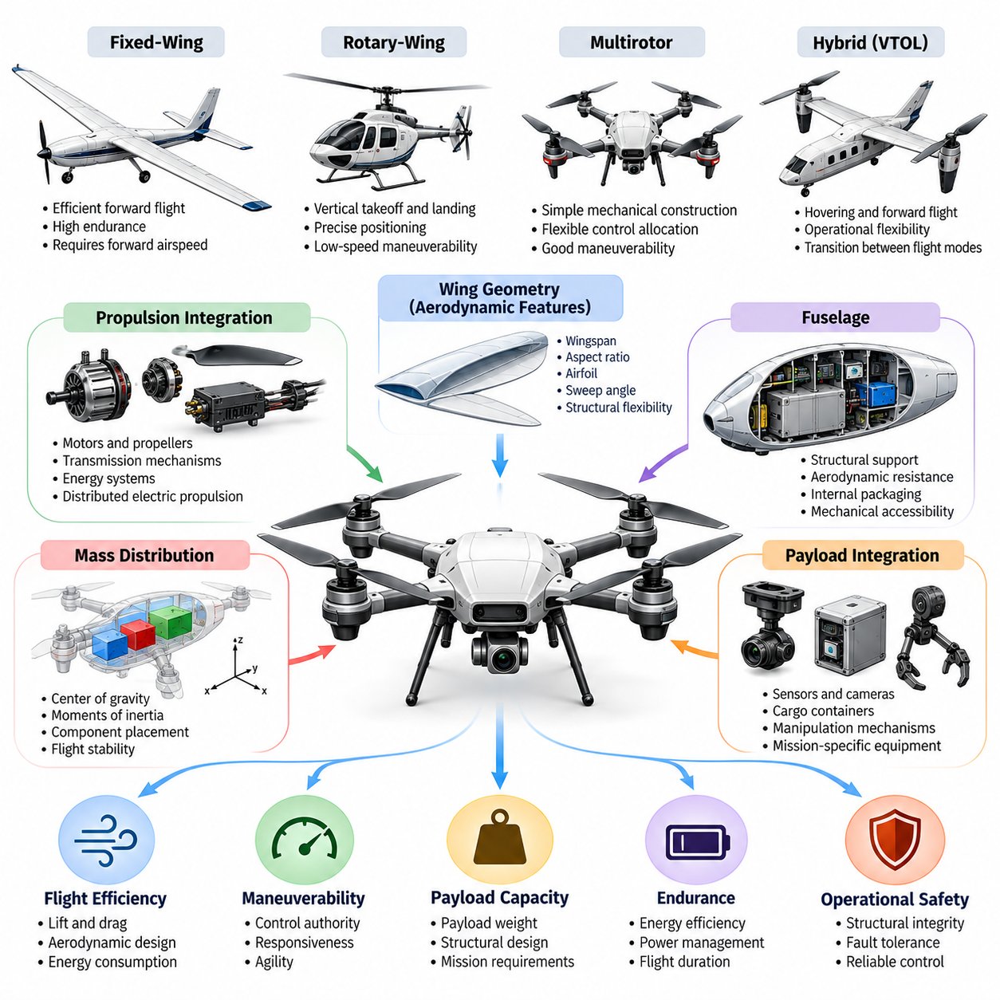{width="7.268055555555556in" height="7.268055555555556in"}

Aerial robot morphology refers to the physical configuration, structural arrangement, and mechanical characteristics that determine how a robotic system generates lift, produces thrust, maintains stability, and moves through the atmosphere. Unlike ground robots, aerial robots must continuously manage gravitational forces and aerodynamic interactions. Their morphology directly influences flight efficiency, maneuverability, payload capacity, endurance, and operational safety.

The morphology of an aerial robot includes its wings, rotors, fuselage, propulsion units, structural supports, control surfaces, and payload interfaces. These components form an integrated physical system whose geometry and mass distribution determine flight behavior. Morphological design therefore involves more than selecting individual components. It requires coordinating aerodynamic, mechanical, electrical, and computational characteristics.

Aerial robots are commonly classified into fixed-wing, rotary-wing, multirotor, and hybrid configurations. Fixed-wing platforms generate lift primarily through forward motion, while rotary-wing systems use rotating aerodynamic surfaces to support flight. Multirotor platforms distribute lift generation across multiple propellers. Hybrid configurations combine different mechanisms to achieve capabilities unavailable through a single conventional architecture.

Fixed-wing aerial robots typically provide efficient forward flight because their wings generate aerodynamic lift without requiring propulsion systems to support the entire vehicle weight continuously. Their morphology emphasizes wing geometry, aerodynamic efficiency, and longitudinal stability. However, conventional fixed-wing configurations generally require forward airspeed for sustained lift, limiting stationary hovering and operations within confined spaces.

Rotary-wing aerial robots generate lift through powered rotating blades, allowing vertical takeoff, landing, and hovering. Their morphology supports operations requiring precise positioning and low-speed maneuverability. Helicopter configurations use specialized rotor mechanisms, while multirotor platforms employ multiple independently controlled propulsion units. These structural differences influence mechanical complexity, controllability, maintenance requirements, and energy consumption.

Multirotor morphology is particularly important in contemporary autonomous aerial robotics because it supports relatively simple mechanical construction and flexible control allocation. Quadcopters, hexacopters, and octocopters differ in rotor number, placement, and redundancy. Their configurations affect thrust distribution, rotational inertia, fault tolerance, and payload capability. Increasing rotor count can improve certain capabilities but also introduces additional mass and complexity.

Vertical takeoff and landing architectures combine operational flexibility with aerodynamic performance. Tilt-rotor, tilt-wing, and lift-plus-cruise configurations use different mechanisms to transition between hovering and forward flight. Their morphology must accommodate changing aerodynamic forces and propulsion requirements throughout the flight envelope. This creates design challenges involving structural integration, transition stability, actuator coordination, and energy efficiency.

Wing geometry plays a central role in aerial morphology because it determines aerodynamic characteristics such as lift generation, drag, and stall behavior. Wingspan, aspect ratio, airfoil selection, sweep angle, and structural flexibility influence flight performance. High-aspect-ratio wings generally favor efficient cruising, while compact wing configurations may improve packaging and maneuverability. These characteristics must be evaluated against mission requirements and environmental conditions.

The fuselage provides structural support for propulsion systems, sensors, batteries, communication equipment, and mission payloads. Its geometry affects aerodynamic resistance, internal packaging, and mechanical accessibility. A streamlined fuselage can reduce drag during forward flight, while a compact central body may benefit multirotor configurations. Structural design must also provide sufficient rigidity to maintain component alignment under aerodynamic and inertial loading.

Propulsion integration strongly influences aerial robot morphology because motors, propellers, transmission mechanisms, and energy systems determine available thrust and vehicle responsiveness. Distributed electric propulsion allows multiple propulsion units to be positioned across the airframe. This arrangement enables flexible thrust allocation and potentially improved fault tolerance. However, electrical distribution, thermal management, vibration, and structural loading become important design considerations.

Mass distribution is especially critical because aerial vehicles operate in a continuously changing three-dimensional force environment. The position of batteries, payloads, motors, and structural components determines the center of gravity and moments of inertia. Poor mass distribution can increase control effort, reduce maneuverability, and constrain flight stability. Morphological design must therefore coordinate component placement with aerodynamic and propulsion characteristics.

Payload integration introduces additional morphological constraints because sensors, cameras, cargo containers, and manipulation mechanisms modify the vehicle\'s mass, drag, and balance. Payload placement may also affect visibility, communication performance, and mechanical interference. Aerial robots intended for inspection, mapping, delivery, or environmental monitoring require different structural arrangements to accommodate their mission-specific equipment and operational requirements.

Hovering capability, maneuverability, flight range, and endurance represent competing morphological objectives. Multirotor systems provide precise hovering and agile movement but often consume substantial energy while supporting their weight. Fixed-wing systems generally achieve longer flight endurance through aerodynamic lift but cannot normally remain stationary. Hybrid systems attempt to combine these advantages, although additional mechanisms may increase weight and system complexity.

Aerial morphology also determines how robots respond to environmental disturbances. Wind gusts, turbulence, precipitation, temperature variations, and changes in air density influence flight performance. Structural stiffness, aerodynamic damping, rotor placement, and control authority affect disturbance rejection. Robust aerial platforms must combine appropriate physical configurations with sensing and control systems capable of maintaining stability under uncertain operating conditions.

The relationship between morphology and control is particularly significant in aerial robotics because physical configuration determines the available control inputs and resulting motion capabilities. Rotor arrangement affects torque generation, while aerodynamic control surfaces influence rotational and translational dynamics. Some configurations are underactuated, meaning they cannot independently command every motion direction. Their controllers must exploit the vehicle\'s dynamics to achieve desired trajectories.

Morphological computation provides another perspective on aerial robot design by recognizing that physical structures can contribute directly to stabilization and motion regulation. Aerodynamic surfaces, flexible wings, passive joints, and mechanically coupled components may produce beneficial responses without continuous computational intervention. These effects can reduce selected control demands, although passive behavior must remain compatible with active stabilization and mission requirements.

Aerial manipulation extends conventional flight morphology by integrating robotic arms, grippers, contact mechanisms, or specialized tools into flying platforms. Such systems must manage interactions between manipulation forces and flight dynamics. Contact with external objects can introduce disturbances that affect vehicle position and attitude. Successful aerial manipulation therefore requires coordinated design of the airframe, propulsion system, manipulator, and control architecture.

Cargo and heavy-lift aerial robots introduce further structural requirements involving load support, propulsion redundancy, landing systems, and energy storage. Increasing payload capacity generally requires greater thrust and stronger structural components, which can increase total vehicle mass. Designers must evaluate these coupled effects rather than treating payload capacity independently. Cargo attachment geometry and load movement also influence flight stability and operational safety.

Biologically inspired aerial morphologies explore physical principles observed in birds, insects, and other flying organisms. Flapping wings, deformable aerodynamic surfaces, and adaptive body configurations offer alternatives to conventional rigid-wing and rotor-based designs. These approaches may provide advantages in specialized flight regimes, including confined environments or highly maneuverable motion, but introduce challenges involving actuation, structural durability, and dynamic modeling.

Morphological adaptability offers opportunities for aerial robots to change their physical configuration according to operational conditions. Foldable wings, variable-pitch propellers, reconfigurable rotor arrangements, and adjustable structural elements can modify aerodynamic or propulsion characteristics during operation. Such mechanisms may expand mission capabilities, but their additional mass, mechanical complexity, and reliability requirements must be carefully considered.

Physical AI introduces a broader interpretation of aerial morphology by treating the robot\'s body as an integral component of intelligent behavior. Perception, planning, learning, and control depend on the vehicle\'s physical capabilities and limitations. An aerial robot cannot execute an arbitrary trajectory merely because its planning system identifies one. Its morphology defines the feasible action space within which intelligent decisions must operate.

Morphology-aware learning allows aerial intelligence systems to incorporate structural properties such as rotor positions, vehicle inertia, wing geometry, and actuator limits. These characteristics can be represented within predictive models, reinforcement learning policies, or adaptive controllers. Incorporating physical structure helps learning systems distinguish between achievable and infeasible behaviors and may improve adaptation across different aerial platforms.

The development of general-purpose aerial robots requires balancing morphological specialization with operational versatility. A configuration optimized for long-distance mapping may perform poorly during close-range inspection, while a highly maneuverable multirotor may lack sufficient endurance for extensive surveillance missions. General-purpose designs must therefore accommodate multiple tasks without introducing excessive compromises in efficiency, payload capability, reliability, or safety.

Aerial robot morphology ultimately represents the physical foundation upon which autonomous flight intelligence operates. Structural geometry, aerodynamic mechanisms, propulsion architecture, mass distribution, and payload integration collectively determine what a flying robot can accomplish. Understanding these relationships provides the basis for evaluating conventional and emerging aerial platforms and for developing future Physical AI systems in which embodiment, intelligence, and environmental interaction are designed together.

## 08.02. Fixed Wing and Rotary Wing Morphology

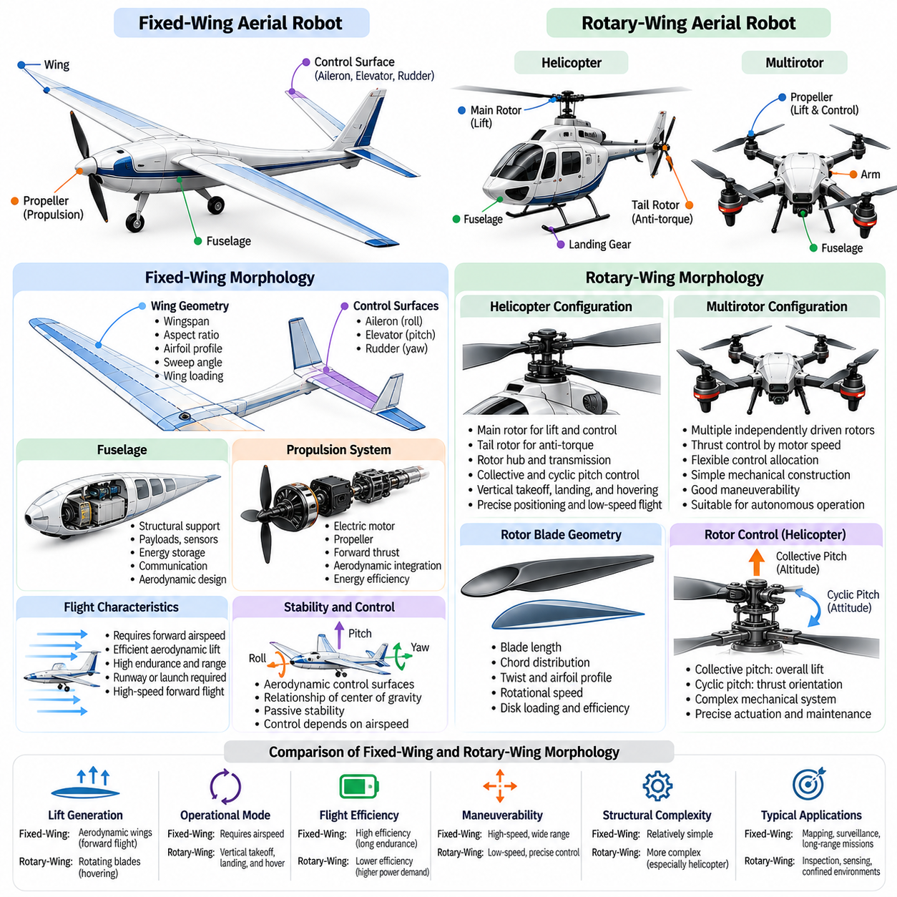{width="7.268055555555556in" height="7.268055555555556in"}

Fixed-wing and rotary-wing morphology represent two fundamental approaches to aerial robot design, distinguished primarily by how lift is generated and sustained. Fixed-wing aircraft rely on aerodynamic forces produced by airflow over stationary wings, while rotary-wing aircraft generate lift through rotating blades. These differences determine structural architecture, propulsion requirements, flight dynamics, control mechanisms, and the operational capabilities of autonomous aerial systems.

Fixed-wing morphology consists of a fuselage, lifting wings, propulsion components, and aerodynamic control surfaces. The wings provide the primary lifting function, while the fuselage supports payloads, energy storage, sensors, and communication equipment. Conventional configurations include horizontal and vertical stabilizers that contribute to directional and longitudinal stability. The arrangement of these elements determines aerodynamic efficiency, maneuverability, and structural performance.

The aerodynamic performance of fixed-wing robots depends strongly on wing geometry and operating conditions. Wingspan, aspect ratio, airfoil profile, sweep angle, and wing loading influence lift generation, drag, stall characteristics, and cruising efficiency. High-aspect-ratio wings generally reduce induced drag during efficient forward flight, while compact wings can improve packaging and structural robustness. Morphological selection must balance these properties against mission requirements.

Fixed-wing aircraft require sufficient airflow over their lifting surfaces to maintain aerodynamic lift. Consequently, conventional fixed-wing robots cannot remain stationary in the air without specialized mechanisms or favorable environmental conditions. Their operational requirements may include runways, launch systems, or recovery equipment. However, efficient aerodynamic lift allows many fixed-wing platforms to achieve greater endurance and range than similarly sized hovering rotorcraft.

Fixed-wing propulsion systems typically generate forward thrust rather than directly supporting the aircraft\'s entire weight. Electric motors, propellers, and alternative propulsion technologies accelerate the aircraft through the surrounding air. The resulting airflow enables the wings to generate lift. Propulsion placement, propeller efficiency, and aerodynamic integration influence energy consumption, flight performance, vibration, and overall structural design.

Flight control in conventional fixed-wing robots relies on aerodynamic control surfaces that modify forces and moments around the aircraft. Ailerons primarily control roll, elevators influence pitch, and rudders regulate yaw. Their effectiveness depends on airspeed, airflow conditions, and geometric placement. Autonomous controllers must account for these relationships when planning trajectories, maintaining stability, and executing maneuvers across different flight conditions.

Fixed-wing stability is strongly influenced by the relationship between the center of gravity, aerodynamic center, and stabilizing surfaces. Wing placement, tail geometry, fuselage proportions, and mass distribution determine the aircraft\'s natural dynamic behavior. A well-designed configuration can provide passive stability that reduces continuous control effort. However, excessive stability may limit maneuverability and responsiveness during demanding flight operations.

Rotary-wing morphology uses rotating aerodynamic blades to generate lift and, depending on the configuration, control forces and moments. Helicopters and multirotor vehicles represent major rotary-wing architectures, although their mechanical arrangements differ substantially. Rotary-wing systems can maintain flight without sustained forward motion, making them suitable for hovering, vertical takeoff, precise positioning, and operations in geographically constrained environments.

Conventional helicopter morphology generally includes a main rotor, fuselage, tail assembly, and an anti-torque mechanism. The main rotor produces lift and contributes to directional motion through changes in blade pitch and rotor disk orientation. A tail rotor or alternative anti-torque arrangement counteracts reaction torque. This architecture enables versatile flight but introduces mechanical complexity through rotor hubs, transmissions, and control linkages.

Rotor blade geometry significantly influences rotary-wing aerodynamic performance. Blade length, chord distribution, twist, airfoil profile, and rotational speed determine lift generation, aerodynamic efficiency, and mechanical loading. Longer blades can increase rotor disk area and reduce disk loading for a given aircraft weight. However, rotor dimensions also affect structural flexibility, tip speed, vibration, and the space required for safe operation.

Collective and cyclic pitch control provide important mechanisms for conventional helicopter maneuvering. Collective pitch changes blade pitch across the rotor disk to adjust overall lift, while cyclic pitch varies blade pitch during rotation to control rotor thrust orientation. These mechanisms allow helicopters to regulate altitude and attitude. Their mechanical sophistication requires precise actuation, careful maintenance, and advanced flight control strategies.

Multirotor morphology provides an alternative rotary-wing architecture by distributing propulsion across several independently driven rotors. Instead of relying on complex mechanical pitch-control mechanisms, many multirotor systems regulate thrust through motor-speed adjustments. Rotor positions, rotational directions, arm lengths, and structural symmetry determine available control authority. These characteristics make multirotors attractive for autonomous inspection, mapping, and aerial sensing.

The distinction between fixed-wing and rotary-wing morphology becomes especially apparent when comparing energy efficiency. Fixed-wing vehicles generally benefit from aerodynamic lift during forward flight, allowing propulsion energy to focus primarily on overcoming drag. Rotary-wing vehicles must continuously generate sufficient rotor thrust to support their weight during hovering. Consequently, hovering endurance is often more constrained by propulsion power and energy storage.

Maneuverability introduces a different set of tradeoffs. Rotary-wing aircraft can hover, translate at low speeds, and perform vertical movements without requiring sustained forward flight. Fixed-wing aircraft generally require coordinated changes in airspeed, bank angle, and flight path to maneuver effectively. Their minimum turning radius and stall limitations constrain operations in narrow spaces, while rotary-wing systems offer greater flexibility for stationary observation and precise positioning.

Payload integration also differs between these morphological families. Fixed-wing robots often position payloads within the fuselage or beneath the wings to preserve aerodynamic balance and minimize drag. Rotary-wing platforms frequently suspend sensors or cargo beneath the central body, providing useful downward visibility. In both cases, payload mass and placement influence center-of-gravity location, moments of inertia, structural loading, and control performance.

Structural requirements reflect the different forces experienced by each configuration. Fixed-wing structures must resist aerodynamic bending, torsion, and maneuver-induced loading across the wings and fuselage. Rotary-wing structures must withstand rotor-generated forces, vibrations, gyroscopic effects, and repeated dynamic loading. Material selection, structural reinforcement, and vibration isolation therefore follow different priorities, even when both platforms use lightweight composite materials.

Environmental conditions further influence morphological suitability. Fixed-wing aircraft may perform efficiently during sustained forward flight but can face operational challenges involving strong crosswinds, limited landing areas, and low-speed turbulence. Rotary-wing aircraft provide flexible takeoff and landing options but may experience substantial disturbances from gusts and complex airflow around obstacles. Wind tolerance depends on the specific vehicle design rather than morphology alone.

The integration of sensors and onboard computing introduces additional design considerations. Fixed-wing robots often require aerodynamic sensor placement that minimizes drag and preserves airflow quality. Rotary-wing platforms must account for rotor vibration, propeller interference, and rapidly changing vehicle attitudes. Camera placement, inertial measurement units, navigation antennas, and communication systems must be integrated without compromising aerodynamic performance or flight stability.

From a Physical AI perspective, fixed-wing and rotary-wing morphologies create different action spaces for intelligent planning and control. A fixed-wing autonomous agent must consider airspeed, turning constraints, stall margins, and continuous flight dynamics. A rotary-wing agent can exploit hovering and low-speed movement but must manage sustained power consumption and rotor-generated disturbances. Intelligent behavior therefore depends on morphology-specific physical capabilities.

Morphology-aware control and learning systems can incorporate aerodynamic models, actuator constraints, mass properties, and propulsion characteristics into autonomous decision-making. Fixed-wing controllers may emphasize energy-efficient trajectory optimization and coordinated turning, while rotary-wing controllers prioritize thrust allocation, attitude stabilization, and precise position regulation. Learning-based methods can complement these models by adapting to uncertain aerodynamic effects and changing operating conditions.

The selection between fixed-wing and rotary-wing morphology should follow the intended mission rather than a universal preference for one architecture. Long-range mapping and wide-area monitoring often favor fixed-wing efficiency, whereas close-range inspection, confined-space navigation, and stationary observation frequently favor rotary-wing capabilities. Hybrid architectures emerge when missions require both efficient forward flight and vertical takeoff, although their added complexity creates further design tradeoffs.

Ultimately, fixed-wing and rotary-wing morphology demonstrate how physical embodiment determines the capabilities and limitations of aerial intelligence. Their contrasting lift mechanisms shape aerodynamic performance, structural design, control complexity, energy consumption, and mission suitability. Understanding these relationships provides a foundation for evaluating multirotor systems, hybrid VTOL configurations, distributed propulsion, and future aerial robots whose morphology and intelligence are jointly optimized.

## 08.03. Multirotor Architectures

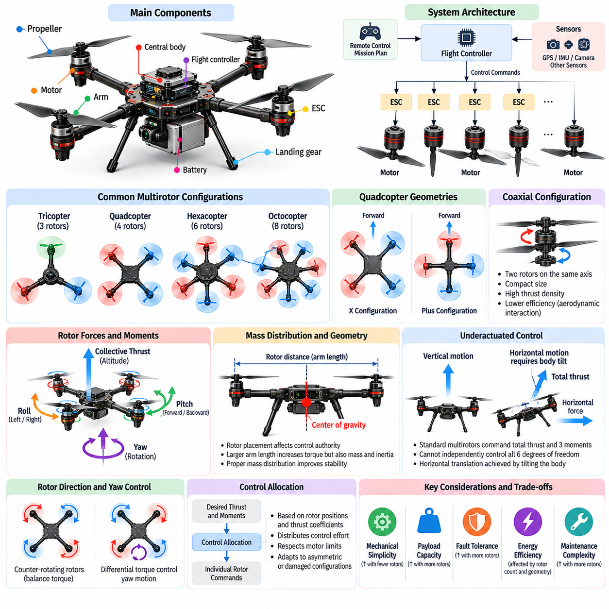{width="7.268055555555556in" height="7.268055555555556in"}

Multirotor architectures represent a major category of aerial robot morphology in which multiple powered rotors generate lift, propulsion, and attitude-control forces. Unlike conventional helicopters, most multirotor platforms regulate motion by varying the rotational speeds of independently driven propellers. Their relatively simple mechanical structures, modular propulsion arrangements, and precise hovering capabilities make them widely applicable to autonomous inspection, mapping, monitoring, and robotic research.

The fundamental architecture of a multirotor robot consists of a central body, structural arms, electric motors, propellers, electronic speed controllers, and an onboard flight-control system. Each rotor produces thrust along its rotational axis, while the combined thrust supports the vehicle against gravity. Differences in rotor thrust generate moments that control orientation. The geometry of these components determines stability, maneuverability, payload capacity, and energy efficiency.

Multirotor configurations are commonly distinguished by rotor count and geometric arrangement. Tricopters, quadcopters, hexacopters, and octocopters use three, four, six, and eight rotors, respectively. Increasing rotor count can distribute lifting forces across additional propulsion units and provide opportunities for redundancy. However, additional motors, propellers, wiring, and structural supports increase mass, cost, power-system complexity, and maintenance requirements.

Quadcopter architecture is one of the most widely adopted multirotor configurations because it provides a practical balance between mechanical simplicity and controllability. Four rotors are typically positioned symmetrically around the central body, with alternating rotational directions. Differential thrust produces roll, pitch, and yaw moments. This arrangement supports stable hovering and agile movement without requiring conventional helicopter swashplates or mechanically complex blade-pitch mechanisms.

Two common quadcopter geometries are the X configuration and the plus configuration. In the X arrangement, the forward direction lies between two rotor arms, while the plus arrangement aligns one arm with the forward axis. Both configurations can provide equivalent fundamental control capabilities, but their geometry changes control allocation, sensor visibility, and structural packaging. Mission requirements and controller conventions influence which arrangement is preferred.

Hexacopter architectures employ six rotors distributed around the vehicle, commonly in a symmetric radial arrangement. The additional propulsion units provide greater flexibility in thrust allocation and may support increased payload capacity or improved fault tolerance. Under suitable design and operating conditions, certain hexacopters can maintain controlled flight after a motor failure. Such capability depends on available thrust margins, rotor geometry, and the control system.

Octocopter architectures use eight propulsion units and are frequently considered for heavy payloads, professional sensing systems, and applications requiring propulsion redundancy. Their distributed thrust generation can accommodate larger total lifting forces when sufficient power is available. However, increased rotor count does not automatically guarantee superior efficiency or reliability. Structural mass, aerodynamic interference, component quality, and failure-management strategies remain important determinants of performance.

Coaxial multirotor architectures position two rotors along approximately the same rotational axis, often with opposite rotational directions. This arrangement can increase rotor count without requiring a proportional increase in vehicle footprint. Coaxial configurations are useful when compact dimensions and high thrust density are important. Nevertheless, aerodynamic interaction between vertically separated rotors can reduce efficiency and complicate thrust prediction.

Rotor placement determines the moment arms through which individual propulsion units generate rotational control forces. Increasing the distance between a rotor and the center of gravity can increase its torque authority for a given thrust difference. However, longer arms increase structural dimensions, bending loads, and potentially rotational inertia. Designers must balance control authority against mechanical stiffness, compactness, weight, and operational clearance.

The rotational direction of each propeller is essential to multirotor yaw control. Rotating propellers generate aerodynamic reaction torques that act on the vehicle body. Counter-rotating rotor arrangements balance these torques during nominal hovering conditions. By adjusting the relative thrust and reaction torque of different rotors, the controller can command yaw motion while maintaining sufficient total lift. Rotor direction must therefore be coordinated with control allocation.

Most conventional multirotors are underactuated systems because they cannot independently control all six degrees of freedom through direct force generation. A standard quadcopter primarily commands collective thrust and three body moments. Horizontal translation requires tilting the vehicle so that the total thrust vector develops a horizontal component. Consequently, position control and attitude control are strongly coupled through the vehicle\'s physical morphology.

Control allocation converts desired total thrust and body moments into individual rotor commands. This process depends on rotor positions, thrust coefficients, reaction-torque coefficients, and actuator limitations. Symmetric architectures often simplify allocation, while asymmetric or damaged configurations require more general models. Accurate allocation is essential for maintaining stability, respecting motor limits, and distributing control effort efficiently across available propulsion units.

The thrust-to-weight ratio is a fundamental performance parameter in multirotor design. It expresses the relationship between maximum available thrust and vehicle weight. A higher ratio generally provides greater acceleration capability, disturbance rejection, and maneuvering authority. However, achieving high thrust capacity may require larger motors, propellers, and power electronics. These additions can increase mass and reduce the benefits of additional propulsion capability.

Propeller diameter, blade geometry, and rotational speed strongly influence propulsion efficiency. Larger propellers can generate required thrust at lower disk loading, potentially reducing induced power consumption during hovering. However, they require additional clearance and may increase structural dimensions. Smaller propellers support compact architectures but often require higher rotational speeds, introducing tradeoffs involving efficiency, noise, vibration, and mechanical loading.

The central frame provides structural support for propulsion arms, batteries, sensors, computing hardware, and mission payloads. Its stiffness influences vibration transmission and the consistency of rotor alignment under dynamic loading. Lightweight composite structures are commonly used to balance rigidity and mass. Modular frames can simplify maintenance and component replacement, while integrated structures may reduce weight and improve packaging efficiency.

Mass distribution plays a critical role in multirotor stability and maneuverability. Batteries and payloads are generally positioned to maintain the center of gravity near the intended thrust center. Large offsets can require persistent differential thrust, reducing control margins and increasing energy consumption. Moments of inertia also influence rotational responsiveness, making component placement important for both mechanical design and flight-controller tuning.

Multirotor propulsion systems typically rely on distributed electric power architectures. Batteries supply energy through power-distribution circuits to electronic speed controllers and motors. Electrical design must accommodate peak current, voltage variation, thermal loads, and electromagnetic interference. The physical arrangement of wiring and power electronics affects reliability, maintainability, cooling, and overall vehicle mass.

Fault tolerance becomes increasingly important as multirotors carry valuable payloads or operate in demanding environments. Additional rotors may provide control redundancy, but survivability depends on actuator authority, system geometry, and the type of failure. A motor failure can create asymmetric thrust and reaction torque, requiring rapid control reallocation. Reliable architectures therefore combine mechanical redundancy with fault detection, estimation, and recovery control.

Environmental interaction introduces further architectural considerations. Wind gusts, turbulent airflow, ground effect, and rotor downwash influence multirotor stability and efficiency. Closely spaced propellers may experience aerodynamic interference, while nearby walls or surfaces can modify local airflow. Rotor spacing, vehicle dimensions, and sensor placement must account for these effects, particularly during indoor navigation, inspection, and precision landing.

Multirotor morphology also influences perception and autonomous navigation. Propeller locations can obstruct cameras, interfere with sensing, or create vibration that affects inertial measurements. The central body must provide suitable mounting locations for navigation sensors, communication antennas, and onboard processors. Effective integration ensures that perception systems operate reliably without compromising thrust generation, aerodynamic clearance, or structural integrity.

From a Physical AI perspective, multirotor architecture defines the physical action space available to autonomous decision-making systems. Rotor geometry, thrust limits, inertia, and energy capacity constrain feasible trajectories and interaction behaviors. Morphology-aware controllers and learning policies can incorporate these properties to improve motion planning, disturbance compensation, and adaptation. Intelligent autonomy therefore emerges through coordinated design of the physical platform and its computational control system.

Future multirotor architectures may incorporate tiltable rotors, variable-pitch propellers, reconfigurable frames, and distributed propulsion mechanisms that expand conventional flight capabilities. These designs can enable additional control authority, improved interaction capabilities, or adaptation to changing missions. Their advantages must be evaluated against mechanical complexity, reliability, and energy costs. Multirotor architecture remains a central example of how morphology shapes aerial robotic intelligence and performance.

## 08.04. VTOL Tilt Rotor and Hybrid Morphology

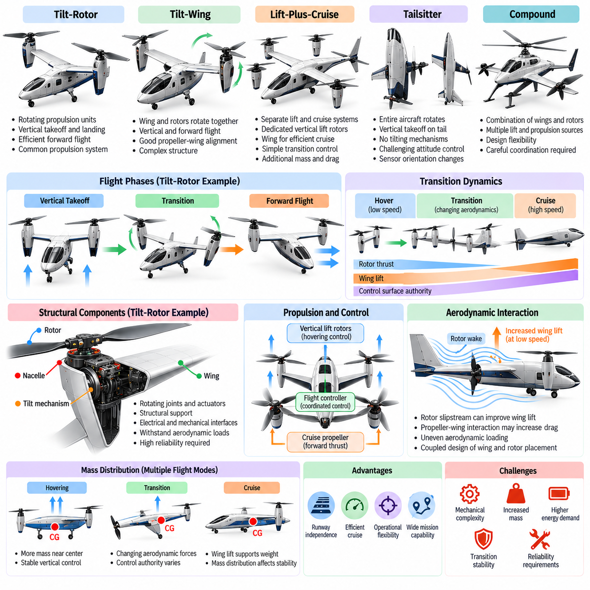{width="7.268055555555556in" height="7.268055555555556in"}

Vertical takeoff and landing (VTOL) morphology combines the ability to operate without conventional runways with the aerodynamic advantages of forward flight. Unlike purely fixed-wing or rotary-wing configurations, VTOL aircraft can use multiple lift-generation mechanisms across different flight phases. Their structural design must accommodate hovering, vertical transitions, and efficient cruising while maintaining stability, controllability, and acceptable energy consumption.

Hybrid aerial morphology emerges from the fundamental tradeoff between hovering capability and forward-flight efficiency. Multirotor platforms provide precise low-speed control but consume substantial power while supporting their weight. Fixed-wing aircraft achieve efficient cruising through aerodynamic lift but generally require forward airspeed. Hybrid VTOL architectures integrate these characteristics to support missions involving confined launch areas and extended travel distances.

VTOL architectures can be classified according to how they generate lift and redirect propulsion forces. Major configurations include tilt-rotor, tilt-wing, lift-plus-cruise, tailsitter, and compound aircraft designs. Each architecture uses a different combination of aerodynamic surfaces, propulsion units, and mechanical transformation mechanisms. These differences determine transition complexity, structural mass, control authority, and operational efficiency.

Tilt-rotor morphology employs propulsion units that rotate between vertical and horizontal orientations. During takeoff and hovering, the rotors direct thrust primarily upward to support the aircraft. As forward speed increases, the propulsion units gradually tilt toward the horizontal direction, allowing the wings to generate increasing aerodynamic lift. This arrangement enables a common propulsion system to support both vertical flight and efficient cruising.

The structural architecture of tilt-rotor aircraft requires carefully designed nacelles, rotating joints, support mechanisms, and propulsion interfaces. Tilt mechanisms must withstand aerodynamic loads, rotor thrust, vibration, and repeated operational cycles. Their placement influences wing bending, mass distribution, and rotational inertia. Mechanical reliability is especially important because actuator failures during transition can produce asymmetric thrust and destabilizing moments.

Tilt-wing morphology differs from tilt-rotor architecture by rotating the wing and its associated propulsion system together. During vertical flight, the wing approaches a near-vertical orientation, allowing rotor thrust to support the aircraft. During forward flight, the wing rotates toward a conventional lifting position. This configuration can maintain favorable propeller-wing alignment but introduces complex aerodynamic interactions and substantial structural requirements.

Lift-plus-cruise morphology separates vertical lift propulsion from forward-flight propulsion. Dedicated lifting rotors support takeoff, landing, and hovering, while separate cruise propellers provide forward thrust. Wings generate aerodynamic lift during efficient forward flight. This separation simplifies some aspects of propulsion control and transition management, but inactive lift motors and supporting structures create additional mass and aerodynamic drag during cruising.

Tailsitter architectures achieve vertical takeoff by orienting the entire aircraft vertically while resting on its tail or specialized landing supports. The vehicle transitions into horizontal flight by rotating its body through a large pitch angle. This approach can eliminate dedicated tilting propulsion mechanisms and separate lift systems. However, it introduces demanding attitude-control requirements, unusual landing geometry, and substantial changes in sensor orientation during transition.

Compound aerial configurations combine fixed wings, powered rotors, and supplementary propulsion mechanisms without necessarily relying on complete aircraft transformation. Some architectures use rotors for lift while additional propellers generate forward thrust. Others incorporate aerodynamic surfaces to reduce rotor loading during cruising. These arrangements provide design flexibility but require careful coordination between multiple lift and propulsion sources.

The transition between hovering and forward flight represents one of the most challenging aspects of hybrid VTOL morphology. During transition, aerodynamic lift, rotor thrust, drag, and control effectiveness change continuously. The aircraft may operate in conditions where neither hovering control assumptions nor conventional fixed-wing control models are fully applicable. Successful transition requires coordinated propulsion control, aerodynamic modeling, and stable attitude regulation.

Transition dynamics depend strongly on airspeed, wing loading, rotor orientation, and vehicle inertia. At low airspeeds, aerodynamic control surfaces may provide limited authority, requiring propulsion-based stabilization. As airspeed increases, wings and control surfaces become increasingly effective. The control system must manage this changing distribution of authority while maintaining sufficient lift and avoiding excessive pitch, roll, or yaw disturbances.

Morphological integration between wings and propulsion systems influences the efficiency of hybrid aerial robots. Rotor slipstreams can increase local airflow over wings, potentially improving lift at low forward speeds. However, propeller-wing interactions may also create uneven loading, additional drag, and complex aerodynamic moments. Wing placement, rotor spacing, and propulsion orientation must therefore be evaluated as coupled design variables rather than independent components.

Mass distribution is especially important in VTOL aircraft because different flight modes impose different balance requirements. The center of gravity must remain compatible with hovering thrust distribution and forward-flight aerodynamic stability. Batteries, payloads, motors, and transformation mechanisms influence these relationships. Poor placement can increase control effort during transition and reduce available stability margins across the operating envelope.

Hybrid VTOL structures experience loading conditions associated with both rotary-wing and fixed-wing operation. Hovering produces concentrated rotor thrust and vibration, while forward flight generates distributed aerodynamic loads across the wings. Transition introduces combinations of these forces, sometimes producing significant bending and torsional stresses. Structural design must accommodate repeated loading without excessive mass, deformation, or fatigue.

Energy efficiency varies considerably across flight modes. Hovering generally requires substantial power because propulsion systems must directly support the aircraft\'s weight. During efficient forward flight, wings generate lift and propulsion primarily compensates for aerodynamic drag. The overall mission efficiency therefore depends on the duration of hovering, transition losses, cruise speed, and aerodynamic performance. Morphological optimization must consider the complete mission profile.

Rotor and propeller selection introduces additional compromises in hybrid VTOL systems. Large propellers operating at low disk loading can improve hovering efficiency, while forward-flight propulsion may favor different blade geometry and operating speeds. Tilt-rotor systems must accommodate both regimes using shared propulsion hardware. Variable-pitch mechanisms and specialized propeller designs can improve adaptability but introduce mechanical complexity and additional maintenance requirements.

Control allocation becomes more complicated when aircraft possess multiple propulsion modes and aerodynamic control surfaces. During hovering, rotor thrust differences may dominate attitude regulation. During cruising, ailerons, elevators, rudders, or equivalent surfaces provide aerodynamic control. Transition requires blending these mechanisms according to airspeed, rotor orientation, and actuator effectiveness. Accurate allocation is essential for smooth motion and reliable flight-envelope management.

Fault tolerance in hybrid VTOL systems requires evaluating failures across different operating modes. A propulsion failure that can be compensated during forward flight may become critical during hovering. Tilt-actuator failures can restrict transition capability or create asymmetric forces. Reliable designs incorporate appropriate redundancy, fault detection, and emergency operating strategies. Safety evaluation must consider whether the aircraft can recover, continue flight, or land under degraded conditions.

VTOL morphology also influences payload integration and operational deployment. Hybrid aircraft may carry cameras, mapping sensors, communication equipment, or delivery payloads while operating from limited ground infrastructure. Payload placement must preserve aerodynamic balance and avoid interference with moving propulsion components. Landing gear, rotor clearance, sensor visibility, and maintenance accessibility become important considerations in practical system integration.

From a Physical AI perspective, hybrid VTOL morphology creates a flight system whose feasible actions change with its operating configuration. Intelligent planning must account for different dynamics during hovering, transition, and cruising. A trajectory that is efficient in fixed-wing mode may be infeasible during low-speed operation. Morphology-aware world models and controllers can represent these mode-dependent constraints to support safe and energy-efficient autonomous behavior.

Learning-based control can complement conventional aerodynamic models by estimating uncertain transition dynamics and adapting to environmental disturbances. Reinforcement learning, adaptive control, and model-predictive control may be combined to manage propulsion coordination and flight-mode transitions. However, learned policies must respect actuator limits, aerodynamic constraints, and safety requirements. Simulation and controlled flight testing remain essential for validating these capabilities.

Future VTOL and hybrid morphologies may incorporate distributed electric propulsion, morphing wings, reconfigurable rotors, and mechanically simplified transformation systems. These technologies could improve operational flexibility, propulsion efficiency, and adaptation to diverse missions. Their practical value depends on achieving favorable balances among weight, reliability, maintainability, and control complexity. VTOL morphology demonstrates how integrated physical design expands the capabilities of autonomous aerial intelligence.

## 08.05. Wing Fuselage and Propulsion Integration

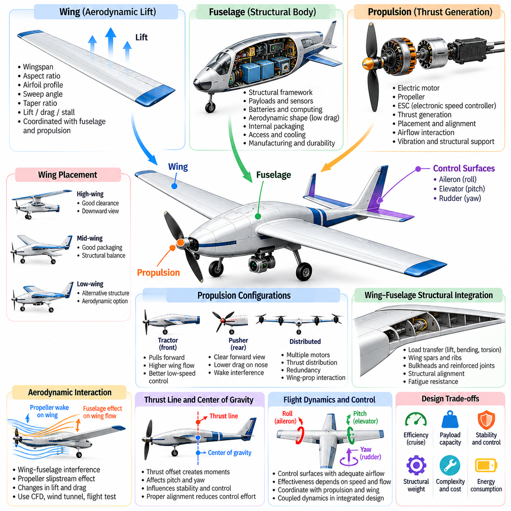{width="7.268055555555556in" height="7.268055555555556in"}

Wing, fuselage, and propulsion integration is a fundamental aspect of aerial robot morphology because these components jointly determine aerodynamic performance, structural efficiency, stability, and mission capability. Rather than functioning as independent subsystems, wings generate lift, the fuselage supports equipment and payloads, and propulsion systems provide the forces required for flight. Their geometric and functional relationships shape the overall behavior of autonomous aerial platforms.

The wing serves as the primary aerodynamic lifting surface in fixed-wing and many hybrid aerial robots. Its geometry influences lift generation, induced drag, stall behavior, and maneuverability. Wingspan, aspect ratio, sweep, taper, and airfoil selection must be coordinated with fuselage dimensions and propulsion placement. A configuration optimized for cruising efficiency may impose structural penalties or limit payload accommodation, requiring compromises across the complete vehicle design.

The fuselage provides the central structural framework connecting wings, propulsion units, control surfaces, sensors, and mission payloads. Its shape influences aerodynamic drag, internal packaging, and structural load transmission. Streamlined fuselages reduce resistance during forward flight, while wider bodies provide additional space for batteries and computing hardware. Designers must balance aerodynamic efficiency with accessibility, cooling, manufacturing requirements, and operational durability.

Wing-fuselage integration determines how aerodynamic loads are transferred into the aircraft structure. Lift generated across the wings produces bending and torsional forces that must pass through attachment points and internal support members. Wing spars, ribs, bulkheads, and reinforced joints distribute these loads while maintaining structural alignment. Poor integration can increase weight, produce local stress concentrations, and reduce fatigue life under repeated flight cycles.

Wing placement relative to the fuselage influences stability, ground clearance, payload visibility, and aerodynamic interaction. High-wing configurations can provide useful ground clearance and unobstructed downward observation, while low-wing arrangements may support alternative structural and aerodynamic priorities. Mid-wing configurations offer additional packaging possibilities but can complicate internal structural continuity. The preferred arrangement depends on mission and manufacturing constraints.

Propulsion integration determines how thrust is generated, transmitted, and aligned with the aircraft\'s aerodynamic forces. Propellers may be mounted ahead of the wings, behind the fuselage, or on distributed propulsion supports. Each placement creates different interactions with airflow, structural vibration, and control surfaces. The propulsion system must be positioned to provide sufficient thrust while minimizing undesirable moments, aerodynamic losses, and mechanical interference.

Tractor propulsion configurations position propellers ahead of the aircraft or lifting surfaces, pulling the vehicle forward through the surrounding air. The propeller slipstream can increase airflow over nearby wings or control surfaces, potentially improving low-speed effectiveness. However, this interaction may introduce nonuniform aerodynamic loading and additional vibration. Propeller placement must therefore account for local airflow patterns and structural attachment requirements.

Pusher propulsion configurations position propellers behind the fuselage or lifting surfaces, generating forward thrust from the rear. This arrangement can improve forward sensor visibility and reduce obstruction of cameras or other payloads. However, propellers may operate in disturbed airflow created by upstream structures, potentially reducing efficiency and increasing noise. Designers must consider wake interaction, cooling airflow, and safe access to rotating components.

Distributed propulsion architectures integrate multiple motors and propellers along wings or other structural members. This arrangement can improve thrust distribution, provide additional control authority, and enable propulsion redundancy. Propeller slipstreams may also modify wing lift and stall behavior. Nevertheless, distributed systems introduce challenges involving electrical wiring, structural reinforcement, aerodynamic interference, and coordinated control across multiple propulsion units.

The relative position of the propulsion thrust line and center of gravity strongly influences aircraft dynamics. When thrust acts away from the center of gravity, changes in propulsion force can generate pitching or yawing moments. These effects may be useful for control but can also create unwanted coupling between speed regulation and attitude stability. Proper alignment reduces unnecessary control effort and improves predictable behavior across operating conditions.

Aerodynamic interference between wings, fuselage, and propulsion components is an important consideration in integrated design. The fuselage can alter airflow near wing roots, while propeller wakes may change local pressure distributions and boundary-layer behavior. These interactions influence lift, drag, and control effectiveness. Computational fluid dynamics, wind-tunnel testing, and flight experiments can help identify configurations that minimize adverse interference.

The integration of aerodynamic control surfaces must be coordinated with wing geometry and propulsion placement. Ailerons, elevators, rudders, and alternative control devices require suitable airflow and structural support. Propeller slipstreams may improve control effectiveness at low speeds but can also produce asymmetric forces. Control-surface placement must therefore consider the complete airflow environment rather than relying exclusively on isolated aerodynamic assumptions.

Structural integration becomes more demanding when propulsion units are mounted directly on wings. Motor thrust, reaction torque, vibration, and inertial loads must be transmitted through wing structures without excessive deformation. Reinforced mounting points and carefully designed load paths help preserve alignment and fatigue resistance. Additional propulsion hardware increases wing mass and may change aeroelastic behavior, requiring evaluation of bending, torsion, and vibration characteristics.

Mass distribution across the integrated airframe affects the center of gravity and moments of inertia. Batteries, motors, payloads, and computing systems must be positioned to maintain suitable longitudinal and lateral balance. Concentrating mass near the center can reduce rotational inertia, while distributed components may improve packaging or structural integration. These decisions influence stability, maneuverability, energy consumption, and controller performance.

Thermal management is another essential aspect of propulsion and fuselage integration. Motors, electronic speed controllers, batteries, and onboard processors generate heat during operation. Airflow through ducts, vents, and internal passages can support cooling, but openings may increase drag or weaken structural surfaces. Designers must balance heat dissipation, environmental protection, aerodynamic performance, and maintenance accessibility across expected operating conditions.

Vibration and acoustic behavior depend strongly on how propulsion systems connect to the airframe. Rotating propellers and electric motors generate periodic forces that can excite structural resonances. These vibrations may degrade camera images, inertial measurements, and component durability. Appropriate mounting stiffness, dynamic balancing, and vibration isolation help protect sensitive equipment while preserving structural integrity and flight-control responsiveness.

Payload integration must be considered from the earliest stages of wing, fuselage, and propulsion design. Cameras, communication antennas, navigation sensors, and delivery mechanisms require appropriate mounting locations and unobstructed operating regions. Payload placement can affect aerodynamic drag, center-of-gravity position, and structural loading. Effective integration minimizes interference while preserving the sensing and interaction capabilities required for autonomous missions.

Manufacturing and maintenance considerations also influence integrated aerial morphology. Modular wings, removable propulsion units, and accessible fuselage compartments can simplify assembly, inspection, and repair. Highly integrated structures may reduce mass and aerodynamic drag but increase replacement complexity. The optimal design balances production cost, structural performance, serviceability, and expected operational lifetime rather than maximizing a single performance parameter.

Hybrid VTOL aircraft introduce additional integration challenges because wings, fuselage, and propulsion systems must operate across hovering, transition, and cruising conditions. Tilt mechanisms, lifting rotors, and aerodynamic surfaces experience changing forces as flight modes evolve. Propulsion placement must preserve control authority during transition without imposing excessive cruise drag. These requirements demand coordinated aerodynamic, structural, and control-system optimization.

From a Physical AI perspective, integrated airframe morphology defines the physical capabilities available to autonomous planning and control. Wing geometry determines efficient flight regimes, propulsion placement influences maneuvering forces, and fuselage architecture constrains sensing and payload interaction. Morphology-aware controllers can incorporate these characteristics into trajectory optimization, disturbance rejection, and energy management, enabling decisions that reflect the aircraft\'s actual physical behavior.

Future aerial robots may employ blended wing-body structures, embedded propulsion, adaptive aerodynamic surfaces, and distributed electric propulsion to achieve tighter functional integration. These technologies can reduce drag, expand control possibilities, and improve mission adaptability, but may introduce new structural and reliability challenges. Successful wing, fuselage, and propulsion integration ultimately requires simultaneous optimization of aerodynamics, mechanics, energy, sensing, and intelligent control.

## 08.06. Distributed Electric Propulsion

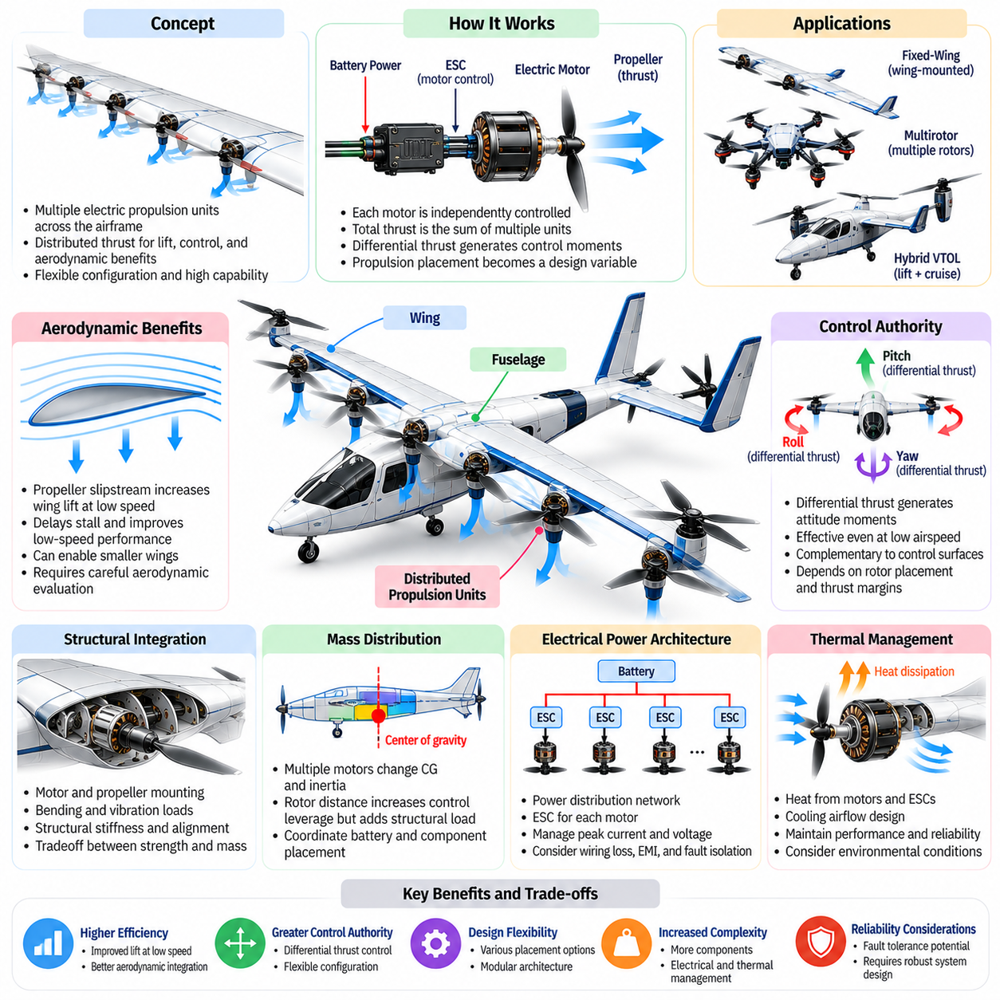{width="7.268055555555556in" height="7.268055555555556in"}

Distributed electric propulsion represents an aerial robot architecture in which multiple electrically driven propulsion units are positioned across the airframe rather than concentrated in a single propulsion location. This approach enables propulsion forces to be distributed according to aerodynamic, structural, and control requirements. By integrating motors, propellers, power electronics, and supporting structures, distributed propulsion can improve design flexibility and expand the capabilities of autonomous aerial platforms.

The fundamental principle of distributed electric propulsion is to divide the required thrust among several independently controlled electric motors. Each propulsion unit contributes to total thrust while potentially influencing vehicle attitude and local airflow. The arrangement of these units determines thrust distribution, control authority, and aerodynamic interaction. Unlike centralized propulsion systems, distributed architectures allow propulsion placement to become an active variable in aircraft morphology.

Distributed propulsion can be implemented in fixed-wing aircraft, multirotor platforms, and hybrid vertical takeoff and landing systems. Fixed-wing designs may position multiple propellers along the wings to improve aerodynamic integration. Multirotors distribute lifting thrust across several rotors, while hybrid VTOL aircraft combine vertical lifting units with forward propulsion. Although these configurations differ, they share the principle of coordinating multiple electric propulsion sources.

Electric motors provide important advantages for distributed propulsion because they can be compact, independently controlled, and mechanically integrated into different airframe locations. Their rotational speed and torque can be regulated electronically without extensive mechanical transmission systems. This flexibility supports modular propulsion arrangements and rapid control responses. However, electrical distribution, thermal management, and motor reliability become increasingly important as propulsion units multiply.

Propeller placement strongly influences the aerodynamic performance of distributed propulsion systems. Propellers positioned ahead of wings can accelerate airflow over lifting surfaces, increasing local dynamic pressure and potentially improving lift at low speeds. This effect is particularly useful during takeoff and slow flight. However, the benefits depend on propeller diameter, rotational speed, wing geometry, and spacing, while nonuniform airflow can introduce additional aerodynamic complexity.

The interaction between propeller slipstreams and wing surfaces is a defining feature of many distributed propulsion architectures. Accelerated airflow can modify lift distribution, boundary-layer behavior, and stall characteristics. Carefully designed configurations may improve low-speed aerodynamic performance or enable smaller lifting surfaces. Nevertheless, slipstream interference can also generate asymmetric loads, increased drag, and complex control responses that require detailed aerodynamic evaluation.

Distributed electric propulsion can provide additional control authority through differential thrust. By commanding different thrust levels across propulsion units, the aircraft can generate roll, pitch, or yaw moments without relying exclusively on conventional aerodynamic control surfaces. This capability is particularly valuable at low airspeeds, when aerodynamic surfaces may be less effective. The available control authority depends on propulsion geometry, thrust margins, and actuator response.

Control allocation is essential for coordinating multiple propulsion units. The flight controller converts desired forces and moments into individual motor commands while respecting actuator limits and system constraints. Symmetric propulsion arrangements can simplify this process, whereas asymmetric configurations require more general allocation models. Accurate thrust estimation and motor characterization help maintain stability, distribute control effort, and prevent actuator saturation during demanding maneuvers.

Structural integration introduces important tradeoffs in distributed propulsion design. Motors and propellers mounted along wings or supporting arms create concentrated loads, bending moments, and vibration sources. Their mounting locations must preserve structural stiffness and alignment under dynamic operating conditions. Additional reinforcement increases mass, potentially reducing aerodynamic and energy benefits. Effective design therefore requires simultaneous optimization of propulsion placement and structural load paths.

Mass distribution is another fundamental consideration because distributed motors and power electronics alter the aircraft\'s center of gravity and moments of inertia. Positioning propulsion units farther from the center can improve rotational control leverage but increase structural loading and rotational inertia. Batteries and electrical distribution equipment must be arranged to maintain suitable balance. These relationships influence maneuverability, stability, and overall energy consumption.

The electrical power architecture must supply multiple propulsion units reliably across different operating conditions. Batteries, power-distribution networks, electronic speed controllers, and protection circuits must accommodate peak current demand and voltage variation. Wiring length and conductor size influence electrical losses and mass. Distributed systems therefore require careful consideration of power routing, electromagnetic interference, fault isolation, and maintenance accessibility.

Thermal management becomes more complex when motors and power electronics are distributed throughout the airframe. Each propulsion unit generates heat that must be removed without compromising aerodynamic efficiency or structural integrity. External airflow can support cooling, but enclosed motor housings and compact wing installations may restrict heat dissipation. Thermal sensors, appropriate material selection, and effective cooling paths help prevent overheating during sustained operation.

Energy efficiency is a major objective of distributed electric propulsion, but additional propulsion units do not automatically reduce power consumption. Potential benefits arise from improved propeller operating conditions, aerodynamic integration, and more favorable thrust distribution. These gains must exceed losses associated with additional hardware, electrical resistance, aerodynamic interference, and structural mass. Efficiency must therefore be evaluated across the complete mission profile.

Propeller size and operating speed influence the balance between propulsion efficiency and vehicle packaging. Larger propellers can reduce disk loading and induced power requirements, but require additional spacing and structural clearance. Smaller propellers can be integrated more densely along wings or supporting structures, although they may operate at higher rotational speeds. Rotor spacing must also account for aerodynamic interaction, vibration, noise, and safety requirements.

Distributed propulsion architectures can improve fault tolerance by providing multiple sources of thrust. Under suitable conditions, remaining propulsion units may compensate for a failed motor or propeller. However, redundancy does not guarantee continued controlled flight because failures can create asymmetric forces and reduce total thrust capacity. Fault tolerance depends on propulsion geometry, available control authority, power-system independence, and the ability to detect and isolate failures.

Reliability engineering must consider common-cause failures that can affect multiple propulsion units simultaneously. A shared battery, power-distribution component, or flight-control computer may create vulnerabilities despite having numerous motors. Electrical protection, independent power channels, fault monitoring, and appropriate redundancy can reduce these risks. The architecture must be evaluated as an integrated system rather than assuming that increasing motor count automatically improves safety.

Distributed propulsion is particularly relevant to hybrid VTOL aircraft because different propulsion units may serve different flight phases. Dedicated lift motors can support hovering and vertical takeoff, while separate cruise propellers provide efficient forward thrust. Other architectures use tiltable propulsion units to perform both functions. The choice influences transition dynamics, structural complexity, energy consumption, and the control strategies required to coordinate propulsion modes.

The integration of distributed propulsion with sensing and onboard computing introduces additional considerations. Motor vibration, electromagnetic interference, and propeller slipstreams can affect cameras, inertial sensors, communication equipment, and environmental measurements. Sensor placement must minimize these disturbances while preserving useful fields of view. Physical separation, shielding, vibration isolation, and coordinated component placement improve the reliability of autonomous perception.

From a Physical AI perspective, distributed electric propulsion expands the relationship between morphology and intelligent control. Multiple independently controlled propulsion units provide a richer set of possible force distributions and maneuvering strategies. Autonomous systems can exploit these capabilities for trajectory optimization, disturbance rejection, and adaptive flight control. However, intelligent policies must respect electrical limits, aerodynamic coupling, structural constraints, and available energy.

Morphology-aware learning and optimization can jointly determine propulsion placement, motor characteristics, and control strategies. Simulation-based design may evaluate different rotor counts, wing arrangements, and thrust-allocation policies under representative mission conditions. Learning-based controllers can adapt to uncertain aerodynamic interactions and actuator variations. Such approaches require careful validation because inaccurate models or unsafe exploration can compromise flight stability.

Future distributed electric propulsion systems may incorporate embedded motors, adaptive propellers, modular propulsion arrays, and reconfigurable airframes. Advances in electric machines, batteries, power electronics, and control algorithms could improve power density and system integration. Nevertheless, practical deployment will depend on balancing efficiency, reliability, structural complexity, and maintainability. Distributed electric propulsion illustrates how coordinated physical design and intelligent control can expand aerial robot capabilities.

## 08.07. Center of Gravity and Payload Placement

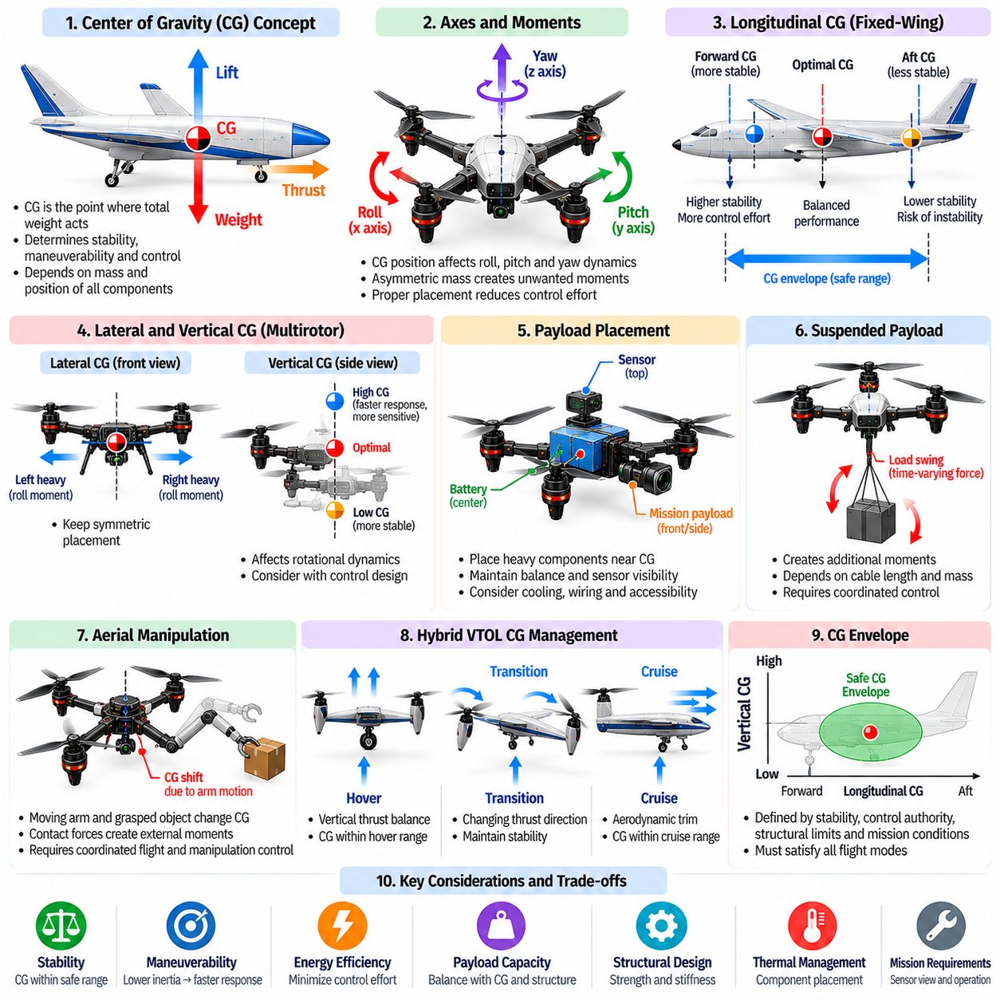{width="7.268055555555556in" height="7.268055555555556in"}

The center of gravity is a fundamental parameter in aerial robot morphology because it determines how gravitational forces interact with aerodynamic lift, propulsion thrust, and control moments. Its position influences stability, maneuverability, energy consumption, and flight safety. Payload placement must therefore be considered as part of the complete airframe architecture rather than as an independent packaging decision made after the aircraft structure has been finalized.

The center of gravity represents the effective location at which the vehicle\'s total weight acts. It depends on the masses and positions of structural components, propulsion units, batteries, sensors, computing hardware, and mission payloads. Changes in any component can shift this location and alter the aircraft\'s dynamic behavior. Accurate mass-property estimation is essential during preliminary design, system integration, and operational configuration changes.

In fixed-wing aircraft, longitudinal center-of-gravity position strongly influences pitch stability and aerodynamic trim. Its relationship to the aerodynamic center and neutral point determines the static stability margin. A forward center of gravity generally increases longitudinal stability but may require greater balancing forces and control effort. An excessively rearward position can reduce stability and create difficult or potentially unrecoverable flight characteristics.

The lateral center-of-gravity position is also important because asymmetric mass distribution can introduce rolling moments and uneven aerodynamic loading. Batteries, sensors, or payloads mounted away from the aircraft centerline may require compensating control inputs. Such imbalances can increase drag and reduce available control authority. Symmetric placement is generally preferred unless mission requirements justify an intentional offset and the resulting effects are properly managed.

For multirotor aircraft, the relationship between the center of gravity and the effective thrust center is particularly important. When the combined rotor thrust acts through the center of gravity, hovering can be maintained with balanced propulsion commands. An offset produces moments that require continuous differential thrust for compensation. This additional control demand can reduce actuator margins, increase energy consumption, and limit maneuverability.

Vertical center-of-gravity placement influences the rotational dynamics and disturbance response of aerial robots. Positioning heavy components above or below the rotor plane changes the relationship between translational acceleration and rotational motion. The effects depend on the vehicle\'s control architecture and operating conditions rather than a universal preference for a low center of gravity. Designers must evaluate these relationships using complete dynamic models.

Payload placement affects not only the center of gravity but also the moments of inertia around the roll, pitch, and yaw axes. Components located far from the vehicle\'s mass center increase rotational inertia, potentially reducing angular acceleration and control responsiveness. Concentrating heavy components near the center can improve agility, although packaging, cooling, and sensor visibility may impose competing requirements.

Batteries are among the most influential components in electric aerial robots because they often represent a substantial fraction of total vehicle mass. Their location can be used to balance motors, payloads, and structural elements. Adjustable battery mounts may help accommodate different mission configurations. However, battery placement must also account for thermal management, structural protection, electrical routing, accessibility, and crash safety.

Mission payloads introduce additional design complexity because their mass, dimensions, and mounting positions vary across applications. Cameras, mapping sensors, communication equipment, delivery packages, and scientific instruments may require different orientations and fields of view. Their placement must preserve flight stability while supporting operational functionality. Payload integration therefore requires coordinated mechanical, aerodynamic, electrical, and control-system design.

Suspended payloads create distinctive dynamic challenges for multirotor and cargo aircraft. A load hanging beneath the vehicle can swing during acceleration, deceleration, or wind disturbances. This motion introduces time-varying forces and moments that interact with the flight controller. Cable length, payload mass, attachment geometry, and damping characteristics influence the resulting dynamics and must be considered during trajectory planning.

Aerial manipulation introduces additional center-of-gravity challenges because robotic arms and grasped objects move relative to the airframe. Extending an arm or lifting an object can shift the combined center of mass and modify rotational inertia. Contact forces may also create external moments that disturb flight. Coordinated manipulation and flight control must account for these changing mass properties and interaction forces to maintain stable operation.

Hybrid VTOL aircraft require center-of-gravity management across hovering, transition, and forward-flight modes. A configuration that is well balanced for vertical thrust may not provide suitable aerodynamic trim during cruising. Tilting propulsion units and movable components can further change mass distribution and force alignment. The allowable center-of-gravity envelope must therefore satisfy stability and control requirements throughout all intended flight modes.

The center-of-gravity envelope defines the range of mass-center positions within which the aircraft can operate safely under specified conditions. Its limits depend on aerodynamic stability, actuator authority, structural loading, and control-system capability. Payload configurations must remain within these limits across expected operating conditions. Design verification should include maximum payload, minimum payload, asymmetric loading, and other representative mass distributions.

Payload mounting structures must transmit inertial and operational loads into the airframe without excessive deformation. Attachment points experience forces during acceleration, landing, turbulence, and emergency maneuvers. Reinforced brackets, load-bearing frames, and appropriate fastening systems help preserve structural integrity. Mounting design must also consider vibration isolation, fatigue resistance, maintainability, and protection of sensitive equipment.

Aerodynamic effects become important when payloads are mounted externally. Large or irregular objects can increase drag, disturb airflow, and introduce additional pitching or yawing moments. Payload placement may also interfere with propeller slipstreams, wing surfaces, or control devices. Streamlined enclosures and careful positioning can reduce these effects, although aerodynamic improvements must be balanced against mass and accessibility.

Payload release and acquisition can produce sudden changes in mass distribution and vehicle dynamics. Delivery aircraft may experience a rapid center-of-gravity shift after releasing cargo, while aerial manipulators encounter similar changes when grasping objects. Controllers must anticipate changes in total weight, inertia, and required thrust. Smooth transition strategies and accurate payload-state estimation help prevent instability during these events.

Center-of-gravity estimation can combine design calculations with measurements and onboard sensing. Component masses and locations provide an initial estimate, while weighing procedures and balance tests help validate the assembled aircraft. During operation, state estimators may infer mass-property changes from actuator commands and measured motion. Such methods require appropriate excitation, reliable sensors, and careful treatment of aerodynamic uncertainty.

Control systems can compensate for moderate center-of-gravity offsets through trim adjustments, differential thrust, and feedback stabilization. However, compensation consumes control authority and cannot overcome every mechanical limitation. Large offsets may cause actuator saturation, excessive structural loading, or unstable behavior. Physical mass balancing should therefore remain a primary design objective rather than relying entirely on software correction.

Energy efficiency is closely related to payload mass and placement. Additional mass increases the lift or thrust required to maintain flight, while poor balance may demand continuous corrective control. In fixed-wing aircraft, unfavorable center-of-gravity positions can increase trim drag. In multirotors, persistent thrust asymmetry can reduce propulsion efficiency. Optimizing payload location can therefore improve endurance without changing battery capacity.

From a Physical AI perspective, payload placement defines important constraints on the actions an aerial robot can safely perform. Intelligent planners must account for mass distribution, actuator limits, and changing dynamics when selecting trajectories or manipulation strategies. A maneuver that is feasible with an empty vehicle may become unsafe with a heavy or displaced payload. Morphology-aware planning connects physical configuration directly to autonomous decision-making.

Future aerial robots may incorporate adjustable battery positions, movable payload mounts, active mass-balancing mechanisms, and online mass-property estimation. These technologies could allow vehicles to adapt their physical configuration to changing mission demands. Their benefits must be evaluated against added weight, complexity, and reliability requirements. Effective center-of-gravity and payload management ultimately depends on integrating morphology, structural design, sensing, and intelligent control.

## 08.08. Hover Maneuverability and Range Tradeoffs

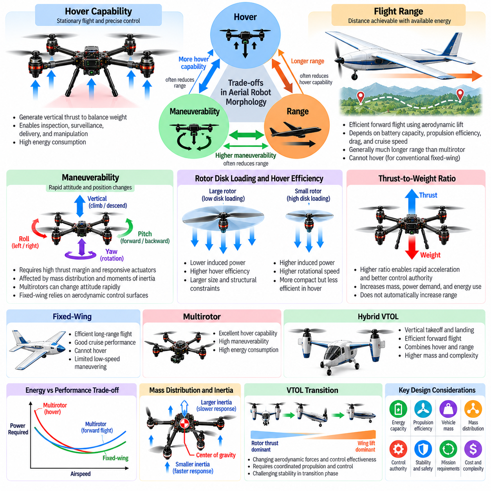{width="7.268055555555556in" height="7.268055555555556in"}

Hover capability, maneuverability, and flight range represent three closely related performance objectives in aerial robot morphology. Hovering enables stationary operation and precise interaction with the environment, maneuverability determines how rapidly the vehicle can change its motion, and range defines the distance achievable with available energy. These objectives compete for propulsion capacity, structural mass, and aerodynamic efficiency, making their balance a central challenge in aerial robot design.

Hovering requires the propulsion system to generate sufficient upward force to balance the aircraft\'s weight without relying on sustained forward motion. Multirotor aircraft achieve this through vertically oriented rotors, while hybrid VTOL platforms may employ dedicated lift propellers or tilting propulsion units. The ability to remain stationary supports inspection, surveillance, delivery, and aerial manipulation, but continuous powered lift can impose substantial energy demands.

Hover efficiency depends strongly on rotor disk loading, defined as the supported weight divided by the total effective rotor disk area. Lower disk loading generally reduces the ideal induced power required to generate lift, improving hover endurance. Larger rotor disks can therefore offer advantages for stationary flight. However, increased rotor dimensions introduce structural, packaging, and safety constraints that may conflict with compactness and maneuverability.

Rotor diameter, blade geometry, and rotational speed influence the relationship between thrust generation and energy consumption. Large, slowly rotating propellers can achieve favorable hover efficiency under appropriate operating conditions, while smaller propellers often require higher rotational speeds. These choices also affect noise, vibration, and motor requirements. Propulsion optimization must consider actual operating conditions rather than assuming that a particular rotor size is universally superior.

Maneuverability describes the aircraft\'s ability to accelerate, decelerate, rotate, and change direction while maintaining controlled flight. High maneuverability requires sufficient thrust margins, responsive actuators, and favorable mass distribution. Multirotors can produce rapid attitude changes through differential rotor thrust, whereas fixed-wing aircraft rely primarily on aerodynamic control surfaces. The achievable response depends on propulsion dynamics, inertia, and aerodynamic forces.

The thrust-to-weight ratio is an important indicator of acceleration capability and available control authority. A vehicle with substantial excess thrust can climb rapidly and respond more effectively to disturbances. However, larger propulsion systems increase mass, electrical demand, and potentially aerodynamic drag. High thrust capability does not necessarily produce greater endurance or range, particularly when additional hardware reduces the fraction of total mass available for energy storage.

Moments of inertia strongly influence rotational maneuverability. Concentrating heavy components near the center of gravity generally reduces rotational inertia and allows faster angular acceleration for a given control moment. Conversely, motors, batteries, and payloads positioned farther from the center can increase inertia and slow attitude responses. Morphological optimization must balance rotational agility against structural requirements, propulsion geometry, and payload accessibility.

Flight range depends on the energy available onboard and the efficiency with which that energy is converted into useful travel. For electric aircraft, battery capacity, propulsion efficiency, aerodynamic drag, and cruise speed are major determining factors. Additional battery capacity can increase stored energy but also raises vehicle mass. Consequently, range does not necessarily increase proportionally with battery size, and an optimal configuration depends on the complete mission profile.

Fixed-wing aircraft generally achieve favorable range because aerodynamic wings provide lift during forward flight without requiring propulsion to support the entire weight directly. Propulsion power primarily compensates for drag and maintains the desired flight condition. This arrangement can provide efficient long-distance transportation, but conventional fixed-wing aircraft cannot hover. Their limited low-speed operation creates constraints for missions requiring stationary observation or precise vertical positioning.

Multirotor aircraft provide exceptional hovering capability and flexible low-speed maneuvering but typically face greater energy limitations during sustained flight. Their rotors must continuously generate lift, including during stationary operation. Forward flight may improve or reduce power efficiency depending on speed and configuration, but aerodynamic drag becomes increasingly significant at higher velocities. These characteristics generally favor short-range missions requiring precise spatial control.

Hybrid VTOL aircraft attempt to combine efficient wing-supported cruising with vertical takeoff, landing, and hovering. During cruise, aerodynamic lift can reduce the power required from dedicated lifting propulsion. However, lift rotors, tilt mechanisms, and structural reinforcements add mass and complexity. Some propulsion components may become inactive during portions of flight, reducing overall efficiency. Hybrid morphology therefore requires careful evaluation of mission-specific benefits.

The transition between hovering and forward flight introduces additional aerodynamic and control challenges. As airspeed increases, lift progressively shifts from powered rotors toward aerodynamic wings in suitable hybrid configurations. Propulsion commands and control-surface effectiveness must be coordinated throughout this process. Poorly designed transition behavior can increase energy consumption, reduce stability margins, and limit the practical advantages of hybrid flight architectures.

Cruise speed creates an important tradeoff between flight duration and distance traveled. Flying slowly may reduce some aerodynamic losses but increase the time required to complete a mission. Flying faster reduces travel time while potentially increasing drag and propulsion power. The speed that maximizes endurance is not necessarily the speed that maximizes range. Mission planning must distinguish between minimizing energy consumption per unit time and minimizing energy consumption per unit distance.

Aerodynamic drag becomes increasingly important as forward speed rises. Fuselage shape, exposed propulsion components, landing structures, and external payloads contribute to resistance. Streamlined configurations can improve range by reducing the thrust required during cruise. However, highly streamlined structures may restrict rotor placement, payload access, or hovering functionality. Designers must therefore balance cruise efficiency with the geometric requirements of vertical flight.

Payload mass creates direct tradeoffs among hover performance, maneuverability, and range. Heavier payloads increase the lift required during hovering and may reduce the thrust margin available for acceleration. Additional weight also increases energy consumption and can alter the optimal cruising condition. Payload placement affects rotational inertia and stability. Consequently, mission capability must be evaluated using realistic payload configurations rather than unloaded vehicle performance alone.

Environmental conditions further influence the balance among these objectives. Wind can increase the energy required for position holding and change the effective ground range during travel. Air density affects rotor thrust generation and aerodynamic lift, while temperature influences battery performance and cooling requirements. Turbulence introduces disturbances that demand additional control activity. Robust morphology must accommodate expected operating environments rather than relying exclusively on ideal conditions.

Battery technology places fundamental constraints on electric aerial robot performance. Energy density influences achievable endurance and range, while power density determines the ability to supply high current during aggressive maneuvers. A battery optimized for energy storage may not provide the discharge characteristics required for extreme thrust demands. Thermal limits, degradation, and reserve-energy requirements further constrain usable capacity, creating additional design tradeoffs.

Mission profiles determine which performance objective should receive priority. Infrastructure inspection may require stable hovering and precise positioning, while mapping missions may emphasize efficient forward travel and wide-area coverage. Emergency response can demand rapid acceleration and strong disturbance rejection. Cargo transportation requires balancing payload capacity with operational range. A morphology optimized for one mission may perform poorly when evaluated against another mission\'s requirements.

Multiobjective optimization provides a systematic framework for evaluating these competing requirements. Designers can compare candidate morphologies using hover endurance, maximum acceleration, achievable range, payload capacity, structural mass, and energy consumption. Pareto-optimal configurations represent designs in which improving one objective generally requires sacrificing another. This approach helps identify mission-appropriate compromises without assuming that a single aerial morphology is universally optimal.

From a Physical AI perspective, hover, maneuverability, and range constraints must be incorporated into autonomous planning and control. An intelligent aircraft should select trajectories and flight modes according to available energy, payload conditions, environmental disturbances, and mission priorities. Morphology-aware control can exploit efficient operating regions while preserving thrust margins and stability. Such integration connects physical design directly to adaptive mission execution.

Future aerial robots may use variable-pitch propellers, adaptive wings, reconfigurable propulsion systems, and improved energy management to modify performance across different flight conditions. Learning-based optimization may further improve trajectory selection and propulsion coordination. Nevertheless, fundamental aerodynamic and energy constraints remain unavoidable. Effective aerial morphology requires balancing stationary flight, dynamic maneuvering, and long-distance mobility through integrated mechanical and intelligent system design.

## 08.09. Cargo and Heavy Lift Aerial Morphology

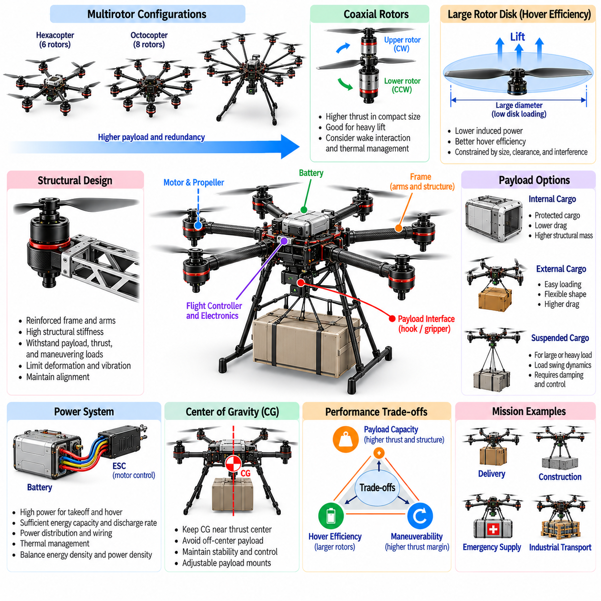{width="7.268055555555556in" height="7.268055555555556in"}

Cargo and heavy-lift aerial morphology focuses on aircraft configurations designed to transport substantial payloads while maintaining stability, efficiency, and operational safety. Unlike lightweight aerial robots optimized primarily for sensing or maneuverability, cargo platforms must accommodate greater structural loads and propulsion demands. Their morphology integrates lifting systems, load-bearing structures, energy storage, and payload interfaces into a coordinated transportation architecture.

Payload capacity is a primary design parameter because it determines the minimum lifting force and structural strength required for flight. The maximum takeoff mass includes the airframe, propulsion system, energy storage, avionics, and transported cargo. Increasing payload capacity generally requires additional thrust and stronger structures, which also increase vehicle mass. Successful designs balance useful payload fraction against the weight of supporting systems.

Heavy-lift multirotors commonly employ six, eight, or more propulsion units to distribute lifting forces across the airframe. Hexacopter and octocopter arrangements can provide substantial thrust and additional control options. However, rotor count alone does not determine lifting capacity or fault tolerance. Motor performance, rotor dimensions, structural geometry, power availability, and control allocation collectively determine the aircraft\'s practical operating limits.

Rotor disk area strongly influences the efficiency of heavy-lift hovering. Larger effective disk areas generally reduce disk loading and the ideal induced power required to support a given weight. This makes large-diameter propellers attractive for cargo aircraft operating at low speeds. Nevertheless, rotor spacing, structural clearance, ground handling, and transportation requirements constrain maximum rotor dimensions. Aerodynamic interference between neighboring rotors must also be evaluated.

Coaxial rotor configurations place two propellers along a common rotational axis, allowing greater propulsion density within a limited footprint. Such arrangements can increase total thrust capacity without proportionally expanding the aircraft\'s horizontal dimensions. However, interactions between upper and lower rotor wakes can reduce aerodynamic efficiency. Coaxial propulsion therefore requires careful consideration of rotor separation, rotational direction, thrust distribution, and thermal management.

The airframe must transmit payload weight, rotor thrust, and maneuvering loads through structurally efficient load paths. Heavy-lift platforms often use reinforced central frames, tubular arms, truss structures, or composite load-bearing members. Structural stiffness is essential for maintaining propulsion alignment and limiting deformation. Designers must account for static loads, dynamic acceleration, landing impacts, fatigue, and vibration without allowing structural reinforcement to consume excessive payload capacity.

Payload placement is particularly important because cargo can represent a large fraction of the aircraft\'s total mass. Ideally, the combined center of gravity remains close to the effective thrust center throughout operation. Off-center cargo produces moments that require continuous control compensation and may reduce available thrust margins. Adjustable mounting structures and standardized cargo interfaces can help accommodate different loads while preserving balance.

Internal cargo compartments protect transported goods from environmental exposure and can reduce aerodynamic drag during forward flight. However, enclosed compartments increase fuselage volume, structural mass, and packaging complexity. External cargo mounts simplify loading and accommodate irregular objects but may increase drag and alter stability. The preferred configuration depends on cargo dimensions, handling requirements, environmental conditions, and the intended flight profile.

Suspended cargo introduces additional dynamic behavior because the load can swing relative to the aircraft. Acceleration, braking, turning, and wind disturbances may excite pendulum-like motion that interacts with vehicle attitude control. Cable length, suspension geometry, payload inertia, and damping influence these oscillations. Flight controllers and trajectory planners must account for suspended-load dynamics to reduce instability and prevent excessive structural loading.

Cargo attachment and release mechanisms must provide reliable mechanical engagement while supporting safe loading and unloading. Hooks, grippers, locking fixtures, and automated release devices require sufficient strength and predictable actuation. The release of heavy cargo can abruptly change total mass and center-of-gravity position. Control systems must anticipate these transitions and adjust propulsion commands to maintain stable flight before, during, and after payload transfer.

Distributed electric propulsion provides architectural flexibility for heavy-lift aircraft by allowing multiple motors to share lifting requirements. Independent propulsion units can support differential thrust control and potentially improve resilience to selected failures. However, electrical wiring, power electronics, and structural supports increase system complexity. Redundancy must be assessed against actual failure scenarios rather than assuming that additional motors guarantee continued flight.

Power-system design is a major constraint because heavy-lift operations demand high electrical power during takeoff, climbing, and hovering. Batteries must provide adequate energy capacity and discharge capability without excessive mass. High-current distribution requires appropriate conductors, connectors, protection devices, and thermal management. The balance between energy density and power density strongly influences achievable payload capacity, endurance, and mission reliability.

Hybrid-electric and fuel-powered propulsion may be considered when battery-only systems cannot meet required payload and range objectives. Hybrid architectures can combine electrical control flexibility with energy sources offering different storage characteristics. However, generators, engines, fuel systems, and mechanical components introduce mass, vibration, maintenance requirements, and operational complexity. Their advantages depend on mission duration, payload demand, and total system efficiency.

Wing-supported cargo aircraft can transport heavy loads over longer distances more efficiently than hovering platforms under suitable flight conditions. Fixed-wing configurations generate aerodynamic lift during cruise, reducing the propulsion power needed to sustain flight. However, they require suitable takeoff and landing arrangements. Hybrid VTOL cargo aircraft seek to combine runway independence with efficient cruising, although vertical-lift hardware imposes additional mass and drag penalties.

Landing gear and ground interfaces are essential elements of cargo morphology. Heavy aircraft require structures capable of absorbing landing impacts while maintaining clearance for payloads, propellers, and loading equipment. Wide landing-gear geometry can improve ground stability, particularly during cargo handling. Retractable systems may reduce cruise drag but introduce mechanical complexity. Ground accessibility and compatibility with logistics infrastructure should influence the design from the outset.

Thermal management becomes increasingly demanding as propulsion power and payload capacity increase. Motors, electronic speed controllers, batteries, and power-distribution components generate substantial heat under sustained loading. Cooling arrangements must prevent overheating without introducing excessive aerodynamic resistance or structural mass. Temperature monitoring and power derating can protect critical components, although reduced power availability may constrain safe flight performance.

Safety engineering must address the consequences of propulsion failures, structural damage, cargo detachment, and degraded control authority. Heavy-lift aircraft possess greater kinetic and potential energy than smaller platforms operating under comparable conditions. Fault detection, structural monitoring, emergency landing strategies, and operational exclusion zones can reduce associated risks. Safe operation requires evaluating the complete aircraft, payload, environment, and mission rather than isolated component reliability.

Cargo missions also depend on loading procedures, payload verification, and operational consistency. Before flight, the system should confirm cargo mass, attachment integrity, center-of-gravity limits, and available energy. Changes in payload geometry can affect aerodynamic drag and rotor clearance. Standardized cargo modules and automated inspection procedures can reduce configuration errors. These capabilities become especially valuable in repeated logistics operations involving different payload types.

From a Physical AI perspective, cargo morphology directly constrains autonomous planning, control, and manipulation. Intelligent systems must account for changing mass properties, limited thrust margins, suspended-load motion, and energy availability when selecting trajectories. Payload-aware control can adjust acceleration, turning behavior, and landing strategies according to the transported load. Reliable autonomy requires integrating physical configuration with real-time state estimation and mission-level decision-making.

Future cargo and heavy-lift aerial robots may incorporate modular propulsion arrays, adaptive load-balancing mechanisms, automated cargo interfaces, and hybrid energy architectures. Advances in lightweight structures, power electronics, and intelligent control could improve payload efficiency and operational flexibility. Nevertheless, fundamental tradeoffs among lifting capacity, endurance, structural mass, and safety will remain. Effective heavy-lift morphology requires coordinated optimization of the entire aerial transportation system.

## 08.10. Aerial Manipulation Morphology

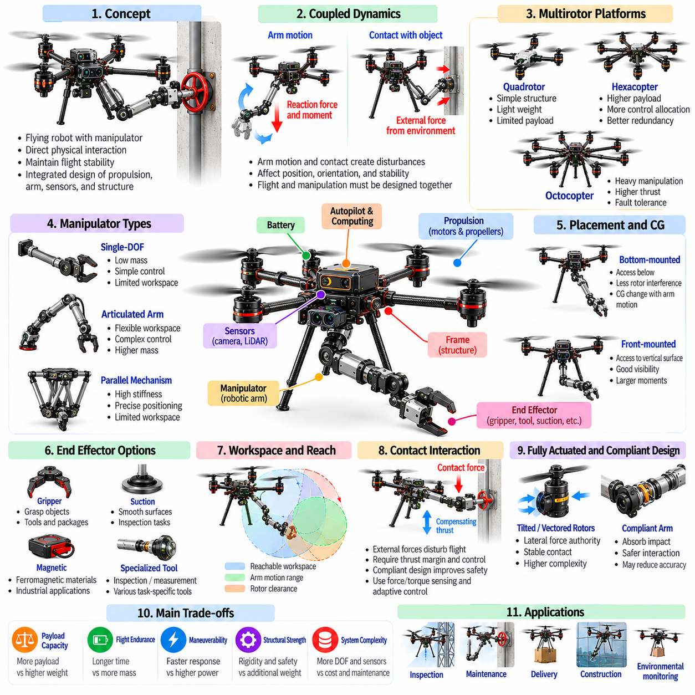{width="7.268055555555556in" height="7.268055555555556in"}

Aerial manipulation morphology describes the physical configuration of flying robots designed to interact with objects and surfaces through direct mechanical contact. Unlike conventional aerial platforms focused on observation or transportation, aerial manipulators must generate controlled forces while maintaining flight stability. Their morphology integrates propulsion, robotic arms, end effectors, sensors, and structural supports into a coordinated system capable of performing physical tasks in three-dimensional environments.

The fundamental challenge of aerial manipulation is the coupling between flight dynamics and manipulation forces. When a robotic arm moves or contacts an object, reaction forces and moments are transmitted to the flying platform. These disturbances can alter position, orientation, and stability. Consequently, the airframe and manipulation mechanism cannot be designed independently. Their combined mass distribution, actuation capabilities, and dynamic interactions determine achievable manipulation performance.

Multirotor aircraft are commonly used for aerial manipulation because they can hover and maintain position near target objects. Quadrotors provide relatively simple propulsion architectures, while hexacopters and octocopters can offer additional thrust capacity and control allocation options. However, conventional multirotors have limited independent force control because translational motion is coupled to vehicle attitude. This constraint influences manipulator placement and interaction strategies.

Aerial manipulators may employ single-degree-of-freedom mechanisms, articulated robotic arms, parallel mechanisms, or multiple coordinated manipulators. Simple mechanisms reduce mass and control complexity but provide limited workspace flexibility. Multi-joint arms enable more sophisticated positioning and object handling, although their additional actuators increase energy consumption and inertia. The appropriate morphology depends on task complexity, required reach, payload capacity, and allowable vehicle mass.

Manipulator placement relative to the airframe strongly influences stability and reachable workspace. Arms mounted beneath the vehicle can access objects below the rotor plane while reducing interference with propellers. Front-mounted manipulators may improve access to vertical surfaces and forward-facing targets. However, extending a manipulator away from the center of gravity increases reaction moments and rotational inertia. Structural geometry must balance accessibility with dynamic stability.

The center of gravity changes when a manipulator extends, retracts, or carries an object. These shifts modify the forces and moments required to maintain stable flight. Large manipulator movements can produce significant attitude disturbances, particularly on lightweight platforms. Designers may position heavy actuators near the airframe center and transmit motion through lightweight links. Such arrangements reduce moving mass but introduce mechanical transmission and structural design challenges.

Manipulator workspace defines the region in which an end effector can operate relative to the flying platform. Workspace size depends on joint configuration, link dimensions, mechanical limits, and collision constraints. Larger workspaces improve task flexibility but often require longer arms and greater structural stiffness. Effective workspace design must also consider rotor clearance, sensor visibility, and the vehicle\'s ability to maintain safe separation from surrounding obstacles.

End-effector morphology determines how the aerial robot establishes contact with objects and surfaces. Mechanical grippers can grasp tools or packages, while suction devices may attach to suitable smooth surfaces. Magnetic mechanisms can interact with compatible ferromagnetic materials, and specialized probes support inspection or measurement tasks. Each interface introduces distinct requirements for gripping force, alignment tolerance, energy consumption, and release reliability.

Contact interaction creates external forces that can destabilize a flying robot. Pushing against a surface generates reaction forces that must be balanced by propulsion and attitude control. Conventional underactuated multirotors may need to tilt their bodies to produce horizontal forces, potentially disturbing manipulator alignment. The magnitude and direction of achievable contact forces depend on propulsion geometry, available thrust margins, and the combined vehicle-manipulator configuration.

Fully actuated aerial platforms can improve manipulation capabilities by generating forces and moments more independently. Tilted rotors, vectored thrust mechanisms, and specialized propulsion arrangements can provide lateral force authority without requiring equivalent changes in body orientation. This capability supports more stable contact with walls and other structures. However, additional actuation introduces mass, aerodynamic interactions, mechanical complexity, and greater control allocation demands.

Compliant manipulation mechanisms can reduce the transmission of sudden contact forces into the airframe. Springs, flexible joints, elastic elements, and passive damping components absorb impact energy and accommodate positioning errors. Compliance can improve safety when interacting with uncertain or delicate surfaces. Nevertheless, excessive flexibility may reduce positioning accuracy and introduce oscillatory behavior. Mechanical compliance must therefore be coordinated with sensing and feedback control.

Force and torque sensing are essential for tasks requiring controlled physical interaction. Sensors located at joints, end effectors, or structural interfaces can estimate contact forces and detect unexpected collisions. These measurements support impedance control, force regulation, and adaptive grasping. However, sensor readings may be affected by vehicle acceleration, vibration, and inertial loads. Accurate interaction estimation requires distinguishing contact forces from normal flight dynamics.

Visual and tactile perception influence manipulator morphology because sensors require suitable viewpoints and mechanical protection. Cameras may be mounted on the airframe, robotic arm, or end effector to observe target objects and contact regions. Depth sensors can support spatial alignment, while tactile sensors provide local contact information. Sensor placement must account for occlusion, propeller interference, vibration, and the changing geometry of the manipulation mechanism.

Aerial grasping requires coordination between vehicle positioning, manipulator motion, and end-effector closure. The robot must approach an object while maintaining sufficient clearance for rotors and supporting structures. During grasping, contact forces and object motion can disturb flight stability. Once the object is secured, the combined mass and inertia change. Reliable grasping therefore depends on integrated trajectory planning, contact estimation, and dynamic compensation.

Aerial transportation with robotic arms introduces additional constraints compared with carrying rigidly mounted payloads. Grasped objects may move relative to the airframe, creating time-varying moments and inertial forces. Long or asymmetric objects can increase aerodynamic drag and complicate obstacle avoidance. Manipulator configurations should minimize unnecessary motion during transport while preserving the ability to place or release objects accurately at the destination.

Cooperative aerial manipulation extends these principles to multiple flying robots handling a shared object. Each robot contributes lifting or interaction forces while maintaining coordinated motion. The relative positions of vehicles determine load distribution, structural tension, and collision risks. Communication delays and positioning uncertainty can create internal forces that stress the object or destabilize the group. Cooperative morphology must therefore consider attachment geometry and distributed control.

Energy consumption is a major limitation because aerial manipulation combines continuous flight power with manipulator actuation. Additional arms, joints, sensors, and structural reinforcement increase vehicle mass and reduce endurance. Contact tasks may require sustained thrust to counter external forces, further increasing energy demand. Efficient designs minimize moving mass, reduce unnecessary degrees of freedom, and select propulsion systems with sufficient operating margins.

Safety requirements become especially important when aerial robots operate close to people, equipment, or infrastructure. Rotating propellers, moving manipulators, and grasped objects create multiple sources of mechanical risk. Protective structures, compliant end effectors, collision detection, and emergency release mechanisms can reduce hazards. Safety-oriented morphology must also preserve sufficient control authority to recover from unexpected contact or manipulation failures.

From a Physical AI perspective, aerial manipulation requires unified reasoning about perception, movement, contact, and physical constraints. Intelligent controllers must predict how manipulator actions influence flight dynamics and how aircraft motion changes interaction forces. Morphology-aware planning can select grasping configurations, approach trajectories, and contact strategies according to available thrust and workspace limitations. This integration transforms aerial robots from passive observers into active physical agents.

Future aerial manipulation systems may incorporate lightweight continuum arms, reconfigurable grippers, fully actuated propulsion, and adaptive compliant structures. Learning-based control and online dynamics estimation could improve manipulation under uncertain contact conditions. However, practical performance will remain constrained by mass, energy, stability, and safety requirements. Effective aerial manipulation morphology ultimately emerges from coordinated optimization of flight mechanics, robotic manipulation, sensing, and intelligent control.

## 08.11. Future Aerial Robot Morphologies

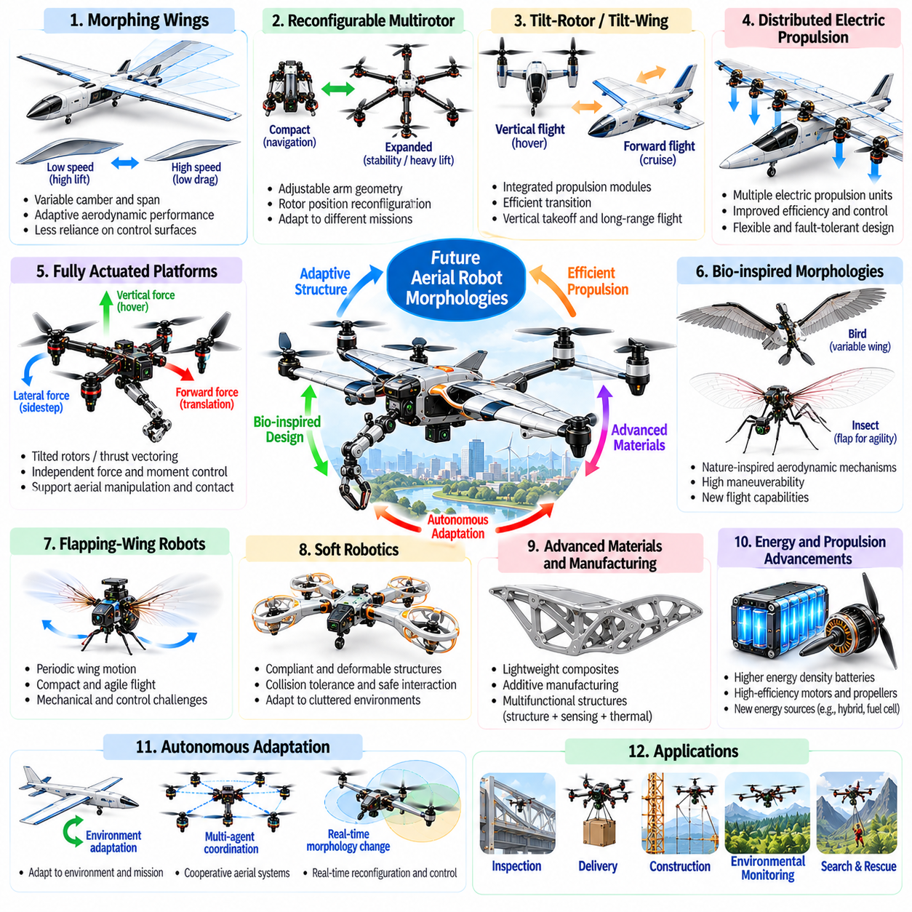{width="7.268055555555556in" height="7.268055555555556in"}

Future aerial robot morphologies will increasingly emerge from the integration of adaptive structures, intelligent propulsion, advanced materials, and autonomous control. Traditional distinctions among fixed-wing aircraft, multirotors, and hybrid VTOL platforms may become less rigid as new architectures combine their capabilities. The objective is not simply to create unconventional aircraft shapes but to develop physical configurations that adapt efficiently to diverse missions and environmental conditions.

Morphological adaptability will become a central design principle for next-generation aerial robots. Instead of maintaining a fixed geometry throughout operation, future platforms may modify wing shape, rotor orientation, structural dimensions, or payload configurations. Such transformations could improve efficiency across hovering, cruising, maneuvering, and landing. However, adaptive mechanisms introduce additional mass, mechanical complexity, and reliability challenges that must be justified by measurable performance benefits.

Morphing wings represent a promising direction for improving aerodynamic performance across different flight regimes. Variable camber, adjustable span, and flexible wing surfaces can modify lift and drag characteristics according to airspeed and maneuvering requirements. These capabilities may reduce dependence on conventional control surfaces while expanding operational flexibility. Practical implementation requires lightweight actuators, durable materials, and reliable structural deformation control.

Reconfigurable multirotor architectures may dynamically change rotor positions, arm geometry, or propulsion orientation. Compact configurations could improve navigation through confined environments, while expanded arrangements may provide greater stability or lifting efficiency. Rotor repositioning could also support specialized manipulation tasks and collision avoidance. Nevertheless, moving propulsion units alter mass distribution and control effectiveness, requiring continuous adaptation of the flight controller.

Tilt-rotor and tilt-wing technologies may evolve toward more integrated propulsion architectures capable of efficient vertical and horizontal flight. Future designs could employ independently controlled propulsion modules to distribute thrust according to flight conditions. Such arrangements may improve transition performance and expand maneuvering capabilities. Their effectiveness will depend on aerodynamic interference, actuator reliability, structural efficiency, and coordinated control allocation.

Distributed electric propulsion is likely to remain an important foundation for innovative aerial morphologies. Multiple propulsion units allow designers to distribute lifting and control forces across unconventional airframes. Integrated motor and propeller arrangements may enable compact configurations, improved control authority, and selected forms of fault tolerance. However, electrical distribution, thermal management, rotor interactions, and system mass must be optimized at the complete aircraft level.

Fully actuated aerial robots may become increasingly valuable for missions requiring precise physical interaction. By using tilted rotors or thrust-vectoring mechanisms, these platforms can generate translational forces without relying entirely on body attitude changes. This capability supports aerial manipulation, surface inspection, and contact-based operations. Future morphologies may integrate propulsion and manipulation structures to improve force control while reducing redundant mechanical components.

Bio-inspired aerial morphologies offer alternative approaches to propulsion, maneuverability, and environmental adaptation. Birds demonstrate coordinated wing deformation and aerodynamic control, while insects illustrate rapid maneuvering through oscillating wings. Translating these principles into engineered systems may enable new forms of flight. However, biological mechanisms cannot be copied directly without considering differences in scale, material properties, actuator performance, and energy availability.

Flapping-wing aerial robots may provide advantages in compact maneuvering and specialized low-speed flight. Their wings generate aerodynamic forces through periodic motion, allowing propulsion and lift generation to be closely integrated. Wing flexibility, flapping frequency, and stroke geometry influence flight performance. Despite their potential, these systems face challenges involving mechanical fatigue, transmission efficiency, vibration, and precise control of unsteady aerodynamic forces.

Soft robotics may introduce compliant structures that improve collision tolerance and interaction safety. Flexible wings, deformable protective frames, and elastic landing mechanisms can absorb impact energy and adapt to environmental contact. Such features may benefit aerial robots operating in cluttered or uncertain environments. However, excessive structural flexibility can reduce control precision and introduce complex dynamic behavior, making coordinated mechanical and control design essential.

Advanced materials and manufacturing technologies will influence the feasibility of future aerial configurations. Lightweight composites, additive manufacturing, multifunctional structures, and integrated electronics may reduce assembly complexity and improve structural efficiency. Components could simultaneously provide mechanical support, sensing, and thermal functions. Nevertheless, manufacturing repeatability, inspection accessibility, fatigue resistance, and repairability remain important considerations for practical deployment.

Energy storage and propulsion technology will continue to shape morphological possibilities. Improvements in battery energy density and power delivery could expand payload capacity and operational endurance. Hybrid energy systems and alternative propulsion architectures may support longer missions or higher lifting demands. However, no energy source eliminates the relationship between stored energy, system mass, and propulsion efficiency. Aircraft geometry must remain compatible with realistic power and thermal constraints.

Modular aerial robot architectures may enable rapid adaptation to different tasks without redesigning the entire vehicle. Interchangeable propulsion modules, sensor assemblies, manipulators, and cargo interfaces could support mission-specific configurations. Standardized mechanical and electrical connections would simplify maintenance and integration. However, modularity introduces interface mass and potential structural inefficiencies, requiring careful evaluation against the flexibility it provides.

Swarm-oriented morphology may influence the design of small aerial robots intended to operate cooperatively. Individual vehicles could prioritize low mass, compactness, and simplified mechanisms while relying on collective coordination for complex missions. Groups may perform distributed sensing, cooperative transportation, or collaborative manipulation. Their physical designs must consider communication limitations, collision avoidance, aerodynamic interactions, and reliable coordination under uncertain conditions.

Autonomous docking and aerial reconfiguration could extend the capabilities of modular platforms. Multiple robots may connect mechanically to form larger lifting structures or share energy and sensing resources. Detachable modules could also separate to perform independent tasks before reconnecting. These concepts introduce challenges in docking accuracy, structural load transfer, electrical integration, and distributed control. Their practicality depends on whether reconfiguration benefits exceed the associated complexity.

Morphological computation may become increasingly important as physical structures assume functions traditionally handled by active control. Passive aerodynamic stability, compliant joints, tuned elasticity, and mechanically coupled mechanisms can simplify certain control tasks. By embedding useful behavior into the aircraft\'s physical design, engineers may reduce sensing and actuation requirements. However, passive mechanisms must remain effective across the intended range of operating conditions.

Digital twins and simulation-driven design will support exploration of increasingly complex aerial morphologies. High-fidelity models can evaluate aerodynamic performance, structural deformation, propulsion interactions, and control behavior before physical prototyping. Automated optimization may identify unconventional configurations that human designers would not readily consider. Simulation accuracy remains critical because model errors can produce designs that perform poorly or unsafely in real environments.

Learning-based design methods may connect morphological optimization with autonomous control development. Rather than optimizing airframe geometry and flight policies separately, future systems could jointly search for compatible physical structures and control strategies. Reinforcement learning and differentiable simulation may support this process where their models are suitable. Nevertheless, learned solutions require validation against uncertainty, hardware limitations, and safety constraints before deployment.

Safety, certification, and operational requirements will strongly influence which future morphologies become commercially practical. Adaptive structures and unconventional propulsion systems introduce failure modes that may not fit established verification procedures. Reliable operation requires structural monitoring, fault detection, predictable emergency behavior, and maintainable hardware. The success of an innovative morphology therefore depends not only on aerodynamic performance but also on its ability to satisfy demanding real-world safety requirements.

From a Physical AI perspective, future aerial morphology will increasingly integrate mechanical embodiment with perception, planning, learning, and control. Intelligent aircraft may estimate their changing physical capabilities and adjust behavior according to structural configuration, energy availability, and environmental conditions. The most effective designs will coordinate morphology and intelligence rather than treating them as separate engineering problems. This integration provides a foundation for adaptable, efficient, and increasingly general-purpose aerial robotic systems.
