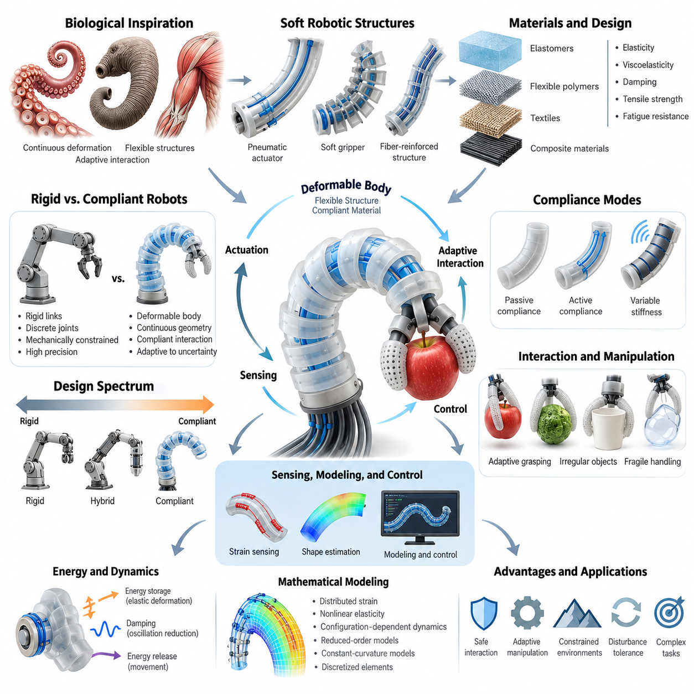
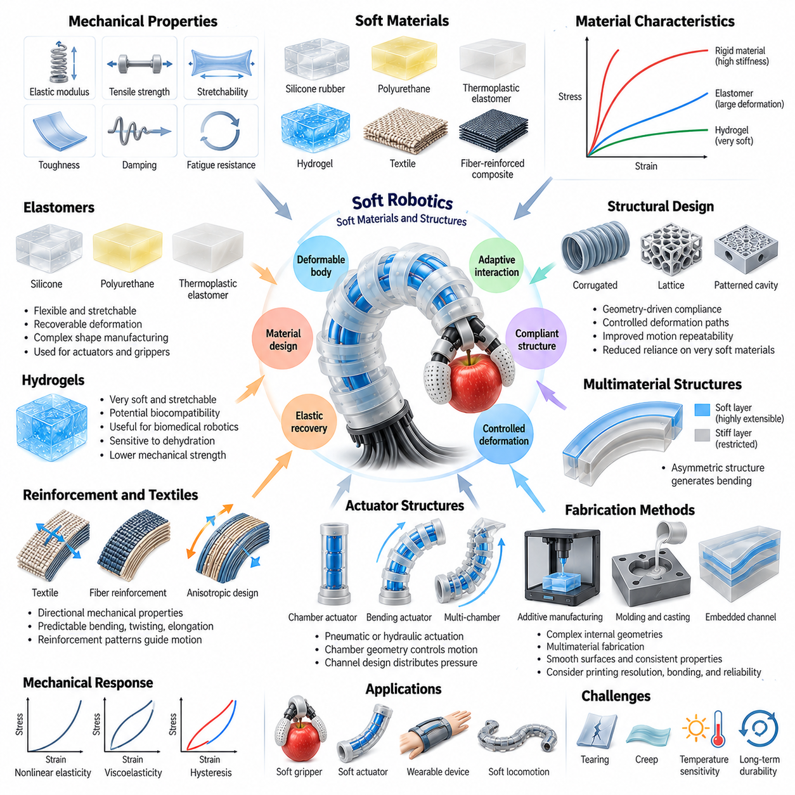
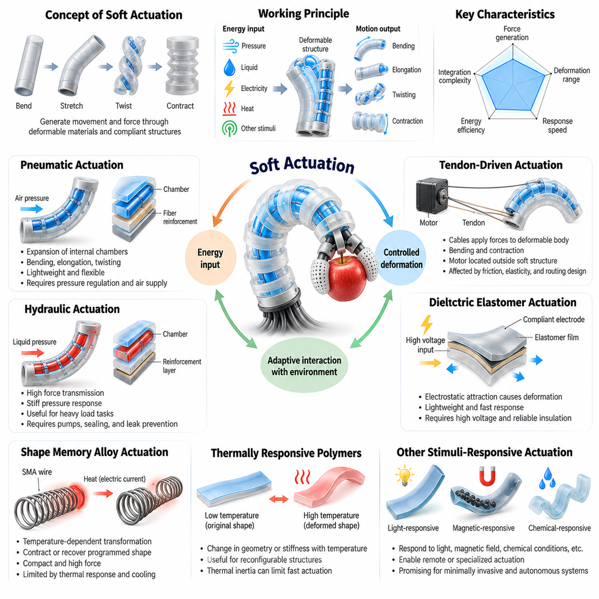
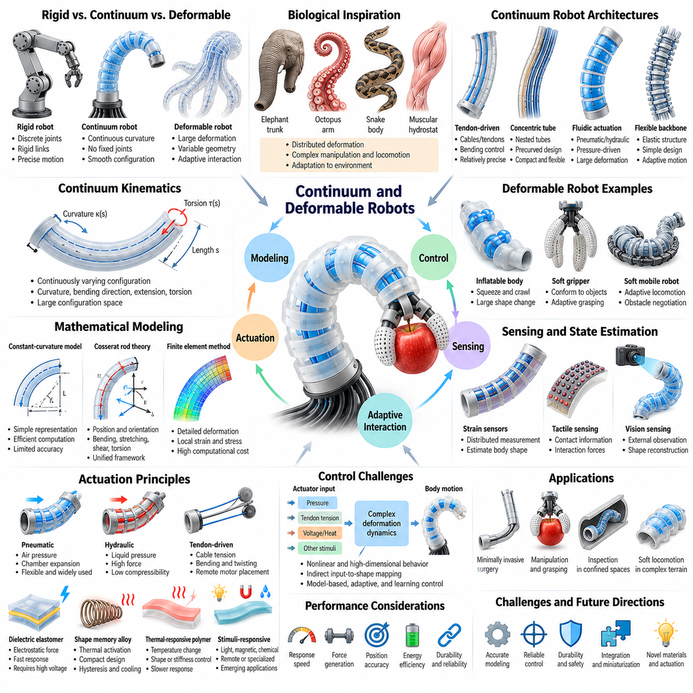
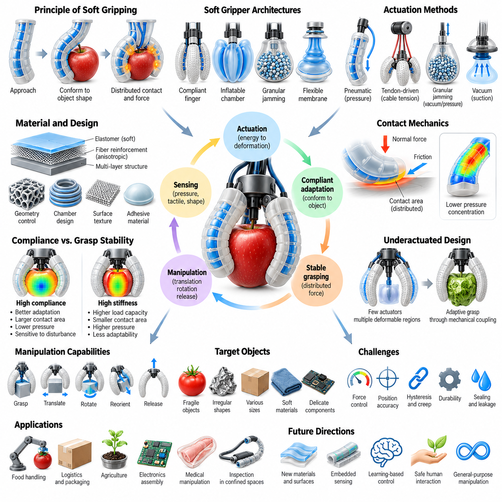
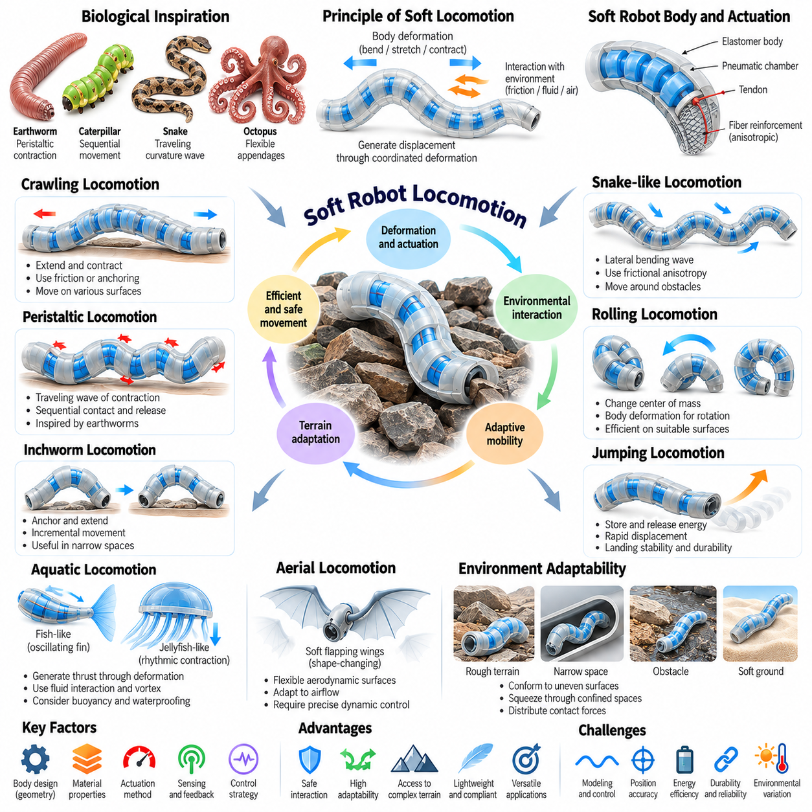
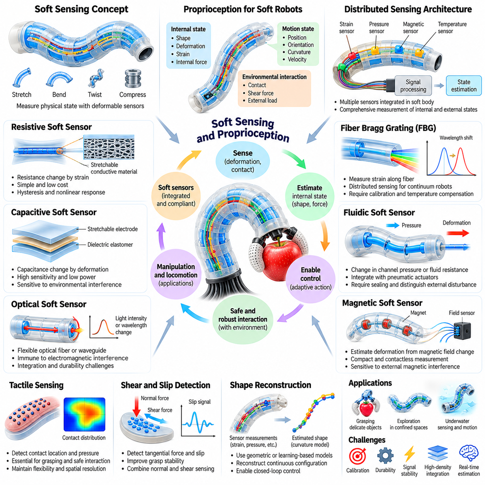
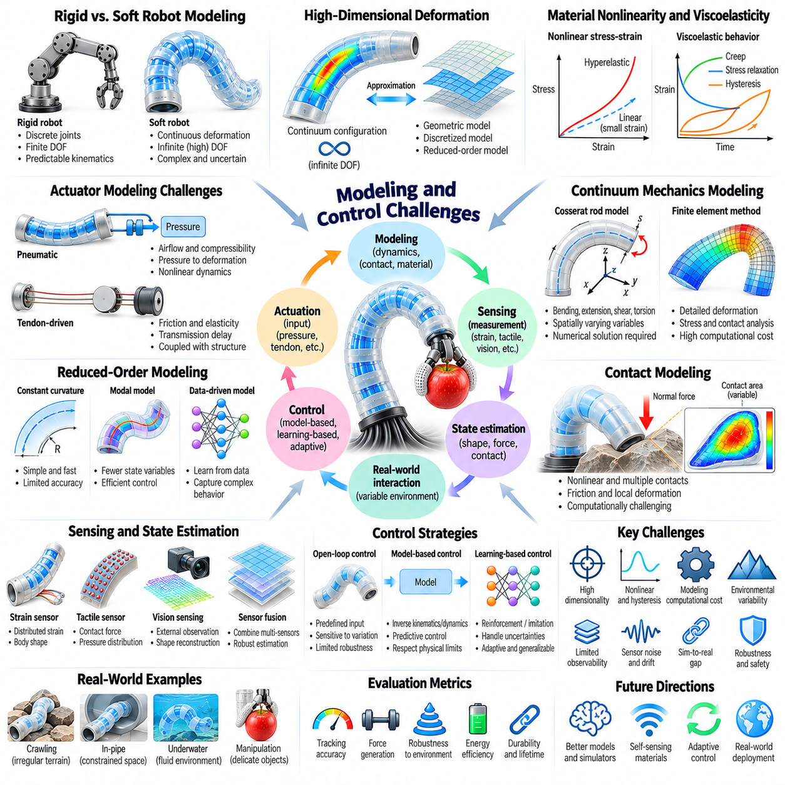
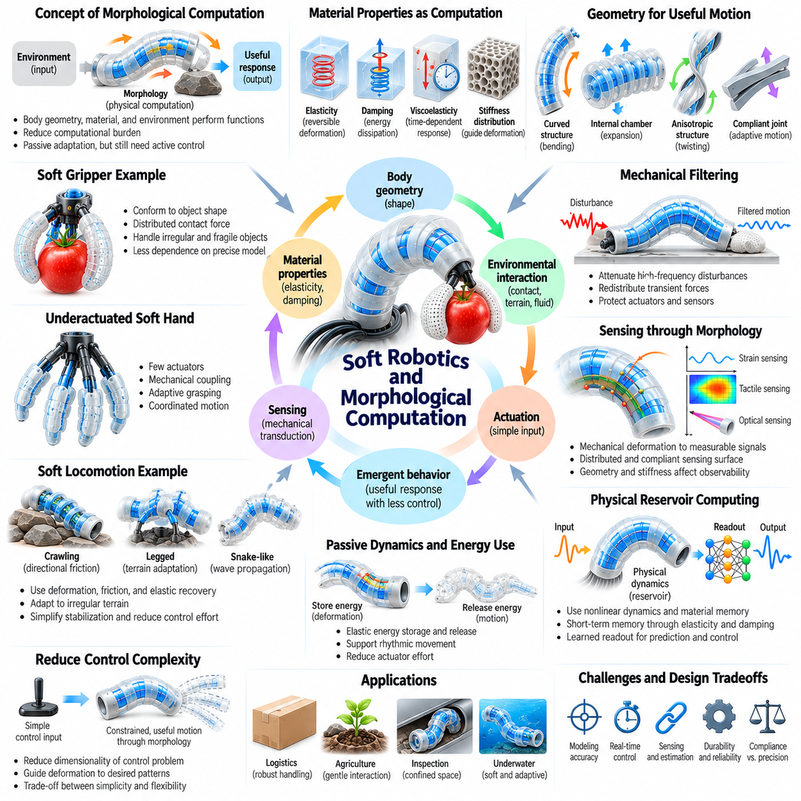
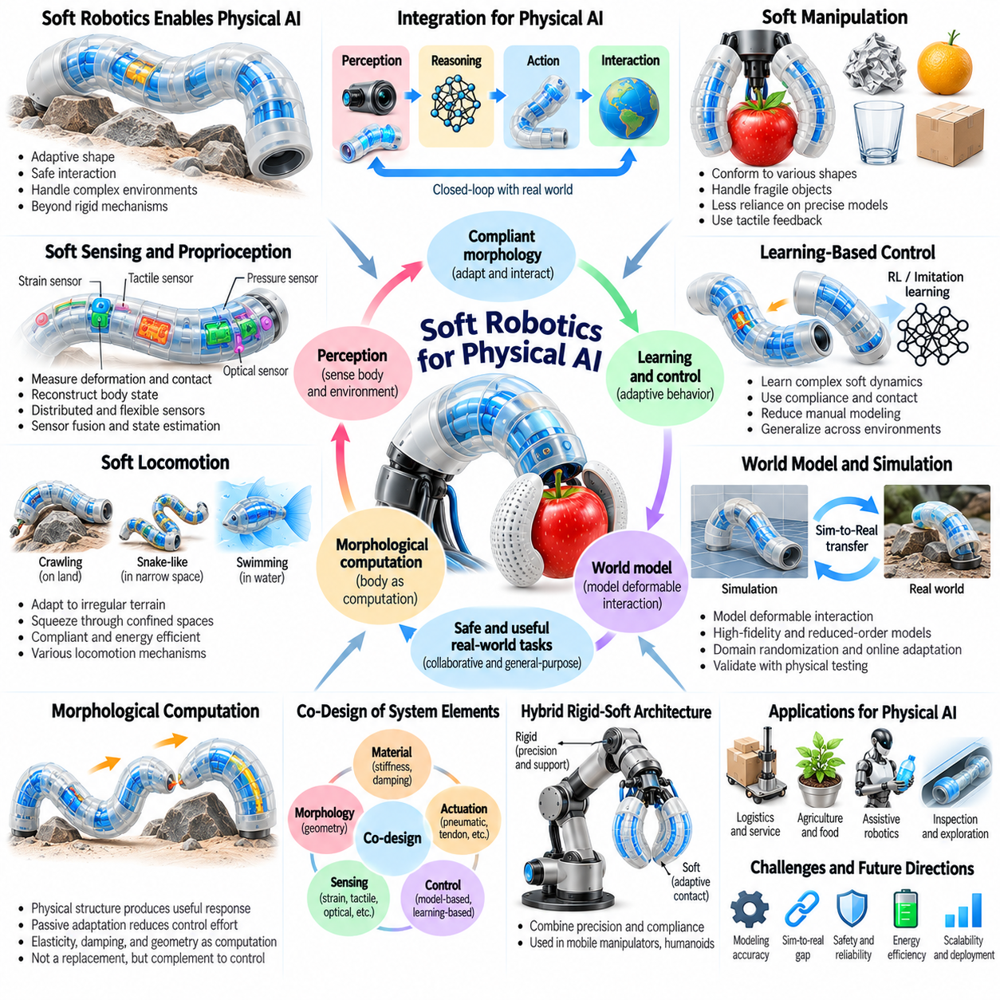

**Volume 03. Embodiment and Morphology**

# Chapter 09. Soft Robotics

## 09.01. Soft Robotics and Compliant Morphology

{width="7.268055555555556in" height="7.268055555555556in"}

소프트 로보틱스(Soft Robotics)는 변형 가능한 몸체(Deformable Body), 유연한 구조(Flexible Structure), 순응성 재료(Compliant Material)를 활용하여 물리적 상호작용(Physical Interaction)을 구현한다는 점에서 기존 로봇 공학(Conventional Robotics Engineering)과 근본적으로 다른 접근 방식이다. 고정된 링크(Fixed Link)와 개별 관절(Discrete Joint)에 의존하는 강체 로봇(Rigid Robot)과 달리, 소프트 로봇(Soft Robot)은 외부 힘에 따라 형상이 연속적으로 변화한다. 이러한 형태(Morphology)는 움직임, 적응(Adaptation), 환경과의 상호작용에 능동적으로 기여하는 요소가 된다.

순응형 형태(Compliant Morphology)는 외부 하중(External Load)이나 내부 구동(Internal Actuation)에 의해 제어된 변형(Controlled Deformation)이 가능하도록 구성된 로봇 몸체의 물리적 구조를 의미한다. 순응성(Compliance)은 모든 움직임을 강체 기계 관절(Rigid Mechanical Joint)로 생성하지 않더라도 구조가 굽혀지고, 늘어나고, 압축되며, 원래 형태로 복원될 수 있도록 한다. 이러한 특성은 안전한 상호작용(Safe Interaction), 적응형 조작(Adaptive Manipulation), 제한된 공간에서의 이동을 위한 새로운 가능성을 제공한다.

전통적인 강체 로봇(Rigid Robot)은 일반적으로 기계적으로 제한된 운동(Mechanically Constrained Motion)과 정밀하게 조절되는 액추에이터 위치(Actuator Position)를 통해 정확도를 확보한다. 반면 소프트 로봇(Soft Robot)은 분산 변형(Distributed Deformation)과 재료 탄성(Material Elasticity)을 활용하여 접촉 형상(Contact Geometry)의 불확실성(Uncertainty)에 대응한다. 물리적 구조가 불규칙한 표면에 자연스럽게 적응하고 접촉력을 분산하며 외란(Disturbance)을 흡수하기 때문에 다양한 조작 작업에서 정확한 기하학적 정렬(Geometric Alignment)의 필요성을 줄일 수 있다.

강성(Rigidity)과 순응성(Compliance)의 구분은 절대적인 것이 아니다. 로봇 시스템(Robotic System)은 높은 강성을 가진 기구부터 완전히 변형 가능한 구조까지 연속적인 설계 영역(Design Spectrum)에 존재한다. 하이브리드 구조(Hybrid Architecture)는 강체 프레임(Rigid Frame), 유연 관절(Flexible Joint), 탄성 전달 장치(Elastic Transmission), 연성 접촉 표면(Soft Contact Surface)을 결합하여 정밀성과 적응성의 균형을 확보한다. 따라서 적절한 순응성 분포(Compliance Distribution)를 선택하는 것은 로봇 형태 설계(Robot Morphology Design)의 핵심 문제이다.

생물학적 유기체(Biological Organism)는 순응형 로봇 시스템(Compliant Robotic System)에 중요한 영감을 제공한다. 근육(Muscle), 힘줄(Tendon), 결합 조직(Connective Tissue), 유연한 골격 구조(Flexible Skeletal Structure)는 동물이 환경의 불확실성에 대응하면서 움직임을 생성하도록 한다. 문어 팔(Octopus Arm), 코끼리 코(Elephant Trunk), 근육성 정수압 골격(Muscular Hydrostat)은 전통적인 관절 구조 없이도 연속 변형(Continuous Deformation)을 통해 복잡한 조작을 수행할 수 있음을 보여준다. 소프트 로보틱스는 이러한 원리를 공학적 신체 구조(Engineered Embodiment)로 구현한다.

재료 특성(Material Property)은 순응형 형태(Compliant Morphology)의 거동을 근본적으로 결정한다. 탄성 계수(Elastic Modulus), 점탄성(Viscoelasticity), 감쇠(Damping), 인장 강도(Tensile Strength), 피로 저항(Fatigue Resistance)은 로봇 몸체가 하중에 반응하는 방식에 영향을 미친다. 낮은 강성(Low Stiffness)의 재료는 큰 변형을 허용하며, 보강 섬유(Reinforcing Fiber)와 내장 구조(Embedded Structure)는 특정 방향의 움직임을 제한한다. 따라서 재료 선택(Material Selection)과 기하학적 설계(Geometric Design)는 독립적으로 고려하기보다 통합적으로 검토해야 한다.

소프트 로봇 구조(Soft Robotic Structure)는 분산된 기계적 반응(Distributed Mechanical Response)을 구현하기 위해 탄성중합체(Elastomer), 유연 고분자(Flexible Polymer), 직물(Textile), 복합재료(Composite Material)를 자주 사용한다. 구조 내부에는 챔버(Chamber), 채널(Channel), 리브(Rib), 이방성 보강재(Anisotropic Reinforcement)가 포함될 수 있으며, 이를 통해 예측 가능한 변형 패턴(Deformation Pattern)을 생성한다. 재료 배치와 구조적 제약을 조절하면 단순한 구동 입력(Actuation Input)을 굽힘, 비틀림, 신장 또는 복잡한 공간 운동으로 변환할 수 있다.

순응성(Compliance)은 수동형(Passive), 능동 제어형(Actively Controlled), 기계적 조절형(Mechanically Adjustable)으로 구현할 수 있다. 수동 순응성(Passive Compliance)은 재료의 고유 특성과 구조적 형상에서 발생하며 추가적인 제어 명령 없이 변형을 허용한다. 능동 순응성(Active Compliance)은 액추에이터(Actuator)와 피드백(Feedback)을 사용하여 상호작용 거동을 조절하고, 가변 강성 메커니즘(Variable-Stiffness Mechanism)은 변형에 대한 저항을 변경한다. 이러한 방식은 단순성, 적응성, 제어 가능성 사이에서 서로 다른 균형을 제공한다.

순응형 형태(Compliant Morphology)의 대표적인 장점은 불확실한 접촉 조건(Uncertain Contact Condition)에 대응할 수 있다는 것이다. 소프트 그리퍼(Soft Gripper)가 익숙하지 않은 형상의 물체를 접촉하면 손가락 구조가 표면을 따라 변형되면서 여러 접촉 영역(Contact Region)을 형성할 수 있다. 이러한 적응은 정밀한 물체 모델(Object Model)과 정확한 손가락 궤적(Finger Trajectory)에 대한 의존도를 줄인다. 그러나 안정적인 파지(Grasping)를 위해서는 여전히 적절한 힘 생성(Force Generation), 마찰(Friction), 안정성(Stability)이 필요하다.

순응형 구조(Compliant Structure)는 기계적 에너지(Mechanical Energy)의 저장과 소산(Dissipation) 방식에도 영향을 미친다. 탄성 변형(Elastic Deformation)은 에너지를 일시적으로 저장한 후 움직임 과정에서 방출할 수 있으며, 감쇠(Damping)는 진동(Oscillation)과 충격 전달(Impact Transmission)을 감소시킨다. 이러한 특성은 반복 보행(Repetitive Locomotion), 충돌 내성(Collision Tolerance), 동적 상호작용(Dynamic Interaction)에 유용하다. 그러나 과도한 변형이나 에너지 소산은 위치 정확도(Positioning Accuracy)와 전체 기계 효율(Mechanical Efficiency)을 감소시킬 수 있다.

소프트 형태(Soft Morphology)는 감지(Sensing), 구동(Actuation), 제어(Control) 사이의 관계를 변화시킨다. 강체 기구(Rigid Mechanism)에서는 관절 엔코더(Joint Encoder)가 로봇의 구성 상태(Configuration)를 비교적 직접적으로 나타낸다. 반면 변형 가능한 몸체(Deformable Body)는 소수의 관절 좌표(Joint Coordinate)만으로 충분히 표현할 수 없는 다양한 형상을 가진다. 따라서 몸체의 형상을 추정하기 위해 분산 변형률 측정(Distributed Strain Measurement), 내장 센서(Embedded Sensor), 시각 관측(Visual Observation), 물리 기반 모델(Physics-Based Model)이 필요할 수 있다.

소프트 로봇 운동(Soft Robotic Motion)의 수학적 표현(Mathematical Representation)은 기존 강체 운동학(Rigid-Body Kinematics)과 상당히 다르다. 연속적으로 변형되는 구조는 분산 변형률(Distributed Strain), 비선형 탄성(Nonlinear Elasticity), 구성 상태 의존 동역학(Configuration-Dependent Dynamics)을 나타낸다. 유효 자유도(Effective Degrees of Freedom)가 매우 많아 직접 모델링(Direct Modeling)의 계산 비용이 높아질 수 있다. 실제 시스템에서는 차수 축소 모델(Reduced-Order Model), 일정 곡률 가정(Constant-Curvature Assumption), 이산화된 기계 요소(Discretized Mechanical Element)를 활용하여 변형을 근사한다.

형태(Morphology)와 제어(Control)의 상호작용은 소프트 로보틱스에서 특히 중요하다. 적절하게 설계된 순응형 몸체(Compliant Body)는 기계적 반응(Mechanical Response)을 통해 외란(Disturbance)에 자동으로 대응할 수 있으므로 명시적인 보정 제어(Corrective Control)의 필요성을 줄인다. 이러한 현상은 물리적 구조가 일반적으로 계산 과정과 연관되는 거동에 기여하는 형태적 계산(Morphological Computation)을 보여준다. 그러나 기계적 적응(Mechanical Adaptation)이 모든 작동 조건에서 피드백(Feedback)과 계획(Planning)을 대체할 수 있는 것은 아니다.

안전성(Safety)은 순응형 로봇 형태(Compliant Robot Morphology)를 개발하는 또 다른 주요 동기이다. 변형 가능한 표면(Deformable Surface)은 접촉력을 넓은 영역에 분산하고 특정 상호작용에서 국부 압력(Localized Pressure)을 감소시킬 수 있다. 이러한 특성은 인간 중심 로보틱스(Human-Centered Robotics), 보조 장치(Assistive Device), 재활 시스템(Rehabilitation System), 협업 조작(Collaborative Manipulation)에 유용하다. 그러나 액추에이터 힘(Actuator Force), 저장 에너지(Stored Energy), 접촉 형상(Contact Geometry), 작동 속도(Operating Speed)도 중요하므로 부드러운 구조 자체가 안전성을 보장하지는 않는다.

소프트 로봇 형태(Soft Robot Morphology)는 강체 시스템과 다른 공학적 한계(Engineering Limitation)도 가진다. 유연 재료(Flexible Material)는 반복 하중(Repeated Loading)에 따라 크리프(Creep), 이력 현상(Hysteresis), 피로(Fatigue), 영구 변형(Permanent Deformation)을 경험할 수 있다. 환경 온도(Environmental Temperature), 노화(Aging), 제조 편차(Manufacturing Variability)는 시간이 지나면서 기계적 특성(Mechanical Property)을 변화시킨다. 이러한 영향은 특히 정밀 조작(Precision Manipulation)이나 연속 산업 운전(Continuous Industrial Operation)에서 보정(Calibration), 반복 정밀도(Repeatability), 장기 신뢰성(Long-Term Reliability)을 확보하기 어렵게 만든다.

따라서 순응형 로봇(Compliant Robot)의 설계에서는 형상(Geometry), 재료(Material), 구동(Actuation), 감지(Sensing), 제어(Control)를 동시에 고려해야 한다. 유연성(Flexibility)을 높이면 환경 적응성(Environmental Adaptability)이 향상될 수 있지만 하중 지지 능력(Load-Bearing Capacity)과 위치 안정성(Positional Stability)은 감소할 수 있다. 반대로 강성(Stiffness)을 높이면 정밀도는 향상되지만 형상 적응성(Conformability)은 제한된다. 효과적인 형태 설계는 목표 작업, 작동 환경, 허용 가능한 성능 한계에 따라 이러한 상충 관계(Trade-Off)를 균형 있게 조정하는 과정에서 도출된다.

소프트 로보틱스(Soft Robotics)는 지능(Intelligence)이 계산 알고리즘(Computational Algorithm)에만 국한되지 않는다는 사실을 보여줌으로써 체화(Embodiment)의 개념을 확장한다. 물리적 특성(Physical Property)은 자연스럽게 가능한 움직임, 외란이 흡수되는 방식, 환경 접촉이 거동에 미치는 영향을 결정한다. 몸체는 지각-행동 순환(Perception-Action Loop)에 직접 참여하며, 제어기가 활용할 수 있는 정보와 의사결정의 물리적 결과를 형성한다.

피지컬 AI(Physical AI) 시스템에서 순응형 형태(Compliant Morphology)는 복잡하고 불확실한 환경과 더욱 자연스럽게 상호작용하는 로봇을 구현하는 방법을 제공한다. 소프트 구조(Soft Structure)는 모델링 오차(Modeling Error)에 대한 기계적 허용성(Mechanical Tolerance)을 제공함으로써 학습 기반 지각(Learned Perception), 적응 제어(Adaptive Control), 예측 세계 모델(Predictive World Model)을 보완할 수 있다. 이러한 가치는 섬세한 물체, 불규칙한 표면, 제한된 공간 또는 강체 접촉이 바람직하지 않은 환경에서 특히 중요하다.

소프트 구성요소(Soft Component)와 강체 구성요소(Rigid Component)의 통합은 앞으로도 중요한 구조 설계 전략(Architectural Strategy)으로 활용될 가능성이 높다. 강체 요소(Rigid Element)는 구조적 지지(Structural Support), 정확한 동력 전달(Accurate Transmission), 안정적인 센서 배치(Stable Sensor Placement)를 제공하고, 순응형 요소(Compliant Element)는 적응성과 접촉 허용성(Contact Tolerance)을 제공한다. 이러한 하이브리드 체화 구조(Hybrid Embodiment)는 두 접근 방식의 장점을 결합할 수 있다. 핵심 설계 목표는 최대한 부드러운 몸체가 아니라 로봇 전체에 적절한 기계적 특성(Mechanical Property)을 분포시키는 것이다.

소프트 로보틱스(Soft Robotics)와 순응형 형태(Compliant Morphology)에 대한 이해는 연성 재료(Soft Material), 구동 원리(Actuation Principle), 연속체 구조(Continuum Structure), 변형 가능한 조작(Deformable Manipulation), 적응형 이동(Adaptive Locomotion)을 학습하기 위한 기초를 제공한다. 또한 형태적 계산(Morphological Computation)과 지능형 물리적 상호작용(Intelligent Physical Interaction)을 연결하는 개념적 기반이 된다. 궁극적으로 순응형 형태는 몸체 구조(Body Structure), 재료 거동(Material Behavior), 제어(Control), 환경(Environment) 사이의 조정된 관계에서 로봇의 능력(Robotic Capability)이 형성된다는 사실을 보여준다.

## 09.02. Soft Materials and Structures

{width="7.268055555555556in" height="7.268055555555556in"}

연성 재료(Soft Materials)와 연성 구조(Soft Structures)는 제어된 변형(Controlled Deformation), 탄성 복원(Elastic Recovery), 환경과의 적응형 상호작용(Adaptive Interaction)을 가능하게 함으로써 소프트 로보틱스(Soft Robotics)의 물리적 기반을 형성한다. 강체 공학 재료(Rigid Engineering Materials)와 달리 연성 재료는 비교적 작은 힘에도 상당한 형상 변화를 일으킬 수 있다. 이러한 재료의 기계적 거동(Mechanical Behavior)은 로봇의 움직임, 접촉 안정성(Contact Stability), 에너지 저장(Energy Storage), 불확실한 환경 조건에 대한 적응 능력에 직접적인 영향을 미친다.

연성 재료(Soft Materials)의 선택은 기계적 특성(Mechanical Properties)과 변형 특성(Deformation Characteristics)을 이해하는 것에서 시작된다. 탄성 계수(Elastic Modulus)는 탄성 변형(Elastic Deformation)에 대한 저항을 나타내며, 인장 강도(Tensile Strength)는 재료가 파손되기 전에 견딜 수 있는 최대 응력을 의미한다. 신장성(Stretchability), 인성(Toughness), 감쇠(Damping), 피로 저항(Fatigue Resistance) 역시 실제 운용 적합성을 결정한다. 높은 유연성이 반드시 내구성이나 기계적 신뢰성을 의미하지는 않으므로 이러한 특성을 종합적으로 평가해야 한다.

탄성중합체(Elastomers)는 유연성과 복원 가능한 변형(Recoverable Deformation)을 동시에 제공하기 때문에 소프트 로봇 시스템(Soft Robotic Systems)에서 가장 널리 사용되는 재료 중 하나이다. 실리콘 고무(Silicone Rubber), 폴리우레탄 탄성중합체(Polyurethane Elastomers), 열가소성 탄성중합체(Thermoplastic Elastomers)는 복잡한 형상으로 제조할 수 있으며 내부 구동 챔버(Internal Actuation Chambers)와 통합할 수 있다. 이러한 재료의 기계적 특성은 화학적 조성, 경화 조건, 형상, 환경 노출에 따라 달라지므로 실제 적용 전에 세심한 특성 평가가 필요하다.

실리콘 기반 재료(Silicone-Based Materials)는 소프트 그리퍼(Soft Grippers), 공압 액추에이터(Pneumatic Actuators), 유연한 로봇 외피(Flexible Robotic Skins)에 특히 유용하다. 상대적으로 낮은 강성(Low Stiffness)과 큰 탄성 변형(Elastic Deformation)을 통해 복잡한 기계 관절 없이도 불규칙한 표면에 적응할 수 있다. 그러나 실리콘 부품은 찢어짐(Tearing), 이력 현상(Hysteresis), 장기적인 재료 열화(Material Degradation)가 발생할 수 있으므로 보강(Reinforcement)과 적절한 작동 한계(Operating Limits)를 고려하는 것이 중요하다.

열가소성 탄성중합체(Thermoplastic Elastomers)는 압출(Extrusion), 성형(Molding), 적층 제조(Additive Manufacturing)를 통해 다양한 제조 가능성을 제공한다. 이러한 가공 특성은 신속한 시제품 제작(Rapid Prototyping)과 복잡한 유연 부품(Flexible Components)의 생산을 지원한다. 재료 조성에 따라 탄성(Elasticity), 인성(Toughness), 제조 용이성(Manufacturability)을 적절하게 결합할 수 있다. 그러나 온도 민감성(Temperature Sensitivity), 크리프(Creep), 반복 하중(Repeated Loading)은 치수 안정성(Dimensional Stability)과 장기 성능(Long-Term Performance)에 영향을 미칠 수 있다.

하이드로젤(Hydrogels)은 상당한 양의 물을 포함하는 고분자 네트워크(Polymer Networks)로 구성된 또 다른 연성 재료이다. 부드러운 특성과 잠재적인 생체적합성(Biocompatibility)으로 인해 생체의학 로보틱스(Biomedical Robotics), 조직 접촉 장치(Tissue-Interfacing Devices), 적응형 감지 구조(Adaptive Sensing Structures)에 적합하다. 그러나 탈수(Dehydration), 제한적인 기계적 강도(Mechanical Strength), 환경 민감성(Environmental Sensitivity)은 실제 적용을 제한할 수 있다. 성공적인 통합을 위해서는 보호용 봉지(Protective Encapsulation)와 작동 조건의 세심한 관리가 필요한 경우가 많다.

직물(Textiles)과 섬유 강화 복합재료(Fiber-Reinforced Composites)는 방향에 따른 기계적 특성(Directional Mechanical Properties)을 부여하여 연성 로봇 구조의 기능을 확장한다. 내장된 섬유(Embedded Fibers)는 특정 축을 따라 팽창을 제한하면서 다른 방향의 변형은 허용할 수 있다. 이러한 이방성 거동(Anisotropic Behavior)은 비교적 단순한 구동 입력(Actuation Inputs)으로 예측 가능한 굽힘(Bending), 비틀림(Twisting), 신장(Elongation)을 가능하게 한다. 따라서 보강 패턴(Reinforcement Patterns)은 결과적인 움직임을 결정하는 중요한 설계 변수(Design Variables)가 된다.

연성 로봇 구조(Soft Robotic Structures)는 제어된 변형을 생성하기 위해 서로 다른 강성(Stiffness)을 가진 재료를 결합하는 경우가 많다. 유연한 액추에이터(Flexible Actuator)는 신장성이 높은 상부층(Upper Layer)과 상대적으로 강성이 높은 하부층(Lower Layer)을 포함할 수 있으며, 내부 압력이 증가하면 굽힘 운동이 발생한다. 이러한 비대칭 구조(Asymmetric Construction)는 분산된 재료 변형률(Distributed Material Strain)을 유용한 기계적 운동(Mechanical Motion)으로 변환한다. 결과적인 거동은 층 두께, 재료 특성, 접합 품질(Bonding Quality), 액추에이터 형상에 따라 달라진다.

내부 챔버(Internal Chambers)와 유체 네트워크(Fluidic Networks)는 연성 로봇 액추에이터(Soft Robotic Actuators)에서 일반적으로 사용되는 구조적 특징이다. 공압(Pneumatic Pressure) 또는 유압(Hydraulic Pressure)은 챔버 벽(Chamber Walls)을 팽창시켜 챔버 형상과 주변 제약 조건에 따라 움직임을 생성한다. 반복적으로 배치된 챔버는 조정된 굽힘 운동(Coordinated Bending)을 생성할 수 있으며, 정교하게 설계된 채널(Channels)은 구조 전체에 압력을 분배한다. 챔버 치수와 벽 두께는 달성 가능한 변위(Displacement), 생성 힘(Generated Force), 기계적 내구성(Mechanical Durability)에 큰 영향을 미친다.

구조적 형상(Structural Geometry)은 로봇의 거동을 결정하는 데 재료 조성(Material Composition)만큼 중요할 수 있다. 주름형 표면(Corrugated Surfaces), 벨로즈(Bellows), 격자 구조(Lattice Structures), 패턴화된 공동(Patterned Cavities)은 국부 강성(Local Stiffness)과 변형 경로(Deformation Pathways)를 변화시킨다. 이러한 특징을 활용하면 극도로 부드러운 재료에만 의존하지 않고도 유연한 메커니즘(Flexible Mechanisms)을 구현할 수 있다. 형상 기반 순응성(Geometry-Driven Compliance)은 선호하는 방향으로 변형을 유도하고 불필요한 움직임을 제한하여 운동 반복성(Motion Repeatability)을 향상시킬 수도 있다.

적층 제조(Additive Manufacturing)는 복잡한 내부 형상(Internal Geometries)과 다중 재료 제작(Multimaterial Fabrication)을 가능하게 함으로써 연성 로봇 구조의 설계 가능성을 확장하였다. 유연 고분자(Flexible Polymers)를 이용하면 기존 조립 방식으로 제작하기 어려운 챔버, 순응형 관절(Compliant Joints), 통합 기계 네트워크(Integrated Mechanical Networks)를 출력할 수 있다. 그러나 출력 해상도(Printing Resolution), 층간 접착력(Interlayer Adhesion), 재료 호환성(Material Compatibility), 제조 편차(Manufacturing Variability)는 구조적 무결성(Structural Integrity)에 상당한 영향을 미칠 수 있다.

금형 성형(Molding)과 주조(Casting)는 탄성중합체 로봇 부품(Elastomeric Robotic Components)을 생산하는 중요한 제작 기술(Fabrication Techniques)로 남아 있다. 액상 고분자(Liquid Polymers)를 금형에 주입하고 경화(Curing)한 후 채널, 공동(Cavities), 내장 보강재(Embedded Reinforcement)를 포함하는 구조로 조립한다. 이러한 공정은 적절하게 관리할 경우 매끄러운 표면과 비교적 일관된 재료 특성을 제공할 수 있다. 층간 접합(Bonding Between Layers)의 신뢰성은 매우 중요하며, 누출(Leakage)과 층간 박리(Delamination)는 액추에이터 성능을 저하시킬 수 있다.

연성 재료(Soft Materials)의 기계적 반응(Mechanical Response)은 종종 비선형성(Nonlinearity)을 나타내며, 이는 변형이 가해진 힘에 비례하여 증가하지 않는다는 의미이다. 큰 변형률(Large Strain)은 유효 강성(Effective Stiffness)을 변화시키고 구조 전체에 복잡한 응력 분포(Stress Distribution)를 생성할 수 있다. 이러한 거동을 근사하기 위해 초탄성 구성 모델(Hyperelastic Constitutive Models)이 자주 사용된다. 정확한 모델링(Accurate Modeling)을 위해서는 실험적으로 결정된 재료 매개변수(Material Parameters)와 작동 중 예상되는 변형 범위(Deformation Range)를 고려해야 한다.

점탄성(Viscoelasticity)은 연성 로봇 구조(Soft Robotic Structures)에 시간 의존적 거동(Time-Dependent Behavior)을 발생시킨다. 지속적인 하중(Sustained Loading)이 작용하면 재료는 크리프(Creep)에 의해 점진적으로 변형될 수 있으며, 하중 제거 후 복원 거동(Recovery Behavior)은 응력이 작용한 시간과 이력에 따라 달라질 수 있다. 이력 현상(Hysteresis)은 하중 증가와 감소 과정의 경로를 다르게 만들어 에너지 손실(Energy Loss)과 반복성(Repeatability) 저하를 발생시킨다. 이러한 영향은 주기적 구동(Cyclic Actuation)과 정밀 조작(Precision Manipulation)에서 특히 중요하다.

내구성(Durability)은 연성 구조(Soft Structures)가 신장, 압축, 굽힘, 접촉력을 반복적으로 경험하기 때문에 중요한 고려 사항이다. 피로 손상(Fatigue Damage)은 급격한 형상 변화 영역(Sharp Geometric Transitions), 접합 계면(Bonded Interfaces), 높은 변형률이 발생하는 영역(Highly Strained Regions)에 축적될 수 있다. 작은 균열(Cracks)은 반복 작동 중 전파되어 결국 누출이나 구조적 파손(Structural Failure)을 일으킬 수 있다. 설계 전략에는 응력 집중(Stress Concentrations) 감소, 보강재 적용, 적절한 검사 주기(Inspection Intervals) 설정 등이 포함된다.

연성 구조(Soft Structures)는 변형과 접촉에 관한 정보를 제공하기 위해 내장형 감지 재료(Embedded Sensing Materials)를 포함할 수도 있다. 전도성 탄성중합체(Conductive Elastomers), 유연 저항 소자(Flexible Resistive Elements), 정전용량층(Capacitive Layers), 광섬유(Optical Fibers)는 신장이나 압력에 반응할 수 있다. 이러한 감지 요소(Sensing Elements)를 몸체에 통합하면 외부 센서에 전적으로 의존하지 않고 분산 측정(Distributed Measurements)을 수행할 수 있다. 그러나 센서 보정(Sensor Calibration)에서는 재료의 이력 현상, 온도 변화, 기계적 결합(Mechanical Coupling)을 고려해야 한다.

가변 강성 구조(Variable-Stiffness Structures)는 작동 중 기계적 거동을 변경할 수 있는 수단을 제공한다. 층 재밍(Layer Jamming), 입자 재밍(Granular Jamming), 상변화 재료(Phase-Changing Materials), 기계적으로 구속된 보강재(Mechanically Constrained Reinforcements)는 필요할 때 변형에 대한 저항을 증가시킬 수 있다. 로봇은 물체에 접근할 때 유연한 상태를 유지하다가 하중을 지지할 때 더 높은 강성을 확보할 수 있다. 이러한 시스템은 연성 형태(Soft Morphology)의 기능적 범위를 확장하지만 추가적인 복잡성, 에너지 요구량(Energy Requirements), 응답 시간 제약(Response-Time Constraints)을 발생시킨다.

환경 적합성(Environmental Compatibility)은 실제 응용 분야에서 재료 선택(Material Selection)에 큰 영향을 미친다. 온도 변화는 탄성(Elasticity)을 변화시킬 수 있으며, 습기(Moisture), 자외선(Ultraviolet Radiation), 화학물질(Chemicals), 반복 멸균(Repeated Sterilization)은 재료 열화(Material Degradation)를 가속할 수 있다. 생체의학 시스템(Biomedical Systems)은 생체적합성(Biocompatibility)과 세척 절차(Cleaning Procedures)에 주의를 기울여야 하며, 산업 시스템(Industrial Systems)은 내마모성(Abrasion Resistance)과 화학적 안정성(Chemical Stability)을 우선시할 수 있다. 따라서 재료 적격성 평가(Material Qualification)는 실험실 조건뿐 아니라 실제 작동 환경을 반영해야 한다.

연성 재료(Soft Materials)와 구조(Structures)의 설계에서는 순응성(Compliance), 강도(Strength), 제조 용이성(Manufacturability), 감지 통합(Sensing Integration), 사용 수명(Service Life) 사이의 균형이 필요하다. 지나치게 낮은 강성은 형상 적응성(Conformability)을 향상시킬 수 있지만 적재 능력(Payload Capacity)과 위치 정확도(Positional Accuracy)를 감소시킬 수 있다. 추가적인 보강(Reinforcement)은 힘 전달(Force Transmission)을 향상시키지만 변형을 제한하고 질량을 증가시킬 수 있다. 효과적인 설계는 단일 특성을 극대화하기보다 작업 요구사항(Task Requirements)에 따라 재료 분포(Material Distribution)와 구조적 형상(Structural Geometry)을 최적화한다.

피지컬 AI(Physical AI)에서 연성 재료(Soft Materials)와 구조(Structures)는 지능형 시스템(Intelligent Systems)이 불확실한 물리적 환경과 상호작용할 수 있도록 하는 기계적 인터페이스(Mechanical Interface)를 제공한다. 변형 특성(Deformation Characteristics)은 힘과 접촉이 물리적으로 표현되는 방식을 결정함으로써 지각(Perception), 제어(Control), 조작(Manipulation), 학습(Learning)에 영향을 미친다. 이러한 재료 및 구조 원리에 대한 이해는 연성 구동(Soft Actuation), 연속체 로보틱스(Continuum Robotics), 적응형 파지(Adaptive Grasping), 형태 인식 지능형 제어(Morphology-Aware Intelligent Control)를 위한 기초를 확립한다.

## 09.03. Soft Actuation Principles

{width="7.268055555555556in" height="7.268055555555556in"}

연성 구동(Soft Actuation)은 강체 모터(Rigid Motor)와 관절형 조인트(Articulated Joint)에만 의존하지 않고 변형 가능한 재료(Deformable Materials)와 순응형 구조(Compliant Structures)를 통해 움직임과 기계적 힘(Mechanical Force)을 생성하는 과정이다. 이를 통해 로봇 몸체는 연속적으로 굽혀지고, 늘어나고, 수축하고, 비틀리며 형상을 변화시킬 수 있다. 기본적인 구동 원리(Actuation Principles)는 에너지가 변형(Deformation)으로 변환되는 방식과 소프트 로봇(Soft Robot)이 환경과 얼마나 효과적으로 상호작용하는지를 결정한다.

기존 액추에이터(Conventional Actuators)가 주로 회전 변위(Rotational Displacement)나 선형 변위(Linear Displacement)를 생성하는 것과 달리, 연성 액추에이터(Soft Actuators)는 유연한 구조(Flexible Structures) 전체에 변형을 분산시킨다. 이러한 움직임은 재료 특성(Material Properties), 내부 형상(Internal Geometry), 인가 에너지(Applied Energy), 외부 제약 조건(External Constraints) 사이의 상호작용에서 발생한다. 이와 같은 분산 거동(Distributed Behavior)은 적응형 움직임(Adaptive Movement)을 가능하게 하지만, 변화하는 환경 조건에서 힘 예측(Force Prediction), 위치 제어(Position Control), 반복성(Repeatability)을 확보하는 데 어려움을 발생시킨다.

연성 구동 기술(Soft Actuation Technologies)은 에너지원(Energy Sources)과 물리적 변환 메커니즘(Physical Conversion Mechanisms)에 따라 분류할 수 있다. 대표적인 방식에는 공압 구동(Pneumatic Actuation), 유압 구동(Hydraulic Actuation), 텐던 구동 메커니즘(Tendon-Driven Mechanisms), 유전체 탄성중합체(Dielectric Elastomers), 형상기억합금(Shape Memory Alloys), 열 구동(Thermal Actuation), 자극 반응형 재료(Stimuli-Responsive Materials)가 포함된다. 각 메커니즘은 힘 생성, 변형 범위, 응답 속도, 에너지 효율, 통합 복잡성 측면에서 서로 다른 특성을 제공한다.

공압 구동(Pneumatic Actuation)은 압축 공기(Compressed Air)를 이용하여 유연한 챔버(Flexible Chambers)에 상당한 변형을 발생시킬 수 있기 때문에 소프트 로보틱스(Soft Robotics)에서 널리 사용된다. 내부 압력(Internal Pressure)이 증가하면 챔버 벽(Chamber Walls)은 형상과 기계적 제약 조건(Mechanical Constraints)에 따라 팽창한다. 비대칭 층(Asymmetric Layers)이나 섬유 보강(Fiber Reinforcement)을 적용하면 이러한 팽창을 파지(Gripping)와 이동(Locomotion)에 적합한 제어된 굽힘(Bending), 신장(Elongation), 비틀림(Twisting) 운동으로 변환할 수 있다.

공압 네트워크(Pneumatic Networks)는 일반적으로 탄성중합체 몸체(Elastomeric Bodies) 내부에 배치된 상호 연결된 챔버(Interconnected Chambers)로 구성된다. 압력 변화(Pressure Changes)는 이러한 네트워크를 통해 전달되며 여러 구조 영역에서 조정된 변형(Coordinated Deformation)을 생성한다. 챔버 치수(Chamber Dimensions), 벽 두께(Wall Thickness), 보강 패턴(Reinforcement Patterns)은 결과적인 움직임을 결정한다. 공압 시스템(Pneumatic Systems)은 유연성과 비교적 단순한 기계적 구조를 제공하지만 압력 조절(Pressure Regulation)과 신뢰할 수 있는 공기 공급원(Air Supply)이 필요하다.

유압 구동(Hydraulic Actuation)은 압축 기체 대신 가압 액체(Pressurized Liquids)를 사용한다. 액체는 상대적으로 비압축성(Incompressible)이므로 유압 시스템(Hydraulic Systems)은 높은 힘 전달 능력(Force Transmission)과 비교적 강성이 높은 압력 응답(Pressure Response)을 제공할 수 있다. 유압 연성 액추에이터(Hydraulic Soft Actuators)는 상당한 파지력(Gripping Force)이나 인양력(Lifting Force)이 필요한 경우에 유용하다. 그러나 설계 과정에서는 유체 누출(Fluid Leakage), 시스템 중량(System Weight), 펌핑 요구사항(Pumping Requirements), 밀봉 신뢰성(Sealing Reliability)을 고려해야 한다.

공압 구동(Pneumatic Actuation)과 유압 구동(Hydraulic Actuation)의 차이는 작동 유체(Working Fluid)의 종류에만 국한되지 않는다. 공압 시스템은 일반적으로 가볍고 순응적인 거동(Compliant Behavior)을 제공하지만 공기의 압축성(Air Compressibility)과 유동 제한(Flow Restrictions)으로 인해 응답 지연(Delayed Response)이 발생할 수 있다. 유압 시스템은 적절한 구성에서 더 높은 힘 밀도(Force Density)를 제공할 수 있지만 기계적 복잡성(Mechanical Complexity)이 증가할 수 있다. 두 방식 중 하나를 선택하려면 작업 하중(Task Loads), 응답 요구사항(Response Requirements), 사용 가능한 기반 설비(Available Infrastructure)를 평가해야 한다.

텐던 구동 연성 액추에이션(Tendon-Driven Soft Actuation)은 케이블(Cables), 섬유(Fibers), 유연한 동력 전달 요소(Flexible Transmission Elements)를 사용하여 변형 가능한 구조(Deformable Structures)에 힘을 가한다. 모터(Motor)가 로봇 몸체의 내부나 주변을 통과하는 텐던(Tendon)을 당기면 분산된 기계적 제약 조건(Distributed Mechanical Constraints)에 의해 굽힘이나 수축이 발생한다. 이러한 방식은 기존 모터를 유연한 영역 외부에 배치할 수 있도록 하여 국부적인 액추에이터 질량(Local Actuator Mass)을 줄이면서도 변형에 대한 상당한 제어 능력(Control Authority)을 유지한다.

텐던 경로(Tendon Routing)는 결과적인 움직임과 힘 분포(Force Distribution)에 큰 영향을 미친다. 중립 굽힘 축(Neutral Bending Axis)에서 떨어진 위치에 배치된 텐던은 굽힘 모멘트(Bending Moment)를 생성하며, 연속체 구조(Continuum Structure) 주변에 여러 텐던을 배치하면 다방향 운동(Multidirectional Motion)을 구현할 수 있다. 마찰(Friction), 케이블 탄성(Cable Elasticity), 경로 곡률(Routing Curvature), 백래시(Backlash)는 동력 전달 정확도(Transmission Accuracy)에 영향을 미친다. 따라서 폐루프 제어(Closed-Loop Control)에서는 정교한 기계적 설계와 보상(Compensation)이 필요하다.

유전체 탄성중합체 액추에이터(Dielectric Elastomer Actuators)는 유연한 절연 재료(Flexible Insulating Materials)에 인가된 정전기력(Electrostatic Forces)을 통해 변형을 생성한다. 순응형 전극(Compliant Electrodes) 사이에 전압(Voltage)을 인가하면 정전기적 인력(Electrostatic Attraction)이 탄성중합체의 두께를 압축하고 다른 방향으로 팽창을 발생시킬 수 있다. 이러한 액추에이터는 경량 구조(Lightweight Construction)와 잠재적으로 빠른 응답(Rapid Response)을 제공한다. 그러나 높은 작동 전압(Operating Voltage), 절연 파괴(Electrical Breakdown), 재료 내구성(Material Durability)은 중요한 공학적 과제로 남아 있다.

형상기억합금(Shape Memory Alloys)은 온도에 따른 재료 상변태(Temperature-Dependent Material Transformations)를 통해 또 다른 구동 메커니즘(Actuation Mechanism)을 제공한다. 특수하게 가공된 합금 요소(Alloy Elements)를 전기적으로 가열하면 수축하거나 미리 설정된 형상(Programmed Shape)을 회복하면서 기계적 움직임을 생성할 수 있다. 소형 구조(Compact Construction)는 작은 로봇 장치(Small Robotic Devices)와 내장형 메커니즘(Embedded Mechanisms)에 적합하다. 그러나 열 응답 한계(Thermal Response Limitations), 냉각 요구사항(Cooling Requirements), 이력 현상(Hysteresis), 피로(Fatigue)는 작동 주파수(Operating Frequency)와 제어 정밀도(Control Precision)를 제한할 수 있다.

열 반응형 고분자(Thermally Responsive Polymers)와 형상기억 고분자(Shape Memory Polymers)도 형상이나 강성(Stiffness)을 제어하여 변화시킬 수 있다. 이러한 재료는 온도가 특정 전이 영역(Transition Regions)을 통과할 때 기계적 거동(Mechanical Behavior)이 변화하며, 이를 통해 사전에 설정된 변형(Programmed Deformation)이나 형상 복원(Shape Recovery)을 구현한다. 이들은 재구성 가능한 구조(Reconfigurable Structures)와 가변 강성 구성요소(Variable-Stiffness Components)에 특히 유용하다. 그러나 열 관성(Thermal Inertia)과 환경 온도 민감성(Environmental Temperature Sensitivity)은 빠른 반복 구동(Rapid Repetitive Actuation)을 제한할 수 있다.

자극 반응형 구동(Stimuli-Responsive Actuation)은 압력, 전기, 온도를 넘어 다양한 물리적 자극으로 확장된다. 일부 재료는 빛(Light), 자기장(Magnetic Fields), 화학적 조건(Chemical Conditions), 습도 변화(Humidity Changes)에 반응하여 변형된다. 유연 고분자(Flexible Polymers)에 내장된 자성 입자(Magnetic Particles)는 외부에서 인가된 자기장(Externally Applied Magnetic Fields)에 의해 원격 변형(Remote Deformation)을 가능하게 한다. 이러한 메커니즘은 초소형 로봇(Miniature Robots)과 특수 환경(Specialized Environments)에 유망하지만 생성 가능한 힘과 외부 장비 요구사항(External Equipment Requirements)은 방식에 따라 크게 달라진다.

연성 액추에이터(Soft Actuator)의 기계적 성능(Mechanical Performance)은 입력 에너지(Input Energy)와 결과적인 변형(Resulting Deformation) 사이의 관계에 따라 결정된다. 주요 특성에는 변위(Displacement), 생성 힘(Generated Force), 구속력(Blocked Force), 구동 대역폭(Actuation Bandwidth), 응답 시간(Response Time), 에너지 소비(Energy Consumption)가 포함된다. 큰 변형 범위(Deformation Range)가 반드시 높은 출력 힘(Output Force)을 의미하지는 않는다. 따라서 설계자는 무부하 운동(Unloaded Motion)에만 의존하지 않고 실제 하중 조건(Realistic Loading Conditions)에서 액추에이터 성능을 평가해야 한다.

액추에이터 형상(Actuator Geometry)은 입력 에너지를 유용한 움직임으로 변환하는 데 핵심적인 역할을 한다. 챔버 방향(Chamber Orientation), 벽 두께(Wall Thickness), 텐던 배치(Tendon Placement), 보강재 분포(Reinforcement Distribution)는 내부 힘이 변형을 생성하는 방식을 결정한다. 기하학적 비대칭성(Geometric Asymmetry)은 굽힘을 유도할 수 있으며, 대칭 구조(Symmetric Configurations)는 신장이나 수축을 생성할 수 있다. 따라서 연성 액추에이터 설계(Soft Actuator Design)에서는 재료, 구조, 에너지 변환 메커니즘(Energy Conversion Mechanisms)을 통합적으로 최적화해야 한다.

비선형 재료 거동(Nonlinear Material Behavior)은 연성 액추에이터 제어(Soft Actuator Control)에 상당한 어려움을 발생시킨다. 탄성 강성(Elastic Stiffness)은 변형에 따라 달라질 수 있으며, 점탄성(Viscoelasticity)은 시간 의존적 응답(Time-Dependent Responses)과 이력 현상(Hysteresis)을 발생시킨다. 따라서 압력(Pressure), 전압(Voltage), 텐던 변위(Tendon Displacement)와 액추에이터 위치 및 힘 사이에는 비선형 관계(Nonlinear Relationships)가 나타날 수 있다. 정확한 제어를 위해서는 실험적 특성 분석(Experimental Characterization), 비선형 모델(Nonlinear Models), 피드백 감지(Feedback Sensing), 적응형 보상 전략(Adaptive Compensation Strategies)이 필요한 경우가 많다.

연성 액추에이터(Soft Actuators)는 외부 기계적 하중(External Mechanical Loads)과도 강하게 상호작용한다. 물체와의 접촉(Contact)은 변형을 제한하고 내부 응력(Internal Stress)을 재분배하며 액추에이터 입력과 출력 힘 사이의 관계를 변화시킬 수 있다. 이러한 상호작용은 몸체가 익숙하지 않은 형상에 적응할 수 있기 때문에 적응형 파지(Adaptive Grasping)에 유리하다. 그러나 정밀한 힘 조절(Precise Force Regulation)을 복잡하게 만들며, 제어기가 변화하는 접촉 조건(Changing Contact Conditions)을 고려하도록 요구한다.

에너지 효율(Energy Efficiency)과 열 관리(Thermal Management)는 구동 기술(Actuation Technologies)을 선택할 때 중요한 고려 사항이다. 공압 시스템(Pneumatic Systems)은 압축(Compression)과 공기 누출(Air Leakage)로 인해 상당한 손실이 발생할 수 있으며, 유압 시스템(Hydraulic Systems)은 펌핑(Pumping)과 유체 저항(Fluid Resistance)으로 에너지를 소비한다. 전기 및 열 액추에이터(Electrical and Thermal Actuators)는 서로 다른 에너지 변환 손실(Energy Conversion Losses)과 발열 제약(Heating Constraints)을 발생시킨다. 시스템 수준 효율(System-Level Efficiency)은 액추에이터 자체뿐 아니라 보조 장비(Supporting Equipment)까지 포함하여 평가해야 한다.

신뢰성(Reliability)은 구동 메커니즘(Actuation Mechanism)과 주변 연성 구조(Soft Structure)의 내구성(Durability)에 의해 결정된다. 반복적인 팽창(Repeated Inflation)은 탄성중합체 챔버(Elastomeric Chambers)에 피로를 누적시킬 수 있으며, 텐던 시스템(Tendon Systems)에서는 케이블 마모(Cable Wear)와 마찰 변화(Friction Changes)가 발생할 수 있다. 전기 액추에이터(Electrical Actuators)는 절연 무결성(Insulation Integrity)이 중요하고, 열 구동 재료(Thermally Activated Materials)는 반복적인 온도 주기(Temperature Cycles)를 견뎌야 한다. 따라서 장기 성능(Long-Term Performance)을 확보하려면 적절한 작동 한계, 모니터링(Monitoring), 유지보수 전략(Maintenance Strategies)이 필요하다.

하이브리드 구동 구조(Hybrid Actuation Architectures)는 개별 기술의 한계를 극복하기 위해 여러 메커니즘을 결합한다. 로봇은 순응형 움직임(Compliant Movement)을 위해 공압 챔버(Pneumatic Chambers)를 사용하고, 방향 제어(Directional Control)를 위해 텐던(Tendons)을 활용하며, 하중 지지(Load Support)를 위해 가변 강성 요소(Variable-Stiffness Elements)를 적용할 수 있다. 이러한 조합은 기능적 다양성(Functional Versatility)을 향상시킬 수 있지만 추가적인 제어 변수(Control Variables)와 통합 요구사항(Integration Requirements)을 발생시킨다. 그 효과는 기계적 거동을 감지 및 제어와 얼마나 잘 조정하는지에 달려 있다.

피지컬 AI(Physical AI)에서 연성 구동(Soft Actuation)은 지능형 의사결정(Intelligent Decision-Making)과 적응 가능한 물리적 거동(Adaptable Physical Behavior)을 직접 연결하는 역할을 한다. 학습된 정책(Learned Policies)과 모델 기반 제어기(Model-Based Controllers)는 순응형 변형(Compliant Deformation)을 활용하여 익숙하지 않은 물체를 조작하고 불확실한 환경과 상호작용할 수 있다. 핵심 설계 목표는 에너지 변환(Energy Conversion), 재료 반응(Material Response), 형태(Morphology), 피드백(Feedback)을 조화롭게 통합하여 물리적 적응(Physical Adaptation)이 신뢰할 수 있는 지능형 행동(Intelligent Action)을 지원하도록 하는 것이다.

## 09.04. Continuum and Deformable Robots

{width="7.268055555555556in" height="7.268055555555556in"}

연속체 로봇(Continuum Robots)과 변형 가능 로봇(Deformable Robots)은 개별 기계 관절(Discrete Mechanical Joints)을 통해서만 움직이는 것이 아니라 몸체가 연속적으로 굽혀지고, 비틀리고, 늘어나며 형상을 변화시킬 수 있는 로봇 시스템(Robotic Systems)의 한 유형이다. 이러한 구조는 유연한 구간(Flexible Segments)을 따라 변형을 분산시켜 생물학적 유기체(Biological Organisms)와 유사한 운동 패턴(Motion Patterns)을 생성한다. 이러한 형태(Morphology)는 복잡한 환경과의 적응형 상호작용(Adaptive Interaction)을 가능하게 하며 기존 로봇 메커니즘(Conventional Robotic Mechanisms)의 기능을 확장한다.

전통적인 관절형 로봇(Articulated Robots)은 정의된 자유도(Degrees of Freedom)를 가진 관절(Joints)로 연결된 강체 링크(Rigid Links)로 모델링된다. 반면 연속체 로봇(Continuum Robots)은 몸체를 따라 연속적으로 변화하는 곡률(Curvature)을 나타내며, 기존의 관절 경계(Joint Boundaries) 없이 부드러운 공간 형상(Spatial Configurations)을 구현할 수 있다. 변형 가능 로봇(Deformable Robots)은 상당한 구조적 변형(Structural Deformation)이 움직임에 기여하는 더 넓은 범주를 포함한다. 모든 변형 가능 로봇이 연속체 메커니즘(Continuum Mechanism)으로 작동하는 것은 아니므로 이러한 구분은 중요하다.

생물학적 구조(Biological Structures)는 연속체 로보틱스(Continuum Robotics)에 중요한 영감을 제공한다. 코끼리 코(Elephant Trunks), 문어 팔(Octopus Arms), 뱀의 몸체(Snake Bodies), 근육성 정수압 골격(Muscular Hydrostats)은 분산 변형(Distributed Deformation)이 조작(Manipulation)과 이동(Locomotion)을 어떻게 지원하는지 보여준다. 이러한 생물은 근육(Muscles), 결합 조직(Connective Tissues), 환경적 힘(Environmental Forces) 사이의 조정된 상호작용을 통해 복잡한 움직임을 구현한다. 공학적으로 설계된 연속체 로봇은 유연한 백본(Flexible Backbones), 탄성 재료(Elastic Materials), 분산 구동(Distributed Actuation)을 사용하여 이러한 원리의 일부를 재현한다.

연속체 로봇(Continuum Robots)의 근본적인 기계적 특성(Mechanical Characteristic)은 유연한 구조(Flexible Structure)를 따라 연속적으로 변화하는 형상(Configurations)을 구현할 수 있다는 것이다. 유한한 관절 각도(Joint Angles)의 연속으로 움직임을 표현하는 대신, 엔지니어는 곡률(Curvature), 굽힘 방향(Bending Direction), 신장(Extension), 비틀림(Torsion)을 사용하여 몸체 형상(Body Shape)을 기술한다. 이러한 변수는 로봇의 길이를 따라 달라질 수 있으며, 특수한 모델링(Modeling)과 제어 방법(Control Methods)이 필요한 방대한 구성 공간(Configuration Space)을 형성한다.

연속체 로봇 구조(Continuum Robot Architectures)에는 텐던 구동 구조(Tendon-Driven Structures), 동심 튜브 로봇(Concentric Tube Robots), 유체 구동 몸체(Fluidically Actuated Bodies), 유연 백본 메커니즘(Flexible Backbone Mechanisms)이 포함된다. 텐던 구동 설계(Tendon-Driven Designs)는 순응형 구간(Compliant Segments)을 따라 배치된 케이블(Cables)에 장력(Tension)을 가하여 굽힘을 생성한다. 동심 튜브 로봇은 중첩된 사전 곡률 튜브(Precurved Tubes) 사이의 탄성 상호작용(Elastic Interactions)을 활용하며, 공압 및 유압 설계(Pneumatic and Hydraulic Designs)는 내부 압력(Internal Pressure)을 사용하여 분산 변형을 생성한다. 각 구조는 정밀도(Precision), 힘(Force), 유연성(Flexibility) 측면에서 서로 다른 상충 관계(Tradeoffs)를 가진다.

텐던 구동 연속체 로봇(Tendon-Driven Continuum Robots)은 일반적으로 여러 텐던(Tendons)으로 둘러싸인 유연한 중앙 백본(Flexible Central Backbone)을 포함한다. 선택된 텐던을 당기면 굽힘 모멘트(Bending Moments)가 발생하여 구조의 곡률(Curvature)과 방향(Orientation)이 변화한다. 텐던 배치(Tendon Placement), 백본 강성(Backbone Stiffness), 마찰(Friction), 경로 형상(Routing Geometry)은 구현 가능한 움직임에 영향을 미친다. 이러한 시스템은 비교적 정밀한 방향 제어(Directional Control)를 제공할 수 있지만 전달 손실(Transmission Losses)과 비선형 변형(Nonlinear Deformation)은 정확한 위치 제어(Positioning)를 어렵게 만든다.

동심 튜브 로봇(Concentric Tube Robots)은 미리 정의된 곡률 프로파일(Curvature Profiles)을 가진 중첩된 탄성 튜브(Elastic Tubes)로 구성된다. 튜브 사이의 상대 회전(Relative Rotation)과 병진 이동(Translation)은 결합된 평형 형상(Equilibrium Shape)을 변화시켜 로봇이 좁고 굽은 경로를 통과할 수 있도록 한다. 이러한 소형 구조(Compact Geometry)는 최소 침습 의료 시술(Minimally Invasive Medical Procedures)에서 특히 유용하다. 그러나 탄성 결합(Elastic Coupling), 마찰(Friction), 잠재적인 불안정성(Instability) 때문에 정교한 기계적 모델링(Mechanical Modeling)과 제어된 작동(Controlled Operation)이 필요하다.

유체 구동 연속체 로봇(Fluidically Actuated Continuum Robots)은 유연한 몸체(Flexible Bodies)를 따라 분포된 가압 챔버(Pressurized Chambers)를 사용하여 굽힘(Bending), 신장(Extension), 비틀림(Twisting)을 생성한다. 챔버 사이의 압력 차이(Pressure Differences)는 비대칭 변형(Asymmetric Deformation)을 발생시켜 구조가 여러 방향으로 움직일 수 있도록 한다. 이러한 시스템은 순응형 상호작용(Compliant Interaction)과 잠재적으로 넓은 변형 범위(Deformation Range)를 제공한다. 성능은 챔버 형상(Chamber Geometry), 재료 탄성(Material Elasticity), 압력 조절(Pressure Regulation), 외부 하중 조건(External Loading Conditions)에 따라 달라진다.

변형 가능 로봇(Deformable Robots)은 팽창형 몸체(Inflatable Bodies), 유연 시트(Flexible Sheets), 관절형 탄성 구조(Articulated Elastic Structures), 분산 연성 액추에이터(Distributed Soft Actuators)를 사용할 수도 있다. 주로 제어된 굽힘을 목적으로 설계되는 연속체 매니퓰레이터(Continuum Manipulators)와 달리, 이러한 로봇은 기어가기(Crawling), 좁은 공간 통과(Squeezing), 파지(Grasping), 장애물 적응(Obstacle Adaptation)을 위해 전체 형상을 변화시킬 수 있다. 기능적 능력(Functional Capabilities)은 사전에 정의된 관절 궤적(Joint Trajectories)만이 아니라 재료 변형(Material Deformation)과 환경적 제약(Environmental Constraints) 사이의 상호작용에서 발생한다.

연속체 로봇(Continuum Robots)의 운동학(Kinematics)은 분산 곡률(Distributed Curvature)과 변형(Deformation)을 고려하는 수학적 표현(Mathematical Descriptions)을 필요로 한다. 일정 곡률 모델(Constant-Curvature Models)은 각 유연 구간(Flexible Segment)을 원호(Circular Arc)로 근사하여 형상 추정(Shape Estimation)과 운동 계획(Motion Planning)의 복잡성을 줄인다. 계산 효율성(Computational Efficiency)은 높지만 불균일한 하중(Uneven Loading), 복잡한 접촉(Complex Contact), 상당한 비틀림(Significant Torsion)이 발생하면 정확도가 감소한다. 몸체를 따라 변형이 크게 달라지는 경우에는 더욱 상세한 모델이 필요하다.

코세라 막대 이론(Cosserat Rod Theory)은 가느다란 연속체 구조(Slender Continuum Structures)를 표현하기 위한 더욱 일반적인 프레임워크(Framework)를 제공한다. 이 이론은 변형 가능한 막대(Deformable Rod)를 따라 위치(Position), 방향(Orientation), 내부 힘(Internal Forces), 모멘트(Moments)가 공간적으로 변화하는 과정을 기술한다. 이러한 접근 방식은 굽힘(Bending), 신장(Stretching), 전단(Shear), 비틀림(Torsion)을 통합된 기계적 표현(Mechanical Representation)에 포함할 수 있다. 그러나 결과 방정식(Equations)을 해결하려면 수치 해석 방법(Numerical Methods)과 상당한 계산 자원(Computational Resources)이 필요할 수 있다.

유한요소법(Finite Element Methods)은 복잡한 변형 가능 로봇 구조(Deformable Robotic Structures)를 분석하는 또 다른 접근 방식이다. 몸체를 작은 요소(Elements)로 분할하면 엔지니어는 외력이 작용할 때 발생하는 국부 변형률(Local Strain), 응력(Stress), 변위(Displacement)를 근사할 수 있다. 이러한 모델은 재료 선택(Material Selection), 액추에이터 설계(Actuator Design), 구조 최적화(Structural Optimization)를 지원한다. 그러나 높은 계산 비용(Computational Expense)은 고주파 제어(High-Frequency Control)에 직접 적용하는 것을 제한할 수 있으므로 차수 축소 근사(Reduced-Order Approximations)와 효율적인 시뮬레이션 기법(Efficient Simulation Techniques)이 필요하다.

연속체 로봇(Continuum Robots)의 제어(Control)는 액추에이터 입력(Actuator Inputs)이 고정된 관절 좌표(Fixed Joint Coordinates)에 직접 대응하지 않기 때문에 어렵다. 텐던 장력(Tendon Tension), 유체 압력(Fluid Pressure), 재료 변형(Material Deformation)은 비선형 기계적 관계(Nonlinear Mechanical Relationships)를 통해 상호작용한다. 외부 접촉(External Contacts)은 결과적인 형상(Configuration)을 추가로 변화시킬 수 있다. 따라서 효과적인 제어를 위해서는 기계적 모델(Mechanical Models), 피드백 측정(Feedback Measurements), 불확실성 보상(Uncertainty Compensation)을 결합하여 신뢰할 수 있는 위치 제어와 상호작용을 구현해야 한다.

형상 감지(Shape Sensing)는 변형 가능한 로봇 몸체(Deformable Robotic Bodies)의 구성 상태(Configuration)를 추정하는 데 필수적이다. 기존 관절 엔코더(Joint Encoders)는 분산 변형(Distributed Deformation)을 완전히 표현할 수 없으므로 추가적인 감지 방식(Sensing Approaches)이 필요한 경우가 많다. 광섬유 센서(Fiber Optic Sensors), 내장형 변형률 게이지(Embedded Strain Gauges), 자기 추적(Magnetic Tracking), 비전 기반 재구성(Vision-Based Reconstruction)은 곡률(Curvature)과 공간 형상(Spatial Shape)에 관한 정보를 제공할 수 있다. 여러 감지 모달리티(Sensing Modalities)를 결합하면 관측 가능성(Observability)이 향상되지만 보정(Calibration)과 통합(Integration)의 어려움도 발생한다.

환경과의 상호작용(Environmental Interaction)은 연속체 로봇(Continuum Robots)과 변형 가능 로봇(Deformable Robots)의 대표적인 장점이다. 이러한 로봇의 몸체는 불규칙한 표면(Irregular Surfaces)에 적응하고, 제한된 통로(Confined Passages)를 통과하며, 넓은 영역에 접촉력(Contact Forces)을 분산시킬 수 있다. 이러한 능력은 섬세한 조작(Delicate Manipulation), 검사(Inspection), 인간 중심 응용(Human-Centered Applications)에 유용하다. 그러나 과도한 순응성(Excessive Compliance)은 하중 지지 능력(Load Capacity), 위치 정확도(Positional Accuracy), 외부 외란에 대한 저항성(Disturbance Resistance)을 감소시킬 수 있다.

연속체 매니퓰레이터(Continuum Manipulators)는 기존 강체 로봇 팔(Rigid Robot Arms)이 효과적으로 작동하기 어려운 환경에 특히 적합하다. 가늘고 유연한 구조(Slender and Flexible Structures)는 장애물 주변으로 접근하고, 굽은 경로(Curved Pathways)를 따라 이동하며, 제한된 작업 공간(Constrained Workspaces)에 도달할 수 있다. 응용 분야에는 최소 침습 수술(Minimally Invasive Surgery), 산업 검사(Industrial Inspection), 복잡한 환경에서의 조작(Manipulation in Cluttered Environments)이 포함된다. 성공적인 적용을 위해서는 유연성과 충분한 강성(Stiffness), 힘 전달(Force Transmission), 제어 가능성(Controllability) 사이의 균형이 필요하다.

변형 기반 이동 시스템(Deformable Locomotion Systems)은 연속적인 몸체 형상 변화(Continuous Body Shape Changes)를 활용하여 이동을 생성한다. 뱀형 로봇(Snake-Like Robots)은 진행하는 곡률 패턴(Traveling Curvature Patterns)을 사용하며, 연성 기어가기 로봇(Soft Crawling Robots)은 순차적인 수축과 신장(Sequential Contraction and Extension)을 활용한다. 다른 설계에서는 팽창(Inflation), 마찰 조절(Friction Modulation), 분산 접촉(Distributed Contact)을 이용하여 제한된 공간을 통과한다. 이동 성능(Locomotion Performance)은 몸체 변형(Body Deformation), 표면 마찰(Surface Friction), 환경 형상(Environmental Geometry) 사이의 결합에 크게 의존한다.

연속체 로봇(Continuum Robots)과 변형 가능 로봇(Deformable Robots)의 기계적 특성(Mechanical Properties)은 중요한 성능 상충 관계(Performance Tradeoffs)를 형성한다. 유연성(Flexibility)이 증가하면 기하학적 적응성(Geometric Adaptability)은 향상되지만 구조적 안정성(Structural Stability)과 힘 전달(Force Transmission)은 감소할 수 있다. 높은 강성(Stiffness)은 적재물 처리(Payload Handling)와 정확한 위치 제어(Accurate Positioning)를 지원하지만 변형을 제한한다. 가변 강성 메커니즘(Variable-Stiffness Mechanisms)과 강체-연성 하이브리드 구조(Hybrid Rigid-Soft Architectures)는 서로 다른 작동 단계(Operational Phases)에 맞추어 기계적 거동을 조절함으로써 이러한 상충 요구사항을 조화시킬 수 있다.

학습 기반 방법(Learning-Based Methods)은 복잡한 동역학(Complex Dynamics)을 가진 변형 가능 로봇 시스템(Deformable Robotic Systems)을 제어하는 데 점점 더 중요해지고 있다. 신경망(Neural Networks)과 강화학습(Reinforcement Learning)은 액추에이터 명령(Actuator Commands), 몸체 구성 상태(Body Configurations), 작업 결과(Task Outcomes) 사이의 관계를 근사할 수 있다. 시뮬레이션 기반 학습(Simulation-Based Training)은 실험 요구사항을 줄일 수 있지만 시뮬레이션된 변형(Simulated Deformation)과 실제 물리적 변형(Physical Deformation) 사이의 차이는 여전히 해결해야 할 과제이다. 신뢰할 수 있는 학습을 위해서는 대표성 있는 데이터(Representative Data), 강건한 감지(Robust Sensing), 적절한 안전 제약(Safety Constraints)이 필요하다.

피지컬 AI(Physical AI)에서 연속체 로봇(Continuum Robots)과 변형 가능 로봇(Deformable Robots)은 몸체 형태(Body Morphology)가 지각(Perception), 행동(Action), 지능형 적응(Intelligent Adaptation)을 직접적으로 형성한다는 사실을 보여준다. 분산 변형(Distributed Deformation)은 강체 메커니즘(Rigid Mechanisms)으로 쉽게 구현하기 어려운 거동을 가능하게 하지만 모델링(Modeling), 감지(Sensing), 제어(Control)에 대한 새로운 요구사항도 발생시킨다. 순응형 구조(Compliant Structures)를 예측 모델(Predictive Models) 및 적응형 정책(Adaptive Policies)과 통합하는 것은 복잡한 물리적 환경과 상호작용할 수 있는 로봇 시스템의 기반을 제공한다.

## 09.05. Soft Grippers and Manipulation

{width="7.268055555555556in" height="7.268055555555556in"}

연성 그리퍼(Soft Grippers)는 순응형 로보틱스(Compliant Robotics)의 중요한 응용 분야로, 변형 가능한 접촉 표면(Deformable Contact Surfaces)과 적응형 기계 구조(Adaptive Mechanical Structures)를 통해 물체 조작(Manipulation)을 가능하게 한다. 정밀하게 제어된 손가락 위치(Finger Positions)에 의존하는 강체 그리퍼(Rigid Grippers)와 달리, 연성 그리퍼는 접촉 과정에서 물체의 형상(Object Geometry)에 맞추어 변형된다. 이러한 적응성(Adaptability)은 깨지기 쉬운 물체, 불규칙한 물체, 익숙하지 않은 물체를 취급할 수 있도록 하며, 정확한 기하학적 모델(Geometric Models)과 엄격한 제약을 가진 파지 계획(Grasp Planning)의 필요성을 줄여준다.

연성 파지(Soft Gripping)의 기본 원리는 순응형 변형(Compliant Deformation)을 통한 접촉력(Contact Forces)의 재분배이다. 유연한 손가락(Flexible Finger)이 물체와 접촉하면 해당 구조는 국부적인 표면 형상(Local Surface Geometry)에 적응하도록 굽혀지거나 압축된다. 이 과정에서는 고립된 접촉점(Isolated Contact Points) 대신 확장된 접촉 영역(Extended Contact Regions)이 형성된다. 분산 접촉(Distributed Contact)은 압력 집중(Pressure Concentrations)을 줄이고 마찰 결합(Frictional Engagement)을 향상시키며, 파지 형성(Grasp Acquisition) 과정에서 위치 오차(Positioning Errors)에 대한 허용 범위를 확대할 수 있다.

연성 그리퍼(Soft Grippers)는 순응형 손가락(Compliant Fingers), 팽창형 챔버(Inflatable Chambers), 입자 재밍 구조(Granular Jamming Structures), 유연 막 메커니즘(Flexible Membrane Mechanisms) 등 다양한 기계적 구조(Mechanical Architectures)를 사용한다. 각 구조는 구동(Actuation)과 재료 반응(Material Response)의 서로 다른 조합을 통해 파지력(Gripping Forces)을 생성한다. 손가락 기반 설계(Finger-Based Designs)는 적응형 감싸기(Adaptive Enclosure)에 중점을 두는 반면, 막 및 재밍 시스템(Membrane and Jamming Systems)은 물체의 움직임에 대한 저항력을 형성하기 전에 복잡한 표면을 따라 변형될 수 있다.

공압 구동 연성 그리퍼(Pneumatically Actuated Soft Grippers)는 일반적으로 내부 압력 챔버(Internal Pressure Chambers)를 포함하는 탄성중합체 손가락(Elastomeric Fingers)을 사용한다. 챔버 압력(Chamber Pressure)이 증가하면 비대칭 팽창(Asymmetric Expansion)이 발생하여 손가락이 물체를 향해 굽혀진다. 손가락의 형상(Geometry)과 보강 패턴(Reinforcement Patterns)은 압력(Pressure), 곡률(Curvature), 파지력(Gripping Force) 사이의 관계를 결정한다. 이러한 그리퍼는 물체 크기의 변화에 적응할 수 있지만, 압력 조절(Pressure Regulation)과 재료 이력 현상(Material Hysteresis)은 정밀한 힘 제어(Force Control)를 어렵게 만든다.

텐던 구동 연성 그리퍼(Tendon-Driven Soft Grippers)는 케이블(Cables)이나 유연한 동력 전달 요소(Flexible Transmission Elements)를 사용하여 순응형 손가락(Compliant Fingers)을 변형시킨다. 모터에서 생성된 장력(Motor-Generated Tension)은 손가락 구조를 따라 굽힘을 발생시키며, 물체와의 기계적 상호작용(Mechanical Interaction)을 통해 파지 형상(Grasp Configuration)이 형성되도록 한다. 텐던 경로(Tendon Routing), 손가락 강성(Finger Stiffness), 접촉 마찰(Contact Friction)은 성능에 영향을 미친다. 이 방식은 기존 전기 모터(Conventional Electric Motors)를 순응형 말단효과기(Compliant End Effectors)와 통합하면서도 소형의 적응형 파지 메커니즘(Adaptive Gripping Mechanisms)을 유지할 수 있다.

입자 재밍 그리퍼(Granular Jamming Grippers)는 입자(Particles)로 채워진 유연한 막(Flexible Membranes)을 사용하며, 이 막은 변형 가능한 상태(Deformable State)와 기계적 저항이 높은 상태(Mechanically Resistant State) 사이를 전환한다. 활성화 이전에는 막이 물체 표면(Object Surface)에 맞추어 변형된다. 압력 차이(Pressure Differential)를 가하면 입자가 압축되고 변형 저항(Resistance to Deformation)이 증가하여 기하학적 맞물림(Geometric Interlocking)과 마찰(Friction)을 통해 파지가 형성된다. 효과는 물체 형상(Object Shape), 막 특성(Membrane Properties), 입자 특성(Particle Characteristics), 사용 가능한 접촉 면적(Contact Area)에 따라 달라진다.

진공 기반 연성 파지 메커니즘(Vacuum-Based Soft Gripping Mechanisms)은 흡착(Suction)과 순응형 밀봉 표면(Compliant Sealing Surfaces)을 이용하여 유지력(Holding Forces)을 생성한다. 유연한 흡착컵(Flexible Suction Cups)은 일정 수준의 표면 불규칙성(Surface Irregularities)에 적응할 수 있으며, 강체 흡착 장치(Rigid Suction Devices)로 취급하기 어려운 물체에서도 밀봉(Seals)을 형성할 수 있다. 그러나 성능은 표면 다공성(Surface Porosity), 거칠기(Roughness), 오염(Contamination), 압력 차이(Pressure Differential)에 의존한다. 신뢰할 수 있는 작동을 위해서는 밀봉 품질(Seal Quality)을 감지하고 탈착(Detachment)을 유발할 수 있는 과도한 하중(Excessive Loads)을 방지해야 한다.

연성 그리퍼(Soft Grippers)는 접착 접촉(Adhesive Contact), 마찰 표면(Frictional Surfaces), 수동 기계적 감싸기(Passive Mechanical Wrapping)를 활용할 수도 있다. 기하학적 패턴이 형성된 패드(Geometrically Patterned Pads)는 마찰을 증가시킬 수 있으며, 특수 접착 재료(Specialized Adhesive Materials)는 적절한 표면 조건에서 파지를 가능하게 한다. 수동 감싸기 구조(Passive Wrapping Structures)는 물체와의 접촉을 이용하여 변형 방향을 바꾸고 물체를 감싸는 구조를 형성한다. 이러한 접근 방식은 재료 선택(Material Selection)과 구조 형상(Structural Geometry)이 능동 파지 제어(Active Grasp Control)의 복잡성을 어떻게 줄일 수 있는지 보여준다.

순응성(Compliance)과 파지 안정성(Grasp Stability) 사이의 관계는 연성 조작(Soft Manipulation)의 핵심 요소이다. 순응성이 증가하면 기하학적 적응성(Geometric Adaptation)은 향상되지만 외부 외란(External Disturbances)에 대한 저항성은 감소할 수 있다. 높은 강성(Stiffness)은 하중 지지 능력(Load-Bearing Capacity)을 지원하지만 접촉력을 집중시키고 형상 적응성(Conformability)을 감소시킬 수 있다. 따라서 효과적인 그리퍼 설계(Gripper Design)를 위해서는 물체 특성(Object Characteristics)과 작업 요구사항(Task Requirements)에 따라 변형 능력(Deformation Capability), 마찰(Friction), 파지력(Gripping Force), 구조적 안정성(Structural Stability)의 균형을 맞추어야 한다.

접촉 역학(Contact Mechanics)은 연성 파지 성능(Soft Grasp Performance)을 이해하기 위한 기초를 제공한다. 수직력(Normal Forces), 접선력(Tangential Forces), 마찰계수(Friction Coefficients), 접촉 면적(Contact Area)은 물체가 안정적으로 유지되는지를 결정하는 데 영향을 미친다. 변형 가능한 재료(Deformable Materials)는 인가 하중(Applied Load)과 손가락 형상(Finger Configuration)에 따라 변화하는 접촉 분포(Contact Distributions)를 생성한다. 정확한 분석을 위해서는 비선형 탄성(Nonlinear Elasticity), 표면 마찰(Surface Friction), 조작 중 발생할 수 있는 국부 미끄러짐(Local Slipping)이나 구름 운동(Rolling)을 고려해야 한다.

연성 파지(Soft Gripping)는 형상(Geometry)이나 기계적 특성(Mechanical Properties)이 불확실한 물체를 조작할 때 특히 유용하다. 과일(Fruits), 포장 제품(Packaged Products), 섬유 제품(Textiles), 섬세한 부품(Delicate Components)은 크기(Size), 강성(Stiffness), 표면 상태(Surface Condition)가 크게 다를 수 있다. 순응형 손가락(Compliant Fingers)은 모든 물체에 대해 별도의 파지 형상(Grasp Configuration)을 요구하지 않고도 이러한 변화의 일부를 수용한다. 그러나 과도한 변형(Excessive Deformation)이나 부적절하게 조절된 힘(Poorly Regulated Forces)은 여전히 깨지기 쉬운 물체를 손상시킬 수 있다.

과소구동(Underactuation)은 적응형 연성 그리퍼(Adaptive Soft Grippers)에서 일반적으로 사용되는 설계 전략(Design Strategy)이다. 제한된 수의 액추에이터(Actuators)가 여러 변형 가능 영역(Deformable Regions)을 구동하며, 기계적 제약(Mechanical Constraints)과 환경 접촉(Environmental Contact)이 최종 파지 형상(Final Grasp Configuration)을 결정하도록 한다. 이러한 방식은 액추에이터 수(Actuator Count)와 제어 복잡성(Control Complexity)을 줄이면서 형상 적응(Shape Adaptation)을 지원한다. 그러나 과소구동 메커니즘(Underactuated Mechanisms)은 개별 접촉력(Individual Contact Forces)과 손가락 위치(Finger Positions)에 대한 독립적인 제어 능력이 제한될 수 있다.

연성 조작(Soft Manipulation)은 안정적인 파지(Stable Grasp)를 형성하고 유지하는 것 이상으로 확장된다. 정교한 조작 작업(Dexterous Tasks)에는 그리퍼 내부에서 물체의 병진 이동(Object Translation), 회전(Rotation), 방향 재설정(Reorientation), 해제(Release)를 제어하는 과정이 필요할 수 있다. 이러한 동작은 조정된 변형(Coordinated Deformation), 변화하는 접촉 위치(Changing Contact Locations), 조절된 마찰(Regulated Friction)에 의존한다. 순응형 손가락(Compliant Fingers)은 구동과 물체 움직임 사이에 결합 운동(Coupled Motion)과 비선형 상호작용(Nonlinear Interactions)을 발생시키므로 정밀한 손안 조작(In-Hand Manipulation)은 여전히 어려운 과제로 남아 있다.

감지(Sensing)는 연성 파지 시스템(Soft Gripping Systems)의 신뢰성을 향상시키는 데 필수적이다. 내장형 변형률 센서(Embedded Strain Sensors)는 손가락 변형(Finger Deformation)을 추정할 수 있으며, 촉각 센서(Tactile Sensors)는 접촉 압력(Contact Pressure)을 측정하고 상호작용 변화(Interaction Changes)를 감지한다. 정전용량식(Capacitive), 저항식(Resistive), 광학식(Optical), 유체식(Fluidic) 감지 기술은 순응형 구조(Compliant Structures)에 통합될 수 있다. 촉각 정보(Tactile Information)와 시각적 지각(Visual Perception)을 결합하면 물체 위치 추정(Object Localization), 파지 검증(Grasp Verification), 적응형 힘 조절(Adaptive Force Regulation)의 신뢰성을 높일 수 있다.

폐루프 제어(Closed-Loop Control)는 연성 그리퍼(Soft Grippers)가 조작 과정에서 변화하는 물체 상태(Object Conditions)에 대응할 수 있도록 한다. 제어기(Controller)는 측정된 변형(Measured Deformation), 접촉력(Contact Force), 감지된 미끄러짐(Detected Slip)에 따라 공압 압력(Pneumatic Pressure)이나 텐던 장력(Tendon Tension)을 조절할 수 있다. 모델 기반 접근 방식(Model-Based Approaches)은 단순화된 변형 모델(Simplified Deformation Models)을 사용하여 기계적 거동(Mechanical Behavior)을 추정하며, 학습 기반 방법(Learning-Based Methods)은 복잡한 입출력 관계(Input-Output Relationships)를 근사한다. 두 접근 방식 모두 정확한 감지와 체계적인 보정(Systematic Calibration)을 통해 성능을 향상시킬 수 있다.

학습 기반 파지 계획(Learning-Based Grasp Planning)은 물체 형상이 익숙하지 않거나 물리적 특성(Physical Properties)이 불확실한 경우 특히 중요하다. 신경망(Neural Networks)은 시각 및 촉각 관측(Visual and Tactile Observations)으로부터 적절한 파지 영역(Grasp Regions)과 액추에이터 명령(Actuator Commands)을 예측할 수 있다. 강화학습(Reinforcement Learning)은 반복적인 상호작용(Repeated Interaction)을 통해 조작 정책(Manipulation Policies)을 최적화할 수 있으며, 모방학습(Imitation Learning)은 시연된 행동(Demonstrated Behaviors)을 전달할 수 있다. 신뢰할 수 있는 배포(Deployment)를 위해서는 다양한 물체, 접촉 조건(Contact Conditions), 재료 변화(Material Variations)를 포함한 학습이 필요하다.

형태적 계산(Morphological Computation)은 물리적 구조(Physical Structures)가 적응 과정(Adaptation Process)의 일부를 수행하도록 함으로써 연성 파지(Soft Gripping)에 직접 기여한다. 순응형 손가락(Compliant Finger)은 물체 주변으로 자연스럽게 굽혀지므로 모든 접촉 위치(Contact Locations)를 명시적으로 계산할 필요성이 줄어든다. 따라서 기계적 변형(Mechanical Deformation)은 물리적 정보 처리(Physical Information Processing)의 한 형태로 작용한다. 그러나 물체 움직임(Object Motion), 마찰(Friction), 하중 조건(Loading Conditions)이 예상하지 못하게 변화하는 경우에는 형태(Morphology)만으로 성공적인 파지를 보장할 수 없다.

연성 그리퍼(Soft Grippers)의 산업적 응용(Industrial Applications)에는 식품 취급(Food Handling), 농업 수확(Agricultural Harvesting), 창고 피킹(Warehouse Picking), 섬세한 부품 조립(Assembly of Delicate Components)이 포함된다. 적응형 접촉 특성(Adaptive Contact Properties)은 기계적 손상(Mechanical Damage)을 줄이고 제품 변동(Product Variations)에 대한 대응을 지원할 수 있다. 그러나 산업 현장 적용(Industrial Deployment)에는 충분한 사이클 속도(Cycle Speed), 반복성(Repeatability), 세척 적합성(Cleaning Compatibility), 부품 내구성(Component Durability)도 필요하다. 이러한 운영 요구사항(Operational Requirements)은 강체 지지 구조(Rigid Supports)와 순응형 접촉 요소(Compliant Contact Elements)를 결합한 하이브리드 설계(Hybrid Designs)를 채택하도록 하는 경우가 많다.

성능 평가(Performance Evaluation)에서는 파지 성공률(Grasp Success Rate), 허용 가능한 물체 변동(Allowable Object Variation), 최대 적재 하중(Maximum Payload), 접촉 압력(Contact Pressure), 외란 저항성(Disturbance Resistance)을 고려해야 한다. 추가적인 평가 지표(Evaluation Metrics)에는 사이클 시간(Cycle Time), 에너지 소비(Energy Consumption), 위치 허용오차(Positioning Tolerance), 반복 작동 내구성(Durability Under Repeated Operation)이 포함된다. 시험(Testing)에는 서로 다른 형상(Geometries), 질량(Masses), 마찰계수(Friction Coefficients), 취약성 수준(Fragility Levels)을 가진 물체를 포함해야 한다. 이러한 평가는 기계적 적응성(Mechanical Adaptability)이 실제로 신뢰할 수 있는 작업 성능(Task Performance)으로 이어지는지를 보여준다.

피지컬 AI(Physical AI)에서 연성 그리퍼(Soft Grippers)는 지능형 지각(Intelligent Perception), 의사결정(Decision-Making), 물리적 조작(Physical Manipulation)을 연결하는 인터페이스(Interface)를 제공한다. 순응형 형태(Compliant Morphology)는 기하학적 불확실성(Geometric Uncertainty)에 대한 민감도를 낮추면서 촉각 학습(Tactile Learning)과 적응형 상호작용(Adaptive Interaction)의 기회를 제공한다. 연성 구조(Soft Structures)를 예측 모델(Predictive Models), 다중 모달 감지(Multimodal Sensing), 지능형 제어(Intelligent Control)와 통합하면 로봇 시스템이 복잡한 실제 환경(Real-World Environments)에서 다양한 물체를 더욱 강건하게 조작할 수 있다.

## 09.06. Soft Robot Locomotion

{width="7.268055555555556in" height="7.268055555555556in"}

연성 로봇 이동(Soft Robot Locomotion)은 강체 바퀴(Rigid Wheels), 궤도(Tracks), 관절형 다리(Articulated Legs)에만 의존하지 않고 순응형 몸체(Compliant Bodies)의 연속적인 변형(Continuous Deformation)을 통해 움직임을 생성하는 것을 의미한다. 연성 로봇(Soft Robots)은 굽힘(Bending), 신장(Stretching), 수축(Contraction), 몸체 형상 변화(Body Shape Changes)를 활용하여 주변 표면과 상호작용한다. 이러한 이동 메커니즘(Locomotion Mechanisms)은 생물학적 유기체(Biological Organisms)와 유사한 경우가 많으며, 불규칙하거나 제한된 공간 또는 기계적으로 민감한 환경(Mechanically Sensitive Environments)에서 이동할 수 있도록 한다.

연성 이동(Soft Locomotion)의 기본 원리는 몸체 변형(Body Deformation)과 환경적 힘(Environmental Forces) 사이의 조정된 상호작용(Coordinated Interaction)이다. 내부 구동(Internal Actuation)은 기하학적 형상(Geometry)을 변화시키며, 마찰(Friction), 접착(Adhesion), 접촉 압력(Contact Pressure), 유체 저항(Fluid Resistance)은 이러한 변화가 실제 변위(Displacement)로 전환되는 방식을 결정한다. 사전에 정의된 관절 궤적(Predefined Joint Trajectories)을 사용하는 강체 로봇(Rigid Robots)과 달리, 연성 로봇은 국부적인 지형 조건(Local Terrain Conditions)에 자연스럽게 적응하는 분산 기계적 응답(Distributed Mechanical Responses)에 의존하는 경우가 많다.

생물학적 이동(Biological Locomotion)은 연성 로봇 운동(Soft Robotic Movement)에 중요한 영감을 제공한다. 지렁이(Earthworms)는 순차적인 근육 수축(Sequential Muscular Contractions)을 사용하고, 애벌레(Caterpillars)는 몸체 구간(Body Segments)을 조정하며, 뱀(Snakes)은 진행하는 곡률 파동(Traveling Curvature Waves)을 생성하고, 문어(Octopuses)는 유연한 부속지(Flexible Appendages)를 활용한다. 이러한 생물은 기존의 강체 관절(Rigid Joints) 없이도 순응형 구조(Compliant Structures)를 통해 이동성을 확보할 수 있음을 보여준다. 로봇 구현(Robotic Implementations)에서는 공압 챔버(Pneumatic Chambers), 유연 액추에이터(Flexible Actuators), 프로그래밍 가능한 변형 패턴(Programmable Deformation Patterns)을 통해 이러한 원리의 일부를 재현한다.

기어가기 이동(Crawling Locomotion)은 소프트 로보틱스(Soft Robotics)에서 가장 일반적인 이동 전략(Movement Strategies) 중 하나이다. 기어가는 로봇(Crawling Robot)은 지면과의 접촉(Contact)을 제어하면서 몸체의 신장(Extension)과 수축(Contraction)을 번갈아 수행한다. 방향성 마찰(Directional Friction)이나 일시적 고정(Temporary Anchoring)은 특정 운동 단계(Motion Phases)에서 뒤쪽으로 미끄러지는 현상(Backward Slipping)을 방지한다. 결과적인 변위(Resulting Displacement)는 변형 시점(Deformation Timing), 표면 특성(Surface Properties), 고정 메커니즘(Anchoring Mechanism)의 효과에 따라 결정된다.

연동 이동(Peristaltic Locomotion)은 변형 가능한 몸체(Deformable Body)를 따라 이동하는 수축과 팽창의 파동(Traveling Waves of Contraction and Expansion)을 사용한다. 지렁이와 기타 길쭉한 생물(Elongated Organisms)에서 영감을 받은 이 메커니즘은 순차적인 접촉과 해제(Sequential Contact and Release)를 통해 전진 운동(Forward Movement)을 생성한다. 공압 챔버(Pneumatic Chambers)나 분산 액추에이터(Distributed Actuators)는 조정된 변형 파동(Coordinated Deformation Waves)을 형성할 수 있다. 이동 효율(Locomotion Efficiency)은 파동 속도(Wave Speed), 수축 진폭(Contraction Amplitude), 접촉 마찰(Contact Friction), 액추에이터 작동 시점(Actuator Timing)과 몸체 순응성(Body Compliance) 사이의 관계에 따라 달라진다.

자벌레 모방 이동(Inchworm-Inspired Locomotion)은 고정(Anchoring)과 몸체 신장(Body Extension)을 번갈아 수행하여 점진적인 움직임(Incremental Movement)을 생성한다. 로봇의 한 영역이 안정적인 접촉(Stable Contact)을 형성하는 동안 다른 영역이 앞으로 확장되고, 이후 지지 위치(Support)가 전환되면서 수축이 이루어진다. 이러한 전략은 좁은 통로(Narrow Channels), 파이프(Pipes), 제한된 경로(Constrained Passages)에서 특히 유용하다. 신뢰할 수 있는 이동을 위해서는 의도하지 않은 미끄러짐(Unwanted Slipping)을 방지하도록 고정력(Anchoring Forces)과 변형(Deformation)을 동기화해야 한다.

뱀형 연성 로봇(Snake-Like Soft Robots)은 조정된 측면 굽힘(Lateral Bending)이나 진행하는 몸체 파동(Traveling Body Waves)을 통해 이동을 생성한다. 유연한 구조(Flexible Structures)는 몸체를 따라 곡률(Curvature)을 분산시켜 장애물 주변과 불규칙한 공간을 통과할 수 있도록 한다. 이동 방향에 따라 저항이 달라지는 마찰 이방성(Frictional Anisotropy)은 몸체 진동(Body Oscillation)을 전진 변위(Forward Displacement)로 변환하는 데 도움을 줄 수 있다. 제어(Control)에서는 표면 조건(Surface Conditions), 몸체 강성(Body Stiffness), 변형 패턴(Deformation Patterns)의 전파를 고려해야 한다.

연성 구름 이동(Soft Rolling Locomotion)은 제어된 변형(Controlled Deformation)을 이용하여 로봇의 질량중심(Center of Mass)을 이동시키거나 접촉 형상(Contact Geometry)을 변화시킨다. 팽창형 챔버(Inflatable Chambers), 형상 변화 구조(Shape-Changing Structures), 내부 구동(Internal Actuation)은 순차적인 몸체 회전(Sequential Body Rotations)을 생성할 수 있다. 구름 로봇(Rolling Robots)은 적절한 표면에서 비교적 효율적인 이동을 달성하면서도 순응형 외부 접촉(Compliant External Contact)을 유지할 수 있다. 그러나 방향 제어(Directional Control)와 장애물 통과(Obstacle Negotiation)는 구조적 대칭성(Structural Symmetry)과 지형 특성(Terrain Characteristics)에 크게 의존한다.

연성 점프 로봇(Soft Jumping Robots)은 기계적 에너지(Mechanical Energy)를 저장하고 방출하여 빠른 변위(Rapid Displacement)를 생성한다. 탄성 구조(Elastic Structures)는 공압 팽창(Pneumatic Inflation), 텐던 장력(Tendon Tension), 기계적 하중(Mechanical Loading)을 통해 에너지를 축적한 후 이를 순간적으로 방출할 수 있다. 이러한 접근 방식은 연속 구동 기어가기 시스템(Continuously Driven Crawling Systems)의 속도를 뛰어넘는 움직임을 생성할 수 있다. 그러나 착지 안정성(Landing Stability), 충격 흡수(Impact Absorption), 액추에이터 내구성(Actuator Durability), 반복 가능한 에너지 방출(Repeatable Energy Release)은 여전히 중요한 공학적 과제이다.

수중 연성 이동(Aquatic Soft Locomotion)은 변형(Deformation)을 활용하여 물과의 상호작용을 통해 추진력(Thrust)을 생성한다. 물고기 모방 로봇(Fish-Inspired Robots)은 진동하는 꼬리(Oscillating Tails)와 유연한 지느러미(Flexible Fins)를 사용하며, 해파리 모방 시스템(Jellyfish-Inspired Systems)은 주기적인 수축과 팽창(Rhythmic Contraction and Expansion)을 활용한다. 결과적인 추진(Propulsion)은 몸체 형상(Body Geometry), 변형 주파수(Deformation Frequency), 유체역학(Fluid Dynamics), 와류 형성(Vortex Formation)에 따라 달라진다. 순응형 구조(Compliant Structures)는 기계적 특성(Mechanical Properties)이 작동 조건(Operating Conditions)에 적절하게 부합할 때 효율적인 유체 상호작용(Fluid Interaction)을 지원할 수 있다.

수중 연성 로봇(Underwater Soft Robots)은 펄스 제트 추진(Pulsed Jet Propulsion), 물결형 막(Undulating Membranes), 분산 지느러미 구동(Distributed Fin Actuation)을 사용할 수도 있다. 유연한 몸체(Flexible Bodies)는 해양 생물(Marine Organisms)이나 섬세한 구조물(Delicate Structures)과 접촉할 때 충격력(Impact Forces)을 줄일 수 있다. 그러나 부력(Buoyancy), 유체역학적 항력(Hydrodynamic Drag), 압력 변화(Pressure Variations), 방수 요구사항(Waterproofing Requirements)은 성능에 영향을 미친다. 효과적인 수중 이동(Aquatic Locomotion)을 위해서는 구동(Actuation), 몸체 순응성(Body Compliance), 유체 상호작용(Fluid Interaction)을 조화롭게 설계해야 한다.

변형 가능한 구조(Deformable Structures)를 이용한 공중 이동(Aerial Movement)에는 연성 날갯짓 날개(Soft Flapping Wings)와 형상 변화 공기역학 표면(Shape-Changing Aerodynamic Surfaces)이 포함된다. 유연한 날개(Flexible Wings)는 공기역학적 하중(Aerodynamic Loads)에 따라 형상을 변화시켜 기동성(Maneuverability)을 향상시키거나 변화하는 비행 조건(Flight Conditions)에 적응할 가능성이 있다. 그러나 안정적인 비행(Stable Flight)을 유지하려면 구조적 변형(Structural Deformation)과 공기역학적 힘(Aerodynamic Forces) 사이의 정밀한 조정이 필요하다. 이러한 시스템은 연성 형태(Soft Morphology)와 동적 제어(Dynamic Control)를 결합하는 것이 중요함을 보여준다.

지형 적응성(Terrain Adaptability)은 연성 로봇 이동(Soft Robot Locomotion)의 대표적인 장점이다. 순응형 몸체(Compliant Bodies)는 고르지 않은 표면(Uneven Surfaces)에 적응하고, 제한된 개구부(Restricted Openings)를 통과하며, 장애물 전체에 접촉력(Contact Forces)을 분산시킬 수 있다. 이러한 능력은 강체 메커니즘(Rigid Mechanisms)이 갇히거나 손상을 유발할 수 있는 환경에서 탐사(Exploration)를 지원한다. 그러나 과도한 변형(Excessive Deformation)은 접지력(Traction)을 감소시키고 방향 제어(Directional Control)를 저해하거나 에너지 소비(Energy Consumption)를 증가시킬 수 있다.

접촉 역학(Contact Mechanics)은 몸체와 주변 환경 사이의 반복적인 상호작용(Repeated Interactions)에서 움직임이 발생하기 때문에 이동 성능(Locomotion Performance)에 큰 영향을 미친다. 마찰계수(Friction Coefficients), 수직력(Normal Forces), 표면 거칠기(Surface Roughness), 접촉 면적(Contact Area)은 변형이 유용한 변위(Useful Displacement)를 생성하는지를 결정한다. 일부 설계에서는 방향성 표면 패턴(Directional Textures)이나 제어 가능한 접착(Controllable Adhesion)을 적용하여 접지력을 조절한다. 따라서 정확한 이동 모델(Locomotion Models)은 몸체 동역학(Body Dynamics)과 환경 접촉(Environmental Contact)을 모두 표현해야 한다.

구동 방식 선택(Actuation Selection)은 연성 이동 시스템(Soft Locomotion Systems)이 구현할 수 있는 운동 패턴(Movement Patterns)과 작동 제약(Operating Constraints)을 결정한다. 공압 액추에이터(Pneumatic Actuators)는 상당한 변형을 제공하지만 외부 압축기(External Compressors)나 탑재형 압력 공급원(Onboard Pressure Sources)이 필요할 수 있다. 텐던 구동 시스템(Tendon-Driven Systems)은 소형 동력 전달 구조(Compact Transmission Arrangements)를 제공하며, 전기활성 재료(Electroactive Materials)와 열 반응형 재료(Thermally Responsive Materials)는 서로 다른 속도 및 효율 특성(Speed and Efficiency Characteristics)을 나타낸다. 각 메커니즘은 이동성(Mobility), 자율성(Autonomy), 적재 하중 요구사항(Payload Requirements)을 기준으로 평가해야 한다.

연성 이동(Soft Locomotion)의 모델링(Modeling)은 변형(Deformation), 접촉(Contact), 액추에이터 동역학(Actuator Dynamics)이 비선형적으로 상호작용하기 때문에 어렵다. 단순화된 운동학 모델(Simplified Kinematic Models)은 반복적인 보행 패턴(Gait Patterns)을 표현할 수 있으며, 연속체 역학(Continuum Mechanics)과 유한요소법(Finite Element Methods)은 더욱 상세한 구조적 표현(Structural Representations)을 제공한다. 고충실도 시뮬레이션(High-Fidelity Simulation)은 특히 접촉 조건(Contact Conditions)이 자주 변화할 때 계산 비용이 높을 수 있다. 차수 축소 모델(Reduced-Order Models)은 실시간 제어(Real-Time Control)를 위한 실용적인 대안을 제공한다.

보행 패턴 생성(Gait Generation)은 반복 가능한 변형과 변위 패턴(Repeatable Patterns of Deformation and Displacement)을 만들기 위해 액추에이터 입력(Actuator Inputs)을 조정하는 과정이다. 개루프 제어(Open-Loop Control)는 예측 가능한 환경에서는 작동할 수 있지만 마찰(Friction), 장애물(Obstacles), 하중 조건(Loading Conditions)이 변화하면 신뢰성이 감소한다. 피드백 제어(Feedback Control)는 몸체 변형(Body Deformation), 접촉 측정(Contact Measurements), 운동 추정(Motion Estimates)을 사용하여 보행 시점(Gait Timing)과 진폭(Amplitude)을 조절한다. 적응형 제어(Adaptive Control)는 예상하지 못한 환경적 상호작용(Environmental Interactions)에 대응함으로써 강건성(Robustness)을 향상시킨다.

학습 기반 접근 방식(Learning-Based Approaches)은 해석적으로 도출하기 어려운 이동 전략(Locomotion Strategies)을 발견할 수 있다. 강화학습(Reinforcement Learning)은 속도(Speed), 안정성(Stability), 에너지 소비(Energy Consumption), 장애물 통과(Obstacle Traversal)를 기준으로 액추에이터 작동 순서(Actuator Sequences)를 최적화할 수 있다. 시뮬레이션 기반 학습(Simulation-Based Training)은 광범위한 탐색(Extensive Exploration)을 가능하게 하지만 시뮬레이션된 재료 거동(Simulated Material Behavior)과 실제 물리적 재료 거동(Physical Material Behavior) 사이의 차이는 전이 성능(Transfer Performance)을 저하시킬 수 있다. 학습된 정책(Learned Policies)을 기계적 모델(Mechanical Models) 및 피드백(Feedback)과 결합하면 실제 적용 신뢰성(Practical Reliability)을 향상시킬 수 있다.

에너지 효율(Energy Efficiency)과 내구성(Durability)은 자율 연성 이동(Autonomous Soft Locomotion)에서 매우 중요하다. 반복적인 변형(Repeated Deformation)은 재료 피로(Material Fatigue), 이력 손실(Hysteresis Losses), 발열(Heating)을 발생시킬 수 있으며, 공압 또는 유압 보조 장비(Pneumatic or Hydraulic Support Equipment)는 시스템 에너지 수요(System Energy Demand)를 증가시킨다. 성능 평가(Performance Evaluation)에서는 이동 속도(Travel Speed), 이동 에너지 비용(Cost of Transport), 지형 통과 성공률(Terrain Traversal Success), 적재 능력(Payload Capacity), 작동 수명(Operating Lifetime)을 고려해야 한다. 신뢰할 수 있는 배포(Reliable Deployment)를 위해서는 적응성(Adaptability), 기계적 내구성(Mechanical Endurance), 탑재 에너지 가용성(Onboard Energy Availability) 사이의 균형이 필요하다.

피지컬 AI(Physical AI)에서 연성 로봇 이동(Soft Robot Locomotion)은 형태(Morphology), 구동(Actuation), 지각(Perception), 제어(Control)가 결합하여 지능형 움직임(Intelligent Movement)을 생성하는 방식을 보여준다. 순응형 구조(Compliant Structures)는 수동적 적응(Passive Adaptation)을 제공하며, 감지(Sensing)와 학습된 정책(Learned Policies)은 익숙하지 않은 지형(Unfamiliar Terrain)에 대한 능동적 대응(Active Responses)을 가능하게 한다. 이러한 능력을 통합하면 연속적인 물리적 상호작용(Continuous Physical Interaction)을 통해 복잡한 환경을 탐색할 수 있는 로봇을 구현할 수 있으며, 기존 강체 로봇 플랫폼(Conventional Rigid Robotic Platforms)의 한계를 넘어 자율 이동성(Autonomous Mobility)을 확장할 수 있다.

## 09.07. Soft Sensing and Proprioception

{width="7.268055555555556in" height="7.268055555555556in"}

연성 감지(Soft Sensing)는 순응형 로봇 구조(Compliant Robotic Structures)에 통합된 변형 가능 센서(Deformable Sensors)를 사용하여 물리적 상태(Physical States)와 환경적 상호작용(Environmental Interactions)을 측정하는 기술을 의미한다. 강체 감지 장치(Rigid Sensing Devices)와 달리 연성 센서(Soft Sensors)는 늘어나고, 굽혀지며, 변화하는 몸체 형상(Body Geometries)에 적응할 수 있다. 이러한 능력은 연성 로봇 시스템(Soft Robotic Systems)의 자연스러운 움직임을 크게 제한하지 않으면서 변형(Deformation), 접촉(Contact), 기계적 하중(Mechanical Loading)을 지속적으로 모니터링할 수 있도록 한다.

고유수용감각(Proprioception)은 로봇이 감각 피드백(Sensory Feedback)을 통해 내부 구성 상태(Internal Configuration), 움직임(Movement), 기계적 상태(Mechanical State)를 추정하는 능력이다. 기존 로봇(Conventional Robots)에서는 관절 엔코더(Joint Encoders)와 관성 센서(Inertial Sensors)가 강체 운동(Rigid-Body Motion)에 관한 정보를 제공한다. 연성 로봇(Soft Robots)은 몸체가 분산된 영역(Distributed Regions)에 걸쳐 연속적으로 변형되므로 추가적인 측정이 필요하다. 따라서 정확한 고유수용감각은 불완전한 감각 관측(Incomplete Sensory Observations)으로부터 몸체 형상(Body Shape)과 내부 힘(Internal Forces)을 재구성하는 능력에 달려 있다.

연성 감지 기술(Soft Sensing Technologies)은 큰 변형률(Large Strains), 비선형 변형(Nonlinear Deformation), 반복적인 기계적 하중(Repeated Mechanical Loading)을 수용할 수 있어야 한다. 감지 요소(Sensing Elements)는 일반적으로 탄성중합체(Elastomers), 유연 기판(Flexible Substrates), 신축성 전도성 재료(Stretchable Conductive Materials) 내부에 내장된다. 센서와 주변 구조 사이의 기계적 적합성(Mechanical Compatibility)은 매우 중요하다. 센서 강성(Sensor Stiffness)이 지나치게 높으면 로봇의 변형을 변화시킬 수 있기 때문이다. 성공적인 통합은 순응성(Compliance)을 유지하면서 신뢰할 수 있는 전기적 또는 광학적 측정(Electrical or Optical Measurements)을 제공한다.

저항식 연성 센서(Resistive Soft Sensors)는 기계적 변형(Mechanical Deformation)으로 인해 발생하는 전기 저항(Electrical Resistance)의 변화를 측정한다. 신축성 전도성 복합재료(Stretchable Conductive Composites), 액체 금속 채널(Liquid-Metal Channels), 전도성 고분자 네트워크(Conductive Polymer Networks)는 변형률(Strain)을 측정 가능한 저항 변화(Resistance Variations)로 변환할 수 있다. 이러한 센서는 제조와 유연 구조(Flexible Structures)로의 통합이 비교적 간단하다. 그러나 이력 현상(Hysteresis), 온도 민감성(Temperature Sensitivity), 재료 피로(Material Fatigue), 비선형 응답(Nonlinear Responses)은 보정(Calibration)과 장기 정확도(Long-Term Accuracy)를 어렵게 만들 수 있다.

정전용량식 연성 센서(Capacitive Soft Sensors)는 순응형 전극(Compliant Electrodes) 사이의 전기 정전용량(Electrical Capacitance) 변화를 통해 변형을 감지한다. 신장(Stretching)이나 압축(Compression)은 전극 형상(Electrode Geometry)과 유전체 두께(Dielectric Thickness)를 변화시켜 측정 가능한 전기 신호(Electrical Signals)를 생성한다. 정전용량식 설계(Capacitive Designs)는 높은 감도(High Sensitivity)와 비교적 낮은 전력 소비(Low Power Consumption)를 제공할 수 있다. 그러나 전자기 간섭(Electromagnetic Interference), 기생 정전용량(Parasitic Capacitance), 환경 조건 변화(Environmental Variations)를 고려한 정교한 회로 설계(Circuit Design)와 신호 처리(Signal Processing)가 필요하다.

광학 감지(Optical Sensing)는 전기 저항(Electrical Resistance)이나 정전용량(Capacitance)에만 의존하지 않고 변형을 측정하는 대안적인 접근 방식이다. 유연 광섬유(Flexible Optical Fibers)와 내장형 광도파로(Embedded Waveguides)는 굽힘(Bending), 신장(Stretching), 압력(Pressure)에 따라 전달되는 빛(Transmitted Light)의 특성이 변화한다. 광학 시스템(Optical Systems)은 전자기 간섭에 대한 내성(Immunity to Electromagnetic Interference)을 제공하고 분산 측정(Distributed Measurements)을 지원할 수 있다. 그러나 통합 복잡성(Integration Complexity), 광 결합 손실(Optical Coupling Losses), 기계적 내구성(Mechanical Durability)은 주요 한계로 작용한다.

광섬유 브래그 격자 센서(Fiber Bragg Grating Sensors)는 연속체 로봇(Continuum Robots)과 변형 가능 매니퓰레이터(Deformable Manipulators)에서 특히 중요하다. 이러한 센서는 반사광(Reflected Light)의 파장 이동(Wavelength Shifts)을 통해 변형률(Strain)을 감지하며, 가늘고 유연한 구조(Slender Flexible Structures)를 따라 측정을 수행할 수 있다. 여러 감지 위치(Sensing Locations)는 분산 곡률(Distributed Curvature)과 변형(Deformation)에 관한 정보를 제공한다. 그러나 변화하는 작동 조건(Operating Conditions)에서 신뢰할 수 있는 형상 추정(Shape Estimation)을 얻으려면 온도 보상(Temperature Compensation), 광섬유 배치(Fiber Routing), 보정(Calibration)이 필요하다.

유체식 연성 센서(Fluidic Soft Sensors)는 전도성 액체(Conductive Liquids), 기체(Gases), 기타 감지 매체(Sensing Media)를 포함하는 변형 가능 채널(Deformable Channels)을 사용한다. 기계적 변형(Mechanical Deformation)은 채널 형상(Channel Geometry), 유체 저항(Fluid Resistance), 압력(Pressure), 전기적 특성(Electrical Properties)을 변화시킨다. 이러한 센서는 공압 액추에이터(Pneumatic Actuators)와 순응형 몸체(Compliant Bodies)에 직접 통합될 수 있다. 성능은 채널 치수(Channel Dimensions), 유체 특성(Fluid Properties), 밀봉 신뢰성(Sealing Reliability), 의도된 변형과 환경적 외란(Environmental Disturbances)을 구분하는 능력에 따라 달라진다.

자기 감지(Magnetic Sensing)는 내장된 자석(Embedded Magnets)과 자기장 센서(Magnetic Field Sensors)의 상대적 위치(Relative Positions) 변화를 측정하여 변형을 추정할 수 있다. 연성 구조(Soft Structure)가 굽혀지거나 늘어나면 자기장 분포(Magnetic Field Distribution)가 변화하여 국부 구성 상태(Local Configuration)에 관한 정보를 제공한다. 이러한 접근 방식은 소형 감지 구조(Compact Sensing Arrangements)를 지원하며 직접적인 기계적 접촉(Direct Mechanical Contact) 없이 작동할 수 있다. 그러나 외부 자기 간섭(External Magnetic Interference)과 비선형 자기장 관계(Nonlinear Field Relationships)는 정확한 재구성(Accurate Reconstruction)을 어렵게 만든다.

촉각 감지(Tactile Sensing)는 연성 로봇(Soft Robots)이 물체 및 주변 표면과의 물리적 접촉(Physical Contact)을 인식할 수 있도록 한다. 분산 압력 센서(Distributed Pressure Sensors), 변형률 감지층(Strain-Sensitive Layers), 순응형 감지 피부(Compliant Sensing Skins)는 접촉 위치(Contact Location), 압력 분포(Pressure Distribution), 상호작용 변화(Interaction Changes)를 감지할 수 있다. 이러한 정보는 파지(Grasping), 조작(Manipulation), 안전한 인간-로봇 상호작용(Safe Human-Robot Interaction)에 필수적이다. 효과적인 촉각 감지를 위해서는 유연성(Flexibility)과 기계적 강건성(Mechanical Robustness)을 유지하면서 충분한 공간 해상도(Spatial Resolution)를 확보해야 한다.

전단 감지(Shear Sensing)와 미끄러짐 감지(Slip Detection)는 수직 접촉 압력(Normal Contact Pressure)을 넘어 촉각 지각(Tactile Perception)의 범위를 확장한다. 조작 과정에서 접선력(Tangential Forces)은 국부 변형(Local Deformation)을 발생시키고 물체의 움직임이 임박했음을 나타낼 수 있다. 전단 변형률(Shear Strain)이나 고주파 접촉 변화(High-Frequency Contact Changes)를 감지할 수 있는 센서는 불안정한 파지(Unstable Grasps)를 식별하는 데 도움이 된다. 수직 압력(Normal Pressure)과 전단 정보(Shear Information)를 결합하면 제어기(Controllers)가 물체를 떨어뜨리거나 손상시킬 위험을 줄이면서 파지력(Gripping Forces)을 조절할 수 있다.

분산 감지 구조(Distributed Sensing Architectures)는 연성 로봇(Soft Robot)의 몸체 전체에 여러 감지 요소(Sensing Elements)를 배치한다. 이러한 네트워크(Networks)는 서로 다른 구조 영역(Structural Regions)에서 국부 변형률(Local Strain), 곡률(Curvature), 압력(Pressure), 접촉(Contact)을 측정한다. 넓은 공간적 감지 범위(Spatial Coverage)는 개별 센서(Isolated Sensors)에 비해 상태 추정(State Estimation)을 향상시킨다. 그러나 센서 밀도(Sensor Density)가 증가하면 배선 복잡성(Wiring Complexity), 신호 간섭(Signal Interference), 보정 요구사항(Calibration Requirements), 추가적인 계산 부담(Computational Demands)도 증가한다.

형상 재구성(Shape Reconstruction)은 분산 센서 측정값(Distributed Sensor Measurements)을 로봇의 전체 구성 상태(Overall Configuration)에 대한 추정값으로 변환한다. 단순화된 기하학적 모델(Simplified Geometric Models)은 변형률 측정(Strain Measurements)으로부터 곡률(Curvature)을 추론할 수 있으며, 더욱 발전된 방법은 연속체 역학(Continuum Mechanics)과 비선형 재료 거동(Nonlinear Material Behavior)을 포함한다. 재구성 정확도(Reconstruction Accuracy)는 센서 배치(Sensor Placement), 측정 품질(Measurement Quality), 모델 가정(Model Assumptions)에 따라 달라진다. 외부 하중(External Loading)과 복잡한 접촉(Complex Contact)은 추가적인 감각 정보(Sensory Information)가 필요한 모호성(Ambiguities)을 발생시킬 수 있다.

센서 융합(Sensor Fusion)은 상호 보완적인 측정값(Complementary Measurements)을 결합하여 고유수용감각 정확도(Proprioceptive Accuracy)와 강건성(Robustness)을 향상시킨다. 변형률 센서(Strain Sensors)는 국부 변형(Local Deformation) 정보를 제공하고, 관성 센서(Inertial Sensors)는 방향(Orientation)을 추정하며, 카메라(Cameras)는 외부 형상(External Geometry)을 관측할 수 있다. 이러한 신호를 결합하면 불확실성(Uncertainty)을 줄이고 개별 센서의 한계(Sensor Limitations)를 보완할 수 있다. 효과적인 융합을 위해서는 시간 동기화(Temporal Synchronization), 좌표 보정(Coordinate Calibration), 비선형 동역학(Nonlinear Dynamics)을 처리할 수 있는 추정 방법(Estimation Methods)이 필요하다.

상태 추정 방법(State Estimation Methods)은 잡음이 포함된 센서 신호(Noisy Sensor Signals)를 로봇의 움직임과 기계적 상태(Mechanical Condition)를 설명하는 유용한 정보로 변환한다. 칼만 필터링(Kalman Filtering), 비선형 관측기(Nonlinear Observers), 학습 기반 추정기(Learning-Based Estimators)는 불완전한 측정값(Incomplete Measurements)으로부터 숨겨진 상태(Hidden States)를 추론할 수 있다. 연성 로봇(Soft Robots)은 구성 공간(Configuration Spaces)이 크고 재료 특성(Material Properties)이 시간에 따라 변화할 수 있기 때문에 특별한 어려움을 가진다. 따라서 신뢰할 수 있는 추정을 위해서는 적절한 모델(Models)과 피드백(Feedback)을 이용한 지속적인 보정(Continuous Correction)이 필요하다.

보정(Calibration)은 센서 응답(Sensor Responses)이 변형률 이력(Strain History), 온도(Temperature), 하중 속도(Loading Rate), 환경 노출(Environmental Exposure)에 따라 달라질 수 있기 때문에 연성 감지(Soft Sensing)에서 중요한 과제이다. 반복적인 변형(Repeated Deformation)은 드리프트(Drift), 이력 현상(Hysteresis), 감지 특성(Sensing Characteristics)의 영구적인 변화를 발생시킬 수 있다. 보정 절차(Calibration Procedures)는 대표적인 작동 조건(Representative Operating Conditions) 전반에서 이러한 영향을 특성화해야 한다. 적응형 보상(Adaptive Compensation)과 주기적인 재보정(Periodic Recalibration)은 장기간 운용(Extended Deployment) 중 측정 일관성(Measurement Consistency)을 향상시킬 수 있다.

기계학습(Machine Learning)은 복잡한 연성 센서 신호(Soft Sensor Signals)를 해석하는 데 유용한 도구를 제공한다. 신경망(Neural Networks)은 분산 측정값(Distributed Measurements)과 몸체 형상(Body Shape), 접촉 조건(Contact Conditions), 인가된 힘(Applied Forces) 사이의 관계를 학습할 수 있다. 데이터 기반 모델(Data-Driven Models)은 단순화된 해석 모델(Simplified Analytical Models)이 정확하게 표현하기 어려운 비선형 효과(Nonlinear Effects)를 포착할 수 있다. 그러나 신뢰성(Reliability)은 대표성 있는 학습 데이터(Representative Training Data), 다양한 작동 조건에서의 검증(Validation), 센서 성능 저하(Sensor Degradation)에 대한 강건성(Robustness)에 달려 있다.

연성 감지(Soft Sensing)와 고유수용감각(Proprioception)은 폐루프 제어(Closed-Loop Control)와 밀접하게 연결된다. 변형(Deformation), 접촉(Contact), 내부 하중(Internal Loading)에 관한 피드백(Feedback)은 제어기(Controllers)가 이동과 조작 과정에서 액추에이터 명령(Actuator Commands)을 조절할 수 있도록 한다. 이는 사전에 결정된 구동 순서(Predetermined Actuation Sequences)에 대한 의존도를 줄이고 불확실한 환경(Uncertain Environments)에 대한 적응을 지원한다. 피드백 제어의 효과는 감지 대역폭(Sensing Bandwidth), 측정 지연(Measurement Latency), 추정 정확도(Estimation Accuracy), 액추에이터 응답성(Actuator Responsiveness)에 따라 달라진다.

실용적인 감지 시스템(Practical Sensing Systems)은 측정 품질(Measurement Quality)과 기계적 통합(Mechanical Integration), 내구성(Durability), 에너지 소비(Energy Consumption) 사이의 균형을 유지해야 한다. 내장형 센서(Embedded Sensors)는 로봇의 순응성(Compliance)을 크게 변화시키지 않으면서 반복적인 신장(Stretching), 압축(Compression), 접촉(Contact)을 견뎌야 한다. 배선(Wiring), 커넥터(Connectors), 전자 인터페이스(Electronic Interfaces)는 장기간 작동(Prolonged Operation) 중 고장 지점(Failure Points)이 될 수 있다. 따라서 시스템 수준 설계(System-Level Design)에서는 센서 배치(Sensor Placement), 패키징(Packaging), 유지보수성(Maintainability), 장기 신뢰성(Long-Term Reliability)을 고려해야 한다.

피지컬 AI(Physical AI)에서 연성 감지(Soft Sensing)와 고유수용감각(Proprioception)은 순응형 형태(Compliant Morphology)를 지능형 행동(Intelligent Behavior)과 연결하는 데 필요한 피드백(Feedback)을 제공한다. 분산 측정(Distributed Measurements)은 로봇 시스템이 변화하는 물리적 상태(Physical State)를 추정하고 시각 정보(Vision)만으로는 추론할 수 없는 상호작용을 인식하도록 한다. 촉각 지각(Tactile Perception), 형상 추정(Shape Estimation), 학습 기반 제어(Learning-Based Control)를 통합하면 불확실한 실제 환경(Uncertain Real-World Environments)에서 더욱 적응적인 조작(Adaptive Manipulation)과 이동(Locomotion)을 구현할 수 있다.

## 09.08. Modeling and Control Challenges

{width="7.268055555555556in" height="7.268055555555556in"}

연성 로봇(Soft Robots)의 모델링(Modeling)과 제어(Control)는 몸체가 연속적으로 변형되고 복잡한 기계적 거동(Mechanical Behavior)을 나타내기 때문에 근본적인 어려움을 가진다. 명확하게 정의된 관절(Well-Defined Joints)과 예측 가능한 운동학(Predictable Kinematics)을 가진 강체 로봇(Rigid Robots)과 달리, 연성 로봇은 유연한 재료(Flexible Materials)와 구조 전체에 움직임을 분산시킨다. 로봇의 구성 상태(Configurations)는 구동(Actuation), 재료 특성(Material Properties), 외부 하중(External Loads), 환경 접촉(Environmental Contact)에 따라 달라지므로 정확한 예측과 제어가 어렵다.

연성 로봇 변형(Soft Robot Deformation)의 고차원적 특성(High-Dimensional Nature)은 주요 모델링 과제(Modeling Challenge)이다. 강체 매니퓰레이터(Rigid Manipulator)는 일반적으로 유한한 관절 좌표(Joint Coordinates)로 표현할 수 있지만, 변형 가능한 몸체(Deformable Body)는 이론적으로 무한한 자유도(Infinite Degrees of Freedom)를 가진다. 실용적인 모델(Practical Models)은 제어와 관련된 거동을 유지하면서 단순화된 기하학적 표현(Simplified Geometric Descriptions)이나 이산화된 기계적 표현(Discretized Mechanical Representations)을 사용하여 이러한 연속 구성 공간(Continuous Configuration Space)을 근사해야 한다.

재료 비선형성(Material Nonlinearity)은 연성 로봇 시스템(Soft Robotic Systems)의 수학적 표현(Mathematical Description)을 상당히 복잡하게 만든다. 탄성중합체(Elastomers)와 유연 복합재료(Flexible Composites)는 일반적으로 큰 변형률(Large Strains), 비선형 응력-변형률 관계(Nonlinear Stress-Strain Relationships), 변형 의존적 강성(Deformation-Dependent Stiffness)을 나타낸다. 선형 탄성 모델(Linear Elastic Models)은 작은 움직임에서는 합리적인 근사치를 제공할 수 있지만 큰 변형에서는 정확도가 감소한다. 따라서 큰 탄성 응답(Large Elastic Responses)을 표현하기 위해 초탄성 구성 모델(Hyperelastic Constitutive Models)이 자주 사용된다.

점탄성(Viscoelasticity)은 순수 탄성 모델(Purely Elastic Models)로는 표현할 수 없는 시간 의존적 거동(Time-Dependent Behavior)을 발생시킨다. 연성 재료(Soft Materials)는 반복적인 하중 인가와 제거(Repeated Loading and Unloading) 과정에서 크리프(Creep), 응력 완화(Stress Relaxation), 이력 현상(Hysteresis)을 나타낼 수 있다. 따라서 동일한 액추에이터 명령(Actuator Commands)이라도 변형 이력(Deformation History)과 작동 조건(Operating Conditions)에 따라 서로 다른 응답을 생성할 수 있다. 정확한 예측을 위해서는 순간 탄성(Instantaneous Elasticity)과 시간 의존적 재료 효과(Time-Dependent Material Effects)를 모두 포함하는 모델이 필요하다.

액추에이터 동역학(Actuator Dynamics)은 입력 명령(Input Commands)이 몸체 구성 상태(Body Configuration)를 직접 결정하지 않기 때문에 추가적인 복잡성을 발생시킨다. 공압 시스템(Pneumatic Systems)은 압력 조절(Pressure Regulation), 공기 유동(Airflow), 챔버 팽창(Chamber Expansion), 압축성(Compressibility)을 포함하며, 텐던 구동 메커니즘(Tendon-Driven Mechanisms)은 마찰(Friction)과 전달계 탄성(Transmission Elasticity)을 발생시킨다. 이러한 효과는 구조적 변형(Structural Deformation)과 외부 하중(External Loading)에 상호작용한다. 따라서 제어 모델(Control Models)은 액추에이터와 순응형 몸체(Compliant Bodies)의 결합 거동(Coupled Behavior)을 표현해야 한다.

연속체 역학(Continuum Mechanics)은 분산 변형(Distributed Deformation)을 표현하기 위한 엄밀한 이론적 기반(Rigorous Foundation)을 제공한다. 코세라 막대 모델(Cosserat Rod Models)은 공간적으로 변화하는 위치(Position), 방향(Orientation), 변형률(Strain), 내부 힘(Internal Forces), 모멘트(Moments)를 통해 가늘고 유연한 구조(Slender Flexible Structures)를 기술한다. 이러한 모델은 굽힘(Bending), 신장(Extension), 전단(Shear), 비틀림(Torsion)을 통합된 프레임워크(Unified Framework) 안에서 표현할 수 있다. 그러나 지배 방정식(Governing Equations)은 수치 해법(Numerical Solutions)과 경계 조건(Boundary Conditions)에 대한 신중한 처리를 요구하는 경우가 많다.

유한요소법(Finite Element Methods)은 변형 가능한 구조(Deformable Structures)를 상호 연결된 요소(Interconnected Elements)로 분할하여 연성 로봇 몸체(Soft Robotic Bodies)를 상세하게 표현한다. 이러한 모델은 응력 분포(Stress Distributions), 국부 변형률(Local Strain), 접촉 변형(Contact Deformation), 액추에이터에 의해 유도되는 움직임(Actuator-Induced Movement)을 예측할 수 있다. 정확도는 재료 특성 분석(Material Characterization), 메시 해상도(Mesh Resolution), 경계 조건(Boundary Conditions)에 따라 달라진다. 높은 계산 비용(High Computational Cost)은 많은 실시간 제어 응용(Real-Time Control Applications)에서 직접적인 사용을 제한한다.

차수 축소 모델링(Reduced-Order Modeling)은 더 적은 상태 변수(State Variables)로 변형을 근사하여 계산상의 한계(Computational Limitations)를 해결한다. 일정 곡률 가정(Constant-Curvature Assumptions), 모드 표현(Modal Representations), 데이터 기반 차원 축소(Data-Driven Reductions)는 복잡한 기계적 거동(Mechanical Behavior)을 단순화할 수 있다. 이러한 모델은 더 빠른 예측(Prediction)과 제어 최적화(Control Optimization)를 가능하게 하지만 불규칙한 접촉(Irregular Contact)이나 불균일한 변형(Nonuniform Deformation)에서는 정확도가 감소할 수 있다. 따라서 모델 선택(Model Selection)에서는 계산 효율성(Computational Efficiency)과 물리적 충실도(Physical Fidelity) 사이의 균형이 필요하다.

접촉 모델링(Contact Modeling)은 연성 로봇(Soft Robots)이 지속적으로 변화하는 표면(Continuously Changing Surfaces)을 통해 물체와 상호작용하기 때문에 특히 어렵다. 로봇이 움직이는 동안 접촉 영역(Contact Regions), 수직력(Normal Forces), 마찰(Friction), 국부 변형(Local Deformation)이 계속 변화한다. 여러 접촉이 동시에 발생하면 불연속성(Discontinuities)과 복잡한 기계적 제약 조건(Mechanical Constraints)이 나타날 수 있다. 신뢰할 수 있는 시뮬레이션(Reliable Simulation)은 제어에 필요한 계산량이 비현실적으로 증가하지 않도록 하면서 이러한 상호작용을 고려해야 한다.

상태 추정(State Estimation)은 기존 관절 엔코더(Conventional Joint Encoders)가 분산된 몸체 변형(Distributed Body Deformation)을 표현할 수 없기 때문에 또 다른 주요 과제이다. 연성 로봇(Soft Robots)은 구성 상태(Configurations)를 재구성하기 위해 내장형 변형률 센서(Embedded Strain Sensors), 촉각 감지(Tactile Sensing), 광학 측정(Optical Measurements), 외부 비전(External Vision)을 필요로 하는 경우가 많다. 센서 신호(Sensor Signals)는 비선형적이고 잡음이 포함되며 이력 현상(Hysteresis)의 영향을 받을 수 있다. 추정 알고리즘(Estimation Algorithms)은 불완전한 측정값(Incomplete Measurements)과 기계적 모델(Mechanical Models)을 결합하여 로봇의 물리적 상태(Physical State)를 추론해야 한다.

관측 가능성(Observability)은 연성 로봇 제어(Soft Robot Control)를 위한 감지 시스템(Sensing Systems)을 설계할 때 핵심적인 고려 사항이다. 제한된 수의 센서(Sensors)만으로는 변형이 큰 몸체(Highly Deformable Body)의 구성 상태(Configuration)를 유일하게 결정하지 못할 수 있다. 특히 외부 하중(External Loading)이 작용하는 상황에서는 서로 다른 변형 패턴(Deformation Patterns)이 유사한 국부 측정값(Local Measurements)을 생성할 수 있다. 따라서 모호성(Ambiguity)을 줄이고 재구성 정확도(Reconstruction Accuracy)를 향상시키기 위해 센서 배치(Sensor Placement), 측정 다양성(Measurement Diversity), 모델 제약 조건(Model Constraints)을 최적화해야 한다.

개루프 제어(Open-Loop Control)는 연성 로봇(Soft Robots)의 응답이 하중 조건(Loading Conditions)과 환경적 상호작용(Environmental Interactions)에 따라 달라지기 때문에 충분하지 않은 경우가 많다. 사전에 결정된 압력 명령(Pressure Commands)이나 텐던 명령(Tendon Commands)은 통제된 환경(Controlled Settings)에서는 적절한 움직임을 생성할 수 있지만 물체나 표면이 변화하면 실패할 수 있다. 폐루프 제어(Closed-Loop Control)는 측정된 변형(Measured Deformation), 접촉력(Contact Forces), 작업 성능(Task Performance)에 따라 구동(Actuation)을 조절함으로써 이러한 변화를 보상한다.

모델 기반 제어(Model-Based Control)는 수학적 예측(Mathematical Predictions)을 사용하여 원하는 구성 상태(Desired Configurations)나 힘(Forces)을 달성하는 액추에이터 명령(Actuator Commands)을 계산한다. 역운동학(Inverse Kinematics)과 역동역학(Inverse Dynamics)은 연성 로봇의 거동이 비선형적(Nonlinear)이고 과소구동(Underactuated)인 경우가 많기 때문에 어려워진다. 여러 액추에이터 조합(Actuator Combinations)이 유사한 구성 상태를 생성할 수 있으며, 일부 목표 형상(Desired Shapes)은 물리적으로 도달할 수 없을 수도 있다. 효과적인 제어기(Controllers)는 재료 한계(Material Limits)와 액추에이터 제약 조건(Actuator Constraints)을 준수해야 한다.

모델 예측 제어(Model Predictive Control)는 비선형 동역학(Nonlinear Dynamics)과 작동 제약 조건(Operational Constraints)을 처리하기 위한 체계적인 접근 방식을 제공한다. 이 방법은 미래의 로봇 거동(Future Robot Behavior)을 반복적으로 예측하고, 제어 입력 시퀀스(Control Input Sequence)를 최적화한 다음, 첫 번째 명령을 적용한 후 예측을 갱신한다. 이러한 프레임워크(Framework)는 힘 제한(Force Limits), 장애물 회피(Obstacle Avoidance), 작업 목표(Task Objectives)를 포함할 수 있다. 그러나 계산 비용(Computational Expense)과 모델 불확실성(Model Uncertainty)은 고주파 구현(High-Frequency Implementation)의 장애물로 남아 있다.

적응형 제어 방법(Adaptive Control Methods)은 재료 특성(Material Properties)과 액추에이터 응답(Actuator Responses)의 불확실성을 해결한다. 강성(Stiffness), 감쇠(Damping), 마찰(Friction)과 같은 매개변수(Parameters)는 온도(Temperature), 노화(Aging), 반복적인 변형(Repeated Deformation)에 따라 변화할 수 있다. 적응형 제어기(Adaptive Controllers)는 이러한 변화에도 성능을 유지하기 위해 피드백(Feedback)을 사용하여 추정값을 갱신한다. 효과적인 작동을 위해서는 충분한 가진(Sufficient Excitation), 신뢰할 수 있는 측정(Reliable Measurements), 불안정한 매개변수 조정(Unstable Parameter Adjustments)을 방지하는 메커니즘이 필요하다.

학습 기반 제어(Learning-Based Control)는 정확한 해석 모델(Analytical Models)을 구축하기 어려운 경우 대안적인 접근 방식을 제공한다. 신경망(Neural Networks)은 액추에이터와 변형 사이의 관계(Actuator-to-Deformation Relationships)를 근사할 수 있으며, 강화학습(Reinforcement Learning)은 조작(Manipulation)과 이동(Locomotion)을 위한 정책(Policies)을 발견할 수 있다. 이러한 방법은 복잡한 비선형 거동(Complex Nonlinear Behavior)을 포착할 수 있지만 대표성 있는 학습 데이터(Representative Training Data)가 필요하다. 익숙하지 않은 물체(Objects), 하중(Loads), 환경(Environments)에 대한 일반화(Generalization)는 여전히 중요한 과제이다.

시뮬레이션-현실 전이(Simulation-to-Reality Transfer)는 작은 모델링 오차(Modeling Errors)도 변형(Deformation)과 접촉 거동(Contact Behavior)에 상당한 차이를 발생시킬 수 있기 때문에 소프트 로보틱스(Soft Robotics)에서 특히 어렵다. 재료 변동성(Material Variability), 액추에이터 불완전성(Actuator Imperfections), 불확실한 마찰(Uncertain Friction)은 시뮬레이션의 예측 정확도(Predictive Accuracy)를 감소시킨다. 도메인 무작위화(Domain Randomization), 시스템 식별(System Identification), 온라인 적응(Online Adaptation)은 전이 성능(Transfer Performance)을 향상시킬 수 있다. 그러나 신뢰할 수 있는 배포(Reliable Deployment)를 위해서는 실제 물리적 검증(Physical Validation)이 필수적이다.

하이브리드 모델링 접근 방식(Hybrid Modeling Approaches)은 해석적 역학(Analytical Mechanics)과 데이터 기반 학습(Data-Driven Learning)을 결합하여 상호 보완적인 장점을 활용한다. 물리 기반 모델(Physics-Based Models)은 구조적 일관성(Structural Consistency)과 해석 가능한 제약 조건(Interpretable Constraints)을 제공하며, 학습된 구성요소(Learned Components)는 모델링되지 않은 비선형성(Unmodeled Nonlinearities)을 보상한다. 잔차 학습(Residual Learning)과 물리 정보 기반 추정(Physics-Informed Estimation)은 완전히 상세한 시뮬레이션 없이도 예측을 개선할 수 있다. 이러한 접근 방식은 변화하는 조건에서 실시간 제어(Real-Time Control)를 구현하는 데 유망하다.

안전성(Safety)과 안정성(Stability)은 연성 로봇(Soft Robots)이 사람이나 깨지기 쉬운 물체와 가까이 접촉하면서 작동할 수 있기 때문에 중요하다. 순응성(Compliance)은 일부 충격 위험(Impact Risks)을 줄이지만 과도한 힘(Excessive Force), 예상하지 못한 변형(Unexpected Deformation), 액추에이터 고장(Actuator Failures)을 완전히 제거하지는 못한다. 제어기(Controllers)는 압력 제한(Pressure Limits), 재료 변형률(Material Strain), 접촉력(Contact Forces), 복구 거동(Recovery Behavior)을 고려해야 한다. 안전 지향 제어(Safety-Oriented Control)를 위해서는 검증된 제약 조건(Validated Constraints), 신뢰할 수 있는 감지(Reliable Sensing), 적절한 고장 대응(Fault Responses)이 필요하다.

피지컬 AI(Physical AI)에서 모델링과 제어의 어려움(Modeling and Control Challenges)은 형태(Morphology), 감지(Sensing), 예측(Prediction), 학습(Learning)을 통합하는 것이 중요함을 보여준다. 연성 로봇 지능(Soft Robot Intelligence)은 물리적 변형(Physical Deformation)이 구현 가능한 거동(Achievable Behavior)에 직접 영향을 미치기 때문에 추상적인 운동 계획(Abstract Motion Planning)에만 의존할 수 없다. 효율적인 기계적 모델(Efficient Mechanical Models), 다중 모달 피드백(Multimodal Feedback), 적응형 제어(Adaptive Control), 학습된 정책(Learned Policies)을 결합하면 불확실한 환경(Uncertain Environments)과의 더욱 신뢰할 수 있는 상호작용을 구현하고 고도화된 체화 지능(Embodied Intelligence)의 발전을 지원할 수 있다.

## 09.09. Soft Robotics and Morphological Computation

{width="7.268055555555556in" height="7.268055555555556in"}

소프트 로보틱스(Soft Robotics)와 형태학적 연산(Morphological Computation)은 로봇의 물리적 구조(Physical Structure)가 감지(Sensing), 제어(Control), 지능형 행동(Intelligent Behavior)에 직접 기여할 수 있기 때문에 밀접하게 연결되어 있다. 형태학적 연산은 몸체 형상(Body Geometry), 재료 특성(Material Properties), 환경적 상호작용(Environmental Interactions)이 명시적인 계산(Explicit Computation)에 할당되던 기능을 수행하는 방식을 설명한다. 연성 로봇(Soft Robots)은 순응형 구조(Compliant Structures)가 힘과 제약 조건에 자연스럽게 반응하기 때문에 이러한 원리를 보여주는 특히 유용한 사례이다.

기존 로보틱스(Conventional Robotics)에서 제어 시스템(Control Systems)은 정밀한 움직임을 계산하고 지속적인 피드백(Continuous Feedback)을 통해 기계적 외란(Mechanical Disturbances)을 보상하는 경우가 많다. 연성 로봇(Soft Robots)은 이러한 책임의 일부를 물리적 몸체(Physical Bodies)에 분산시킬 수 있다. 탄성 변형(Elastic Deformation), 수동적 순응성(Passive Compliance), 분산 접촉(Distributed Contact)은 모든 조정을 제어기(Controller)가 명시적으로 계산하지 않아도 구조가 환경 변화(Environmental Variation)에 적응할 수 있도록 한다.

형태학적 연산(Morphological Computation)의 핵심 원리(Central Principle)는 물리적 동역학(Physical Dynamics)이 입력(Inputs)을 유용한 응답(Useful Responses)으로 변환할 수 있다는 것이다. 순응형 구조(Compliant Structure)가 장애물(Obstacle)과 접촉하면 형상(Geometry)과 재료 강성(Material Stiffness)이 구조의 굽힘이나 힘의 재분배 방식을 결정한다. 이러한 응답은 성공적인 상호작용에 필요한 의사결정(Decisions)의 수를 줄여 제어를 단순화할 수 있다. 그러나 수동적 기계 적응(Passive Mechanical Adaptation)이 능동적 감지(Active Sensing)와 제어(Control)의 필요성을 완전히 제거하는 것은 아니다.

재료 특성(Material Properties)은 계산적 거동(Computational Behavior)을 결정하는 데 근본적인 역할을 한다. 탄성(Elasticity)은 가역적 변형(Reversible Deformation)을 지배하고, 감쇠(Damping)는 기계적 에너지(Mechanical Energy)를 소산시키며, 점탄성(Viscoelasticity)은 시간 의존적 응답(Time-Dependent Responses)을 발생시킨다. 설계자는 이러한 특성을 선택하고 분포시킴으로써 로봇이 접촉(Contact)과 구동(Actuation)에 반응하는 방식을 조절할 수 있다. 따라서 기계적 거동(Mechanical Behavior)은 단순한 구조적 제약 조건(Structural Constraint)이 아니라 기능적 아키텍처(Functional Architecture)의 일부가 된다.

몸체 형상(Body Geometry) 역시 환경적 힘(Environmental Forces)이 움직임(Movement)으로 변환되는 방식을 결정한다. 곡면(Curved Surfaces), 순응형 관절(Compliant Joints), 내부 챔버(Internal Chambers), 유연한 부속지(Flexible Appendages)는 변형의 방향과 크기(Direction and Magnitude of Deformation)를 결정한다. 적절하게 설계된 형태(Morphology)는 비교적 단순한 액추에이터 명령(Actuator Commands)만으로도 유용한 움직임을 생성할 수 있다. 이러한 관계는 기계적 설계(Mechanical Design)가 운동 계획(Motion Planning)과 저수준 제어(Low-Level Control)의 복잡성을 줄일 수 있음을 보여준다.

연성 그리퍼(Soft Grippers)는 물체 형상(Object Geometry)에 대한 수동적 적응(Passive Adaptation)을 통해 형태학적 연산(Morphological Computation)을 보여준다. 순응형 손가락(Compliant Fingers)이 불규칙한 물체(Irregular Object)를 감싸며 닫힐 때 변형(Deformation)은 접촉력(Contact Forces)을 물체 표면 전체에 분산시킨다. 그리퍼(Gripper)는 정확한 기하학적 재구성(Geometric Reconstruction) 없이도 크기와 형상의 차이를 수용할 수 있다. 이는 상세한 지각(Detailed Perception)에 대한 의존도를 줄이지만, 파지 안정성(Grasp Stability)은 여전히 마찰(Friction), 재료 강성(Material Stiffness), 인가된 힘(Applied Forces)에 따라 달라진다.

과소구동 연성 손(Underactuated Soft Hands)은 적은 수의 액추에이터(Actuators)로 여러 자유도(Degrees of Freedom)를 조정함으로써 이러한 원리를 확장한다. 텐던(Tendons), 탄성 요소(Elastic Elements), 순응형 관절(Compliant Joints)은 접촉 조건(Contact Conditions)에 따라 움직임을 분산시킨다. 손가락의 한 영역이 물체와 접촉하면 다른 영역은 계속 움직이면서 물체 형상에 적응할 수 있다. 기계적 결합(Mechanical Coupling)은 그렇지 않았다면 더욱 복잡한 액추에이터 제어(Actuator Control)가 필요했을 협응된 파지 동작(Coordinated Grasping Behavior)을 생성한다.

연성 이동(Soft Locomotion)은 형태(Morphology)에 내재된 연산(Computation)의 또 다른 사례를 제공한다. 유연한 몸체(Flexible Bodies)는 변형(Deformation), 마찰(Friction), 탄성 복원(Elastic Recovery)을 통해 지형(Terrain)과 상호작용한다. 기어가는 로봇(Crawling Robots)은 방향성 마찰(Directional Friction)을 활용할 수 있으며, 순응형 다리(Compliant Legs)는 지면 접촉(Ground Contact) 중 불규칙성을 흡수한다. 이러한 기계적 응답(Mechanical Responses)은 안정화(Stabilization)와 지형 적응(Terrain Adaptation)의 일부 측면을 단순화하지만, 신뢰할 수 있는 이동을 위해서는 여전히 조정된 구동(Coordinated Actuation)이 필요하다.

수동 동역학적 거동(Passive Dynamic Behavior)은 물리적 구조(Physical Structures)가 지속적이고 상세한 개입 없이 움직임을 지원할 수 있음을 보여준다. 탄성 요소(Elastic Elements)는 운동의 한 단계에서 에너지를 저장하고 다른 단계에서 이를 방출한다. 적절하게 조정된 순응성(Compliance)은 주기적 움직임(Rhythmic Movement)을 개선하고 액추에이터 구동 노력(Actuator Effort)을 줄일 수 있다. 그러나 이러한 장점은 작동 속도(Operating Speed), 하중 조건(Loading Conditions), 구조 동역학(Structural Dynamics)과 환경적 힘(Environmental Forces) 사이의 관계에 따라 달라진다.

기계적 필터링(Mechanical Filtering)은 형태(Morphology)가 제어(Control)에 영향을 미치는 중요한 메커니즘이다. 순응형 구조(Compliant Structures)는 고주파 외란(High-Frequency Disturbances)을 감쇠시키고 일시적인 힘(Transient Forces)이 액추에이터(Actuators)나 센서(Sensors)에 도달하기 전에 재분배할 수 있다. 이러한 물리적 필터링(Physical Filtering)은 제어 부담(Control Effort)을 줄이고 민감한 구성요소(Delicate Components)를 보호할 수 있다. 그러나 과도한 순응성(Excessive Compliance)은 진동(Oscillations), 지연(Delays), 위치 정확도(Positional Accuracy)의 감소를 발생시킬 수 있다.

형태학적 연산(Morphological Computation)은 기계적 변형(Mechanical Deformation)이 환경적 상호작용(Environmental Interactions)을 측정 가능한 패턴(Measurable Patterns)으로 변환하기 때문에 감지(Sensing)에도 영향을 미친다. 순응형 감지 표면(Compliant Sensing Surface)은 국부적인 접촉(Localized Contact)을 여러 내장형 센서(Embedded Sensors)에 분산시킬 수 있다. 표면의 형상(Geometry)과 강성(Stiffness)은 결과적인 신호(Signals)에 영향을 미친다. 따라서 센서 배치(Sensor Placement)와 재료 설계(Material Design)는 어떤 물리적 정보(Physical Information)를 관측할 수 있는지, 그리고 이를 얼마나 쉽게 해석할 수 있는지를 함께 결정한다.

물리적 리저버 컴퓨팅(Physical Reservoir Computing)의 개념은 형태학적 연산(Morphological Computation)을 시간적 정보 처리(Temporal Information Processing)로 확장한다. 변형 가능한 몸체(Deformable Body)는 탄성(Elasticity), 감쇠(Damping), 재료 이완(Material Relaxation)을 통해 비선형 동역학(Nonlinear Dynamics)과 단기 기억(Short-Term Memory)을 나타낼 수 있다. 이러한 변화하는 상태(Evolving States)의 센서 측정값(Sensor Measurements)은 입력 패턴(Input Patterns)을 재구성하거나 예측하는 데 사용될 수 있다. 이러한 시스템은 물리적 동역학을 계산 자원(Computational Resources)으로 활용하지만, 성능은 적절한 출력 판독(Readout)과 학습 방법(Training Methods)에 따라 달라진다.

형태학적 설계(Morphological Design)는 가능한 움직임을 유용한 패턴으로 제한함으로써 제어 문제(Control Problems)의 차원(Dimensionality)을 줄일 수 있다. 기계적 결합(Mechanical Coupling), 이방성 강성(Anisotropic Stiffness), 기하학적 제약(Geometric Restrictions)은 변형이 원하는 구성 상태(Desired Configurations)로 향하도록 유도한다. 제어기(Controller)는 모든 국부 자유도(Local Degrees of Freedom)를 독립적으로 제어하는 대신 더 적은 수의 협응된 움직임(Coordinated Motions)을 명령할 수 있다. 이는 구동(Actuation)을 단순화하지만 의도된 작업(Intended Task) 이외의 상황에서는 유연성(Flexibility)을 감소시킬 수 있다.

이방성 재료(Anisotropic Materials)와 구조(Structures)는 특수한 거동(Specialized Behavior)을 지원하는 방향 의존적 기계 응답(Directional Mechanical Responses)을 제공한다. 섬유 보강(Fiber Reinforcement)은 선택된 방향으로 팽창(Expansion)을 제한하여 공압 액추에이터(Pneumatic Actuators)가 예측 가능한 방식으로 굽혀지거나 비틀리도록 할 수 있다. 마찬가지로 방향성 표면 패턴(Directional Surface Textures)은 기어가기 이동(Crawling) 중 접지력(Traction)에 영향을 미칠 수 있다. 이러한 사례는 원하는 운동 패턴(Movement Patterns)을 소프트웨어 명령(Software Commands)에만 의존하지 않고 물리적 구조(Physical Structure)에 부호화할 수 있음을 보여준다.

형태학적 연산(Morphological Computation)은 로봇이 불확실한 환경(Uncertain Environments)에서 작동할 때 특히 가치가 높다. 수동적 순응성(Passive Compliance)은 감지(Sensing), 통신(Communication), 제어 계산(Control Calculations)을 기다리지 않고 예상하지 못한 접촉(Unexpected Contact)에 즉각적인 국부 응답(Local Responses)을 제공한다. 이는 조작(Manipulation)과 이동(Locomotion) 과정에서 강건성(Robustness)을 향상시킬 수 있다. 그러나 결과적인 거동(Resulting Behavior)이 반드시 최적인 것은 아니며, 기계적 적응(Mechanical Adaptation)은 작업별 성능 요구사항(Task-Specific Performance Requirements)을 기준으로 평가해야 한다.

형태학적 연산(Morphological Computation)의 효과는 몸체 설계(Body Design)를 의도된 환경(Environment)과 작업(Task)에 얼마나 적절하게 맞추는지에 따라 달라진다. 순응성이 높은 그리퍼(Highly Compliant Gripper)는 깨지기 쉬운 물체(Fragile Objects)를 효과적으로 다룰 수 있지만 정밀한 힘 전달(Precise Force Transmission)이 필요한 무거운 하중(Heavy Loads)을 처리하는 데 어려움을 겪을 수 있다. 유연한 이동 메커니즘(Flexible Locomotion Mechanism)은 불규칙한 지형(Irregular Terrain)을 통과할 수 있지만 평탄한 표면(Smooth Surfaces)에서는 속도(Speed)나 효율(Efficiency)을 희생할 수 있다. 따라서 형태 최적화(Morphological Optimization)는 작동 조건(Operating Conditions)과 성능 절충 관계(Performance Tradeoffs)를 고려해야 한다.

공동 설계 접근 방식(Co-Design Approaches)은 기계적 구조(Mechanical Structure)를 고정된 플랫폼(Fixed Platform)으로 취급하지 않고 형태(Morphology)와 제어(Control)를 함께 최적화한다. 설계 변수(Design Variables)에는 형상(Geometry), 재료 강성(Material Stiffness), 액추에이터 배치(Actuator Placement), 센서 분포(Sensor Distribution), 제어 매개변수(Control Parameters)가 포함될 수 있다. 시뮬레이션(Simulation)과 실험적 최적화(Experimental Optimization)는 작업 성능(Task Performance)을 향상시키는 조합을 식별할 수 있다. 그러나 계산 복잡성(Computational Complexity)과 부정확한 재료 모델(Inaccurate Material Models)은 자동화된 설계(Automated Design)의 신뢰성을 제한할 수 있다.

학습 기반 방법(Learning-Based Methods)은 로봇의 물리적 동역학(Physical Dynamics)에 적합한 제어 정책(Control Policies)을 발견함으로써 형태학적 연산(Morphological Computation)을 활용할 수 있다. 강화학습(Reinforcement Learning)은 탄성 복원(Elastic Recovery), 접촉 역학(Contact Mechanics), 수동적 안정화(Passive Stabilization)의 장점을 활용하는 액추에이터 작동 순서(Actuator Sequences)를 식별할 수 있다. 학습된 정책(Learned Policy)과 물리적 구조(Physical Structure)는 함께 거동(Behavior)을 결정한다. 효과적인 학습을 위해서는 재료 변동성(Material Variability)과 시뮬레이션 및 실제 작동(Simulation and Real-World Operation) 사이의 차이를 고려해야 한다.

형태학적 연산(Morphological Computation)을 디지털 연산(Digital Computation)을 완전히 대체하는 것으로 해석해서는 안 된다. 기계적 구조(Mechanical Structures)는 유용한 변환(Useful Transformations)을 수행하지만, 변화하는 목표(Changing Goals)와 복잡한 추론(Complex Reasoning)에 대해서는 일반적으로 프로그래밍 가능한 제어기(Programmable Controllers)만큼의 유연성을 제공하지 못한다. 실용적인 아키텍처(Practical Architecture)는 수동적 기계 응답(Passive Mechanical Responses)과 능동적 지각(Active Perception), 계획(Planning), 피드백(Feedback)을 결합한다. 적절한 역할 분담(Division of Responsibility)은 안전성(Safety), 적응성(Adaptability), 작업 복잡성(Task Complexity)에 따라 달라진다.

피지컬 AI(Physical AI)에서 소프트 로보틱스(Soft Robotics)는 지능(Intelligence)이 형태(Morphology), 재료(Materials), 구동(Actuation), 감지(Sensing), 제어(Control), 환경(Environment) 사이의 상호작용에서 나타난다는 것을 보여준다. 유용한 응답(Useful Responses)을 물리적 구조(Physical Structure)에 내재화함으로써 로봇은 특정 계산 요구량(Computational Demands)을 줄이는 동시에 적응성(Adaptability)을 향상시킬 수 있다. 형태학적 연산(Morphological Computation)을 학습(Learning) 및 피드백(Feedback)과 통합하면 물리적 특성(Physical Properties)을 지능형 행동(Intelligent Behavior)을 위한 능동적 자원(Active Resources)으로 활용하는 체화 시스템(Embodied Systems)을 구현할 수 있다.

## 09.10. Soft Robotics for Physical AI

{width="7.268055555555556in" height="7.268055555555556in"}

소프트 로보틱스(Soft Robotics)는 지능형 시스템(Intelligent Systems)이 순응형 및 변형 가능 몸체(Compliant and Deformable Bodies)를 통해 물리적 세계와 상호작용할 수 있도록 함으로써 피지컬 AI(Physical AI)의 중요한 기반을 제공한다. 정밀하게 구속된 메커니즘(Precisely Constrained Mechanisms)에 의존하는 강체 로봇(Rigid Robots)과 달리, 연성 로봇(Soft Robots)은 외부 힘(External Forces)과 환경 형상(Environmental Geometry)에 맞추어 몸체 형상을 변화시킨다. 이러한 물리적 적응성(Physical Adaptability)은 더욱 안전한 접촉(Safer Contact), 유연한 조작(Flexible Manipulation), 복잡한 환경에서의 이동을 지원한다.

피지컬 AI(Physical AI)는 지각(Perception), 추론(Reasoning), 행동(Action), 물리적 상호작용(Physical Interaction)의 통합을 통해 지능(Intelligence)이 발현되도록 요구한다. 소프트 로보틱스(Soft Robotics)는 몸체 형태(Body Morphology)를 이러한 과정의 능동적 구성요소(Active Component)로 만듦으로써 기여한다. 변형(Deformation), 탄성(Elasticity), 분산 접촉(Distributed Contact)은 로봇이 주변 환경을 인식하고 반응하는 방식에 영향을 미친다. 따라서 지능형 행동(Intelligent Behavior)은 계산 모델(Computational Models)뿐만 아니라 몸체의 기계적 특성(Mechanical Properties)에도 의존한다.

순응성(Compliance)은 피지컬 AI 시스템(Physical AI Systems)이 사람이나 깨지기 쉬운 물체(Fragile Objects) 근처에서 작동할 때 특히 중요하다. 연성 구조(Soft Structures)는 접촉력(Contact Forces)을 분산시키고 예상하지 못한 상호작용 중 특정 충격 하중(Impact Loads)을 줄일 수 있다. 이러한 능력은 협업 조작(Collaborative Manipulation), 보조 로보틱스(Assistive Robotics), 서비스 응용(Service Applications)을 지원한다. 그러나 순응성만으로 안전성(Safety)이 보장되는 것은 아니므로 힘 모니터링(Force Monitoring), 액추에이터 제한(Actuator Limits), 검증된 제어 전략(Validated Control Strategies)이 필수적이다.

연성 조작(Soft Manipulation)은 피지컬 AI 시스템(Physical AI Systems)이 다룰 수 있는 물체의 범위를 확장한다. 변형 가능 그리퍼(Deformable Grippers)는 불규칙한 표면(Irregular Surfaces)에 적응하고 정확한 기하학적 모델(Exact Geometric Models) 없이도 형상의 차이를 수용한다. 이는 지각(Perception)과 운동 계획(Motion Planning)에 대한 일부 요구사항을 줄이면서 접촉 적응성(Contact Adaptability)을 향상시킨다. 그러나 신뢰할 수 있는 조작을 위해서는 촉각 피드백(Tactile Feedback), 파지 안정성 추정(Grasp Stability Estimation), 상호작용 힘(Interaction Forces)의 적절한 제어가 필요하다.

연성 로봇 손(Soft Robotic Hands)은 분산 변형(Distributed Deformation)과 과소구동 메커니즘(Underactuated Mechanisms)을 통해 정교한 조작(Dexterous Manipulation)을 구현할 가능성도 제공한다. 유연한 손가락(Flexible Fingers)은 비교적 적은 수의 액추에이터(Actuators)를 사용하여 여러 접촉점(Contact Points)을 조정할 수 있다. 기계적 특성(Mechanical Properties)은 파지(Grasping)와 물체 조정(Object Adjustment) 과정에서 힘을 분산시키는 데 도움을 준다. 촉각 감지(Tactile Sensing)와 학습된 제어 정책(Learned Control Policies)을 통합하면 더욱 복잡한 손 내부 조작(In-Hand Manipulation) 작업으로 이러한 능력을 확장할 수 있다.

이동(Locomotion)은 소프트 로보틱스(Soft Robotics)가 피지컬 AI(Physical AI)의 능력을 확장할 수 있는 또 다른 영역이다. 순응형 몸체(Compliant Bodies)는 좁은 개구부(Narrow Openings)를 통과하고, 불규칙한 지형(Irregular Terrain)에 적응하며, 이동 중 외란(Disturbances)을 흡수할 수 있다. 기어가기(Crawling), 연동 이동(Peristaltic Locomotion), 수영(Swimming), 하이브리드 이동 메커니즘(Hybrid Locomotion Mechanisms)은 환경 적응(Environmental Adaptation)을 위한 다양한 접근 방식을 보여준다. 이러한 방식의 효과는 형태(Morphology)와 구동(Actuation)을 의도된 작동 조건(Operating Conditions)에 얼마나 적절하게 맞추는지에 따라 달라진다.

연성 감지(Soft Sensing)와 고유수용감각(Proprioception)은 순응형 형태(Compliant Morphology)를 지능형 제어(Intelligent Control)와 연결하는 데 필수적이다. 내장형 변형률 센서(Embedded Strain Sensors), 유연 촉각 센서 배열(Flexible Tactile Arrays), 광학 감지 시스템(Optical Sensing Systems)은 변형(Deformation), 접촉(Contact), 내부 구성 상태(Internal Configuration)에 관한 정보를 제공한다. 이러한 측정값은 기존의 강체 관절(Rigid Joints)이 없는 상황에서도 몸체 상태(Body State)를 재구성하는 데 도움을 준다. 센서 융합(Sensor Fusion)과 상태 추정(State Estimation)은 분산 신호(Distributed Signals)를 계획(Planning)과 피드백(Feedback)에 적합한 정보로 변환한다.

형태학적 연산(Morphological Computation)은 피지컬 AI 시스템(Physical AI Systems)이 기계적 구조(Mechanical Structure)를 정보 처리 아키텍처(Information-Processing Architecture)의 일부로 활용할 수 있도록 한다. 탄성(Elasticity), 감쇠(Damping), 형상(Geometry)은 모든 조정을 디지털 방식으로 계산하지 않아도 유용한 응답(Useful Responses)을 생성할 수 있다. 수동적 적응(Passive Adaptation)은 제어 복잡성(Control Complexity)을 줄이고 국부 외란(Local Disturbances)에 대한 반응을 개선할 수 있다. 그러나 변화하는 목표(Changing Goals)와 익숙하지 않은 작업(Unfamiliar Tasks)을 처리하기 위해서는 능동적 지각(Active Perception)과 계획(Planning)이 여전히 필요하다.

학습 기반 제어(Learning-Based Control)는 연성 로봇(Soft Robots)의 복잡한 동역학(Complex Dynamics)을 활용하기 위한 메커니즘을 제공한다. 강화학습(Reinforcement Learning)과 모방학습(Imitation Learning)은 순응성(Compliance), 접촉 역학(Contact Mechanics), 탄성 복원(Elastic Recovery)을 활용하는 액추에이터 제어 정책(Actuator Policies)을 발견할 수 있다. 이러한 방법은 수작업으로 도출한 제어 법칙(Manually Derived Control Laws)에 대한 의존도를 줄일 수 있다. 그러나 학습된 행동(Learned Behaviors)은 재료 변동(Material Variation), 외부 하중(External Loads), 학습 조건과 다른 환경(Environments)에 대해서도 일반화(Generalization)되어야 한다.

피지컬 AI(Physical AI)를 위한 세계 모델(World Models)은 변형 가능한 몸체(Deformable Bodies)와 주변 환경 사이의 상호작용(Interactions)을 표현해야 한다. 연성 로봇의 거동(Soft Robot Behavior)을 예측하려면 재료 특성(Material Properties), 액추에이터 동역학(Actuator Dynamics), 접촉 조건(Contact Conditions), 환경 제약(Environmental Constraints)에 관한 정보가 필요하다. 고충실도 시뮬레이션(High-Fidelity Simulations)은 상세한 예측을 제공할 수 있지만 계산 비용(Computational Cost)이 높은 경우가 많다. 차수 축소 모델(Reduced-Order Models)과 학습된 동역학 모델(Learned Dynamics Models)은 실시간 추론(Real-Time Reasoning)과 제어(Control)를 위한 실용적인 대안을 제공한다.

시뮬레이션-현실 전이(Simulation-to-Reality Transfer)는 연성 재료(Soft Materials)가 비선형 변형(Nonlinear Deformation), 이력 현상(Hysteresis), 피로(Fatigue), 제조 변동성(Manufacturing Variability)을 나타내기 때문에 여전히 중요한 과제이다. 강성(Stiffness)이나 마찰(Friction)의 작은 오차도 시뮬레이션된 거동(Simulated Behavior)과 실제 물리적 거동(Physical Behavior) 사이에 상당한 차이를 발생시킬 수 있다. 도메인 무작위화(Domain Randomization), 시스템 식별(System Identification), 온라인 적응(Online Adaptation)은 전이 신뢰성(Transfer Reliability)을 향상시킬 수 있다. 대표적인 조건(Representative Conditions)에서 성능을 검증하기 위해서는 실제 물리적 시험(Physical Testing)이 여전히 필요하다.

형태(Morphology), 감지(Sensing), 구동(Actuation), 제어(Control)의 공동 설계(Co-Design)는 연성 피지컬 AI 시스템(Soft Physical AI Systems)에서 특히 중요하다. 재료 강성(Material Stiffness), 챔버 형상(Chamber Geometry), 액추에이터 배치(Actuator Placement), 센서 분포(Sensor Distribution)는 구현 가능한 행동(Achievable Behavior)을 공동으로 결정한다. 이러한 요소를 함께 최적화하면 적응성(Adaptability), 에너지 효율(Energy Efficiency), 작업 성능(Task Performance)을 향상시킬 수 있다. 이 접근 방식은 로봇 몸체(Robotic Body)를 수동적 플랫폼(Passive Platform)이 아니라 통합된 계산 및 기계 시스템(Integrated Computational and Mechanical System)으로 취급한다.

강체-연성 하이브리드 아키텍처(Hybrid Rigid-Soft Architectures)는 범용 기계(General-Purpose Machines)에 소프트 로보틱스(Soft Robotics)를 적용하기 위한 실용적인 경로를 제공한다. 강체 구성요소(Rigid Components)는 구조적 지지(Structural Support), 정확한 위치 결정(Accurate Positioning), 효율적인 힘 전달(Efficient Force Transmission)을 제공하고, 순응형 요소(Compliant Elements)는 적응형 접촉(Adaptive Contact)과 변형(Deformation)을 가능하게 한다. 이러한 조합은 모바일 매니퓰레이터(Mobile Manipulators), 휴머노이드 손(Humanoid Hands), 보조 로봇(Assistive Robots)과 관련이 있다. 설계 과정에서는 기계적 인터페이스(Mechanical Interfaces)와 제어 조정(Control Coordination)을 신중하게 관리해야 한다.

에너지 효율(Energy Efficiency)은 자율 연성 피지컬 AI 플랫폼(Autonomous Soft Physical AI Platforms)에서 핵심적인 고려 사항이다. 공압 및 유압 시스템(Pneumatic and Hydraulic Systems)은 펌프(Pumps), 밸브(Valves), 저장조(Reservoirs), 압력 조절 장비(Pressure Regulation Equipment)를 필요로 할 수 있다. 반복적인 변형(Repeated Deformation)은 이력 손실(Hysteresis Losses)과 재료 발열(Material Heating)을 발생시킬 수도 있다. 효율적인 운용을 위해서는 액추에이터 성능(Actuator Performance)만이 아니라 감지(Sensing), 계산(Computation), 지원 하드웨어(Supporting Hardware)를 포함한 전체 시스템 에너지 소비(Total System Energy Consumption)를 평가해야 한다.

내구성(Durability)과 유지보수성(Maintainability)은 연성 로봇 기술(Soft Robotic Technologies)이 실험실 외부에서도 신뢰성 있게 작동할 수 있는지를 결정한다. 탄성중합체(Elastomers)는 반복적인 사용 과정에서 피로(Fatigue), 천공(Punctures), 크리프(Creep), 기계적 특성 변화(Changes in Mechanical Properties)를 경험할 수 있다. 내장형 센서(Embedded Sensors)와 유체 채널(Fluidic Channels)은 추가적인 고장 메커니즘(Failure Mechanisms)을 발생시킬 수 있다. 실용적인 시스템에는 보호 설계(Protective Designs), 교체 가능한 구성요소(Replaceable Components), 상태 모니터링(Condition Monitoring), 예상 작동 수명(Expected Operating Lifetimes) 동안의 성능 검증(Performance Validation)이 필요하다.

소프트 로보틱스(Soft Robotics)는 안전성 보증(Safety Assurance)과 성능 평가(Performance Evaluation)에도 새로운 과제를 제기한다. 변형 가능한 몸체(Deformable Bodies)는 예측하기 어려운 접촉 패턴(Contact Patterns)을 나타낼 수 있으므로 힘 추정(Force Estimation)과 충돌 분석(Collision Analysis)이 더욱 복잡해진다. 평가에서는 접촉 압력(Contact Pressure), 변형 한계(Deformation Limits), 복구 거동(Recovery Behavior), 작업 성공(Task Success), 고장 대응(Failure Responses)을 고려해야 한다. 안전성 검증(Safety Validation)은 실제 작동 조건(Realistic Operating Conditions)에서 수동적 기계 특성(Passive Mechanical Characteristics)과 능동적 제어(Active Control)를 모두 다루어야 한다.

인간 중심 응용(Human-Centered Applications)은 연성 피지컬 AI(Soft Physical AI)의 잠재력을 보여준다. 착용형 보조 장치(Wearable Assistive Devices), 재활 로봇(Rehabilitation Robots), 순응형 인터페이스(Compliant Interfaces)는 신체 움직임(Body Movement)에 적응하고 상호작용 힘(Interaction Forces)을 분산시킬 수 있다. 이러한 시스템의 효과는 착용 편의성(Comfort), 제어 가능성(Controllability), 해부학적 적합성(Anatomical Compatibility), 신뢰할 수 있는 감지(Reliable Sensing)에 따라 달라진다. 사람과 밀접하게 상호작용하므로 안전성(Safety), 사용성(Usability), 개인별 차이(Individual Variation)에 대한 신중한 평가가 필수적이다.

소프트 로보틱스(Soft Robotics)는 강체 기계(Rigid Machines)가 접근하기 어려운 환경에서 탐사(Exploration)와 검사(Inspection)를 지원할 수도 있다. 변형 가능 메커니즘(Deformable Mechanisms)은 제한된 통로(Confined Passages)를 이동하고, 섬세한 기반 시설(Delicate Infrastructure)과 상호작용하거나, 불규칙한 자연 공간(Irregular Natural Spaces)을 통과할 수 있다. 피지컬 AI(Physical AI)는 적응형 지각(Adaptive Perception)과 자율적 의사결정(Autonomous Decision-Making)을 통해 이러한 능력을 향상시킬 수 있다. 성공적인 운용을 위해서는 환경적 위험(Environmental Hazards)과 접촉 조건의 불확실성(Uncertainty in Contact Conditions)에 대한 강건성(Robustness)이 필요하다.

피지컬 AI(Physical AI)를 위한 소프트 로보틱스(Soft Robotics)의 미래는 재료(Materials), 내장형 감지(Embedded Sensing), 소형 구동(Compact Actuation), 모델링(Modeling), 학습(Learning)의 발전에 달려 있다. 자가 감지 재료(Self-Sensing Materials), 가변 강성 구조(Variable-Stiffness Structures), 통합 제조(Integrated Fabrication)는 더욱 뛰어난 자율 시스템(Autonomous Systems)을 가능하게 할 수 있다. 또한 표준화된 평가(Standardized Evaluation)와 재현 가능한 설계 방법(Reproducible Design Methods)이 필요하다. 이러한 발전은 지능형 로봇 플랫폼(Intelligent Robotic Platforms)에 연성 메커니즘(Soft Mechanisms)을 실용적으로 통합하는 능력을 향상시킬 수 있다.

궁극적으로 소프트 로보틱스(Soft Robotics)는 지능(Intelligence)이 계산 과정(Computational Processes)과 물리적 체화(Physical Embodiment) 사이의 상호작용에 의해 형성된다는 사실을 보여줌으로써 피지컬 AI(Physical AI)의 범위를 확장한다. 순응형 형태(Compliant Morphology)는 수동적 적응(Passive Adaptation)을 제공하며, 감지(Sensing), 예측 모델(Predictive Models), 학습된 정책(Learned Policies)은 의도적인 행동(Deliberate Action)을 지원한다. 이러한 능력을 결합하면 로봇이 불확실한 환경(Uncertain Environments)과 더욱 유연하게 상호작용할 수 있으며, 기존 강체 기계 설계(Conventional Rigid Mechanical Designs)의 한계를 넘어 체화 지능(Embodied Intelligence)을 확장할 수 있다.
