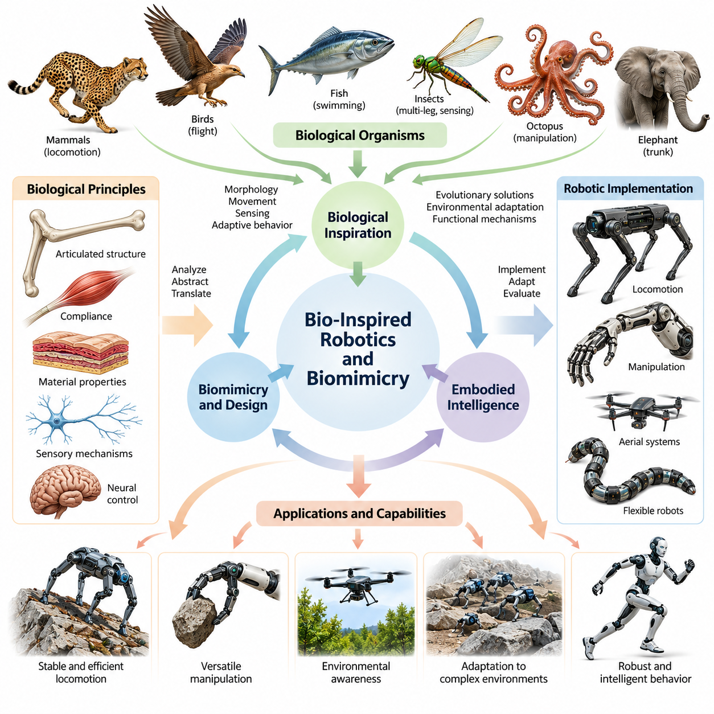
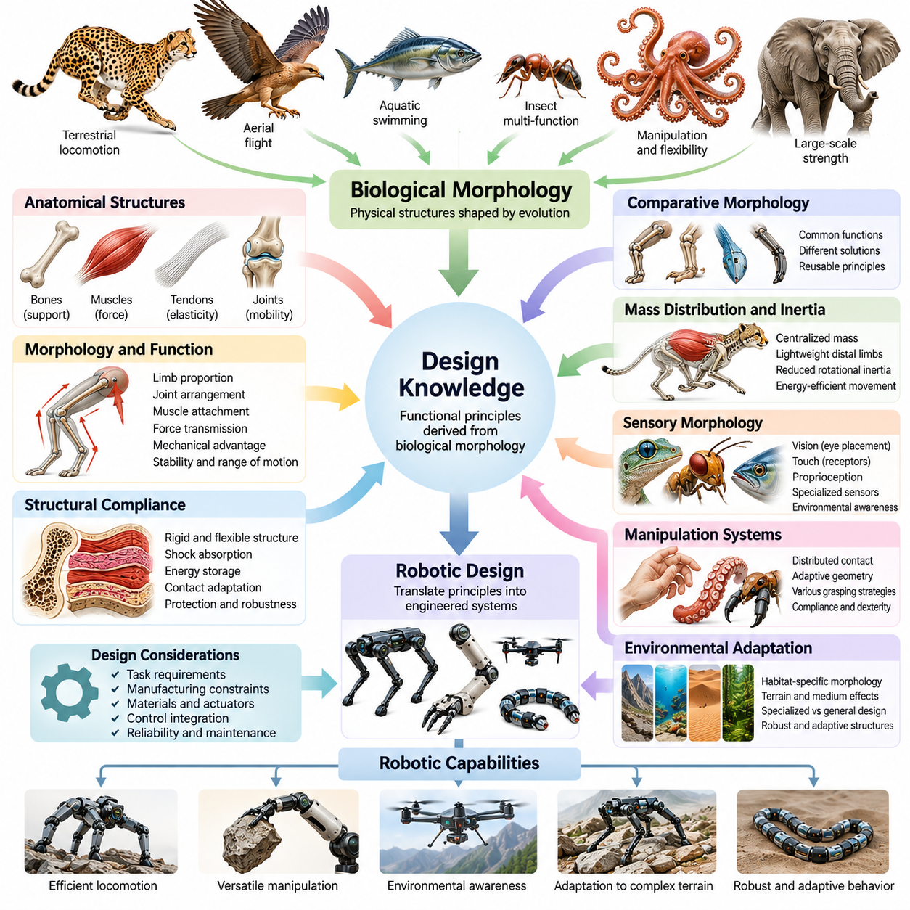
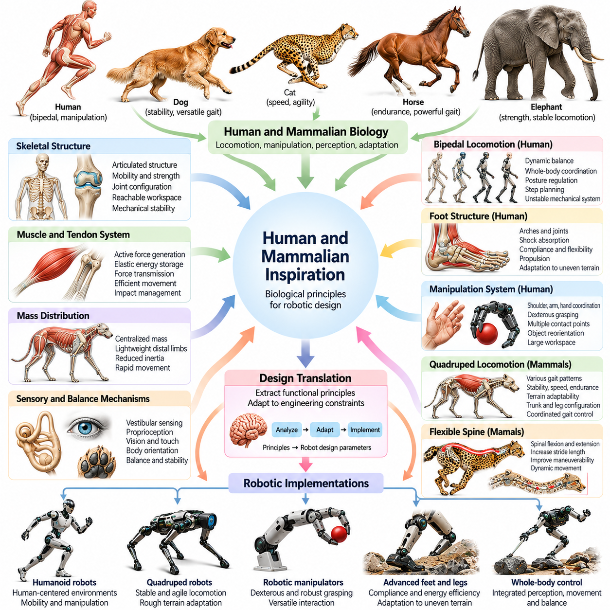
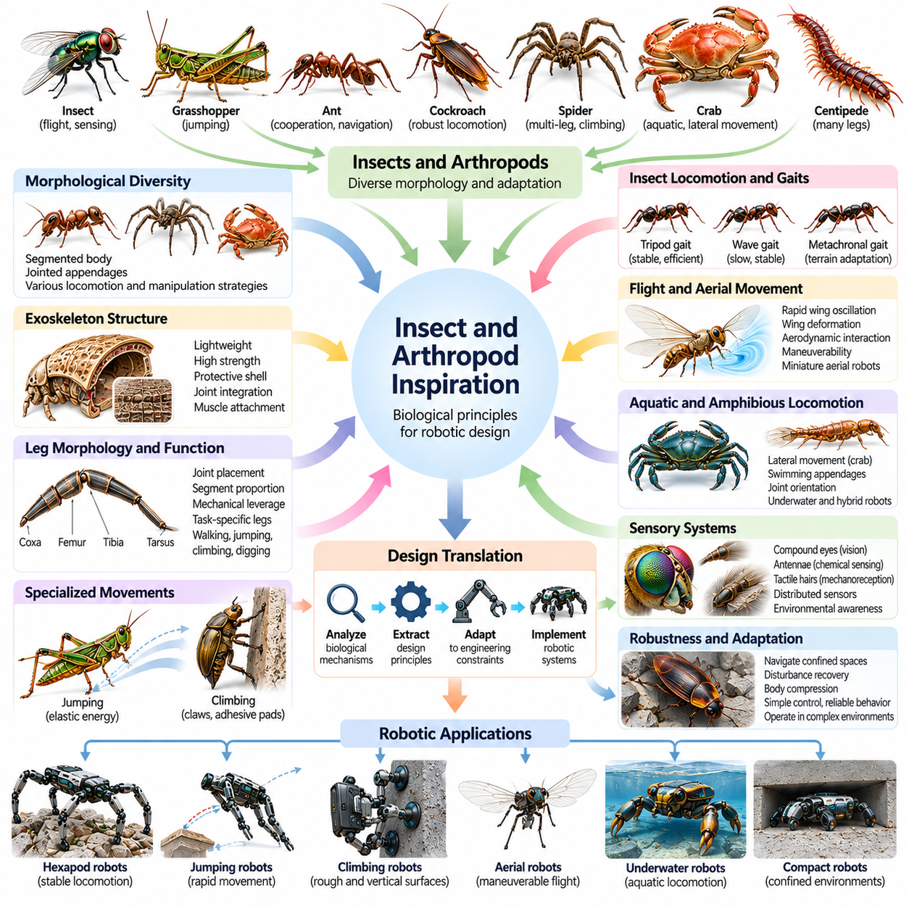
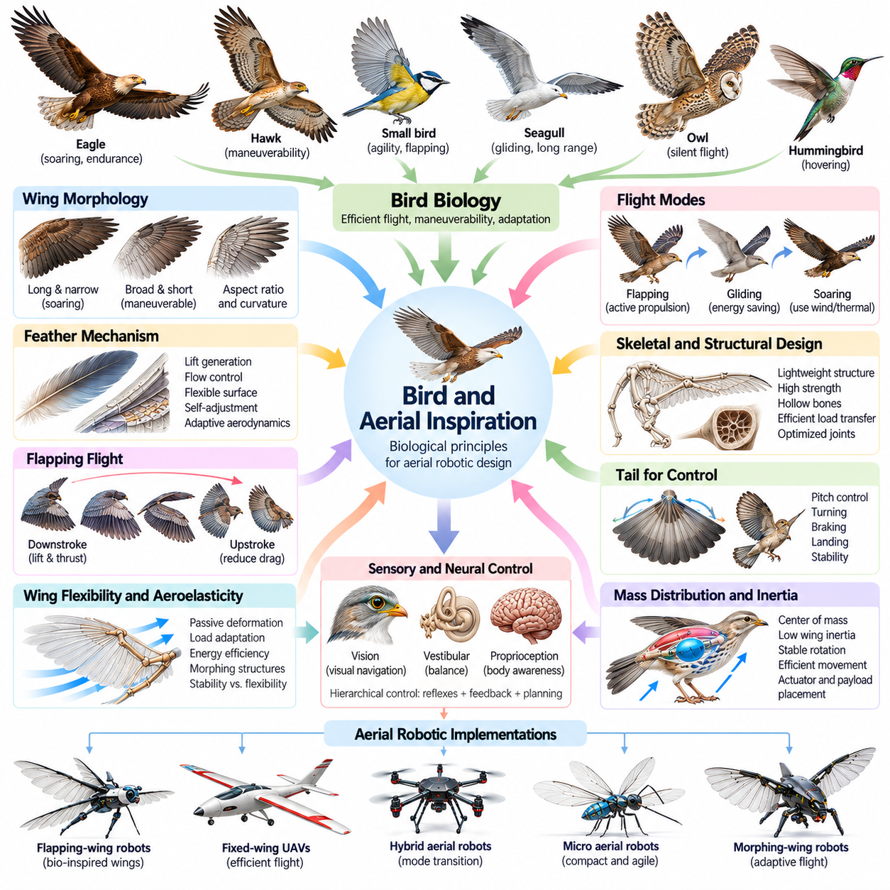
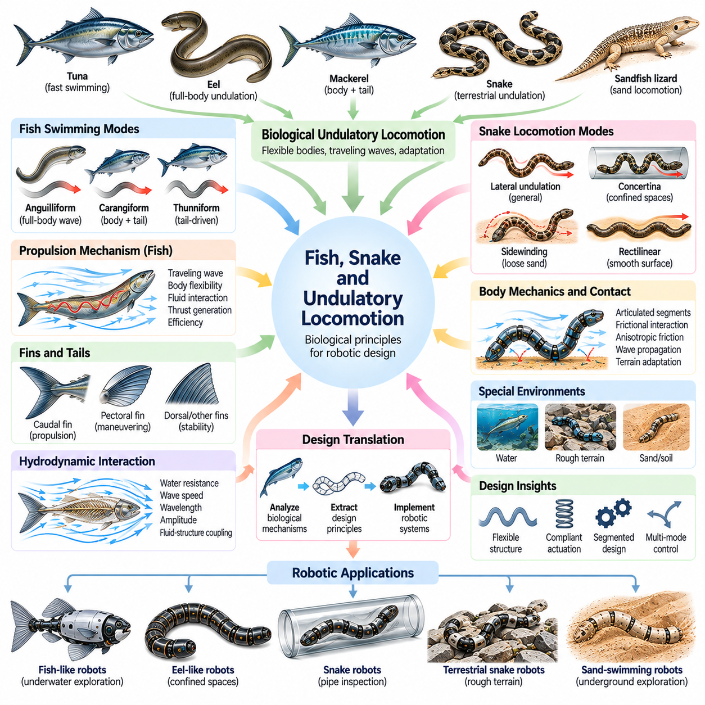
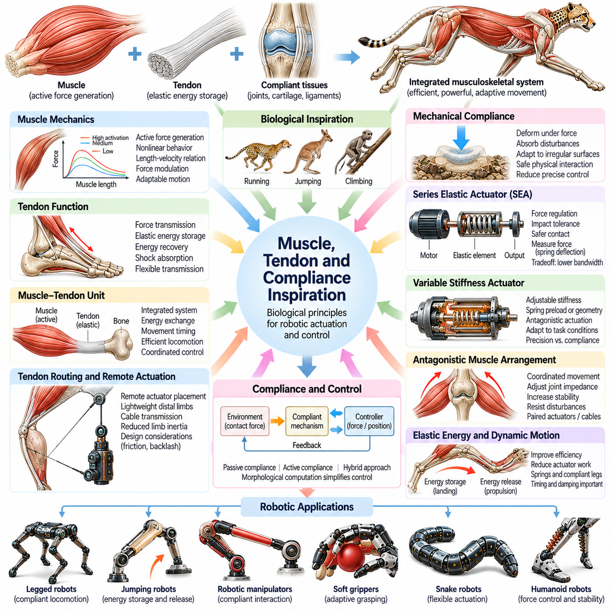
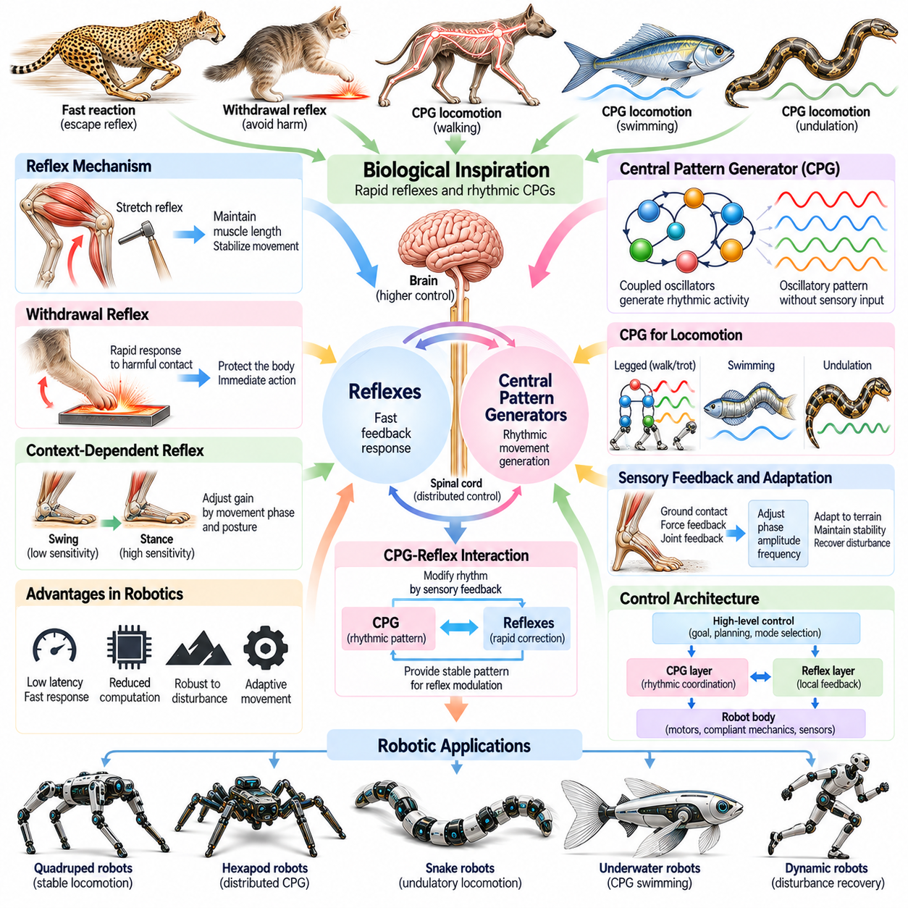
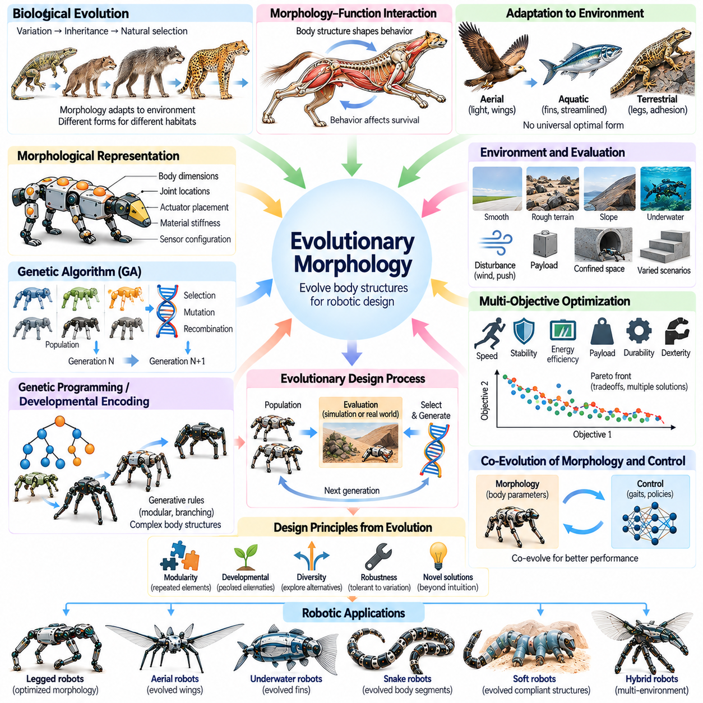
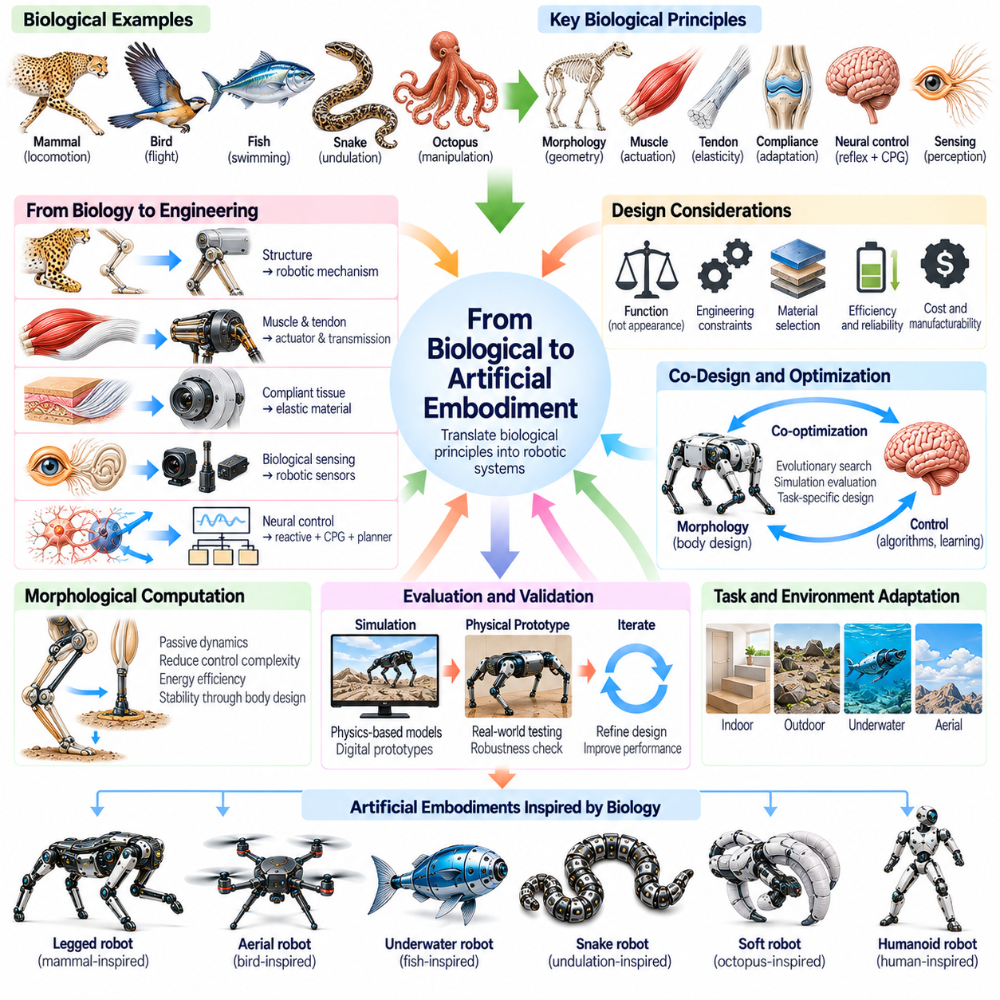

**Volume 03. Embodiment and Morphology**

# Chapter 10. Bio Inspired Robotics

## 10.01. Bio Inspired Robotics and Biomimicry

{width="7.268055555555556in" height="7.268055555555556in"}

생체모방 로봇공학(Bio-inspired Robotics)은 생물학적 유기체(Biological Organisms)에서 관찰되는 원리를 로봇 시스템(Robotic Systems)의 설계, 제작 및 제어에 적용하는 학제간 연구 분야(Interdisciplinary Field)이다. 생명체를 단순히 기계적으로 복제하는 대신, 생물학적 구조(Biological Structures), 움직임, 감각 메커니즘(Sensory Mechanisms), 적응 행동(Adaptive Behaviors)이 물리적 문제를 해결하는 방식을 연구한다. 이러한 통찰은 복잡한 환경과 효율적으로 상호작용하는 로봇을 개발하기 위한 공학적 전략을 제공한다.

생체모방(Biomimicry)은 기술적 응용을 위해 생물학적 해결책을 체계적으로 연구하고 적용하는 것을 의미한다. 로봇공학에서 생체모방은 자연에서 유용한 메커니즘을 식별하고, 그 기능적 원리(Functional Principles)를 이해하며, 이를 인공 시스템(Artificial Systems)으로 변환하는 과정을 포함한다. 생체모방 로봇(Biomimetic Robot)이 반드시 영감을 제공한 생물과 외형적으로 유사할 필요는 없다. 서로 다른 재료, 구동기(Actuators), 컴퓨팅 아키텍처(Computing Architectures)를 사용하면서 특정 기계적 기능을 재현할 수 있다.

생체모방 로봇공학과 생체모방의 관계는 체화 지능(Embodied Intelligence)과 밀접하게 연결된다. 생물학적 유기체는 신경계(Nervous Systems), 신체 구조(Physical Structures), 주변 환경(Surrounding Environments) 사이의 지속적인 상호작용을 통해 지능적 행동을 구현한다. 신체는 인지(Perception), 이동(Locomotion), 조작(Manipulation), 안정화(Stabilization)에 직접 기여한다. 생체모방 로봇공학은 이러한 상호작용을 공학적으로 구현하여 기계 구조와 계산 제어기(Computational Controllers)에 지능적 행동을 분산하는 방법을 연구한다.

생물학적 진화(Biological Evolution)는 환경적 제약(Environmental Constraints)과 기능적 제약(Functional Constraints) 아래에서 발전한 다양한 형태학적 해결책(Morphological Solutions)을 제공한다. 동물은 서로 다른 서식지에서 생존하기 위해 특수한 사지, 유연한 신체, 감각기관, 이동 메커니즘을 진화시켜 왔다. 공학자는 이러한 적응 특성을 분석하여 안정성, 에너지 효율(Energy Efficiency), 기동성(Maneuverability), 강건성(Robustness)과 관련된 설계 원리를 도출할 수 있다. 그러나 생물학적 최적화(Biological Optimization)가 반드시 공학적 최적화(Engineering Optimization)와 일치하는 것은 아니다.

생체모방 설계(Bio-inspired Design)의 핵심 원리는 생물학적 외형(Biological Appearance)과 기능적 추상화(Functional Abstraction)를 구분하는 것이다. 동물의 외형을 재현한다고 해서 해당 동물의 성능까지 재현되는 것은 아니다. 효과적인 생체모방을 위해서는 생물학적 능력을 만들어 내는 근본적인 물리 메커니즘(Physical Mechanisms)을 이해해야 한다. 따라서 공학자는 인공적 구현 방식을 선택하기 전에 힘 전달(Force Transmission), 구조적 순응성(Structural Compliance), 재료 특성(Material Properties), 감각 피드백(Sensory Feedback), 움직임 협응(Movement Coordination)을 분석한다.

생물학적 이동(Biological Locomotion)은 형태 의존적 지능(Morphology-dependent Intelligence)의 중요한 사례를 제공한다. 포유류는 관절로 연결된 사지를 협응하여 걷고 달리며 외부 교란(Disturbances)으로부터 회복하고, 곤충은 여러 접촉점을 활용하여 안정적으로 이동한다. 물고기는 신체의 협응된 변형을 통해 추진력(Propulsion)을 생성하며, 조류는 공기역학적 구조(Aerodynamic Structures)와 능동적인 날개 제어(Active Wing Control)를 결합한다. 이러한 메커니즘은 신체 형상, 기계적 동역학(Mechanical Dynamics), 환경적 힘(Environmental Forces)의 상호작용에서 이동 능력이 형성된다는 사실을 보여준다.

생체모방 로봇공학은 제어 복잡도(Control Complexity)를 줄이는 수동적 기계 특성(Passive Mechanical Properties)의 역할도 강조한다. 생물학적 힘줄(Tendons), 탄성 조직(Elastic Tissues), 유연 관절(Flexible Joints), 순응성 부속기관(Compliant Appendages)은 에너지를 저장하고 충격을 흡수하며 물리적 상호작용을 조절한다. 유사한 특성을 로봇 구조에 적용하면 수동적 안정화(Passive Stabilization)와 에너지 효율적인 움직임을 지원할 수 있다. 이러한 접근은 물리적 동역학이 명시적인 계산을 대신하여 기능을 수행하는 형태학적 계산(Morphological Computation)과 연결된다.

생물학적 원리를 로봇 조작(Robotic Manipulation)에 통합하는 과정은 이동 기능을 넘어 확장된다. 인간의 손, 코끼리의 코, 문어의 팔, 곤충의 부속기관은 불규칙한 물체를 파지(Grasping)하고 도달(Reach)하며 적응하는 다양한 전략을 보여준다. 이러한 구조는 분산 순응성(Distributed Compliance), 중복 운동(Redundant Motion), 협응 접촉(Coordinated Contact)이 다목적 상호작용을 지원하는 방식을 설명한다. 로봇 조작기는 생물학적 시스템의 해부학적 복잡성을 완전히 재현하지 않고도 선택적인 원리를 적용할 수 있다.

생물학적 감지(Biological Sensing)는 또 다른 중요한 영감의 원천이다. 동물은 시각(Vision), 촉각(Touch), 고유수용감각(Proprioception), 청각(Hearing), 특수 감각 메커니즘을 결합하여 주변 환경을 해석한다. 곤충은 더듬이와 겹눈(Compound Eyes)을 사용하고, 물고기는 측선계(Lateral-line Systems)를 통해 물의 움직임을 감지하며, 포유류는 촉각 피드백과 사지 위치 감각을 통합한다. 생체모방 감지 아키텍처(Bio-inspired Sensing Architectures)는 이러한 메커니즘을 활용하여 환경 인식(Environmental Awareness)과 물리적 상호작용을 개선하는 방법을 연구한다.

감지와 움직임 사이의 관계는 생물학적 지능(Biological Intelligence)에서 특히 중요하다. 유기체는 당면한 작업에 필요한 정보를 획득하기 위해 감각 구조와 신체를 능동적으로 움직인다. 이러한 과정은 감각 관측(Sensory Observations)이 움직임에 영향을 주고, 움직임이 이후의 관측을 변화시키는 지속적인 지각-행동 순환(Perception-Action Loop)을 형성한다. 생체모방 로봇은 능동적 지각(Active Perception), 적응적 탐색(Adaptive Exploration), 감각운동 피드백(Sensorimotor Feedback)을 통해 유사한 원리를 적용할 수 있다.

생물학적 제어 시스템(Biological Control Systems)은 중앙집중식 계산(Centralized Computation)에만 의존하기보다 계층적이고 분산된 조직 구조(Hierarchical and Distributed Organization)를 활용하는 경우가 많다. 반사 경로(Reflex Pathways)는 외부 교란에 빠르게 반응하고, 신경 회로(Neural Circuits)는 보행과 수영 같은 리듬 활동(Rhythmic Activities)을 협응한다. 상위 수준의 처리 과정은 목표, 움직임 전환, 환경 적응을 조절한다. 로봇 제어 아키텍처(Robotic Control Architectures)는 유사한 메커니즘을 적용하여 지속적인 운동 계획(Motion Planning)의 계산 부담을 줄이면서 반응성을 개선할 수 있다.

중앙 패턴 생성기(Central Pattern Generators, CPGs)는 로봇 이동에서 특히 영향력 있는 생물학적 개념이다. 이러한 신경 회로는 모든 움직임 주기에 독립적인 외부 명령이 없어도 협응된 리듬 활동을 생성할 수 있다. 인공 중앙 패턴 생성기(Artificial Central Pattern Generators)는 결합 진동자(Coupled Oscillators) 또는 신경 모델(Neural Models)을 사용하여 이동 패턴을 생성한다. 생성된 출력은 감각 피드백을 통해 조정할 수 있으며, 이를 통해 로봇은 보행 주파수(Gait Frequency), 위상 관계(Phase Relationships), 움직임 협응을 조절할 수 있다.

생체모방 공학(Biomimetic Engineering)은 생물학적 재료(Biological Materials)와 인공 재료(Artificial Materials) 사이의 중요한 차이도 고려해야 한다. 생물학적 조직은 가벼운 구조 안에서 탄성(Elasticity), 강도(Strength), 자가 복구(Self-repair), 복잡한 계층적 조직(Hierarchical Organization)을 결합하는 경우가 많다. 기존 로봇 시스템은 일반적으로 서로 다른 기계적 특성과 내구성을 가진 제조 부품에 의존한다. 따라서 생물학적 메커니즘을 로봇으로 변환하려면 제작 방법(Fabrication Methods), 구동기 한계(Actuator Limitations), 유지보수 요구사항(Maintenance Requirements), 구조적 신뢰성(Structural Reliability)을 신중하게 고려해야 한다.

소프트 로봇공학(Soft Robotics)은 생물학적 영감(Biological Inspiration)과 인공 체화(Artificial Embodiment) 사이에서 특히 밀접한 연결 관계를 제공한다. 유연한 재료, 변형 가능한 구동기(Deformable Actuators), 연속체 구조(Continuum Structures)는 로봇이 분산된 변형(Distributed Deformation)을 통해 주변 환경과 상호작용하도록 한다. 이러한 시스템은 근육, 촉수, 연체동물의 일부 특성을 모사할 수 있다. 순응성은 적응성과 접촉 안전성(Contact Safety)을 개선할 수 있지만, 정확한 감지, 동적 모델링(Dynamic Modeling), 정밀 제어(Precise Control)는 여전히 중요한 공학적 과제로 남아 있다.

생체모방 로봇공학이 생물학적 해결책이 기존 공학 설계(Conventional Engineering Designs)보다 항상 우수하다는 의미는 아니다. 평탄한 표면에서는 바퀴가 다리보다 높은 성능을 제공할 수 있고, 강체 산업용 조작기(Rigid Industrial Manipulators)는 순응성 생물학적 구조보다 높은 위치 정밀도(Positioning Precision)를 제공할 수 있으며, 프로펠러(Propellers)는 인공 지느러미보다 단순한 추진 방식을 제공할 수 있다. 적절한 설계는 생물학적 유사성 자체보다 운용 조건(Operating Conditions), 성능 요구사항(Performance Requirements), 제조 제약(Manufacturing Constraints), 시스템 수준 목표(System-level Objectives)에 따라 결정된다.

체계적인 생체모방 설계 프로세스(Systematic Biomimetic Design Process)는 기능적 공학 문제(Functional Engineering Problem)를 정의하고 유사한 문제를 해결하는 생물학적 시스템을 탐색하는 것에서 시작한다. 연구자는 관련 해부학적 구조(Anatomical Structures), 물리적 메커니즘, 행동 전략(Behavioral Strategies)을 분석한다. 이러한 관찰 결과는 시뮬레이션(Simulation)과 실험(Experimentation)을 통해 평가할 수 있는 단순화된 모델(Simplified Models)로 변환된다. 이후 로봇 구현은 생물학적 외형의 유사성이 아니라 측정 가능한 공학적 목표에 따라 개선된다.

정량적 평가(Quantitative Evaluation)는 생물학적 영감이 실질적인 이점을 제공하는지 판단하는 데 필수적이다. 이동 시스템(Locomotion Systems)은 속도, 에너지 소비(Energy Consumption), 안정성, 지형 적응성(Terrain Adaptability)을 기준으로 평가할 수 있으며, 조작기는 파지 신뢰성(Grasp Reliability), 조작 능력(Dexterity), 접촉력 조절(Contact-force Regulation)을 기준으로 평가할 수 있다. 비교 실험(Comparative Experiments)에서는 로봇 크기, 질량, 운용 조건, 제어 능력을 고려해야 한다. 이러한 평가는 실제로 입증된 기능적 개선과 외형적으로 설득력 있는 모방을 구분한다.

생체모방 로봇공학은 인공지능(Artificial Intelligence), 강화학습(Reinforcement Learning), 자동화된 형태 최적화(Automated Morphology Optimization)와 점차 융합되고 있다. 학습 알고리즘(Learning Algorithms)은 순응성 구조를 활용하는 제어 전략을 발견할 수 있으며, 진화 최적화(Evolutionary Optimization)는 다양한 신체 형상과 구동기 배치를 탐색할 수 있다. 시뮬레이션 환경(Simulation Environments)은 물리적 시제품(Physical Prototypes)을 제작하기 전에 형태와 행동의 조합을 평가하도록 지원한다. 이러한 방법은 생물학적 영감을 계산 지원 로봇 설계(Computationally Assisted Robotic Design)로 확장한다.

피지컬 AI(Physical AI)의 발전은 물리적 상호작용(Physical Interaction)에 기반한 지능을 강조함으로써 생물학적 영감의 중요성을 더욱 높인다. 생체모방 로봇은 신체 구조가 학습(Learning), 적응(Adaptation), 일반화(Generalization)에 어떤 영향을 미치는지 연구하는 플랫폼을 제공한다. 로봇의 기계적 특성은 가능한 행동을 제한하는 동시에 자연적인 동역학(Natural Dynamics)을 통해 유용한 행동을 가능하게 한다. 따라서 효과적인 피지컬 AI 시스템은 형태(Morphology), 감지(Sensing), 구동(Actuation), 제어(Control), 학습(Learning)의 협력적 설계를 필요로 한다.

생체모방 로봇공학의 보다 넓은 의의는 생물학적 관찰(Biological Observations)을 재사용 가능한 공학 지식(Reusable Engineering Knowledge)으로 전환하는 데 있다. 자연은 제한된 자원 아래에서 움직임, 지각, 적응, 물리적 상호작용을 구현하는 다양한 방법을 보여준다. 공학자는 생물체를 문자 그대로 복제하기보다 기능적 원리를 추출함으로써 활용성과 환경 적합성(Environmental Compatibility)이 향상된 로봇 시스템을 개발할 수 있다. 따라서 생체모방은 새로운 형태의 인공 체화와 지능적 물리 행동(Intelligent Physical Behavior)을 탐구하는 중요한 기반이 된다.

## 10.02. Biological Morphology as Design Knowledge

{width="7.268055555555556in" height="7.268055555555556in"}

생물학적 형태(Biological Morphology)는 물리적 구조가 이동(Locomotion), 감지(Sensing), 조작(Manipulation), 적응(Adaptation)을 지원하는 방식을 보여줌으로써 로봇공학(Robotics)에 풍부한 설계 지식(Design Knowledge)을 제공한다. 생명체의 기하학적 형상(Geometry), 비율(Proportions), 재료 구성(Material Composition), 기계적 조직(Mechanical Organization)은 기능적 요구사항과 환경 조건 사이의 상호작용을 반영한다. 공학자는 이러한 관계를 연구하여 물리적 특성을 통해 유용한 행동을 구현하는 로봇 신체 설계 원리를 도출할 수 있다.

미리 정의된 메커니즘(Predefined Mechanisms)에서 출발하는 경우가 많은 기존 공학적 접근법(Conventional Engineering Approaches)과 달리, 생물학적 형태는 진화 과정(Evolutionary Processes)을 통해 형성된 통합 시스템(Integrated Systems)의 사례를 제공한다. 뼈(Bones), 근육(Muscles), 힘줄(Tendons), 관절(Joints), 감각 구조(Sensory Structures)는 독립적인 장치가 아니라 상호 연결된 구성요소로 작동한다. 이러한 집합적 조직은 협응된 구조적 특성에서 기계적 성능(Mechanical Performance)이 나타나는 방식을 보여주며, 로봇 형태학(Robotic Morphology)과 시스템 수준 설계(System-level Design)에 중요한 통찰을 제공한다.

생물학적 구조(Biological Structures)는 인공적 제작(Artificial Construction)을 위한 정확한 설계도가 아니라 기능적 지식(Functional Knowledge)으로 해석해야 한다. 진화적 적응(Evolutionary Adaptations)은 생존(Survival), 번식(Reproduction), 발달(Development), 환경적 역사(Environmental History)를 포함한 다양한 제약을 반영한다. 이러한 제약은 제조 비용(Manufacturing Cost), 정밀도(Precision), 신뢰성(Reliability), 유지보수(Maintenance)와 같은 공학적 요구사항과 다르다. 따라서 효과적인 생체모방 설계(Bio-inspired Design)는 불필요한 생물학적 복잡성을 피하면서 이전 가능한 원리(Transferable Principles)를 추출한다.

생물학적 형태에 대한 연구는 해부학적 구조(Anatomical Structures)와 기능적 역할(Functional Roles) 사이의 관계를 식별하는 것에서 시작한다. 연구자는 사지 비율(Limb Proportions), 관절 배치(Joint Arrangements), 신체 분절(Body Segmentation), 근육 부착 위치(Muscle Attachment Locations), 구조적 유연성(Structural Flexibility)을 분석한다. 이러한 특성은 힘 전달(Force Transmission), 운동 범위(Movement Range), 기계적 이점(Mechanical Advantage), 안정성(Stability)에 영향을 미친다. 이러한 관계를 이해하면 생물학적 관찰을 측정 가능한 로봇 설계 매개변수(Robotic Design Parameters)로 변환할 수 있다.

비교 형태학(Comparative Morphology)은 서로 다른 생물 사이에서 재사용 가능한 설계 원리(Reusable Design Principles)를 발견하기 위한 체계적인 방법을 제공한다. 서로 다른 해부학적 구조를 사용하면서 유사한 기능을 수행하는 종을 비교하면 필수 메커니즘(Essential Mechanisms)과 종 특이적 적응(Species-specific Adaptations)을 구분할 수 있다. 반대로 서로 다른 환경에서 활동하는 근연 생물(Related Organisms)을 비교하면 형태학적 변이(Morphological Variations)가 변화하는 물리적 제약 아래에서 성능에 어떤 영향을 미치는지 파악할 수 있다.

형태와 이동(Locomotion) 사이의 관계는 생물학적 설계 지식의 공학적 가치를 잘 보여준다. 육상 동물(Terrestrial Animals)은 서식지와 이동 요구사항에 따라 서로 다른 사지 구성(Limb Configurations), 신체 비율, 접촉 전략(Contact Strategies)을 나타낸다. 긴 사지는 적절한 지형에서 효율적인 이동을 지원할 수 있으며, 소형 구조(Compact Structures)는 제한된 공간에서 기동성(Maneuverability)을 향상시킬 수 있다. 이러한 관찰은 로봇의 다리 길이(Leg Length), 관절 배치(Joint Placement), 지지 자세 형상(Stance Geometry), 지상고(Ground Clearance)에 관한 설계 결정을 안내한다.

생물학적 형태는 질량 분포(Mass Distribution)와 관성 관리(Inertia Management)에 관한 중요한 원리도 보여준다. 많은 동물은 상당한 근육 질량(Muscle Mass)을 몸통(Torso) 가까이에 집중시키면서 상대적으로 가벼운 말단 사지(Distal Limbs)를 유지한다. 이러한 배치는 회전 관성(Rotational Inertia)과 빠른 사지 움직임에 필요한 에너지 요구량(Energetic Demands)을 줄일 수 있다. 로봇 설계자는 무거운 구동기(Actuators)를 신체 가까이에 배치하고 링크 기구(Linkages), 케이블(Cables), 힘줄 유사 메커니즘(Tendon-like Mechanisms)을 통해 기계적 동력을 전달하는 방식으로 관련 원리를 적용한다.

구조적 순응성(Structural Compliance)은 생물학적 설계 지식의 또 다른 중요한 형태이다. 생명체는 강체 골격 요소(Rigid Skeletal Elements)와 외부 힘에 따라 변형되는 유연 조직(Flexible Tissues)을 결합한다. 이러한 조합은 충격 흡수(Shock Absorption), 에너지 저장(Energy Storage), 접촉 적응(Contact Adaptation), 기계적 보호(Mechanical Protection)를 지원한다. 로봇은 탄성 관절(Elastic Joints), 순응성 메커니즘(Compliant Mechanisms), 유연 구조 부품(Flexible Structural Components)을 통해 유사한 특성을 구현할 수 있으며, 물리적 상호작용이 안정성과 제어에 직접 기여하도록 할 수 있다.

생물학적 관절(Biological Joints)은 제한된 기계 구조 안에서 이동성과 안정성이 어떻게 공존할 수 있는지를 보여준다. 관절 형상(Joint Geometry), 인대 배치(Ligament Arrangements), 주변 조직(Surrounding Tissues)은 특정 움직임을 제한하면서 다른 움직임을 허용한다. 이러한 물리적 제약(Physical Constraints)은 기계적으로 가능한 움직임의 범위를 줄이고 협응(Coordination)을 단순화할 수 있다. 로봇 관절 설계(Robotic Joint Design)는 기계적 스토퍼(Mechanical Stops), 수동 정렬 메커니즘(Passive Alignment Mechanisms), 작업 특화 자유도(Task-specific Degrees of Freedom)를 통합하여 유사한 원리를 적용할 수 있다.

생물학적 부속기관(Biological Appendages)의 형태는 힘 생성(Force Generation)과 기계적 이점(Mechanical Advantage)에 관한 통찰을 제공한다. 근육 부착 위치(Muscle Attachment Locations), 지레팔 길이(Lever-arm Lengths), 관절 구성(Joint Configurations)은 근육의 힘이 움직임으로 변환되는 방식을 결정한다. 서로 다른 해부학적 배치는 힘(Strength), 속도(Speed), 운동 범위(Movement Range) 중 특정 특성에 유리하게 작용한다. 공학자는 이러한 관계를 활용하여 로봇 시스템의 운용 요구사항에 적합한 구동기 위치(Actuator Positions), 전달비(Transmission Ratios), 링크 형상(Linkage Geometries)을 선택할 수 있다.

생물학적 조작 시스템(Biological Manipulation Systems)은 분산 접촉(Distributed Contact)과 적응형 형상(Adaptive Geometry)의 중요성을 보여준다. 인간의 손가락은 관절과 순응성 조직(Compliant Tissues)을 협응하여 다양한 형상과 표면 특성을 가진 물체를 파지(Grasping)한다. 문어의 팔은 연속적인 변형(Continuous Deformation)을 통해 조작을 수행하며, 특수한 동물 부속기관은 대안적인 파지 전략(Grasping Strategies)을 제공한다. 이러한 사례는 정밀한 위치 제어(Precise Position Control)에만 의존하지 않고 구조적 적응성(Structural Adaptability)을 활용하는 로봇 말단장치(Robotic End Effectors)의 개발에 영감을 제공한다.

형태학적 특수화(Morphological Specialization)는 감각 성능(Sensory Performance)에도 영향을 미친다. 생물학적 감각기관(Biological Sensory Organs)의 위치와 방향은 어떤 환경 정보를 효율적으로 획득할 수 있는지를 결정한다. 눈의 배치(Eye Placement)는 시각적 관측 범위(Visual Coverage)에 영향을 미치고, 촉각 수용체 분포(Tactile Receptor Distribution)는 접촉 민감도(Contact Sensitivity)에 영향을 주며, 고유수용감각 구조(Proprioceptive Structures)는 내부 신체 인식(Internal Body Awareness)을 지원한다. 로봇 설계자는 이러한 원리를 활용하여 센서 배치(Sensor Placement)를 신체 형상, 움직임 패턴, 예상 상호작용 조건과 조화시킬 수 있다.

생물학적 형태는 환경적 힘(Environmental Forces)과의 상호작용을 통해 수동적 기계 지능(Passive Mechanical Intelligence)을 지원하는 경우가 많다. 유연한 부속기관은 표면에 맞춰 변형될 수 있고, 탄성 조직은 저장된 에너지를 반환할 수 있으며, 신체 형상은 지속적인 보정 명령(Corrective Commands) 없이 움직임을 안정화할 수 있다. 이러한 효과는 물리적 특성이 정보 처리(Information Processing)와 행동 조절(Behavioral Regulation)에 기여하는 형태학적 계산(Morphological Computation)을 보여준다. 이러한 메커니즘은 능동 로봇 제어기(Active Robotic Controllers)에 가해지는 부담을 줄일 수 있다.

생물학적 형태와 환경 적응(Environmental Adaptation) 사이의 관계는 구조화되지 않은 산업 환경(Unstructured Industrial Environments) 밖에서 작동하는 로봇에 특히 중요하다. 동물은 특정 표면이나 매질(Media)과의 상호작용을 개선하는 특수한 발(Feet), 발톱(Claws), 패드(Pads), 지느러미(Fins), 체표 구조(Body Coverings)를 가진다. 이러한 적응은 접촉 형상(Contact Geometry), 마찰(Friction), 순응성(Compliance), 표면 질감(Surface Texture)이 이동성(Mobility)에 미치는 영향을 보여준다. 공학자는 이러한 관찰을 지형 특화 이동 메커니즘(Terrain-specific Locomotion Mechanisms)과 적응형 접촉 인터페이스(Adaptive Contact Interfaces)로 변환할 수 있다.

생물학적 시스템은 여러 구조적 규모(Structural Scales)에서 모듈성(Modularity)과 기능적 통합(Functional Integration)도 보여준다. 반복되는 신체 분절(Repeated Body Segments), 쌍을 이루는 사지(Paired Limbs), 협응된 부속기관(Coordinated Appendages)은 움직임과 적응을 지원하는 조직적 패턴을 제공한다. 동시에 생물학적 구성요소는 여러 기능을 동시에 수행하는 경우가 많다. 로봇 형태학은 모듈형 아키텍처(Modular Architectures)의 장점을 활용하면서 지지(Support), 감지(Sensing), 구동(Actuation), 기계적 보호(Mechanical Protection)를 결합하는 다기능 구조(Multifunctional Structures)를 통합할 수 있다.

생물학적 형태를 공학적 지식으로 변환할 때 중요한 과제는 적절한 추상화 수준(Level of Abstraction)을 식별하는 것이다. 상세한 해부학적 복제(Detailed Anatomical Replication)는 불필요한 복잡성을 초래할 수 있으며, 지나친 단순화(Excessive Simplification)는 유용한 행동을 만들어 내는 핵심 메커니즘을 제거할 수 있다. 공학자는 어떤 기하학적 관계(Geometric Relationships), 재료 특성(Material Properties), 동적 특성(Dynamic Characteristics)이 필수적인지 판단해야 한다. 이러한 과정에는 기계적 분석(Mechanical Analysis), 수학적 모델링(Mathematical Modeling), 실험적 검증(Experimental Validation)이 필요하다.

계산 모델링(Computational Modeling)은 생물학적 형태를 공학적 설계 변수(Engineering Design Variables)로 표현할 수 있도록 한다. 기하학적 매개변수(Geometric Parameters)는 신체 치수와 관절 위치를 설명하고, 동적 매개변수(Dynamic Parameters)는 질량(Mass), 관성(Inertia), 강성(Stiffness), 감쇠(Damping)를 나타낸다. 이후 시뮬레이션(Simulation)을 통해 이러한 특성이 이동, 조작, 안정성, 에너지 소비에 미치는 영향을 평가할 수 있다. 이러한 표현은 정성적 생물학적 관찰(Qualitative Biological Observations)을 로봇 설계를 위한 검증 가능한 가설(Testable Hypotheses)로 변환한다.

영상화 기술(Imaging), 동작 포착(Motion Capture), 생체역학 분석(Biomechanical Analysis)의 발전은 생물학적 구조와 행동에 관한 더욱 상세한 정보를 제공한다. 3차원 해부학적 모델(Three-dimensional Anatomical Models)은 내부 형상(Internal Geometry)을 보여주며, 동작 측정(Motion Measurements)은 협응과 운동 동역학(Movement Dynamics)을 특성화한다. 힘 측정(Force Measurements)과 재료 시험(Material Testing)은 기계적 상호작용을 더욱 명확하게 설명한다. 이러한 관찰을 결합하면 외부 형태만으로는 추론하기 어려운 기능적 관계를 식별할 수 있다.

생물학적 형태는 자동화된 로봇 설계(Automated Robot Design)와 진화 최적화(Evolutionary Optimization)에도 활용될 수 있다. 공학자는 생물학적으로 영감을 받은 관절 구성(Joint Configurations), 사지 비율(Limb Proportions), 구조적 배치(Structural Arrangements)를 사용하여 설계 공간(Design Spaces)을 정의할 수 있다. 이후 최적화 알고리즘(Optimization Algorithms)은 로봇 성능 목표(Robotic Performance Objectives)에 따라 대안을 탐색한다. 이러한 접근은 생물학적 설계 지식과 계산 탐색(Computational Search)을 결합하여, 다른 구성이 더 우수한 공학적 성능을 제공하는 경우 인공 시스템이 자연적 해부학 구조에서 벗어날 수 있도록 한다.

생물학적 형태의 가치는 궁극적으로 로봇 능력(Robotic Capabilities)의 측정 가능한 개선에 달려 있다. 후보 설계(Candidate Designs)는 안정성(Stability), 에너지 효율(Energy Efficiency), 기동성(Maneuverability), 적재 능력(Payload Capacity), 적응성(Adaptability), 강건성(Robustness)을 기준으로 평가해야 한다. 비교 시험(Comparative Testing)에서는 운용 조건(Operating Conditions)과 구현 제약(Implementation Constraints)을 고려해야 한다. 생물학적 영감은 그 기초 원리를 설명하고 재현하며 체계적인 실험(Systematic Experimentation)을 통해 검증할 수 있을 때 공학적 지식이 된다.

피지컬 AI(Physical AI)에서 생물학적 형태는 지능이 물리적 체화(Physical Embodiment)에 어떻게 의존하는지를 이해하기 위한 기반이 된다. 신체 구조(Body Structure)는 로봇이 수행할 수 있는 행동, 수집하는 감각 정보(Sensory Information), 제어 문제(Control Problem)의 복잡성에 영향을 미친다. 공학자는 생물학적 관찰을 기능적 설계 원리(Functional Design Principles)로 전환함으로써 기계적 구조(Mechanical Structures)가 지각(Perception), 학습(Learning), 적응적 행동(Adaptive Behavior)을 능동적으로 지원하는 로봇 시스템을 개발할 수 있다.

## 10.03. Human and Mammalian Inspiration

{width="7.268055555555556in" height="7.268055555555556in"}

인간과 포유류의 생물학(Human and Mammalian Biology)은 정교한 이동(Locomotion), 조작(Manipulation), 지각(Perception), 물리적 적응(Physical Adaptation) 능력을 보여주기 때문에 로봇 시스템(Robotic Systems)에 중요한 영감을 제공한다. 포유류의 신체는 관절형 골격(Articulated Skeletons), 근육(Muscles), 힘줄(Tendons), 감각기관(Sensory Organs), 분산 신경 제어(Distributed Neural Control)를 협응된 기계 시스템(Coordinated Mechanical Systems)으로 통합한다. 이러한 관계를 연구하면 복잡한 환경에서 안정적인 이동, 정교한 조작, 적응적 행동(Adaptive Behavior)을 수행할 수 있는 로봇을 개발하는 데 도움이 된다.

인간의 형태(Human Morphology)는 많은 인공 환경(Artificial Environments)이 인간의 신체 치수와 능력을 기준으로 설계되기 때문에 로봇공학(Robotics)에서 특히 중요하다. 문, 계단, 도구, 가구, 작업 공간은 특정한 도달 범위(Reach), 이동성(Mobility), 조작 능력을 전제로 한다. 휴머노이드 로봇(Humanoid Robots)은 인간형 신체 구조(Anthropomorphic Body Structures)를 활용하여 이러한 환경에서 작업할 수 있다. 그러나 인간의 외형을 재현하는 것보다 인간 중심 인프라(Human-centered Infrastructure)와 기능적으로 호환되는 것이 더욱 중요하다.

인간의 골격계(Human Skeletal System)는 관절형 구조(Articulated Structures)가 이동성, 강도(Strength), 기계적 안정성(Mechanical Stability) 사이에서 균형을 이루는 방식을 보여준다. 골반(Pelvis), 척추(Spine), 어깨(Shoulders), 팔(Arms), 다리(Legs)는 상호 연결된 운동학적 사슬(Kinematic Chains)을 형성하여 협응된 전신 움직임(Whole-body Movement)을 지원한다. 관절 구성(Joint Configurations)은 도달 가능한 작업 공간(Reachable Workspaces)과 수행 가능한 운동 패턴(Motion Patterns)을 결정한다. 로봇 설계자는 이러한 구조를 연구하여 적절한 자유도(Degrees of Freedom)와 기구학적 중복성(Kinematic Redundancy)을 갖춘 조작기(Manipulators) 및 휴머노이드 플랫폼(Humanoid Platforms)을 개발한다.

인간의 이족 보행(Human Bipedal Locomotion)은 동적으로 불안정한 기계 시스템(Dynamically Unstable Mechanical Systems)의 균형을 유지하기 위한 중요한 원리를 제공한다. 보행은 신체가 양발 사이에서 지지 상태(Support)를 지속적으로 전환하는 동안 다리, 골반, 몸통(Torso), 팔 사이의 협응된 상호작용을 포함한다. 균형(Balance)은 신체 형상(Body Geometry), 질량 분포(Mass Distribution), 지면 반력(Ground Reaction Forces), 능동 제어(Active Control)에 따라 결정된다. 휴머노이드 로봇은 협응 보행(Coordinated Stepping), 자세 조절(Posture Regulation), 전신 안정화(Whole-body Stabilization)를 통해 이러한 원리를 적용한다.

인간의 발(Human Foot)은 형태(Morphology)가 지면과의 효율적인 상호작용을 지원하는 방식을 보여준다. 발의 아치(Arches), 관절(Joints), 힘줄(Tendons), 순응성 조직(Compliant Tissues)은 접촉력(Contact Forces)을 분산시키면서 유연성과 구조적 지지(Structural Support)를 제공한다. 보행 중 발은 충격 흡수(Shock Absorption)와 추진(Propulsion) 기능 사이를 전환한다. 로봇 발(Robotic Feet)은 관절형 발가락(Articulated Toes), 탄성 구조(Elastic Structures), 순응성 접촉면(Compliant Contact Surfaces)을 통합하여 안정성, 에너지 효율(Energy Efficiency), 불규칙한 지형(Uneven Terrain)에 대한 적응성을 개선할 수 있다.

인간의 팔과 손(Human Arms and Hands)은 정교한 로봇 조작 시스템(Dexterous Robotic Manipulation Systems)을 설계하기 위한 기반을 제공한다. 어깨와 팔꿈치는 넓은 작업 공간(Workspace) 안에서 손의 위치를 결정하고, 손목은 방향(Orientation)을 조정하며, 손가락은 여러 접촉점(Contact Points)을 형성한다. 대립 가능한 엄지(Opposable Thumb)는 정밀 파지(Precision Grasping)와 물체 방향 재조정(Object Reorientation)을 가능하게 한다. 로봇 조작기는 선택적인 해부학적 원리(Anatomical Principles)를 적용하여 파지 다양성(Grasp Versatility), 협응 운동(Coordinated Motion), 일상 물체와의 상호작용을 개선할 수 있다.

인간의 상체 형태(Human Upper-body Morphology)는 여러 관절에 걸친 협응 운동(Coordinated Movement)의 중요성도 보여준다. 손을 뻗기(Reaching), 들어 올리기(Lifting), 운반하기(Carrying)는 척추, 어깨, 팔꿈치, 손목, 하체(Lower Body) 사이의 상호작용을 포함한다. 이러한 움직임은 조작 작업(Manipulation Tasks)을 수행하는 동안 기계적 하중(Mechanical Loads)을 분산하고 균형을 유지한다. 휴머노이드 로봇은 유사한 전신 협응(Whole-body Coordination)을 적용하여 독립적인 로봇 팔(Isolated Robotic Arms)의 능력을 넘어서는 작업을 수행할 수 있다.

포유류의 사족 보행(Mammalian Quadrupedal Locomotion)은 로봇 이동(Robotic Locomotion)에 또 다른 중요한 영감을 제공한다. 개, 고양이, 말 및 기타 네발 동물은 안정성(Stability), 속도(Speed), 지구력(Endurance), 지형 적응성(Terrain Adaptability)의 다양한 조합을 보여준다. 이들의 사지 배치(Limb Arrangements)와 신체 비율(Body Proportions)은 서로 다른 이동 요구사항을 반영한다. 사족 보행 로봇(Quadruped Robots)은 이러한 관찰을 활용하여 몸통 형상(Trunk Geometry), 다리 구성(Leg Configuration), 관절 배치(Joint Placement), 협응 보행 패턴 생성(Coordinated Gait Generation)을 설계한다.

포유류의 보행 패턴(Mammalian Gait Patterns)은 이동 전략(Movement Strategies)이 속도와 환경 조건에 따라 어떻게 변화하는지를 보여준다. 걷기(Walking), 속보(Trotting), 측대보(Pacing), 구보(Cantering), 질주(Galloping)는 사지 사이의 서로 다른 타이밍 관계(Timing Relationships)를 포함한다. 이러한 패턴은 지지 분포(Support Distribution), 신체 진동(Body Oscillation), 에너지 소비(Energy Expenditure)에 영향을 미친다. 로봇 보행 제어기(Robotic Gait Controllers)는 선택적인 협응 원리(Coordination Principles)를 재현하면서 기계적 제약(Mechanical Constraints)에 맞춰 타이밍, 보폭(Stride Length), 접촉력(Contact Forces)을 조정할 수 있다.

많은 포유류의 유연한 척추(Flexible Spine)는 동적 이동(Dynamic Locomotion)에 관한 중요한 통찰을 제공한다. 달리는 동안 척추의 신전(Spinal Extension)과 굴곡(Flexion)은 보폭과 신체 추진력(Body Propulsion)에 기여할 수 있다. 고양이와 기타 민첩한 포유류(Agile Mammals)는 빠른 움직임 중 자세를 조정하기 위해 몸통 유연성(Torso Flexibility)을 활용한다. 관절형 또는 순응성 몸통(Articulated or Compliant Trunks)을 가진 로봇 시스템은 유사한 메커니즘을 활용하여 기동성(Maneuverability), 장애물 통과(Obstacle Negotiation), 동적 움직임(Dynamic Movement)을 개선할 수 있다.

포유류의 근육 및 힘줄 시스템(Mammalian Muscle and Tendon Systems)은 능동적인 힘 생성(Active Force Generation)이 수동적인 기계적 탄성(Passive Mechanical Elasticity)과 어떻게 상호작용하는지를 보여준다. 근육은 제어 가능한 힘(Controllable Forces)을 생성하고, 힘줄은 하중(Loads)을 전달하며 기계적 에너지(Mechanical Energy)를 일시적으로 저장할 수 있다. 이러한 구조는 운동 효율(Movement Efficiency)과 충격 관리(Impact Management)를 지원한다. 로봇 설계자는 생물학적 근골격계(Biological Musculoskeletal Systems)의 일부 기능적 이점을 재현하기 위해 힘줄 구동 방식(Tendon-driven Actuation), 탄성 전달장치(Elastic Transmissions), 순응성 관절(Compliant Joints)을 연구한다.

포유류 사지의 근육 질량 분포(Muscle Mass Distribution)는 구동기 배치(Actuator Placement)에 유용한 원리를 제공한다. 많은 포유류는 상당한 근육 질량을 몸통 가까이에 배치하면서 힘줄을 통해 말단 관절(Distal Joints)로 힘을 전달한다. 이러한 구성은 사지 관성(Limb Inertia)을 줄이고 빠른 움직임을 지원할 수 있다. 로봇은 원격 구동(Remote Actuation), 케이블 전달장치(Cable Transmissions), 경량 말단 구조(Lightweight Distal Structures)를 통해 유사한 배치를 적용할 수 있지만, 전달 손실(Transmission Losses)과 기계적 복잡성(Mechanical Complexity)을 고려해야 한다.

포유류의 균형 메커니즘(Mammalian Balance Mechanisms)은 기계적 구조(Mechanical Structure)와 지속적인 감각 피드백(Sensory Feedback)을 결합한다. 전정 감각(Vestibular Sensing), 고유수용감각(Proprioception), 시각(Vision), 촉각 정보(Tactile Information)는 신체 방향(Body Orientation)과 움직임을 추정하는 데 기여한다. 이러한 신호는 자세 보정(Posture Correction)과 외부 교란(Disturbances)에 대한 협응 반응(Coordinated Responses)을 지원한다. 로봇 시스템은 관성 측정 장치(Inertial Measurement Units, IMUs), 관절 엔코더(Joint Encoders), 힘 센서(Force Sensors), 시각 인식(Visual Perception)을 통해 유사한 감지 원리를 활용하여 안정성을 유지한다.

인간과 포유류의 반사 작용(Reflexes)은 광범위한 상위 수준 계획(High-level Planning)을 필요로 하지 않는 빠른 반응에 영감을 제공한다. 신장 반사(Stretch Reflexes), 회피 반응(Withdrawal Responses), 자세 조정(Postural Adjustments)은 국소 감각운동 경로(Local Sensorimotor Pathways)가 움직임을 조절하는 방식을 보여준다. 로봇 제어기(Robotic Controllers)는 예상하지 못한 접촉이나 외부 교란에 대응하기 위해 유사한 피드백 메커니즘(Feedback Mechanisms)을 구현할 수 있다. 이러한 아키텍처는 빠르고 예측 가능한 물리적 반응(Physical Reactions)을 지원함으로써 상위 수준 계획을 보완한다.

포유류의 이동은 서로 다른 표면에 접촉 행동(Contact Behavior)을 적응시키는 것의 중요성도 보여준다. 발바닥(Paws), 발굽(Hooves), 특수한 발 구조(Specialized Foot Structures)는 견인력(Traction), 순응성(Compliance), 하중 분산(Load Distribution)의 서로 다른 조합을 제공한다. 고양이는 정확한 발 배치(Precise Foot Placement)를 위해 유연한 발바닥을 사용하고, 발굽을 가진 포유류(Hoofed Mammals)는 특정 조건에서 효율적인 이동에 적합한 구조를 활용한다. 로봇 발은 유사한 접촉 형상(Contact Geometries)을 적용하여 특정 지형에서 성능을 개선할 수 있다.

포유류의 조작 능력(Manipulation Capabilities)은 인간의 손을 넘어 다양한 형태로 나타난다. 영장류(Primates)는 물체 조작(Object Handling)을 위해 손가락과 팔을 협응하여 사용하고, 코끼리는 근육질의 코(Muscular Trunks)를 사용하여 물체를 조작한다. 이러한 생물학적 시스템은 정교한 조작 능력(Dexterity), 도달 범위(Reach), 분산 변형(Distributed Deformation)에 대한 서로 다른 접근법을 보여준다. 이들의 기능적 원리는 다양한 상호작용 요구사항에 맞춰 설계된 관절형 로봇 손(Articulated Robotic Hands), 연속체 조작기(Continuum Manipulators), 순응성 파지 메커니즘(Compliant Grasping Mechanisms)에 영감을 제공한다.

인간의 운동 학습(Human Motor Learning)은 지능형 로봇 행동(Intelligent Robotic Behavior)에 추가적인 영감을 제공한다. 인간은 반복 연습(Practice), 감각 피드백(Sensory Feedback), 변화하는 물리적 조건에 대한 적응을 통해 움직임을 개선한다. 학습된 협응(Learned Coordination)은 물체, 하중, 환경이 달라지더라도 익숙한 행동이 효과적으로 유지되도록 한다. 로봇 학습 시스템(Robotic Learning Systems)은 기계적 제약(Mechanical Constraints)과 안전 제약(Safety Constraints)을 준수하면서 강화학습(Reinforcement Learning), 모방학습(Imitation Learning), 적응 제어(Adaptive Control)를 통해 유사한 원리를 적용할 수 있다.

포유류의 행동(Mammalian Behavior)은 형태(Morphology)와 제어(Control)가 함께 발달하는 방식도 보여준다. 어린 동물은 신체가 성장하고 신경계(Nervous Systems)가 성숙함에 따라 점진적으로 협응된 움직임을 습득한다. 사지 비율(Limb Proportions), 근력(Strength), 감각 능력(Sensory Capabilities)의 변화는 발달 과정에서 사용할 수 있는 제어 전략(Control Strategies)에 영향을 미친다. 로봇공학 연구는 이러한 관계를 활용하여 발달 학습(Developmental Learning), 점진적 기술 습득(Progressive Skill Acquisition), 변화하는 신체 매개변수(Body Parameters)에 대한 적응을 연구할 수 있다.

인공 구동기(Artificial Actuators), 센서(Sensors), 재료(Materials), 에너지 시스템(Energy Systems)은 생물학적 대응 요소(Biological Counterparts)와 상당히 다르기 때문에 생물학적 영감은 신중하게 공학적으로 변환되어야 한다. 인간이나 포유류의 해부학적 구조(Anatomy)를 재현한 로봇이라도 기계적 특성(Mechanical Properties)이 동일하지 않으면 서로 다른 동적 행동(Dynamic Behavior)을 나타낼 수 있다. 따라서 효과적인 공학 설계는 해부학적 유사성(Anatomical Similarity) 자체보다 기능적 추상화(Functional Abstraction), 정량적 모델링(Quantitative Modeling), 실험적 검증(Experimental Validation)을 강조한다.

피지컬 AI(Physical AI)에서 인간과 포유류의 생물학적 영감은 형태(Morphology), 지각(Perception), 제어(Control), 학습(Learning)을 체화 시스템(Embodied Systems)에 통합하기 위한 프레임워크(Framework)를 제공한다. 생물학적 사례는 기계적 구조(Mechanical Structures)가 균형(Balance), 운동 효율(Movement Efficiency), 정교한 조작 능력(Dexterity), 환경 적응(Environmental Adaptation)에 어떻게 기여하는지를 보여준다. 공학자는 포유류의 신체와 행동에서 이전 가능한 원리(Transferable Principles)를 추출함으로써 복잡한 물리적 환경(Physical Environments)과 더욱 효과적으로 상호작용하는 로봇 플랫폼(Robotic Platforms)을 개발할 수 있다.

## 10.04. Insect and Arthropod Inspiration

{width="7.268055555555556in" height="7.268055555555556in"}

곤충(Insects)과 절지동물(Arthropods)은 비교적 작은 신경계(Nervous Systems)를 가지고도 효율적인 이동(Locomotion), 분산 감지(Distributed Sensing), 구조적 적응성(Structural Adaptability), 강건한 행동(Robust Behavior)을 보여주기 때문에 로봇공학(Robotics)에 중요한 생물학적 영감(Biological Inspiration)을 제공한다. 이들의 분절된 신체(Segmented Bodies), 관절형 부속기관(Articulated Appendages), 특수 감각기관(Specialized Sensory Organs)은 다양한 환경에서의 움직임을 지원한다. 이러한 메커니즘을 연구하면 기계적 단순성(Mechanical Simplicity)과 효과적인 물리적 상호작용(Physical Interaction)을 결합한 소형 로봇(Compact Robots)을 개발하는 데 도움이 된다.

절지동물(Arthropods)에는 곤충, 거미(Spiders), 갑각류(Crustaceans) 및 관련 생물들이 포함되며, 분절된 신체, 관절형 부속기관, 외골격(Exoskeletons)을 특징으로 한다. 이들의 형태학적 다양성(Morphological Diversity)은 신체 아키텍처(Body Architecture)의 변화가 서로 다른 이동 전략(Locomotion Strategies)과 조작 전략(Manipulation Strategies)을 어떻게 지원하는지를 보여준다. 공학자는 이러한 구조를 분석하여 다족 이동(Legged Mobility), 기계적 보호(Mechanical Protection), 센서 배치(Sensor Placement), 협응 운동(Coordinated Movement)에 재사용할 수 있는 원리를 도출한다.

외골격(Exoskeleton)은 절지동물 형태학(Arthropod Morphology)의 대표적인 특징이며 로봇 구조 설계(Robotic Structural Design)에 중요한 교훈을 제공한다. 척추동물의 골격(Vertebrate Skeletons)과 달리 절지동물의 외골격은 내부 조직을 둘러싸 보호하면서 근육(Muscles)의 부착 지점을 제공한다. 외골격의 형상(Geometry)과 재료 조직(Material Organization)은 강성(Stiffness), 유연성(Flexibility), 하중 전달(Load Transmission)에 영향을 미친다. 로봇 구조는 경량 외피(Lightweight Shells), 통합 관절(Integrated Joints), 보호 기능을 갖춘 하중 지지 프레임(Protective Load-bearing Frames)을 통해 유사한 원리를 적용할 수 있다.

곤충의 이동(Insect Locomotion)은 여러 관절형 다리(Articulated Legs)가 지속적인 상위 수준 협응(High-level Coordination) 없이도 안정성을 제공할 수 있음을 보여준다. 여섯 개의 다리를 가진 곤충은 여러 접촉점(Contact Points)에 체중을 분산하고 이동 중 지지 패턴(Support Patterns)을 조정한다. 이러한 구조는 불규칙한 표면(Irregular Surfaces)에서 안정적인 이동을 가능하게 하며, 개별 다리가 장애물(Obstacles)을 만났을 때 중복성(Redundancy)을 제공한다. 육족 보행 로봇(Hexapod Robots)은 유사한 원리를 적용하여 까다로운 지형에서 신뢰성 높은 이동을 구현한다.

교대 삼각 보행(Alternating Tripod Gait)은 곤충에서 영감을 받은 이동 방식(Insect-inspired Locomotion) 중 널리 연구되는 사례이다. 이 보행에서는 세 개의 다리가 하나의 지지 그룹(Support Group)을 형성하는 동안 나머지 세 개의 다리가 앞으로 이동하며, 두 그룹이 번갈아 역할을 수행한다. 이러한 협응은 질량중심(Center of Mass)이 지지 접촉점(Supporting Contacts)에 대해 적절한 위치를 유지할 때 안정적인 지지를 제공할 수 있다. 육족 보행 로봇은 효율적인 보행을 위해 삼각 보행 패턴(Tripod Patterns)을 사용하며, 지형 조건에 따라 더 신중한 이동이 필요할 때 보행 타이밍(Gait Timing)을 조정한다.

곤충은 속도(Speed), 안정성(Stability), 환경 조건(Environmental Conditions)이 변화할 때 대안적인 보행 패턴(Gait Patterns)도 사용한다. 파동 보행(Wave Gaits)과 순차적 협응(Metachronal Coordination)은 여러 지지 접촉점(Supporting Contacts)을 유지하면서 다리를 순차적으로 움직이도록 한다. 이러한 전략은 느린 이동이나 장애물 통과(Obstacle Negotiation) 과정에서 안정성을 향상시킬 수 있다. 로봇 보행 제어기(Robotic Gait Controllers)는 지지 다리의 수와 움직임 타이밍을 조정하여 이동 속도(Locomotion Speed), 에너지 소비(Energy Consumption), 지형 적응성(Terrain Adaptability) 사이의 균형을 맞출 수 있다.

절지동물의 다리 형태(Arthropod Leg Morphology)는 관절 배치(Joint Placement), 분절 비율(Segment Proportions), 기계적 지레 작용(Mechanical Leverage)의 중요성을 보여준다. 서로 다른 종은 걷기(Walking), 점프(Jumping), 등반(Climbing), 굴착(Digging), 수영(Swimming)에 특화된 부속기관을 가진다. 다리 분절(Leg Segments)의 배치는 도달 가능한 작업 공간(Reachable Workspaces)과 힘 전달 특성(Force Transmission Characteristics)을 결정한다. 공학자는 이러한 관찰을 로봇 링크 형상(Robotic Linkage Geometries), 구동기 구성(Actuator Configurations), 작업 특화 다리 아키텍처(Task-specific Leg Architectures)로 변환한다.

점프하는 곤충(Jumping Insects)은 특수한 기계 구조(Specialized Mechanical Structures)를 통한 빠른 에너지 방출(Rapid Energy Release)의 중요한 사례를 제공한다. 메뚜기(Grasshoppers)와 벼룩(Fleas)은 강력한 움직임을 생성하기 위해 에너지를 저장한 후 방출하는 탄성 메커니즘(Elastic Mechanisms)을 사용한다. 이러한 전략은 근육이 모든 기계적 동력(Mechanical Power)을 순간적으로 공급하지 않아도 빠른 가속(Rapid Acceleration)을 가능하게 한다. 점프 로봇(Jumping Robots)은 스프링(Springs), 래치(Latches), 탄성 전달장치(Elastic Transmissions)를 통합하여 유사한 에너지 저장 원리(Energy-storage Principles)를 재현할 수 있다.

등반하는 곤충(Climbing Insects)은 부속기관 형태(Appendage Morphology)와 표면 특성(Surface Properties) 사이의 정교한 상호작용을 보여준다. 발톱(Claws), 접착 패드(Adhesive Pads), 특수 접촉 구조(Specialized Contact Structures)는 거친 표면(Rough Surfaces), 매끄러운 표면(Smooth Surfaces), 경사진 표면(Inclined Surfaces)에서 이동을 가능하게 한다. 이러한 메커니즘은 접촉 형상(Contact Geometry), 마찰(Friction), 접착력(Adhesion), 제어된 힘 분포(Controlled Force Distribution)에 의존한다. 등반 로봇(Climbing Robots)은 유사한 구조를 적용하여 특정 표면에서 부착 신뢰성(Attachment Reliability)과 이동성(Mobility)을 개선할 수 있다.

바퀴벌레(Cockroaches)는 좁고 복잡한 환경(Confined and Cluttered Environments)에서 작동하는 로봇에 중요한 영감을 제공한다. 납작한 신체(Flattened Bodies), 유연한 관절(Flexible Joints), 빠른 이동 능력(Rapid Locomotion)을 통해 좁은 통로(Narrow Passages)를 이동하고 기계적 교란(Mechanical Disturbances)으로부터 회복할 수 있다. 일부 종은 제한된 개구부(Restricted Openings)를 통과하기 위해 신체를 압축할 수 있다. 생체모방 로봇(Bio-inspired Robots)은 순응성 외피(Compliant Shells), 관절형 구조(Articulated Structures), 낮은 차체 형상(Low-profile Geometries)을 활용하여 제한된 공간에서의 이동 능력을 개선할 수 있다.

거미(Spiders)는 다족 이동(Multi-legged Locomotion)과 분산 기계 제어(Distributed Mechanical Control)에 대한 또 다른 관점을 제공한다. 여덟 개의 다리를 가진 형태(Eight-legged Morphology)는 걷기, 등반, 복잡한 표면에서의 기동을 포함한 다양한 이동 전략을 지원한다. 많은 거미는 근육 메커니즘(Muscular Mechanisms)을 보완하기 위해 유압(Hydraulic Pressure)을 이용하여 다리를 신전시킨다. 로봇 연구자는 유체 구동 시스템(Fluid-powered Actuation Systems)과 기계적으로 적응 가능한 다족 플랫폼(Mechanically Adaptive Legged Platforms)을 개발할 때 이러한 원리를 연구한다.

갑각류(Crustaceans)는 절지동물의 형태가 수중 환경(Aquatic Environments)과 수륙 양용 환경(Amphibious Environments)에 어떻게 적응하는지를 보여준다. 게(Crabs)는 측면 방향으로 배치된 부속기관(Laterally Oriented Appendages)을 사용하여 옆으로 이동하며, 수영하는 갑각류(Swimming Crustaceans)는 특수한 사지를 협응하여 추진력(Propulsion)을 생성한다. 이러한 구조는 관절 방향(Joint Orientation)과 부속기관 형상(Appendage Geometry)이 물속 및 바닥면(Substrates)에서의 움직임에 미치는 영향을 보여준다. 이러한 관찰은 수중 보행 로봇(Underwater Walking Robots)과 하이브리드 이동 시스템(Hybrid Locomotion Systems)의 개발을 지원한다.

곤충의 날개(Insect Wings)는 소형 비행 로봇(Miniature Aerial Robots)에 중요한 영감을 제공한다. 비행 곤충(Flying Insects)은 빠른 날개 진동(Wing Oscillations), 복잡한 날개 변형(Wing Deformation), 주변 공기 흐름(Airflow)과의 상호작용을 통해 공기역학적 힘(Aerodynamic Forces)을 생성한다. 이러한 비행 메커니즘(Flight Mechanisms)은 기존 고정익 항공기(Fixed-wing Aircraft) 및 회전익 시스템(Rotary-wing Systems)과 상당히 다르다. 공학자는 제한된 환경에서 기동할 수 있는 날갯짓형 초소형 비행체(Flapping-wing Micro Aerial Vehicles)를 개발하기 위해 이러한 원리를 연구한다.

많은 곤충의 작은 크기는 독특한 공기역학적 제약(Aerodynamic Constraints)과 기계적 제약(Mechanical Constraints)을 발생시킨다. 곤충 크기(Insect Scales)에서는 점성 효과(Viscous Effects)와 비정상 공기역학 현상(Unsteady Aerodynamic Phenomena)이 비행 성능(Flight Performance)에 큰 영향을 미칠 수 있다. 날개 유연성(Wing Flexibility), 날갯짓 타이밍(Stroke Timing), 회전 운동(Rotational Motion)은 양력 생성(Lift Generation)과 기동성(Maneuverability)에 기여한다. 로봇 설계자는 서로 다른 재료와 구동 능력(Actuator Capabilities)을 가진 인공 플랫폼에 곤충 비행 메커니즘을 적용할 때 이러한 스케일링 관계(Scaling Relationships)를 고려해야 한다.

곤충의 감각 시스템(Insect Sensory Systems)은 소형이면서 효율적인 지각(Perception)을 위한 유용한 모델을 제공한다. 겹눈(Compound Eyes)은 넓은 시야의 시각 감지(Wide-field Visual Sensing)를 지원하고, 더듬이(Antennae)는 기계적 신호(Mechanical Signals)와 화학적 신호(Chemical Signals)를 감지하며, 특수 수용체(Specialized Receptors)는 공기 흐름, 진동(Vibration), 신체 움직임을 측정한다. 이러한 감각 메커니즘은 제한된 신경 처리 자원(Neural Processing Resources)으로 작동하는 경우가 많다. 로봇 시스템은 유사한 감지 전략(Sensing Strategies)을 적용하여 항법(Navigation), 장애물 회피(Obstacle Avoidance), 빠른 환경 반응(Rapid Environmental Responses)을 지원할 수 있다.

광학 흐름(Optic Flow)은 곤충에서 영감을 받은 로봇 항법(Insect-inspired Robotic Navigation)에서 특히 중요하다. 비행 곤충은 겉보기 시각 운동(Apparent Visual Motion)의 패턴을 사용하여 상대적 움직임(Relative Movement)과 주변 환경까지의 근접도(Environmental Proximity)를 추정한다. 이러한 정보는 주변 환경의 완전한 기하학적 재구성(Geometric Reconstruction) 없이도 장애물 회피, 속도 조절(Speed Regulation), 착륙 행동(Landing Behavior)을 지원한다. 로봇 항법 시스템(Robotic Navigation Systems)은 광학 흐름 측정(Optic-flow Measurements)을 활용하여 비교적 경량의 지각 아키텍처(Lightweight Perception Architectures)로 반응성이 높은 제어를 구현할 수 있다.

곤충의 신경계(Insect Nervous Systems)는 분산 제어(Distributed Control)와 국소 피드백(Local Feedback)이 협응된 행동(Coordinated Behavior)을 생성하는 방식을 보여준다. 개별 사지와 관련된 신경 회로(Neural Circuits)는 인접한 신체 분절(Neighboring Segments) 및 상위 제어 중추(Higher-level Control Centers)와 정보를 교환하면서 움직임을 조절한다. 이러한 조직은 모든 운동 동작에 대해 중앙집중식 계획(Centralized Planning)에 의존하는 정도를 줄인다. 로봇 제어기(Robotic Controllers)는 국소 반사 루프(Local Reflex Loops), 결합 진동자(Coupled Oscillators), 분산 협응 메커니즘(Distributed Coordination Mechanisms)을 통해 유사한 아키텍처를 적용할 수 있다.

중앙 패턴 생성기(Central Pattern Generators, CPGs)와 감각 반사(Sensory Reflexes)는 절지동물에서 영감을 받은 이동(Arthropod-inspired Locomotion)과 특히 밀접하게 관련된다. 리듬성 신경 활동(Rhythmic Neural Activity)은 반복적인 사지 움직임을 협응하고, 감각 피드백(Sensory Feedback)은 접촉과 외부 교란에 대응하여 이러한 패턴을 수정한다. 인공 구현(Artificial Implementations)에서는 진동자 네트워크(Oscillator Networks)와 피드백 제어기(Feedback Controllers)를 사용하여 적응형 보행 행동(Adaptive Gait Behavior)을 생성한다. 이러한 메커니즘은 로봇이 예상하지 못한 지형 변화(Terrain Variations)를 만났을 때 반응성을 향상시킬 수 있다.

절지동물의 형태(Arthropod Morphology)는 기계적 설계(Mechanical Design)와 행동(Behavior)이 협력하여 강건성(Robustness)을 구현하는 방식도 보여준다. 분절된 신체(Segmented Bodies), 순응성 연결부(Compliant Connections), 보호 외피(Protective Shells), 중복 부속기관(Redundant Appendages)은 외부 교란을 견디고 이동성을 유지하는 데 도움이 될 수 있다. 로봇 시스템은 모듈형 구조(Modular Structures), 결함 허용 보행 전략(Fault-tolerant Gait Strategies), 기계적으로 복원력이 높은 구성요소(Mechanically Resilient Components)를 통해 이러한 원리를 적용할 수 있다. 그러나 효과적인 강건성은 신체 설계와 제어의 전체적인 통합(Integration)에 달려 있다.

피지컬 AI(Physical AI)에서 곤충과 절지동물의 생물학적 영감은 소형 신체(Compact Bodies), 특수화된 형태(Specialized Morphology), 분산 감각운동 협응(Distributed Sensorimotor Coordination)으로부터 정교한 물리적 행동(Sophisticated Physical Behavior)이 나타날 수 있음을 보여준다. 이러한 생물은 효율적인 이동(Efficient Locomotion), 적응형 감지(Adaptive Sensing), 기계적 복원력(Mechanical Resilience), 분산형 제어(Decentralized Control)를 위한 공학적 원리를 제공한다. 이러한 원리를 인공 시스템(Artificial Systems)으로 변환하면 소형이면서 민첩하고 환경에 적응할 수 있는 로봇 플랫폼(Robotic Platforms)의 개발을 지원할 수 있다.

## 10.05. Bird and Aerial Inspiration

{width="7.268055555555556in" height="7.268055555555556in"}

조류(Birds)는 효율적인 비행(Efficient Flight), 뛰어난 기동성(Maneuverability), 다양한 대기 조건(Atmospheric Conditions)에 대한 적응형 제어(Adaptive Control)를 보여주기 때문에 항공 로봇공학(Aerial Robotics)에 중요한 생물학적 영감(Biological Inspiration)을 제공한다. 조류의 날개(Wings), 깃털(Feathers), 골격 구조(Skeletal Structures), 근육(Muscles), 감각 시스템(Sensory Systems)은 공기역학적 힘(Aerodynamic Forces)을 생성하기 위한 통합 메커니즘(Integrated Mechanisms)으로 작동한다. 이러한 관계를 연구하면 추진력(Propulsion), 안정성(Stability), 에너지 효율(Energy Efficiency), 환경 적응성(Environmental Adaptability)을 결합한 항공 로봇(Aerial Robots)을 개발하는 데 도움이 된다.

조류의 비행(Avian Flight)은 새가 날개 형상(Wing Geometry)과 운동 패턴(Movement Patterns)을 지속적으로 변화시킨다는 점에서 기존 항공기(Conventional Aircraft)의 운용 방식과 다르다. 날개의 펼침(Wing Extension), 접힘(Folding), 비틀림(Twisting), 깃털 조정(Feather Adjustments)은 양력(Lift), 항력(Drag), 기동성에 영향을 미친다. 이러한 변형은 새가 변화하는 비행 요구사항(Flight Requirements)에 맞춰 공기역학적 구성(Aerodynamic Configuration)을 조정할 수 있도록 한다. 생체모방 항공 로봇(Bio-inspired Aerial Robots)은 다양한 운용 조건에서 성능을 향상시키기 위해 유사한 가변형 구조(Morphing Structures)를 연구한다.

조류의 날개 형태(Avian Wing Morphology)는 공기역학적 효율(Aerodynamic Efficiency)과 기능적 특화(Functional Specialization)에 관한 중요한 설계 지식(Design Knowledge)을 제공한다. 길고 좁은 날개는 효율적인 활공(Soaring)과 지속 비행(Sustained Flight)에 적합한 반면, 짧고 넓은 날개는 제한된 환경(Constrained Environments)에서의 기동성을 지원할 수 있다. 날개 종횡비(Wing Aspect Ratio), 표면 곡률(Surface Curvature), 구조적 유연성(Structural Flexibility)은 공기역학적 성능(Aerodynamic Performance)에 영향을 미친다. 공학자는 이러한 관찰을 특정 로봇 비행 임무(Robotic Flight Missions)에 최적화된 날개 형상으로 변환한다.

깃털 시스템(Feather System)은 공기역학적 표면(Aerodynamic Surfaces)을 제어하기 위한 독특한 생물학적 메커니즘(Biological Mechanism)을 나타낸다. 비행 깃털(Flight Feathers)은 양력 생성(Lift Generation), 공기 흐름 조절(Airflow Regulation), 날개의 국소 변형(Localized Deformation)에 기여한다. 깃털이 서로 겹치는 배열(Overlapping Arrangement)은 공기역학적 연속성(Aerodynamic Continuity)을 유지하면서 표면 형상(Surface Geometry)을 제어된 방식으로 변화시킬 수 있도록 한다. 인공 깃털형 구조(Artificial Feather-like Structures)와 분절형 날개 표면(Segmented Wing Surfaces)은 기존의 강체 조종면(Rigid Control Surfaces) 없이도 적응형 공기역학적 특성(Adaptive Aerodynamic Characteristics)을 제공할 수 있다.

날갯짓 비행(Flapping Flight)은 추진력 생성(Propulsion Generation)과 양력 생성이 협응된 날개 움직임(Coordinated Wing Movement)에 통합될 수 있음을 보여준다. 새는 반복적인 날갯짓 주기(Stroke Cycles) 동안 날개의 병진 운동(Translation), 회전(Rotation), 변형(Deformation)을 결합하여 공기역학적 힘을 생성한다. 이러한 메커니즘의 상대적 기여도(Relative Contributions)는 종(Species), 비행 속도(Flight Speed), 환경 조건에 따라 달라진다. 날갯짓형 로봇(Flapping-wing Robots)은 주기적 운동(Periodic Motion)을 통해 제어 가능한 공기역학적 힘을 생성하는 추진 시스템(Propulsion Systems)을 개발하기 위해 이러한 원리를 연구한다.

하강 날갯짓(Downstroke)과 상승 날갯짓(Upstroke)의 차이는 조류에서 영감을 받은 추진 방식(Bird-inspired Propulsion)을 이해하는 데 중요하다. 하강 날갯짓 동안 많은 새는 상당한 양력과 전방 추력(Forward Thrust)을 생성하는 반면, 상승 날갯짓은 비행 조건에 따라 저항(Resistance)을 줄이거나 추가적인 공기역학적 힘을 생성할 수 있다. 날개 접힘과 깃털 조정은 이러한 상호작용을 변화시킨다. 로봇 날갯짓 메커니즘(Robotic Flapping Mechanisms)은 비대칭 날갯짓 궤적(Asymmetric Stroke Trajectories)을 활용하여 추진 효율(Propulsion Efficiency)과 비행 제어(Flight Control)를 개선할 수 있다.

새는 형태(Morphology)와 에너지 소비(Energy Consumption) 사이의 서로 다른 관계를 보여주는 여러 비행 모드(Flight Modes)를 사용한다. 날갯짓 비행은 능동 추진(Active Propulsion)을 제공하고, 무동력 활공(Gliding)은 고도(Altitude)를 전방 이동으로 전환하며, 상승 기류를 이용한 활공(Soaring)은 대기 에너지(Atmospheric Energy)를 활용하여 고도를 유지하거나 높인다. 일부 종은 환경 조건에 따라 이러한 모드 사이를 전환한다. 항공 로봇은 유사한 모드 전환 전략(Mode-switching Strategies)을 통합하여 비행 지속시간(Endurance)을 연장하고 추진 요구량(Propulsion Demands)을 줄일 수 있다.

활공성 조류(Soaring Birds)는 에너지 효율적인 비행(Energy-efficient Flight)의 특히 유용한 사례를 제공한다. 독수리(Eagles), 대머리수리(Vultures), 알바트로스(Albatrosses)는 열상승 기류 활공(Thermal Soaring), 사면 상승풍 활공(Slope Soaring), 동적 활공(Dynamic Soaring)을 통해 대기의 움직임(Atmospheric Motion)을 활용한다. 이들의 날개 구성(Wing Configurations)과 제어 전략(Control Strategies)은 제한적인 날갯짓만으로 지속적인 비행을 가능하게 한다. 자율 항공 시스템(Autonomous Aerial Systems)은 바람 조건(Wind Conditions)을 추정하고 이용 가능한 대기 에너지를 활용하는 궤적(Trajectories)을 계획함으로써 유사한 기술을 연구할 수 있다.

조류의 골격 형태(Avian Skeletal Morphology)는 경량 구조(Lightweight Structures)가 높은 공기역학적 하중(Aerodynamic Loads)을 지지하는 방식을 보여준다. 속이 비어 있거나 공기가 채워진 뼈(Hollow or Air-filled Bones), 보강된 구조 배열(Reinforced Structural Arrangements), 특수 관절(Specialized Joints)은 우수한 강도 대비 중량 특성(Strength-to-weight Characteristics)에 기여한다. 날개뼈(Wing Bones)와 관련 조직(Associated Tissues)은 비행 중 공기역학적 힘과 근육의 힘(Muscular Forces)을 전달한다. 로봇 설계자는 경량 복합재 구조(Lightweight Composite Structures), 최적화된 하중 경로(Optimized Load Paths), 기계적으로 효율적인 관절 아키텍처(Mechanically Efficient Joint Architectures)를 통해 유사한 원리를 적용할 수 있다.

새의 신체 내부 질량 분포(Mass Distribution) 역시 비행 안정성(Flight Stability)과 기동성에 영향을 미친다. 날개 관성(Wing Inertia)은 날갯짓에 필요한 에너지 비용(Energetic Cost)에 영향을 주며, 신체 질량의 배치(Body Mass Placement)는 회전 동역학(Rotational Dynamics)과 제어 권한(Control Authority)에 영향을 미친다. 새는 이러한 효과를 관리하기 위해 날개 움직임, 신체 자세(Body Posture), 꼬리 조정(Tail Adjustments)을 협응한다. 로봇 항공기(Robotic Aircraft)는 날개 말단 질량(Distal Wing Mass)을 최소화하고 구동기(Actuators), 배터리(Batteries), 탑재물(Payloads)을 신중하게 배치함으로써 관련 원리를 적용할 수 있다.

새의 꼬리(Bird Tails)는 공기역학적 안정화(Aerodynamic Stabilization)와 기동(Maneuvering)에 중요한 영감을 제공한다. 꼬리의 펼침(Tail Spreading), 접힘(Folding), 방향 변화(Orientation Changes)는 비행 중 공기역학적 힘과 모멘트(Aerodynamic Moments)를 변화시킨다. 이러한 조정은 피치 제어(Pitch Control), 선회(Turning), 제동(Braking), 착륙(Landing)에 기여할 수 있다. 생체모방 항공 로봇은 특히 기존 조종면(Conventional Control Surfaces)의 효과가 감소하는 상황에서 기동성을 개선하기 위해 관절형 꼬리(Articulated Tails) 또는 변형 가능한 공기역학적 표면(Deformable Aerodynamic Surfaces)을 통합할 수 있다.

날개 유연성(Wing Flexibility)과 공기역학적 하중(Aerodynamic Loading) 사이의 상호작용은 수동적 구조 적응(Passive Structural Adaptation)의 중요성을 보여준다. 새의 날개는 공기역학적 힘에 의해 변형되며, 이러한 변형은 힘 분포(Force Distribution)와 비행 효율(Flight Efficiency)에 영향을 미칠 수 있다. 적절하게 설계된 순응성 구조(Compliant Structures)는 지속적인 능동 조정(Active Adjustment) 없이도 유익한 수동 반응(Passive Responses)을 제공할 수 있다. 로봇의 가변형 날개(Morphing Wings)는 유사한 공탄성 거동(Aeroelastic Behavior)을 활용할 수 있지만, 지나친 유연성은 불안정성(Instability)이나 제어의 어려움(Control Difficulties)을 초래할 수 있다.

조류의 비행 제어(Bird Flight Control)는 시각 정보(Visual Information), 전정 감각 정보(Vestibular Information), 고유수용감각 정보(Proprioceptive Information)의 지속적인 통합에 의존한다. 시각 관측(Visual Observations)은 항법(Navigation)과 장애물 회피(Obstacle Avoidance)를 지원하고, 전정 감각(Vestibular Sensing)은 방향 추정(Orientation)과 균형(Balance)에 기여한다. 고유수용감각 피드백(Proprioceptive Feedback)은 날개 구성(Wing Configuration)과 근육 활동(Muscular Activity)에 관한 정보를 제공한다. 항공 로봇은 카메라(Cameras), 관성 측정 장치(Inertial Measurement Units, IMUs), 관절 센서(Joint Sensors), 공기역학적 측정(Aerodynamic Measurements)을 통해 유사한 감지 아키텍처(Sensing Architectures)를 활용한다.

시각 유도(Visual Guidance)는 조류의 항법과 착륙에서 특히 중요하다. 새는 시각적 움직임(Visual Motion), 환경의 지형지물(Environmental Landmarks), 공간적 관계(Spatial Relationships)를 이용하여 비행 궤적(Flight Trajectories)을 조절한다. 광학 흐름(Optic Flow)은 주변 표면에 대한 상대적 움직임(Relative Movement)과 근접도(Proximity)에 관한 정보를 제공한다. 로봇 항공 시스템(Robotic Aerial Systems)은 유사한 시각 피드백(Visual Feedback)을 활용하여 장애물 회피, 정밀 착륙(Precision Landing), 외부 위치 신호(External Positioning Signals)가 제한된 환경에서의 항법을 지원할 수 있다.

조류에서 영감을 받은 항공 로봇공학(Bird-inspired Aerial Robotics)은 빠른 기동(Rapid Maneuvering)과 외란 억제(Disturbance Rejection)도 연구한다. 새는 돌풍(Gusts)이나 예상하지 못한 장애물에 대응하여 날개 형상, 날갯짓 진폭(Stroke Amplitude), 신체 자세, 꼬리 방향을 조정한다. 이러한 조정은 공기역학적 제어(Aerodynamic Control), 기계적 유연성(Mechanical Flexibility), 감각 피드백을 결합한다. 로봇 제어기(Robotic Controllers)는 적응형 날개 구동(Adaptive Wing Actuation)과 피드백 조절(Feedback Regulation)을 통합하여 난류 환경(Turbulent Flight)이나 제한된 비행 공간(Constrained Flight)에서 안정성을 개선할 수 있다.

횃대 착지(Perching)는 공중 이동(Aerial Locomotion)과 물리적 상호작용(Physical Interaction) 사이의 협응을 보여주는 독특한 사례이다. 새는 날개 제동(Wing Braking), 신체 방향(Body Orientation), 다리 신전(Leg Extension), 파지(Grasping)를 협응하여 비행 상태에서 안정적인 접촉 상태(Stable Contact)로 전환한다. 이러한 행동에는 정확한 지각(Accurate Perception)과 여러 기계 시스템(Mechanical Systems)의 정밀한 타이밍(Precise Timing)이 필요하다. 횃대 착지 로봇(Perching Robots)은 유사한 원리를 적용하여 나뭇가지(Branches), 난간(Rails), 기타 구조물에 착륙할 수 있으며, 정지 관측(Stationary Observation) 중 에너지 소비를 줄일 가능성이 있다.

조류에서 영감을 받은 항공 로봇(Bird-inspired Aerial Robots)을 개발하려면 스케일링 효과(Scaling Effects)를 신중하게 고려해야 한다. 공기역학적 거동(Aerodynamic Behavior)은 크기(Size), 비행 속도(Flight Speed), 레이놀즈 수(Reynolds Number), 날갯짓 주파수(Wingbeat Frequency)에 따라 변화한다. 대형 조류(Large Birds)에서 효과적인 메커니즘이 초소형 로봇 항공기(Miniature Robotic Aircraft)에서도 동일하게 작동하는 것은 아니다. 따라서 공학자는 직접적인 성능 동등성(Performance Equivalence)을 가정하기보다 적절한 공기역학적 모델(Aerodynamic Models), 재료 특성(Material Properties), 구동기 성능(Actuator Capabilities)을 사용하여 생물학적 원리를 평가해야 한다.

인공 날갯짓 시스템(Artificial Flapping-wing Systems)은 기계적 복잡성(Mechanical Complexity), 구조적 피로(Structural Fatigue), 동력 전달(Power Transmission)과 관련된 과제에도 직면한다. 반복적인 날개 진동(Wing Oscillations)은 관절(Joints), 구동기(Actuators), 유연한 구성요소(Flexible Components)에 반복 하중(Cyclic Loads)을 가한다. 경량 구조(Lightweight Construction)는 내구성(Durability) 및 제어 가능성(Controllability)과 균형을 이루어야 한다. 효과적인 설계를 위해서는 날개 형상(Wing Geometry), 전달 메커니즘(Transmission Mechanisms), 구동기 배치(Actuator Placement), 비행 제어 알고리즘(Flight-control Algorithms)의 협응된 최적화(Coordinated Optimization)가 필요하다.

계산 시뮬레이션(Computational Simulation)과 실험적 시험(Experimental Testing)은 조류 비행 원리(Avian Flight Principles)를 신뢰성 높은 로봇 시스템(Reliable Robotic Systems)으로 변환하는 데 필수적이다. 공기역학적 모델(Aerodynamic Models), 유체-구조 상호작용 시뮬레이션(Fluid-structure Interaction Simulations), 실제 비행 실험(Physical Flight Experiments)은 날개 변형(Wing Deformation)과 제어 입력(Control Inputs)이 성능에 미치는 영향을 밝혀준다. 평가 지표(Evaluation Metrics)에는 양력 생성(Lift Generation), 추진 효율(Propulsion Efficiency), 기동성(Maneuverability), 비행 지속시간(Endurance), 외란 허용성(Disturbance Tolerance)이 포함된다. 이러한 방법은 기능적인 공기역학적 이점(Functional Aerodynamic Advantages)과 피상적인 생물학적 유사성(Superficial Biological Resemblance)을 구별하는 데 도움이 된다.

피지컬 AI(Physical AI)에서 조류 및 항공 생체모방(Bird and Aerial Inspiration)은 형태(Morphology), 공기역학적 상호작용(Aerodynamic Interaction), 감지(Sensing), 제어(Control)가 지능적인 움직임(Intelligent Movement)을 공동으로 생성하는 방식을 보여준다. 생물학적 비행 시스템(Biological Flight Systems)은 물리적 구조(Physical Structures)가 안정성, 추진력, 환경 적응(Environmental Adaptation)에 능동적으로 기여할 수 있음을 보여준다. 조류의 형태와 행동(Avian Morphology and Behavior)에서 이전 가능한 원리(Transferable Principles)를 추출함으로써 공학자는 복잡한 물리적 환경(Complex Physical Environments)에서 효율성(Efficiency), 다용도성(Versatility), 자율성(Autonomy)이 향상된 항공 로봇을 개발할 수 있다.

## 10.06. Fish Snake and Undulatory Locomotion

{width="7.268055555555556in" height="7.268055555555556in"}

물고기(Fish), 뱀(Snakes), 기타 파동 운동 동물(Undulatory Animals)은 관절형 사지(Articulated Limbs)에만 의존하지 않고 신체 변형(Body Deformation)의 협응된 파동(Coordinated Waves)을 통해 이동하기 때문에 로봇 이동(Robotic Locomotion)에 중요한 영감을 제공한다. 이들의 유연한 신체(Flexible Bodies)는 물, 토양, 주변 표면과의 상호작용을 통해 추진력(Propulsion)을 생성한다. 이러한 메커니즘을 연구하면 제한된 공간(Confined Spaces), 복잡한 지형(Complex Terrain), 유체 환경(Fluid Environments)을 이동할 수 있는 로봇을 개발하는 데 도움이 된다.

파동형 이동(Undulatory Locomotion)은 길게 뻗은 신체(Elongated Body)를 따라 굽힘 파동(Bending Waves)이 전파되는 현상을 포함한다. 이러한 파동은 신체와 환경 사이의 상호작용을 통해 분산된 힘(Distributed Forces)을 생성하며, 전진 운동(Forward Movement)이나 방향 변화(Directional Changes)를 일으킨다. 결과적인 움직임은 신체 유연성(Body Flexibility), 파동 진폭(Wave Amplitude), 주파수(Frequency), 환경 저항(Environmental Resistance)에 따라 달라진다. 로봇 시스템은 관절형 분절(Articulated Segments), 순응성 구조(Compliant Structures), 협응 구동(Coordinated Actuation)을 사용하여 이러한 원리를 재현한다.

물고기는 신체 형태(Body Morphology)와 유체 상호작용(Fluid Interaction)이 협력하여 효율적인 수중 추진력(Underwater Propulsion)을 생성하는 방식을 보여준다. 많은 어종은 신체를 따라 진행파(Traveling Waves)를 생성하면서 지느러미(Fins)를 사용하여 안정성과 방향을 조절한다. 유연성 분포(Flexibility Distribution)와 근육 활동(Muscle Activity)은 결과적인 유영 운동(Swimming Motion)에 영향을 미친다. 물고기 모방 로봇(Fish-inspired Robots)은 기존 회전식 프로펠러(Conventional Rotating Propellers)에 대한 의존도를 줄이는 추진 메커니즘(Propulsion Mechanisms)을 개발하기 위해 이러한 관계를 연구한다.

물고기의 유영 전략(Fish Swimming Strategies)은 신체 형상(Body Geometry), 서식 환경(Habitat), 이동 요구사항(Locomotion Requirements)에 따라 달라진다. 뱀장어형 유영(Anguilliform Swimming)을 하는 뱀장어(Eels)는 신체 대부분에서 상당한 굽힘을 생성하는 반면, 전갱이형 유영(Carangiform Swimming)을 하는 물고기는 신체 후방부(Posterior Region)에 더 큰 움직임을 집중시킨다. 참치형 유영(Thunniform Swimming)은 비교적 제한된 신체 굽힘과 꼬리 중심 추진(Tail-driven Propulsion)을 강조한다. 이러한 차이는 수중 로봇 플랫폼(Underwater Robotic Platforms)을 위한 대안적인 설계 원리(Design Principles)를 제공한다.

물고기 이동(Fish Locomotion)에서 진행파(Traveling Wave)는 신체를 통해 주변 유체(Surrounding Fluid)로 기계적 에너지(Mechanical Energy)를 전달한다. 협응된 근육 활성화(Coordinated Muscle Activation)는 측면 변형(Lateral Deformation)을 생성하며, 유체력(Fluid Forces)은 결과적인 움직임과 추진력에 영향을 미친다. 파동 속도(Wave Speed), 파장(Wavelength), 진폭(Amplitude)은 추력 생성(Thrust Generation)과 유영 효율(Swimming Efficiency)에 영향을 준다. 로봇 설계자는 구동기 협응(Actuator Coordination)과 기계적 순응성(Mechanical Compliance)을 통해 이러한 매개변수를 조정하여 원하는 성능을 달성한다.

물고기의 꼬리와 지느러미(Fish Tails and Fins)는 특수한 표면(Specialized Surfaces)이 추진, 기동, 안정화(Stabilization)에 기여하는 방식을 보여준다. 많은 어종에서 꼬리지느러미(Caudal Fins)는 상당한 추진력을 생성하며, 가슴지느러미(Pectoral Fins)와 기타 지느러미는 선회(Turning), 제동(Braking), 자세 조절(Posture Regulation)을 지원한다. 유연한 지느러미 표면(Flexible Fin Surfaces)은 유체 하중(Fluid Loading)에 따라 변형되며 힘 분포(Force Distribution)를 변화시킨다. 수중 로봇(Underwater Robots)은 관절형 또는 순응성 지느러미(Articulated or Compliant Fins)를 통합하여 기동성과 저속 제어(Low-speed Control)를 개선할 수 있다.

신체 유연성(Body Flexibility)과 유체역학적 하중(Hydrodynamic Loading) 사이의 상호작용은 물고기 모방 로봇 설계(Fish-inspired Robotic Design)의 핵심 요소이다. 지나치게 강체인 신체(Excessively Rigid Bodies)는 유용한 변형을 제한할 수 있으며, 과도하게 순응적인 구조(Overly Compliant Structures)는 운동 정밀도(Motion Precision)를 낮추거나 에너지를 낭비할 수 있다. 적절한 강성 분포(Stiffness Distributions)는 수동 변형(Passive Deformation)이 능동 제어(Active Control)를 보완하도록 한다. 공학자는 추진 효율, 안정성, 제어 가능성(Controllability)의 균형을 맞추기 위해 가변 강성 구조(Variable-stiffness Structures)와 순응성 전달장치(Compliant Transmissions)를 연구한다.

뱀의 이동(Snake Locomotion)은 고체 환경(Solid Environments)과의 접촉을 통해 이루어지는 파동형 움직임(Undulatory Movement)의 대조적인 사례를 제공한다. 뱀은 신체의 측면 굽힘(Lateral Body Bending)과 분산 마찰력(Distributed Frictional Forces)을 협응하여 지면에서 추진력을 생성한다. 길게 뻗은 신체 형태(Elongated Morphology)는 좁은 통로(Narrow Passages)와 불규칙한 장애물(Irregular Obstacles)을 통과할 수 있도록 한다. 뱀 모방 로봇(Snake-inspired Robots)은 직렬 관절형 신체(Serially Articulated Bodies)를 채택하여 기존 바퀴형 플랫폼(Conventional Wheeled Platforms)이 접근하기 어려운 환경에서 이동성을 확보한다.

측면 파동 운동(Lateral Undulation)은 신체를 따라 굽힘 파동이 이동하는 동안 접촉력(Contact Forces)이 전진 운동을 생성하는 대표적인 뱀 이동 방식이다. 효과적인 추진력은 비등방성 마찰(Anisotropic Friction), 표면 불규칙성(Surface Irregularities), 적절한 신체 협응(Body Coordination)에 의존한다. 로봇 구현(Robotic Implementations)에서는 반복적인 관절 움직임(Repeated Joint Movements)을 사용하여 진행하는 곡률 패턴(Traveling Curvature Patterns)을 생성한다. 성능은 지형 특성(Terrain Properties)과 신체 접촉의 기계적 특성(Mechanical Characteristics)에 크게 좌우된다.

뱀은 환경 조건이 변화할 때 대안적인 이동 모드(Alternative Locomotion Modes)도 사용한다. 아코디언형 이동(Concertina Locomotion)은 신체 일부를 고정(Anchoring)하고 다른 부분을 신장(Extending)하는 과정을 번갈아 수행하여 좁은 통로에서 이동을 지원한다. 측면 감기 이동(Sidewinding)은 협응된 신체 들어 올리기(Lifting)와 접촉 패턴(Contact Patterns)을 사용하여 느슨한 지반(Loose Substrates)을 이동한다. 직선형 이동(Rectilinear Locomotion)은 특수한 근육 및 피부 상호작용(Muscular and Skin Interactions)을 통해 신체를 비교적 곧게 유지하면서 이동한다. 이러한 전략은 적응형 로봇 보행 패턴 라이브러리(Adaptable Robotic Gait Libraries)에 영감을 제공한다.

측면 감기 이동(Sidewinding)은 모래(Sand)나 기타 변형되기 쉬운 지형(Yielding Terrain)에서 작동하는 로봇과 특히 관련이 깊다. 뱀은 수평 및 수직 신체 파동(Horizontal and Vertical Body Waves)을 협응하여 일부 신체 구간을 지면에서 들어 올리는 동시에 국소 접촉 영역(Localized Contact Regions)을 형성한다. 이러한 움직임은 불필요한 미끄러짐(Unwanted Slipping)을 줄이고 까다로운 지반(Difficult Substrates)에서 이동 성능을 향상시킬 수 있다. 측면 감기 로봇(Robotic Sidewinders)은 공간적으로 협응된 관절 궤적(Spatially Coordinated Joint Trajectories)과 제어된 지면 접촉(Controlled Ground Contact)을 통해 관련 패턴을 재현한다.

뱀 모방 로봇(Snake-inspired Robots)은 제한된 환경(Constrained Environments)에서의 검사(Inspection), 탐사(Exploration), 수색 작업(Search Operations)에 이점을 제공한다. 좁은 신체(Narrow Bodies)는 파이프(Pipes), 잔해 틈(Rubble Gaps), 제한된 산업 공간(Confined Industrial Spaces)에 진입할 수 있으며, 여러 분절에 걸쳐 접촉을 분산할 수 있다. 관절형 구조(Articulated Structures)는 장애물 주변으로 신체를 굽히고 제한된 통로 안에서 자세를 조정할 수 있도록 한다. 그러나 기계적 복잡성(Mechanical Complexity), 마찰 관리(Friction Management), 신뢰성 높은 감지(Reliable Sensing)는 여전히 중요한 공학적 과제(Engineering Challenges)로 남아 있다.

파동형 이동(Undulatory Locomotion)은 토양(Soil)이나 기타 변형 가능한 매질(Deformable Media)을 통과하는 생물에서도 나타난다. 예를 들어 샌드피시 도마뱀(Sandfish Lizards)은 주변 입자가 복잡한 저항 거동(Resistance Behavior)을 보이는 입상 표면(Granular Surfaces) 아래에서 신체 파동(Body Undulation)을 이용해 이동한다. 이러한 움직임은 이동 메커니즘(Locomotion Mechanisms)이 환경 역학(Environmental Mechanics)에 적응해야 함을 보여준다. 이러한 생물에서 영감을 받은 로봇 시스템은 지하 이동(Subsurface Mobility)과 입상 재료(Granular Materials)와의 상호작용을 연구한다.

중앙 패턴 생성기(Central Pattern Generators, CPGs)는 리듬성 파동 운동(Rhythmic Undulatory Motion)을 협응하기 위한 유용한 제어 원리(Control Principle)를 제공한다. 결합 진동자(Coupled Oscillators)는 연속된 신체 분절(Successive Body Segments) 사이에서 진행하는 위상 관계(Traveling Phase Relationships)를 생성하여 지속적인 굽힘 파동(Continuous Bending Waves)을 만들어낼 수 있다. 감각 피드백(Sensory Feedback)은 접촉, 저항, 환경 교란(Environmental Disturbances)에 대응하여 이러한 패턴을 수정한다. 로봇 제어기(Robotic Controllers)는 리듬성 협응(Rhythmic Coordination)과 적응형 피드백(Adaptive Feedback)을 결합하여 변화하는 조건에서 이동 성능을 개선한다.

파동형 로봇(Undulatory Robot)의 기계적 아키텍처(Mechanical Architecture)는 구현 가능한 이동 패턴(Locomotion Patterns)에 큰 영향을 미친다. 관절 간격(Joint Spacing), 회전축(Rotational Axes), 분절 길이(Segment Lengths), 구동기 배치(Actuator Placement), 신체 순응성(Body Compliance)은 달성 가능한 곡률(Achievable Curvature)과 힘 전달(Force Transmission)을 결정한다. 다중 자유도(Multiple Degrees of Freedom)를 가진 로봇은 3차원 신체 파동(Three-dimensional Body Waves)을 생성할 수 있지만, 단순한 평면 메커니즘(Planar Mechanisms)은 제한된 운동 패턴을 지원한다. 따라서 형태학적 설계(Morphological Design)는 목표 환경(Intended Environment)과 이동 전략(Movement Strategy)에 부합해야 한다.

효과적인 파동형 이동에는 환경 감지(Environmental Sensing)가 필수적이다. 추진력은 분산된 물리적 상호작용(Distributed Physical Interaction)에 의존하기 때문이다. 관절 엔코더(Joint Encoders), 힘 센서(Force Sensors), 관성 측정(Inertial Measurements), 외부 지각 시스템(External Perception Systems)은 신체 구성(Body Configuration)과 접촉 조건(Contact Conditions)에 관한 정보를 제공한다. 제어기(Controllers)는 이러한 관측(Observations)을 활용하여 파동 매개변수(Wave Parameters)와 이동 방향(Movement Direction)을 조정한다. 이러한 통합은 환경 저항을 정확하게 예측하기 어려운 상황에서도 적응형 이동(Adaptive Locomotion)을 지원한다.

파동형 로봇의 에너지 효율(Energy Efficiency)은 기계적 설계(Mechanical Design), 구동(Actuation), 환경력(Environmental Forces) 사이의 관계에 따라 달라진다. 반복적인 굽힘(Repeated Bending)에는 에너지가 필요하지만, 탄성 구조(Elastic Structures)는 움직임 중 기계적 에너지를 일시적으로 저장하고 반환할 수 있다. 적절하게 협응된 변형(Coordinated Deformation)은 불필요한 저항(Unnecessary Resistance)을 줄이고 추진력을 개선할 수 있다. 공학자는 전력 소비(Power Consumption), 전진 속도(Forward Speed), 이동 비용(Cost of Transport), 기계적 손실(Mechanical Losses)을 통해 효율을 평가한다.

계산 모델링(Computational Modeling)은 물고기 및 뱀 모방 이동(Fish- and Snake-inspired Locomotion)의 기반이 되는 복잡한 상호작용을 설명하는 데 도움이 된다. 유체역학 시뮬레이션(Hydrodynamic Simulations)은 유영하는 신체 주변의 유체력을 설명하고, 마찰 접촉 모델(Frictional Contact Models)은 지상 이동(Terrestrial Movement)의 특성을 나타낸다. 입상 매질 상호작용 모델(Granular Interaction Models)은 모래나 토양을 통한 이동 분석을 지원한다. 이러한 도구를 사용하면 실제 실험(Physical Experimentation)에 앞서 형태, 제어 매개변수(Control Parameters), 환경 조건을 체계적으로 조사할 수 있다.

생물학적 이동(Biological Locomotion)에는 단순화된 모델(Simplified Models)이 완전히 설명하지 못할 수 있는 비선형 상호작용(Nonlinear Interactions)이 포함되므로 실험적 검증(Experimental Validation)이 여전히 필요하다. 로봇 시제품(Robotic Prototypes)은 유영 시험(Swimming Trials), 지형 주행(Terrain Traversal), 장애물 통과(Obstacle Negotiation), 외란 대응 실험(Disturbance-response Experiments)을 통해 평가된다. 성능 측정(Performance Measurements)에는 속도(Speed), 기동성(Maneuverability), 안정성(Stability), 에너지 소비(Energy Consumption), 환경 적응성(Environmental Adaptability)이 포함된다. 이러한 시험은 생물학적 원리가 실질적인 공학적 이점(Practical Engineering Advantages)을 제공하는지 확인하는 데 도움이 된다.

피지컬 AI(Physical AI)에서 물고기, 뱀, 파동형 이동(Fish, Snake, and Undulatory Locomotion)은 분산된 신체 변형(Distributed Body Deformation)이 추진과 환경 상호작용(Environmental Interaction)을 위한 통합 메커니즘(Integrated Mechanism)으로 기능할 수 있음을 보여준다. 이러한 시스템은 형태(Morphology), 재료 특성(Material Properties), 리듬성 제어(Rhythmic Control), 물리적 피드백(Physical Feedback) 사이의 관계를 강조한다. 이러한 원리를 로봇공학에 적용하면 수중 탐사(Underwater Exploration), 제한된 공간 검사(Confined-space Inspection), 까다로운 지형에서의 이동을 위한 적응형 플랫폼(Adaptable Platforms)을 개발할 수 있다.

## 10.07. Muscle Tendon and Compliance Inspiration

{width="7.268055555555556in" height="7.268055555555556in"}

생물학적 근육(Biological Muscles), 힘줄(Tendons), 순응성 조직(Compliant Tissues)은 힘 생성(Force Generation), 에너지 저장(Energy Storage), 충격 흡수(Shock Absorption), 기계적 적응성(Mechanical Adaptability)을 결합하기 때문에 로봇 구동(Robotic Actuation)에 필수적인 영감을 제공한다. 강체 전달 시스템(Rigid Transmission Systems)과 달리 생물학적 구조는 변화하는 하중(Loads)에 따라 지속적으로 변형된다. 이러한 기계적 특성(Mechanical Properties)은 운동 제어(Movement Control)에 직접적으로 기여한다. 이러한 관계를 이해하면 불확실한 물리적 환경(Physical Environments)과 안전하고 효율적으로 상호작용하는 로봇을 개발하는 데 도움이 된다.

골격근(Skeletal Muscles)은 협응된 수축(Coordinated Contraction)을 통해 화학 에너지(Chemical Energy)를 기계적 힘(Mechanical Force)으로 변환하여 움직임을 생성한다. 근육의 힘 출력(Force Output)은 활성화 수준(Activation), 근육 길이(Muscle Length), 수축 속도(Contraction Velocity)에 따라 달라진다. 이러한 관계는 기존 전기 모터(Conventional Electric Motors)와 다른 비선형 거동(Nonlinear Behavior)을 만들어낸다. 로봇 설계자는 유용한 힘 조절(Force Modulation), 적응형 운동(Adaptable Motion), 동적 상호작용 능력(Dynamic Interaction Capabilities)을 재현하는 구동기(Actuators)와 제어기(Controllers)를 개발하기 위해 근육 역학(Muscle Mechanics)을 연구한다.

힘줄(Tendons)은 근육을 골격 구조(Skeletal Structures)에 연결하고 관절(Joints)을 가로질러 힘을 전달한다. 힘줄은 능동적으로 기계적 동력(Mechanical Power)을 생성하지 않지만, 탄성(Elasticity)을 통해 변형 에너지(Strain Energy)를 일시적으로 저장하고 방출할 수 있다. 이러한 거동은 효율적인 이동(Locomotion)과 동적 움직임(Dynamic Movement)에 기여한다. 힘줄에서 영감을 받은 로봇 메커니즘(Tendon-inspired Robotic Mechanisms)은 탄성 요소(Elastic Elements)와 유연한 전달장치(Flexible Transmissions)를 사용하여 힘 분포(Force Distribution)를 개선하고, 충격 하중(Impact Loading)을 줄이며, 에너지 회수(Energy Recovery)를 지원한다.

근육-힘줄 단위(Muscle-tendon Unit)는 서로 독립적인 두 구성요소가 아니라 통합된 기계 시스템(Integrated Mechanical System)으로 작동한다. 근육 수축(Muscle Contraction)은 힘 생성(Force Production)을 제어하고, 힘줄 변형(Tendon Deformation)은 운동 타이밍(Movement Timing)과 에너지 교환(Energy Exchange)에 영향을 미친다. 이동 중 탄성 힘줄(Elastic Tendons)은 하중을 받을 때 늘어나고 추진(Propulsion) 과정에서 원래 상태로 복원될 수 있다. 로봇 구동 시스템(Robotic Actuation Systems)은 협응된 모터 제어(Coordinated Motor Control)와 정교하게 설계된 탄성 전달장치(Elastic Transmissions)를 통해 이러한 상호작용의 일부를 재현할 수 있다.

기계적 순응성(Mechanical Compliance)은 외력이 가해졌을 때 구조가 변형될 수 있는 능력을 의미한다. 생물학적 유기체(Biological Organisms)에서 순응성은 근육, 힘줄, 인대(Ligaments), 연골(Cartilage), 연조직(Soft Tissues)에서 나타난다. 이러한 구성요소는 접촉력(Contact Forces)이 신체를 통해 전달되는 방식에 영향을 미친다. 로봇 시스템은 기하학적 불확실성(Geometric Uncertainty)을 수용하고, 외란(Disturbances)을 흡수하며, 물리적 상호작용(Physical Interaction) 중 매우 정밀한 위치 제어(Position Control)의 필요성을 줄이기 위해 순응성을 통합한다.

순응성(Compliance)은 수동적 기계 요소(Passive Mechanical Elements) 또는 능동적으로 제어되는 구동기 거동(Actively Controlled Actuator Behavior)을 통해 구현할 수 있다. 수동 순응성(Passive Compliance)은 스프링(Springs), 유연한 재료(Flexible Materials), 탄성 구조(Elastic Structures)를 사용하여 지속적인 계산 없이 변형을 발생시킨다. 능동 순응성(Active Compliance)은 힘 피드백(Force Feedback)과 제어 알고리즘(Control Algorithms)을 통해 구동기의 응답을 변경한다. 하이브리드 접근법(Hybrid Approaches)은 두 메커니즘을 결합하여 로봇이 예측 가능한 기계적 거동(Mechanical Behavior)을 활용하면서 변화하는 작업에 맞춰 상호작용 특성(Interaction Characteristics)을 조정할 수 있도록 한다.

직렬 탄성 구동기(Series Elastic Actuators, SEAs)는 생물학에서 영감을 받은 로봇 구동(Biologically Inspired Robotic Actuation)의 대표적인 사례이다. 탄성 요소(Elastic Element)를 모터 전달장치(Motor Transmission)와 출력 하중(Output Load) 사이에 배치하여 외력이 가해질 때 제어된 변형(Controlled Deformation)이 발생하도록 한다. 스프링 특성(Spring Characteristics)이 알려져 있다면 이러한 변형을 측정하여 전달된 힘(Transmitted Force)을 추정할 수 있다. 이러한 구동기는 힘 조절(Force Regulation), 충격 허용성(Impact Tolerance), 안전한 접촉(Safer Contact)을 지원하지만, 탄성으로 인해 제어 대역폭(Bandwidth)과 위치 정밀도(Positioning Precision)가 제한될 수 있다.

가변 강성 구동기(Variable Stiffness Actuators, VSAs)는 작동 중 기계적 강성(Mechanical Stiffness)을 변경할 수 있도록 하여 순응성 구동(Compliant Actuation)을 확장한다. 생물학적 근육(Biological Muscles)은 활성화 패턴(Activation Patterns)과 서로 반대 방향으로 작용하는 근육군(Opposing Muscle Groups) 사이의 상호작용을 통해 관련 기능을 수행한다. 로봇 메커니즘은 스프링 예압(Spring Preload), 전달장치 형상(Transmission Geometry), 길항 구동기 힘(Antagonistic Actuator Forces)을 조정하여 관절 강성(Joint Stiffness)을 변경할 수 있다. 이러한 적응성(Adaptability)은 정밀도(Precision), 에너지 효율(Energy Efficiency), 외란 저항성(Disturbance Resistance)에 대한 서로 다른 요구사항을 지원한다.

길항근 배열(Antagonistic Muscle Arrangements)은 로봇 관절 설계(Robotic Joint Design)에 또 다른 중요한 원리를 제공한다. 생물학적 관절(Biological Joints)에서는 서로 반대 방향으로 작용하는 근육군이 협응하여 움직임을 생성하면서 관절 임피던스(Joint Impedance)를 조절한다. 동시 활성화(Simultaneous Activation)는 반드시 큰 순운동(Net Motion)을 발생시키지 않으면서 외란에 대한 저항을 증가시킬 수 있다. 로봇 시스템은 쌍으로 구성된 구동기(Paired Actuators), 케이블 구동 메커니즘(Cable-driven Mechanisms), 제어 가능한 탄성 요소(Controllable Elastic Elements)를 통해 이러한 거동의 일부를 재현한다.

생물학적 힘줄 배치(Biological Tendon Routing)는 구동기 배치(Actuator Placement)와 기계적 동력 전달(Mechanical Transmission)이 형태(Morphology)에 어떻게 영향을 미치는지를 보여준다. 근육은 신체 중심부 가까이에 위치하면서 힘줄을 통해 말단 관절(Distal Joints)로 힘을 전달할 수 있으며, 이를 통해 사지의 이동 질량(Moving Mass)을 줄일 수 있다. 이러한 배열은 많은 동물에서 빠르고 효율적인 움직임을 지원한다. 힘줄 구동 로봇(Tendon-driven Robots)은 케이블(Cables)과 원격 구동기(Remote Actuators)를 사용하여 유사한 이점을 얻는 동시에 마찰(Friction), 백래시(Backlash), 케이블 신장(Cable Stretch), 유지보수 요구사항(Maintenance Requirements)을 고려한다.

탄성 에너지 저장(Elastic Energy Storage)은 달리기(Running)와 점프(Jumping)에서 특히 중요하다. 착지(Landing) 또는 지지 구간(Stance) 동안 순응성 구조(Compliant Structures)는 기계적 에너지를 흡수하며, 이 에너지는 이후 추진에 기여할 수 있다. 이러한 과정은 적절한 운동 조건(Movement Conditions)에서 구동기 일(Actuator Work)을 줄일 수 있다. 로봇 다리(Robotic Legs)는 에너지 회수(Energy Recovery)를 활용하기 위해 스프링, 순응성 발(Compliant Feet), 탄성 전달장치를 통합하지만, 실제 효율은 감쇠(Damping), 타이밍(Timing), 강성(Stiffness)과 보행 동역학(Gait Dynamics) 사이의 관계에 따라 달라진다.

생물학적 순응성(Biological Compliance)은 불규칙한 표면(Irregular Surfaces)과 예상하지 못한 장애물(Unexpected Obstacles)에 적응함으로써 접촉 안정성(Contact Stability)도 개선한다. 연조직(Soft Tissues)은 접촉 영역(Contact Regions)에 하중을 분산하여 국소 압력(Localized Pressure)과 기계적 응력(Mechanical Stress)을 줄인다. 로봇공학에서는 순응성 그리퍼(Compliant Grippers), 유연한 발(Flexible Feet), 변형 가능한 접촉 패드(Deformable Contact Pads)가 유사한 이점을 제공한다. 이러한 구조는 환경 형상(Environmental Geometry)을 완전히 파악하지 않아도 파지 신뢰성(Grasp Reliability), 지형 적응(Terrain Adaptation), 물리적 상호작용을 개선할 수 있다.

순응성(Compliance)과 제어(Control) 사이의 관계는 형태학적 계산(Morphological Computation)의 핵심이다. 적절한 기계적 특성(Mechanical Properties)은 상위 수준 제어 시스템(Higher-level Control Systems)이 반응하기 전에 외란에 대한 유용한 응답(Useful Responses)을 생성할 수 있다. 탄성 구조(Elastic Structures)는 특정 움직임을 안정화하거나 접촉력을 자동으로 분산할 수 있다. 그러나 수동적 기계 특성(Passive Mechanics)이 모든 상황에서 감지(Sensing)와 피드백(Feedback)을 대체할 수 있는 것은 아니다. 효과적인 로봇 설계는 신뢰성 높은 성능(Reliable Performance)을 달성하기 위해 기계적 거동과 능동 제어(Active Control)를 협응시킨다.

근육 모방 구동(Muscle-inspired Actuation)은 인공 근육(Artificial Muscles)과 소프트 구동기(Soft Actuators)에 관한 연구도 촉진한다. 공압 인공 근육(Pneumatic Artificial Muscles)은 압력에 의한 변형(Pressure-driven Deformation)을 통해 수축을 생성하며, 유전체 탄성체(Dielectric Elastomers)와 기타 스마트 재료(Smart Materials)는 전기적 또는 물리적 자극(Electrical or Physical Stimulation)을 통해 움직임을 발생시킬 수 있다. 이러한 기술은 유연성(Flexibility), 힘(Force), 속도(Speed), 효율(Efficiency)의 서로 다른 조합을 제공한다. 실제 적용 가능성(Practical Application)은 전력 요구사항(Power Requirements), 내구성(Durability), 제어 가능성(Controllability), 시스템 통합 제약(Integration Constraints)에 따라 결정된다.

피지컬 AI(Physical AI)에서 근육, 힘줄, 순응성에서 얻은 영감(Muscle, Tendon, and Compliance Inspiration)은 지능적인 물리적 행동(Intelligent Physical Behavior)이 계산 기반 제어(Computational Control)만으로 결정되지 않는다는 사실을 보여준다. 재료 특성(Material Properties), 탄성 전달장치(Elastic Transmissions), 구동기 배열(Actuator Arrangements), 기계적 형상(Mechanical Geometry)은 로봇이 힘과 환경 접촉(Environmental Contact)에 반응하는 방식을 결정한다. 이러한 생물학적 원리(Biological Principles)를 감지(Sensing), 학습(Learning), 피드백 제어(Feedback Control)와 통합하면 적응성(Adaptability), 에너지 관리 능력(Energy Awareness), 물리적 복원력(Physical Resilience)이 향상된 로봇 시스템을 구현할 수 있다.

## 10.08. Reflexes and Central Pattern Generators

{width="7.268055555555556in" height="7.268055555555556in"}

생물학적 반사 작용(Biological Reflexes)과 중앙 패턴 생성기(Central Pattern Generators, CPGs)는 분산 신경 회로(Distributed Neural Circuits)로부터 협응된 움직임(Coordinated Movement)이 어떻게 나타날 수 있는지를 보여주기 때문에 로봇 제어(Robotic Control)에 중요한 영감을 제공한다. 동물은 모든 근육 수축(Muscle Contraction)을 명시적으로 계획하지 않고도 빠른 보호 반응(Protective Reactions)과 리듬성 이동(Rhythmic Locomotion)을 수행한다. 이러한 메커니즘은 국소 피드백(Local Feedback)과 내부적으로 생성된 패턴(Internally Generated Patterns)이 복잡한 물리적 환경에서 안정적이고 적응적인 행동(Adaptive Behavior)을 지원하는 방식을 보여준다.

반사 작용(Reflexes)은 비교적 직접적인 신경 경로(Neural Pathways)를 통해 감각 정보(Sensory Information)를 운동 활동(Motor Activity)에 연결하는 빠른 감각운동 반응(Sensorimotor Responses)이다. 신장 반사(Stretch Reflexes)는 근육 길이(Muscle Length)를 조절하는 데 도움을 주며, 회피 반사(Withdrawal Reflexes)는 잠재적으로 유해한 접촉(Harmful Contact)으로부터 신체를 보호한다. 이러한 반응은 상위 수준 신경계 기능(Higher-level Nervous System Functions)과 함께 작동한다. 로봇 반사 제어기(Robotic Reflex Controllers)는 예상하지 못한 물리적 상호작용이 발생했을 때 즉각적인 보정 동작(Corrective Actions)을 생성하기 위해 유사한 원리를 적용한다.

반사 제어(Reflex Control)의 기능적 이점(Functional Advantage)은 반응 지연(Response Delays)과 계산 요구량(Computational Demands)을 줄이는 데 있다. 로봇은 완전한 환경 모델(Environmental Model)이나 복잡한 운동 계획(Motion Plan)을 기다리는 대신 특정 감각 사건(Sensory Events)에 직접 반응할 수 있다. 접촉력(Contact Forces), 관절 변위(Joint Displacement), 갑작스러운 가속(Sudden Acceleration)은 사전에 정의된 보정 행동(Predefined Corrective Behavior)을 유발할 수 있다. 이러한 접근법은 균형 회복(Balance Recovery), 충돌 대응(Collision Response), 안정적인 물리적 상호작용(Stable Physical Interaction)의 유지에 특히 유용하다.

생물학적 반사 작용(Biological Reflexes)은 상황과 무관하게 고정된 반응만을 수행하는 것은 아니다. 반사의 민감도(Sensitivity)와 강도(Strength)는 자세(Posture), 운동 단계(Movement Phase), 행동 목표(Behavioral Objectives)에 따라 달라질 수 있다. 이동 중 동일한 감각 입력(Sensory Input)이라도 사지가 체중을 지지하는지 또는 앞으로 이동하는지에 따라 서로 다른 반응을 생성할 수 있다. 로봇 시스템은 상태 의존적 피드백 이득(State-dependent Feedback Gains)과 상황 인식 반사 정책(Context-sensitive Reflex Policies)을 통해 이러한 유연성을 재현할 수 있다.

일반적으로 CPG라고 부르는 중앙 패턴 생성기(Central Pattern Generators, CPGs)는 리듬성 감각 입력(Rhythmic Sensory Input)이 없어도 리듬성 활동(Rhythmic Activity)을 생성할 수 있는 신경 회로(Neural Circuits)이다. 이들은 걷기(Walking), 수영(Swimming), 특정 호흡 운동(Respiratory Motions)과 같은 반복적인 생물학적 움직임(Repetitive Biological Movements)에 기여한다. 이러한 활동은 여러 신체 분절(Body Segments)에 걸쳐 협응된 근육 활성화(Coordinated Muscle Activation)를 조직할 수 있다. 로봇공학에서 인공 CPG(Artificial CPGs)는 주기적 관절 궤적(Periodic Joint Trajectories)과 이동 리듬(Locomotion Rhythms)을 생성하기 위한 구조화된 메커니즘을 제공한다.

CPG의 기본 작동 원리(Fundamental Operation)는 지속적인 진동 패턴(Sustained Oscillatory Patterns)을 생성하는 신경 요소(Neural Elements) 사이의 상호작용을 포함한다. 생물학적 네트워크(Biological Networks)는 근육군(Muscle Groups) 사이의 교대 활동(Alternating Activity)을 형성하는 흥분성 연결(Excitatory Connections)과 억제성 연결(Inhibitory Connections)을 포함할 수 있다. 인공 구현(Artificial Implementations)에서는 결합된 수학적 진동자(Coupled Mathematical Oscillators)나 단순화된 신경 모델(Simplified Neural Models)을 자주 사용한다. 이러한 시스템은 위상(Phase), 진폭(Amplitude), 주파수(Frequency), 결합 강도(Coupling Strength)와 같은 변수를 통해 리듬성 행동(Rhythmic Behavior)을 표현한다.

결합 진동자(Coupled Oscillators)는 여러 로봇 사지(Robotic Limbs) 또는 신체 분절(Body Segments)을 협응하는 데 특히 유용하다. 각 진동자(Oscillator)는 국소적인 리듬 과정(Local Rhythmic Process)을 나타내며, 결합 관계(Coupling Relationships)는 인접한 단위 사이의 타이밍 차이(Timing Differences)를 조절한다. 적절한 위상 관계(Phase Relationships)는 걷기(Walking), 속보(Trotting), 도약 보행(Bounding), 진행하는 신체 파동(Traveling Body Waves)을 생성할 수 있다. 진동자 매개변수(Oscillator Parameters)를 수정하면 로봇 제어기는 모든 움직임을 개별 명령(Individual Commands)으로 구성하지 않고도 이동 패턴(Locomotion Patterns) 사이를 전환할 수 있다.

CPG와 감각 피드백(Sensory Feedback) 사이의 관계는 적응형 이동(Adaptive Locomotion)에 필수적이다. 리듬성 활동은 내부적으로 발생할 수 있지만, 생물학적 움직임(Biological Movement)은 근육, 관절, 환경 접촉(Environmental Contact)에서 얻은 정보에 의해 지속적으로 수정된다. 감각 신호(Sensory Signals)는 진동 타이밍(Oscillation Timing), 진폭, 위상을 조정할 수 있다. 로봇 CPG 제어기(Robotic CPG Controllers)도 힘 측정(Force Measurements), 관절 피드백(Joint Feedback), 관성 감지(Inertial Sensing)를 통합하여 지형 변화(Terrain Variations)와 외란(Disturbances)에 움직임을 적응시킨다.

위상 재설정(Phase Resetting)은 감각 정보가 리듬성 제어(Rhythmic Control)를 실제 물리적 사건(Physical Events)과 동기화(Synchronization)하는 방식을 보여준다. 발이 예상보다 일찍 또는 늦게 지면에 접촉하면 피드백은 적절한 협응을 유지하도록 진동자 위상(Oscillator Phase)을 수정할 수 있다. 이러한 메커니즘은 내부적으로 생성된 운동 패턴(Internally Generated Movement Patterns)과 환경 조건(Environmental Conditions) 사이의 불일치를 줄인다. 로봇 이동 시스템(Robotic Locomotion Systems)은 접촉 타이밍(Contact Timing)과 보행 안정성(Gait Stability)을 개선하기 위해 관련 전략을 사용한다.

반사 작용(Reflexes)과 CPG는 생물학적 운동 제어(Biological Motor Control)에서 상호 보완적인 기능(Complementary Functions)을 수행한다. CPG는 반복적인 움직임의 기본 리듬(Underlying Rhythm)을 형성하고, 반사 경로(Reflex Pathways)는 예상하지 못한 조건에 대한 빠른 보정(Rapid Corrections)을 제공한다. 이들의 상호작용은 리듬성 행동이 기계적으로 반복되는 데 그치지 않고 반응성을 유지하도록 한다. 로봇 제어기는 진동자 기반 궤적 생성(Oscillator-based Trajectory Generation)과 국소 피드백 루프(Local Feedback Loops)를 결합하여 협응되면서도 적응 가능한 움직임을 구현할 수 있다.

다족 보행 로봇(Legged Robots)에서 반사 작용에서 영감을 받은 메커니즘(Reflex-inspired Mechanisms)은 지지 구간의 하중 지지(Stance Support), 발의 장애물 회피 높이(Foot Clearance), 외란으로부터의 회복(Disturbance Recovery)을 조절할 수 있다. 하중 민감 피드백(Load-sensitive Feedback)은 사지에 증가된 접촉력이 작용할 때 지지력을 강화할 수 있으며, 장애물 관련 피드백(Obstacle-related Feedback)은 유각 궤적(Swing Trajectories)을 수정할 수 있다. 이러한 반응은 불확실한 지형 형상(Uncertain Terrain Geometry)에서도 이동을 유지하는 데 도움이 된다. 효과적인 구현을 위해서는 반사 루프(Reflex Loops)와 전역 제어 목표(Global Control Objectives) 사이의 불안정한 상호작용을 방지하도록 신중하게 조정해야 한다.

사족 보행 로봇(Quadruped Robots)과 육족 보행 로봇(Hexapod Robots)은 분산 리듬 협응(Distributed Rhythmic Coordination)을 통해 이점을 얻는 경우가 많다. 개별 다리는 국소적으로 생성된 운동 패턴(Locally Generated Movement Patterns)을 따르면서 진동자 결합(Oscillator Coupling)을 통해 타이밍 정보를 교환할 수 있다. 이러한 아키텍처(Architecture)는 중앙집중식 제어기(Centralized Controller)가 모든 관절 움직임을 지정하지 않아도 협응된 보행 패턴 생성(Coordinated Gait Generation)을 지원한다. 그러나 속도(Speed), 방향(Direction), 보행 전환(Gait Transitions), 운용 안전 제약(Operational Safety Constraints)을 선택하기 위해서는 전역 감독(Global Supervision)이 여전히 중요하다.

파동형 로봇(Undulatory Robots)은 CPG에서 영감을 받은 제어(CPG-inspired Control)의 또 다른 적용 사례를 제공한다. 진동자 사이의 순차적인 위상 차이(Sequential Phase Differences)는 관절형 신체(Articulated Bodies)를 따라 진행하는 굽힘 파동(Traveling Bending Waves)을 생성한다. 이러한 패턴은 물고기형 유영(Fish-like Swimming), 뱀형 기어가기(Snake-like Crawling), 기타 연속적인 이동 전략(Continuous Locomotion Strategies)을 지원할 수 있다. 위상 관계와 진동 진폭(Oscillation Amplitudes)을 조정하면 추진 특성(Propulsion Characteristics)이 변화한다. 감각 피드백은 유체 저항(Fluid Resistance)이나 표면 마찰(Surface Friction)의 변화를 보상하는 데 도움이 된다.

로봇의 형태(Morphology)는 반사 제어(Reflex Control)와 CPG 제어(CPG Control)의 효과에 큰 영향을 미친다. 관절 배열(Joint Arrangement), 신체 질량 분포(Body Mass Distribution), 구동기 동역학(Actuator Dynamics), 기계적 순응성(Mechanical Compliance)은 리듬성 명령(Rhythmic Commands)이 실제 물리적 움직임으로 변환되는 방식을 결정한다. 탄성 구조(Elastic Structures)는 유용한 진동을 강화하거나 원하지 않는 공진(Unwanted Resonance)을 유발할 수 있다. 따라서 제어기 설계(Controller Design)는 로봇을 독립적으로 제어되는 관절들의 추상적 집합(Abstract Collection of Independently Controlled Joints)으로 취급하기보다 기계적 특성(Mechanical Properties)을 고려해야 한다.

학습 방법(Learning Methods)은 생물학적 영감을 받은 운동 제어(Biologically Inspired Motor Control)를 고정된 진동자 매개변수(Oscillator Parameters)와 반사 임계값(Reflex Thresholds)을 넘어 확장할 수 있다. 강화학습(Reinforcement Learning), 적응형 최적화(Adaptive Optimization), 시스템 식별(System Identification)은 성능에 따라 보행 주파수(Gait Frequency), 결합 강도(Coupling Strength), 피드백 민감도(Feedback Sensitivity)를 조정할 수 있다. 학습된 정책(Learned Policies)은 리듬성 제어기(Rhythmic Controllers)를 감독하거나 운용 중 실시간으로 매개변수를 수정할 수 있다. 이러한 조합은 구조화된 운동 생성(Structured Movement Generation)을 제공하면서 경험 기반 적응(Experience-driven Adaptation) 능력을 유지한다.

주요 공학적 과제(Engineering Challenges) 중 하나는 여러 피드백 메커니즘(Feedback Mechanisms)이 상호작용할 때 안정성(Stability)을 보장하는 것이다. 반사 반응(Reflex Responses)은 리듬성 명령(Rhythmic Commands)과 충돌할 수 있으며, 부적절하게 조정된 진동자 결합(Oscillator Coupling)은 바람직하지 않은 동기화(Undesirable Synchronization)를 발생시킬 수 있다. 센서 지연(Sensor Delays), 구동기 포화(Actuator Saturation), 변화하는 접촉 조건(Changing Contact Conditions)은 제어를 더욱 복잡하게 만든다. 강건한 구현(Robust Implementations)을 위해서는 생물학적 유사성(Biological Analogy)에만 의존하지 않고 체계적인 분석(Systematic Analysis), 매개변수 제약(Parameter Constraints), 다양한 운용 조건(Operating Conditions)에서의 시험이 필요하다.

계산 시뮬레이션(Computational Simulation)은 실제 배치(Physical Deployment)에 앞서 반사 및 CPG 아키텍처(Reflex and CPG Architectures)를 평가하기 위한 유용한 환경을 제공한다. 연구자는 통제된 조건(Controlled Conditions)에서 보행 전환(Gait Transitions), 외란 반응(Disturbance Responses), 에너지 소비(Energy Consumption), 동기화 거동(Synchronization Behavior)을 조사할 수 있다. 이후 물리적 실험(Physical Experiments)은 마찰 불확실성(Friction Uncertainty)과 구동기 한계(Actuator Limitations)를 포함하여 단순화된 모델이 간과할 수 있는 영향을 밝혀낸다. 정량적 평가(Quantitative Evaluation)는 분산 리듬 제어(Distributed Rhythmic Control)가 실제 로봇 성능(Practical Robotic Performance)을 개선하는지 판단하는 데 도움이 된다.

반사 기반 아키텍처(Reflex-based Architectures)와 CPG 기반 아키텍처(CPG-based Architectures)는 로봇 행동(Robotic Behavior)의 계층적 구성(Hierarchical Organization)도 지원한다. 상위 수준 계획(High-level Planning)은 이동 목표(Movement Objectives)를 지정하고, 중간 수준 제어기(Intermediate Controllers)는 리듬성 패턴(Rhythmic Patterns)을 선택하며, 국소 피드백 메커니즘(Local Feedback Mechanisms)은 즉각적인 물리적 상호작용(Physical Interactions)을 조절할 수 있다. 이러한 분리는 서로 다른 제어 과정(Control Processes)이 적절한 시간 척도(Timescales)에서 작동하도록 한다. 그러나 상충하는 명령(Contradictory Commands)을 방지하고 작업 수준의 일관성(Task-level Consistency)을 유지하려면 계층 간 협응(Coordination Between Layers)이 여전히 필요하다.

피지컬 AI(Physical AI)에서 반사 작용(Reflexes)과 중앙 패턴 생성기(Central Pattern Generators)는 신경계에서 영감을 받은 제어(Neural-inspired Control), 신체 형태(Body Morphology), 환경 피드백(Environmental Feedback) 사이의 상호작용을 통해 지능적인 움직임(Intelligent Movement)이 나타날 수 있음을 보여준다. 이들의 중요성은 생물학적 신경 회로(Biological Circuitry)를 정확하게 재현하는 데 있는 것이 아니라 리듬성 협응(Rhythmic Coordination), 빠른 반응(Rapid Response), 분산 적응(Distributed Adaptation)의 원리를 추출하는 데 있다. 이러한 원리를 지각(Perception), 학습(Learning), 안전 인식 제어(Safety-aware Control)와 통합하면 반응성과 복원력이 향상된 체화 로봇 시스템(Embodied Robotic Systems)을 개발할 수 있다.

## 10.09. Evolutionary Morphology

{width="7.268055555555556in" height="7.268055555555556in"}

진화 형태학(Evolutionary Morphology)은 변이(Variation), 유전(Inheritance), 자연선택(Natural Selection)을 통해 생물학적 신체 구조(Biological Body Structures)가 어떻게 출현하고 변화하는지를 연구한다. 여러 세대에 걸쳐 생물은 특정 환경에서 생존(Survival)과 번식(Reproduction)에 영향을 미치는 형태학적 특성(Morphological Characteristics)을 발달시킨다. 이러한 과정은 신체 형상(Body Geometry), 재료(Materials), 운동 메커니즘(Movement Mechanisms)이 미리 결정된 설계(Predetermined Design)를 따르기보다 기능적 요구사항(Functional Demands)에 적응할 수 있음을 보여줌으로써 로봇공학(Robotics)에 영감을 제공한다.

생물학적 진화(Biological Evolution)는 보편적으로 최적인 구조(Universally Optimal Structures)를 만들어내지 않는다. 대신 환경적 압력(Environmental Pressures), 발달 제약(Developmental Constraints), 역사적 한계(Historical Limitations) 아래에서 기존 생물의 구조를 변화시킨다. 특정 서식지(Habitat)에서 효과적으로 작동하는 형태(Morphology)가 다른 환경에서는 적합하지 않을 수 있다. 이러한 원리는 성공적인 로봇 신체 설계(Robotic Body Design)를 추상적인 이상(Abstraction Ideals)이 아니라 구체적인 작업(Tasks), 운용 조건(Operating Conditions), 실제적 제약(Practical Constraints)에 따라 평가해야 한다는 점에서 중요하다.

진화 형태학(Evolutionary Morphology)은 생물학적 형태(Form)와 기능(Function)이 지속적인 상호작용(Continuous Interaction)을 통해 발달한다는 사실을 보여준다. 사지 비율(Limb Proportions), 관절 배열(Joint Arrangements), 감각 구조(Sensory Structures), 조직 특성(Tissue Properties)은 생물이 수행할 수 있는 행동(Behaviors)에 영향을 미친다. 이러한 행동은 다시 생존과 번식 성공(Reproductive Success)에 영향을 준다. 로봇 설계자는 이러한 관점을 적용하여 형태를 독립적인 제어기(Independent Controller)를 지지하는 고정된 기계 플랫폼(Fixed Mechanical Platform)이 아니라 성능(Performance)에 능동적으로 기여하는 요소로 다룰 수 있다.

자연선택(Natural Selection)은 로봇공학의 진화 최적화(Evolutionary Optimization)에 개념적 기반(Conceptual Foundation)을 제공한다. 후보 설계(Candidate Designs)는 성능 목표(Performance Objectives)에 따라 평가할 수 있으며, 성공적인 구성(Configurations)의 특성은 후속 설계 세대(Subsequent Design Generations)에 반영될 수 있다. 계산 진화 알고리즘(Computational Evolutionary Algorithms)은 선택(Selection), 돌연변이(Mutation), 재조합(Recombination)을 통해 이러한 과정의 일부를 재현한다. 이러한 방법은 해석적으로 최적화하기 어려운 복잡한 형태학적 설계 공간(Morphological Design Spaces)을 체계적으로 탐색할 수 있도록 한다.

로봇 형태(Robotic Morphology)는 신체 치수(Body Dimensions), 관절 위치(Joint Locations), 구동기 배치(Actuator Placement), 재료 강성(Material Stiffness), 센서 구성(Sensor Configuration)을 설명하는 매개변수(Parameters)로 표현할 수 있다. 진화 탐색(Evolutionary Search)은 이러한 매개변수를 수정하여 대안적인 물리적 설계(Alternative Physical Designs)를 생성한다. 각 후보는 시뮬레이션(Simulation), 해석 모델(Analytical Models), 실험 측정(Experimental Measurements)을 통해 평가된다. 그 결과 최적화 과정(Optimization Process)은 작업 성능(Task Performance)을 향상시키는 예상하지 못한 기계적 특성(Mechanical Characteristics)의 조합을 발견할 수 있다.

유전 알고리즘(Genetic Algorithms)은 이산 변수(Discrete Variables)와 연속 변수(Continuous Variables)를 포함하는 형태학적 설계 공간(Morphological Design Spaces)을 탐색하는 데 널리 사용된다. 후보 로봇(Candidate Robots)은 매개변수 집합(Parameter Sets) 또는 구조화된 표현(Structured Representations)으로 인코딩(Encoding)되며, 적합도 함수(Fitness Functions)는 관련 성능을 정량화한다. 선택(Selection)은 유망한 구성(Promising Configurations)을 우선하며, 변이 연산자(Variation Operators)는 새로운 대안을 도입한다. 그러나 최적화 결과는 표현 방식(Representation Choices), 평가 정확도(Evaluation Accuracy), 탐색 과정에서 유지되는 다양성(Diversity)에 크게 의존한다.

유전 프로그래밍(Genetic Programming)과 발달 인코딩(Developmental Encodings)은 복잡한 로봇 신체(Complex Robot Bodies)를 표현하기 위한 대안적인 접근법을 제공한다. 모든 구성요소를 독립적으로 지정하는 대신 생성 규칙(Generative Rules)을 사용하여 반복 분절(Repeated Segments), 분기 구조(Branching Structures), 모듈식 배열(Modular Arrangements)을 설명할 수 있다. 이러한 표현은 비교적 간결한 기술(Compact Descriptions)만으로도 협응된 형태학적 변이(Coordinated Morphological Variation)를 생성할 수 있다. 이는 다리(Limbs), 관절(Joints), 구조 모듈(Structural Modules)의 수가 달라지는 로봇을 탐색할 때 특히 중요하다.

형태(Morphology)와 제어(Control) 사이의 관계는 진화 로봇공학(Evolutionary Robotics)의 핵심이다. 신체 구성(Body Configuration)은 환경 속에서 어떻게 움직이고 상호작용하는지를 고려하지 않고는 의미 있게 평가할 수 없다. 관절 배치(Joint Placement)는 기계적 지렛대 효과(Mechanical Leverage)를 개선하는 동시에 다른 제어 전략(Control Strategies)을 요구할 수 있다. 따라서 공진화 접근법(Co-evolutionary Approaches)은 물리적 구조(Physical Structure)와 제어 매개변수(Control Parameters)를 함께 최적화하여 체화(Embodiment)와 행동(Behavior)의 유용한 조합이 반복적인 평가(Iterative Evaluation)를 통해 나타나도록 한다.

공진화(Co-evolution)는 기존 공학적 직관(Conventional Engineering Intuition)과 상당히 다른 해결책(Solutions)을 만들어낼 수 있다. 로봇은 특이한 사지 비율(Unusual Limb Proportions), 비대칭 구조(Asymmetric Structures), 기계적으로 결합된 움직임(Mechanically Coupled Movements)을 통해 효과적인 이동(Effective Locomotion)을 달성할 수 있다. 이러한 결과는 익숙한 생물학적 구성(Biological Configurations)과 산업적 구성(Industrial Configurations)을 넘어 대안을 탐색하는 것이 중요함을 보여준다. 그러나 발견된 설계는 시뮬레이션상의 이점(Simulated Advantages)이 비현실적인 가정(Unrealistic Assumptions)에 의존할 수 있으므로 물리적 검증(Physical Validation)이 필요하다.

환경 다양성(Environmental Diversity)은 형태학적 진화(Morphological Evolution)의 결과에 큰 영향을 미친다. 매끄러운 지형(Smooth Terrain)에만 최적화된 로봇은 경사면(Slopes), 느슨한 지반(Loose Substrates), 불규칙한 장애물(Irregular Obstacles)에서 성능이 저하될 수 있다. 여러 환경에서 후보를 평가하면 더 폭넓은 적응성(Broader Adaptability)을 갖춘 설계를 유도할 수 있다. 따라서 진화 로봇공학(Evolutionary Robotics)은 강건한 형태 구성(Robust Morphological Configurations)을 선택할 때 다양한 지형 조건(Terrain Conditions), 외란(Disturbances), 탑재 하중(Payloads), 운용 시나리오(Operational Scenarios)를 포함할 수 있다.

다목적 최적화(Multi-objective Optimization)는 로봇 형태(Robotic Morphology)에 서로 경쟁하는 공학적 요구사항(Competing Engineering Requirements)이 존재하기 때문에 특히 중요하다. 구조적 강도(Structural Strength)를 높이면 질량(Mass)이 증가할 수 있으며, 관절을 추가하면 조작성(Dexterity)은 향상되지만 에너지 소비(Energy Consumption)와 기계적 복잡성(Mechanical Complexity)이 증가할 수 있다. 진화 알고리즘(Evolutionary Algorithms)은 속도(Speed), 안정성(Stability), 효율(Efficiency), 탑재 능력(Payload Capacity), 내구성(Durability) 사이의 절충관계(Tradeoffs)를 탐색할 수 있다. 파레토 기반 방법(Pareto-based Methods)은 하나의 보편적인 해결책 대신 서로 다른 절충안을 나타내는 구성들을 식별한다.

생물학적 진화(Biological Evolution)는 모듈성(Modularity)과 반복적인 구조 패턴(Repeated Structural Patterns)의 중요성도 보여준다. 많은 생물은 서로 다른 기능을 위해 변형될 수 있는 반복적인 해부학적 요소(Recurring Anatomical Elements)를 가지고 있다. 로봇 시스템은 표준화된 구성요소(Standardized Components)를 다양한 신체 구성(Body Configurations)으로 조합하는 모듈식 아키텍처(Modular Architectures)를 채택할 수 있다. 진화 탐색(Evolutionary Search)은 제조 일관성(Manufacturing Consistency)을 유지하고 유지보수(Maintenance)를 단순화하면서 모듈 배열(Module Arrangements), 연결성(Connectivity), 기능적 특화(Specialization)를 조사할 수 있다.

발달 과정(Developmental Processes)은 진화 형태학(Evolutionary Morphology)에 또 다른 차원을 도입한다. 생물학적 구조(Biological Structures)는 완전히 조립된 최종 형태(Final Forms)로 갑자기 나타나는 것이 아니라 조절된 성장(Regulated Growth)을 통해 형성된다. 계산 발달 모델(Computational Developmental Models)도 간결한 설계 기술(Compact Design Descriptions)을 완전한 로봇 형상(Complete Robot Geometries)으로 변환한다. 이러한 접근법은 확장 가능한 복잡성(Scalable Complexity), 협응된 구조 패턴(Coordinated Structural Patterns), 체계적인 변이(Systematic Variation)를 지원할 수 있지만, 발달 제약(Developmental Constraints)이 잠재적으로 유용한 구성을 배제할 수도 있다.

시뮬레이션(Simulation)은 수천 개의 물리적 로봇 설계(Physical Robot Designs)를 평가하는 데 많은 비용과 시간이 필요하기 때문에 진화 형태학(Evolutionary Morphology)에서 중요한 역할을 한다. 물리 기반 환경(Physics-based Environments)은 이동(Locomotion), 구조 하중(Structural Loading), 에너지 사용(Energy Use), 상호작용 성능(Interaction Performance)을 추정한다. 병렬 계산(Parallel Computation)을 통해 대규모 후보 집단(Large Candidate Populations)을 효율적으로 조사할 수 있다. 그러나 특히 유연한 재료(Flexible Materials)와 복잡한 접촉(Complex Contacts)을 다룰 때는 시뮬레이션 충실도(Simulation Fidelity)와 계산 비용(Computational Cost) 사이의 균형을 고려해야 한다.

시뮬레이션과 현실 사이의 격차(Simulation-to-Reality Gap, Sim-to-Real Gap)는 진화된 로봇 형태(Evolved Robotic Morphologies)의 주요 과제이다. 설계는 마찰 모델(Friction Models), 구동기 동역학(Actuator Dynamics), 재료 변형(Material Deformation), 충돌 처리(Collision Handling)의 부정확성을 이용할 수 있다. 시뮬레이션에서 탁월한 성능을 보이는 구성이 실제 제작 후에는 실패할 수 있다. 강건 최적화(Robust Optimization), 매개변수 무작위화(Parameter Randomization), 반복적인 물리적 시험(Repeated Physical Testing)은 이러한 격차를 줄이고 실제 환경의 불확실성(Real-world Uncertainty)에서도 장점이 유지되는 설계를 식별하는 데 도움이 된다.

제조 가능성(Manufacturability)은 진화 설계(Evolutionary Design)의 또 다른 필수 제약조건(Essential Constraint)이다. 알고리즘은 제작(Fabrication), 조립(Assembly), 수리(Repair), 기존 구동기(Available Actuators)와의 통합(Integration)이 어려운 형상을 생성할 수 있다. 따라서 실용적인 탐색 절차(Practical Search Procedures)는 치수(Dimensions), 재료 특성(Material Properties), 부품 가용성(Component Availability), 구조적 실현 가능성(Structural Feasibility)에 대한 제한을 포함한다. 적층 제조(Additive Manufacturing)와 모듈식 제작(Modular Fabrication)은 설계 공간(Design Space)을 확장할 수 있지만, 물리적 생산 요구사항(Physical Production Requirements)은 평가 과정에 계속 포함되어야 한다.

진화 형태학(Evolutionary Morphology)은 적응형 및 재구성 가능한 로봇 시스템(Adaptive and Reconfigurable Robotic Systems)도 지원할 수 있다. 모듈식 로봇(Modular Robots)은 서로 다른 작업에 대응하도록 구조를 변경할 수 있으며, 가변 강성 메커니즘(Variable-stiffness Mechanisms)은 전체 형상(Overall Geometry)을 변경하지 않고도 기계적 거동(Mechanical Behavior)을 수정할 수 있다. 진화 최적화(Evolutionary Optimization)는 특정 환경과 운용 목표(Operating Objectives)에 적합한 구성을 식별할 수 있다. 이러한 적응은 재구성 시간(Reconfiguration Time), 에너지 소비(Energy Consumption), 신뢰성(Reliability), 기계적 전환(Mechanical Transitions)의 복잡성을 고려해야 한다.

피지컬 AI(Physical AI)에서 진화 형태학(Evolutionary Morphology)은 체화(Embodiment), 제어(Control), 학습(Learning), 환경 상호작용(Environmental Interaction) 사이의 관계를 발견하기 위한 프레임워크(Framework)를 제공한다. 이는 지능적인 물리적 성능(Intelligent Physical Performance)이 적절한 기계적 구조(Mechanical Structures)를 선택하는 데 부분적으로 의존한다는 사실을 보여준다. 진화 탐색(Evolutionary Search), 물리 기반 시뮬레이션(Physics-based Simulation), 다목적 평가(Multi-objective Evaluation), 실험적 검증(Experimental Validation)을 결합하면 실제 작업(Real-world Tasks)에서 더욱 특화되고(Specialized), 적응적이며(Adaptable), 효과적인(Effective) 로봇 형태를 개발할 수 있다.

## 10.10. From Biological to Artificial Embodiment

{width="7.268055555555556in" height="7.268055555555556in"}

생물학적 체화(Biological Embodiment)에서 인공 체화(Artificial Embodiment)로의 전환은 생명체(Living Organisms)의 원리를 물리적 환경(Physical Environments)에서 감지(Sensing), 행동(Acting), 적응(Adapting)할 수 있는 공학적 시스템(Engineered Systems)으로 변환하는 과정이다. 생물학적 신체(Biological Bodies)는 형태(Morphology), 재료(Materials), 신경 제어(Neural Control), 환경 상호작용(Environmental Interaction)을 기능적 시스템(Functional Systems)으로 통합한다. 인공 체화는 해부학적 구조(Anatomical Structure)를 정확하게 복제하거나 생물학적 동등성(Biological Equivalence)을 확보할 필요 없이 이러한 요소 사이의 유용한 관계를 재현하는 것을 목표로 한다.

생물학적 영감(Biological Inspiration)은 관찰 가능한 움직임(Observable Movement)의 기초가 되는 기능적 메커니즘(Functional Mechanisms)을 이해하는 것에서 시작된다. 엔지니어는 동물이 힘을 분산(Force Distribution)하고, 관절을 협응(Joint Coordination)하며, 순응성(Compliance)을 활용하고, 외란(Disturbances)에 대응하는 방식을 분석한다. 그 목적은 외형(External Appearance)을 모방하는 것이 아니라 다른 시스템에 적용할 수 있는 원리(Transferable Principles)를 식별하는 것이다. 따라서 성공적인 로봇 설계(Robotic Design)는 개발의 동기가 된 기계적 또는 제어상의 이점(Mechanical or Control Advantages)을 유지하면서도 생물학적 참조 모델(Biological Reference)과 상당히 다른 형태를 가질 수 있다.

생체모방(Biomimicry)과 생물학적 영감 기반 공학(Bio-inspired Engineering)의 차이는 인공 체화(Artificial Embodiment)에서 중요하다. 생체모방은 식별 가능한 생물학적 구조(Biological Structures)나 메커니즘(Mechanisms)을 재현하는 데 중점을 두는 반면, 보다 폭넓은 생물학적 영감 기반 설계(Bio-inspired Design)는 서로 다른 기술로 구현할 수 있는 원리를 추출한다. 두 접근법 모두 로봇공학(Robotics)에 기여할 수 있지만, 공학적 제약조건(Engineering Constraints)이 실제적 가치(Practical Value)를 결정한다. 생물학적 유사성(Biological Similarity)만으로 기능적 우수성(Functional Superiority)이 입증되는 것은 아니다.

형태학적 변환(Morphological Translation)은 생물학적 구조(Biological Structures)를 사용 가능한 로봇 구성요소(Robotic Components)에 대응시키는 과정이 필요하다. 근육(Muscles)은 전기식 구동기(Electric Actuators), 공압식 구동기(Pneumatic Actuators), 인공 근육 구동기(Artificial Muscle Actuators)에 대응할 수 있으며, 힘줄(Tendons)은 케이블(Cables)과 탄성 전달장치(Elastic Transmissions)의 설계에 영감을 줄 수 있다. 생물학적 관절(Biological Joints)은 관절형 메커니즘(Articulated Mechanisms)의 설계에 활용될 수 있고, 순응성 조직(Compliant Tissues)은 유연한 구조 재료(Flexible Structural Materials)의 개발에 기여할 수 있다. 이러한 대응은 인공 구성요소가 생물학적 대응물의 모든 특성을 재현하는 경우가 드물기 때문에 기능적 근사(Functional Approximations)에 해당한다.

재료 선택(Material Selection)은 생물학적 체화를 로봇 시스템(Robotic Systems)으로 변환하는 데 근본적인 역할을 한다. 생체 조직(Living Tissues)은 기존 재료(Conventional Materials)가 완전히 복제하기 어려운 방식으로 탄성(Elasticity), 감쇠(Damping), 강도(Strength), 적응적 재형성(Adaptive Remodeling)을 결합한다. 따라서 엔지니어는 운용 요구사항(Operational Requirements)에 따라 금속(Metals), 고분자(Polymers), 복합재료(Composites), 연성 재료(Soft Materials)를 선택한다. 하이브리드 구조(Hybrid Structures)는 강체 하중 지지 구성요소(Rigid Load-bearing Components)와 순응성 접촉부(Compliant Interfaces)를 결합하여 정밀도(Precision), 내구성(Durability), 적응성(Adaptability) 사이의 균형을 확보할 수 있다.

구동 아키텍처(Actuation Architecture)는 인공 신체(Artificial Bodies)가 기계적 동력(Mechanical Power)을 생성하고 전달하는 방식을 결정한다. 생물학적 유기체(Biological Organisms)는 복잡한 힘-길이 관계(Force-length Relationships)와 힘-속도 관계(Force-velocity Relationships)를 갖는 분산 근육(Distributed Muscles)을 사용하는 반면, 로봇은 주로 모터(Motors)와 기계적 전달장치(Mechanical Transmissions)에 의존한다. 힘줄 구동 메커니즘(Tendon-driven Mechanisms), 직렬 탄성 구동기(Series Elastic Actuators), 가변 강성 시스템(Variable Stiffness Systems)은 이러한 차이의 일부를 연결한다. 이들의 유용성은 제어 가능성(Controllability), 에너지 효율(Energy Efficiency), 기계적 복잡성(Mechanical Complexity), 유지보수 요구사항(Maintenance Requirements)에 따라 달라진다.

인공 체화(Artificial Embodiment)는 생물학적 감지(Biological Sensing)를 공학적 지각 시스템(Engineered Perception Systems)으로 변환하는 과정도 필요로 한다. 동물은 시각(Vision), 촉각(Touch), 고유수용감각(Proprioception), 전정 감각(Vestibular Information), 분산 기계수용감각(Distributed Mechanoreception)을 결합하여 움직임을 조절한다. 로봇은 카메라(Cameras), 촉각 센서(Tactile Sensors), 엔코더(Encoders), 힘 센서(Force Sensors), 관성 측정 장치(Inertial Measurement Units, IMUs)를 통해 이러한 기능을 근사적으로 구현한다. 효과적인 통합(Effective Integration)을 위해서는 적절한 센서 배치(Sensor Placement), 보정(Calibration), 동기화(Synchronization), 불확실한 측정값(Uncertain Measurements)의 해석이 필요하다.

생물학적 신경계(Biological Nervous Systems)는 국소 반사(Local Reflexes)와 분산 협응(Distributed Coordination)이 상위 수준 의사결정(Higher-level Decision-making)을 보완할 수 있음을 보여준다. 로봇 아키텍처(Robotic Architectures)는 저수준 피드백 루프(Low-level Feedback Loops), 리듬성 제어기(Rhythmic Controllers), 운동 계획기(Motion Planners), 학습된 정책(Learned Policies)을 통해 이러한 기능적 계층구조(Functional Hierarchy)를 재현할 수 있다. 중앙 패턴 생성기(Central Pattern Generators, CPGs)는 이동(Locomotion)을 조직할 수 있으며, 반사 작용에서 영감을 받은 반응(Reflex-inspired Responses)은 즉각적인 외란(Immediate Disturbances)에 대응한다. 이후 상위 수준 지능(Higher-level Intelligence)은 목표(Objectives)를 선택하고 작업 조건(Task Conditions)에 맞춰 행동을 적응시킨다.

신체 자체(Body Itself)는 형태학적 계산(Morphological Computation)을 통해 인공지능(Artificial Intelligence)에 기여한다. 적절한 형상(Geometry), 탄성(Elasticity), 기계적 결합(Mechanical Coupling)은 명시적인 계산(Explicit Calculation) 없이 유용한 물리적 반응(Useful Physical Responses)을 생성함으로써 제어를 단순화할 수 있다. 수동 동역학(Passive Dynamics)은 효율적인 이동(Efficient Locomotion)을 지원할 수 있으며, 순응성 접촉면(Compliant Contact Surfaces)은 조작(Manipulation)을 안정화할 수 있다. 이러한 이점은 순응성이 높을수록 항상 성능이 개선된다고 가정하는 것이 아니라 기계적 특성(Mechanical Properties)을 의도한 환경(Intended Environment)에 적합하게 조정하는 데 달려 있다.

생물학적 시스템(Biological Systems)은 형태(Morphology)와 제어(Control)를 독립적으로 최적화할 수 없음을 보여준다. 사지 비율(Limb Proportions)은 관절 토크 요구사항(Joint Torque Requirements)에 영향을 미치고, 구동기 배치(Actuator Placement)는 관성(Inertia)에 영향을 주며, 재료 강성(Material Stiffness)은 상호작용 동역학(Interaction Dynamics)을 변화시킨다. 따라서 인공 체화는 기계적 구조(Mechanical Structure), 감지(Sensing), 구동(Actuation), 제어(Control)를 함께 고려하는 통합 설계 과정(Integrated Design Processes)을 통해 이점을 얻는다. 이러한 접근법은 일반적으로 하드웨어-소프트웨어 공동 설계(Hardware-software Co-design) 또는 체화-제어 공동 최적화(Embodiment-control Co-optimization)라고 한다.

진화 형태학(Evolutionary Morphology)은 생물학적 영감(Biological Inspiration)에서 인공 체화(Artificial Embodiment)로 나아가는 또 다른 경로를 제공한다. 계산 탐색(Computational Search)은 작업별 성능 기준(Task-specific Performance Criteria)을 사용하여 대안적인 신체 형상(Body Geometries), 관절 구성(Joint Configurations), 재료 분포(Material Distributions)를 탐색할 수 있다. 형태와 제어의 공동 최적화(Co-optimization of Morphology and Control)는 기존 설계 방법(Conventional Design Methods)이 간과하는 효과적인 조합을 발견할 수 있다. 그러나 진화적 결과(Evolutionary Results)는 제조 제약조건(Manufacturing Constraints)을 충족하고 시뮬레이션 평가 조건(Simulated Evaluation Conditions)을 벗어난 상황에서도 신뢰성을 유지해야 한다.

시뮬레이션(Simulation)은 실제 제작(Physical Construction)에 앞서 인공 체화(Artificial Embodiments)를 평가하는 데 필수적이다. 물리 기반 모델(Physics-based Models)은 다양한 운용 시나리오(Operating Scenarios)에서 구조 하중(Structural Loading), 접촉 거동(Contact Behavior), 구동기 성능(Actuator Performance), 운동 효율(Movement Efficiency)을 추정할 수 있다. 디지털 시제품(Digital Prototypes)은 생물학적 설계 원리(Biological Design Principles)와 공학적 대안(Engineering Alternatives)을 신속하게 비교할 수 있도록 지원한다. 그러나 마찰(Friction), 순응성(Compliance), 구동기 동역학(Actuator Dynamics)에 관한 시뮬레이션 오차(Simulation Errors)가 존재하므로 성능에 대한 주장을 신뢰하기 전에 실험적 검증(Experimental Validation)이 필요하다.

물리적 하드웨어(Physical Hardware)로의 전환은 많은 생물학적 유추(Biological Analogies)에는 존재하지 않는 제약조건(Constraints)을 도입한다. 로봇은 배터리(Batteries), 전자장치(Electronics), 배선(Wiring), 열 관리(Thermal Management), 유지보수가 가능한 기계 조립체(Maintainable Mechanical Assemblies)를 수용해야 한다. 또한 로봇 구조는 비용(Cost)과 제조 요구사항(Manufacturing Requirements)을 충족하면서 반복 하중(Repeated Loading)을 견뎌야 한다. 이러한 고려사항은 단순화된 관절(Simplified Joints), 모듈식 구성요소(Modular Components), 대안적인 이동 메커니즘(Alternative Locomotion Mechanisms)처럼 생물학적 형태(Biological Morphology)에서 벗어난 설계를 정당화할 수 있다.

인공 체화(Artificial Embodiment)는 환경 상호작용(Environmental Interaction) 중 안전성(Safety)과 신뢰성(Reliability)도 확보해야 한다. 생물학적 유기체(Biological Organisms)는 로봇이 자동으로 재현할 수 없는 정교한 보호 반응(Protective Responses)과 적응적 조직 특성(Adaptive Tissue Properties)을 갖추고 있다. 따라서 공학적 시스템(Engineered Systems)에는 힘 제한(Force Limits), 충돌 감지(Collision Detection), 고장 감시(Fault Monitoring), 제어된 복구 행동(Controlled Recovery Behavior)이 필요하다. 순응성(Compliance)은 일부 접촉 위험(Contact Hazards)을 줄일 수 있지만, 적절한 감지(Sensing), 제어(Control), 운용 안전장치(Operational Safeguards)와 결합되어야 한다.

학습(Learning)은 수동으로 지정된 제어 규칙(Manually Specified Control Rules)을 넘어 행동을 적응시킬 수 있도록 하여 생물학적 영감을 받은 로봇 신체(Bio-inspired Robotic Bodies)의 능력을 확장한다. 강화학습(Reinforcement Learning), 모방학습(Imitation Learning), 적응 제어(Adaptive Control)는 특정 체화(Embodiment)의 기계적 특성(Mechanical Characteristics)을 활용할 수 있다. 다양한 환경에서의 학습(Training Across Varied Environments)은 외란(Disturbances)과 불확실한 접촉(Uncertain Contacts)에 대한 강건성(Robustness)을 향상시킬 수 있다. 그러나 학습된 행동(Learned Behavior)은 안정성(Stability), 일반화(Generalization), 안전성(Safety), 학습 조건에 대한 의존성(Dependence on Training Conditions)을 기준으로 평가되어야 한다.

다양한 로봇 플랫폼(Robotic Platforms)은 생물학적 영감(Biological Inspiration)이 여러 형태의 인공 체화(Artificial Embodiment)를 지원한다는 사실을 보여준다. 휴머노이드(Humanoids)는 인간의 근골격계 구성(Human Musculoskeletal Organization)에서 영감을 얻고, 사족 보행 로봇(Quadrupeds)은 포유류 이동 원리(Mammalian Locomotion Principles)를 활용하며, 비행 로봇(Aerial Robots)은 조류(Birds)와 곤충(Insects)의 개념을 차용한다. 소프트 로봇(Soft Robots)은 순응성 생물학적 구조(Compliant Biological Structures)를 통합하고, 수영 로봇(Swimming Robots)과 뱀형 로봇(Snake-like Robots)은 진행하는 신체 파동(Traveling Body Waves)을 활용한다. 각 플랫폼은 의도한 기능(Intended Function)에 따라 생물학적 원리(Biological Principles)를 선택적으로 변환한다.

범용 로봇 신체(General-purpose Robotic Body)는 생물학적 유기체(Biological Organism)와의 외형적 유사성(Resemblance)만으로 평가해서는 안 된다. 그 효과성(Effectiveness)은 작업 수행 범위(Task Coverage), 에너지 소비(Energy Consumption), 물리적 강건성(Physical Robustness), 조작 능력(Manipulation Capability), 익숙하지 않은 환경에 대한 적응성(Adaptability to Unfamiliar Environments)에 따라 결정된다. 특화된 생물학적 메커니즘(Specialized Biological Mechanisms)은 제한된 조건(Narrow Conditions)에서 탁월한 성능을 제공할 수 있지만, 다른 환경에서는 범용성(Versatility)이 제한될 수 있다. 따라서 인공 체화는 특화(Specialization)와 범용 능력(General-purpose Capability) 사이의 절충관계(Tradeoffs)를 명시적으로 평가해야 한다.

피지컬 AI(Physical AI)에서 생물학적 체화(Biological Embodiment)에서 인공 체화(Artificial Embodiment)로의 전환은 자연의 형태(Natural Forms)를 복제하는 접근법에서 통합된 물리적 지능(Integrated Physical Intelligence)을 공학적으로 구현하는 접근법으로의 변화를 의미한다. 생물학적 원리(Biological Principles)는 효과적인 형태(Morphology), 구동(Actuation), 감지(Sensing), 제어(Control)에 관한 가설(Hypotheses)을 제공하며, 계산 모델(Computational Models)과 실험(Experiments)은 그 실제적 가치를 판단한다. 이러한 통찰(Insights)을 학습(Learning) 및 시스템 수준 최적화(System-level Optimization)와 결합하면 물리적 세계와 더욱 효율적이고(Efficiently), 안전하며(Safely), 적응적으로(Adaptively) 상호작용할 수 있는 로봇 신체(Robotic Bodies)를 개발할 수 있다.
