**Volume 03. Embodiment and Morphology**

# Chapter 11. Morphology Optimization

## 11.01. Morphology as an Optimization Problem

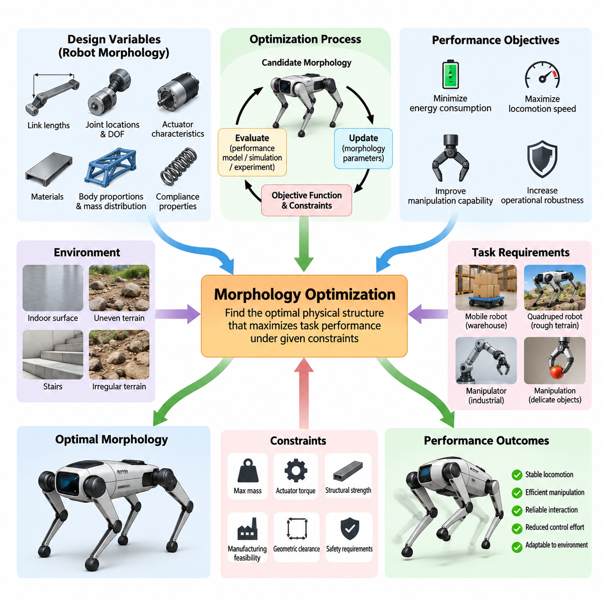{width="7.268055555555556in" height="7.268055555555556in"}

Robot morphology can be formulated as an optimization problem in which the physical structure of a robot is systematically designed to maximize its ability to perform intended tasks. Rather than treating body geometry, joint configuration, material properties, and actuator placement as fixed engineering choices, morphology optimization considers these characteristics as adjustable parameters that influence behavior, efficiency, and interaction with the environment.

The central principle of morphology optimization is that physical embodiment directly determines the capabilities and limitations of an intelligent robotic system. A robot with an appropriate body structure can achieve stable locomotion, efficient manipulation, and reliable environmental interaction with reduced control effort. Conversely, poorly selected morphology may introduce mechanical limitations that cannot be fully compensated for by advanced perception, planning, or learning algorithms.

Morphology optimization begins by defining a design space containing the possible physical configurations of a robot. This space may include link lengths, joint locations, degrees of freedom, body proportions, structural materials, mass distribution, actuator characteristics, and compliance properties. Each combination of these variables represents a candidate morphology whose performance can be evaluated through mathematical models, simulation, or physical experiments.

The optimization process requires a mathematical representation of the relationship between morphological parameters and system performance. A design vector can represent the adjustable physical characteristics, while an objective function measures the effectiveness of a particular configuration. The objective may involve minimizing energy consumption, maximizing locomotion speed, improving manipulation capability, or increasing operational robustness under specified environmental conditions.

A general morphology optimization problem seeks a design that minimizes a cost function or maximizes a performance function while satisfying physical and operational constraints. These constraints may include maximum mass, available actuator torque, structural strength, manufacturing feasibility, geometric clearance, and safety requirements. The resulting optimal morphology is therefore not necessarily the most powerful or mechanically complex design, but the most suitable configuration within the feasible design space.

The selection of optimization objectives depends strongly on the intended application. For a warehouse mobile robot, compact dimensions, payload capacity, turning radius, and energy efficiency may dominate the design requirements. For a quadruped robot operating on uneven terrain, leg geometry, ground clearance, joint range, and dynamic stability become critical. For a robotic manipulator, reachable workspace, dexterity, stiffness, and payload handling are often primary considerations.

Morphology optimization is inherently connected to robot kinematics and dynamics because physical geometry determines how motion and forces propagate through the mechanical system. Link dimensions and joint arrangements influence reachable configurations, while mass distribution and inertia affect acceleration, balance, and actuator loading. Consequently, evaluating a candidate morphology requires understanding both geometric accessibility and the dynamic effort needed to execute useful behaviors.

The interaction between morphology and the environment introduces additional complexity into the optimization problem. A robot designed for smooth indoor surfaces may perform poorly on loose soil, stairs, or irregular terrain. Similarly, a manipulator optimized for rigid industrial objects may be unsuitable for delicate or deformable materials. Effective optimization therefore considers representative operating conditions rather than evaluating mechanical performance in isolation.

An important distinction exists between task-specific and general-purpose morphology optimization. Task-specific optimization concentrates on maximizing performance for a narrow operational requirement, often producing highly specialized structures. General-purpose optimization seeks a broader balance across different tasks and environments. Although specialization may provide superior performance in a defined setting, versatility can improve adaptability and long-term operational usefulness.

The physical design variables involved in morphology optimization may be continuous, discrete, or categorical. Continuous variables include link lengths, body dimensions, and stiffness coefficients, while discrete variables may describe the number of joints, legs, or actuators. Categorical choices include wheel types, transmission mechanisms, and structural materials. Combining these variable classes creates a mixed optimization problem with potentially complex and discontinuous performance relationships.

The feasible design space is often highly constrained because many candidate morphologies violate mechanical or operational requirements. Excessively long limbs may increase workspace but also produce greater bending moments and actuator demands. Lightweight structures may improve energy efficiency while reducing stiffness or payload capacity. Optimization must identify configurations that satisfy essential requirements while managing these competing effects through systematic evaluation.

Morphological characteristics can also influence the computational complexity of robot control. Passive mechanical properties, such as elasticity, damping, and compliant contact surfaces, may absorb disturbances and stabilize interactions without requiring continuous corrective commands. This relationship connects morphology optimization with morphological computation, where physical structure contributes directly to the generation and regulation of intelligent behavior.

A morphology that performs well under one control strategy may perform poorly under another. For example, a legged robot with compliant joints may benefit from controllers that exploit elastic energy storage, while a rigid robot may require different motion trajectories and force regulation. This dependence means that morphology evaluation should consider the control architecture used to operate the candidate design rather than assuming that physical performance is independent of control.

Simulation provides an important mechanism for exploring morphological alternatives before manufacturing physical prototypes. Virtual environments allow engineers to modify geometric dimensions, actuator specifications, material properties, and contact characteristics while measuring resulting behavior. Repeated evaluations can reveal performance trends and identify promising configurations, although simulation accuracy depends on the fidelity of the underlying physical models.

The quality of an optimization result depends on how effectively the evaluation process represents real operating conditions. Idealized simulations may overlook friction variability, actuator saturation, structural deformation, manufacturing tolerances, or sensor uncertainty. These discrepancies can cause a morphology that appears optimal in simulation to underperform in deployment. Robust evaluation therefore requires uncertainty analysis and eventual validation using physical hardware.

Morphology optimization frequently involves several competing objectives that cannot be maximized simultaneously. Increasing structural rigidity may improve positioning accuracy but reduce impact tolerance, while adding actuators may increase dexterity at the expense of mass, power consumption, and maintenance complexity. Instead of producing one universally superior configuration, multi-objective optimization identifies alternative designs representing different balances among desirable characteristics.

The concept of Pareto optimality provides a useful framework for understanding these design tradeoffs. A morphology is Pareto optimal when improving one objective necessarily worsens at least one other objective within the feasible design space. The resulting Pareto frontier represents candidate configurations that offer meaningful engineering choices. Designers can select among these alternatives according to mission priorities, operating constraints, and acceptable compromises.

Optimization algorithms differ in how they explore the morphological design space. Gradient-based methods can efficiently refine continuous parameters when suitable derivatives are available, while evolutionary algorithms can explore diverse structural configurations without requiring differentiable objective functions. Bayesian optimization can reduce expensive evaluations by estimating promising regions, and topology optimization can determine material distributions that satisfy structural performance requirements.

Recent computational approaches increasingly connect morphology optimization with machine learning and differentiable physical simulation. Learned surrogate models can approximate expensive performance evaluations, while differentiable simulators may provide gradients linking design parameters to simulated outcomes. Generative methods can propose novel mechanical configurations, although their practical value depends on physical feasibility, reliable evaluation, and the ability to manufacture proposed structures.

The optimization process should also consider lifecycle requirements beyond immediate task performance. Manufacturing cost, assembly complexity, repairability, component availability, thermal management, and operational durability influence whether an optimized morphology is practical. A theoretically efficient structure may offer limited commercial value if it requires expensive fabrication, specialized maintenance, or components that cannot withstand sustained operation.

Robust morphology optimization seeks designs that maintain acceptable performance despite uncertainty in operating conditions and physical parameters. Variations in payload, surface friction, component wear, and external disturbances can significantly affect robot behavior. Instead of optimizing exclusively for nominal conditions, robust methods evaluate performance across representative variations and favor configurations that remain reliable when environmental assumptions change.

The broader significance of morphology optimization lies in recognizing that robot intelligence emerges from coordinated relationships among physical structure, control, and environmental interaction. Mechanical design determines which behaviors are physically possible, while control and learning determine how those possibilities are exploited. Treating morphology as an optimization problem establishes a systematic foundation for designing embodied systems whose physical capabilities support their intended intelligence.

Ultimately, morphology optimization transforms robot body design from a largely experience-driven activity into a measurable and iterative engineering process. By defining design variables, evaluating performance, enforcing constraints, and exploring tradeoffs, engineers can develop structures that better match operational requirements. This foundation supports advanced methods for multi-objective design, simulation-based optimization, and the joint optimization of robotic bodies and controllers.

## 11.02. Design Variables Constraints and Objectives

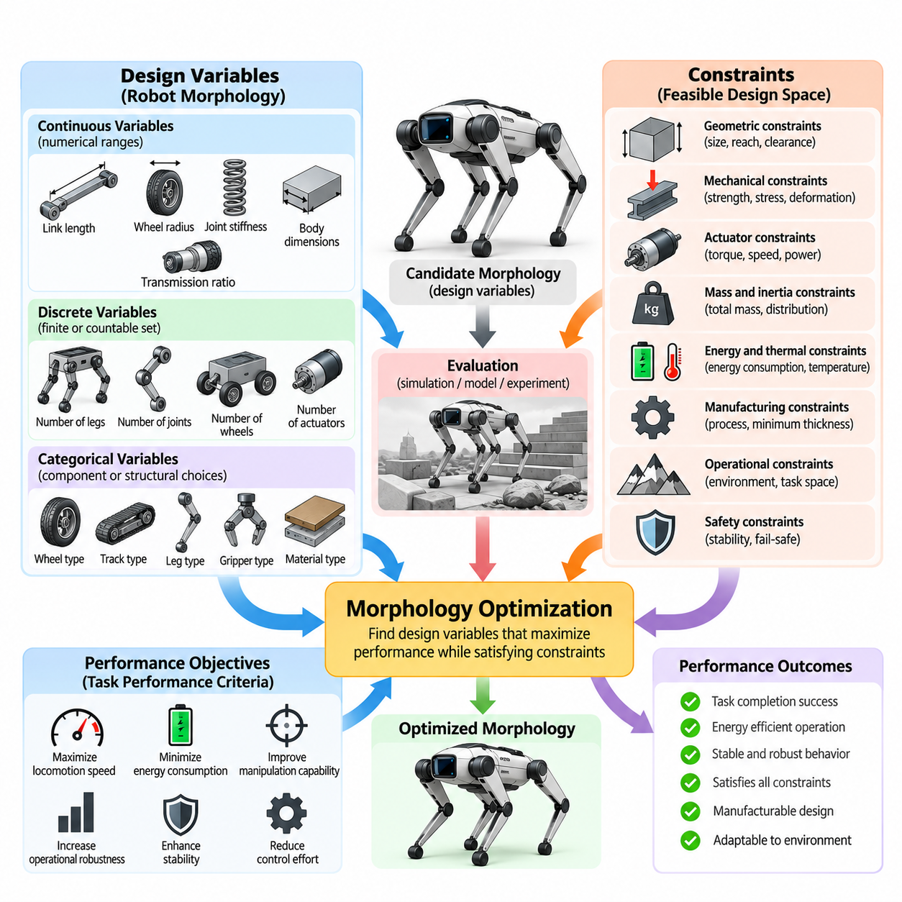{width="7.268055555555556in" height="7.268055555555556in"}

Morphology optimization requires a systematic definition of design variables, constraints, and objectives to transform robot body design into a mathematically structured engineering problem. Design variables describe the physical characteristics that can be modified, constraints define the boundaries of feasible configurations, and objectives establish the performance criteria used to compare alternatives. Together, these elements determine the optimization search space and the meaning of an optimal robotic morphology.

Design variables represent the adjustable parameters that define a robot\'s physical embodiment. They may include body dimensions, link lengths, joint positions, actuator placement, structural materials, mass distribution, and mechanical compliance. Each variable influences the robot\'s kinematic and dynamic behavior, while interactions among variables can produce complex performance relationships. Effective optimization therefore requires selecting parameters that meaningfully affect the intended tasks.

Continuous design variables describe physical properties that can vary within numerical intervals. Examples include leg length, wheel radius, joint stiffness, body width, and actuator transmission ratios. These parameters are often suitable for numerical optimization because relatively small adjustments can produce measurable performance changes. However, their feasible ranges must reflect manufacturing limitations, structural requirements, and the capabilities of available components.

Discrete design variables describe characteristics that take values from a finite or countable set. The number of legs, joints, wheels, actuators, and structural modules are common examples. Changing these variables may alter the robot\'s fundamental mechanical architecture rather than simply adjusting its dimensions. Consequently, discrete morphology optimization often involves comparing substantially different configurations with distinct kinematic structures and operational capabilities.

Categorical design variables represent choices among alternative component types or structural concepts. A mobile robot may use conventional wheels, omnidirectional wheels, tracks, or articulated legs, while a manipulator may employ serial, parallel, or hybrid architectures. Material selection and transmission mechanisms also introduce categorical choices. Such variables frequently create discontinuities in the design space because different categories follow different mechanical relationships.

The selection of design variables should balance model expressiveness against computational complexity. Including too few variables may exclude promising configurations, while including too many can make optimization expensive and difficult to interpret. Engineers commonly begin with influential geometric and mechanical parameters before introducing detailed structural characteristics. Sensitivity analysis can help identify variables that contribute most strongly to performance variation.

Design variables are rarely independent because changing one physical characteristic often affects several others. Increasing link length can expand workspace while simultaneously increasing structural mass, joint torque requirements, and bending deformation. Moving actuators closer to the body may reduce distal inertia but require additional transmissions. These dependencies should be represented through coupled physical models rather than treating every design parameter as an isolated decision.

Constraints define the conditions that every acceptable morphology must satisfy. They establish the feasible region within the broader design space and prevent optimization algorithms from selecting configurations that are physically impossible or operationally unacceptable. Constraints may originate from mechanical strength, actuator capacity, geometry, energy availability, manufacturing processes, environmental conditions, and safety requirements. Their proper definition is essential for obtaining practically useful designs.

Geometric constraints regulate the spatial dimensions and arrangement of robot components. They may limit overall height, width, reach, wheelbase, ground clearance, or joint travel. A warehouse robot must fit through designated passages, while a manipulator must avoid mechanical interference between links. Geometric constraints also determine whether a robot can access required workspaces and maintain sufficient clearance during motion.

Mechanical constraints ensure that a candidate structure can withstand expected forces and moments. Structural members must remain within allowable stress and deformation limits, while joints and transmissions must support required loads. Actuator torque, speed, and power ratings impose additional restrictions on feasible motion. These constraints should account for representative dynamic loading rather than relying exclusively on static operating conditions.

Mass and inertia constraints are especially important for mobile robots, manipulators, and legged platforms. Excessive mass increases energy consumption and actuator demand, while unfavorable mass distribution can reduce stability or maneuverability. Distal limb mass strongly influences joint acceleration requirements, and elevated centers of mass can increase tipping risk. Optimization must therefore consider both total mass and its spatial distribution throughout the robot.

Energy and thermal constraints connect morphology design to practical operating endurance. Battery capacity, actuator efficiency, transmission losses, and structural mass influence achievable operating time. High-performance actuators may introduce thermal loads that require cooling or reduced duty cycles. A morphology that satisfies instantaneous performance requirements may still be unsuitable for continuous operation if its energy consumption or heat generation exceeds available limits.

Manufacturing constraints restrict designs to structures that can be fabricated, assembled, inspected, and maintained using available technologies. Minimum wall thickness, material availability, machining accessibility, additive manufacturing limitations, and assembly tolerances can eliminate otherwise attractive configurations. Incorporating manufacturability early in optimization reduces the risk of producing theoretically optimal structures that are impractical or prohibitively expensive to build.

Safety constraints establish boundaries that protect humans, equipment, and the operating environment. These may include maximum contact forces, acceptable stopping distances, stability margins, collision clearances, and limits on exposed moving components. Safety requirements can influence joint placement, actuator selection, structural compliance, and protective geometry. They should be incorporated into the feasible design definition rather than considered only after optimization is complete.

Objectives describe the performance outcomes that optimization seeks to improve. Unlike constraints, which establish minimum acceptable conditions, objectives distinguish the relative quality of feasible designs. Typical objectives include minimizing mass, energy consumption, manufacturing cost, and positioning error while maximizing speed, payload capacity, workspace, stability, or task success. Objective selection must reflect measurable operational value rather than arbitrary geometric preferences.

A mathematical objective function maps a candidate design to a numerical performance measure. For example, energy efficiency may be evaluated through energy consumed per unit distance, while manipulation performance may be measured using reachable workspace or task-specific dexterity. The evaluation method should be consistent across candidates and sufficiently representative of real operating conditions. Poorly chosen metrics can favor designs that perform well numerically but fail practical requirements.

Objectives and constraints can sometimes represent the same physical quantity in different ways. Robot mass may be minimized as an objective or restricted by a maximum allowable value. Similarly, stability may be maximized or enforced through a minimum stability margin. The appropriate formulation depends on whether the quantity represents a hard requirement or a desirable improvement. This distinction helps prevent unnecessary restrictions while preserving essential operational guarantees.

Multiple objectives introduce tradeoffs because improvements in one performance dimension may reduce performance elsewhere. A larger manipulator may provide greater reach but require heavier structures and more powerful actuators. A wider mobile platform may improve static stability while reducing maneuverability in narrow environments. Multi-objective optimization explicitly represents these competing outcomes and supports the selection of balanced configurations.

Objective normalization becomes important when performance measures have different units and numerical scales. Energy consumption, payload mass, positioning accuracy, and manufacturing cost cannot be meaningfully combined without appropriate scaling. Weighted objective functions can express design priorities, but their results depend on the selected weights. Alternative approaches preserve separate objectives and identify Pareto-optimal configurations without assuming a single universal performance ranking.

The optimization formulation must also account for uncertainty in physical parameters and operating environments. Manufacturing tolerances, payload variation, friction changes, and component degradation may cause actual performance to differ from predicted values. Robust constraints and objectives evaluate candidate morphologies across representative uncertainty conditions. This approach favors designs that remain feasible and effective beyond a narrowly defined nominal operating point.

Simulation and experimental evaluation provide the performance information needed to assess design variables against objectives and constraints. Kinematic models estimate workspace and motion accessibility, while dynamic simulations predict forces, energy requirements, and stability behavior. Structural analysis evaluates stress and deformation, and physical prototypes reveal modeling discrepancies. Combining these evaluation methods creates a more reliable foundation for morphology optimization.

The relationship among design variables, constraints, and objectives determines the quality of the entire optimization process. Incomplete variables can exclude innovative designs, unrealistic constraints can eliminate feasible solutions, and poorly defined objectives can direct optimization toward undesirable outcomes. Successful formulation therefore requires collaboration among mechanical engineering, control, perception, manufacturing, and application specialists to capture the complete requirements of the robotic system.

For Physical AI systems, morphology optimization must ultimately support intelligent behavior rather than mechanical performance alone. Body geometry affects sensing visibility, contact opportunities, control authority, and the range of actions available to learned policies. Consequently, design objectives may include task adaptability, interaction reliability, and compatibility with perception and control architectures. This perspective establishes the foundation for integrated optimization of robotic morphology and embodied intelligence.

## 11.03. Performance Energy and Stability Objectives

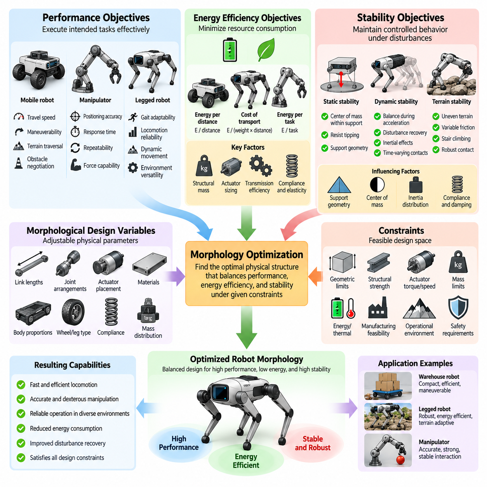{width="7.268055555555556in" height="7.268055555555556in"}

Performance, energy efficiency, and stability are fundamental objectives in robot morphology optimization because they determine how effectively a physical structure supports useful behavior. Performance measures the ability to execute intended tasks, energy efficiency describes the resources required for operation, and stability reflects the capacity to maintain controlled behavior under disturbances. These objectives are strongly coupled through geometry, mass distribution, actuation, and mechanical dynamics.

Performance optimization begins by identifying measurable capabilities associated with the robot\'s intended application. For mobile robots, relevant measures include travel speed, acceleration, maneuverability, terrain traversal, and obstacle negotiation. Manipulators may emphasize positioning accuracy, response time, repeatability, and force generation. Legged robots require additional consideration of gait adaptability, locomotion reliability, and dynamic movement capability across varying environmental conditions.

Morphological characteristics influence performance by defining the mechanical limits within which control algorithms operate. Link lengths determine reachable workspace, joint arrangements affect dexterity, and actuator placement influences available torque and acceleration. Structural stiffness determines resistance to deformation, while body proportions affect mobility and interaction. Optimization seeks configurations that provide sufficient mechanical capability without introducing unnecessary complexity or excessive resource requirements.

Energy efficiency is particularly important for autonomous robots operating with limited onboard power. Battery-powered platforms must balance useful task execution against electrical consumption, mechanical losses, and operating endurance. Morphology affects these quantities through structural mass, actuator sizing, transmission efficiency, and contact mechanics. An energy-efficient design reduces the effort required to generate useful motion while maintaining the performance necessary for its intended mission.

Energy consumption can be evaluated through several complementary metrics depending on the robot\'s operating mode. Mobile robots often use energy per unit distance, while legged platforms may employ cost of transport to relate energy expenditure to weight and distance traveled. Manipulators may be evaluated using energy per completed task or mechanical work efficiency. These measures allow alternative morphologies to be compared under consistent operating conditions and representative workloads.

The relationship between mass and energy consumption is central to morphology optimization. Increasing body mass generally raises the effort required for acceleration, lifting, and locomotion, although the precise effect depends on operating conditions. Lightweight structures can reduce actuator demands but may introduce flexibility, vibration, or insufficient load capacity. The objective is therefore not simply minimum mass, but a suitable balance between structural efficiency, dynamic performance, and operational reliability.

Actuator selection and placement strongly influence both performance and energy objectives. Larger actuators can provide greater torque and acceleration but increase mass, electrical demand, and thermal loading. Locating actuators near the robot\'s main body can reduce moving limb inertia, although additional transmission mechanisms may introduce friction and compliance. Morphology optimization must evaluate these competing effects across expected motion profiles rather than considering actuator capacity independently.

Mechanical compliance can improve energy efficiency by storing and releasing elastic energy during repetitive motion. Springs, flexible joints, and compliant structures may recover energy during walking, running, or cyclic manipulation. Properly tuned compliance can also reduce impact forces and peak actuator demands. However, excessive flexibility may compromise precision, introduce oscillations, or complicate control, making compliance selection dependent on task frequency and operating conditions.

Stability objectives describe the ability of a robot to maintain acceptable motion or equilibrium despite internal and external disturbances. For stationary systems, stability may involve resisting tipping or unwanted deformation. Mobile and legged robots require consideration of balance during acceleration, turning, and contact transitions. Stability is influenced by support geometry, center-of-mass location, inertia, contact forces, and the effectiveness of the available control mechanisms.

Static stability is commonly evaluated through the relationship between the center of mass and the support region. For a robot resting on a horizontal surface, the projection of its center of mass should remain within the support polygon under appropriate assumptions. Increasing support width or lowering the center of mass can improve resistance to tipping. Nevertheless, wider structures may reduce maneuverability, and lower configurations may restrict ground clearance or reachable workspace.

Dynamic stability becomes important when robots accelerate, decelerate, jump, or change contact configurations. In these situations, maintaining balance requires accounting for inertial forces, angular momentum, and time-varying ground reactions. Morphological parameters such as limb length, joint arrangement, and mass distribution influence the range of recoverable motions. Dynamic stability optimization therefore evaluates feasible trajectories and disturbance recovery rather than relying exclusively on static geometric margins.

For legged robots, stability depends strongly on stance geometry and the distribution of contact forces. Wider stances may improve support margins but increase joint loading or energy consumption. Longer legs can improve obstacle clearance while increasing rotational inertia and structural demands. Foot dimensions, compliance, and friction characteristics also influence contact reliability. Optimal morphology must support stable locomotion across representative gaits, terrain conditions, and payload variations.

Mobile platforms with wheels or tracks exhibit different stability characteristics because their support geometry and ground interaction differ from those of legged robots. Wheelbase, track width, suspension configuration, and center-of-gravity height affect tipping resistance during turns and slopes. Suspension compliance may improve traction on irregular surfaces but alter body motion. Stability objectives must therefore account for both geometric rollover resistance and the dynamic behavior of the suspension system.

Performance, energy, and stability objectives frequently compete with one another. Increasing acceleration capability may require more powerful actuators and greater energy consumption. Expanding the support footprint can improve stability while increasing mass and limiting operation in confined spaces. Reducing structural weight may improve endurance but weaken stiffness or disturbance tolerance. These interactions make single-objective optimization insufficient for many practical robot design problems.

Multi-objective morphology optimization provides a framework for evaluating such competing requirements. Rather than maximizing performance, minimizing energy, and maximizing stability independently, the optimization process searches for configurations that represent useful compromises. Pareto-optimal designs identify alternatives where improving one objective requires sacrificing another. Engineers can then select configurations according to mission priorities, safety requirements, and acceptable operating costs.

Objective functions must be normalized and evaluated consistently to support meaningful comparisons. Speed, energy consumption, and stability margins use different units and numerical scales, making direct aggregation potentially misleading. Weighted combinations can express engineering priorities, while constraint-based formulations can enforce minimum stability or performance requirements. The selected formulation should preserve the operational meaning of each metric and avoid rewarding physically unrealistic configurations.

Simulation-based evaluation enables systematic exploration of performance, energy, and stability across candidate morphologies. Dynamic models estimate actuator effort, contact forces, motion capability, and energy expenditure under specified tasks. Repeated simulations can test different payloads, terrains, speeds, and disturbances. However, model uncertainty, contact approximation, and actuator limitations must be considered because simulated improvements may not transfer directly to physical hardware.

Robust optimization extends these objectives beyond nominal operating conditions. A morphology optimized for one payload, terrain, or movement speed may become inefficient or unstable when circumstances change. Evaluating performance distributions across representative scenarios helps identify configurations with reliable behavior. Robust objectives may penalize excessive variability, poor worst-case performance, or sensitivity to uncertain mechanical parameters and environmental interactions.

The relationship between morphology and control must also be considered when evaluating these objectives. A mechanically stable configuration may require less corrective control effort, while an agile but unstable structure may depend on high-bandwidth sensing and actuation. Similarly, energy consumption depends on the trajectories and feedback policies used during operation. Joint consideration of body design and controller behavior produces more realistic estimates of achievable system performance.

Practical optimization requires experimental validation using physical prototypes and representative operating tasks. Measurements of electrical energy, mechanical output, motion accuracy, disturbance recovery, and thermal behavior can reveal discrepancies between predicted and actual performance. These observations support refinement of simulation models and objective functions. Iterative testing is especially important when compliance, friction, or complex contact dynamics strongly influence robot behavior.

For Physical AI systems, performance, energy efficiency, and stability should ultimately be evaluated in relation to autonomous task execution. A robot must perform useful actions reliably, maintain safe physical interaction, and operate within available energy resources. Morphology optimization therefore seeks not merely superior mechanical specifications, but physical structures that support sustained intelligent behavior. Balancing these objectives provides a foundation for capable, efficient, and robust embodied robotic systems.

## 11.04. Mobility Manipulability and Payload Objectives

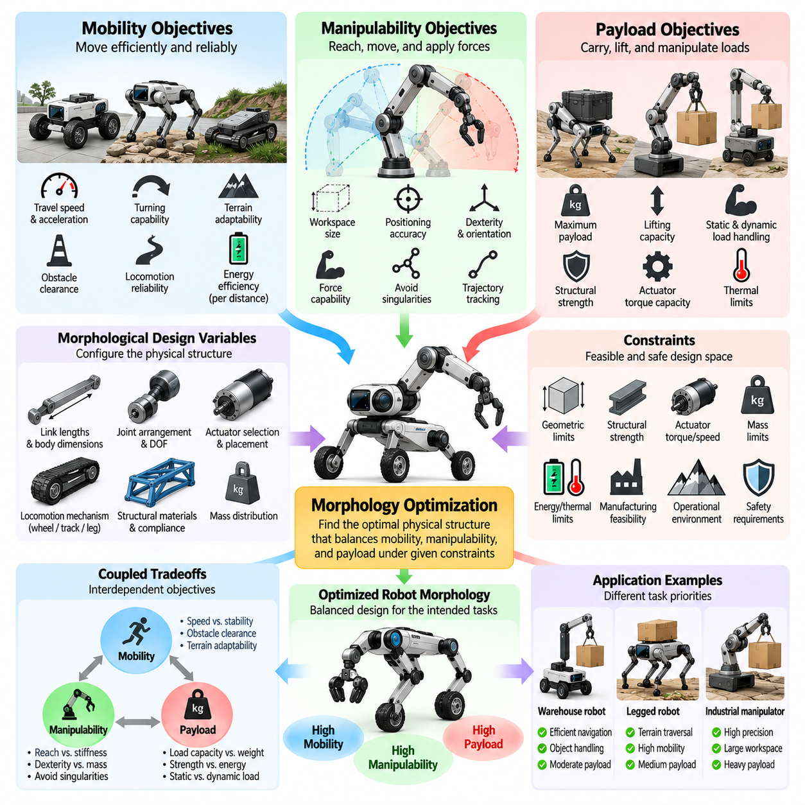{width="7.268055555555556in" height="7.268055555555556in"}

Mobility, manipulability, and payload capacity are fundamental objectives in robot morphology optimization because they determine how effectively a robot moves, interacts with objects, and performs useful physical work. Mobility describes the ability to navigate environments, manipulability characterizes the capability to position and orient end effectors, and payload capacity defines the loads a robot can safely handle. These objectives are closely connected through geometry, actuation, structural strength, and mass distribution.

Mobility optimization focuses on improving a robot\'s ability to move through its intended operating environment. Relevant performance measures include travel speed, acceleration, turning capability, obstacle clearance, terrain adaptability, and locomotion reliability. The importance of each measure depends on the application. Warehouse robots prioritize efficient navigation through constrained spaces, while outdoor platforms may emphasize rough-terrain traversal, slope climbing, and recovery from disturbances.

Robot morphology directly influences mobility through body dimensions, locomotion mechanisms, and contact geometry. Wheel radius affects obstacle negotiation, wheelbase influences turning behavior, and track width contributes to lateral stability. For legged robots, limb length, joint arrangement, and foot placement determine reachable footholds and gait possibilities. Morphology optimization seeks combinations that provide sufficient movement capability without excessive mechanical complexity or energy consumption.

Mobility can be quantified using task-dependent metrics that represent meaningful operational outcomes. These include distance traveled per unit time, minimum turning radius, maximum traversable slope, obstacle height capability, and successful traversal rate. Energy consumption per distance provides an additional measure of movement efficiency. Evaluating these metrics across representative environments prevents optimization from favoring configurations that perform well only under narrowly defined conditions.

Manipulability describes the ability of a robotic mechanism to generate controlled end-effector motions and forces across its workspace. It depends on the arrangement of joints, link dimensions, degrees of freedom, and kinematic relationships. A manipulator with favorable geometry can reach required positions while maintaining useful motion directions and avoiding singular configurations. Morphology optimization therefore considers not only workspace size but also the quality of motion achievable within that workspace.

The manipulator Jacobian provides a mathematical relationship between joint velocities and end-effector velocities. Its properties can be used to evaluate directional motion capability, proximity to singularities, and sensitivity to joint motion. Manipulability indices summarize selected aspects of these relationships, although their interpretation depends on coordinate scaling and task requirements. Optimization should therefore evaluate Jacobian-based measures alongside representative manipulation trajectories and force demands.

Workspace optimization aims to maximize the region in which a robot can perform required tasks. Longer links may increase reach, while additional joints can improve access around obstacles and provide alternative configurations. However, greater reach often increases structural bending moments, actuator loading, and positioning sensitivity. A large theoretical workspace is not necessarily useful if the robot cannot generate adequate forces or maintain acceptable accuracy throughout the region.

Kinematic redundancy can improve manipulability by providing multiple joint configurations for the same end-effector pose. Redundant manipulators may avoid obstacles, maintain favorable joint postures, and distribute motion across several joints. Nevertheless, additional degrees of freedom increase mechanical mass, actuator requirements, and control complexity. Morphology optimization must determine whether the resulting flexibility provides sufficient task-level benefits to justify these additional resources.

Payload capacity represents the maximum load a robot can transport, lift, support, or manipulate while satisfying specified operational constraints. It depends on actuator torque, structural strength, transmission capability, stability, and the location of the load. Payload ratings must therefore be associated with particular configurations and operating conditions. A manipulator may support a substantial load near its base but experience severe limitations at maximum reach.

Payload optimization requires evaluating both static and dynamic loading. Static analysis considers gravitational forces and resulting joint torques, while dynamic analysis includes acceleration, deceleration, impact, and inertial effects. Structural deformation and actuator heating may further restrict allowable loads during repeated operation. Consequently, payload capacity should be evaluated over representative motion profiles and duty cycles rather than inferred from maximum actuator torque alone.

The relationship between payload and robot mass introduces an important design tradeoff. Stronger structures and larger actuators can increase load capacity but also raise the robot\'s own weight and energy consumption. Payload-to-weight ratio provides one measure of structural efficiency, although it does not fully describe task performance. An optimized morphology should deliver the required payload capability while minimizing unnecessary structural mass and preserving acceptable mobility and stability.

For mobile manipulators, mobility, manipulability, and payload capacity must be evaluated as coupled objectives. A mobile base extends the manipulator\'s effective workspace, while the arm changes the platform\'s center of mass and stability during operation. Heavy payloads carried at extended reach can generate substantial tipping moments. Joint optimization of base dimensions, arm geometry, actuator placement, and mass distribution is therefore necessary for reliable mobile manipulation.

Humanoid robots introduce additional coupling because locomotion and manipulation share the same articulated body. Arm motion can influence balance, while leg posture determines the available support region and manipulation height. Carrying an object changes the combined center of mass and may constrain feasible walking motions. Morphology optimization must consider whole-body coordination and the ability to maintain useful manipulation performance while preserving locomotion stability.

Quadruped robots equipped with manipulators face similar interactions between mobility and payload objectives. Leg geometry determines terrain accessibility and support capability, while an attached arm introduces additional mass and shifting moments. A configuration optimized exclusively for locomotion may become unstable during manipulation. Effective design requires evaluating the combined mechanical system across walking, standing, reaching, and load-transfer activities.

Aerial robots demonstrate particularly strong tradeoffs between mobility and payload capacity. Increasing payload requires additional lift, which may demand larger propulsion systems, greater battery capacity, or reduced flight endurance. Rotor placement, airframe geometry, and center-of-gravity location influence maneuverability and control authority. Aerial manipulation adds further disturbances through contact forces, making payload and interaction objectives inseparable from flight stability.

Mobility and manipulability can sometimes be improved through morphological specialization. A compact omnidirectional platform may offer excellent indoor positioning, while a tracked robot may provide superior traction on challenging terrain. Similarly, a long-reach manipulator may serve inspection tasks, whereas a compact high-stiffness arm may better support precision assembly. Optimization should reflect the actual task distribution rather than assuming that maximum capability in every dimension is desirable.

Multi-objective optimization provides a systematic method for managing these competing requirements. Increasing reach may reduce payload capacity, while expanding the support footprint may improve stability but restrict navigation through narrow passages. Pareto-optimal solutions represent configurations where improving one objective requires compromising another. Designers can compare these alternatives using mission requirements, operational constraints, and expected lifecycle costs.

Objective functions should distinguish maximum theoretical capability from useful task-level capability. A robot\'s maximum speed may be irrelevant if it cannot safely navigate typical environments, and a manipulator\'s largest reachable workspace may include regions with poor force transmission. Similarly, maximum payload is insufficient without specifying reach, acceleration, and duty cycle. Task-weighted objectives provide a more meaningful representation of practical performance.

Simulation-based evaluation allows candidate morphologies to be tested across representative mobility, manipulation, and payload scenarios. Kinematic analysis estimates reachability and manipulability, while dynamic simulation evaluates actuator effort, contact forces, and load-dependent stability. Structural models assess deformation and stress under expected payloads. Combining these methods helps identify designs that satisfy multiple objectives without relying on isolated performance measurements.

Robust optimization extends the evaluation to uncertainty in payload mass, object location, terrain conditions, and mechanical parameters. A robot optimized for a nominal load may experience unacceptable joint torque or instability when payload distribution changes. Similarly, terrain variations can reduce mobility or alter available support forces. Evaluating representative uncertainties encourages morphologies that maintain reliable capability across realistic operating conditions.

Morphology and controller design should be considered together because achievable mobility, manipulability, and payload performance depend on control strategies. Motion planning determines whether available workspace can be used effectively, while force control and balance regulation influence safe load handling. A favorable mechanical configuration may reduce control effort, but poor coordination can prevent its potential from being realized. Co-optimization therefore provides a more complete assessment of system capability.

For Physical AI systems, these objectives ultimately describe the physical action possibilities available to intelligent agents. Mobility determines where the robot can operate, manipulability determines how it can interact with its surroundings, and payload capacity determines the scale of physical work it can perform. Optimizing their relationships produces robotic bodies that support versatile, reliable, and efficient autonomous behavior across the intended range of tasks and environments.

## 11.05. Multi Objective Morphology Optimization

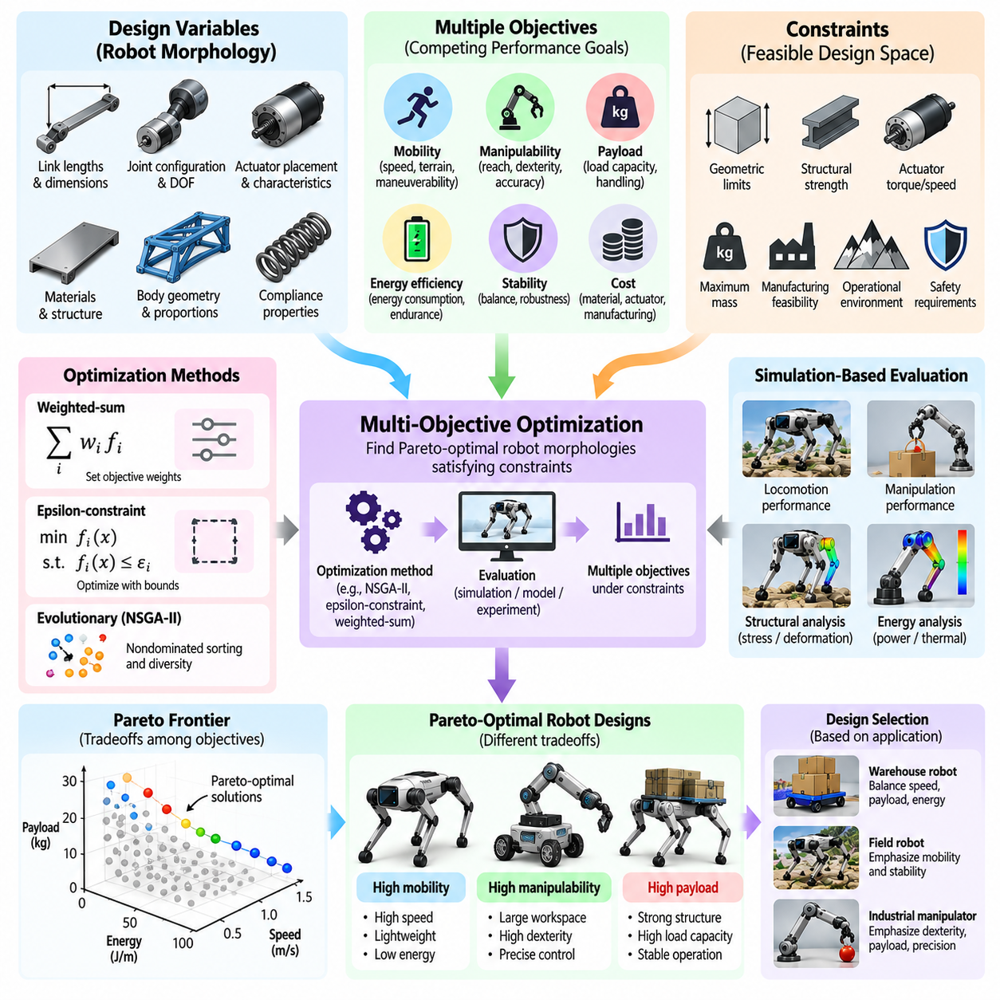{width="7.268055555555556in" height="7.268055555555556in"}

Multi-objective morphology optimization addresses the challenge of designing robotic bodies that must satisfy several competing performance requirements simultaneously. Unlike single-objective optimization, which seeks the best configuration according to one criterion, multi-objective optimization evaluates tradeoffs among mobility, manipulability, payload capacity, energy efficiency, stability, and cost. The goal is to identify balanced physical configurations rather than assuming that one morphology is universally superior.

Robot morphology naturally creates competing objectives because structural modifications influence multiple aspects of system behavior. Increasing limb length may improve reach and obstacle clearance while increasing mass, inertia, and actuator torque requirements. Expanding the support footprint may enhance stability but reduce maneuverability in confined spaces. Multi-objective optimization explicitly represents these interactions and evaluates their consequences across the intended operating conditions.

A multi-objective optimization problem is formulated using a vector of objective functions associated with a common set of design variables. These variables may describe body dimensions, joint configurations, actuator placement, material properties, and structural compliance. Each candidate morphology produces multiple performance values rather than a single score. The optimization process searches for feasible configurations that offer favorable combinations of these competing outcomes.

Constraints remain essential because every candidate design must satisfy physical, operational, and safety requirements. Maximum mass, actuator torque limits, structural stress, geometric clearance, manufacturing feasibility, and minimum stability margins may define the feasible design space. Multi-objective optimization does not eliminate these restrictions. Instead, it identifies alternative configurations that satisfy mandatory requirements while expressing different performance advantages.

Pareto optimality provides the fundamental mathematical concept for comparing solutions with competing objectives. A morphology is Pareto optimal when no other feasible morphology can improve at least one objective without worsening another. A design is dominated when another feasible design performs at least as well across every objective and strictly better in one or more. This relationship allows optimization algorithms to distinguish meaningful alternatives from inferior configurations.

The collection of nondominated solutions forms the Pareto set in design space, while their corresponding objective values form the Pareto frontier. This frontier represents the achievable tradeoffs among competing design goals. For example, one configuration may provide superior mobility with moderate payload capacity, while another supports heavier loads at the expense of speed. Neither design is necessarily preferable without considering the intended application.

The shape of the Pareto frontier provides important information about the underlying engineering problem. A relatively flat region may indicate that one objective can be improved with little sacrifice in another, while a steep region suggests substantial tradeoffs. Disconnected or nonconvex regions may arise from discrete architecture choices or nonlinear physical interactions. Understanding these characteristics helps designers identify promising compromises and avoid unnecessary performance sacrifices.

Weighted-sum optimization combines several objectives into a single scalar function using numerical weights. These weights express the relative importance assigned to performance measures such as energy consumption, stability, and payload capacity. The method is straightforward and compatible with many numerical optimizers. However, results depend strongly on weight selection, objective scaling, and the geometry of the feasible objective space.

Objective normalization is necessary when different performance metrics use incompatible units or numerical ranges. Energy consumption may be measured in joules, payload capacity in kilograms, and positioning accuracy in millimeters. Combining raw values can unintentionally favor objectives with larger numerical magnitudes. Normalization using meaningful reference values or performance ranges helps ensure that assigned weights reflect engineering priorities rather than measurement scales.

The epsilon-constraint method offers an alternative formulation by optimizing one objective while imposing explicit bounds on the others. A robot designer might minimize energy consumption while requiring minimum payload capacity, acceptable stability, and sufficient workspace coverage. By varying these bounds, the optimization process can explore different portions of the Pareto frontier. This approach is useful when some performance requirements have clear operational thresholds.

Evolutionary multi-objective optimization is particularly suitable for robot morphology because design spaces often contain nonlinear, discontinuous, and mixed discrete-continuous variables. Population-based algorithms evaluate multiple candidate structures and progressively improve their performance diversity. Methods such as NSGA-II use nondominated sorting and diversity preservation to approximate Pareto-optimal solutions without requiring objective gradients or smooth performance functions.

Simulation-based evaluation enables evolutionary and other multi-objective algorithms to compare candidate morphologies before physical fabrication. Each design can be tested across representative locomotion, manipulation, and payload scenarios. Dynamic simulation estimates actuator effort, energy consumption, contact forces, and stability, while structural analysis evaluates stress and deformation. The resulting measurements provide the objective values required to rank competing configurations.

Computational cost becomes a significant challenge when every morphology requires expensive physical simulation. Evaluating thousands of designs across multiple tasks, terrains, and payload conditions can demand substantial computing resources. Surrogate models approximate relationships between design variables and performance outcomes, allowing promising candidates to be screened efficiently. High-fidelity simulations can then validate selected designs and refine the optimization process.

Robust multi-objective optimization incorporates uncertainty into the evaluation of competing design goals. Manufacturing tolerances, payload variation, terrain friction, component wear, and modeling errors can change the performance of a candidate morphology. A design that appears Pareto optimal under nominal conditions may become inferior or infeasible under disturbances. Robust formulations therefore consider expected performance, variability, and worst-case behavior across representative operating scenarios.

Task diversity introduces another dimension to morphology optimization because a robot may perform several activities with different mechanical requirements. A mobile manipulator may need efficient navigation, accurate reaching, stable lifting, and reliable object transport. Optimizing exclusively for one activity can degrade performance elsewhere. Task-weighted objectives or scenario-based evaluation can represent the relative importance of different activities within the intended operational workload.

The relationship between morphology and control introduces additional tradeoffs that cannot be captured through mechanical parameters alone. A compliant leg structure may improve energy recovery but require specialized control strategies, while a rigid configuration may simplify positioning at the expense of impact tolerance. Evaluating candidate bodies with appropriate controllers provides a more realistic comparison. Joint optimization of morphology and control can reveal solutions that separate design processes overlook.

Safety and reliability must remain explicit considerations throughout multi-objective optimization. A configuration with excellent speed and payload performance may still be unacceptable if it violates stability margins, actuator thermal limits, or human interaction requirements. Safety-critical properties are often better represented as hard constraints than as objectives that can be traded away. Reliability metrics can additionally distinguish designs that maintain consistent performance under repeated operation.

Manufacturing and lifecycle considerations influence the practical value of Pareto-optimal designs. Complex joint arrangements may improve dexterity but increase assembly effort, maintenance requirements, and component costs. Lightweight specialized structures may offer excellent performance while reducing repairability or durability. Including manufacturing cost, serviceability, and expected lifetime in the evaluation helps connect mathematical optimization with deployable robotic products.

Selecting a final morphology from the Pareto frontier requires engineering judgment and clearly defined mission priorities. Decision-makers may consider performance thresholds, operating environments, production costs, safety margins, and future adaptability. Sensitivity analysis can reveal whether small changes in objective weights or uncertain parameters alter the preferred configuration. Designs located near favorable tradeoff regions may provide greater practical value than extreme solutions.

Multi-objective optimization also supports systematic comparison among fundamentally different robot architectures. Wheeled, tracked, legged, and hybrid platforms can be evaluated against common task-level metrics while respecting their distinct physical constraints. Similarly, serial and parallel manipulators may occupy different regions of the performance frontier. This perspective helps determine when architectural changes offer meaningful advantages over incremental parameter adjustments.

For Physical AI, multi-objective morphology optimization connects mechanical design with the broader requirements of intelligent autonomous behavior. A robot must not only move efficiently or manipulate heavy objects, but also perceive, adapt, recover from disturbances, and execute tasks reliably. The preferred morphology therefore depends on how physical capabilities interact with sensing, learning, and control. Balanced optimization enables embodiment to support intelligence across diverse operational demands.

Ultimately, multi-objective morphology optimization transforms competing engineering requirements into a structured exploration of feasible design alternatives. Pareto analysis, numerical optimization, evolutionary search, simulation, and robustness evaluation reveal how physical configurations distribute advantages and limitations. Rather than producing a universally optimal robot body, the process identifies defensible design choices aligned with specific missions, operating conditions, and long-term system requirements.

## 11.06. Gradient and Topology Optimization

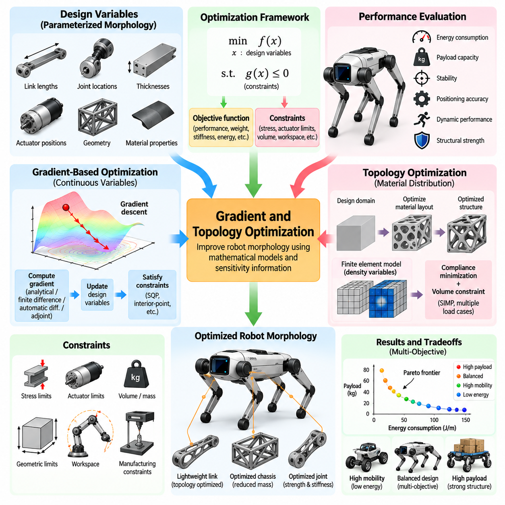{width="7.268055555555556in" height="7.268055555555556in"}

Gradient-based optimization and topology optimization provide systematic methods for improving robot morphology through mathematical models of physical performance. Gradient-based methods adjust continuous design variables using sensitivity information, while topology optimization determines how material should be distributed within a structural domain. Together, these approaches enable engineers to refine robot geometry, reduce unnecessary mass, and improve mechanical capability under specified constraints.

Gradient-based morphology optimization begins with a parameterized representation of the robot\'s physical structure. Design variables may include link lengths, joint locations, structural thicknesses, actuator positions, and material properties. An objective function evaluates performance measures such as energy consumption, stiffness, payload capacity, or stability. The optimization algorithm iteratively modifies these parameters to improve the objective while satisfying geometric and mechanical constraints.

The gradient of an objective function describes how its value changes with respect to each design variable. This information provides a local direction for improving the current design. Gradient descent updates parameters in the direction of decreasing objective value, while constrained optimization methods account for feasibility requirements. The effectiveness of these approaches depends on accurate sensitivity estimates, appropriate step sizes, and the numerical properties of the design problem.

Analytical differentiation can provide exact derivatives when the governing equations are sufficiently simple and differentiable. However, robot morphology optimization frequently involves complex dynamics, contact interactions, and nonlinear material behavior. Finite-difference methods approximate gradients by perturbing individual design variables and measuring changes in performance. Although straightforward, finite differences can become computationally expensive and sensitive to numerical noise.

Automatic differentiation offers an alternative by computing derivatives through differentiable computational operations. When simulation models and objective functions are implemented using compatible numerical frameworks, gradients can be propagated through the evaluation process. This approach is especially useful for large parameterized models. Nevertheless, discontinuous contact events, discrete design choices, and numerical solver behavior may limit derivative accuracy or availability.

Adjoint sensitivity analysis is valuable when the number of design variables is large but the number of objectives is relatively small. Instead of independently perturbing every parameter, adjoint methods calculate sensitivities through additional equations associated with the governing physical model. This can substantially reduce computational cost in structural and fluid optimization. Their implementation requires careful treatment of model constraints, boundary conditions, and numerical discretization.

Gradient-based optimization is commonly combined with constrained numerical algorithms such as sequential quadratic programming and interior-point methods. These algorithms seek improved designs while respecting stress limits, actuator capabilities, workspace requirements, and geometric restrictions. Constraint gradients help determine how candidate modifications affect feasibility. Because the resulting problems are often nonconvex, solutions may depend strongly on initialization and converge to local optima.

Topology optimization extends structural design beyond adjusting predefined dimensions by allowing the internal arrangement of material to change. Instead of selecting only beam thicknesses or link lengths, the optimizer determines which regions of a design domain should contain material. This enables the discovery of lightweight load-bearing structures with complex internal geometry. Applications include robotic links, actuator supports, chassis frames, and specialized end-effector components.

A common topology optimization approach represents the design domain using finite elements with associated material-density variables. Each element receives a numerical value indicating the presence or relative amount of material. The Solid Isotropic Material with Penalization method encourages designs toward solid and void regions by penalizing intermediate densities. Optimization then adjusts material distribution according to structural objectives and imposed volume or manufacturing constraints.

Compliance minimization is a widely used topology optimization objective because it seeks structures that resist deformation under prescribed loads. For a fixed material volume, minimizing structural compliance generally increases stiffness under the specified loading conditions. In robotic applications, this can improve positioning accuracy and load-bearing performance. However, a design optimized for one loading case may perform poorly under different joint configurations or dynamic operating conditions.

Robotic structures experience complex loading patterns that require more comprehensive topology optimization formulations. Manipulator links encounter changing bending moments and torsional forces, while legged robots experience impact loads and cyclic stresses. Mobile robot frames must support payloads and withstand acceleration and vibration. Multiple load cases can be included to produce structures that maintain acceptable mechanical behavior across representative operating scenarios.

Mass reduction is another major objective because structural weight influences actuator requirements, energy consumption, and dynamic response. Removing unnecessary material can reduce link inertia and improve acceleration capability. However, excessive mass reduction may compromise stiffness, strength, fatigue resistance, or vibration characteristics. Effective topology optimization therefore balances weight savings against mechanical durability and the dynamic requirements of the complete robotic system.

Topology optimization can also target natural frequencies and vibration behavior. Lightweight robotic structures may exhibit flexible modes that interfere with precision control or repeated motion. Increasing selected natural frequencies or limiting dynamic compliance can reduce undesirable oscillations. Such objectives are especially important for high-speed manipulators, precision positioning systems, and lightweight robotic limbs where structural dynamics interact strongly with controller performance.

Manufacturing constraints determine whether optimized geometries can be fabricated reliably. Minimum feature sizes, allowable wall thicknesses, machining access, and assembly interfaces may restrict the material distribution. Additive manufacturing enables complex internal structures but introduces limitations involving support material, surface quality, and material anisotropy. Incorporating manufacturing requirements during optimization reduces the need for extensive redesign after structural optimization.

Filtering and regularization are important because unconstrained topology optimization can produce numerical artifacts and impractically fine structural features. Density filters, projection methods, and minimum-length-scale constraints help produce smoother and more manufacturable geometries. These techniques also reduce mesh-dependent behavior and unstable material patterns. The final design should be verified using refined structural models and realistic manufacturing assumptions.

Topology optimization and gradient-based parameter optimization can be combined within a hierarchical design process. Topology optimization first identifies promising structural layouts, while subsequent shape and sizing optimization refine dimensions, surfaces, and connection regions. Alternatively, engineers may optimize overall robot geometry before refining individual components. This staged approach separates architectural decisions from detailed structural refinement while preserving consistency with system-level objectives.

The interaction between structural optimization and robot dynamics requires particular attention. A lightweight link may improve actuator efficiency but change the system\'s mass matrix, inertia distribution, and vibration response. These changes influence trajectory tracking, control bandwidth, and disturbance rejection. Consequently, morphology optimization should evaluate optimized components within the assembled robot rather than assuming that improvements in isolated structural metrics guarantee better system performance.

Differentiable simulation provides opportunities to connect structural parameters directly with task-level performance objectives. Gradients can potentially be calculated through kinematic models, dynamic equations, and selected contact approximations. This allows geometry and material parameters to be optimized according to locomotion efficiency, manipulation accuracy, or energy expenditure. However, model fidelity and differentiability must be balanced against computational cost and numerical stability.

Gradient-based methods have limitations when the design landscape contains many local minima, discontinuities, or discrete architectural choices. Joint-count selection, actuator-type changes, and contact-mode transitions may not admit useful continuous derivatives. In such cases, gradient optimization can be combined with evolutionary search, Bayesian optimization, or discrete design exploration. Hybrid strategies use global search to identify promising regions and local gradient methods to refine continuous parameters.

Robustness is essential because optimized structures may be sensitive to manufacturing tolerances, uncertain loads, and material variability. Designs operating close to stress or stability limits can become unreliable when actual conditions differ from simulation assumptions. Robust topology optimization considers multiple loading scenarios and uncertainty distributions, while sensitivity analysis identifies vulnerable parameters. Experimental testing remains necessary to validate strength, stiffness, fatigue behavior, and operational reliability.

For Physical AI systems, gradient-based and topology optimization connect detailed mechanical design with intelligent physical behavior. Structural geometry determines the forces, motions, and energy demands that learning and control algorithms must manage. Efficient material distribution can improve payload capability and responsiveness while reducing unnecessary mass. Integrating structural optimization with sensing, actuation, and controller design supports robotic embodiments that are mechanically efficient, adaptable, and reliable.

## 11.07. Evolutionary Morphology Optimization [w/Code]

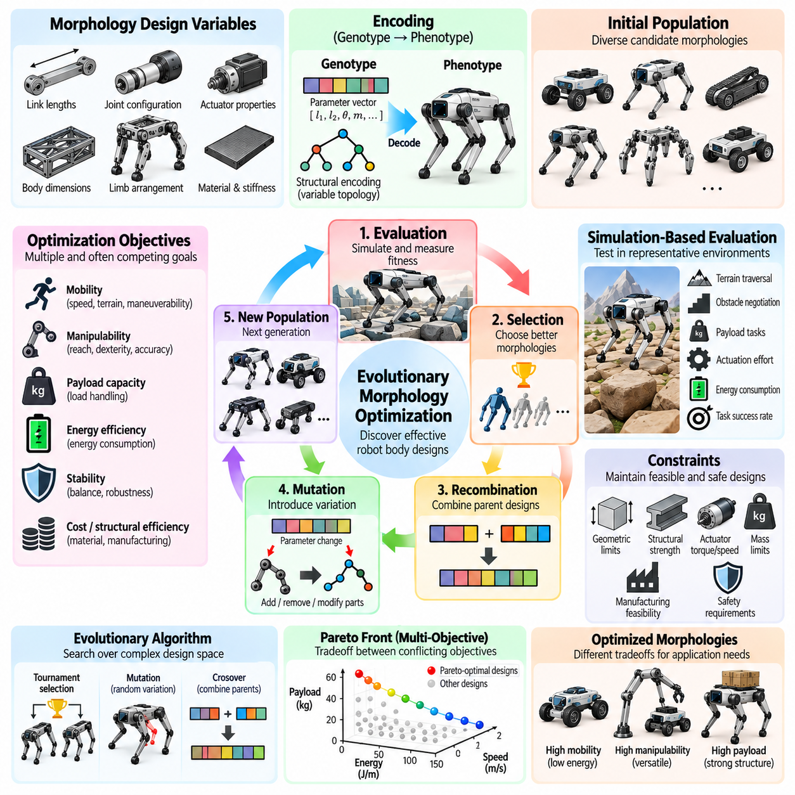{width="7.268055555555556in" height="7.268055555555556in"}

Evolutionary morphology optimization applies principles inspired by biological evolution to discover effective robotic body designs. Instead of relying on gradients or manually specified structural improvements, evolutionary algorithms explore populations of candidate morphologies through selection, mutation, and recombination. This approach is particularly valuable when design spaces contain discrete choices, nonlinear interactions, and complex relationships between physical structure and task performance.

The optimization process begins by defining a representation of robot morphology that can be modified computationally. Design variables may describe link lengths, joint positions, limb arrangements, actuator properties, material stiffness, and body proportions. Some representations use fixed-length parameter vectors, while others encode variable structural connectivity. The selected representation determines which robot architectures can be discovered and how efficiently the search space can be explored.

Each candidate morphology is represented by a genotype that encodes its design parameters or structural organization. A decoding process transforms this genotype into a phenotype, representing the physical robot configuration evaluated during optimization. Direct encodings specify individual components explicitly, while indirect encodings use developmental rules or generative functions. Indirect representations can produce repeated structures, symmetry, and coordinated geometric variations using relatively compact descriptions.

Evolutionary search typically starts with an initial population of candidate robot designs. These candidates may be generated randomly, sampled from feasible parameter ranges, or initialized using existing engineering configurations. Population diversity is important because it allows the algorithm to investigate different regions of the design space. Excessively similar initial designs can restrict exploration and increase the likelihood of premature convergence toward locally favorable solutions.

Fitness evaluation determines how successfully each candidate morphology satisfies the intended design objectives. A fitness function may consider locomotion speed, energy consumption, stability, manipulation capability, payload capacity, or structural efficiency. Candidate robots are commonly evaluated through physics-based simulation under representative operating conditions. The resulting performance measurements guide selection and determine which morphological characteristics are more likely to persist.

Selection mechanisms favor candidates with desirable fitness while preserving opportunities for continued exploration. Tournament selection compares randomly chosen individuals, whereas rank-based methods assign selection probabilities according to relative performance. Strong selection pressure can accelerate improvement but may reduce genetic diversity. Weaker selection maintains broader exploration but can slow convergence. Effective evolutionary optimization balances exploitation of successful designs with discovery of alternatives.

Mutation introduces variation by modifying encoded morphological characteristics. Continuous parameters such as link length or actuator capacity may receive numerical perturbations, while discrete mutations can add, remove, or rearrange structural elements. Mutation operators must respect physical feasibility whenever possible. Excessive mutation can destroy useful design characteristics, whereas insufficient mutation may prevent the population from escaping unproductive regions of the search space.

Recombination combines information from multiple parent designs to produce new candidate morphologies. For fixed-length encodings, crossover may exchange parameter segments or interpolate continuous variables. Structural encodings require more careful operators to preserve valid connectivity and meaningful component relationships. Recombination can accelerate the discovery of useful combinations, but its effectiveness depends on whether inherited design features remain compatible after integration.

Evolutionary morphology optimization must account for physical constraints throughout the search process. Candidate designs may violate joint limits, structural strength requirements, actuator capabilities, geometric clearances, or manufacturing restrictions. Constraint handling methods include feasibility-preserving operators, repair procedures, and penalties applied during fitness evaluation. Maintaining physically meaningful candidates reduces wasted simulation effort and improves the relevance of discovered solutions.

Multi-objective evolutionary optimization is especially useful because robot morphology involves competing performance requirements. Increasing reach may improve manipulation capability while reducing stiffness and payload capacity. Lightweight structures may lower energy consumption but compromise durability. Algorithms such as NSGA-II maintain populations of nondominated solutions and preserve diversity along the Pareto frontier, allowing engineers to examine multiple viable design compromises.

Simulation environments provide the primary evaluation infrastructure for many evolutionary morphology studies. Dynamic models calculate motion, contact forces, actuator effort, and energy expenditure for candidate bodies. Different terrains, payloads, and task sequences can be used to evaluate generalization. However, simulation fidelity directly affects optimization quality, and inaccurate contact models or simplified actuator dynamics may encourage designs that fail in physical operation.

Computational expense is a major limitation because evolutionary algorithms may require thousands of candidate evaluations across many generations. Parallel simulation can evaluate multiple individuals simultaneously, while surrogate models approximate expensive fitness calculations. Early termination can discard clearly unsuccessful candidates before completing full evaluations. Multi-fidelity strategies combine inexpensive preliminary tests with detailed simulation for promising morphologies.

Morphology and controller co-evolution extends evolutionary optimization by adapting physical structure and control behavior together. A candidate genotype may encode both body parameters and controller parameters, allowing the search process to evaluate their interactions. This is important because a morphology with excellent mechanical potential may perform poorly under an unsuitable controller. Joint evolution can discover coordinated combinations of limb geometry, compliance, gait patterns, and actuation strategies.

The evaluation protocol must distinguish morphological quality from controller training limitations. Comparing candidate bodies using identical fixed controllers may unfairly favor particular structures, while independently training every controller introduces substantial computational cost. Standardized controller optimization budgets and consistent evaluation procedures improve comparison fairness. The objective is to estimate achievable task performance rather than performance under an arbitrarily mismatched control policy.

Evolutionary optimization can produce unexpected designs that differ substantially from conventional engineering configurations. Unusual limb proportions, asymmetric structures, or unconventional joint arrangements may emerge when they provide measurable advantages. Such discoveries illustrate the value of open-ended structural exploration. Nevertheless, unconventional morphologies require careful examination to determine whether their apparent benefits arise from genuine mechanical improvements or simulation artifacts.

Diversity preservation helps evolutionary algorithms avoid premature convergence and discover alternative design strategies. Niching methods, novelty search, and quality-diversity algorithms encourage exploration beyond the highest current fitness values. Quality-diversity approaches can maintain collections of effective morphologies with different behavioral or structural characteristics. These collections provide engineers with multiple design options suited to changing tasks or operating environments.

Robust evolutionary optimization evaluates candidate morphologies across uncertain and variable conditions. Changes in terrain friction, payload distribution, actuator performance, or material properties may significantly alter fitness. Evaluating multiple randomized scenarios can reduce overfitting to a single simulated environment. Robust fitness measures may emphasize expected performance, consistency, or worst-case outcomes, encouraging designs that remain useful under realistic operational variability.

Manufacturing feasibility must be incorporated before evolutionary designs are translated into physical prototypes. Complex structures may require specialized fabrication processes, while unusual joints or transmission arrangements may introduce reliability concerns. Manufacturing constraints can be embedded directly in the genotype or enforced during evaluation. Practical optimization should also consider assembly complexity, repairability, material availability, and long-term maintenance requirements.

Experimental validation is essential because evolved morphologies may exploit inaccuracies in simulation models. Physical prototypes reveal effects involving friction, backlash, structural flexibility, actuator heating, and contact uncertainty that may be inadequately represented computationally. Measurements from real hardware can improve simulation models and refine subsequent evolutionary searches. This iterative process reduces the gap between simulated fitness and deployable robotic performance.

Evolutionary morphology optimization is particularly relevant to Physical AI because intelligent behavior emerges from interactions among body structure, control, and environment. Evolutionary search can discover physical configurations that simplify control, support adaptive locomotion, or improve manipulation efficiency. When combined with learning-based controllers and realistic evaluation, evolutionary methods help identify embodiments that support flexible autonomous behavior rather than optimizing isolated mechanical specifications.

Ultimately, evolutionary morphology optimization provides a flexible framework for exploring robotic designs that are difficult to optimize using conventional gradient-based methods. Population-based search, structural variation, simulation evaluation, and multi-objective selection reveal diverse solutions across complex design spaces. Its practical success depends on meaningful representations, reliable fitness measurements, computational efficiency, and physical validation. These principles support the systematic discovery of capable and adaptable robotic bodies.

## 11.08. Bayesian and Black Box Optimization

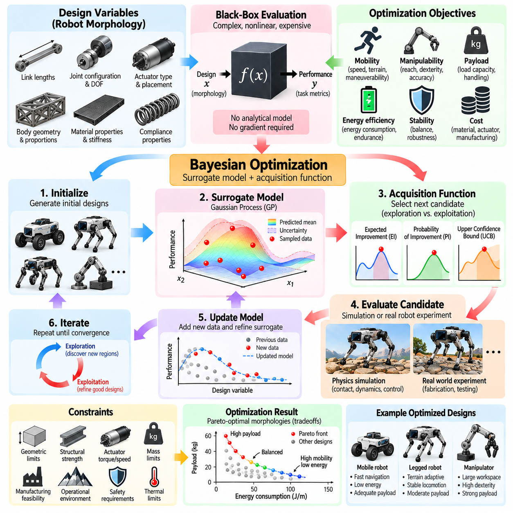{width="7.268055555555556in" height="7.268055555555556in"}

Bayesian optimization and black-box optimization provide practical methods for improving robot morphology when performance functions are expensive, nonlinear, noisy, or difficult to differentiate. Unlike gradient-based approaches, these methods do not require analytical derivatives of the design objectives. Instead, they evaluate candidate configurations and use observed results to guide subsequent exploration. They are especially valuable when morphology evaluation involves complex simulation or physical experiments.

Black-box optimization treats the relationship between design variables and performance outcomes as an unknown function that can only be evaluated through experiments or computation. Design parameters may include limb lengths, joint positions, actuator capacities, structural stiffness, and body proportions. The optimizer proposes candidate morphologies, receives measured performance values, and updates its search strategy. This formulation accommodates complicated physical interactions without requiring explicit mathematical expressions.

Robot morphology optimization frequently exhibits black-box characteristics because performance depends on coupled mechanical and control processes. Contact dynamics, friction, actuator saturation, and nonlinear structural deformation can make objective functions difficult to express analytically. Simulation-based evaluations may also contain discontinuities caused by falls, collisions, or changes in contact modes. Black-box methods can explore these behaviors without assuming that the objective landscape is smooth.

Bayesian optimization is a model-based black-box optimization approach that uses probabilistic surrogate models to estimate performance across the design space. Rather than evaluating every possible morphology, it learns relationships between design parameters and observed objective values. The surrogate predicts both expected performance and uncertainty for untested configurations. These predictions help determine which candidate should be evaluated next to improve optimization efficiency.

Gaussian processes are widely used surrogate models in Bayesian optimization because they provide flexible predictions with associated uncertainty estimates. A Gaussian process represents the objective function through a probability distribution conditioned on observed evaluations. Kernel functions describe similarities between candidate designs and influence the smoothness of predicted performance. Appropriate kernel selection is important because robotic design variables may exhibit different scales and nonlinear dependencies.

Bayesian optimization generally begins with an initial set of evaluated candidate morphologies. These designs may be selected through random sampling, Latin hypercube sampling, or engineering-informed initialization. Their measured performance values form the initial dataset used to train the surrogate model. The optimizer then repeatedly selects new candidates, evaluates their performance, and updates the model. This sequential learning process concentrates computational effort on informative design regions.

Acquisition functions determine which candidate morphology should be evaluated next by balancing exploration and exploitation. Exploration favors uncertain regions where potentially superior designs may remain undiscovered, while exploitation prioritizes configurations predicted to perform well. Common acquisition strategies include expected improvement, probability of improvement, and upper confidence bound methods. Their effectiveness depends on the accuracy of surrogate predictions and the available evaluation budget.

Expected improvement evaluates the potential benefit of testing a candidate relative to the best performance observed so far. It considers both the predicted objective value and uncertainty, allowing uncertain but promising designs to receive attention. Confidence-bound methods combine estimated performance with uncertainty using an adjustable exploration parameter. These mechanisms provide a principled alternative to selecting candidates solely according to their predicted performance.

The computational advantage of Bayesian optimization becomes significant when each morphology evaluation is expensive. High-fidelity physics simulation may require detailed contact modeling, structural analysis, and controller execution across multiple tasks. Physical prototype experiments can be even more costly because they involve fabrication, assembly, calibration, and testing. By selecting informative candidates, Bayesian optimization can reduce the number of evaluations required to identify competitive designs.

Morphology optimization often includes mixed continuous, discrete, and categorical variables that complicate conventional Bayesian optimization. Continuous variables may represent link dimensions, while discrete variables describe joint counts and categorical variables identify actuator types. Specialized kernels, structured surrogate models, or alternative probabilistic methods can accommodate these differences. The optimization framework must preserve valid robot configurations while exploring heterogeneous design spaces.

Constraint handling is essential because many candidate morphologies may violate physical or operational requirements. Constraints can include maximum mass, actuator torque limits, structural stress, minimum stability margins, and manufacturing feasibility. Constrained Bayesian optimization may construct separate surrogate models for objective functions and constraint violations. Acquisition strategies then favor candidates that combine promising performance with a sufficiently high probability of feasibility.

Noisy evaluations present another challenge because repeated tests of the same morphology may produce different outcomes. Randomized terrain conditions, controller variability, sensor noise, and numerical simulation effects can introduce uncertainty into performance measurements. Bayesian models can explicitly represent observation noise and distinguish it from uncertainty caused by limited data. Repeated evaluations may be necessary when measurement variability is large relative to expected design improvements.

Multi-objective Bayesian optimization extends the approach to competing morphology requirements such as mobility, energy efficiency, stability, and payload capacity. Instead of predicting a single performance score, the surrogate models several objectives and supports exploration of Pareto-optimal tradeoffs. Acquisition methods based on hypervolume improvement can prioritize candidates expected to expand the nondominated solution set. This is useful when evaluation budgets are limited but several design alternatives are needed.

High-dimensional morphology spaces can reduce the efficiency of standard Bayesian optimization because surrogate uncertainty becomes difficult to estimate accurately. Robots with many joints, structural parameters, and material variables may contain dozens or hundreds of design dimensions. Dimensionality reduction, parameter grouping, trust-region methods, and hierarchical optimization can improve scalability. These techniques concentrate search effort on influential variables or promising local regions.

Alternative black-box optimization methods include random search, evolutionary strategies, covariance matrix adaptation, and derivative-free local search. Covariance Matrix Adaptation Evolution Strategy adapts a sampling distribution to explore promising continuous parameter combinations. Pattern search and related methods evaluate structured perturbations without calculating gradients. These approaches may outperform Bayesian optimization when evaluation costs are moderate or the design space is large and irregular.

Surrogate-assisted optimization combines black-box search algorithms with predictive models to reduce evaluation expense. A surrogate can screen large numbers of candidate designs before selected morphologies undergo high-fidelity simulation. Model predictions must be periodically corrected using new observations to prevent systematic errors from directing the search toward unrealistic solutions. Adaptive sampling helps maintain accuracy in regions where promising designs are concentrated.

Multi-fidelity optimization exploits the availability of evaluation methods with different computational costs and accuracies. Simplified kinematic models can rapidly estimate workspace, while detailed dynamic simulation evaluates stability and energy consumption. Physical testing provides higher-confidence evidence for selected prototypes. Multi-fidelity Bayesian optimization learns relationships between these evaluation levels and determines when expensive measurements are justified.

Morphology and controller co-optimization can also benefit from Bayesian and black-box methods. Candidate body configurations may require different controller parameters to achieve their full potential. Joint optimization explores both structural and control variables, while nested optimization trains or tunes a controller for each proposed morphology. Although this increases computational complexity, it provides more realistic estimates of achievable performance than evaluating every body with an unsuitable fixed controller.

Robust Bayesian optimization considers uncertainty in operating conditions and physical parameters rather than optimizing only nominal performance. Variations in payload mass, terrain friction, actuator efficiency, and manufacturing tolerances can significantly affect a robot\'s behavior. Robust objectives may emphasize expected performance, variance, or worst-case outcomes across representative scenarios. Probabilistic modeling helps identify designs that remain effective despite uncertainty and environmental variability.

The reliability of surrogate-guided optimization depends on validation and careful experimental design. Predictions should be checked against independent simulations or physical measurements, especially near performance boundaries and safety constraints. Unexpected results can reveal missing variables, inaccurate assumptions, or insufficient model flexibility. Incorporating these observations into subsequent optimization cycles improves both predictive accuracy and the practical relevance of selected morphologies.

For Physical AI systems, Bayesian and black-box optimization provide efficient mechanisms for connecting robot body design with measurable autonomous behavior. They allow complex interactions among morphology, control, sensing, and environment to be evaluated without requiring fully differentiable models. By intelligently allocating simulation and experimental resources, these methods support the discovery of efficient, stable, and adaptable robotic embodiments under realistic engineering constraints.

## 11.09. Simulation Based Design Optimization

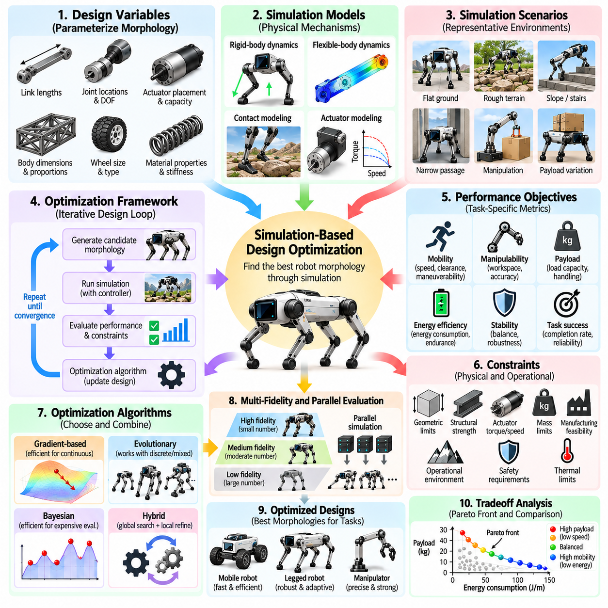{width="7.268055555555556in" height="7.268055555555556in"}

Simulation-based design optimization uses computational models to evaluate and improve robot morphology before physical prototypes are manufactured. It connects geometric parameters, material properties, actuator characteristics, and control strategies with measurable performance outcomes. By repeatedly simulating candidate designs, engineers can explore complex relationships between physical structure and behavior while reducing development cost, experimental risk, and dependence on manual trial-and-error.

The process begins with a parameterized robot model that represents the physical characteristics available for optimization. Design variables may include link lengths, joint locations, wheel dimensions, body proportions, actuator placement, and structural stiffness. These parameters are connected to geometric and dynamic models so that each candidate configuration can be generated automatically. Consistent parameterization enables systematic comparison across different morphological alternatives.

Simulation models must capture the physical mechanisms that determine robot performance. Rigid-body dynamics describe motion and force transmission, while flexible-body models represent structural deformation and vibration. Contact models estimate interactions with terrain, objects, and surrounding surfaces. Actuator models incorporate torque limits, speed characteristics, and energy consumption. The required modeling fidelity depends on the intended tasks and optimization objectives.

A simulation-based optimization framework combines a design generator, physics simulator, performance evaluator, and search algorithm. The generator constructs candidate robot configurations from selected parameters. The simulator predicts their behavior under specified operating conditions, and the evaluator calculates objective values and constraint violations. The search algorithm uses these results to propose improved designs, forming an iterative computational design loop.

Performance objectives must reflect the robot\'s intended operational requirements. Mobile robots may be evaluated using traversal speed, energy efficiency, obstacle clearance, and stability. Manipulators may emphasize reachable workspace, positioning accuracy, payload capacity, and joint effort. Legged robots require measures of locomotion robustness, impact tolerance, and terrain adaptability. Appropriate objectives ensure that optimization produces practically useful morphologies.

Simulation scenarios determine whether candidate designs are evaluated under representative conditions. A mobile robot may traverse slopes, uneven terrain, and narrow passages, while a manipulator may execute reaching and lifting tasks across its workspace. Multiple scenarios reveal performance limitations that remain hidden during isolated tests. Scenario selection should represent expected deployment conditions without allowing optimization to exploit overly simplified environments.

Physical constraints are incorporated to prevent the optimization process from producing unrealistic designs. Constraints may specify allowable dimensions, total mass, actuator torque, structural stress, joint ranges, and minimum ground clearance. Candidate configurations that violate these requirements can be rejected, repaired, or penalized during evaluation. Explicit feasibility checks improve computational efficiency and maintain consistency with practical engineering requirements.

The choice of optimization algorithm depends on the structure of the design space and the computational expense of simulation. Gradient-based methods can efficiently refine differentiable continuous parameters, while evolutionary algorithms explore discontinuous or discrete architectural alternatives. Bayesian optimization is useful when evaluations are expensive and relatively few experiments are available. Hybrid approaches combine global exploration with local refinement.

High-fidelity simulation can improve prediction accuracy but substantially increases computational cost. Detailed contact dynamics, deformable materials, and complex actuator models may require small integration steps and extensive numerical computation. Simplified models enable faster exploration but may omit important physical effects. Multi-fidelity optimization addresses this tradeoff by using inexpensive models for screening and detailed simulations for promising candidates.

Parallel computing can accelerate simulation-based optimization by evaluating multiple candidate morphologies simultaneously. Distributed simulation environments allow large design populations or scenario collections to be processed across available computing resources. Automated experiment management records parameter settings, simulation versions, objective values, and failure conditions. Reproducible evaluation pipelines are essential for interpreting optimization results and comparing alternative designs.

Controller behavior must be considered because morphological performance depends on how the robot is operated. A mechanically promising configuration may perform poorly when evaluated with a controller designed for another body. Simulation-based co-optimization can adjust geometry and controller parameters together, or optimize a controller separately for each morphology. This produces more meaningful performance comparisons but increases the computational burden of evaluating candidates.

Contact-rich tasks create particular difficulties because small geometric changes can produce abrupt differences in simulated behavior. Legged locomotion, grasping, and obstacle interaction involve transitions between contact states that may be numerically sensitive. Friction coefficients, collision geometry, and solver tolerances can strongly influence predicted performance. Optimization results should therefore be tested for sensitivity to contact modeling assumptions.

Robust simulation-based optimization evaluates designs across uncertain physical and environmental conditions. Variations in payload mass, terrain friction, actuator efficiency, and manufacturing tolerances may change the ranking of candidate morphologies. Domain randomization exposes each design to multiple plausible conditions rather than a single nominal environment. Robust objectives favor configurations that maintain acceptable performance despite these variations.

Structural analysis can be integrated with dynamic simulation to evaluate the mechanical feasibility of optimized morphologies. Finite element analysis estimates stress, deformation, and vibration characteristics under representative loading conditions. Dynamic simulations provide time-varying forces that can serve as structural load cases. Combining these models helps identify designs that achieve favorable motion performance without sacrificing mechanical strength or fatigue resistance.

Simulation-to-reality transfer remains a central challenge because computational models cannot perfectly reproduce physical systems. Differences in friction, backlash, material behavior, actuator heating, and sensor characteristics can cause simulated performance to diverge from experimental results. Calibration against measured hardware data improves model accuracy. Iterative validation reduces the risk of selecting designs that exploit simulation errors rather than genuine physical advantages.

Sensitivity analysis helps determine which morphology parameters have the greatest influence on performance. Engineers can perturb design variables and observe changes in energy consumption, stability, or task completion. This reveals influential parameters, interactions, and regions where performance is particularly sensitive to manufacturing variation. Sensitivity information also supports dimensionality reduction and more efficient allocation of optimization effort.

Multi-objective simulation-based optimization considers competing goals rather than reducing design quality to a single metric. Increasing structural stiffness may require additional mass, while expanding workspace may increase actuator demands. Candidate designs can be compared using Pareto dominance to identify meaningful performance tradeoffs. The resulting Pareto frontier provides engineers with alternative configurations suited to different operational priorities and resource constraints.

Digital twins extend simulation-based optimization by connecting computational robot models with measurements from physical hardware. Sensor data and operational logs can update estimates of mass properties, actuator characteristics, and environmental interactions. These updates improve simulation accuracy and support continued design refinement. A validated digital twin can also help assess modifications before they are implemented in deployed robotic systems.

A practical optimization workflow progresses from broad conceptual exploration toward increasingly detailed verification. Early stages evaluate many candidates using simplified models, while later stages apply high-fidelity dynamics, structural analysis, and realistic controller evaluation. Promising configurations are then tested through prototypes and controlled experiments. Feedback from physical testing informs model updates and subsequent optimization cycles.

Simulation-based design optimization supports Physical AI by treating robot morphology as an integral component of intelligent behavior. Body geometry, mass distribution, compliance, and actuation influence what a robot can perceive, control, and accomplish in its environment. Integrating simulation, optimization, learning, and experimental validation enables the systematic development of efficient and adaptable robotic embodiments that satisfy real-world performance requirements.

## 11.10. Differentiable Physics and Design

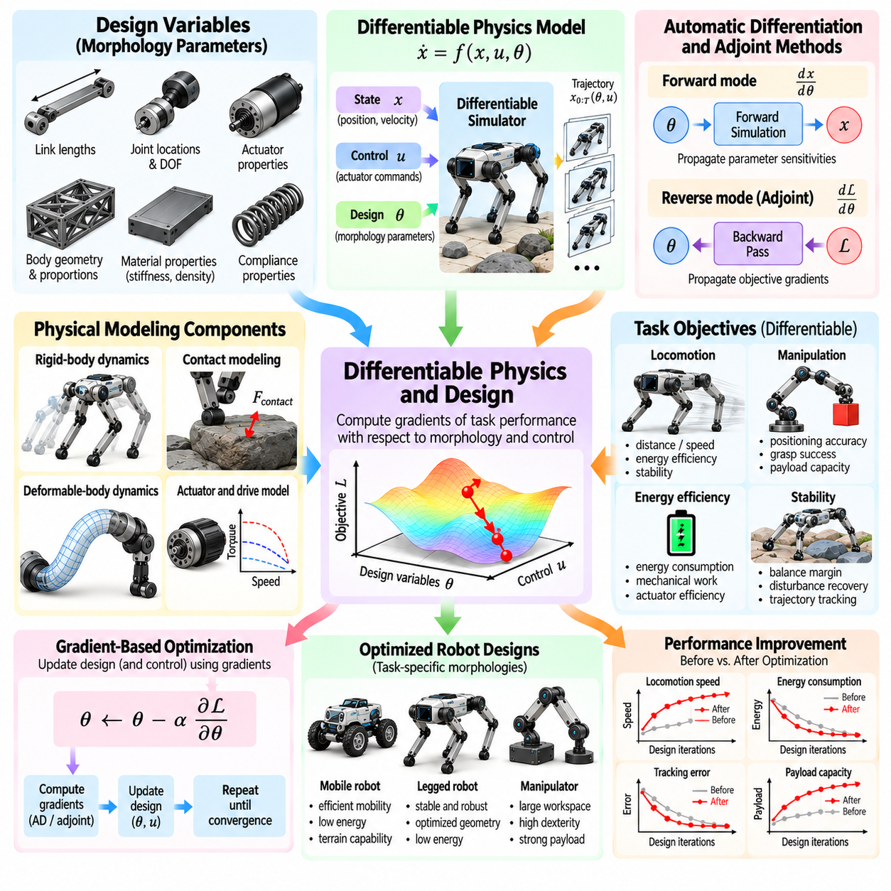{width="7.268055555555556in" height="7.268055555555556in"}

Differentiable physics provides a computational framework in which changes to robot design parameters can be related directly to changes in physical behavior through derivatives. Unlike conventional simulation, which primarily predicts system responses, differentiable simulation also estimates how those responses vary with geometry, mass, stiffness, and actuation. This capability connects physical modeling with gradient-based optimization and enables systematic improvement of robotic morphology.

The central principle is to represent physical dynamics using mathematical operations that support differentiation. A robot\'s state evolves according to equations describing motion, forces, constraints, and environmental interactions. Design parameters influence these equations through link dimensions, inertia tensors, joint locations, and material properties. Differentiating the simulated trajectory reveals how small morphological changes affect task performance.

A differentiable physics model typically combines state variables, control inputs, design parameters, and numerical integration. State variables describe positions and velocities, while control inputs represent actuator commands. Design parameters determine structural and mechanical properties. During simulation, the system advances through successive time steps, allowing gradients of a final performance objective to be propagated backward through the computational process.

Automatic differentiation is an important enabling technology because it calculates derivatives through sequences of numerical operations. Forward-mode differentiation propagates parameter sensitivities alongside the simulation, while reverse-mode differentiation propagates objective sensitivities backward. Reverse-mode methods are often attractive when many design parameters influence a small number of objectives. However, storing long simulation trajectories can create substantial memory demands.

Adjoint methods provide another approach for computing gradients through dynamic systems. Rather than differentiating every intermediate operation independently, an adjoint formulation introduces auxiliary variables that capture how the objective depends on system states. These variables are propagated backward through the dynamics to obtain parameter sensitivities. Adjoint methods can improve efficiency, although their accuracy depends on consistent numerical integration and constraint treatment.

Differentiable rigid-body dynamics enables optimization of robot geometry and inertial properties. Link lengths influence reachable workspace and joint leverage, while mass distribution affects acceleration, balance, and energy consumption. By differentiating task objectives with respect to these parameters, an optimizer can identify promising geometric modifications. Such methods are applicable to manipulators, legged robots, mobile platforms, and other articulated systems.

Contact modeling presents a major challenge because physical contact often introduces discontinuities into system dynamics. Collisions, impacts, friction transitions, and changes between sticking and sliding can produce abrupt variations in motion. Traditional contact solvers may not provide stable derivatives across these events. Differentiable simulators therefore employ smooth contact approximations, implicit differentiation, or specialized methods for handling constrained dynamics.

Smooth contact models replace abrupt interaction rules with continuous approximations that are easier to differentiate. Penalty-based contact formulations, for example, represent penetration resistance using continuous force functions. Although these approximations improve gradient availability, excessive smoothing can distort physical behavior. Accurate optimization requires balancing numerical differentiability with realistic contact forces, impact responses, and friction characteristics.

Differentiable deformable-body simulation extends morphology optimization to flexible structures and compliant materials. Elastic deformation can be represented through finite element methods, mass-spring systems, or other continuum approximations. Material stiffness, structural thickness, and geometry become differentiable design variables. This enables optimization of soft robotic limbs, compliant grippers, flexible mechanisms, and lightweight structures under task-dependent loading conditions.

Differentiable simulation can connect mechanical design directly to energy efficiency objectives. Changes in link geometry, mass distribution, and compliance influence actuator torque, motion trajectories, and mechanical work. Gradients of energy-related objectives can guide structural modifications that reduce unnecessary effort. However, realistic energy evaluation should account for actuator efficiency, electrical losses, transmission behavior, and operating conditions rather than mechanical work alone.

A major advantage of differentiable design is the ability to optimize morphology and control parameters simultaneously. The physical body determines which motions are possible, while the controller determines how available capabilities are used. Joint optimization can adjust limb proportions, actuator properties, gait parameters, and control policies according to a shared task objective. This interaction is especially important when structural changes alter the optimal control strategy.

Task-level differentiable objectives may include locomotion distance, manipulation accuracy, stability margins, and trajectory tracking error. Instead of optimizing isolated mechanical properties, the algorithm evaluates how morphology contributes to complete task execution. Gradients can reveal structural parameters that improve behavior under a particular controller and environment. Careful objective design is necessary to prevent solutions that exploit numerical artifacts or unrealistic task assumptions.

Optimization constraints remain essential because differentiable objectives alone do not guarantee practical designs. Robot morphology must satisfy joint limits, actuator capacity, structural strength, geometric clearance, and manufacturing requirements. Differentiable constraint functions can be incorporated through penalties or constrained optimization algorithms. Discrete architectural decisions, such as changing joint count or actuator type, generally require additional search mechanisms.

Long simulation horizons introduce difficulties because gradients must propagate through many dynamic transitions. Repeated matrix operations, unstable dynamics, and contact events may cause gradients to vanish, explode, or become numerically unreliable. Checkpointing, truncated differentiation, stable integration schemes, and carefully designed objectives can mitigate these problems. Gradient validation using finite differences remains useful for identifying implementation errors.

Differentiable physics models also involve tradeoffs between computational efficiency and physical fidelity. Simplified rigid-body models can support rapid optimization but may neglect structural flexibility, actuator heating, or complex friction. Detailed multiphysics models capture more phenomena but increase computational and memory requirements. Hierarchical workflows can optimize candidate morphologies using differentiable approximations before validating them with higher-fidelity simulation.

Uncertainty complicates gradient-based design because physical parameters and environmental conditions are never known perfectly. Friction coefficients, material stiffness, payload distribution, and actuator characteristics may vary between simulation and deployment. Robust differentiable optimization evaluates performance across multiple parameter samples or randomized scenarios. Gradients of aggregated objectives can encourage morphologies that remain effective across plausible operating conditions.

Differentiable physics can be integrated with learning-based control and reinforcement learning to improve embodied behavior. A differentiable model may provide gradients for policy optimization, structural adaptation, or model-based planning. However, learned controllers can exploit inaccuracies in differentiable simulations, especially near contact transitions. Combining analytical gradients with empirical evaluations and robust learning procedures helps reduce these limitations.

The relationship between differentiable design and topology optimization is particularly important for lightweight robotic structures. Material-density variables can be differentiated through structural simulations to determine how material placement affects stiffness, deformation, and dynamic response. These sensitivities guide redistribution of material within a design domain. Manufacturing constraints and structural verification are still required before optimized geometries can become physical components.

Experimental validation is necessary because mathematical differentiability does not guarantee physical accuracy. Real robots exhibit backlash, sensor noise, material variability, unmodeled friction, and actuator nonlinearities. Hardware measurements can calibrate simulation parameters and reveal discrepancies between predicted and observed behavior. Repeated optimization and validation cycles improve confidence that gradient-driven design modifications produce genuine physical benefits.

For Physical AI, differentiable physics establishes a direct connection between embodiment, physical interaction, and computational learning. It enables robotic bodies to be optimized according to the behaviors they must perform rather than solely according to geometric specifications. By combining differentiable dynamics, structural optimization, controller learning, and experimental validation, engineers can develop robotic morphologies that are efficient, adaptable, and aligned with real-world tasks.

## 11.11. Generative and AI Driven Robot Design

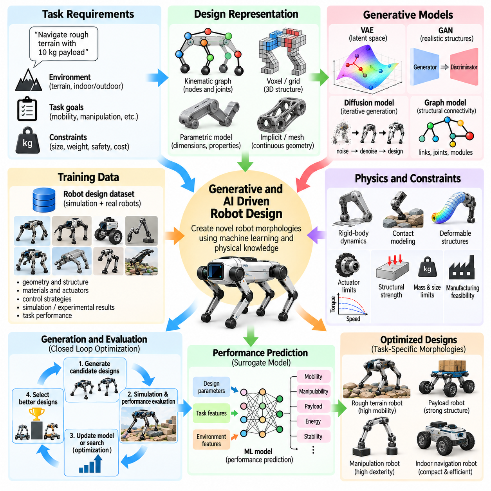{width="7.268055555555556in" height="7.268055555555556in"}

Generative and AI-driven robot design uses machine learning to explore physical configurations beyond those produced through conventional engineering workflows. Instead of modifying only predefined dimensions, generative systems can propose new structural arrangements, component geometries, and material distributions. These methods combine learned design patterns with physical constraints, enabling broader exploration of robot morphology while reducing dependence on manual design iteration.

Generative robot design begins with a representation of physical structure that can be processed by computational models. A robot may be described through geometric parameters, joint connectivity, component graphs, voxel structures, or implicit surfaces. The representation determines which morphological variations can be generated and evaluated. Effective representations must balance expressive flexibility with physical validity, computational efficiency, and compatibility with manufacturing processes.

Machine learning models can learn relationships between robot morphology and performance from existing design datasets. Training examples may contain structural parameters, simulation results, task descriptions, and measured hardware performance. By identifying patterns across these observations, a model can estimate which geometric or mechanical characteristics contribute to successful behavior. Such knowledge supports design generation without requiring exhaustive simulation of every possible configuration.

Variational autoencoders provide one approach for learning compact representations of robotic designs. An encoder maps existing morphologies into a continuous latent space, while a decoder reconstructs physical configurations from latent variables. Nearby points in this space may represent related structural designs, enabling smooth exploration of candidate morphologies. Optimization within the latent space can identify promising configurations while reducing the dimensionality of the original design problem.

Generative adversarial networks offer another mechanism for producing candidate robot structures. A generator proposes designs, while a discriminator learns to distinguish generated configurations from examples in the training distribution. This interaction can encourage realistic geometric patterns and component arrangements. However, designs that resemble training examples are not necessarily mechanically effective, so physical simulation and engineering constraints remain necessary.

Diffusion models extend generative design by learning to construct structures through iterative refinement. Starting from a noisy representation, the model progressively generates coherent geometry or component arrangements. Conditional diffusion can incorporate task requirements, geometric boundaries, or target performance characteristics. These methods are promising for complex design spaces, although generated structures still require validation for connectivity, strength, and manufacturability.

Graph-based generative models are particularly suitable for robots because mechanical systems naturally contain connected components and joints. Nodes may represent links, actuators, or modules, while edges describe mechanical relationships. Graph neural networks can learn how structural connectivity influences behavior and generate candidate architectures. Such representations support variable numbers of components, making them useful for exploring alternative limb arrangements and modular robot configurations.

AI-driven design can incorporate task descriptions as conditions for morphology generation. A robot intended for narrow indoor navigation may require compact dimensions and stable mobility, while a manipulation robot may prioritize reach and dexterity. Conditional generative models use task features to guide structural proposals toward relevant capabilities. The quality of these proposals depends on whether the training data adequately represent the intended environments and operational demands.

Foundation models and language-guided systems can support early-stage robot design by translating high-level requirements into candidate design specifications. Natural language instructions may describe desired tasks, payloads, environments, and operating constraints. AI systems can organize these requirements into structured parameters or propose preliminary architectures. However, generated specifications must be checked against physical laws, engineering calculations, and explicit safety requirements.

Physics-informed generative design integrates mechanical knowledge into the generation process rather than relying exclusively on statistical patterns. Constraints involving mass, structural strength, joint limits, and actuator capacity can restrict candidate configurations. Physics-based losses or differentiable simulation can encourage designs that satisfy desired mechanical properties. This integration reduces the likelihood of producing visually plausible structures that cannot function as physical robots.

Generative design is closely related to topology optimization because both approaches can modify material distribution and structural geometry. Traditional topology optimization typically searches within a specified design domain using explicit objectives and constraints. Generative models can learn reusable structural patterns and propose alternative layouts rapidly. Combining these methods allows learned models to initialize optimization, while physics-based refinement improves the mechanical validity of generated structures.

Performance prediction models can accelerate AI-driven morphology exploration by estimating candidate quality before expensive simulation. Surrogate models may predict energy consumption, stability, payload capacity, or structural deformation from design features. Low-confidence predictions can trigger additional simulation, while clearly unsuitable designs can be rejected early. Active learning continuously updates these predictors using newly evaluated candidates, improving the efficiency of subsequent design cycles.

Generative models can also support multi-objective robot design by producing candidates with different performance tradeoffs. Some morphologies may emphasize lightweight construction, while others prioritize stiffness, stability, or manipulation capability. Conditioning generation on target objectives enables exploration of alternative design priorities. Pareto-based evaluation remains important because a generated design cannot be considered universally optimal across competing engineering requirements.

Morphology and controller co-design introduces additional complexity because the usefulness of a physical structure depends on its control strategy. A generative system may propose body configurations together with controller parameters or learned control policies. Simulation evaluates whether the resulting combinations achieve desired behavior. Iterative feedback can improve both structure and control, but comparisons must account for differences in controller training effort and optimization budgets.

Manufacturing-aware generation ensures that proposed designs can be translated into practical hardware. Geometric constraints may include minimum wall thickness, allowable overhangs, assembly clearances, and standardized component interfaces. Material availability and fabrication methods further restrict feasible solutions. Integrating these requirements during generation reduces redesign effort and helps connect computational creativity with reliable physical construction.

The reliability of AI-generated robot morphologies depends on the quality and diversity of training data. Datasets concentrated on particular robot architectures may cause models to reproduce familiar configurations rather than discover fundamentally different structures. Incomplete performance labels and inconsistent simulation assumptions can introduce systematic bias. Diverse datasets, uncertainty estimation, and independent evaluation help reduce these limitations.

Sim-to-real transfer is essential because generated designs may exploit inaccuracies in simulation or learned performance models. Physical prototypes reveal friction, backlash, actuator heating, material imperfections, and other effects that computational models may overlook. Experimental measurements can be incorporated into subsequent training and optimization cycles. This feedback improves predictive accuracy and helps distinguish genuine mechanical innovations from artifacts of the design process.

Human engineers remain important in AI-driven robot design because design objectives are rarely captured completely by numerical metrics. Practical considerations include maintainability, safety, cost, accessibility, and compatibility with existing infrastructure. Engineers evaluate generated alternatives, identify hidden constraints, and determine acceptable tradeoffs. Human-AI collaboration therefore combines computational exploration with engineering judgment and responsibility.

Generative design workflows can integrate requirement interpretation, candidate generation, physics simulation, performance evaluation, and structural refinement into a continuous process. Promising configurations are selected for detailed analysis and prototype testing, while unsuccessful designs provide additional learning data. This closed-loop approach progressively improves both the design models and the resulting morphologies. Traceable evaluation records are important for reproducibility and verification.

For Physical AI, generative and AI-driven robot design offers a pathway toward bodies that are tailored to intelligent behavior rather than selected from fixed mechanical templates. Learned representations, physics-based evaluation, and controller co-optimization can reveal new relationships between embodiment and capability. Their practical value depends on rigorous validation, realistic constraints, and reliable manufacturing. Together, these methods support the development of adaptable robotic systems with increasingly integrated physical intelligence.

## 11.12. Co Optimization of Body and Controller [w/Code]

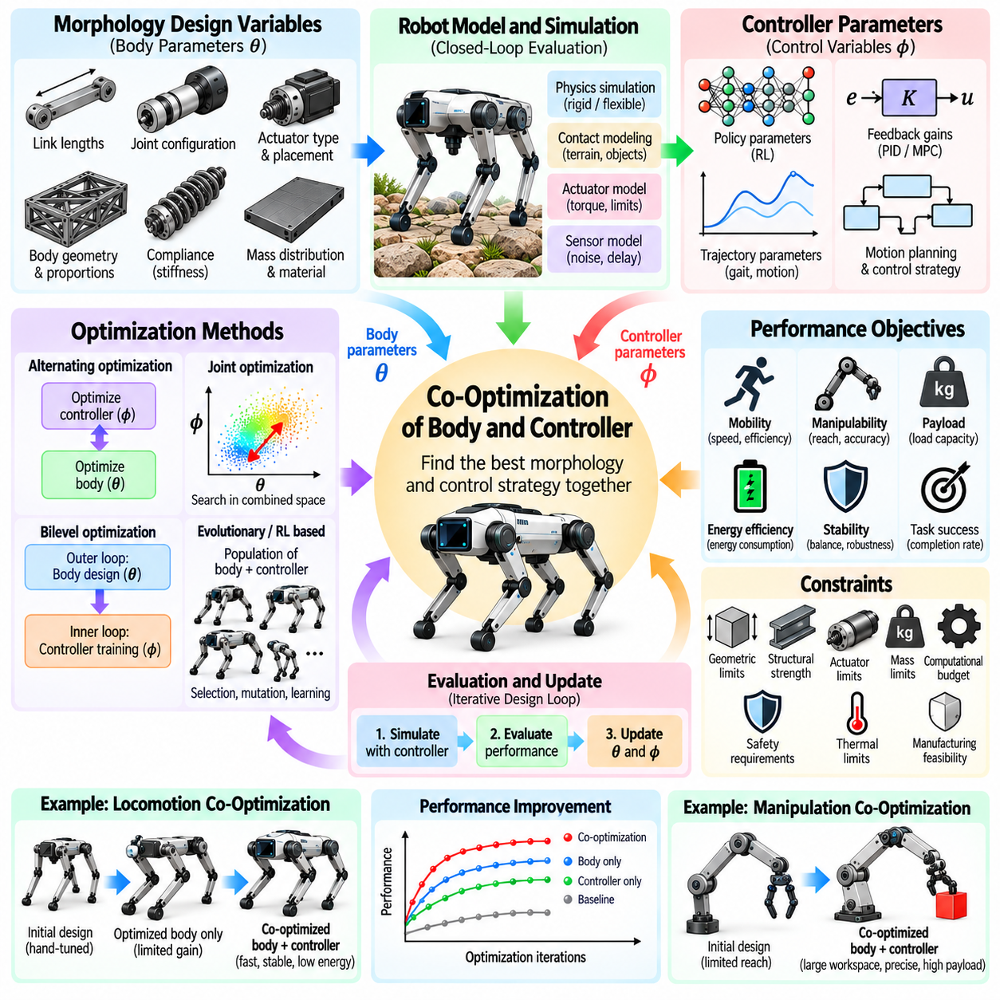{width="7.268055555555556in" height="7.268055555555556in"}

Co-optimization of body and controller is a design approach that simultaneously considers robot morphology and the control system responsible for generating behavior. Traditional workflows often establish mechanical structure before developing control algorithms, potentially limiting overall performance. Co-optimization recognizes that physical capabilities and control strategies are interdependent, allowing both to evolve toward shared operational objectives.

Robot morphology determines the mechanical possibilities available to a controller. Link lengths, joint arrangements, mass distribution, actuator placement, and structural compliance influence reachable motions and dynamic responses. Conversely, controller characteristics determine how effectively these physical capabilities are exploited. A morphology that performs poorly under one controller may become highly effective when paired with an appropriately optimized control strategy.

The co-optimization problem can be formulated using two interacting groups of decision variables. Morphological variables describe geometry, mechanical properties, and actuation architecture, while control variables specify feedback gains, motion trajectories, or policy parameters. A shared objective function evaluates the resulting closed-loop behavior. Optimization seeks combinations that maximize task performance while satisfying physical, computational, and operational constraints.

Closed-loop simulation provides an essential evaluation environment for body-controller co-optimization. Each candidate morphology is simulated together with its associated controller under representative task conditions. Performance metrics may include task completion, energy consumption, stability, tracking accuracy, and disturbance recovery. Evaluating complete closed-loop behavior prevents designs from being selected solely because of favorable mechanical properties.

One approach uses alternating optimization, in which body parameters and controller parameters are improved sequentially. The controller is optimized for a fixed morphology, after which morphological variables are adjusted using the current control strategy. Repeating this process can progressively improve overall performance. However, alternating methods may converge to locally favorable combinations and remain sensitive to initialization and optimization order.

Joint optimization searches directly over morphology and controller parameters within a unified design space. This approach can identify interactions that sequential methods might overlook, such as coordinated changes in limb geometry and gait timing. Nevertheless, the combined search space can become extremely large and computationally expensive. Efficient parameterization, surrogate models, and structured search algorithms help reduce this complexity.

Bilevel optimization offers a formal framework for separating physical design decisions from controller adaptation. An outer optimization process selects morphology parameters, while an inner process determines an effective controller for each candidate body. The outer objective measures performance after controller optimization. This formulation captures the dependence of achievable performance on control adaptation, although repeated controller training can be costly.

Differentiable physics enables gradient-based co-optimization when simulation dynamics and objective functions support reliable differentiation. Gradients can propagate through body parameters, actuator models, and control computations to identify coordinated improvements. Such methods can efficiently refine continuous design variables. Contact discontinuities, unstable trajectories, and discrete structural choices nevertheless complicate gradient computation and may require specialized treatment.

Evolutionary algorithms provide an alternative when morphology and controller spaces contain discontinuous or categorical variables. Candidate robots can encode body proportions, joint configurations, actuator selections, and controller parameters within a shared representation. Selection favors combinations that perform well during simulated tasks. Mutation and recombination explore new designs, while diversity mechanisms help prevent premature convergence toward narrowly specialized solutions.

Reinforcement learning can be integrated with morphology optimization by training control policies for different physical configurations. A policy learns to produce actions that maximize cumulative task rewards under the dynamics of its associated body. Morphological parameters can then be updated based on the performance of trained policies. This approach supports complex behaviors but requires careful management of training cost, reward design, and evaluation fairness.

Locomotion provides a clear example of body-controller interdependence. Leg length, joint placement, foot geometry, and compliance influence stride characteristics and ground contact behavior. Gait frequency, stance timing, and feedback control determine how these features translate into movement. Joint optimization can improve speed, stability, and energy efficiency by coordinating mechanical design with locomotion strategies rather than treating them independently.

Manipulation tasks demonstrate similar interactions between morphology and control. Arm dimensions, joint arrangement, transmission ratios, and gripper compliance determine workspace and force capabilities. Motion planning, impedance control, and grasp strategies determine how effectively these capabilities are used. Co-optimization can balance reach, precision, payload handling, and contact stability for the manipulation tasks a robot is expected to perform.

Actuator selection is particularly important because it links mechanical design with control bandwidth and energy consumption. Motor torque, gear ratio, transmission compliance, and thermal limits influence achievable acceleration and force regulation. Controller gains and motion profiles must remain compatible with these characteristics. Joint optimization can reduce actuator oversizing while maintaining adequate performance margins and reliable operation.

Morphological computation introduces another dimension to body-controller co-optimization. Passive compliance, elastic elements, and carefully distributed mass can stabilize motion or absorb disturbances without requiring continuous active correction. These physical mechanisms may reduce sensing and control demands. However, excessive compliance can decrease positioning precision or introduce oscillations, making coordinated optimization necessary to determine appropriate mechanical behavior.

Robustness must be evaluated because a body-controller combination optimized for one environment may perform poorly under different conditions. Changes in payload, terrain friction, sensor noise, and actuator efficiency can alter closed-loop dynamics. Robust co-optimization evaluates candidate systems across multiple disturbances and operating scenarios. Designs are favored when they maintain acceptable performance rather than achieving exceptional results only under nominal conditions.

Multi-objective co-optimization addresses competing requirements such as speed, energy efficiency, stability, payload capacity, and controller complexity. Improvements in one dimension may increase structural mass or computational demands elsewhere. Pareto-based methods identify alternative body-controller combinations representing different engineering tradeoffs. Designers can then select configurations according to deployment priorities, cost limitations, and safety requirements.

Generalization is a major concern when controllers are trained specifically for individual morphologies. A highly specialized policy may perform well in familiar scenarios but fail when tasks or environmental conditions change. Morphology-conditioned policies and shared representations can support adaptation across different bodies. Evaluating candidates on unseen tasks helps distinguish genuinely versatile designs from solutions that exploit narrow training conditions.

Simulation-to-reality transfer remains challenging because optimized controllers may exploit inaccuracies in physical models. Contact friction, structural flexibility, actuator delays, and sensor imperfections can cause unexpected behavior after deployment. Domain randomization, hardware calibration, and physical prototype testing help reduce these discrepancies. Controller adaptation on real hardware may also be necessary after selecting a morphology through simulation.

Practical implementation requires balancing optimization quality against computational and manufacturing costs. Training a separate controller for every candidate morphology can be prohibitively expensive, especially with high-dimensional policies. Warm-started training, reusable policy representations, parallel simulation, and multi-fidelity evaluation can improve efficiency. Final candidates must also satisfy structural integrity, maintenance, assembly, and operational safety requirements.

For Physical AI, body-controller co-optimization establishes a unified perspective in which intelligence emerges through interactions among morphology, control, and environment. Mechanical structure shapes the available behaviors, while learned or engineered control strategies determine how those behaviors are realized. Integrating physical design, dynamic simulation, machine learning, and experimental validation enables robotic systems whose embodiment and intelligence are developed as complementary parts of a single design process.
