**Volume 03. Embodiment and Morphology**

# 내용 {#내용 .TOC-Heading}

> [Chapter 12. Morphology Aware Control [1](#chapter-12.-morphology-aware-control)](#chapter-12.-morphology-aware-control)

>

> [12.01. What is Morphology Aware Control [2](#what-is-morphology-aware-control)](#what-is-morphology-aware-control)

>

> [12.02. Kinematic and Dynamic Body Awareness [3](#kinematic-and-dynamic-body-awareness)](#kinematic-and-dynamic-body-awareness)

>

> [12.03. Mass Inertia and Payload Awareness [4](#mass-inertia-and-payload-awareness)](#mass-inertia-and-payload-awareness)

>

> [12.04. Contact Compliance and Terrain Awareness [5](#contact-compliance-and-terrain-awareness)](#contact-compliance-and-terrain-awareness)

>

> [12.05. Whole Body and Redundancy Aware Control [6](#whole-body-and-redundancy-aware-control)](#whole-body-and-redundancy-aware-control)

>

> [12.06. Model Based Morphology Aware Control [7](#model-based-morphology-aware-control)](#model-based-morphology-aware-control)

>

> [12.07. Learning Based Morphology Aware Control [8](#learning-based-morphology-aware-control)](#learning-based-morphology-aware-control)

>

> [12.08. Morphology Conditioned Policies [9](#morphology-conditioned-policies)](#morphology-conditioned-policies)

>

> [12.09. Graph Representations of Robot Bodies [10](#graph-representations-of-robot-bodies)](#graph-representations-of-robot-bodies)

>

> [12.10. Graph Neural Networks for Robot Control [w/Code] [11](#graph-neural-networks-for-robot-control-wcode)](#graph-neural-networks-for-robot-control-wcode)

>

> [12.11. Cross Morphology Policy Transfer [12](#cross-morphology-policy-transfer)](#cross-morphology-policy-transfer)

>

> [12.12. Cross Embodiment Generalization [13](#cross-embodiment-generalization)](#cross-embodiment-generalization)

>

> [12.13. Morphology Conditioned Foundation Models [14](#morphology-conditioned-foundation-models)](#morphology-conditioned-foundation-models)

>

> [12.14. Body Aware World Models [15](#body-aware-world-models)](#body-aware-world-models)

>

> [12.15. Adaptive Control after Morphology Change [16](#adaptive-control-after-morphology-change)](#adaptive-control-after-morphology-change)

## Chapter 12. Morphology Aware Control

## 12.01. What is Morphology Aware Control

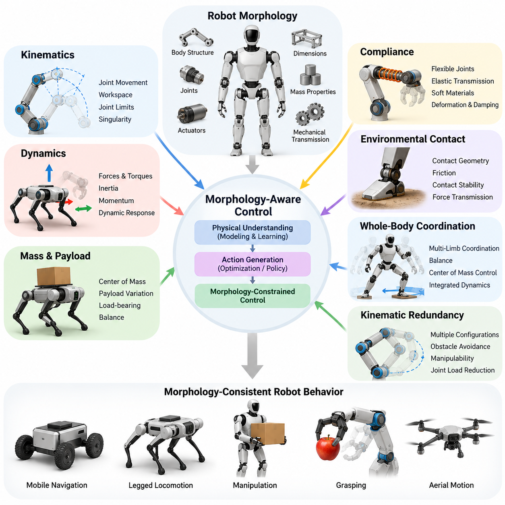{width="7.268055555555556in" height="7.268055555555556in"}

Morphology-aware control is a robotics control approach that explicitly incorporates the physical structure, mechanical properties, and configuration of a robot into the process of generating actions. Rather than treating the robot as a generic actuator system, it recognizes that body geometry, joint arrangement, mass distribution, compliance, and contact characteristics directly influence achievable motion and control performance.

Traditional robot control often assumes that a fixed mathematical model adequately describes the relationship between control commands and physical responses. Morphology-aware control extends this perspective by recognizing that the robot\'s embodiment determines its feasible actions, dynamic behavior, and interaction capabilities. The controller therefore considers physical constraints and structural characteristics when selecting movements and regulating forces.

The fundamental principle is that intelligence and control cannot be completely separated from the physical body executing an action. A control policy suitable for a wheeled mobile robot may be inappropriate for a quadruped, humanoid, or aerial platform because their locomotion mechanisms and stability requirements differ. Morphology-aware control connects decision-making with the mechanical realities of each embodiment.

Robot morphology includes the arrangement of links and joints, degrees of freedom, actuator placement, body dimensions, and mechanical transmission mechanisms. These characteristics determine the robot\'s reachable workspace, movement flexibility, load-bearing capacity, and dynamic response. A morphology-aware controller uses this structural information to generate commands consistent with the robot\'s physical capabilities.

Kinematic awareness represents an essential component of morphology-aware control. The controller must understand how joint movements influence the position and orientation of robot components. Forward and inverse kinematic relationships provide the mathematical foundation for coordinating these movements. By incorporating joint limits, workspace boundaries, and singularity conditions, the controller can avoid physically infeasible configurations.

Dynamic awareness extends beyond geometric relationships to include forces, torques, inertia, and momentum. Robots with different mass distributions or actuator arrangements respond differently to identical control commands. Morphology-aware control accounts for these differences when computing actuator efforts, regulating acceleration, and maintaining stability during motion or environmental interaction.

Mass distribution and payload variation are particularly important in mobile manipulation and legged locomotion. Carrying an object changes the combined center of mass and may alter the forces required to maintain balance. A morphology-aware controller can incorporate estimated payload properties into its dynamic model, allowing the robot to adjust posture, acceleration, and contact forces according to changing physical conditions.

Compliance introduces another important dimension of morphology-aware control. Flexible joints, elastic transmissions, soft materials, and deformable structures store and release mechanical energy during movement. These effects can improve shock absorption and physical interaction, but they also complicate motion prediction. Controllers must account for elastic deformation and damping to achieve stable and accurate behavior.

Environmental contact creates a direct relationship between robot morphology and external physical conditions. The shape of a foot, wheel, gripper, or supporting surface influences friction, contact stability, and force transmission. Morphology-aware control incorporates contact geometry and mechanical properties when determining appropriate movements, especially during walking, grasping, pushing, and manipulation.

Whole-body coordination illustrates the importance of integrating morphology into control. A humanoid performing a reaching task must coordinate its legs, torso, arms, and center of mass while maintaining balance. Controlling the arm independently may produce an unstable posture. A morphology-aware whole-body controller considers interconnected body dynamics and distributes motion across available joints.

Kinematic redundancy provides additional opportunities for morphology-aware control. Robots possessing more degrees of freedom than required for a particular task can select among multiple feasible configurations. The controller may exploit this flexibility to avoid obstacles, maintain manipulability, reduce joint loading, or improve balance. Effective redundancy resolution requires knowledge of the robot\'s structural arrangement and operational constraints.

Model-based morphology-aware control uses explicit mathematical representations of robot kinematics and dynamics. These models describe relationships among joint coordinates, actuator forces, body motion, and environmental contacts. Optimization-based controllers can use this information to satisfy physical constraints while pursuing task objectives, although performance depends on model accuracy and computational resources.

Learning-based morphology-aware control provides an alternative or complementary approach. Instead of relying exclusively on manually derived models, machine learning algorithms can discover relationships between body characteristics and successful actions. Reinforcement learning and imitation learning may incorporate morphology parameters into policy observations, enabling controllers to adapt behavior to different mechanical configurations.

Morphology-conditioned policies explicitly represent body characteristics as inputs to a control model. These inputs may include link lengths, joint types, actuator limits, mass properties, or structural connectivity. Conditioning allows a shared policy to produce different actions for different embodiments, potentially reducing the need to train an independent controller for every robot configuration.

Graph-based representations provide a natural method for describing robotic morphology. Individual links or joints can be represented as graph nodes, while mechanical connections form graph edges. This representation preserves structural relationships and can accommodate robots with different numbers of components. Graph neural networks can process these structures to learn control representations that exploit local and global body relationships.

Cross-morphology policy transfer seeks to reuse control knowledge between robots possessing different physical structures. For example, locomotion strategies learned by one quadruped may provide useful information for another quadruped with different limb proportions. Successful transfer requires accounting for differences in joint arrangements, actuator capabilities, and dynamics rather than assuming identical action representations.

Cross-embodiment generalization extends this concept to more diverse robotic platforms. A shared learning system may identify reusable principles of balance, contact regulation, or object interaction across different embodiments. However, transferring knowledge between manipulators, humanoids, and mobile robots remains challenging because their action spaces, physical constraints, and interaction mechanisms may differ substantially.

Morphology-aware control also supports the development of robot foundation models. Large-scale policies trained on heterogeneous robotic datasets can potentially incorporate embodiment descriptions alongside sensory observations and task instructions. Such models may learn relationships between physical structure and action generation, although reliable generalization across substantially different robot bodies remains an active research challenge.

Body-aware world models further connect morphology with predictive intelligence. These models estimate how a robot and its environment will evolve under candidate actions while considering the robot\'s physical characteristics. By predicting motion, contact outcomes, and stability consequences, a controller can evaluate possible behaviors before execution and select actions that respect embodiment-specific constraints.

Morphology may also change during operation because of payload attachment, component replacement, joint failure, mechanical wear, or intentional reconfiguration. A controller designed around an unchanged body model may become inaccurate under these conditions. Adaptive morphology-aware control therefore updates relevant model parameters or policies when structural or dynamic changes are detected.

Accurate morphology awareness depends on suitable sensing and state estimation. Joint encoders, inertial measurement units, force sensors, tactile sensors, and actuator feedback provide information about the robot\'s configuration and physical interactions. These measurements can be combined with structural models to estimate dynamic states, contact conditions, and deviations between expected and observed behavior.

The practical benefits of morphology-aware control include improved motion feasibility, energy efficiency, physical interaction, and operational robustness. By exploiting favorable mechanical characteristics, a controller may reduce unnecessary actuator effort and avoid configurations associated with excessive loading. However, these improvements are not automatic and must be evaluated against computational complexity, sensing limitations, and modeling uncertainty.

Safety is another important motivation for morphology-aware control. Structural limits, joint torque constraints, stability margins, and contact force restrictions define boundaries within which the robot should operate. Incorporating these constraints into planning and control can reduce the likelihood of unsafe actions. Reliable deployment additionally requires independent safety mechanisms, fault detection, and validation under realistic operating conditions.

Ultimately, morphology-aware control establishes a direct connection between robotic embodiment and intelligent action generation. It treats the robot\'s physical structure not merely as hardware executing commands but as an essential element of the control system. This perspective provides a foundation for adaptable, efficient, and generalizable Physical AI systems that coordinate mechanical design, perception, learning, and control.

## 12.02. Kinematic and Dynamic Body Awareness

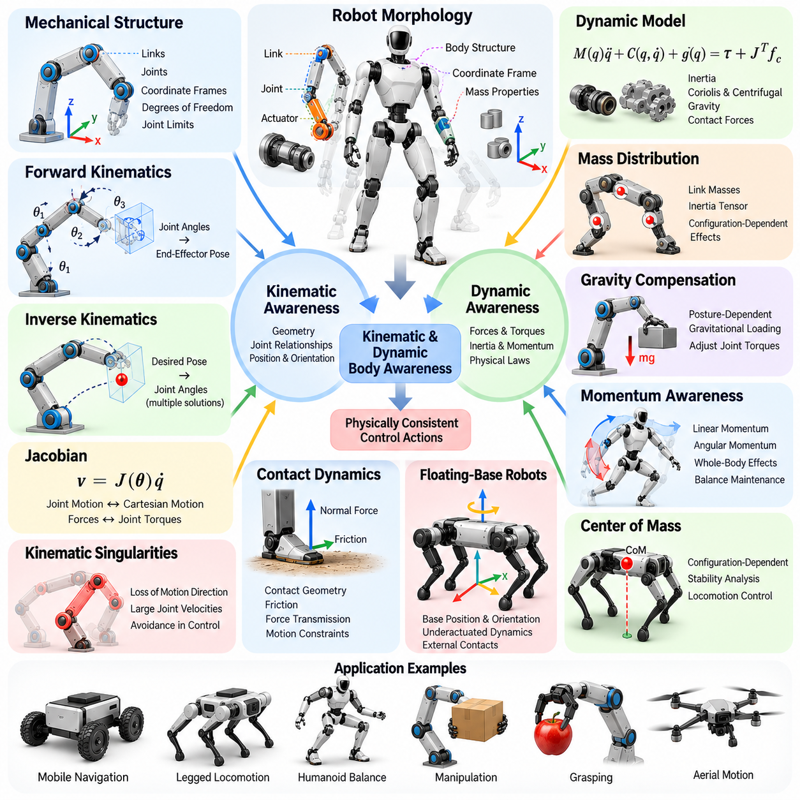{width="7.268055555555556in" height="7.268055555555556in"}

Kinematic and dynamic body awareness refers to a robot\'s ability to represent, estimate, and utilize the geometric and physical relationships governing its movements. Kinematic awareness describes how joint configurations determine body positions and orientations, while dynamic awareness explains how forces, torques, inertia, and momentum influence motion. Together, these capabilities enable morphology-aware control to generate physically consistent actions.

Kinematic body awareness begins with an explicit understanding of the robot\'s mechanical structure. Links, joints, and coordinate frames establish relationships between individual components and the overall body. A robot controller uses these relationships to determine where each component is located relative to a reference frame. This structural knowledge is essential for coordinated movement, collision avoidance, and accurate physical interaction.

Forward kinematics computes the position and orientation of robot components from known joint configurations. For a serial manipulator, successive joint transformations determine the end-effector pose relative to the robot base. For a humanoid or quadruped, similar transformations describe the positions of hands, feet, and body segments. Accurate forward kinematics enables the controller to maintain a consistent geometric representation of the robot.

Inverse kinematics determines joint configurations required to achieve desired positions or orientations. Because robotic structures may contain redundant joints or limited workspaces, inverse kinematic solutions are not always unique or feasible. Morphology-aware controllers consider joint limits, structural geometry, and task priorities when selecting solutions. This prevents desired movements from violating the robot\'s mechanical capabilities.

The Jacobian matrix provides an important connection between joint motion and Cartesian motion. It relates joint velocities to the linear and angular velocities of selected body points. The Jacobian also connects external forces to generalized joint torques through its transpose. These relationships support velocity control, force regulation, manipulability analysis, and coordinated motion across different robotic morphologies.

Kinematic singularities occur when certain motion directions become unavailable or require excessively large joint velocities. Their locations depend on the robot\'s joint arrangement and geometric configuration. A morphology-aware controller can identify configurations approaching singularity and adjust trajectories accordingly. Such awareness improves numerical stability and reduces the likelihood of undesirable actuator commands.

Dynamic body awareness extends geometric understanding by incorporating the physical laws governing motion. Robot dynamics describe how applied forces and torques produce accelerations under the influence of inertia, gravity, velocity-dependent effects, and environmental contact. These relationships depend on the robot\'s morphology and current configuration. Dynamic awareness therefore allows control decisions to reflect actual mechanical behavior.

Mass distribution is a fundamental element of dynamic awareness. Every link contributes mass and inertia to the overall system, and joint movement changes the spatial distribution of these properties. Consequently, the effort required to accelerate or stabilize a robot varies with posture. A dynamically aware controller accounts for these configuration-dependent effects when computing actuator commands.

The inertia matrix describes how generalized accelerations relate to inertial forces within a robot\'s articulated structure. Its values depend on link masses, inertia tensors, and joint configurations. Coriolis and centrifugal effects further influence motion when multiple joints move simultaneously. Incorporating these terms improves dynamic prediction and supports precise control during rapid or coordinated movements.

Gravity compensation is another important application of dynamic body awareness. A robotic arm must generate sufficient joint torque to support its own weight and any attached payload. The required torque changes as the arm moves through different configurations. Morphology-aware controllers estimate gravitational loading and adjust actuator effort to maintain posture without introducing unnecessary motion.

Momentum awareness becomes particularly important in humanoids, quadrupeds, and mobile manipulators. Movements of individual limbs influence the linear and angular momentum of the entire body. Rapid arm motion may disturb humanoid balance, while leg movement can alter quadruped body orientation. Controllers that account for these interactions can coordinate movements to preserve stability and achieve desired dynamic behavior.

The center of mass provides a compact representation of overall mass distribution. Its position changes with joint configurations and attached payloads. During locomotion, controllers often evaluate center-of-mass motion relative to supporting contacts and dynamic stability requirements. This information helps determine whether planned movements are compatible with balance and available contact forces.

Contact dynamics introduces additional complexity because environmental interactions constrain robot motion and generate external forces. A foot contacting the ground, a gripper holding an object, or a wheel rolling over terrain creates mechanical relationships between the body and its surroundings. Dynamic body awareness incorporates these interactions to predict force transmission, acceleration, and changes in motion constraints.

Floating-base robots require special consideration because their main body is not permanently fixed to the environment. Humanoids and quadrupeds possess base positions and orientations that evolve through contact forces and internal movements. Their controllers must estimate floating-base motion alongside joint states. This integrated representation supports whole-body coordination and physically consistent locomotion control.

State estimation connects theoretical body models with measured physical behavior. Joint encoders provide configuration information, while inertial sensors estimate angular velocity and acceleration. Force sensors, contact measurements, and actuator feedback contribute additional information about external interactions. Combining these measurements enables controllers to estimate body states that cannot be directly observed through individual sensors.

Kinematic and dynamic models are complementary rather than interchangeable. Kinematic models determine whether a movement is geometrically achievable, while dynamic models determine the forces and torques required to execute it. A trajectory may satisfy all joint limits yet demand actuator efforts beyond available capacity. Effective morphology-aware control therefore evaluates geometric feasibility and dynamic feasibility together.

Model predictive control can exploit both forms of body awareness by forecasting robot behavior over a finite planning horizon. The controller predicts future configurations, velocities, and forces under candidate control inputs. It then selects actions that satisfy mechanical constraints while pursuing motion objectives. This approach is particularly useful when balance, contact, and actuator limitations must be considered simultaneously.

Whole-body control integrates kinematic and dynamic relationships across multiple robot components. A humanoid reaching toward an object may need to coordinate its torso, arms, legs, and supporting contacts. A quadruped carrying a manipulator must account for interactions between locomotion and manipulation. Whole-body optimization can distribute tasks and actuator efforts while respecting structural and physical constraints.

Dynamic body awareness also supports energy-efficient control. Mechanical work, joint loading, and actuator power consumption depend on motion trajectories and body configurations. By predicting these relationships, a controller can avoid unnecessary acceleration, excessive joint torque, and inefficient postures. Energy optimization must nevertheless remain compatible with task accuracy, stability, and safety requirements.

Uncertainty presents a significant challenge because physical models cannot perfectly describe real robotic systems. Manufacturing tolerances, friction variation, structural flexibility, sensor noise, and payload changes introduce discrepancies between predicted and observed behavior. Robust control and online parameter estimation can reduce sensitivity to these uncertainties, although accurate adaptation requires sufficient measurements and reliable estimation methods.

Learning-based methods can complement analytical kinematic and dynamic models. Neural networks may estimate unmodeled forces, predict residual dynamics, or learn relationships between body configurations and control outcomes. Hybrid approaches combine physical equations with learned corrections to improve prediction accuracy. Their reliability depends on training coverage, generalization, and appropriate treatment of uncertainty.

Kinematic and dynamic body awareness also enables adaptation to changing morphology. Replacing an end effector, attaching a payload, or reconfiguring a modular robot alters geometric or inertial properties. The controller must update relevant transformations, mass parameters, and operational constraints. Without these updates, previously valid motion plans or torque predictions may become inaccurate.

Safety-critical control benefits from continuous awareness of physical limits. Joint position boundaries, velocity restrictions, torque limits, contact stability, and structural loading define feasible operating conditions. Monitoring these quantities allows controllers to identify potentially unsafe commands before execution. However, model-based constraint enforcement should be complemented by independent protection mechanisms and validated safety functions.

Ultimately, kinematic and dynamic body awareness provides the physical foundation for morphology-aware control. It connects the robot\'s mechanical architecture with geometric reasoning, force prediction, state estimation, and coordinated action. By maintaining an integrated understanding of body configuration and physical behavior, robots can execute movements that are more feasible, stable, efficient, and adaptable across diverse embodiments.

## 12.03. Mass Inertia and Payload Awareness

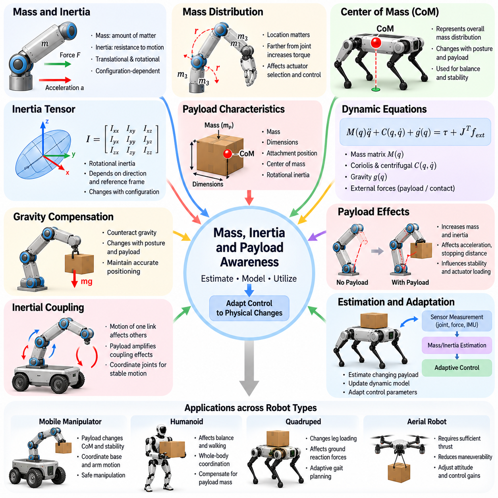{width="7.268055555555556in" height="7.268055555555556in"}

Mass, inertia, and payload awareness refers to a robot controller\'s ability to understand how the distribution of physical mass influences movement, stability, and interaction forces. These properties determine how a robot accelerates, decelerates, rotates, and responds to external disturbances. Morphology-aware control incorporates this information to generate actions that remain consistent with the robot\'s mechanical capabilities and changing operating conditions.

Mass represents the amount of matter associated with individual robot components, while inertia describes resistance to changes in translational or rotational motion. In articulated robots, the combined effects of link masses, joint configurations, and inertia tensors determine the forces required for movement. A controller must account for these relationships because identical commands can produce different responses depending on the robot\'s posture.

Mass distribution is particularly important because a robot\'s physical behavior depends not only on total weight but also on where that weight is located. Heavy components positioned far from rotational axes can increase the torque required for acceleration. Concentrating mass near the body center may reduce certain rotational demands. These relationships influence actuator selection, mechanical design, trajectory planning, and control efficiency.

The center of mass provides a compact representation of the robot\'s overall mass distribution. Its location depends on the masses and positions of individual components and changes when articulated joints move. For humanoids and quadrupeds, center-of-mass estimation supports balance and locomotion planning. For mobile manipulators, it helps evaluate stability when robotic arms extend or transport objects.

The inertia tensor describes how mass is distributed around different rotational axes. Unlike scalar mass, rotational inertia depends on direction and the selected reference frame. As a robot changes configuration, its effective inertia properties also change. Accurate inertia modeling enables controllers to predict angular acceleration, estimate required torques, and coordinate movements involving multiple connected body segments.

Payload awareness extends mass and inertia estimation to objects carried, grasped, or otherwise attached to the robot. A payload modifies the combined system\'s mass, center of mass, and inertia. These changes affect actuator loading, acceleration capability, stopping distance, and stability. A controller that ignores payload variation may generate commands that are feasible for an unloaded robot but unsafe or ineffective when carrying additional weight.

Payload characteristics include mass, dimensions, attachment position, center of mass, and rotational inertia. Two objects with identical mass can produce different mechanical effects if their shapes or attachment locations differ. A compact object held close to the body may be easier to control than an elongated object extending outward. Morphology-aware control therefore considers payload geometry alongside its total mass.

Dynamic equations provide the mathematical foundation for incorporating mass and inertia into robot control. The configuration-dependent mass matrix relates generalized accelerations to inertial forces, while gravity and velocity-dependent terms contribute additional loading. External forces introduced by payloads or environmental contacts further modify the system dynamics. Accurate modeling helps determine actuator efforts required for desired motion.

Gravity compensation becomes increasingly important when a robot carries heavy or asymmetrically positioned loads. A manipulator holding an object must generate additional joint torque to counteract gravitational forces. The required compensation changes as the arm moves or the object orientation changes. By updating gravity estimates, the controller can maintain accurate positioning while reducing unnecessary corrective motion.

Inertial coupling describes how acceleration of one body segment influences other parts of an articulated robot. Rapid arm movement can create reaction forces and moments that disturb a mobile base or humanoid torso. Carrying a payload amplifies some of these interactions. A morphology-aware controller considers coupled dynamics when coordinating joints, allowing movements to remain stable without treating each actuator independently.

Payload awareness is essential for mobile manipulation because carrying an object changes both manipulation dynamics and platform stability. Extending a loaded arm can shift the combined center of mass toward the edge of the support region. The controller may respond by repositioning the mobile base, adjusting arm posture, or limiting acceleration. Such coordination allows manipulation tasks to proceed while respecting stability constraints.

For humanoid robots, mass and inertia awareness directly influence standing balance, walking, and whole-body manipulation. Lifting an object changes the center of mass and may require compensatory movements of the torso, pelvis, or legs. Dynamic walking introduces additional momentum and contact-force constraints. Controllers must coordinate these effects to maintain feasible motion while transporting objects through human environments.

Quadruped robots also require payload-aware control when transporting equipment or performing manipulation tasks. Additional mass changes leg loading, ground reaction forces, and the mechanical effort required for locomotion. Uneven payload placement can introduce asymmetric loading and rotational moments. Adaptive gait planning and force distribution help maintain stability while reducing excessive stress on individual joints.

Aerial robots are particularly sensitive to payload mass because available thrust must support the combined vehicle and payload weight. Additional mass changes acceleration capability, energy consumption, and flight endurance. Payload placement can shift the center of gravity and modify rotational inertia, affecting attitude control. Morphology-aware flight controllers account for these changes when allocating thrust and planning feasible maneuvers.

Payload estimation is necessary when object properties are unknown or vary during operation. Robots can infer payload mass from actuator torque, acceleration measurements, force sensing, and observed motion responses. Estimation methods may combine physical models with online identification algorithms. Reliable estimation requires separating payload effects from friction, contact disturbances, sensor noise, and other uncertain dynamic influences.

Online parameter identification allows controllers to update mass and inertia estimates during operation. Rather than assuming fixed physical parameters, the robot compares predicted motion with measured responses and adjusts its internal model. This capability is useful when tools are exchanged, objects are grasped, or payload configurations change. Estimation accuracy depends on measurement quality and sufficiently informative motion.

Adaptive control uses updated mass and inertia information to modify control behavior as operating conditions change. Controller gains, feedforward torques, acceleration limits, and motion trajectories may be adjusted according to estimated loading. This reduces dependence on a single nominal model. However, adaptation must remain bounded by actuator capabilities, stability requirements, and uncertainty in estimated parameters.

Model predictive control can incorporate payload-dependent dynamics when selecting future actions. By predicting changes in joint loading, center-of-mass motion, and contact forces, the controller evaluates candidate trajectories before execution. Optimization constraints can restrict excessive torque, acceleration, or unstable configurations. This approach is valuable for robots that must manipulate variable loads while maintaining balance.

Energy efficiency is closely related to mass and inertia awareness. Accelerating heavy components requires mechanical work, while repeated acceleration and deceleration can increase actuator losses. Payload distribution also affects the energy required for rotation and locomotion. Controllers can reduce unnecessary motion and select favorable configurations, although energy savings must be balanced against task duration, precision, and safety.

Safety considerations become critical when payload mass approaches the robot\'s operational limits. Excessive loading may cause actuator saturation, structural stress, reduced braking capability, or loss of stability. Morphology-aware controllers monitor estimated loads and enforce appropriate motion restrictions. Independent overload protection and validated safety mechanisms remain necessary because model estimates cannot guarantee complete protection.

Learning-based methods can complement analytical payload models by estimating difficult-to-model dynamic effects. Neural networks may predict residual forces, infer hidden payload properties, or adapt control policies to different loading conditions. Combining learned estimates with physical constraints can improve flexibility. Nevertheless, generalization to unfamiliar payloads requires careful evaluation under uncertain and potentially hazardous conditions.

Mass and inertia awareness also supports morphology changes caused by modular attachments, tool replacement, or mechanical reconfiguration. Adding a sensor module or replacing an end effector modifies the robot\'s physical parameters even when its basic kinematic structure remains unchanged. Controllers must update the corresponding mass properties and dynamic representations to preserve accurate prediction and coordinated movement.

Ultimately, mass, inertia, and payload awareness enables robots to understand how their physical composition affects motion and control. By integrating body mass distribution, rotational inertia, payload estimation, and adaptive dynamics, morphology-aware controllers can improve stability, precision, efficiency, and robustness. These capabilities are fundamental to Physical AI systems that must operate reliably while interacting with changing objects and environments.

## 12.04. Contact Compliance and Terrain Awareness

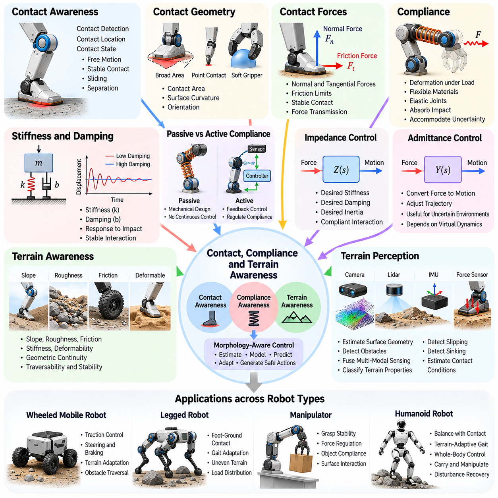{width="7.268055555555556in" height="7.268055555555556in"}

Contact, compliance, and terrain awareness refers to a robot controller\'s ability to recognize and respond to mechanical interactions between its body and the surrounding environment. Contact determines how forces are exchanged, compliance governs deformation under loading, and terrain properties influence mobility and stability. Morphology-aware control integrates these factors to generate movements consistent with physical interaction constraints.

Contact awareness begins with identifying when, where, and how the robot touches external surfaces. Contact may occur through feet, wheels, grippers, manipulators, or other body structures. Each contact establishes mechanical constraints that influence allowable motion and force transmission. A controller must distinguish between free motion, stable contact, sliding, and separation to select appropriate control strategies.

Contact geometry determines how interaction forces are distributed across physical interfaces. A broad foot provides different support characteristics from a narrow point contact, while a soft gripper distributes pressure differently from a rigid fingertip. Surface curvature, contact area, and orientation affect mechanical stability. Morphology-aware controllers incorporate these geometric properties when planning movement and regulating contact forces.

Contact forces include normal forces acting perpendicular to surfaces and tangential forces associated with friction. Their magnitudes depend on body loading, motion, and environmental conditions. Maintaining stable contact generally requires tangential forces to remain within frictional limits. Controllers that estimate these constraints can reduce unwanted slipping while preserving sufficient force for locomotion or manipulation.

Compliance describes the ability of mechanical structures to deform under applied forces. It may originate from flexible materials, elastic joints, compliant actuators, or intentionally deformable components. Compliance can absorb impacts, distribute contact pressure, and accommodate geometric uncertainty. However, excessive deformation may reduce positioning accuracy or introduce oscillations that complicate control.

Stiffness and damping are fundamental parameters for understanding compliant behavior. Stiffness relates applied force to deformation, while damping describes resistance to motion through energy dissipation. Their combined effects influence how a robot responds to impacts and sustained loading. Morphology-aware control considers these properties when determining appropriate force commands, motion speeds, and interaction strategies.

Passive compliance and active compliance provide different mechanisms for managing physical interaction. Passive compliance arises from mechanical properties without requiring continuous feedback adjustment. Active compliance uses sensors and control algorithms to regulate the apparent mechanical response. Combining both approaches can improve interaction performance, although active control remains limited by actuator bandwidth, sensing accuracy, and stability constraints.

Impedance control provides a framework for regulating the relationship between motion deviations and interaction forces. Rather than enforcing a rigid position trajectory, the controller specifies desired stiffness, damping, and sometimes inertial behavior. This approach is useful when robots interact with uncertain environments. Morphology awareness allows impedance parameters to reflect body structure, actuator characteristics, and contact conditions.

Admittance control offers a complementary approach by converting measured external forces into desired motion responses. It is particularly useful for systems with accurate position control and reliable force sensing. When a robot encounters resistance, an admittance controller can modify its commanded trajectory. The resulting behavior depends on the selected virtual dynamics and the physical limitations of the robot.

Terrain awareness extends contact reasoning to the properties of surfaces supporting or obstructing robot movement. Terrain may vary in slope, roughness, friction, stiffness, deformability, and geometric continuity. These characteristics determine whether a robot can traverse an area safely and efficiently. Morphology-aware controllers relate terrain properties to wheel geometry, leg configuration, ground clearance, and available actuation.

Terrain perception commonly combines cameras, depth sensors, lidar, inertial measurements, and proprioceptive feedback. Visual sensing estimates surface geometry and potential obstacles, while proprioception reveals how the body responds during interaction. Force and motion measurements can indicate slipping, sinking, or unexpected resistance. Integrating these observations supports more reliable terrain classification and contact prediction.

Friction awareness is essential because traction determines the forces that can be transmitted through contact. A wheel moving across wet flooring may experience reduced grip, while a robot foot on loose gravel may encounter uncertain support. Friction estimates can be inferred from observed motion and force responses. Controllers use these estimates to adjust acceleration, braking, gait timing, and contact-force distribution.

Deformable terrain introduces additional challenges because the supporting surface changes shape under loading. Sand, soil, snow, and soft ground may compress, shift, or yield as a robot moves. Contact forces and effective support geometry can therefore evolve during interaction. Terrain-aware control must account for these changes rather than assuming a rigid and stationary contact surface.

For wheeled mobile robots, contact and terrain awareness influence traction control, steering, braking, and obstacle traversal. Wheel radius, tire compliance, suspension geometry, and vehicle mass distribution affect how forces are transferred to the ground. Controllers can adjust wheel torque and velocity commands according to estimated slip and surface conditions, improving mobility while reducing unnecessary wheel spinning.

Quadruped robots rely on contact awareness to coordinate stance and swing phases during locomotion. Each supporting foot contributes forces that influence body acceleration and balance. Terrain geometry determines feasible footholds, while friction and compliance affect contact reliability. Morphology-aware gait controllers coordinate leg motion and ground reaction forces to maintain stable locomotion across uneven surfaces.

Humanoid robots face additional complexity because bipedal locomotion requires carefully coordinated contact transitions. Foot placement, support geometry, center-of-mass motion, and angular momentum jointly influence balance. Compliance in ankles, feet, and leg structures affects impact absorption and force transmission. Controllers must account for these interactions during walking, turning, stair climbing, and recovery from disturbances.

Manipulation tasks also depend on contact and compliance awareness. A robotic hand must generate sufficient grip force to prevent slipping without damaging fragile objects. Contact location, fingertip geometry, object stiffness, and friction influence grasp stability. Morphology-aware manipulation controllers coordinate finger positions and forces while adapting to differences in object shape and mechanical properties.

Whole-body contact control becomes important when robots interact with multiple surfaces simultaneously. A humanoid may support itself with a hand while stepping over an obstacle, or a quadruped may brace against a surface during manipulation. These situations introduce coupled contact constraints across several body components. Whole-body optimization can distribute forces while respecting friction, torque, and balance limitations.

Model-based contact control uses mathematical descriptions of rigid-body dynamics, friction constraints, and contact transitions. Optimization methods can determine feasible contact forces and joint torques for desired movements. However, real contact behavior includes uncertainty, impacts, deformation, and discontinuities. Accurate control therefore requires models that balance computational efficiency with sufficient physical realism.

Learning-based approaches can improve contact and terrain adaptation by discovering relationships between sensory observations and successful interaction strategies. Reinforcement learning may produce locomotion policies that adjust to irregular terrain or uncertain friction. Learned controllers can complement analytical models, but their reliability depends on training diversity, uncertainty handling, and validation under unfamiliar conditions.

Online adaptation allows robots to update control behavior as contact and terrain conditions change. Unexpected slipping may trigger reduced acceleration or altered foothold placement, while increased deformation may require modified force regulation. Such adaptation relies on timely detection and stable feedback responses. Controllers must distinguish genuine environmental changes from sensor noise and transient disturbances.

Safety considerations are central to contact-aware control because incorrect force regulation can damage equipment, destabilize robots, or injure nearby people. Excessive contact forces, unstable friction conditions, and unexpected terrain collapse create significant hazards. Controllers should enforce force limits, monitor contact stability, and provide appropriate fallback behavior when reliable interaction cannot be maintained.

Ultimately, contact, compliance, and terrain awareness connects robot morphology with the mechanics of real-world interaction. By integrating contact geometry, force transmission, compliant behavior, and environmental properties, morphology-aware controllers can improve mobility, manipulation, stability, and adaptability. These capabilities provide an essential foundation for Physical AI systems operating in complex and changing physical environments.

## 12.05. Whole Body and Redundancy Aware Control

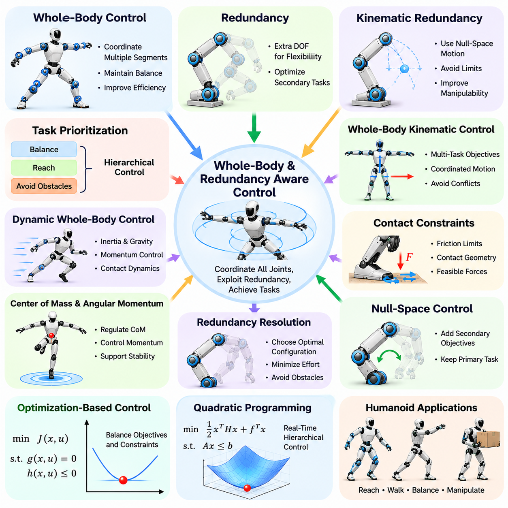{width="7.268055555555556in" height="7.268055555555556in"}

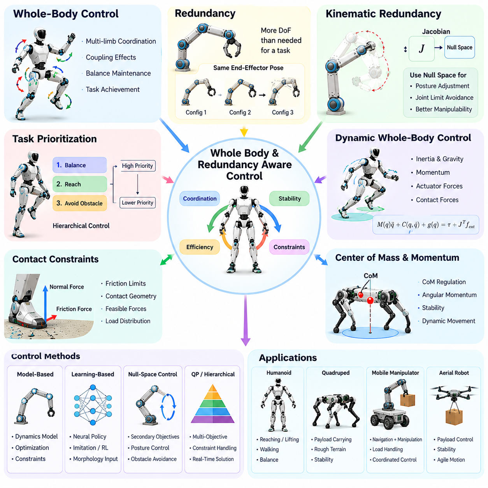{width="7.268055555555556in" height="7.268055555555556in"}

Whole-body and redundancy-aware control is a robotics control approach that coordinates multiple joints, limbs, and body segments while exploiting available degrees of freedom. Rather than controlling individual components independently, it considers the robot as an interconnected mechanical system. This approach enables morphology-aware controllers to achieve task objectives while maintaining balance, respecting physical constraints, and improving motion efficiency.

Whole-body control recognizes that movements of one body segment can influence the behavior of other segments through kinematic and dynamic coupling. A humanoid moving its arm may shift its center of mass, while a quadruped manipulating an object may experience changes in body orientation. Coordinated control accounts for these interactions and distributes motion across the robot\'s structure to maintain stable and consistent behavior.

Redundancy occurs when a robot possesses more degrees of freedom than are strictly necessary to accomplish a particular task. A seven-degree-of-freedom manipulator, for example, can often reach the same end-effector pose using different joint configurations. This flexibility creates opportunities to optimize secondary objectives without compromising the primary task, provided that mechanical constraints and available motion directions are respected.

Kinematic redundancy is commonly analyzed through the relationship between joint velocities and task-space velocities. The Jacobian matrix maps joint motion into end-effector or body motion, while its null space represents joint movements that do not affect the selected task instantaneously. Redundancy-aware controllers exploit these null-space directions to adjust posture, avoid joint limits, and improve manipulability.

Task prioritization is essential when multiple control objectives compete for limited degrees of freedom. A humanoid may need to maintain balance while reaching toward an object and avoiding nearby obstacles. Hierarchical control assigns higher priority to critical objectives and uses remaining freedom for secondary tasks. This structure helps prevent lower-priority movements from interfering with essential stability or safety requirements.

Whole-body kinematic control integrates multiple task-space objectives into a unified motion-generation framework. These objectives may include hand positioning, foot placement, torso orientation, gaze direction, and center-of-mass regulation. By considering the complete joint configuration, the controller can coordinate simultaneous movements and avoid conflicts that arise when separate subsystems generate incompatible commands.

Dynamic whole-body control extends this coordination by incorporating inertia, gravity, momentum, actuator forces, and environmental contacts. Joint accelerations and torques must satisfy the robot\'s equations of motion while achieving desired task behavior. This formulation is especially important for floating-base robots, whose body motion depends on contact forces rather than direct actuation of the base.

Contact constraints play a central role in whole-body control because supporting limbs must generate physically feasible forces. During humanoid walking, feet exchange forces with the ground while other body segments perform coordinated movements. The controller must respect friction limits, contact geometry, and actuator capabilities. Incorrect force distribution can produce slipping, unstable motion, or excessive joint loading.

The center of mass and angular momentum provide important quantities for coordinating whole-body behavior. Moving a manipulator or swinging a leg changes the distribution of momentum throughout the robot. Controllers can regulate center-of-mass trajectories and centroidal momentum to support balance and dynamic movement. These quantities connect individual joint actions with the stability of the entire body.

Redundancy resolution determines how additional degrees of freedom should be used when several configurations can satisfy the same task. Optimization criteria may include minimizing joint velocities, reducing actuator effort, avoiding obstacles, or maintaining favorable joint configurations. The selected solution depends on the robot\'s morphology, task requirements, and environmental conditions.

Null-space control provides a mathematical mechanism for combining primary and secondary objectives. A primary task determines the essential motion, while projected secondary commands modify joint configurations without changing the primary task velocity under ideal kinematic assumptions. Near singularities or under active constraints, exact task separation becomes more difficult, requiring careful numerical treatment and feasibility evaluation.

Optimization-based whole-body control formulates coordinated movement as a constrained mathematical problem. Decision variables may include joint accelerations, actuator torques, and contact forces. Equality constraints enforce motion dynamics and required contacts, while inequality constraints represent torque limits, friction boundaries, and joint restrictions. The resulting solution balances task performance against physical feasibility.

Quadratic programming is widely used because many whole-body control objectives and constraints can be expressed in a computationally manageable form. Weighted objectives allow the controller to trade off tracking accuracy, posture regulation, and control effort. Hierarchical quadratic programming can preserve strict task priorities when feasible. Real-time implementation requires efficient solvers and careful handling of changing contact conditions.

Humanoid robots provide a representative application of whole-body and redundancy-aware control. Reaching, lifting, walking, and balancing involve interactions among arms, legs, torso, and pelvis. A humanoid carrying an object may adjust its stance and torso orientation while maintaining hand position. Whole-body coordination enables these movements to occur simultaneously without treating each limb as an isolated mechanism.

Quadruped robots also benefit from coordinated control when locomotion and manipulation occur together. A quadruped equipped with a robotic arm must distribute ground reaction forces while compensating for arm movements and payload effects. Redundant leg configurations can support body posture adjustments and foothold selection. Integrated control helps maintain stability while expanding the robot\'s operational capabilities.

Mobile manipulators combine a movable base with one or more robotic arms, creating additional degrees of freedom for positioning and manipulation. The same end-effector target may be reached through different combinations of base motion and arm configuration. Redundancy-aware control can select favorable combinations based on workspace accessibility, collision avoidance, stability, and energy requirements.

Manipulability is an important consideration because some joint configurations permit motion more effectively in particular directions. Near kinematic singularities, small task-space movements may require large joint velocities. Redundancy-aware controllers can adjust unused degrees of freedom to maintain favorable Jacobian properties. This improves motion capability and reduces sensitivity to numerical instability.

Collision avoidance introduces additional constraints into whole-body motion planning. A robot must avoid external obstacles while preventing self-collision between limbs and body segments. Redundant joints provide alternative configurations that may preserve the desired end-effector trajectory. Controllers can incorporate distance constraints or repulsive objectives, although collision-free motion must still be verified across the complete trajectory.

Energy and actuator efficiency can also benefit from redundancy-aware coordination. Different joint configurations may achieve identical task outcomes with different torque demands and mechanical losses. Optimization can distribute effort across available actuators and avoid unnecessarily demanding postures. However, energy objectives must remain subordinate to essential safety, balance, and task feasibility constraints.

Learning-based whole-body control offers another method for coordinating complex robotic structures. Reinforcement learning can discover joint coordination strategies through interaction with simulated or physical environments. Morphology-conditioned policies may adapt these strategies to different body configurations. Nevertheless, learned controllers require careful validation because successful training performance does not guarantee safe behavior under unfamiliar conditions.

Model predictive whole-body control considers future motion and contact evolution when selecting current actions. By predicting joint states, body momentum, and contact forces over a planning horizon, the controller can anticipate stability challenges before they occur. This is particularly valuable for dynamic locomotion and manipulation, although computational complexity increases with model detail and planning horizon length.

Morphology changes introduce additional challenges for redundancy-aware control. Tool replacement, joint failure, modular reconfiguration, or actuator limitations can modify the available degrees of freedom and feasible task space. Controllers must update kinematic models, dynamic parameters, and optimization constraints. Adaptive redundancy resolution can redistribute tasks among remaining functional components when sufficient capability remains.

Safety-aware whole-body control incorporates joint limits, torque restrictions, collision boundaries, contact stability, and balance requirements into coordinated action generation. Task priorities should prevent optional movements from compromising critical constraints. Runtime monitoring and fallback strategies provide additional protection when optimization becomes infeasible or model assumptions fail.

Ultimately, whole-body and redundancy-aware control transforms robotic morphology into a resource for intelligent coordination. By integrating kinematic redundancy, dynamic coupling, task prioritization, contact constraints, and optimization, controllers can exploit the full capabilities of complex robot bodies. These principles provide a foundation for versatile Physical AI systems capable of coordinated locomotion, manipulation, and adaptation in changing environments.

## 12.06. Model Based Morphology Aware Control

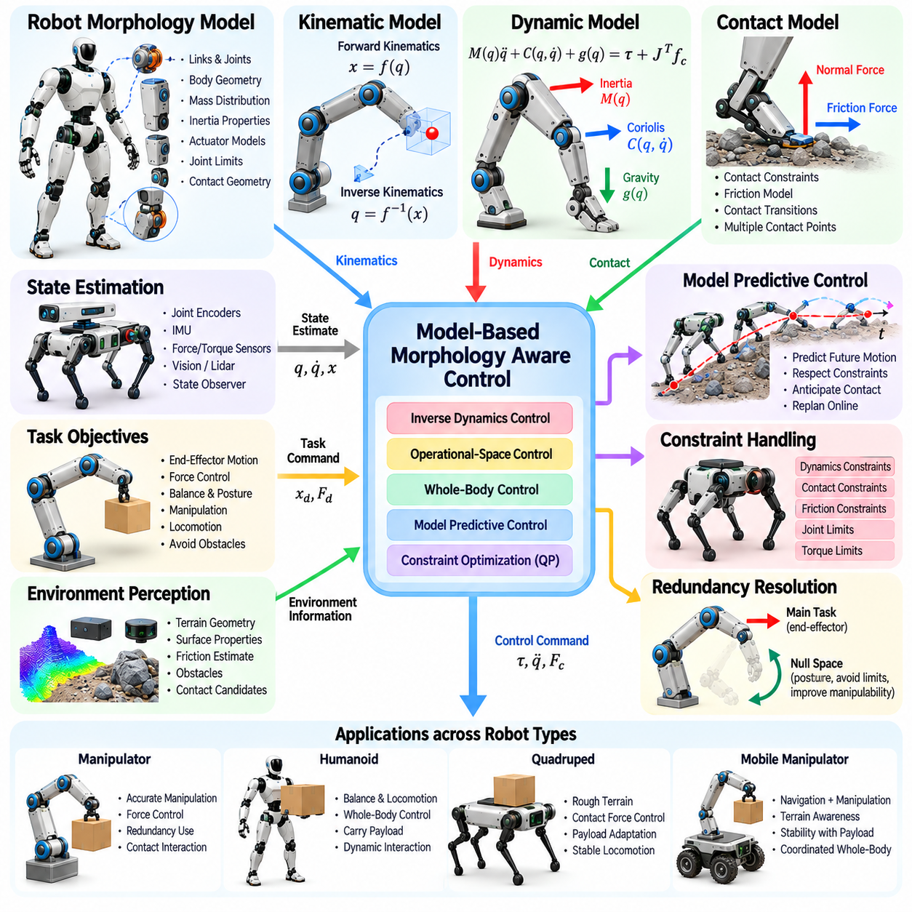{width="7.268055555555556in" height="7.268055555555556in"}

Model-based morphology-aware control uses explicit mathematical representations of a robot\'s physical structure to predict motion, forces, and interactions with the environment. These representations describe how links, joints, actuators, and contact surfaces influence system behavior. By incorporating body geometry and dynamics into control decisions, the robot can generate actions that are physically feasible, coordinated, and responsive to changing operating conditions.

The foundation of model-based control is a structured description of robot morphology. Kinematic models define the relationships between joint configurations and body positions, while dynamic models describe how forces and torques produce acceleration. Mass distribution, inertia, joint limits, and actuator characteristics provide additional physical constraints. Together, these elements establish a predictive representation of the robot\'s capabilities.

Forward kinematics calculates the positions and orientations of body components from known joint configurations. Inverse kinematics determines joint configurations required to achieve desired task-space poses. These relationships enable controllers to coordinate manipulators, legs, and mobile platforms. Morphology-aware implementations update the relevant transformations when body configurations or attached mechanisms change.

Dynamic modeling extends geometric reasoning by accounting for mass, inertia, gravity, and velocity-dependent forces. The equations of motion relate joint accelerations to actuator torques and external interactions. For floating-base robots, the model must also represent unactuated body motion and environmental contacts. Accurate dynamics help controllers anticipate loading and maintain physically consistent movement.

The mass matrix describes configuration-dependent inertial relationships among generalized coordinates. Coriolis and centrifugal effects introduce additional forces during motion, while gravitational terms represent posture-dependent loading. Model-based controllers combine these quantities to estimate the effort required for desired accelerations. This improves motion tracking when the physical parameters are sufficiently accurate.

Inverse dynamics control calculates actuator torques needed to achieve specified joint accelerations. By compensating for modeled inertial, gravitational, and velocity-dependent effects, the controller can reduce tracking errors. However, model uncertainty, friction, actuator delays, and external disturbances limit perfect compensation. Feedback control remains necessary to correct differences between predicted and observed behavior.

Computed torque control combines inverse dynamics compensation with feedback regulation. Desired accelerations are constructed from trajectory references and position or velocity errors, then converted into torque commands through the dynamic model. This approach can simplify the controlled system\'s apparent behavior. Its effectiveness depends on parameter accuracy, actuator performance, and appropriate feedback gains.

Operational-space control expresses control objectives in coordinates associated with tasks rather than individual joints. A manipulator may regulate end-effector motion or interaction forces while accounting for the inertia of its complete articulated structure. Task-space dynamics connect desired accelerations and forces to joint-level commands. Redundant degrees of freedom can support posture optimization and constraint avoidance.

Whole-body model-based control coordinates multiple limbs and body segments through a unified dynamic formulation. Humanoids and quadrupeds require simultaneous consideration of balance, momentum, contact forces, and actuator limitations. Optimization methods distribute joint torques and ground reaction forces while satisfying physical constraints. This enables coordinated locomotion and manipulation without treating individual limbs independently.

Contact modeling is essential because robot dynamics change when feet, wheels, or manipulators interact with surfaces. Contact constraints restrict allowable motion and determine how external forces enter the equations of motion. Friction models help evaluate whether planned forces can be transmitted without slipping. Controllers must also account for transitions between contact modes, which may introduce impacts and discontinuities.

Constraint-based optimization provides a systematic method for combining desired behavior with mechanical limitations. Equality constraints can enforce dynamic consistency and required contact conditions, while inequality constraints represent torque limits, joint boundaries, and friction restrictions. Quadratic programming is frequently used to compute feasible control commands. Infeasible conditions require priority management or safe fallback behavior.

Model predictive control uses a mathematical model to forecast system evolution over a finite planning horizon. At each control step, an optimization problem selects actions that minimize predicted tracking errors or control effort while respecting constraints. The controller then executes an initial action and replans using updated measurements. This repeated process supports anticipation of future motion and contact conditions.

Morphology-aware model predictive control incorporates body-specific parameters into its predictions. Link lengths, mass distribution, joint ranges, actuator limits, and contact geometry influence feasible trajectories. A humanoid carrying an object may require different balance adjustments from an unloaded robot. Updating the model allows the controller to account for such changes before executing potentially destabilizing movements.

State estimation connects mathematical models with actual robot behavior. Joint encoders, inertial sensors, force sensors, and external perception provide measurements of configuration, velocity, and contact conditions. Estimation algorithms combine these observations with predicted dynamics to reconstruct states that cannot be measured directly. Reliable control depends on both model quality and the accuracy of estimated states.

Parameter identification improves model accuracy by estimating physical quantities from observed motion and actuator responses. Unknown payload mass, joint friction, and inertial parameters can be inferred through appropriately designed measurements. Online identification allows models to evolve during operation. However, some parameters cannot be uniquely estimated without sufficiently informative excitation and reliable sensing.

Adaptive model-based control modifies its internal representation when robot properties change. Tool replacement, payload variation, actuator degradation, or mechanical reconfiguration may invalidate previously calibrated parameters. Updating mass, inertia, kinematic transformations, and actuator characteristics helps preserve control performance. Adaptation must remain bounded to prevent uncertain estimates from producing unstable commands.

Robust control addresses the unavoidable differences between mathematical models and physical systems. Parameter errors, external disturbances, flexible structures, and unmodeled contacts can degrade nominal control performance. Robust formulations incorporate uncertainty bounds or disturbance rejection mechanisms. The objective is to preserve acceptable behavior across a range of plausible physical conditions rather than assuming perfect predictions.

Compliance and flexibility introduce additional modeling challenges because real robots are not always perfectly rigid. Elastic joints, deformable feet, soft grippers, and flexible transmissions can store and release mechanical energy. Controllers may use extended dynamic models that include elastic states and damping. Simplified rigid-body models remain useful when their assumptions are valid for the operating regime.

Computational efficiency strongly influences the practical implementation of model-based control. Detailed models can improve prediction fidelity but increase the cost of optimization and state estimation. Real-time systems therefore balance physical accuracy against available processing resources and control frequency. Reduced-order models, sparse computations, and efficient solvers help maintain timely control responses.

Model-based control also supports simulation, verification, and safety analysis. Digital representations of robot morphology allow engineers to evaluate trajectories, actuator loading, and contact conditions before physical execution. Simulation can expose potential constraint violations and unstable behaviors. Nevertheless, validation on physical hardware remains necessary because simulation models cannot reproduce every environmental interaction.

Different robot morphologies require different modeling assumptions and control formulations. Wheeled robots emphasize nonholonomic motion constraints and traction, manipulators emphasize articulated dynamics, and legged robots require contact-dependent floating-base models. Aerial robots incorporate thrust generation and aerodynamic effects. Morphology-aware control selects representations that reflect the dominant physical mechanisms of each platform.

Hybrid model-based approaches combine analytical physics with learned components to address difficult-to-model effects. Neural networks may estimate residual dynamics, friction variations, or contact behavior while analytical models enforce known mechanical relationships. This combination can improve predictive accuracy without abandoning physical structure. Learned components still require uncertainty assessment and validation outside their training conditions.

Ultimately, model-based morphology-aware control connects explicit physical knowledge with predictive decision-making. By integrating kinematics, dynamics, contact mechanics, optimization, state estimation, and adaptation, controllers can coordinate complex robot bodies while respecting mechanical limitations. These principles provide a foundation for reliable Physical AI systems that must act intelligently within the constraints of real-world physics.

## 12.07. Learning Based Morphology Aware Control

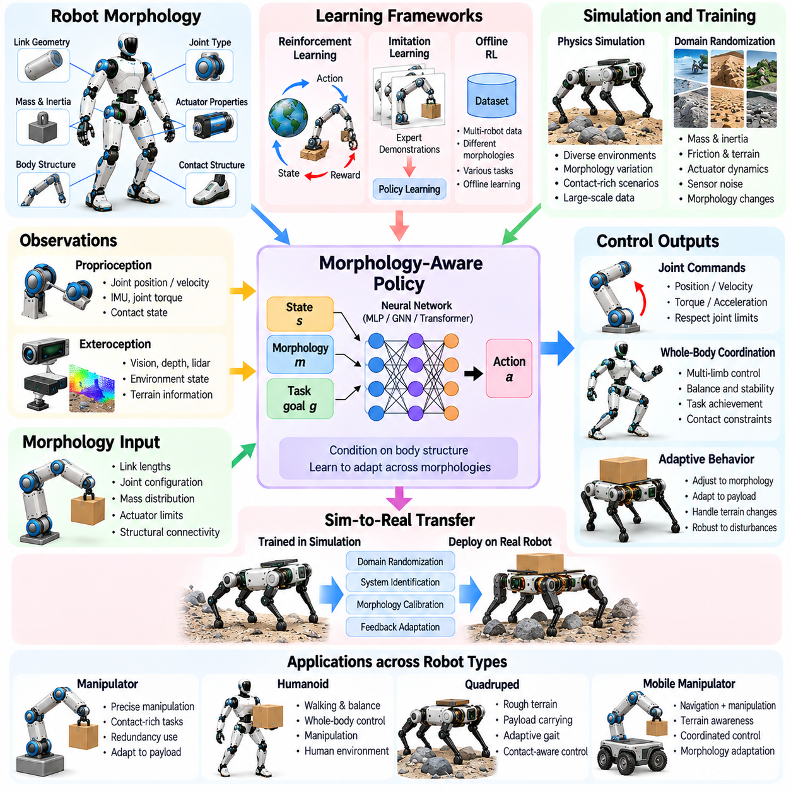{width="7.268055555555556in" height="7.268055555555556in"}

Learning-based morphology-aware control enables robots to develop control strategies by learning how their physical structures influence movement and environmental interaction. Instead of relying exclusively on predefined mathematical models, these methods extract relationships from experience, simulation, and sensor observations. By incorporating body geometry, actuator properties, and dynamic characteristics, learned controllers can adapt their behavior to different embodiments and operating conditions.

Traditional learning-based control often assumes a fixed robot structure, limiting its applicability when body configurations change. Morphology-aware learning addresses this limitation by explicitly representing the physical characteristics that determine available actions. Joint arrangements, link dimensions, mass distributions, and actuator capabilities become inputs to the learning process. This allows policies to distinguish between robots with different mechanical capabilities.

Reinforcement learning provides a major framework for developing morphology-aware control policies. An agent interacts with an environment, receives observations, executes actions, and updates its policy according to reward signals. Morphological information can be included alongside joint states, velocities, and sensory measurements. The resulting policy learns to associate body characteristics with actions that improve task performance under physical constraints.

Policy representations determine how morphological information influences learned behavior. A conventional neural network may concatenate body parameters with state observations, while structured architectures process joints and links according to their physical relationships. Conditioning mechanisms allow the same policy to produce different actions for different robot bodies. Their effectiveness depends on whether the representation captures task-relevant mechanical properties.

Morphology-conditioned policies can support control across families of related robots. During training, the learning system encounters variations in link lengths, joint configurations, actuator strengths, and body proportions. Exposure to these differences encourages the policy to develop behaviors that depend on physical capabilities rather than memorized configurations. Generalization remains limited when new morphologies differ substantially from the training distribution.

Graph representations provide a natural description of articulated robot structures. Links and joints can be represented as nodes or edges, while connectivity encodes mechanical relationships. Graph neural networks exchange information across connected components and generate control features that reflect body topology. Such architectures can accommodate different numbers of joints, although changes in topology and dynamics still require appropriate training.

Learning-based whole-body control coordinates multiple limbs and body segments through policies that consider their combined effects. A humanoid must synchronize arms, legs, and torso during locomotion and manipulation, while a quadruped must coordinate ground contacts and body motion. Morphology-aware policies can learn these relationships from repeated interactions. Their outputs must remain compatible with actuator limits and contact constraints.

Simulation is central to training morphology-aware controllers because physical exploration can be expensive and hazardous. Physics simulators generate experiences across different robot bodies, tasks, and environmental conditions. Automated morphology variation exposes policies to a broader range of dynamics and kinematics. However, simulation accuracy and computational cost influence the usefulness of the resulting training data.

Domain randomization improves robustness by varying physical and environmental parameters during training. Mass, friction, actuator response, sensor noise, and terrain properties may be sampled across plausible ranges. Morphology randomization extends this process to body dimensions, joint properties, and mechanical configurations. These variations can reduce dependence on narrow assumptions but do not guarantee successful transfer to unfamiliar hardware.

Sim-to-real transfer applies policies trained in simulation to physical robots. Differences between simulated and actual dynamics may cause unstable or inaccurate behavior, particularly during contact-rich tasks. Morphology-aware transfer incorporates measured body parameters and observed hardware responses to reduce these discrepancies. Hardware calibration, conservative testing, and feedback correction remain essential for reliable deployment.

Imitation learning offers an alternative to learning entirely through reward-driven exploration. Controllers can learn from expert demonstrations, optimized trajectories, or previously validated control policies. Morphological conditioning allows demonstrations from one robot to inform behavior on another, provided the relevant task relationships can be transferred. Differences in joint structure and reachable workspace may require task-space representations.

Offline reinforcement learning uses previously collected interaction data to develop policies without requiring continuous physical exploration. Datasets may contain trajectories from multiple robots with different morphologies and operating conditions. Including body descriptions helps distinguish actions that are appropriate for each platform. Dataset coverage and distributional uncertainty remain important limitations when deploying learned behavior.

Representation learning seeks compact features that capture the mechanical properties most relevant to control. Encoders may transform joint topology, mass parameters, actuator characteristics, and sensory observations into latent morphology representations. These features can condition downstream policies or value functions. A useful representation should preserve distinctions that affect feasible movement while avoiding unnecessary dependence on specific robot identities.

Meta-learning supports rapid adaptation by training controllers across multiple tasks and morphological variations. Rather than optimizing for a single body, the learning process encourages strategies that can be updated using limited new experience. A robot equipped with a different tool or modified limb may then adapt more quickly. Performance depends on the diversity of training conditions and the information available during adaptation.

Online system identification can complement learning-based control by estimating unknown physical parameters during operation. Joint responses, contact forces, and motion measurements provide evidence about mass, friction, actuator behavior, and payload changes. Estimated parameters can condition the control policy or update an internal dynamics model. Reliable adaptation requires separating genuine morphology changes from disturbances and sensor uncertainty.

Residual learning combines analytical control models with neural networks that estimate modeling errors. A model-based controller supplies a nominal action, while a learned component compensates for unmodeled friction, flexibility, or contact effects. Morphological information helps the residual model distinguish between different physical structures. Constraining learned corrections can improve reliability compared with unrestricted policy outputs.

World models provide another approach by learning predictive representations of robot-environment dynamics. A morphology-aware world model estimates how a particular body will respond to candidate actions and external contacts. Controllers can use these predictions for planning or model-based reinforcement learning. Prediction errors may accumulate over long horizons, especially when contact transitions and unfamiliar materials are involved.

Multi-task learning encourages policies to share knowledge across locomotion, manipulation, balance, and other behaviors. Morphology-aware representations help identify which capabilities are common across embodiments and which depend on specific mechanical structures. Shared training may improve data efficiency and transfer, but conflicting objectives can reduce performance when tasks require substantially different control strategies.

Safety remains a fundamental challenge because learned policies may produce unexpected actions outside familiar conditions. Joint limits, torque constraints, collision boundaries, and contact stability requirements should be enforced through suitable control mechanisms. Safety filters, constrained optimization, and supervisory controllers can restrict unsafe commands. Empirical success alone does not establish reliable operation under rare disturbances.

Evaluation of morphology-aware learning requires testing beyond the robot configurations encountered during training. Experiments should examine changes in body dimensions, actuator capabilities, payloads, terrain, and contact conditions. Performance measures include task success, tracking accuracy, energy consumption, stability, and constraint violations. Comparing against morphology-agnostic policies helps determine whether explicit body awareness provides measurable benefits.

Scalability becomes important when learning across large collections of robot embodiments. Training systems must manage different observation dimensions, action spaces, joint topologies, and physical parameter ranges. Structured representations and shared policy architectures can reduce the need for separate controllers. Nevertheless, computational demands and uneven training coverage may limit generalization across highly diverse robot families.

Hybrid control architectures combine learning-based adaptation with model-based prediction and established feedback mechanisms. Learned components may propose actions, estimate uncertain dynamics, or adjust control parameters, while analytical controllers enforce mechanical feasibility. This division of responsibilities can improve flexibility without discarding physical knowledge. Effective integration requires consistent state representations and careful treatment of uncertainty.

Ultimately, learning-based morphology-aware control connects robot embodiment with data-driven adaptation and intelligent action selection. By combining reinforcement learning, structured body representations, simulation, transfer learning, and safety constraints, controllers can develop behaviors suited to diverse mechanical systems. These methods provide an important foundation for Physical AI that must learn and adapt while respecting the capabilities and limitations of physical bodies.

## 12.08. Morphology Conditioned Policies

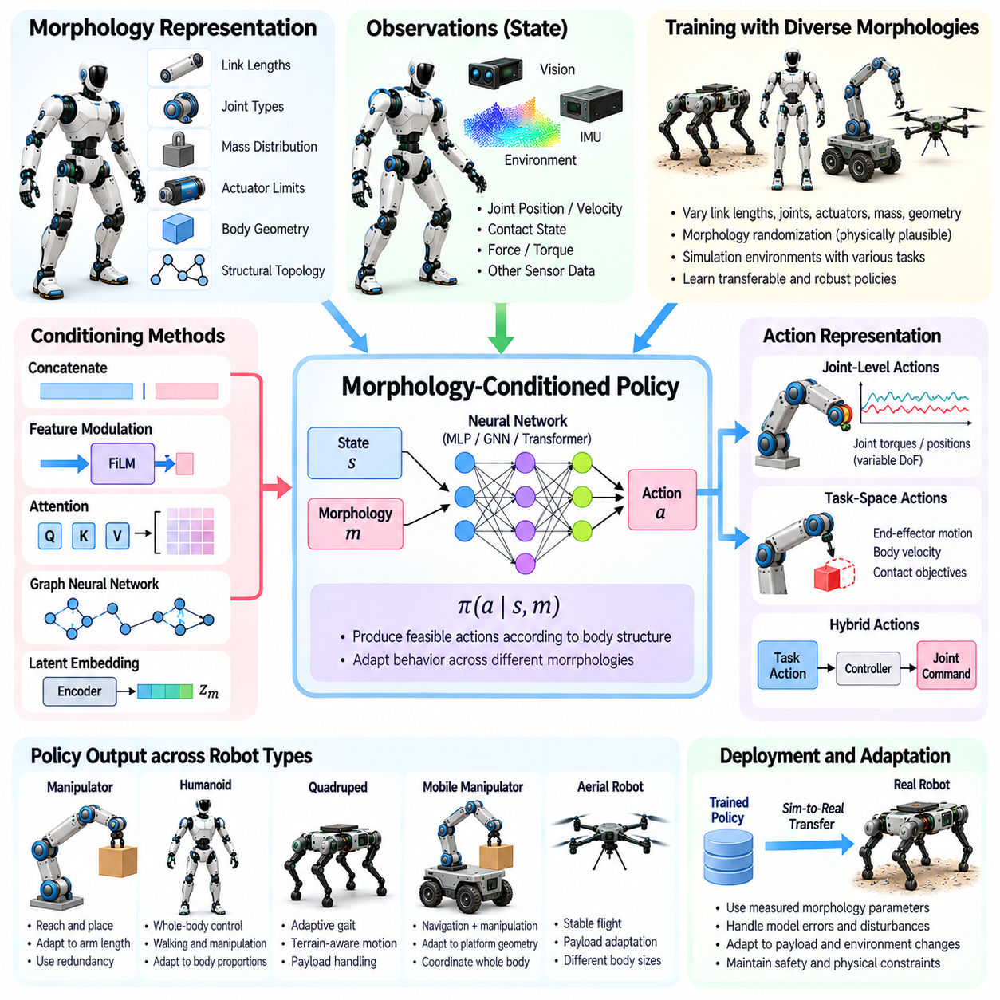{width="7.268055555555556in" height="7.268055555555556in"}

Morphology-conditioned policies are control policies that explicitly incorporate a robot\'s physical structure when selecting actions. Unlike conventional policies designed for a fixed embodiment, they use information about joints, links, actuators, and body geometry to adapt behavior across different configurations. This approach connects physical capabilities with learned decision-making and supports more flexible control across diverse robotic platforms.

A morphology-conditioned policy maps observations and body descriptions to control actions. Observations may include joint positions, velocities, contact states, and environmental measurements, while morphology descriptions encode structural and mechanical properties. The policy uses both sources to determine feasible behavior. Consequently, identical environmental observations may produce different actions for robots with different bodies.

Morphological information can be represented through link lengths, joint types, mass distributions, actuator limits, and connectivity relationships. These parameters describe the robot\'s available movements and dynamic capabilities. Accurate representations should distinguish mechanically important differences without introducing unnecessary complexity. The appropriate level of detail depends on the control task and diversity of robot embodiments.

A basic conditioning strategy concatenates morphology parameters with state observations before processing them through a neural network. This allows a shared policy to associate particular physical characteristics with suitable actions. Although straightforward, fixed-length representations can be difficult to apply when robots have different numbers of joints. Padding and masking provide partial solutions but may limit structural generalization.

Latent morphology embeddings provide a more compact approach to representing robot bodies. An encoder transforms structural parameters into a learned feature vector that conditions the control policy. The embedding may capture relationships involving body proportions, actuation capacity, and dynamic response. Its usefulness depends on whether training encourages the representation to preserve differences relevant to control performance.

Structured representations can encode morphology through graphs rather than fixed parameter vectors. Robot links and joints form connected elements whose relationships describe body topology. Graph neural networks propagate information between these elements to produce morphology-aware features or distributed actions. This approach supports variable-sized structures, although unfamiliar connectivity patterns may still challenge generalization.

Conditioning mechanisms determine how body information modifies policy computation. Morphology features may be concatenated with observations, used to modulate intermediate neural network layers, or supplied through attention mechanisms. Feature-wise modulation can adjust policy responses according to mechanical properties. Attention can associate task-relevant observations with particular body components and their capabilities.

Training morphology-conditioned policies requires experience across a sufficiently diverse collection of robot structures. Simulation environments can vary link dimensions, joint arrangements, actuator strengths, and mass distributions while preserving meaningful task objectives. Exposure to multiple bodies encourages the policy to learn transferable relationships. Narrow training coverage can instead produce overfitting to a limited morphology family.

Morphology randomization is particularly useful for developing policies that tolerate mechanical variation. During training, selected body parameters are sampled from physically plausible ranges. The policy learns to adjust its actions according to these variations rather than assuming a single nominal robot. However, arbitrary randomization can generate unrealistic or infeasible structures, making mechanically consistent sampling essential.

Action representation is a major challenge when controlling robots with different degrees of freedom. A fixed-dimensional policy output cannot directly describe arbitrary joint configurations. Possible approaches include per-joint action heads, graph-based action generation, and shared actuator-level controllers. The selected interface must preserve correspondence between policy outputs and actual actuators while respecting platform-specific limits.

Task-space action representations can reduce dependence on particular joint arrangements. Instead of predicting individual joint commands, a policy may specify desired end-effector motion, body velocity, or contact objectives. A morphology-specific controller then converts these targets into feasible actuator commands. This separation improves portability when different robots can accomplish similar tasks through different mechanical configurations.

Morphology-conditioned locomotion policies adapt movement strategies to leg length, joint arrangement, body mass, and actuator capability. A short-legged quadruped may require different stride timing from a larger robot, even when both receive the same velocity command. Conditioning allows a shared policy to adjust gait characteristics. Successful locomotion still depends on contact stability, terrain conditions, and feasible joint torques.

Manipulation policies also benefit from explicit morphology conditioning because arm length, joint redundancy, and gripper geometry determine reachable configurations. Different manipulators may accomplish the same object-placement task using different joint trajectories. A shared policy can exploit body descriptions to select appropriate movements. Task-space goals and collision constraints help maintain consistency across embodiments.

Whole-body morphology-conditioned policies coordinate locomotion and manipulation through shared representations of body capabilities. Humanoids and mobile manipulators may require simultaneous control of balance, reaching, and contact forces. Morphology features help the policy account for differences in limb proportions and available joints. Coordination becomes more difficult when embodiments possess fundamentally different contact or actuation mechanisms.

Cross-morphology generalization evaluates whether a policy trained on certain robot structures can control previously unseen bodies. Testing should distinguish interpolation within familiar parameter ranges from extrapolation to substantially different morphologies. Success on related robots does not automatically imply transfer across unrelated embodiments. Structural differences, actuator dynamics, and contact mechanics may require additional adaptation.

Transfer learning can improve performance when deploying a shared policy on a new robot. A pretrained morphology-conditioned controller provides initial behavior, while fine-tuning adjusts the policy to hardware-specific characteristics. Adaptation may use simulation data, demonstrations, or limited physical interaction. Preserving previously learned capabilities while avoiding unsafe exploration remains an important practical requirement.

Online morphology estimation supports conditioning when physical parameters are unknown or change during operation. A robot may infer payload mass, actuator effectiveness, or joint friction from observed responses. Estimated properties can update the policy\'s morphology representation. This enables adaptation to tool replacement or component degradation, although inaccurate estimates may produce inappropriate control actions.

Morphology-conditioned policies can be combined with model-based control to improve physical consistency. A learned policy may propose task targets or nominal actions, while an optimization-based controller enforces dynamics, contact constraints, and actuator limits. Morphology parameters inform both components. This hybrid architecture separates adaptable decision-making from the enforcement of known mechanical restrictions.

Multi-task training encourages shared policies to learn relationships between morphology and task requirements. Locomotion, reaching, carrying, and obstacle avoidance emphasize different physical capabilities. Conditioning helps distinguish which body characteristics matter for each behavior. However, competing training objectives and unequal data coverage can cause negative transfer, particularly when tasks require incompatible control strategies.

Evaluation should measure more than task success on familiar robots. Relevant criteria include stability, tracking accuracy, energy consumption, collision frequency, constraint violations, and adaptation speed. Experiments should vary morphology independently from environmental conditions when possible. Comparisons with morphology-agnostic baselines help determine whether explicit body conditioning provides meaningful improvements.

Scalability depends on representing heterogeneous bodies without requiring separate policies for every robot. Shared encoders, modular architectures, and graph-based computation can reduce duplication across related platforms. Nevertheless, large differences in sensing, actuation, and task capabilities complicate universal policy design. Common interfaces must preserve essential mechanical information rather than forcing incompatible embodiments into identical assumptions.

Safety-aware conditioning is necessary because morphology changes can invalidate previously reliable actions. A policy trained on powerful actuators may request excessive motion from a weaker robot, while altered geometry may introduce unexpected collisions. Runtime constraints, feasibility checks, and supervisory control can restrict unsafe outputs. Generalization claims require validation under realistic loading, contact, and hardware conditions.

Ultimately, morphology-conditioned policies connect explicit body descriptions with adaptive control behavior. By combining structural representations, neural conditioning, diverse training, and physically constrained action generation, they enable knowledge sharing across related robot embodiments. These capabilities support the development of Physical AI systems that can recognize differences in mechanical structure and adjust their actions accordingly.

## 12.09. Graph Representations of Robot Bodies

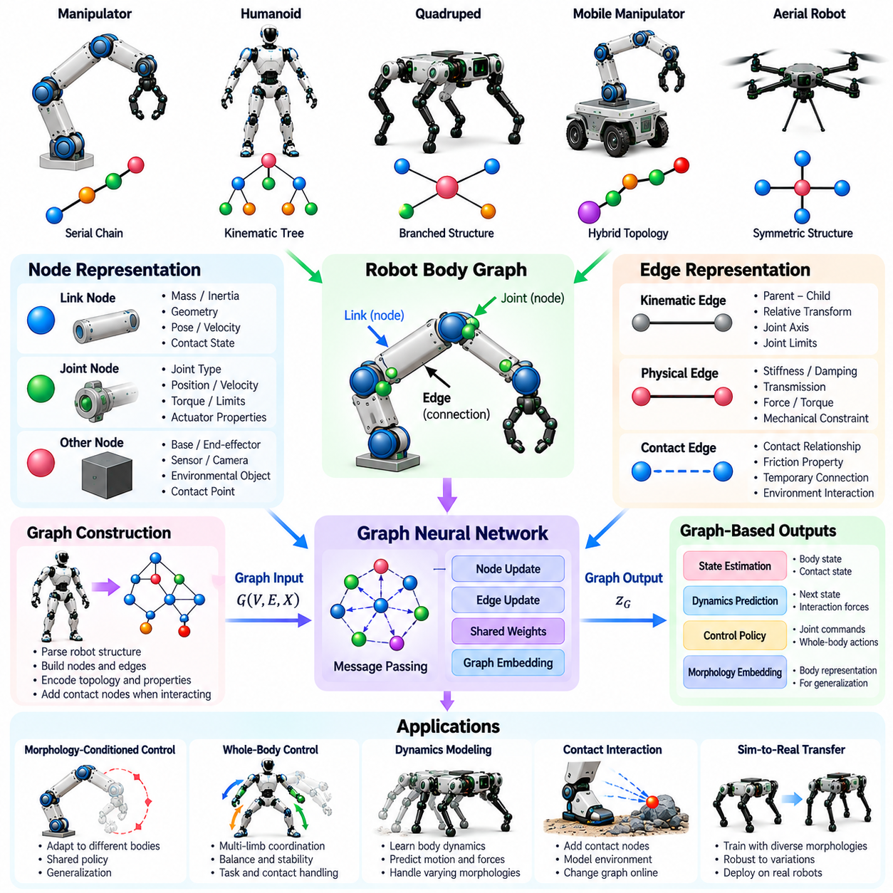{width="7.268055555555556in" height="7.268055555555556in"}

Graph representations of robot bodies provide a structured framework for describing mechanical organization, physical properties, and interactions between components. Instead of treating a robot as a fixed-length vector of joint states, graph models represent its body as interconnected elements. This approach preserves structural relationships and supports control, learning, and reasoning across robots with different numbers of links and joints.

A robot body graph consists of nodes and edges that encode physical components and their relationships. Nodes may represent rigid links, joints, actuators, or functional body segments, depending on the modeling objective. Edges describe mechanical connections, kinematic constraints, or information pathways. The chosen graph definition must remain consistent so that structural information can be interpreted correctly by downstream algorithms.

In a link-centered representation, each node corresponds to a rigid body, while edges represent joints connecting adjacent links. This formulation closely follows the mechanical structure of articulated robots. Node attributes can include mass, inertia, geometry, and spatial pose, while edge attributes describe joint type, axis, limits, and actuation properties. Such representations preserve essential information for dynamics and control.

Joint-centered graphs use joints as nodes and encode relationships through shared links or mechanical dependencies. This representation can be convenient when learning algorithms predict joint torques, velocities, or positions directly. Joint features may include measured states, actuator capabilities, and local geometric parameters. However, information about rigid-body inertia and branching structures must still be represented explicitly.

Robot kinematic trees form a common class of body graphs. A base link serves as the root, and connected branches represent limbs or manipulation chains. Humanoids, quadrupeds, and many industrial manipulators can be described using this organization. Parent-child relationships define coordinate transformations and support recursive kinematic calculations. Closed-loop mechanisms require additional constraints beyond a simple tree.

Graph topology captures how robot components are connected independently of their numerical dimensions. Degree distributions, branching patterns, and path lengths characterize structural organization. Two robots may share similar topology while differing in link lengths, masses, and actuator strengths. Conversely, robots with comparable dimensions may have different connectivity. Effective representations therefore combine topology with physical attributes.

Node features provide local descriptions of robot components. A link node may contain mass, center of mass, inertia tensor, geometry, velocity, and contact information. A joint node may contain position, velocity, torque, limits, and actuation status. Feature selection should reflect the intended task and available measurements. Static morphological properties can be combined with dynamic states that change during operation.

Edge features describe relationships between connected components. These may include joint axes, relative transformations, mechanical stiffness, damping, or transmission properties. Directed edges can encode parent-child relationships, while undirected connections may support symmetric information exchange. Physical interpretation matters because different edge types impose different constraints on motion and force transmission.

Spatial coordinate frames are essential for constructing physically meaningful graph features. Positions, orientations, forces, and velocities depend on the reference frame in which they are expressed. Transformations between local and global frames must remain consistent across graph components. Frame-aware representations help avoid learning arbitrary coordinate dependencies and support generalization across different robot poses.

Graph representations can encode dynamic relationships in addition to mechanical connectivity. Joint motion influences neighboring links, while contact forces propagate through articulated structures. Message-passing algorithms approximate the exchange of information between connected components. Repeated propagation allows distant body segments to influence one another. However, learned message passing does not automatically enforce physical conservation laws.

Graph neural networks process robot body graphs by updating node or edge features using information from neighboring components. Shared update functions can operate across different graph sizes and related mechanical structures. This parameter sharing reduces dependence on a specific robot configuration. The resulting representations can support state estimation, dynamics prediction, action generation, and morphology-conditioned control.

Graph-based dynamics models learn how robot states evolve under applied actions and external forces. Node and edge features provide information about inertial properties, joint constraints, and local interactions. Predictive models can estimate future positions, velocities, or accelerations. Combining learned relationships with analytical rigid-body dynamics may improve physical consistency and reduce the amount of training data required.

Contact interactions introduce relationships that are not always present in the robot\'s permanent mechanical structure. A foot touching the ground or a gripper holding an object creates temporary physical connections. Dynamic graph construction can add contact edges or environmental nodes to represent these interactions. Updating graph connectivity during operation helps capture changing support conditions and manipulation constraints.

Graph representations are particularly valuable for morphology-conditioned policies because they accommodate variable numbers of body components. A shared controller can process different articulated structures without requiring identical joint counts. Graph-level features summarize global morphology, while node-level features support local control decisions. Action outputs must still be mapped correctly to the actuators available on each robot.

Hierarchical graph representations organize robot bodies at multiple levels of abstraction. Individual joints and links form detailed local graphs, while limbs and functional modules become higher-level components. This organization can reduce computational complexity and support coordinated whole-body reasoning. Hierarchical processing is especially useful when local actuator control and global balance objectives must operate at different timescales.

Symmetry provides another useful structural property for robot body graphs. Left and right limbs or repeated leg modules often share similar mechanical relationships. Graph-based models can exploit repeated structures through shared parameters and consistent feature definitions. Nevertheless, apparent geometric symmetry does not guarantee identical dynamics, particularly when payloads, contacts, or actuator characteristics differ.

Graph representations also support modular and reconfigurable robots. Adding, removing, or replacing a limb changes graph connectivity and component attributes. A controller designed for variable structures may update its representation without rebuilding the entire policy architecture. Successful adaptation still requires sufficient training coverage and accurate descriptions of newly introduced mechanical components.

Cross-morphology transfer benefits from graph structures because related mechanical patterns can be recognized across different robots. A learned controller may reuse knowledge about articulated chains, support limbs, or joint coordination. Transfer becomes more difficult when new embodiments contain unfamiliar mechanisms or substantially different dynamics. Graph compatibility alone does not guarantee equivalent control capabilities.

Graph construction involves important design tradeoffs. Detailed graphs preserve local mechanical information but increase memory usage and computational cost. Simplified graphs improve efficiency but may omit contact relationships, transmission effects, or dynamic coupling. The appropriate representation depends on whether the application emphasizes motion prediction, real-time control, structural comparison, or generalization across embodiments.

Data quality strongly influences graph-based learning. Robot descriptions must contain consistent units, coordinate conventions, joint ordering, and mechanical parameters. Missing actuator specifications or inaccurate inertial properties can produce misleading representations. Standardized robot description formats can support graph extraction, but additional processing may be necessary to encode contacts, sensors, and task-specific relationships.

Evaluation of robot body graphs should examine both representational fidelity and downstream control performance. Relevant tests include dynamics prediction accuracy, task success, computational latency, and transfer to unseen morphologies. Experiments should distinguish structural generalization from changes in physical parameters alone. Comparisons with fixed-vector and non-graph representations help identify the actual benefits of graph modeling.

Safety and physical feasibility remain essential when graph representations are used for control. A learned graph model may predict actions that violate joint limits, actuator constraints, or contact stability requirements. Analytical dynamics, optimization-based controllers, and runtime safety checks can enforce necessary restrictions. Graph representations provide structural knowledge, but they do not independently guarantee safe robot behavior.

Ultimately, graph representations of robot bodies establish a common language for connecting mechanical morphology with learning and control. By encoding components, connectivity, physical attributes, and changing interactions, they enable structured reasoning across diverse embodiments. These representations provide a foundation for graph neural networks, morphology-conditioned policies, and Physical AI systems capable of adapting to different robotic bodies.

## 12.10. Graph Neural Networks for Robot Control [w/Code]

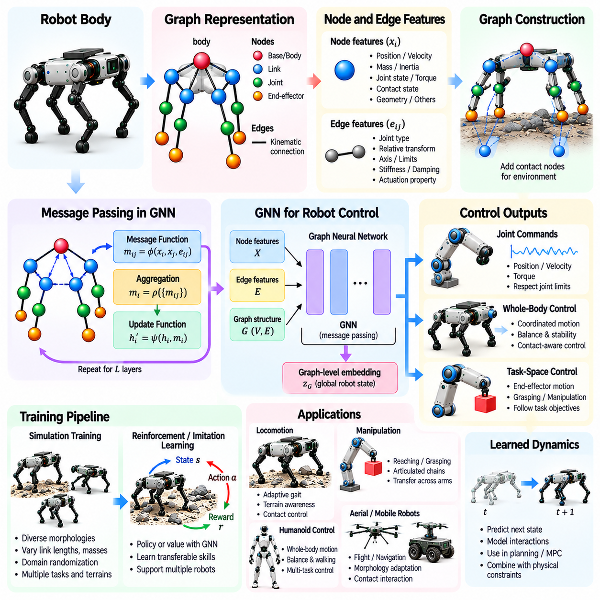{width="7.268055555555556in" height="7.268055555555556in"}

Graph neural networks provide a structured learning framework for robot control by representing physical bodies as interconnected components. Unlike conventional neural networks that assume fixed input dimensions, graph-based models operate on nodes and edges describing joints, links, and mechanical relationships. This architecture enables control policies to exploit robot topology while supporting different body configurations and degrees of freedom.

A robot control graph typically contains nodes representing joints or rigid links and edges describing their mechanical connections. Node features may include joint positions, velocities, torques, mass, and inertial properties. Edge features encode joint types, relative transformations, and connectivity constraints. Together, these attributes provide a structured description of robot morphology and its instantaneous dynamic state.

Message passing is the central computational mechanism of graph neural networks. Each node receives information from neighboring nodes, combines incoming messages, and updates its internal representation. Messages can incorporate local states, mechanical parameters, and relative geometric relationships. Repeated message-passing layers allow information to propagate across limbs and support coordinated control decisions.

Graph neural network architectures generally combine message functions, aggregation operators, and update functions. Message functions transform neighboring node and edge features into information relevant to control. Aggregation operators combine incoming messages using summation, averaging, or attention. Update functions integrate the aggregated information with existing node states to produce representations for subsequent computation.

Parameter sharing is particularly valuable for controlling robots with different morphologies. The same message and update functions can process repeated mechanical structures, such as articulated limbs or modular joints. Consequently, a policy may operate on graphs containing different numbers of nodes. However, shared parameters do not guarantee successful transfer when robots exhibit substantially different dynamics or actuator capabilities.

Graph-based policies can generate actuator commands through node-level output functions. Each actuated joint receives an action derived from its learned representation and relevant global information. Outputs may specify desired positions, velocities, torques, or parameters for lower-level controllers. Appropriate action scaling and actuator masking ensure that commands correspond to the capabilities and constraints of each robot.

Graph-level representations complement local node features by summarizing the overall robot configuration. Pooling operations aggregate information about body proportions, joint arrangements, and dynamic conditions. Global features can influence local control decisions through additional message-passing stages. This combination helps coordinate individual actuators according to whole-body objectives such as balance, locomotion, and manipulation.

Graph neural networks can support reinforcement learning by serving as policy networks or value-function approximators. During training, robots interact with simulated environments and receive rewards associated with task performance. Graph observations provide structural context for selecting actions. Training across multiple morphologies encourages reusable control strategies, although generalization depends on the diversity of encountered structures.

Morphology randomization improves the adaptability of graph-based controllers. Training environments can vary link lengths, joint limits, actuator strengths, and mass distributions while preserving physically meaningful connections. The network learns to associate these structural differences with appropriate actions. Randomized parameters must remain mechanically feasible to avoid learning from unrealistic robot configurations.

Graph-based locomotion control coordinates the interactions between legs, joints, and the robot body. Information about contact states, joint motion, and body orientation propagates through the graph. A quadruped controller can use these relationships to adjust gait timing and distribute movement across its limbs. Reliable locomotion still requires explicit consideration of ground friction, stability, and actuator limitations.

For manipulation, graph neural networks represent articulated chains and their relationships to task objectives. Joint-level information can propagate toward the end effector, while task errors influence upstream joints. Graph-based policies may learn reaching, grasping, or trajectory-tracking behaviors across manipulators with related structures. Differences in workspace, redundancy, and gripper design must be reflected in the representation.

Dynamic contact graphs extend robot body representations to environmental interactions. Temporary edges can connect feet to terrain or grippers to manipulated objects. Contact features may describe forces, surface normals, friction, and relative motion. Updating these connections enables the controller to reason about changing support and manipulation conditions, although discontinuous contacts complicate learning and prediction.

Graph neural networks also support learned dynamics models that predict future robot states from current states and actions. These models estimate interactions between connected mechanical components and can be incorporated into planning or model predictive control. Analytical physics can supplement learned predictions through known kinematic and dynamic constraints. Prediction uncertainty must be considered when models operate outside familiar conditions.

Spatial equivariance is an important design consideration for graph-based robot control. A physically meaningful model should respond consistently when coordinate frames or global orientations change. Equivariant architectures use geometric relationships and transformation-aware operations to preserve relevant symmetries. This can improve data efficiency and reduce dependence on arbitrary coordinate conventions.

Computational efficiency determines whether graph neural networks can operate within real-time control loops. Message passing across large graphs increases memory requirements and processing latency. The number of layers, neighborhood size, and feature dimensions affect computational cost. Efficient aggregation, sparse graph operations, and hierarchical processing can reduce overhead while preserving important structural information.

Ultimately, graph neural networks connect robot morphology with distributed learning and coordinated control. Their ability to process structured mechanical relationships makes them useful for morphology-conditioned policies, dynamics prediction, and cross-robot transfer. Combined with physical constraints, reliable sensing, and systematic validation, graph-based control provides a foundation for adaptable Physical AI across diverse robotic embodiments.

## 12.11. Cross Morphology Policy Transfer

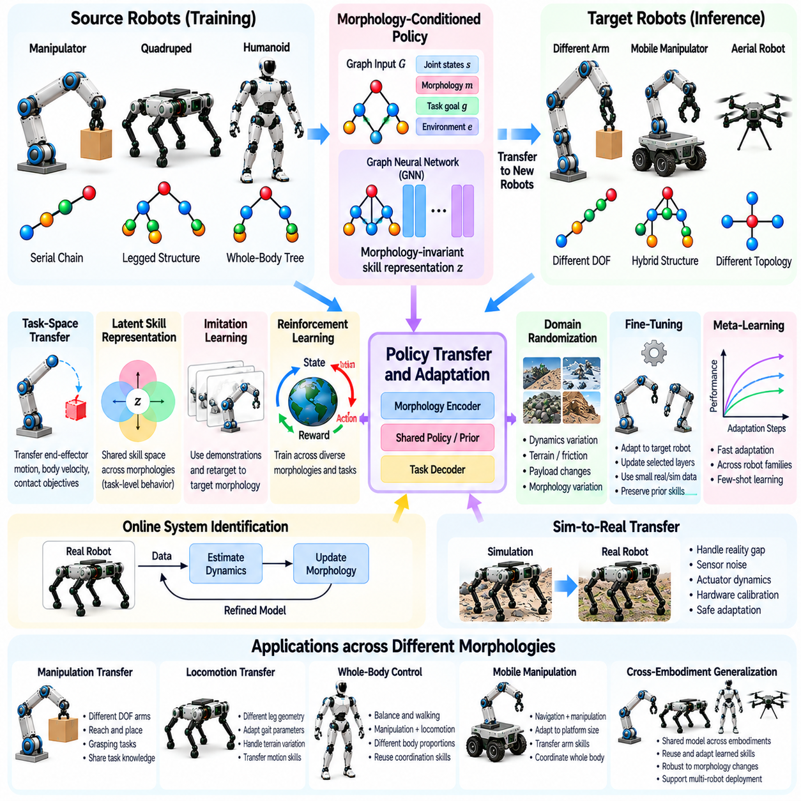{width="7.268055555555556in" height="7.268055555555556in"}

Cross-morphology policy transfer enables a control policy learned on one robot to support another robot with a different physical structure. Rather than training every embodiment independently, this approach reuses knowledge about motion, coordination, and environmental interaction. Successful transfer requires identifying which behaviors remain applicable despite differences in joint arrangements, body proportions, actuator capabilities, and dynamics.

The central challenge is that robot morphologies define different observation spaces, action spaces, and physical constraints. A policy trained for a six-joint manipulator cannot directly command a seven-joint arm without an appropriate interface. Similarly, locomotion strategies learned on one quadruped may not match another robot\'s limb geometry. Transfer methods must therefore separate reusable task knowledge from embodiment-specific control requirements.

Morphology-conditioned policies address these differences by incorporating explicit body descriptions into action selection. Link lengths, joint types, mass distributions, actuator limits, and mechanical connectivity can serve as conditioning variables. A shared policy learns how actions should change with physical characteristics. This approach is particularly effective when source and target robots belong to related morphological families.

Structural representations provide a foundation for transferring knowledge across different joint configurations. Graph-based models encode robot links and joints as connected components rather than fixed-dimensional vectors. Shared message-passing functions can process different graph sizes and branching patterns. However, structural compatibility alone does not guarantee transfer when actuator dynamics or contact mechanisms differ substantially.

Task-space representations reduce dependence on the specific arrangement of robot joints. Instead of transferring joint torque commands directly, a controller may transfer desired end-effector trajectories, body velocities, or contact objectives. A target-specific inverse kinematics or whole-body controller then translates these objectives into actuator commands. Transfer remains limited by the target robot\'s reachable workspace and physical capabilities.

Latent skill representations offer another mechanism for sharing control knowledge. A neural encoder can transform observations and task objectives into compact representations of behaviors such as reaching, balancing, or stepping. Morphology-specific decoders convert these representations into executable actions. Effective transfer requires the shared latent space to capture task meaning without discarding mechanically important differences.

Imitation learning supports cross-morphology transfer by extracting behavioral knowledge from demonstrations. Motion trajectories generated by a source robot can be expressed through task-space objectives or contact sequences before adaptation to a target embodiment. This avoids assuming identical joint correspondence. Nevertheless, demonstrations may require modification when the target robot cannot reproduce the source robot\'s motion.

Reinforcement learning can develop transferable policies by training across multiple robot morphologies. Simulation environments vary link dimensions, joint configurations, mass distributions, and actuator strengths while preserving common task objectives. The policy learns to adjust behavior according to available physical capabilities. Generalization depends on training diversity, reward design, and the mechanical feasibility of sampled morphologies.

Domain randomization improves transfer robustness by exposing policies to variations in dynamics and environmental conditions. Randomized friction, payloads, actuator delays, and terrain properties reduce dependence on a single nominal model. Morphology randomization extends this process to structural parameters. However, random variation cannot replace explicit adaptation when a target robot introduces fundamentally unfamiliar mechanisms.

Fine-tuning adapts a pretrained policy to the characteristics of a target robot. Initial parameters provide a useful starting point, while additional demonstrations or reinforcement learning refine control behavior. Selective adaptation may update only morphology encoders, action decoders, or specialized network layers. This can reduce training cost and limit the degradation of previously acquired capabilities.

Meta-learning approaches optimize policies for rapid adaptation across robot families. During training, the controller repeatedly encounters different morphologies and learns parameters that can be adjusted using limited target-specific experience. This approach is valuable when physical interaction data are expensive. Its effectiveness depends on whether the target morphology resembles the variation represented during meta-training.

Online system identification can support policy transfer when target robot parameters are uncertain. Observed joint responses, contact forces, and body motion provide information about mass, inertia, friction, and actuator behavior. Estimated parameters update the morphology representation or dynamics model used by the controller. Reliable identification requires informative observations and safeguards against unstable exploratory actions.

Sim-to-real transfer introduces additional challenges because physical hardware differs from simulation. Sensor noise, unmodeled compliance, actuator saturation, and contact uncertainty can undermine transferred policies. Hardware calibration and conservative adaptation help reduce these discrepancies. A policy that generalizes across simulated morphologies must still be validated on the actual target platform before unrestricted operation.

Cross-morphology transfer also depends on the relationship between source and target tasks. Similar tasks may share high-level objectives even when their mechanical implementations differ. For example, two manipulators can share an object-placement goal while requiring different joint trajectories. Transfer becomes more difficult when the target robot lacks the sensing, workspace, or actuation needed to achieve the original objective.

Safety constraints are essential during transfer because previously successful actions may become infeasible on a new embodiment. Differences in torque limits, joint ranges, balance margins, and contact geometry can create unexpected failures. Optimization-based safety filters and supervisory controllers can restrict unsafe commands. Transfer performance should be evaluated through task success, adaptation efficiency, stability, and constraint compliance.

Ultimately, cross-morphology policy transfer aims to separate generalizable control knowledge from the mechanical details of individual robots. Morphology conditioning, graph representations, task-space interfaces, latent skills, and adaptive learning provide complementary mechanisms for achieving this separation. Together, they support Physical AI systems that can reuse experience across diverse bodies while respecting embodiment-specific physical constraints.

## 12.12. Cross Embodiment Generalization

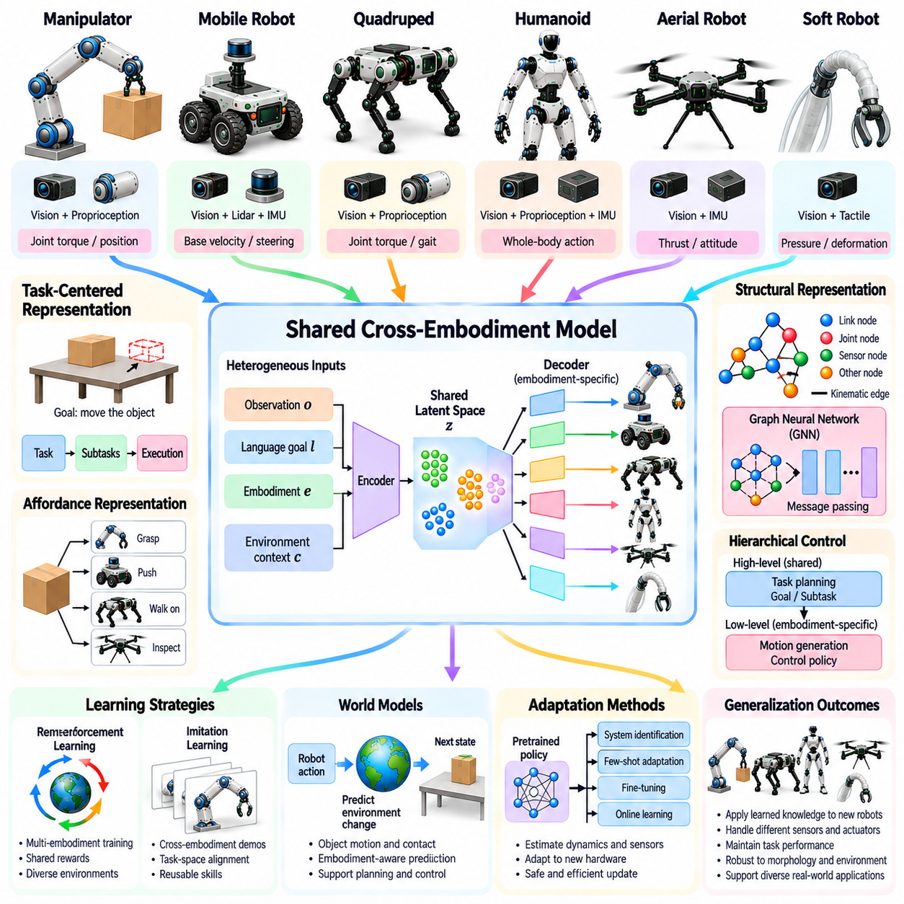{width="7.268055555555556in" height="7.268055555555556in"}

Cross-embodiment generalization refers to the ability of an intelligent control system to apply learned knowledge across robots with different physical structures, sensing capabilities, and actuation mechanisms. Unlike transfer between closely related morphologies, it addresses broader differences between robotic embodiments. The objective is to preserve useful task knowledge while adapting actions to the physical capabilities and limitations of each platform.

Robot embodiment encompasses more than geometric morphology. It includes mechanical structure, actuator characteristics, sensor placement, control interfaces, and environmental interaction mechanisms. A wheeled mobile robot, articulated manipulator, quadruped, and humanoid may observe and influence the world differently. Generalization therefore requires representations that distinguish shared task objectives from embodiment-dependent execution strategies.

A fundamental challenge arises from differences in observation and action spaces. Robots may possess different numbers of joints, sensor modalities, and control frequencies. Directly transferring raw observations or actuator commands is often impractical. Cross-embodiment systems instead seek common representations of objects, goals, spatial relationships, and task progress while retaining interfaces for platform-specific control.

Task-centered representations provide an important foundation for embodiment-independent reasoning. A goal such as moving an object to a specified location can be described without prescribing a particular robot configuration. Different embodiments may accomplish the objective through distinct grasping, pushing, or transportation strategies. The controller must determine which methods are feasible for the available body and operating environment.

Affordance representations describe possible interactions between agents, objects, and environments. A surface may support walking, rolling, or grasping depending on the robot\'s physical capabilities. Consequently, affordances are relational rather than entirely object-specific properties. Embodiment-aware affordance models help distinguish actions that are meaningful for a particular robot from those that are physically impossible.

Shared latent representations can connect heterogeneous sensory observations and control objectives. Encoders transform images, proprioceptive measurements, language instructions, and robot descriptions into features that capture task-relevant information. Embodiment-specific decoders translate these features into executable commands. Successful alignment requires preserving physical distinctions that affect feasibility, safety, and interaction outcomes.

Vision-language-action models provide one approach to learning relationships between perception, instructions, and robotic behavior. Large datasets containing demonstrations from different platforms may support reusable task understanding. However, action representations and mechanical constraints vary substantially between robots. Effective generalization requires explicit embodiment information, compatible control interfaces, or adaptation mechanisms.

Graph-based morphology representations can describe articulated robots with different numbers of components. Nodes and edges encode joints, links, mechanical connectivity, and physical parameters. Graph neural networks share computational functions across related structures. Although useful for articulated systems, these representations may require additional abstractions when transferring between fundamentally different platforms such as aerial vehicles and manipulators.

Hierarchical control separates embodiment-independent planning from embodiment-specific execution. A high-level policy selects goals, subtasks, or desired environmental changes, while a low-level controller generates feasible motions. This architecture allows different robots to share planning knowledge without requiring identical actuator commands. Reliable execution depends on accurate capability descriptions and feedback from each platform.

Cross-embodiment imitation learning extracts reusable behavior from demonstrations collected on different robots. Demonstrations may be aligned through object trajectories, contact events, task phases, or desired outcomes rather than joint-level correspondence. This supports knowledge transfer between mechanically dissimilar systems. Nevertheless, differences in reachable workspace and manipulation capability can prevent direct reproduction of demonstrated behavior.

Multi-embodiment reinforcement learning trains policies across diverse robotic platforms and environments. Shared objectives encourage learning of general task relationships, while embodiment-specific observations guide action selection. Training may combine common policy components with specialized control modules. Balancing data across platforms is important because dominant embodiments can bias the learned representation and reduce transfer performance.

World models can support cross-embodiment generalization by predicting how actions change the environment. Rather than modeling only robot joint motion, an embodiment-aware world model can represent object movement, contact outcomes, and task progress. Planning can then compare feasible strategies for different robots. Predictions must still incorporate each platform\'s physical constraints and uncertainty about environmental interactions.

Adaptation mechanisms become essential when deploying a shared system on an unfamiliar embodiment. Online system identification, few-shot learning, and targeted fine-tuning can estimate actuator behavior, sensing characteristics, and control limitations. These updates help connect previously learned task knowledge with new hardware. Adaptation should remain conservative when physical exploration could damage equipment or create unsafe interactions.

Evaluation must distinguish genuine cross-embodiment generalization from memorization of familiar robot configurations. Test platforms should differ meaningfully in morphology, sensing, actuation, or task execution mechanisms. Metrics include task success, adaptation efficiency, sample requirements, physical feasibility, and safety violations. Comparisons should also examine performance on unseen tasks and environmental conditions.

Ultimately, cross-embodiment generalization seeks to separate transferable intelligence from the physical implementation of individual robots. Shared task representations, affordance reasoning, hierarchical control, multimodal learning, and adaptive execution provide complementary mechanisms. Together, these approaches advance Physical AI toward systems that can apply common knowledge across diverse robotic bodies while respecting their distinct physical capabilities.

## 12.13. Morphology Conditioned Foundation Models

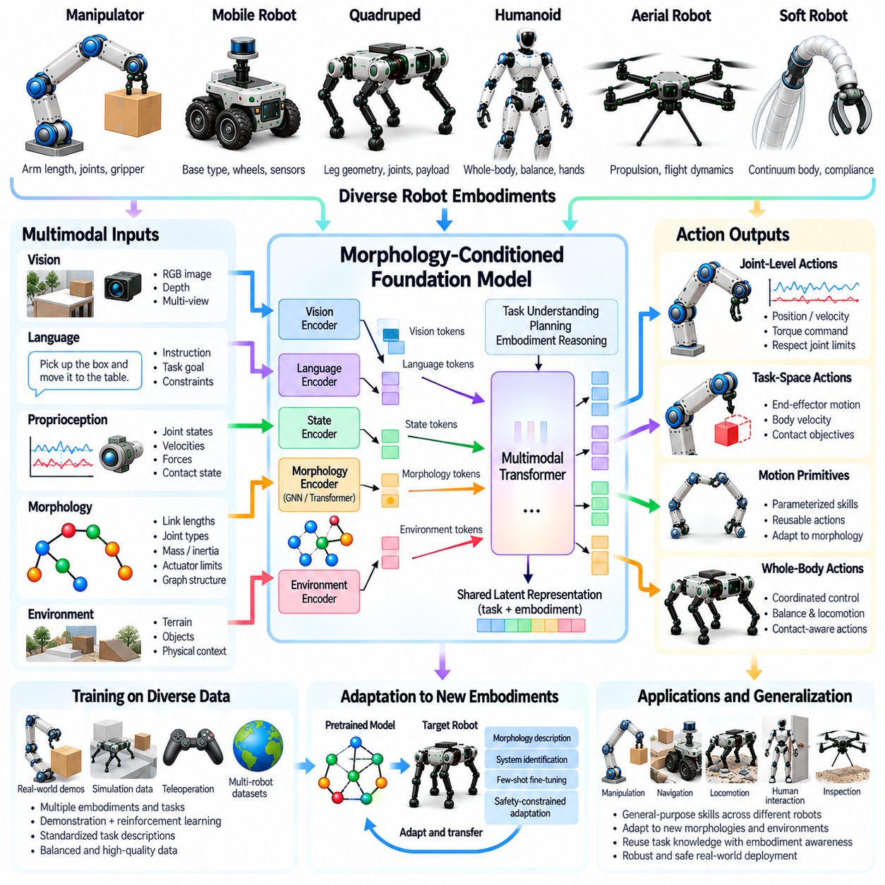{width="7.268055555555556in" height="7.268055555555556in"}

Morphology-conditioned foundation models aim to develop general-purpose intelligence that adapts its behavior to the physical structure of a robot. Unlike conventional models trained for a single embodiment, these systems incorporate information about joints, links, actuators, sensors, and body geometry. Their objective is to combine broadly reusable task knowledge with control decisions that respect the mechanical capabilities and constraints of each robot.

The central principle is that intelligent behavior depends on both task objectives and embodiment characteristics. A command such as reaching, lifting, or navigating cannot be executed identically by every robot. Body dimensions, joint configurations, actuator limits, and available sensing determine feasible actions. Morphology conditioning enables a foundation model to interpret instructions in relation to the physical capabilities of the platform performing the task.

Foundation models for robotics may integrate visual observations, language instructions, proprioceptive signals, and structured body descriptions. Images provide information about objects and environments, while language specifies goals and constraints. Proprioception describes the robot\'s current physical state. Morphology representations provide the structural context needed to translate these inputs into actions compatible with the robot\'s mechanical configuration.

Robot morphology can be encoded through numerical parameters, kinematic trees, graph structures, or learned body embeddings. Numerical descriptions capture dimensions, masses, joint limits, and actuator characteristics. Graph representations preserve mechanical connectivity and articulation patterns. Learned embeddings compress structural information into latent features that can condition the model\'s internal reasoning and action generation.

A morphology encoder transforms robot-specific structural information into representations suitable for a shared foundation model. Graph neural networks can process variable numbers of joints and links through message passing. Transformer architectures can instead represent body components as tokens with positional and structural attributes. The resulting embeddings provide information about mechanical relationships without requiring identical robot configurations.

Multimodal fusion connects morphology information with perception, instructions, and robot state. Attention mechanisms can associate relevant body components with objects, spatial targets, or task requirements. For example, a manipulation task may emphasize arm reach and gripper capability, while locomotion requires information about support geometry and actuator strength. Effective fusion helps the model select actions according to both task demands and physical feasibility.

Action representation is a major challenge because different robots possess incompatible control interfaces. A foundation model may predict task-space trajectories, desired contacts, motion primitives, or actuator-level commands. High-level representations offer greater portability, while low-level actions provide more direct control. Morphology-specific action decoders can translate shared representations into commands appropriate for individual robotic platforms.

Training morphology-conditioned foundation models requires data from diverse robot embodiments and tasks. Demonstrations, teleoperation records, simulation trajectories, and reinforcement learning experiences can provide complementary supervision. Each training example should include sufficient information about the robot\'s structure and capabilities. Without reliable embodiment metadata, a model may confuse mechanical differences with variations in task behavior.

Cross-embodiment datasets introduce challenges involving inconsistent sensors, action frequencies, coordinate frames, and annotation conventions. Standardized task descriptions and calibrated reference frames improve compatibility. Robot-specific observations may be mapped into shared representations while retaining information essential for control. Dataset balance is also important because overrepresented platforms can dominate the learned policy and weaken generalization.

Large-scale pretraining can encourage the model to learn relationships shared across robotic systems. These relationships include object interaction patterns, spatial reasoning, task decomposition, and contact-dependent behavior. Morphology conditioning then connects general knowledge with embodiment-specific execution. However, exposure to diverse robots does not automatically produce reliable performance on structures that differ substantially from the training distribution.

Simulation provides a scalable environment for generating morphology-diverse training experiences. Procedural robot models can vary link lengths, joint arrangements, actuator capabilities, and mass distributions. Physics-based interaction produces trajectories under different mechanical conditions. Realistic parameter ranges and accurate contact models are essential because physically inconsistent simulation data can undermine learned control behavior.

Adaptation mechanisms allow a pretrained foundation model to operate on previously unseen robot bodies. A new morphology description may be sufficient when the target resembles familiar embodiments. More substantial differences may require fine-tuning, specialized action decoders, or additional demonstrations. Online system identification can refine uncertain physical parameters, while safety constraints should limit exploratory actions during adaptation.

Morphology-conditioned world models extend this framework by predicting how different bodies interact with their environments. The model can estimate future states, contact outcomes, and task progress under candidate actions. Planning algorithms may compare alternative behaviors according to predicted feasibility and performance. Accurate prediction requires integrating mechanical structure, actuator dynamics, environmental properties, and uncertainty into the learned representation.

Safety and evaluation remain central to practical deployment. Models must respect joint limits, torque constraints, collision boundaries, balance requirements, and contact stability. Evaluation should include unseen morphologies, unfamiliar tasks, and changes in physical parameters. Task success alone is insufficient; robustness, adaptation efficiency, constraint compliance, and failure recovery are necessary measures of dependable generalization.

Ultimately, morphology-conditioned foundation models seek to unify general-purpose reasoning with embodiment-aware physical execution. Structured body representations, multimodal learning, shared action abstractions, and adaptive control provide the essential building blocks. Their long-term significance lies in enabling Physical AI systems to transfer knowledge across diverse robots without ignoring the mechanical differences that determine what each body can safely accomplish.

## 12.14. Body Aware World Models

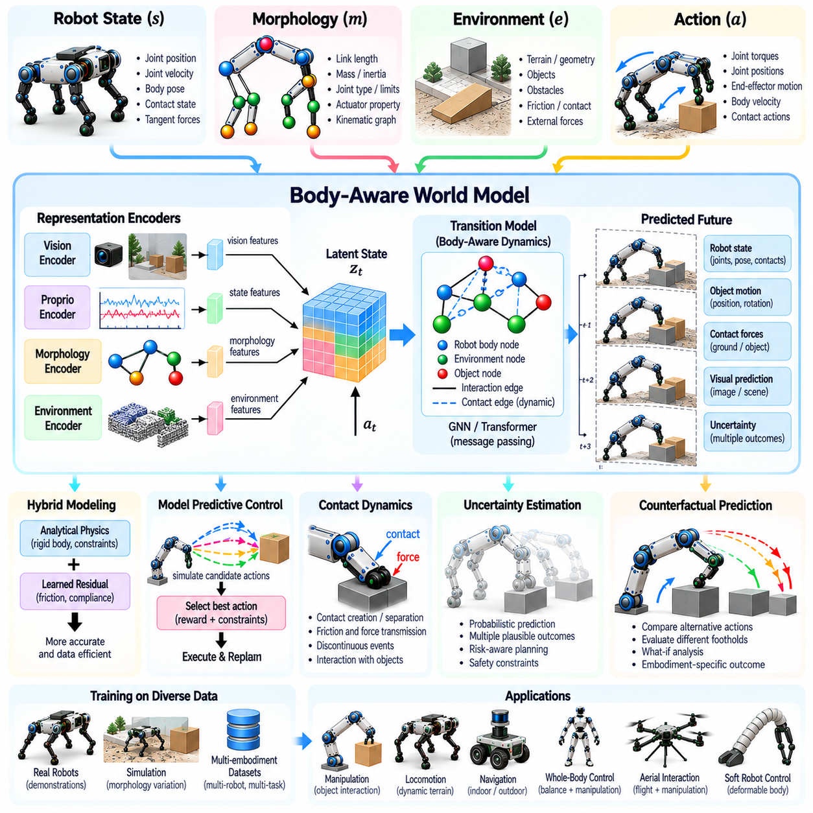{width="7.268055555555556in" height="7.268055555555556in"}

Body-aware world models are predictive representations that incorporate a robot\'s physical structure into its understanding of the environment. Unlike conventional world models that primarily describe external objects and events, these models account for how body geometry, joint configurations, and actuator capabilities influence future interactions. Their purpose is to predict not only what may happen in the environment but also what a particular robot can physically accomplish.

The central principle is that environmental dynamics cannot be separated entirely from the body performing an action. Identical commands may produce different outcomes when executed by robots with different masses, limb lengths, or contact mechanisms. A body-aware world model therefore conditions its predictions on both environmental states and embodiment characteristics, enabling more accurate reasoning about motion, interaction, and physical feasibility.

A body-aware world model typically combines robot state, morphology information, environmental observations, and candidate actions. Robot state includes joint positions, velocities, body orientation, and contact conditions. Morphology information describes link geometry, mass distribution, actuator limits, and mechanical connectivity. Environmental observations provide information about terrain, objects, obstacles, and external forces that influence future behavior.

Morphology representations can be incorporated through numerical parameters, kinematic trees, graph structures, or learned body embeddings. Graph-based descriptions preserve relationships between joints and links, while latent embeddings provide compact conditioning information. The representation must capture physical properties relevant to prediction. Omitting important actuator or contact characteristics can produce inaccurate forecasts even when the robot\'s geometry is represented correctly.

The transition model predicts how the combined robot-environment state evolves after an action. It may estimate future joint motion, body displacement, object trajectories, and contact forces. Learned transition functions can capture complex interactions that are difficult to model analytically. However, predictions must remain consistent with fundamental physical constraints, including joint limits, collision geometry, and feasible actuator outputs.

Contact dynamics are particularly important because robots interact with their surroundings through intermittent physical connections. Walking involves repeated foot-ground contacts, while manipulation involves changing relationships between grippers and objects. A body-aware world model must represent contact creation, separation, friction, and force transmission. These discontinuous events introduce uncertainty and require careful treatment during learning and prediction.

Hybrid modeling combines analytical mechanics with learned components to improve predictive reliability. Rigid-body dynamics and kinematic constraints can provide a physically grounded baseline. Neural networks then estimate residual effects associated with friction, compliance, actuator delays, or unmodeled interactions. This approach can improve data efficiency while reducing physically implausible predictions, although model errors remain possible.

Graph neural networks provide a natural architecture for representing interactions among body components and environmental objects. Nodes may describe links, joints, contact points, or manipulated objects, while edges encode mechanical and physical relationships. Message passing propagates forces and state information through the graph. Dynamic edges allow the model to update its representation as contact relationships change during movement.

Latent world models compress high-dimensional observations into representations suitable for efficient prediction. Visual encoders extract environmental features, while proprioceptive encoders summarize internal robot states. Morphology-conditioned transition networks predict future latent states under candidate actions. Decoders may reconstruct observations or estimate task-relevant quantities, although latent accuracy does not automatically guarantee physical consistency.

Body-aware world models support model predictive control by simulating possible action sequences before execution. The controller evaluates predicted trajectories according to task objectives, energy consumption, stability, and safety constraints. Only the initial portion of a selected sequence is executed before replanning with new observations. This repeated prediction and correction process helps accommodate changing environments and imperfect models.

Counterfactual prediction enables a robot to evaluate how alternative actions or body configurations might affect outcomes. A controller may compare different footholds, grasp locations, or movement strategies without physically executing every possibility. Morphology conditioning makes these comparisons specific to the available embodiment. Predictions involving unfamiliar configurations require caution because extrapolation beyond training experience can be unreliable.

Uncertainty estimation is essential when world models guide physical actions. Sensor noise, uncertain contact conditions, and incomplete knowledge of mechanical parameters can produce multiple plausible future outcomes. Probabilistic models or ensembles can represent prediction uncertainty. Risk-sensitive planning then favors actions that remain acceptable across plausible outcomes rather than relying exclusively on the most optimistic forecast.

Learning body-aware world models requires diverse interaction data covering multiple robot states, actions, and environmental conditions. Simulation can generate extensive trajectories with controlled variations in morphology and dynamics. Real-world data help capture effects that simulators fail to reproduce. Training should emphasize contact transitions, actuator saturation, and unusual operating conditions because these situations frequently expose model weaknesses.

Adaptation becomes necessary when a robot experiences payload changes, component replacement, joint degradation, or mechanical reconfiguration. Online parameter estimation can update the model\'s representation of mass, inertia, actuator response, and structural connectivity. Continual learning may refine predictions from new experience. However, updates should be constrained and validated to prevent unstable behavior caused by inaccurate adaptation.

Evaluation should measure predictive accuracy, physical consistency, planning effectiveness, and robustness across different embodiments. Short-horizon prediction errors reveal local modeling quality, while long-horizon rollouts expose accumulated inaccuracies. Closed-loop experiments determine whether predictions improve actual control performance. Safety evaluation must examine collision avoidance, stability, constraint compliance, and behavior under unfamiliar conditions.

Ultimately, body-aware world models connect physical embodiment with predictive intelligence. By combining morphology representations, environmental understanding, learned dynamics, and physics-based constraints, they enable robots to anticipate the consequences of their actions. Their significance for Physical AI lies in supporting planning and adaptation that recognize not only how the world changes, but also how each robot\'s body shapes those changes.

## 12.15. Adaptive Control after Morphology Change

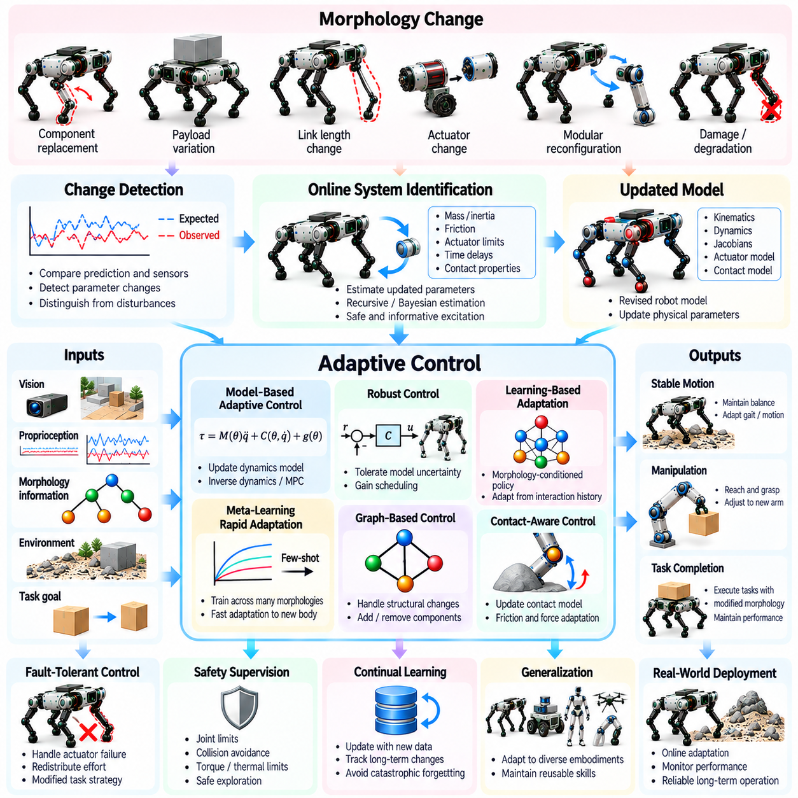{width="7.268055555555556in" height="7.268055555555556in"}

Adaptive control after morphology change enables a robot to maintain useful behavior when its physical structure or mechanical characteristics are altered. Such changes may result from component replacement, payload variation, joint degradation, modular reconfiguration, or structural damage. Conventional controllers often assume fixed body parameters, whereas adaptive systems update their internal representations and control strategies to accommodate the modified embodiment.

Morphology changes can affect robot kinematics, dynamics, sensing, and actuation simultaneously. A modified link length changes reachable workspace and joint relationships, while altered mass distribution influences inertia and balance. Replacing an actuator may introduce different torque limits or response delays. Effective adaptation requires identifying which physical properties have changed and how those changes influence the robot\'s ability to execute tasks.

The adaptation process begins with detecting discrepancies between predicted and observed behavior. A controller may compare expected joint motion, contact forces, body acceleration, and actuator responses against sensor measurements. Persistent deviations can indicate changes in mechanical parameters or structural connectivity. Detection algorithms must distinguish genuine morphology changes from temporary disturbances, sensor errors, and variations in environmental conditions.

Online system identification estimates the physical parameters of a modified robot during operation. Joint trajectories, applied torques, inertial measurements, and contact observations provide evidence about mass, inertia, friction, and actuator characteristics. Recursive estimation and Bayesian techniques can update parameter estimates as new data become available. Reliable identification requires sufficient excitation while respecting operational safety constraints.

Morphology-aware state estimation extends conventional estimation by incorporating uncertainty about body parameters and mechanical relationships. The estimator may jointly infer robot motion, contact conditions, and slowly varying structural characteristics. When a joint becomes restricted or a component changes position, the estimated state must reflect the altered configuration. Accurate estimation provides the foundation for stable adaptation and informed control decisions.

Model-based adaptive control updates mathematical representations of robot kinematics and dynamics. Revised mass matrices, Jacobians, actuator models, and constraint equations allow controllers to account for structural changes. Adaptive inverse dynamics or model predictive control can then generate commands appropriate for the modified body. The quality of adaptation depends on model accuracy, parameter observability, and computational responsiveness.

Robust control complements adaptation by maintaining acceptable behavior despite uncertainty in the modified robot model. Feedback controllers can tolerate bounded parameter errors, disturbances, and imperfect identification. Gain scheduling may select different control parameters according to estimated morphology conditions. However, robustness has practical limits, and severe structural changes may require explicit reconfiguration rather than incremental adjustment.

Learning-based adaptation provides an alternative when mechanical changes are difficult to describe analytically. Neural policies can condition actions on morphology embeddings, estimated physical parameters, or recent interaction histories. Recurrent networks may infer hidden changes from sequences of observations. Training across diverse body configurations can improve adaptability, although unfamiliar failures may remain outside the learned distribution.

Meta-learning and rapid policy adaptation seek to reduce the experience required after a morphology change. During training, a controller encounters many structural variations and learns parameters that support efficient adjustment. After deployment, limited target-specific observations or demonstrations can refine its behavior. Such methods are particularly useful for modular robots, but rapid adaptation must not compromise stability or actuator safety.

Graph-based representations support adaptation when mechanical connectivity changes. Nodes represent joints, links, or actuators, while edges describe structural relationships. Adding, removing, or disabling components modifies the graph without necessarily requiring an entirely new policy architecture. Graph neural networks can propagate updated information through the modified structure, although successful control still depends on appropriate training and physical constraints.

Contact-aware adaptation becomes essential when morphology changes affect interaction with the environment. Altered foot geometry can modify ground contact patterns, while a replacement gripper may change grasp stability and force distribution. The controller must update contact predictions, friction assumptions, and feasible force limits. Adaptation should account for discontinuous contact events and avoid relying on outdated interaction models.

Fault-tolerant control addresses morphology changes caused by mechanical degradation or component failure. When an actuator loses effectiveness, the controller may redistribute effort among remaining joints or modify task objectives. A quadruped might adopt a compensatory gait, while a manipulator may exploit redundant joints. Such strategies are feasible only when the remaining structure provides sufficient controllability and mechanical support.

Safety supervision is critical because adaptation can introduce unpredictable transient behavior. Joint limits, collision boundaries, thermal constraints, torque saturation, and stability margins must remain enforced during parameter updates. Safety filters can reject commands that violate known constraints, while supervisory logic can initiate reduced-performance modes. Severe uncertainty may require stopping operation until the modified robot is inspected and validated.

Validation should examine adaptation speed, tracking accuracy, stability, energy consumption, and recovery performance after structural changes. Experiments can include payload shifts, altered link dimensions, actuator degradation, and modular reconfiguration. Both gradual and abrupt changes should be tested. Evaluation must distinguish successful parameter adaptation from temporary compensation that masks underlying mechanical problems.

Ultimately, adaptive control after morphology change connects body awareness with operational resilience. Online identification, model updating, robust feedback, learning-based policies, and structural representations provide complementary adaptation mechanisms. Integrated with safety monitoring and systematic validation, these capabilities allow Physical AI systems to respond intelligently to changing bodies while preserving reliable and physically feasible behavior.
